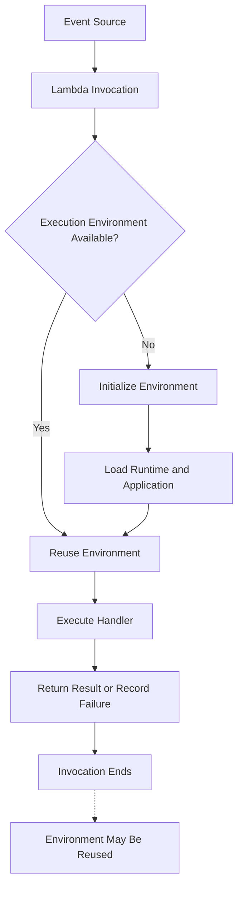
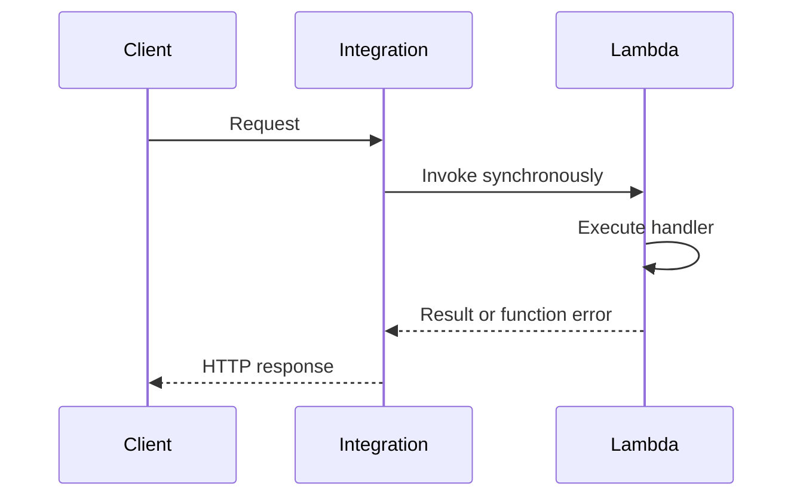
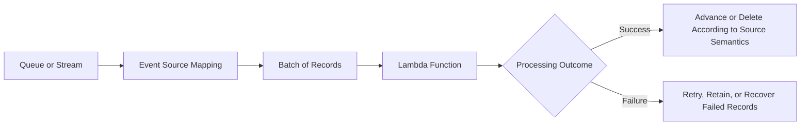
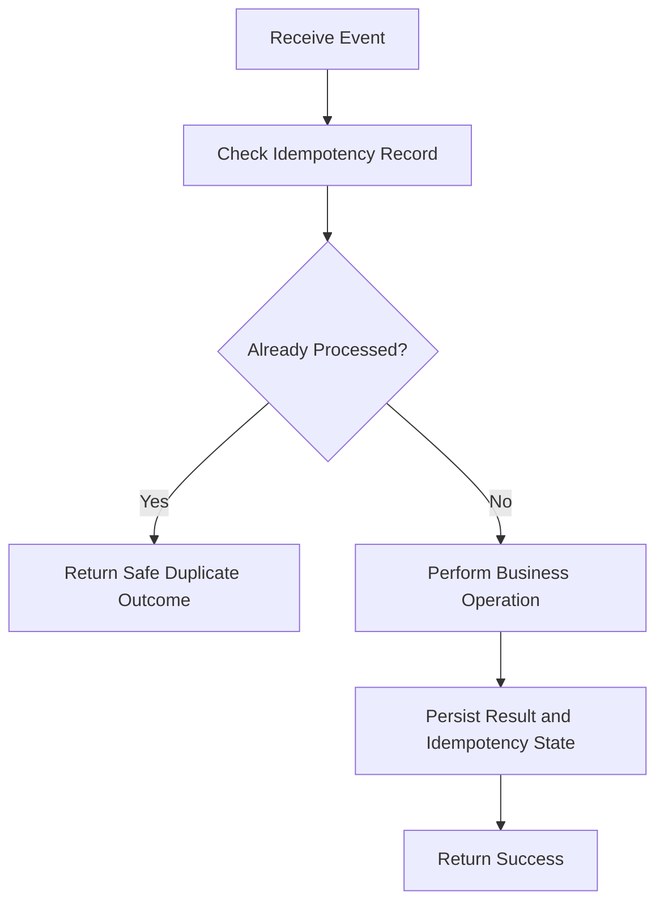

# 01- Introduction to AWS Lambda

## Overview

AWS Lambda is a serverless compute service that runs application code in response to events without requiring developers to provision or manage servers. AWS manages the underlying compute infrastructure, execution environments, and service-level scaling, while developers remain responsible for application code, permissions, configuration, reliability, and operational behavior.

Lambda is commonly used to implement event-driven backend systems, REST APIs, asynchronous processing pipelines, scheduled jobs, and integrations between AWS services.

For backend engineers, Lambda is not simply a replacement for a traditional application server. It introduces a different execution model that affects application architecture, concurrency, state management, error handling, database connectivity, deployment, observability, and cost.

### Why Lambda matters

Traditional backend applications commonly run as long-lived processes behind a load balancer or API gateway. Lambda executes code through managed function invocations, allowing AWS to create and reuse execution environments as workloads change.

This model is useful when workloads are event-driven, intermittent, bursty, or naturally divided into independent processing units.

Key engineering implications include:

- **Infrastructure management:** AWS manages the underlying compute infrastructure.
- **Automatic scaling:** Lambda can create additional execution environments to handle concurrent invocations, subject to configured and account-level limits.
- **Event-driven execution:** Functions can respond to HTTP requests, queue messages, object uploads, scheduled events, and other triggers.
- **Pay-per-use compute:** Pricing depends on the execution model, requests, configured resources, and other applicable features.
- **Operational responsibility:** Developers must still design for failures, duplicate events, permissions, downstream capacity, observability, and deployment safety.

## What Is Serverless Computing?

Serverless computing is a cloud execution model in which the cloud provider manages the underlying infrastructure required to execute an application component.

It does not mean that servers do not exist. It means developers generally do not manage those servers directly.

In Lambda, AWS manages the execution infrastructure, while developers configure functions and control their application behavior.

### Traditional hosting versus serverless

| Concern | Traditional VM-based application | AWS Lambda |
|---|---|---|
| Infrastructure | Provision and manage virtual machines | AWS manages underlying compute infrastructure |
| Application lifecycle | Usually long-running processes | Function invocation lifecycle |
| Scaling | Configure replicas or autoscaling | Managed scaling within applicable limits |
| Availability | Design infrastructure redundancy | AWS manages service infrastructure; application resilience remains your responsibility |
| Operating system | Greater control over the environment | Managed runtime or supported container-image environment |
| Deployment | Deploy application to servers or containers | Deploy a ZIP package or container image |
| State | Can maintain process-local state | Persistent business state belongs in external storage |
| Cost model | Often includes provisioned capacity | Request and compute usage, plus related services and features |
| Workload suitability | Long-running services and persistent processes | Event-driven, request-driven, and bounded-duration tasks |

Serverless is an architectural choice, not a requirement for every backend service. Long-running workloads, applications requiring specialized operating-system control, or systems needing predictable persistent compute may be better suited to containers or virtual machines.

## How AWS Lambda Works

A Lambda function contains application code, a handler entry point, configuration, and associated permissions. An event invokes the function, and Lambda executes the handler in a managed execution environment.

A typical invocation follows this flow:



The environment may be reused for subsequent invocations, but reuse is not guaranteed. Lambda can create additional environments, recycle existing ones, or shut them down.

### Core components

| Component | Responsibility |
|---|---|
| Lambda function | Defines the code and configuration that Lambda executes |
| Handler | Entry point called for an invocation |
| Event | Input describing the request, message, or triggering event |
| Context object | Provides invocation metadata and runtime information |
| Execution environment | Provides the isolated environment in which the function runs |
| Runtime | Loads and executes application code and communicates with Lambda |
| Execution role | Grants the function permissions to access AWS resources |
| Invocation permissions | Control which principals or services may invoke the function |
| Trigger or event source | Initiates execution directly or through an integration |
| CloudWatch | Provides logs, metrics, alarms, and related operational capabilities |

The execution role and invocation permissions serve different purposes. The execution role controls what the function can do after it runs; invocation permissions control who or what can call it.

## Lambda Functions and Handlers

A Lambda function is the deployable unit of execution. A handler is the application entry point that receives an event and context information.

For Python, the configured handler identifies a module and a callable.

For example, if the file is `app.py` and the handler function is named `lambda_handler`, the handler setting is:

```text
app.lambda_handler
```

A basic Python implementation looks like this:

```python
import json
import logging

logger = logging.getLogger()
logger.setLevel(logging.INFO)


def lambda_handler(event, context):
    logger.info(
        "Processing invocation",
        extra={
            "aws_request_id": context.aws_request_id,
            "remaining_time_ms": context.get_remaining_time_in_millis(),
        },
    )

    return {
        "statusCode": 200,
        "headers": {
            "content-type": "application/json",
        },
        "body": json.dumps(
            {
                "message": "Request processed successfully",
            }
        ),
    }
```

This example returns an HTTP-style response body, but the response format is appropriate only for integrations that expect that structure, such as a compatible API Gateway integration. Other event sources expect different response semantics.

### Event and context

The handler receives two important arguments:

- `event`: Input data supplied by the invocation mechanism.
- `context`: Runtime information about the current invocation.

The event schema depends on the trigger. An API Gateway event differs from an SQS record, an S3 object notification, or an EventBridge event.

The context object provides information such as:

- AWS request ID.
- Function name and version.
- Memory limit.
- Remaining execution time.
- Log group and log stream information.

The remaining execution time can be useful for avoiding work that cannot finish within the configured timeout.

```python
def lambda_handler(event, context):
    remaining_ms = context.get_remaining_time_in_millis()

    if remaining_ms < 2_000:
        raise TimeoutError("Insufficient execution time remaining")

    return {"status": "accepted"}
```

In a real application, a guard like this should be based on the operation's expected duration and recovery strategy. Raising an exception is not itself a retry guarantee; retries depend on the invocation mechanism.

## Lambda Execution Model

Lambda runs application code inside managed execution environments. An environment provides the runtime and resources required to execute the function.

The execution lifecycle includes initialization, invocation, and eventual environment shutdown.

### Initialization

During initialization, Lambda prepares the execution environment and loads the runtime and application code. Runtime initialization and module-level application initialization occur as part of this process.

Python example:

```python
import json
import os

SERVICE_NAME = os.environ.get("SERVICE_NAME", "orders")
DEFAULT_HEADERS = {
    "content-type": "application/json",
}


def lambda_handler(event, context):
    return {
        "statusCode": 200,
        "headers": DEFAULT_HEADERS,
        "body": json.dumps(
            {
                "service": SERVICE_NAME,
                "request_id": context.aws_request_id,
            }
        ),
    }
```

Module-level configuration is initialized when the module is loaded into an environment. This can reduce repeated setup work when the environment is reused.

Initialization is also where poorly designed applications can incur unnecessary startup latency, such as loading large dependencies or making slow network calls.

### Invocation

During invocation, Lambda passes the event and context to the handler. The handler executes application logic and returns a result or fails.

A function should treat each invocation as an independent business operation. It must not assume that the next invocation will run in the same environment or on the same underlying compute capacity.

### Shutdown and reuse

After an invocation, Lambda may retain the execution environment for reuse. Eventually, the environment may be shut down or replaced.

This means:

- Module-level objects can be reused within an environment.
- Local memory is not durable storage.
- In-memory caches are best-effort optimizations, not reliable shared caches.
- Cleanup code should not be the only mechanism protecting business correctness.
- Applications must tolerate environment replacement without losing business data.

## Execution-Environment Reuse

Execution-environment reuse allows Lambda to avoid repeating some initialization work between invocations.

Reusable resources may include database clients, SDK clients, HTTP connection pools, and immutable configuration.

For example, a Python function can create an AWS SDK client outside the handler:

```python
import json

import boto3

dynamodb = boto3.resource("dynamodb")
table = dynamodb.Table("Orders")


def lambda_handler(event, context):
    order_id = event["order_id"]

    response = table.get_item(
        Key={"order_id": order_id},
        ConsistentRead=True,
    )

    return {
        "statusCode": 200,
        "body": json.dumps(
            {
                "order": response.get("Item"),
            },
            default=str,
        ),
    }
```

Creating the SDK resource outside the handler allows the environment to reuse it across invocations.

The example assumes the table uses `order_id` as its partition key and that the function's execution role permits the required DynamoDB operation.

### Safe and unsafe reuse

| Resource or state | Reuse guidance |
|---|---|
| AWS SDK clients | Generally suitable for reuse |
| Immutable configuration | Suitable for reuse |
| HTTP clients and connection pools | Suitable when configured with appropriate timeouts and lifecycle handling |
| Database connections | Reuse carefully; monitor stale connections and connection limits |
| In-memory cache | Suitable as a best-effort optimization |
| Request-specific mutable state | Initialize for every invocation |
| Authentication or authorization decisions | Do not reuse across requests without validating the relevant identity and policy context |
| Business transaction state | Persist in a durable data store |

A common mistake is storing user-specific data in a global variable and assuming it belongs to only one request. Even when environments execute invocations sequentially, mutable global state can leak data between requests.

## Lambda Invocation Models

Lambda supports several invocation patterns. Their differences affect response handling, retries, error propagation, and delivery semantics.

### Synchronous invocation

The caller invokes Lambda and waits for the result.

Common examples include:

- API Gateway invoking Lambda for an HTTP request.
- A backend service using the Lambda Invoke API with synchronous request-response behavior.
- An Application Load Balancer invoking Lambda through its integration.



The caller is directly affected by invocation latency and integration timeouts.

A function error is not automatically retried by the synchronous invocation model. Retry behavior may instead be implemented by the caller or by a higher-level workflow.

### Asynchronous invocation

With asynchronous invocation, the caller submits an event and does not wait for the handler to complete.

Lambda accepts the event for asynchronous processing and manages an internal event queue. The function executes later, and Lambda can retry eligible failures according to the asynchronous invocation configuration.

Typical use cases include notifications, background processing, and event-driven integrations where the producer does not need the function's final result immediately.

Important considerations:

- Acceptance of an event is not proof that the business operation completed.
- Duplicate delivery or processing can occur.
- Retry and event-retention settings affect failure recovery.
- Dead-letter queues or failure destinations can help preserve failed work.
- Monitoring is necessary to detect events that are not successfully processed.

### Event source mappings

An event source mapping connects Lambda to supported polling-based event sources, including Amazon SQS, Amazon Kinesis Data Streams, and DynamoDB Streams.

Lambda polls or retrieves records from the source, groups them into batches where applicable, and invokes the function.



The exact behavior depends on the event source. For SQS, successfully processed messages are deleted by the integration after successful processing. For stream sources, checkpoints and shard progress determine which records are retried.

Event source mappings have configuration options for batching, filtering, concurrency, and failure handling. Not every option is available for every source.

### Invocation-model comparison

| Property | Synchronous | Asynchronous | Event source mapping |
|---|---|---|---|
| Caller waits for handler result | Yes | No | Usually no direct producer response |
| Input handling | Direct invocation request | Accepted event queued for processing | Records retrieved from a configured source |
| Typical use | Request-response APIs | Background event processing | Queue and stream consumers |
| Retry behavior | Caller or orchestrator dependent | Lambda asynchronous retry configuration | Event-source-specific |
| Batching | Depends on integration | Not the standard direct async model | Supported for configured sources |
| Ordering | Depends on caller and integration | Not generally guaranteed | Source-specific; ordered stream partitions or FIFO queues have their own constraints |
| Duplicate processing | Possible with caller retries or repeated requests | Possible | Possible |
| Failure handling | Return error or propagate integration failure | Retries and optional failure destination or DLQ | Source-specific retries, visibility timeouts, checkpoints, and failure handling |

## Delivery Guarantees and Idempotency

Lambda does not provide a universal exactly-once business-processing guarantee across all invocation mechanisms.

At-least-once delivery means an event may be delivered more than once. This can happen because a handler completes its business operation but fails before the integration records successful completion, or because a response is lost and the producer retries.

For example, an order-processing function might charge a customer and then time out before reporting success. A retry could charge the customer again unless the application prevents duplicate effects.

### Implementing idempotency

An operation is idempotent when repeating the same operation produces the same intended business outcome as executing it once.

Typical techniques include:

- Assigning a stable event or business-operation identifier.
- Recording processed identifiers in a durable data store.
- Using conditional writes or unique constraints.
- Using payment-provider idempotency keys for supported payment operations.
- Designing state transitions to reject invalid repeated transitions.
- Coordinating side effects through an appropriate transaction or workflow.

A simple conceptual flow is:



The diagram describes the intended behavior, not a complete transactional implementation. If the business operation and idempotency record are stored separately, a failure between them can still cause duplicate side effects. Production implementations need atomic state transitions, conditional writes, or an appropriate transactional design.

## Concurrency and Scaling

Concurrency represents the number of function invocations executing simultaneously.

For example, if 100 invocations overlap in execution time, the function may require approximately 100 concurrent execution slots.

A rough planning estimate is:

\[
\text{Concurrency} \approx \text{Requests per second} \times \text{Average duration in seconds}
\]

If a function receives 200 requests per second and its average duration is 0.25 seconds:

\[
200 \times 0.25 = 50
\]

The estimated average concurrency is 50. This is a planning approximation, not a capacity guarantee. Traffic bursts, latency distributions, retries, and downstream bottlenecks can increase actual demand.

### Concurrency controls

| Mechanism | Purpose | Engineering consideration |
|---|---|---|
| Account concurrency quota | Limits aggregate concurrency available to applicable functions | Plan capacity across workloads and Regions |
| Reserved concurrency | Reserves concurrency for a function and limits its maximum concurrency | Can protect downstream services but may throttle traffic |
| Provisioned concurrency | Pre-initializes execution environments to reduce initialization latency | Adds cost and requires capacity planning |
| Event source mapping concurrency controls | Limit or shape consumption for supported sources | Exact options depend on the source and configuration |
| Downstream connection limits | Protect databases and other dependencies | Must be considered alongside Lambda scaling |

Lambda can scale faster than a database or third-party API can accept traffic. Unbounded application-level retries or excessive concurrency can turn a temporary dependency problem into a cascading failure.

Use explicit concurrency controls, bounded retries, timeouts, and backpressure where appropriate.

## Function Configuration

A Lambda function's behavior is influenced by its runtime, handler, memory, timeout, temporary storage, environment variables, networking, permissions, and deployment artifact.

| Setting | Purpose | Production guidance |
|---|---|---|
| Runtime | Provides the language runtime | Select a supported runtime and track its lifecycle |
| Handler | Identifies the application entry point | Verify module and callable names |
| Memory | Configures available memory and influences CPU allocation | Benchmark realistic workloads |
| Timeout | Maximum allowed execution duration | Set based on workload latency and recovery behavior |
| Ephemeral storage | Provides temporary local storage under `/tmp` | Size according to workload and understand its temporary nature |
| Environment variables | Supplies non-secret configuration and references | Validate required settings and protect sensitive values |
| Execution role | Grants access to AWS services | Apply least privilege |
| VPC configuration | Connects the function to selected VPC resources | Validate routing, DNS, security groups, and egress |
| Architecture | Selects a supported instruction-set architecture | Ensure native dependencies are compatible |
| Logging configuration | Controls logging destination and behavior | Use structured logs and suitable retention |
| Concurrency configuration | Controls function capacity allocation or limits | Match demand to downstream capacity |

Memory and timeout are especially important. A function that has insufficient memory may run slowly or fail under memory pressure. A timeout that is too short can interrupt legitimate work, while an excessively long timeout can delay failure detection and increase resource consumption.

## Deployment Models

Lambda supports ZIP deployment packages and container images, subject to the service's packaging and image requirements.

### ZIP deployment packages

A ZIP package contains the application code and, when necessary, its dependencies.

This is a common choice for Python functions with straightforward dependencies and modest packaging requirements.

Considerations include:

- Packaging the correct handler module.
- Including required dependencies.
- Avoiding incompatible native libraries.
- Understanding package-size limits.
- Separating development-only dependencies from runtime dependencies.

### Container images

Lambda also supports deploying functions as container images stored in Amazon Elastic Container Registry (ECR).

Container images are useful when teams need container-based packaging workflows, complex dependency management, or a consistent build process across development and deployment.

However, a Lambda container image is not equivalent to running a general-purpose long-lived container on ECS or Kubernetes. Lambda still controls invocation and execution-environment lifecycle.

| Consideration | ZIP package | Container image |
|---|---|---|
| Packaging | Archive of code and dependencies | Container image |
| Build workflow | Archive creation and upload | Image build, push, and deployment |
| Dependency management | Package dependencies with code or use layers | Package dependencies into image layers |
| Native dependencies | Must match runtime environment and architecture | Must comply with Lambda image requirements |
| Best fit | Many conventional functions | Container-oriented build and dependency workflows |

## Lambda Integrations

Lambda is commonly used as a compute component within a larger AWS architecture.

### API Gateway and Lambda

API Gateway can expose HTTP endpoints and invoke Lambda for request processing.

Typical flow:

1. A client sends an HTTP request.
2. API Gateway applies configured routing, authorization, throttling, and integration behavior.
3. Lambda executes the handler.
4. The integration maps the function result or error into an HTTP response.

This architecture is suitable for REST APIs, webhooks, lightweight backend services, and serverless application endpoints.

API Gateway is not the only way to expose a Lambda function. Function URLs provide a simpler HTTP endpoint, while Application Load Balancer supports Lambda targets in suitable architectures. Their authentication, routing, response, and integration capabilities differ.

### S3-triggered processing

An S3 event notification can invoke a Lambda function when configured object events occur.

Typical workloads include:

- File validation.
- Image or document processing.
- Metadata extraction.
- Data ingestion and transformation.

Production implementations should account for duplicate notifications, object-key encoding, permissions, event filtering, and failure recovery. Large file processing should normally stream or process data in bounded chunks rather than loading unnecessarily large objects into memory.

### SQS and Lambda

Amazon SQS provides durable queue-based decoupling between producers and consumers.

A Lambda event source mapping consumes messages and invokes the function with batches. Queue-based processing helps absorb bursts and isolate temporary producer-consumer imbalances.

For production workloads, configure the visibility timeout appropriately, handle duplicate messages, monitor queue depth and message age, and use a dead-letter queue when the recovery design requires it.

### EventBridge and Lambda

Amazon EventBridge routes events based on configured rules and event patterns. Lambda can be a target for matching events.

This is useful for event-driven integration, scheduled automation through appropriate scheduling capabilities, and decoupling event producers from consumers.

EventBridge delivery and retry behavior is distinct from Lambda's own asynchronous invocation retry behavior. Configure and monitor both layers according to the integration being used.

### DynamoDB Streams and Lambda

DynamoDB Streams records changes to items in a DynamoDB table. A Lambda event source mapping can process those records.

This is useful for change-driven workflows such as:

- Updating derived data.
- Publishing domain events.
- Triggering downstream processing.
- Maintaining read models.

Because stream records can be retried and batches can contain multiple records, processing must account for duplicates, record ordering constraints, checkpointing, and partial batch failure behavior.

### Step Functions and Lambda

AWS Step Functions coordinates multi-step workflows involving Lambda and other supported service integrations.

It is useful when a business process requires explicit workflow state, branching, retries, timeouts, parallel work, or compensation logic.

For example, an order workflow might validate an order, authorize payment, reserve inventory, and notify the customer. A workflow orchestrator makes the transitions and failure handling more explicit than an ad hoc chain of function invocations.

## Security Fundamentals

Lambda security involves several distinct boundaries:

- **Execution permissions:** The function's execution role controls access to AWS APIs and resources.
- **Invocation permissions:** Identity-based or resource-based policies determine who can invoke the function.
- **Network access:** VPC configuration, security groups, routes, and endpoints influence connectivity.
- **Data protection:** Secrets, environment variables, logs, and temporary files require appropriate controls.
- **Artifact integrity:** Application dependencies and deployment artifacts must be protected from tampering.

### Least-privilege execution roles

Avoid attaching broad policies such as unrestricted administrative permissions to a Lambda execution role.

For example, a function that only reads items from one DynamoDB table should receive only the necessary actions on that table, rather than broad access to all DynamoDB resources.

Use IAM policy scoping, review effective permissions, and validate the required service integrations. Some integrations also require resource-based permissions on the function.

### Secrets management

Do not hardcode passwords, access keys, tokens, or other credentials in application source code.

Use AWS Secrets Manager or Systems Manager Parameter Store when appropriate. Grant access only to the required secrets and parameters, and consider caching retrieved values when the security and rotation requirements allow it.

Environment variables can contain configuration and secret references, but access to function configuration must itself be restricted. Sensitive values should be protected using suitable encryption and access controls.

### VPC connectivity

A Lambda function attached to a VPC uses the configured subnet and security-group settings to access relevant network resources.

VPC attachment does not automatically provide internet access. Outbound connectivity depends on the VPC's routing and egress architecture, such as suitable NAT infrastructure or service endpoints.

For database connectivity, consider connection limits, private routing, DNS resolution, security-group rules, and whether a connection-management solution such as Amazon RDS Proxy is appropriate.

## Observability and Operations

Production Lambda workloads require more than successful invocation counts.

Use Amazon CloudWatch and other supported observability integrations to understand both function behavior and business outcomes.

### Important metrics

| Metric or signal | What it helps diagnose |
|---|---|
| Invocations | Workload volume |
| Errors | Failed executions |
| Duration | Execution latency and timeout risk |
| Throttles | Requests rejected because concurrency or applicable limits were reached |
| Concurrent executions | Capacity demand |
| Iterator age | Processing lag for applicable stream-based sources |
| Queue depth and oldest-message age | Backlog and consumer health for queue-based systems |
| Asynchronous event age and dropped events | Delayed or failed asynchronous processing |
| Custom business metrics | Domain-specific failures, throughput, or processing outcomes |

The exact metrics available depend on the integration and event source.

### Logging and tracing

Use structured logs containing useful identifiers, such as:

- Lambda request ID.
- Business operation or correlation ID.
- Event or message ID.
- Entity identifier where appropriate and safe.
- Processing outcome and failure category.

Avoid logging secrets, access tokens, sensitive personal data, or entire event payloads without a clear and approved operational need.

Distributed tracing can help identify latency across API Gateway, Lambda, databases, queues, and downstream services when tracing is correctly configured and supported by the integrations involved.

### Reliability controls

Production systems should define:

- Explicit timeouts.
- Bounded retry behavior.
- Idempotency strategy.
- Failure destinations or dead-letter handling where applicable.
- Concurrency limits based on dependency capacity.
- Alarms for errors, throttling, latency, and processing backlog.
- Operational procedures for replay, recovery, and duplicate events.

A function returning success is not always proof that the overall business workflow completed successfully. Monitor downstream outcomes where necessary.

## Cost Considerations

Lambda pricing depends on factors such as request volume, execution duration, configured memory, architecture, and selected features. Other AWS services used by the application may introduce additional charges.

Common cost drivers include:

- High invocation volume.
- Long execution duration.
- Excessive memory allocation.
- Provisioned concurrency.
- Large volumes of logging and retained log data.
- NAT gateways, databases, queues, storage, and API integrations.
- Retries caused by persistent failures.
- Inefficient initialization and unnecessary network calls.

### Cost optimization practices

- Benchmark memory settings instead of always selecting the smallest value.
- Reduce unnecessary initialization and dependency loading.
- Avoid repeated network calls when safe caching is possible.
- Batch work where the source and latency requirements permit it.
- Use asynchronous processing for work that does not need to block the caller.
- Set log retention policies and avoid excessive debug logging in production.
- Monitor retry storms and repeated failures.
- Review provisioned concurrency and other optional features against actual latency requirements.

Do not optimize compute cost in isolation. A lower Lambda bill is not an improvement if it increases database contention, causes retries, or degrades business reliability.

## Common Mistakes and Production Pitfalls

| Mistake | Why it causes problems | Better approach |
|---|---|---|
| Assuming a function is a persistent process | Execution environments can be replaced | Persist business state externally |
| Keeping request-specific data in global variables | State can leak between invocations | Initialize mutable request state inside the handler |
| Assuming every event is delivered exactly once | Retries and duplicate events are possible | Design idempotent operations |
| Setting an excessively short timeout | Legitimate work may fail before completion | Measure realistic duration and account for dependency latency |
| Giving the execution role broad permissions | Increases the impact of compromise or bugs | Scope permissions to required actions and resources |
| Scaling without considering database capacity | Can exhaust connections or overload dependencies | Plan concurrency and connection limits together |
| Assuming VPC attachment provides internet access | Routing and egress are separate concerns | Validate routes, endpoints, DNS, and egress |
| Ignoring event-source retry semantics | Failed records may be repeatedly processed | Understand source-specific delivery and recovery behavior |
| Treating logs as the only monitoring mechanism | Logs alone may not expose backlog or saturation | Combine logs, metrics, alarms, and tracing |
| Deploying without rollback planning | Faulty releases may affect production traffic | Use versions, aliases, verification, and an appropriate rollback strategy |

## When to Choose Lambda

Lambda is a strong choice when the workload naturally fits managed, event-driven execution and does not require a continuously running process.

It may be appropriate for:

- HTTP endpoints and lightweight backend operations.
- Queue consumers and event handlers.
- Scheduled maintenance jobs.
- File processing and data ingestion.
- Event-driven microservice integrations.
- Workflow steps coordinated by Step Functions.
- Bursty workloads where managed scaling reduces operational overhead.

Consider ECS/Fargate, Kubernetes, or virtual machines when workloads require long-running processes, specialized runtime control, persistent workers, or execution characteristics that do not fit Lambda's limits and lifecycle.

### Lambda versus containers

| Consideration | Lambda | ECS/Fargate |
|---|---|---|
| Execution model | Managed function invocations | Managed container tasks and services |
| Infrastructure management | AWS manages the function execution infrastructure | AWS manages the underlying infrastructure for Fargate tasks; application teams manage task and service configuration |
| Scaling unit | Function concurrency and supported event-source controls | Tasks and service capacity |
| Long-running processes | Subject to Lambda execution limits | Better suited to long-running services and workers |
| Event-driven processing | Native integration with many event sources | Possible through queues, event consumers, and other integrations |
| Runtime control | Constrained by Lambda runtime and packaging requirements | Greater control over the container environment |
| Cost characteristics | Request and execution based, plus related resources | Task resource allocation and runtime, plus related resources |
| Typical use | Bounded, event-driven compute | Long-running APIs, services, and workers |

The correct choice depends on workload duration, traffic shape, operational requirements, runtime needs, dependency capacity, and total system cost.

## Production Readiness Checklist

Before deploying a Lambda-backed backend, verify the following:

- [ ] The handler and event schema are validated.
- [ ] Runtime and dependencies are supported and compatible with the selected architecture.
- [ ] Memory, timeout, and temporary storage are configured for realistic workloads.
- [ ] The execution role follows least-privilege principles.
- [ ] Invocation permissions are explicitly reviewed.
- [ ] Secrets are not hardcoded or exposed in logs.
- [ ] Duplicate events and retry behavior are handled safely.
- [ ] Concurrency is appropriate for downstream capacity.
- [ ] Database connections and outbound network access are tested.
- [ ] Structured logs, metrics, and actionable alarms are configured.
- [ ] Deployment verification and rollback procedures are documented.
- [ ] Cost drivers, quotas, and failure-recovery procedures are understood.

## Key Takeaways

- AWS Lambda provides managed, event-driven compute, but application teams remain responsible for correctness, security, resilience, and observability.
- Execution environments can be reused, but they are not durable; persist business state externally and keep request-specific state isolated.
- Invocation models and event sources have different retry, ordering, batching, and failure semantics; design for duplicate processing and idempotency.
- Concurrency, timeouts, memory, networking, and downstream capacity must be designed together to avoid throttling and cascading failures.
- Production-ready Lambda systems require least-privilege IAM, structured observability, safe deployment and rollback, and cost management across the entire architecture.