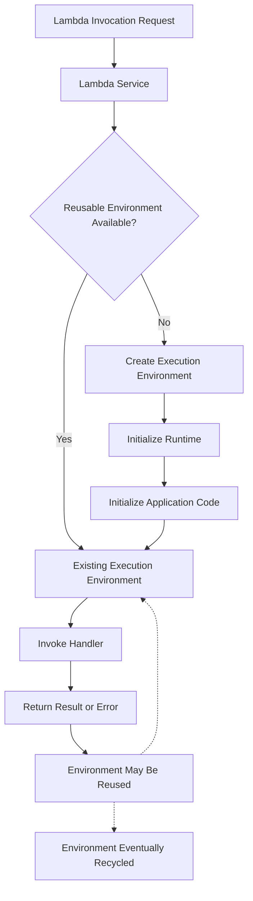
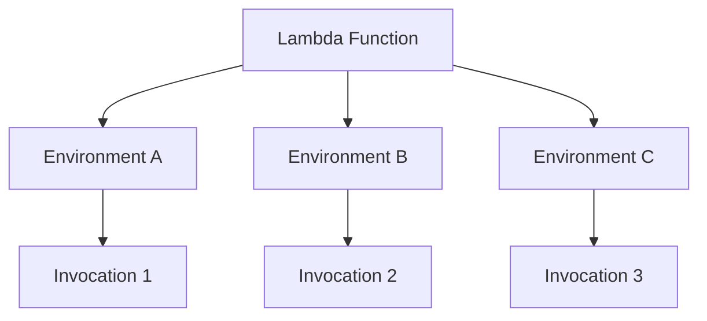

# 02- Lambda Execution Environment

## Overview

The AWS Lambda execution environment is the isolated runtime environment in which a Lambda function's code executes. It provides the runtime, application code, memory, temporary storage, and other resources required to process invocations.

Understanding execution environments is essential for designing low-latency, reliable serverless applications. Environment initialization affects cold-start latency, environment reuse influences performance, and lifecycle behavior determines which resources can safely be cached between invocations.

For backend engineers, the central principle is that **an execution environment can be reused, but it must never be treated as a permanent application process or a durable storage mechanism**.

This distinction affects Python module initialization, database connections, HTTP clients, in-memory caches, concurrency, resource cleanup, and application correctness.

## Execution Environment Architecture

A Lambda execution environment contains the components required to initialize and run a function.



The diagram represents the general lifecycle. Exact initialization, reuse, scaling, and shutdown behavior can vary with runtime, invocation model, and features such as provisioned concurrency or SnapStart.

### Main components

| Component | Responsibility |
|---|---|
| Execution environment | Provides an isolated environment for executing the function |
| Runtime | Loads and executes application code and participates in the Lambda invocation lifecycle |
| Handler | Processes an individual invocation |
| Application initialization | Loads configuration and initializes module-level resources |
| Memory | Holds runtime state, application objects, and invocation data |
| `/tmp` storage | Provides temporary local file storage |
| Environment variables | Supplies configured application settings |
| Extensions | Optional processes or integrations that participate in the environment lifecycle |

The execution environment is not the same as the Lambda function itself. A single function can have multiple environments executing concurrently.

For example, if a function receives 100 concurrent invocations, Lambda may use multiple execution environments to process them. Each environment has its own memory and process-local state.

## Execution Environment Lifecycle

The general lifecycle can be divided into initialization, invocation, and eventual shutdown.

### Initialization phase

Initialization prepares the runtime and application code for execution.

For a Python function, this commonly includes:

- Loading the Python runtime.
- Importing application modules.
- Executing module-level statements.
- Creating reusable clients and other resources.
- Loading configuration required by the application.

Consider this implementation:

```python
import json
import os

import boto3

SERVICE_NAME = os.environ["SERVICE_NAME"]
ORDERS_TABLE_NAME = os.environ["ORDERS_TABLE_NAME"]

dynamodb = boto3.resource("dynamodb")
orders_table = dynamodb.Table(ORDERS_TABLE_NAME)


def lambda_handler(event, context):
    order_id = event["order_id"]

    response = orders_table.get_item(
        Key={"order_id": order_id}
    )

    return {
        "service": SERVICE_NAME,
        "order": response.get("Item"),
    }
```

The environment variables are read and the DynamoDB resource is created during module initialization. If the environment is reused, subsequent invocations can reuse these initialized objects.

This approach reduces repeated setup work, but it introduces an important constraint: initialization failures can prevent the handler from executing at all.

If `SERVICE_NAME` is missing, for example, module import fails before the function processes an event.

**Production guidance:**

- Validate required configuration deliberately.
- Avoid expensive initialization that is not needed for every invocation.
- Reuse SDK clients and suitable connection pools.
- Do not place request-specific mutable state in module-level variables.
- Account for initialization latency when setting timeout and latency objectives.

### Invocation phase

During invocation, Lambda supplies the event and context to the handler.

The handler performs the application operation and returns a result or raises an exception.

```python
import json
import logging

logger = logging.getLogger()
logger.setLevel(logging.INFO)


def lambda_handler(event, context):
    order_id = event["order_id"]

    logger.info(
        "Processing order",
        extra={
            "order_id": order_id,
            "request_id": context.aws_request_id,
        },
    )

    return {
        "statusCode": 200,
        "body": json.dumps(
            {
                "order_id": order_id,
                "status": "accepted",
            }
        ),
    }
```

The returned structure is suitable only when the integration expects an HTTP-style response. A queue consumer or stream processor typically uses different response semantics.

An execution environment may process additional invocations after the current invocation finishes. Application correctness must not depend on that happening.

### Shutdown phase

Lambda eventually recycles execution environments. Shutdown may occur because an environment is no longer needed, the service replaces it, or lifecycle and infrastructure conditions require it.

Applications must not assume that shutdown will provide an opportunity to complete arbitrary business work.

Use explicit application-level mechanisms for critical cleanup and durability:

- Commit or roll back database transactions.
- Persist business state before reporting success.
- Close resources when required by the application's lifecycle.
- Use durable queues or workflow orchestration for work that must survive process termination.
- Avoid relying on background threads to finish after the handler returns.

Shutdown hooks and extension lifecycle notifications can support resource cleanup, but they are not substitutes for durable workflow design.

## Execution Environment Reuse

Lambda may reuse an existing environment to process later invocations of the same function. Reuse avoids repeating some initialization work and can improve performance.

For Python, module-level objects generally remain available while the same runtime process continues to exist.

### Resources suitable for reuse

| Resource | Reuse recommendation | Reason |
|---|---|---|
| Boto3 clients and resources | Generally reuse | Avoids repeatedly constructing SDK objects |
| Immutable configuration | Reuse | Reduces repeated parsing and setup |
| HTTP clients | Reuse with appropriate timeout and connection-pool configuration | Can reduce connection setup overhead |
| Database connection pools | Reuse carefully | Must account for connection limits and stale connections |
| Compiled regular expressions | Reuse | Avoids repeated compilation |
| Static lookup data | Reuse when bounded | Can reduce repeated computation or network calls |
| User-specific request state | Do not reuse globally | Can leak data across invocations |
| Business transaction state | Persist externally | In-memory state is not durable |
| Authentication decisions | Revalidate as required | Cached decisions may become stale or cross request boundaries |

### Global variables and state leakage

A frequent mistake is treating module-level state as if it belonged to one request.

Consider this example:

```python
# Unsafe design: request data is stored globally.
current_user = None


def lambda_handler(event, context):
    global current_user

    current_user = event["user_id"]

    return {
        "user_id": current_user,
    }
```

This example unnecessarily stores request-specific data in global state. Later invocations can observe stale values, and more complicated variations can introduce cross-request data leakage.

Prefer local state:

```python
def lambda_handler(event, context):
    user_id = event["user_id"]

    return {
        "user_id": user_id,
    }
```

The safe design makes the lifetime of request-specific data explicit.

### In-memory caching

A global dictionary can provide a small, best-effort cache:

```python
import time

CONFIG_CACHE = {}
CACHE_TTL_SECONDS = 60


def get_cached_value(key, loader):
    now = time.monotonic()
    cached = CONFIG_CACHE.get(key)

    if cached and now - cached["loaded_at"] < CACHE_TTL_SECONDS:
        return cached["value"]

    value = loader()

    CONFIG_CACHE[key] = {
        "value": value,
        "loaded_at": now,
    }

    return value
```

This pattern can reduce repeated reads within one environment. However, it is not a distributed cache:

- Each environment has its own cache.
- A new environment starts with an empty cache.
- Different environments can hold different values.
- Memory consumption grows with cached data.
- Cache invalidation and security-sensitive freshness require explicit design.

Use Redis or another shared caching service when a cache must be shared across environments or consistently managed across multiple instances.

## Execution Environments and Concurrency

Execution environments are isolated from one another. Multiple invocations of the same function can execute concurrently in separate environments.

A simplified model is:



The number of environments is not a fixed property of the function. It changes with concurrency demand, available capacity, configuration, and service behavior.

### Implications for shared resources

Suppose a Lambda function initializes a database connection during module import.

If 200 execution environments each establish one connection, the database may receive approximately 200 connections from that function alone. Additional functions, application services, and administrative connections increase the total.

This is why environment reuse and concurrency planning must be considered together.

Production recommendations:

- Reuse connections within an environment when safe.
- Use connection pooling only with appropriate pool sizes and lifecycle behavior.
- Consider Amazon RDS Proxy for supported database workloads when connection management is a concern.
- Limit function concurrency when the downstream service has a strict capacity ceiling.
- Monitor database connection counts, query latency, and throttling.
- Avoid assuming that a small amount of code necessarily creates a small infrastructure footprint.

## Cold Starts and Initialization Performance

A cold start occurs when an invocation requires initialization of an execution environment rather than using an already initialized environment.

Initialization latency can be affected by:

- Runtime initialization.
- Application import time.
- Dependency size and complexity.
- Network calls during initialization.
- Configuration or secret retrieval.
- Extensions.
- Runtime-specific behavior.
- Advanced features and their initialization model.

A warm invocation reusing an initialized environment can avoid some of this work, but warm execution is not guaranteed.

### Reduce initialization overhead

Prefer lightweight initialization:

```python
import boto3

dynamodb = boto3.resource("dynamodb")


def lambda_handler(event, context):
    table = dynamodb.Table(event["table_name"])

    return table.get_item(
        Key={"id": event["id"]}
    )
```

Avoid unnecessary startup work:

```python
# Potentially expensive initialization.
# Avoid doing this unless it is required and justified.
import time

time.sleep(5)
```

The first example initializes the SDK resource outside the handler. The second illustrates an artificial delay that would add unnecessary initialization latency.

Other useful techniques include:

- Removing unused dependencies.
- Reducing expensive imports.
- Avoiding unnecessary remote calls during initialization.
- Loading large data structures only when required.
- Measuring initialization duration separately from handler duration.
- Considering provisioned concurrency or SnapStart where supported and appropriate.

Do not assume that every initialization task belongs outside the handler. If initialization is expensive and rarely needed, lazy initialization may reduce startup cost. If a resource must be initialized for every request because it contains request-specific data, keep that work inside the handler.

## Temporary Storage and Local Files

Lambda execution environments provide temporary storage through `/tmp`. It is useful for bounded intermediate data, downloaded files, generated artifacts, and local processing.

Temporary storage is not a durable filesystem. Its contents can persist across invocations when an environment is reused, but applications must not rely on that persistence.

### Example: Temporary file processing

```python
import csv
import os
import tempfile

import boto3

s3 = boto3.client("s3")


def lambda_handler(event, context):
    bucket = event["bucket"]
    key = event["key"]

    with tempfile.NamedTemporaryFile(
        mode="w+",
        suffix=".csv",
        dir="/tmp",
        newline="",
        delete=True,
    ) as temp_file:
        s3.download_file(
            bucket,
            key,
            temp_file.name,
        )

        temp_file.seek(0)

        with open(
            temp_file.name,
            mode="r",
            newline="",
            encoding="utf-8",
        ) as input_file:
            rows = sum(1 for _ in csv.reader(input_file))

    return {
        "rows": rows,
        "source": os.path.basename(key),
    }
```

The example demonstrates temporary file use, but production file processing should also validate object identity, file size, encoding, malformed input, and access permissions. For very large files, streaming may be preferable to downloading the entire object.

### Temporary storage considerations

- Configure ephemeral storage to match actual workload requirements.
- Remove sensitive temporary files when they are no longer needed.
- Do not treat `/tmp` as the authoritative copy of business data.
- Account for memory and disk usage when processing large objects.
- Validate input sizes to avoid resource exhaustion.
- Use S3 or another durable service for persistent artifacts.

## Environment Variables and Configuration

Environment variables are commonly used to configure function behavior without embedding environment-specific settings in application code.

Examples include:

- Table names.
- Queue URLs.
- API endpoint configuration.
- Feature flags.
- Environment identifiers.

```python
import os

ORDERS_TABLE = os.environ["ORDERS_TABLE"]
ENVIRONMENT = os.environ.get("ENVIRONMENT", "development")
```

Use separate configuration for development, staging, and production. Validate required values early, and avoid placing credentials directly in source code or exposing them through logs.

For sensitive configuration, use Secrets Manager or Systems Manager Parameter Store as appropriate, with least-privilege access and a deliberate caching and rotation strategy.

Configuration is initialized or read according to the application's code. If a value is cached at module scope, changing the underlying configuration does not automatically refresh that in-memory value inside an already initialized environment.

## Database and Network Connections

Long-lived resources such as database connections require special attention because Lambda environments may be reused while underlying network connections become stale.

A database connection can fail after a database restart, network interruption, idle timeout, or failover. Reusing a connection therefore requires error handling and appropriate reconnection behavior.

### Recommended connection strategy

- Initialize reusable clients outside the handler when appropriate.
- Configure connection and operation timeouts.
- Detect and recover from stale connections safely.
- Keep transactions bounded to individual business operations.
- Do not share mutable transaction state across requests.
- Consider database connection proxies for supported engines and workloads.
- Ensure VPC routing, security groups, DNS, and database access rules are correct.

For relational databases, concurrency planning is particularly important. A sudden increase in Lambda environments can exhaust the database's connection capacity even when each individual invocation performs only a small query.

## Execution Environment Reuse and Security

Environment reuse can improve performance, but it creates security and correctness obligations.

A function must ensure that data belonging to one invocation is not accidentally exposed to another invocation.

Avoid:

- Storing user-specific data in global mutable variables.
- Reusing authorization results beyond their valid context.
- Logging credentials or sensitive request payloads.
- Leaving sensitive files in temporary storage unnecessarily.
- Assuming environment memory is shared across all function instances.
- Assuming cached configuration or secrets automatically refresh.

Prefer immutable shared configuration, request-local mutable state, explicit cache expiration, and durable storage for business records.

## Monitoring Execution Environment Behavior

CloudWatch provides Lambda metrics and logs that help identify initialization overhead, invocation failures, and performance issues.

Useful signals include:

| Signal | Diagnostic value |
|---|---|
| Duration | Shows execution latency |
| Errors | Identifies failed invocations |
| Throttles | Indicates requests rejected by concurrency or applicable limits |
| Concurrent executions | Shows concurrency demand |
| Initialization duration in supported runtime reporting | Helps investigate initialization overhead |
| Memory usage in logs or enhanced monitoring integrations | Helps detect memory pressure |
| Database connection metrics | Helps identify connection exhaustion |
| Application-level latency metrics | Distinguishes application and dependency bottlenecks |

Lambda reporting logs can include initialization-related information, but the exact fields and availability depend on the runtime and execution path. Use the relevant runtime and observability documentation when building detailed performance dashboards.

### Practical diagnostic approach

When latency increases unexpectedly:

1. Compare invocation duration with initialization-related measurements.
2. Inspect dependency initialization and import time.
3. Check whether database or HTTP connection setup is repeated.
4. Review downstream latency and connection failures.
5. Inspect memory usage and timeout configuration.
6. Compare traffic patterns with concurrency growth.
7. Test changes under realistic load before deploying them.

Do not assume that every slow invocation is a cold start. Slow database queries, DNS resolution, network connection establishment, dependency latency, and application-level work can produce similar symptoms.

## Common Mistakes

| Mistake | Impact | Prevention |
|---|---|---|
| Treating the environment as permanent | State can disappear unexpectedly | Persist important state externally |
| Assuming every invocation gets a new environment | Repeated initialization wastes time and resources | Reuse suitable clients and immutable configuration |
| Assuming every invocation reuses an environment | Latency can vary as environments are created | Measure cold-start behavior and set realistic latency objectives |
| Storing request data globally | Can cause cross-invocation state leakage | Keep request-specific state local to the handler |
| Creating a database connection for every operation without planning | Adds latency and can exhaust connection capacity | Reuse connections safely and manage concurrency |
| Performing slow network calls during initialization | Increases initialization latency and can prevent handler execution | Minimize startup dependencies and use deliberate lazy initialization where appropriate |
| Relying on shutdown to complete business work | Critical operations may be interrupted | Persist state and use durable workflow mechanisms |
| Treating `/tmp` as permanent storage | Data may disappear when an environment is recycled | Store durable data in an appropriate service |
| Caching secrets indefinitely | Rotated credentials may remain stale | Apply a defined cache lifetime and refresh strategy |
| Ignoring environment-level memory growth | Large caches or files can cause resource exhaustion | Bound caches and monitor resource consumption |

## Practical Engineering Guidelines

For most Python-based Lambda applications:

- Create reusable SDK clients outside the handler when appropriate.
- Keep request-specific mutable state inside the handler.
- Make business operations idempotent where duplicate processing is possible.
- Keep initialization lightweight and avoid unnecessary remote calls.
- Use explicit connection, read, and operation timeouts.
- Configure memory and ephemeral storage based on measured requirements.
- Store durable state in databases, object storage, queues, or other appropriate services.
- Monitor initialization, execution duration, concurrency, errors, and downstream health.
- Validate environment variables and permissions before production deployment.
- Test environment reuse assumptions, stale connections, duplicate events, and cold-start behavior.

## Key Takeaways

- A Lambda execution environment provides the runtime and resources for function execution, but it can be created, reused, and recycled by the service.
- Module-level initialization and reusable clients can reduce overhead, while request-specific mutable state must remain isolated to prevent cross-invocation leakage.
- Environment reuse is a performance optimization, not a durability guarantee; persist business state and critical workflow progress externally.
- Concurrency and environment reuse directly affect database connections, downstream capacity, memory consumption, and application reliability.
- Production functions should minimize unnecessary initialization, handle stale resources safely, monitor execution behavior, and never depend on shutdown for critical business operations.