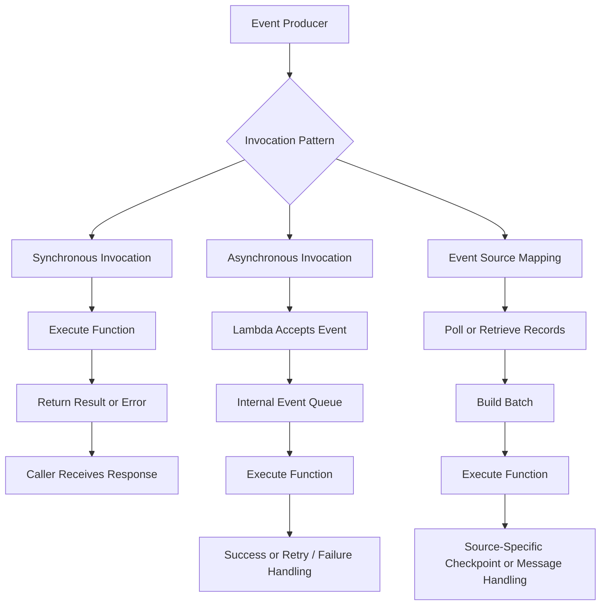
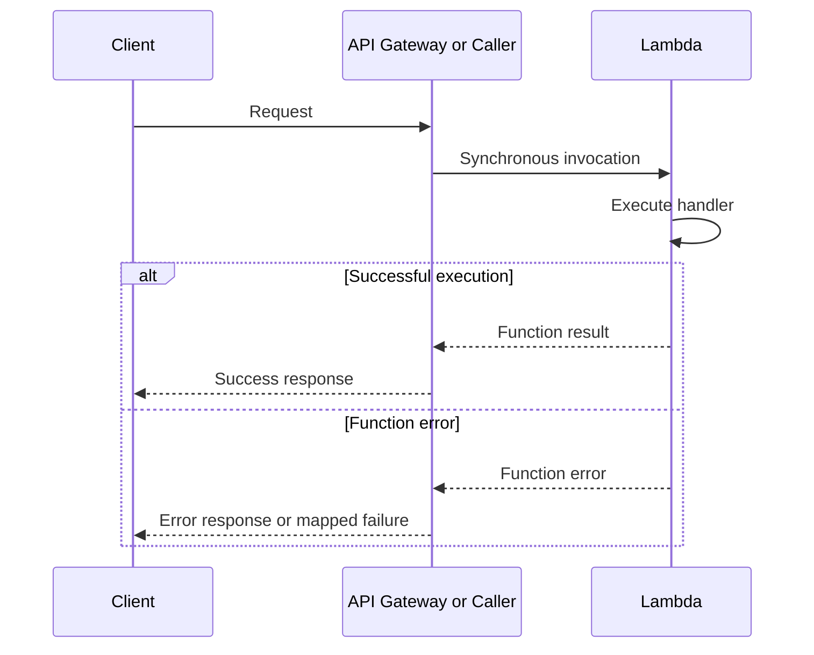
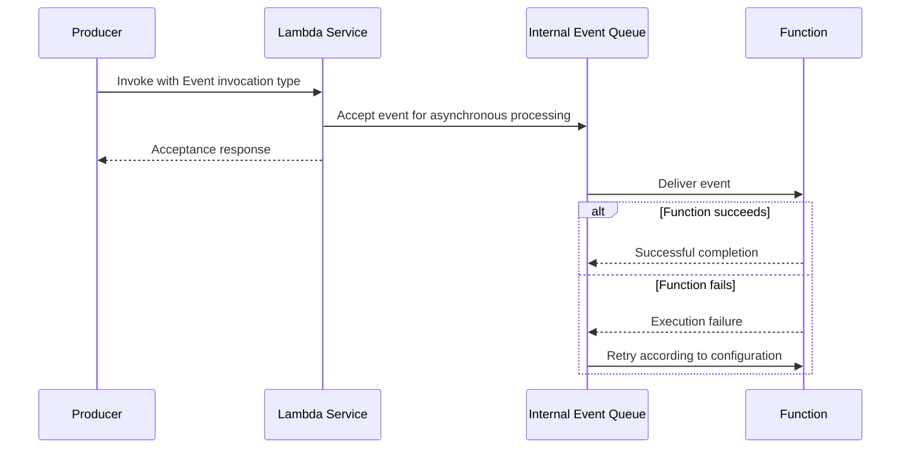
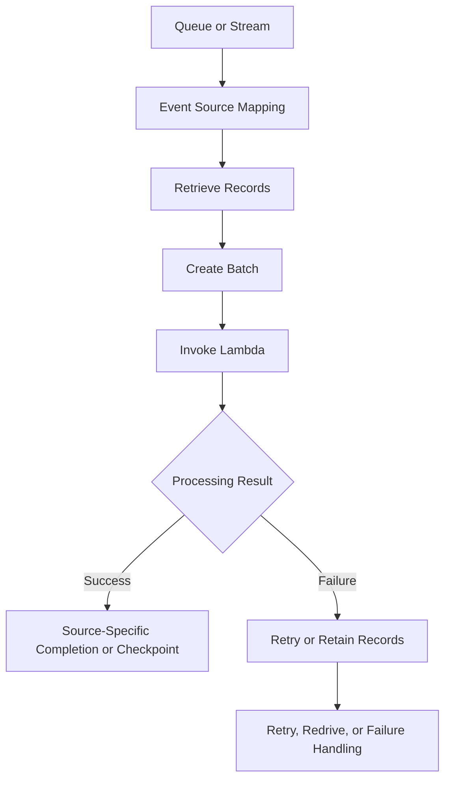
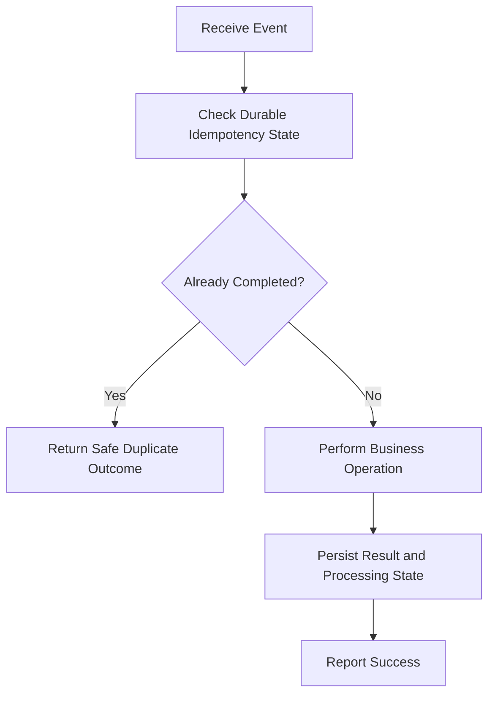

# 03- Invocation Models

## Overview

AWS Lambda supports multiple invocation models that determine how a function receives events, how callers observe execution results, and how failures are handled.

Choosing the correct invocation model is an architectural decision. It affects API latency, retry behavior, event delivery, ordering, duplicate processing, backpressure, and operational complexity.

The three primary invocation patterns are:

- **Synchronous invocation:** The caller waits for the function's response.
- **Asynchronous invocation:** Lambda accepts an event for later processing without requiring the caller to wait for the handler to finish.
- **Event source mappings:** Lambda retrieves records from supported event sources and invokes the function with batches of records.

These patterns are not interchangeable. A synchronous API request, an asynchronous notification, and a queue consumer have different reliability and failure-handling requirements.

## Invocation Architecture



The diagram shows the general patterns. Actual delivery, acknowledgement, retry, and checkpoint behavior depends on the invocation API, integration, event source, and configuration.

## Synchronous Invocation

Synchronous invocation uses request-response semantics. The caller invokes the function and waits for the execution result.

Typical use cases include:

- API Gateway-backed REST APIs.
- Application Load Balancer integrations.
- Lambda Function URLs.
- Backend services invoking Lambda through the AWS SDK.
- Request-response operations where the caller needs an immediate outcome.

### Request lifecycle



The caller remains dependent on the function's completion time and the integration's timeout behavior. A successful function response does not automatically imply that every downstream business operation completed correctly unless the application explicitly enforces that guarantee.

### Direct synchronous invocation

The AWS Lambda Invoke API supports synchronous invocation through the `RequestResponse` invocation type.

Example using Python and Boto3:

```python
import json

import boto3

lambda_client = boto3.client("lambda")


def invoke_order_function(order_id: str) -> dict:
    response = lambda_client.invoke(
        FunctionName="process-order",
        InvocationType="RequestResponse",
        Payload=json.dumps(
            {"order_id": order_id}
        ).encode("utf-8"),
    )

    payload = json.loads(
        response["Payload"].read()
    )

    if response.get("FunctionError"):
        raise RuntimeError(
            f"Lambda execution failed: {payload}"
        )

    return payload
```

Important distinctions:

- `StatusCode` describes the Invoke API operation's status, not necessarily the business outcome.
- `FunctionError` indicates that the function execution failed.
- The response payload contains the function's returned value or error information.
- Transport-level errors and service throttling can still occur.
- The caller must implement appropriate timeout, retry, and idempotency behavior.

The client should also account for SDK-level retries and distinguish transient infrastructure failures from application failures.

### Synchronous error handling

Lambda does not automatically retry a failed synchronous invocation simply because the handler raised an exception.

The caller or an orchestration layer decides whether to retry. API integrations may translate function errors into HTTP responses according to their configuration.

For example, a client may retry a transient failure, but retrying a non-idempotent operation can duplicate side effects.

Use synchronous invocation when:

- The caller requires an immediate result.
- The operation can complete within the applicable timeout limits.
- The caller can tolerate the latency.
- Failure handling can be performed within the request-response flow.

Avoid it for lengthy workflows that do not need to block the caller.

## Asynchronous Invocation

Asynchronous invocation allows a producer to submit an event without waiting for the handler to finish.

Lambda accepts the event for asynchronous processing and manages an internal event queue. The function executes later, and Lambda handles eligible retries according to the asynchronous invocation configuration.

Typical use cases include:

- Sending notifications.
- Triggering background processing.
- Processing events where the producer does not need the final result immediately.
- Decoupling a producer from a consumer's execution latency.

### Asynchronous request lifecycle



The acceptance response means the event was accepted for asynchronous processing. It does not mean that the business operation has completed.

### Direct asynchronous invocation

The Invoke API uses `InvocationType="Event"` for asynchronous invocation.

```python
import json

import boto3

lambda_client = boto3.client("lambda")


def submit_order_processing(order_id: str) -> None:
    response = lambda_client.invoke(
        FunctionName="process-order",
        InvocationType="Event",
        Payload=json.dumps(
            {"order_id": order_id}
        ).encode("utf-8"),
    )

    if response["StatusCode"] != 202:
        raise RuntimeError(
            f"Event was not accepted: {response['StatusCode']}"
        )
```

For this invocation type, a successful response generally indicates that Lambda accepted the event. It does not contain the eventual handler result.

A production producer should distinguish between submission failure and downstream processing failure. Monitoring and failure destinations are needed to detect processing failures after the producer has received an acceptance response.

### Retry behavior

For direct asynchronous invocation, Lambda retries eligible function errors according to its asynchronous invocation settings. By default, function errors are retried twice after the initial attempt, with delays between retries. Throttling and certain system errors are handled differently and may be retried for longer within the event's maximum age.

Relevant configuration includes:

- Maximum event age.
- Maximum retry attempts for function errors.
- Dead-letter queue configuration for supported asynchronous invocation failure handling.
- On-success and on-failure destinations.
- Monitoring for dropped or expired events.

The exact outcome depends on the error category and configuration. Do not treat all failures as if they follow one identical retry schedule.

### Failure destinations and dead-letter queues

A dead-letter queue and an asynchronous invocation destination solve related but different problems.

| Mechanism | Purpose |
|---|---|
| Dead-letter queue | Preserves failed asynchronous events for later inspection or recovery, subject to supported configuration |
| On-failure destination | Sends invocation outcome information to a supported destination after the configured failure conditions are met |
| On-success destination | Records successful asynchronous invocation outcomes when configured |
| CloudWatch alarms | Alerts operators to processing failures, throttling, or other operational signals |

Destinations can include supported services such as SQS, SNS, EventBridge, or another Lambda function, depending on the feature and configuration.

Choose the recovery mechanism according to whether you need the original event, invocation metadata, routing flexibility, or a workflow for manual replay.

## Event Source Mappings

An event source mapping is a Lambda-managed integration that reads records from a supported event source and invokes a Lambda function with those records.

Common sources include:

- Amazon SQS.
- Amazon Kinesis Data Streams.
- Amazon DynamoDB Streams.
- Amazon MSK and supported self-managed Kafka sources.
- Amazon MQ, where supported.

Event source mappings are particularly useful for queue consumers and stream processors.

### Processing flow



The event source mapping controls how records are retrieved and delivered, subject to the event source's own semantics.

Unlike direct asynchronous invocation, event source mappings do not use Lambda's internal asynchronous invocation queue as the producer-to-consumer mechanism. The mapping reads records from the source and invokes the function.

### Polling and batching

The mapping retrieves records and may combine them into a batch before invoking the handler. Batching reduces invocation overhead but introduces trade-offs:

- Larger batches can improve throughput.
- Larger batches can increase processing latency while the batch is assembled.
- One failed record may cause other records in the batch to be retried, depending on the source and failure configuration.
- Batch size must fit the function's memory, timeout, and processing requirements.

Batching and concurrency controls vary by event source. Consult the relevant event source mapping configuration rather than assuming all sources expose identical options.

### SQS and Lambda

For SQS, Lambda polls the queue through an event source mapping and invokes the function with a batch of messages.

When the batch succeeds, Lambda deletes the successfully processed messages according to the integration's behavior. If processing fails, messages can become visible again after the visibility timeout and may be delivered again.

Important considerations:

- Configure the queue visibility timeout appropriately.
- Make processing idempotent.
- Use a dead-letter queue when repeated failures require isolation.
- Monitor queue depth and the age of the oldest message.
- Control concurrency when the downstream service has limited capacity.
- Consider partial batch responses to avoid retrying successfully processed messages unnecessarily.

### Stream-based sources

Kinesis Data Streams and DynamoDB Streams use stream-oriented processing and checkpointing semantics.

Records are associated with stream positions and, where applicable, shards. The event source mapping manages progress and retries according to the source's behavior and configuration.

A failed batch can delay processing of later records, depending on the source and configuration. Options such as partial batch failure reporting, retry limits, and record-age limits can help manage failure isolation.

Ordering guarantees are source-specific. For example, stream ordering is constrained by shard and partition behavior rather than providing universal ordering across all records.

## Invocation Models Compared

| Property | Synchronous | Asynchronous | Event source mapping |
|---|---|---|---|
| Caller waits for handler result | Yes | No | Producer generally does not wait for each handler result |
| Event storage before execution | Depends on caller or integration | Lambda-managed asynchronous queue | Source queue or stream |
| Typical use | HTTP request-response | Background event processing | Queue and stream consumption |
| Retry control | Caller or orchestrator | Lambda asynchronous invocation configuration | Event source mapping and source-specific settings |
| Batching | Integration-specific | Not the standard direct asynchronous Invoke pattern | Supported for configured sources |
| Ordering | Depends on caller and integration | Not generally guaranteed | Source-specific |
| Duplicate processing | Possible | Possible | Possible |
| Progress tracking | Caller or application | Asynchronous invocation outcome | Source-specific acknowledgement or checkpoint |
| Backpressure | Caller limits, integration throttling, or application controls | Concurrency and invocation settings | Queue buffering, stream throughput, and mapping concurrency controls |

## Delivery Semantics and Duplicate Processing

Invocation behavior should be designed around the actual delivery semantics of the source and integration.

At-least-once delivery means an event can be delivered more than once. Lambda applications should not assume that every business operation executes exactly once merely because the function is invoked through a managed integration.

Duplicates can occur when:

- A function performs a side effect but fails before completion is acknowledged.
- A queue message becomes visible again after the visibility timeout.
- A stream batch is retried.
- A producer retries after an uncertain response.
- An asynchronous event is retried after a function error.

### Idempotent processing

Idempotency ensures that repeated processing of the same logical operation does not create unintended duplicate business effects.

For example, an order-processing function should not charge a customer twice because the same message was delivered more than once.

Common strategies include:

- Use a stable event ID or business-operation ID.
- Store processed operation identifiers durably.
- Use conditional writes or unique database constraints.
- Use payment-provider idempotency keys where supported.
- Make state transitions conditional on the current business state.
- Use transactions where the data store supports the required atomicity.

A conceptual workflow is:



This diagram represents the intended behavior, not a complete implementation. If the business side effect and the idempotency record are written independently, a failure between those steps can still cause duplicate effects. Use an atomic or recoverable design appropriate to the business operation.

## Partial Batch Failure Handling

For supported event source mappings, partial batch responses allow a function to report which records failed rather than treating the entire batch as failed.

This is particularly useful for SQS and supported stream sources, but the response structure and configuration requirements differ by source.

### SQS example

Enable the `ReportBatchItemFailures` response type on the event source mapping. The handler can then return the message IDs that failed processing.

```python
import logging

logger = logging.getLogger()
logger.setLevel(logging.INFO)


def process_message(message: dict) -> None:
    # Perform an idempotent business operation.
    body = message["body"]

    if not body:
        raise ValueError("Message body is empty")


def lambda_handler(event, context):
    batch_item_failures = []

    for record in event["Records"]:
        message_id = record["messageId"]

        try:
            process_message(record)
        except Exception:
            logger.exception(
                "Message processing failed",
                extra={"message_id": message_id},
            )

            batch_item_failures.append(
                {"itemIdentifier": message_id}
            )

    return {
        "batchItemFailures": batch_item_failures,
    }
```

This example demonstrates the response pattern. Production code should classify permanent and transient failures, validate messages, apply idempotency, and avoid silently retrying poison messages forever.

For SQS, the response uses message identifiers. Stream-based sources use source-specific record identifiers and checkpoint semantics.

Partial batch failure handling must be explicitly enabled where required. Returning the structure without the correct event source mapping configuration does not automatically guarantee partial retries.

## Choosing an Invocation Model

Choose based on the caller's latency requirements, delivery requirements, and recovery strategy.

| Requirement | Recommended starting point | Reason |
|---|---|---|
| Return a result to an HTTP client | Synchronous integration | The caller needs an immediate response |
| Process a notification without blocking the producer | Asynchronous invocation or an event bus | The producer does not need the handler's final result |
| Buffer work during traffic spikes | SQS with an event source mapping | Queue buffering decouples producer and consumer capacity |
| Process ordered records from a stream | Appropriate stream source with an event source mapping | Source-specific ordering and checkpoint semantics can be preserved |
| Coordinate multiple business steps and retries | Step Functions or another explicit orchestrator | Workflow state and recovery are easier to model |
| Process a long-running workflow beyond Lambda's execution limits | Durable workflow or container-based architecture | A single Lambda invocation is not an unlimited-duration worker |

The table provides starting points rather than universal rules. Existing service constraints, payload sizes, ordering requirements, regional availability, and downstream capacity can change the design.

## Reliability, Backpressure, and Downstream Protection

Lambda can scale to meet demand, but downstream systems may not scale at the same rate.

For example, a queue can accumulate thousands of messages while Lambda increases concurrency. If every invocation opens multiple database connections, the database can become overloaded even though the queue consumer itself appears healthy.

Use a combination of:

- Reserved concurrency where a function needs a maximum concurrency limit.
- Event source mapping concurrency controls where supported.
- Queue buffering to absorb bursts.
- Bounded retries and suitable visibility or timeout settings.
- Idempotency to make retries safe.
- Circuit breakers or graceful degradation where appropriate.
- Metrics and alarms for queue depth, record age, throttling, and downstream latency.

Do not use retries as the only response to a dependency outage. Aggressive retries can amplify load and create a cascading failure.

## Payload and Timeout Considerations

Invocation payload limits and execution timeouts differ across Lambda invocation mechanisms and integrated services.

Direct synchronous and asynchronous invocation have different request and response characteristics. API Gateway, Function URLs, Application Load Balancer, queues, and stream sources also impose their own limits.

Before choosing an invocation pattern, verify:

- Maximum event and response payload sizes.
- Function timeout and integration timeout constraints.
- Queue visibility timeout and message retention settings.
- Stream retention and record-age requirements.
- Batch-size limits and batching windows.
- Retry behavior and failure destination support.

For large payloads, consider passing an S3 object reference rather than embedding the entire file in an event. This keeps event payloads small and separates event transport from durable data storage.

## Monitoring Invocation Behavior

Monitor invocation behavior at both the Lambda layer and the source or integration layer.

| Signal | Why it matters |
|---|---|
| Invocations | Measures execution volume |
| Errors | Identifies function failures |
| Throttles | Indicates concurrency or applicable service limits |
| Duration | Reveals execution latency |
| Concurrent executions | Helps explain scaling and downstream pressure |
| Asynchronous event age | Helps identify delayed processing |
| Dropped asynchronous events | Indicates events that could not be processed within configured constraints |
| SQS queue depth | Indicates backlog |
| SQS oldest-message age | Indicates processing delay |
| Stream iterator age | Indicates lag behind a stream |
| Partial batch failures | Helps identify record-level processing failures when instrumented |
| Application-level success metrics | Measures actual business outcomes |

Use alarms that reflect service objectives. A function can have low error rates while a queue backlog grows steadily, so invocation success alone is not a sufficient health signal.

## Common Mistakes

| Mistake | Why it is problematic | Better approach |
|---|---|---|
| Treating asynchronous acceptance as business success | The handler may fail later | Monitor asynchronous outcomes and configure failure handling |
| Assuming synchronous failures are automatically retried | The invocation mechanism may not retry | Define caller or workflow retry policies |
| Assuming every source uses identical retry semantics | Sources have different delivery and checkpoint behavior | Document source-specific guarantees |
| Assuming exactly-once business processing | Duplicate delivery can repeat side effects | Implement durable idempotency |
| Retrying an entire batch for one failed record unnecessarily | Successful records may be processed repeatedly | Use partial batch responses where supported |
| Ignoring queue visibility timeout | Messages can be redelivered while processing is still active | Configure visibility timeout and function timeout coherently |
| Allowing unbounded concurrency | Downstream services can be overloaded | Apply concurrency controls and backpressure |
| Treating a DLQ as automatic recovery | Failed messages are preserved but not necessarily corrected or replayed | Define ownership, inspection, replay, and retention procedures |
| Ignoring event age and retention | Events can expire before successful processing | Monitor lag and set suitable limits |
| Putting large files directly into event payloads | Payload limits and memory costs can become problematic | Pass durable object references when appropriate |

## Key Takeaways

- Lambda supports synchronous invocation, asynchronous invocation, and event source mappings; each has distinct response, retry, and failure semantics.
- Asynchronous acceptance does not prove business completion, while event source mappings use source-specific retrieval, acknowledgement, and checkpoint behavior.
- Duplicate processing is possible across invocation patterns; use durable idempotency and safe business-state transitions rather than assuming exactly-once execution.
- Partial batch failure handling, bounded retries, dead-letter handling, and concurrency controls improve reliability when configured for the relevant event source.
- Choose an invocation model based on latency, ordering, payload size, delivery guarantees, downstream capacity, and the operational recovery strategy.