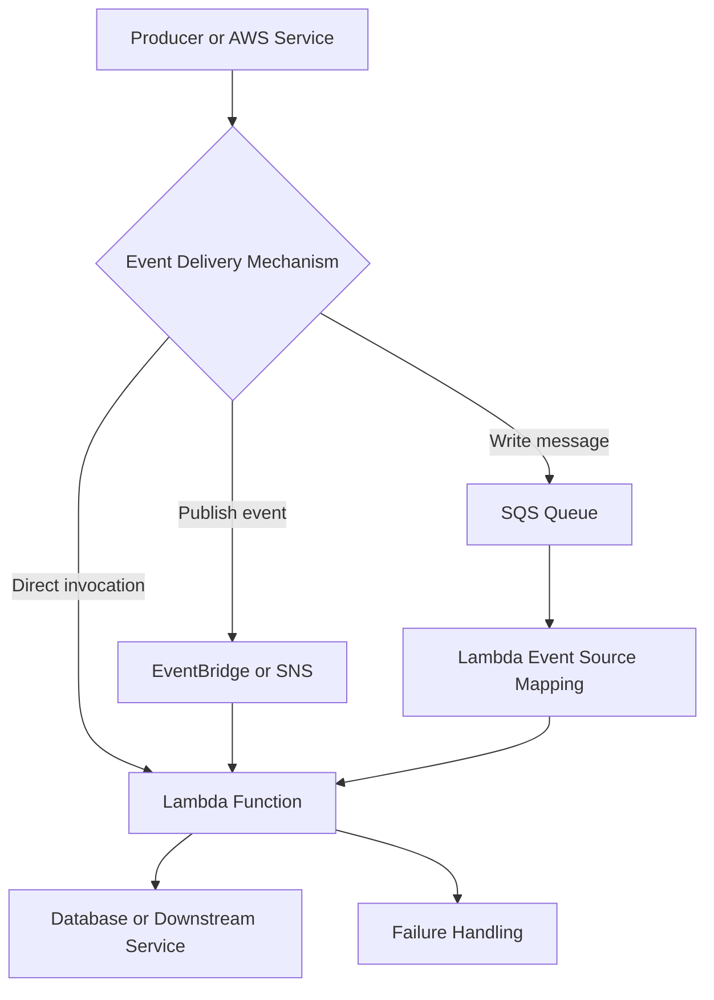
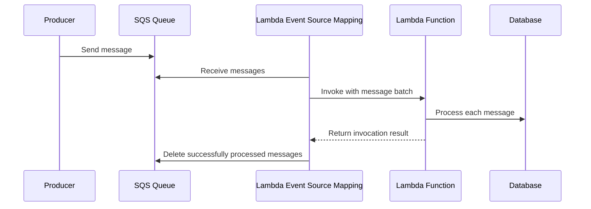
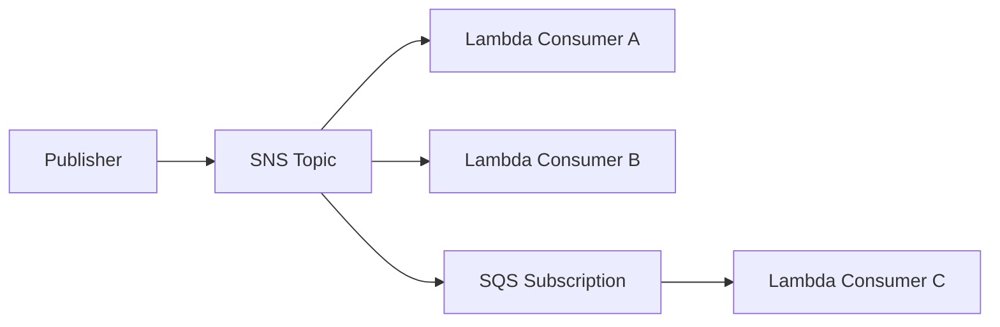
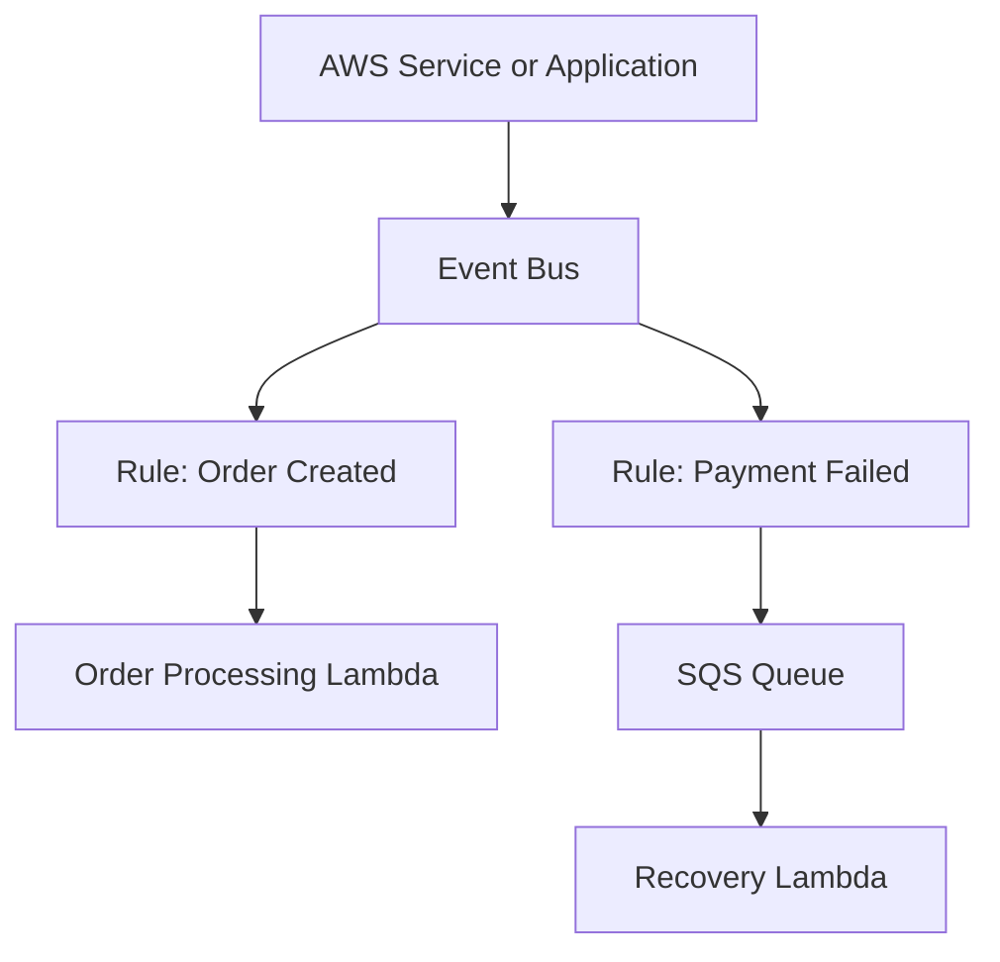
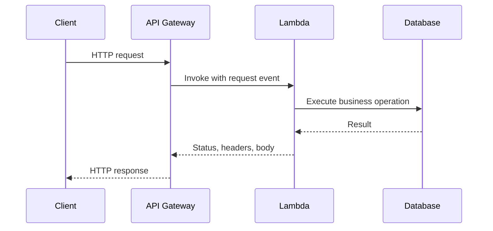

# 04- Event Sources

## Overview

AWS Lambda integrates with AWS services and external systems through several event-delivery mechanisms. An event source determines how work reaches a function, how events are buffered, how failures are handled, and how processing scales.

Choosing the correct event source is an architectural decision. Two functions can execute identical Python code but have substantially different reliability, ordering, retry, and scaling characteristics depending on how they receive events.

Lambda event integrations fall into three broad categories:

- **Direct service invocation:** A service invokes a Lambda function directly, such as Amazon S3 invoking a function after an object is created.
- **Event source mappings:** Lambda polls or reads records from a source such as Amazon SQS, Amazon Kinesis Data Streams, or Amazon DynamoDB Streams and invokes the function with batches of records.
- **Service-mediated event delivery:** A service such as Amazon EventBridge or Amazon SNS routes events to Lambda, often providing filtering, fan-out, or routing capabilities.

The key distinction is that **an event source is not necessarily an invocation model**. The source service, Lambda integration, event source mapping configuration, and function code collectively determine delivery and processing behavior.

## Event Source Integration Models

### Direct invocation

In direct integrations, an AWS service invokes Lambda when an event occurs. The service-specific integration determines the event payload and delivery behavior.

Examples include:

- Amazon S3 object-created notifications.
- Amazon SNS message delivery to a Lambda subscription.
- Amazon EventBridge rules targeting a Lambda function.
- API Gateway forwarding HTTP requests to Lambda.

The function receives an event object representing the originating request or event. Its structure depends on the integration.

### Event source mappings

An event source mapping connects Lambda to a supported event source. Lambda manages polling, retrieves records, batches them, and invokes the function.

Common sources include:

- Amazon SQS.
- Amazon Kinesis Data Streams.
- Amazon DynamoDB Streams.
- Amazon Managed Streaming for Apache Kafka.
- Self-managed Apache Kafka.
- Amazon MQ.
- Amazon MSK event sources.

The mapping controls parameters such as batch size, batching window, concurrency limits, filtering, and failure handling where supported.

### Integration model comparison

| Characteristic | Direct invocation | Event source mapping |
|---|---|---|
| Event retrieval | Initiated by the source or integration | Lambda polls or reads the source |
| Buffering | Depends on the source service | Usually controlled by the source's queue or stream |
| Batch processing | Integration-dependent | Common for queues and streams |
| Retry behavior | Depends on the source and invocation type | Depends on the event source and mapping configuration |
| Ordering | Depends on the source and integration | Depends on the queue or stream |
| Backpressure | Often managed through source-specific delivery controls | Can be managed through buffering, batch settings, and concurrency limits |
| Typical use case | API requests, notifications, event routing | Queue processing, stream processing, asynchronous workloads |

## Event Source Architecture

A production event-driven system commonly separates event production from event processing.



This separation allows the architecture to control buffering, retries, scaling, and failure isolation independently of business logic.

For example, an order service can publish an order-created event to EventBridge, route a copy to an SQS queue, and let a Lambda consumer process the order asynchronously. The queue absorbs bursts and allows the consumer to scale according to available capacity.

## Amazon S3 Event Sources

Amazon S3 can publish object events to Lambda when supported bucket events occur. Typical use cases include file validation, image transformation, document processing, and data ingestion.

### How S3 invokes Lambda

1. An application uploads an object to an S3 bucket.
2. S3 detects a configured event, such as `s3:ObjectCreated:Put`.
3. S3 delivers an event notification to the configured destination.
4. Lambda receives the event and processes the object.
5. The function retrieves the object using the bucket and object key in the event.

The event generally contains bucket information, object keys, event metadata, and identifiers useful for tracing the operation.

### Example S3 event

```json
{
  "Records": [
    {
      "eventSource": "aws:s3",
      "eventName": "ObjectCreated:Put",
      "s3": {
        "bucket": {
          "name": "application-ingestion-bucket"
        },
        "object": {
          "key": "incoming/report.csv",
          "size": 2048
        }
      }
    }
  ]
}
```

This is a representative event shape. Actual payloads can contain additional fields, and object keys in S3 event notifications are URL-encoded.

### Python handler

```python
import logging
from urllib.parse import unquote_plus

import boto3

logger = logging.getLogger()
logger.setLevel(logging.INFO)

s3 = boto3.client("s3")


def lambda_handler(event, context):
    for record in event.get("Records", []):
        if record.get("eventSource") != "aws:s3":
            continue

        bucket = record["s3"]["bucket"]["name"]
        key = unquote_plus(record["s3"]["object"]["key"])

        logger.info(
            "Processing uploaded object",
            extra={
                "bucket": bucket,
                "object_key": key,
                "request_id": context.aws_request_id,
            },
        )

        response = s3.get_object(Bucket=bucket, Key=key)
        body = response["Body"]

        try:
            process_object(body)
        finally:
            body.close()


def process_object(body):
    # Replace with streaming parsing or domain-specific processing.
    for line in body.iter_lines():
        if line:
            process_line(line)


def process_line(line):
    # Validate and persist the record.
    pass
```

This example demonstrates streaming access to the object body instead of loading the entire file into memory. The processing functions are placeholders and must be implemented for the application.

### S3 event-source considerations

**Duplicate notifications:** S3 event notifications are delivered at least once, and duplicate notifications can occur. Processing must be idempotent.

**Ordering:** Do not assume notifications arrive in the same order as object operations. If business correctness depends on version order, use object versioning or application-level version checks.

**Object key decoding:** Decode the key before using it in S3 API calls. Incorrect decoding can cause `NoSuchKey` errors.

**Recursive invocation:** Avoid configuring a function to write output to the same bucket and prefix that triggers it. This can create an invocation loop. Use separate input and output prefixes or buckets.

**Large objects:** Stream data where possible, and consider an SQS-backed workflow when processing requires buffering, independent retries, or stronger control over consumer concurrency.

### When to use S3 events

Use S3-triggered Lambda when object creation or related object events should initiate processing without a continuously running consumer.

For workloads that require explicit buffering, multiple consumers, controlled retry behavior, or sustained high-volume processing, consider routing events through SQS or EventBridge where the integration supports the required pattern.

## Amazon SQS Event Sources

Amazon SQS is a common event source for asynchronous backend processing. It decouples producers from consumers and buffers work until a consumer can process it.

Lambda uses an event source mapping to poll an SQS queue and invoke the function with batches of messages.

### Processing flow



The mapping handles polling and message deletion based on processing results. The exact retry and visibility behavior depends on the queue type, mapping configuration, and function response.

### Standard and FIFO queues

| Characteristic | Standard queue | FIFO queue |
|---|---|---|
| Ordering | Best-effort ordering | Ordered within a message group |
| Delivery | At least once | At least once |
| Parallelism | High, subject to service and mapping limits | Can process different message groups concurrently |
| Deduplication | Application-level idempotency is generally required | Producer-side deduplication features are available, but consumer idempotency remains important |
| Typical use case | Background jobs, notifications, independent tasks | Ordered business workflows and sequential updates per entity |

FIFO ordering does not automatically guarantee exactly-once business effects. A function can commit a database transaction and fail before the message is deleted, causing another processing attempt.

### Example SQS event

```json
{
  "Records": [
    {
      "messageId": "example-message-id",
      "receiptHandle": "example-receipt-handle",
      "body": "{\"order_id\": \"order-123\", \"event_type\": \"order.created\"}",
      "attributes": {
        "ApproximateReceiveCount": "1"
      },
      "eventSource": "aws:sqs",
      "eventSourceARN": "arn:aws:sqs:ap-south-1:123456789012:orders"
    }
  ]
}
```

The message body is a string. If the producer sends JSON, the consumer must parse that JSON explicitly.

### Python handler

```python
import json
import logging

logger = logging.getLogger()
logger.setLevel(logging.INFO)


def lambda_handler(event, context):
    for record in event.get("Records", []):
        message_id = record["messageId"]

        try:
            message = json.loads(record["body"])
            process_order_event(message)

        except json.JSONDecodeError:
            logger.exception(
                "Invalid message JSON",
                extra={"message_id": message_id},
            )
            raise


def process_order_event(message):
    order_id = message["order_id"]
    event_type = message["event_type"]

    logger.info(
        "Processing order event",
        extra={
            "order_id": order_id,
            "event_type": event_type,
        },
    )

    # Apply an idempotent business operation.
```

This handler fails the entire invocation if an invalid message is encountered. For batch processing, that can cause otherwise successful messages to be retried. A production implementation should choose an explicit failure policy and use partial batch responses where appropriate.

### Visibility timeout

The visibility timeout controls how long a received message remains hidden from other consumers while processing is in progress.

If Lambda does not successfully process a message before it becomes visible again, another attempt can occur. A timeout that is too short can cause concurrent duplicate processing.

For Lambda event source mappings, AWS recommends configuring the queue visibility timeout to be at least six times the function timeout, with additional allowance for the maximum batching window when one is configured. Validate the current service guidance and workload-specific timing before deploying.

### Batch size and batching window

An SQS mapping can deliver multiple messages in one invocation.

- **Batch size** controls the maximum number of messages in a batch, subject to source-specific limits.
- **Maximum batching window** allows the mapping to wait for more messages before invoking the function.
- **Concurrency controls** influence how many batches are processed simultaneously.

Larger batches can reduce invocation overhead but increase per-invocation duration, memory requirements, and the impact of failures.

### Partial batch responses

By default, a failed invocation can cause messages in the batch to become eligible for retry, including messages that were already processed successfully.

Enable `ReportBatchItemFailures` on the event source mapping when the handler needs to report individual failed messages.

Example response:

```json
{
  "batchItemFailures": [
    {
      "itemIdentifier": "message-id-that-failed"
    }
  ]
}
```

The identifier must match the message identifier required by the SQS integration.

A Python implementation can return only the failed message IDs:

```python
import json
import logging

logger = logging.getLogger()
logger.setLevel(logging.INFO)


def lambda_handler(event, context):
    failures = []

    for record in event.get("Records", []):
        message_id = record["messageId"]

        try:
            message = json.loads(record["body"])
            process_message(message)

        except Exception:
            logger.exception(
                "Message processing failed",
                extra={"message_id": message_id},
            )
            failures.append({"itemIdentifier": message_id})

    return {"batchItemFailures": failures}


def process_message(message):
    # Perform an idempotent operation.
    pass
```

This pattern prevents successful messages from being unnecessarily retried when partial batch responses are configured correctly. Catching exceptions should not mean silently accepting permanent failures: logging, retry limits, DLQ configuration, and alerting must remain part of the design.

### Dead-letter queues

An SQS dead-letter queue (DLQ) receives messages that cannot be successfully processed within the source queue's configured redrive policy.

A DLQ helps isolate poison messages and makes them available for investigation or controlled redrive.

Operational guidance:

- Configure an appropriate `maxReceiveCount`.
- Monitor the DLQ's visible message count and age.
- Preserve enough message context to investigate failures.
- Correct the underlying cause before redriving messages.
- Ensure replayed operations remain idempotent.

An SQS redrive DLQ is distinct from Lambda's asynchronous invocation DLQ. They apply to different delivery mechanisms.

## Amazon SNS Event Sources

Amazon SNS is a managed publish/subscribe service. A topic can deliver a published message to multiple subscribers, including Lambda functions.

### Event flow



This architecture supports fan-out without requiring the publisher to know every consumer.

### SNS-to-Lambda behavior

When SNS invokes a Lambda subscriber, the function receives an SNS-specific event structure. The original published message is available inside each record's `Sns.Message` field.

```python
import json
import logging

logger = logging.getLogger()
logger.setLevel(logging.INFO)


def lambda_handler(event, context):
    for record in event.get("Records", []):
        if record.get("EventSource") != "aws:sns":
            continue

        sns_message = record["Sns"]["Message"]

        try:
            payload = json.loads(sns_message)
        except json.JSONDecodeError:
            logger.exception("SNS message is not valid JSON")
            raise

        process_notification(payload)


def process_notification(payload):
    # Deliver a notification or initiate a downstream workflow.
    pass
```

### SNS considerations

- Direct SNS-to-Lambda delivery is suitable for straightforward fan-out.
- Subscription filter policies can reduce unnecessary delivery when supported by the subscription configuration.
- Delivery failures and retries follow SNS's delivery behavior for Lambda subscriptions.
- A successful invocation does not necessarily mean every downstream business operation has completed.
- Consumers should handle duplicates and use explicit failure handling.
- Use SNS-to-SQS when consumers need independent buffering and greater control over queue-level retries.

Choose SNS when the primary requirement is pub/sub fan-out. Choose SQS when the primary requirement is buffering and controlled consumption. They can be combined when both are needed.

## Amazon EventBridge Event Sources

Amazon EventBridge routes events from AWS services, custom applications, and supported SaaS integrations using event buses and rules.

EventBridge is useful when producers should publish events without knowing which consumers will process them.

### EventBridge architecture



Rules can match event fields and route matching events to configured targets. An event bus separates event production from consumer-specific routing.

### Example event

```json
{
  "version": "0",
  "id": "example-event-id",
  "detail-type": "OrderCreated",
  "source": "com.example.orders",
  "account": "123456789012",
  "time": "2026-10-10T12:00:00Z",
  "region": "ap-south-1",
  "detail": {
    "order_id": "order-123",
    "status": "created"
  }
}
```

The `detail` object is application-defined for custom events. Consumers should validate its schema rather than assume every event has the same fields.

### Python handler

```python
import logging

logger = logging.getLogger()
logger.setLevel(logging.INFO)


def lambda_handler(event, context):
    detail_type = event.get("detail-type")
    detail = event.get("detail", {})

    if detail_type == "OrderCreated":
        handle_order_created(detail)
    else:
        logger.info(
            "Ignoring unsupported event type",
            extra={"detail_type": detail_type},
        )


def handle_order_created(detail):
    order_id = detail["order_id"]
    status = detail["status"]

    # Apply idempotent business logic.
    logger.info(
        "Handling order event",
        extra={"order_id": order_id, "status": status},
    )
```

### EventBridge delivery considerations

**Retries and destinations:** EventBridge has target-delivery retry behavior and supports dead-letter queues for applicable target delivery failures. Configure retry policy and failure handling explicitly.

**Duplicate events:** Event delivery can be duplicated. Consumers must be idempotent.

**Event filtering:** Filter at the rule level when possible to avoid unnecessary Lambda invocations and processing costs.

**Schema evolution:** Version application event contracts and maintain compatibility between producers and consumers.

**Replay and archive:** EventBridge archives can support replay for eligible events when configured. Replay should be treated as a reprocessing operation, not as proof of exactly-once effects.

Use EventBridge for event routing, service integration, and event-driven decoupling. Use SQS behind a target when a consumer needs its own durable buffer and controlled processing rate.

## DynamoDB Streams Event Sources

DynamoDB Streams captures item-level changes in a DynamoDB table. Lambda reads stream records through an event source mapping.

Typical use cases include:

- Updating search indexes.
- Publishing domain events after database changes.
- Maintaining derived data.
- Triggering asynchronous business workflows.
- Replicating changes into another data store.

### Processing flow

1. An application writes or updates an item in DynamoDB.
2. DynamoDB Streams records the change.
3. Lambda's event source mapping reads records from the stream.
4. The function processes records in batches.
5. The mapping advances its checkpoint according to processing outcomes.

### Stream view types

The table's stream configuration determines which data is available in each record.

| Stream view type | Record contents |
|---|---|
| `KEYS_ONLY` | Primary key attributes |
| `NEW_IMAGE` | New item image |
| `OLD_IMAGE` | Previous item image |
| `NEW_AND_OLD_IMAGES` | Both previous and new item images |

Choose the minimum required data to reduce payload size and limit unnecessary exposure of application data.

### Example record

```json
{
  "eventName": "MODIFY",
  "eventSource": "aws:dynamodb",
  "dynamodb": {
    "SequenceNumber": "123456789",
    "Keys": {
      "PK": {"S": "ORDER#123"}
    },
    "NewImage": {
      "status": {"S": "PAID"}
    }
  }
}
```

This is a representative record. Actual records include additional metadata, and image fields depend on the stream view type.

### Python handler

```python
import logging

logger = logging.getLogger()
logger.setLevel(logging.INFO)


def lambda_handler(event, context):
    for record in event.get("Records", []):
        event_name = record.get("eventName")
        dynamodb = record.get("dynamodb", {})
        keys = dynamodb.get("Keys", {})

        logger.info(
            "Processing DynamoDB stream record",
            extra={
                "event_name": event_name,
                "sequence_number": dynamodb.get("SequenceNumber"),
                "keys": keys,
            },
        )

        if event_name in {"INSERT", "MODIFY"}:
            handle_change(record)


def handle_change(record):
    # Apply an idempotent projection update or publish a domain event.
    pass
```

### Ordering and checkpoints

DynamoDB Streams preserves modification order for a given item. Lambda event source mapping behavior, parallelization configuration, and batch processing affect how records are processed and checkpointed. Do not assume a global order across all items.

If processing a batch fails, records can be retried according to mapping behavior. Configure failure handling and consider partial batch responses and failure destinations where supported.

### DynamoDB Streams pitfalls

- Performing non-idempotent writes can produce duplicate side effects.
- Slow handlers can delay stream processing and increase iterator age.
- Large batches can increase the impact of a single failure.
- Incorrect checkpoint or failure configuration can delay recovery.
- A stream is retained for a limited period; it is not a permanent event archive.

Monitor `IteratorAge`, errors, throttling, and processing latency. Ensure the consumer can recover before the stream retention window is exhausted.

## Amazon Kinesis Data Streams Event Sources

Kinesis Data Streams provides ordered records within individual shards. Lambda consumes records through an event source mapping and invokes the function with batches.

Typical use cases include telemetry ingestion, clickstream processing, real-time analytics, and application event pipelines.

### Processing model

- Producers write records to a stream.
- Records are distributed across shards according to partition keys.
- Lambda reads records from shards.
- The function processes each batch.
- The event source mapping checkpoints progress and retries failures according to its configuration.

### Important considerations

**Shard-level ordering:** Ordering is maintained within a shard. Records distributed across different shards do not have a global order.

**Checkpointing:** A failed batch can delay checkpoint advancement and cause records to be processed again.

**Parallelization:** Mapping configuration can increase concurrent processing for a shard, but concurrency must be balanced against ordering requirements and downstream capacity.

**Iterator age:** Increasing iterator age can indicate that the consumer is falling behind.

**Partial batch responses:** Supported stream mappings can report individual failed sequence numbers. Configure the relevant response type and report the correct failed records.

**Failure destinations:** On-failure destinations can preserve information about discarded records after configured retry limits are exceeded, where supported by the mapping.

### When to use Kinesis

Choose Kinesis when the workload requires streaming ingestion and ordered processing within partitioned streams. Choose SQS when the workload is primarily independent background tasks and queue-based work distribution is more appropriate.

## Amazon Managed Streaming for Apache Kafka and Self-Managed Kafka

Lambda can consume records from supported Apache Kafka sources through event source mappings.

This allows event-driven processing without maintaining a separate consumer process, while Kafka continues to provide the underlying topic, partition, and retention model.

### Processing behavior

1. Producers publish records to Kafka topics.
2. Lambda's event source mapping uses Kafka consumer mechanisms to read records.
3. Lambda invokes the function with batches of records.
4. The mapping manages consumer progress and offsets according to the integration's processing behavior.

### Engineering considerations

- Partition assignment and ordering influence concurrency.
- Records from a partition must be processed with the required ordering semantics.
- Consumer lag is a critical operational signal.
- Network access, authentication, and authorization must be configured correctly.
- VPC connectivity may be required for private Kafka clusters.
- Batch failures and retries can cause repeated processing.
- Downstream capacity must be considered when scaling consumers.

Use Lambda for event-driven Kafka consumers with manageable execution duration and stateless processing. Use long-running containerized consumers when the workload requires persistent connections, specialized consumer behavior, or more direct control over the consumer lifecycle.

## Amazon MQ Event Sources

Amazon MQ event source mappings allow Lambda to consume messages from supported ActiveMQ and RabbitMQ brokers.

This integration is useful when existing systems rely on managed message brokers and need event-driven processing without migrating their messaging architecture immediately.

Important considerations include:

- Broker connectivity and authentication.
- VPC networking and security group configuration.
- Supported broker engines and versions.
- Event source mapping limits and batching behavior.
- Retry and acknowledgment behavior.
- Message ordering and redelivery.
- Connection and throughput constraints.

Do not assume Amazon MQ behaves identically to SQS. Its delivery semantics, broker behavior, and integration constraints differ. Verify the current Lambda event source mapping documentation for the selected broker engine and configuration.

## API Gateway as an Event Source

Amazon API Gateway invokes Lambda to implement HTTP APIs and REST APIs. The event contains request information such as the HTTP method, path, headers, query parameters, and body, depending on the API type and payload format.

### Request flow



### Example handler

```python
import json


def lambda_handler(event, context):
    method = event.get("requestContext", {}).get("http", {}).get("method")
    path = event.get("rawPath")

    if method == "GET" and path == "/health":
        return {
            "statusCode": 200,
            "headers": {"content-type": "application/json"},
            "body": json.dumps({"status": "ok"}),
        }

    return {
        "statusCode": 404,
        "headers": {"content-type": "application/json"},
        "body": json.dumps({"error": "not_found"}),
    }
```

This example uses the payload format commonly associated with API Gateway HTTP API payload version 2.0. REST APIs and other payload versions can use different event shapes and response requirements.

### Production considerations

- Configure authentication and authorization at the API boundary.
- Validate request bodies and parameters.
- Set timeouts and payload expectations across the request path.
- Avoid synchronous Lambda work for operations that exceed client-facing latency requirements.
- Use structured logs and correlation identifiers.
- Apply throttling and quotas to protect downstream services.
- Configure CORS and response headers when required.
- Keep API Gateway integration permissions narrowly scoped.

Use API Gateway for managed HTTP API features such as routing, authorization integrations, request controls, and API lifecycle management. It is not interchangeable with an event bus or message queue.

## Application Load Balancer as an Event Source

An Application Load Balancer (ALB) can invoke Lambda targets through a target group. This is useful when an existing load-balancing architecture needs to route HTTP or HTTPS requests to Lambda.

The Lambda event contains request information in an ALB-specific structure, which differs from API Gateway's payload.

### Considerations

- The ALB target group must be configured with Lambda targets.
- The function needs a resource-based permission allowing the load balancer to invoke it.
- Request and response formats follow the ALB-Lambda integration contract.
- Authentication, routing, and observability responsibilities must be considered at the appropriate layer.
- Payload and response limitations differ from other HTTP integrations.

Choose ALB when it fits the existing load-balancing architecture and routing requirements. Choose API Gateway when API-specific features such as API keys, usage plans, or API management capabilities are important. Validate the current feature set for the specific integration before making the decision.

## Lambda Function URLs

A Lambda function URL provides an HTTPS endpoint for a Lambda function without requiring API Gateway.

Function URLs are suitable for straightforward HTTP endpoints, webhooks, development tools, and internal integrations where their feature set and security model are sufficient.

### Function URL characteristics

- Provides an HTTPS endpoint associated with a function or supported alias.
- Supports `AWS_IAM` and `NONE` authentication modes.
- Supports configurable CORS behavior.
- Uses a Lambda-specific request and response format.
- Does not replace the broader API management capabilities of API Gateway.

### Security considerations

With `AWS_IAM`, callers must authenticate and have the required permissions. With `NONE`, the endpoint can be publicly callable unless other controls restrict access. A public endpoint should not be assumed to be protected merely because it is difficult to guess.

Before exposing a function URL, review authorization, input validation, rate protection, abuse controls, and the sensitivity of the operation.

## Event Source Mapping Configuration

Event source mappings expose configuration that affects latency, throughput, reliability, and cost. The available settings vary by event source.

| Setting | Purpose | Engineering trade-off |
|---|---|---|
| Batch size | Maximum records or messages delivered per invocation | Larger batches reduce invocation overhead but increase failure impact |
| Maximum batching window | Time allowed to accumulate records | Can improve batch efficiency while adding latency |
| Maximum concurrency | Limits parallel processing for supported sources | Protects downstream capacity but may increase backlog |
| Parallelization factor | Allows additional concurrent processing for supported stream sources | Improves throughput but requires careful ordering analysis |
| Filter criteria | Selects records that should be processed | Reduces unnecessary invocations but can discard events that do not match |
| Maximum record age | Limits the age of records processed for supported streams | Prevents stale processing but can result in discarded records |
| Retry attempts | Controls retry behavior for supported stream mappings | Limits repeated failures but can increase discarded records |
| Bisect batch on error | Splits failing batches for supported streams | Helps isolate poison records but increases processing overhead |
| On-failure destination | Stores information about exhausted failures where supported | Improves recovery and investigation |
| Partial batch response | Reports specific failed records where supported | Reduces unnecessary retries of successful records |

Do not assume every setting applies to every source. Validate source-specific behavior, current quotas, and supported configuration values before deployment.

## Retries, Duplicate Delivery, and Idempotency

Most event-driven Lambda architectures must account for duplicate processing. The source or integration can retry delivery, and a function can fail after performing a side effect but before acknowledging successful completion.

For example:

1. Lambda receives a payment event.
2. The function charges a customer through a payment provider.
3. The provider succeeds, but the function times out before returning success.
4. The event is retried.
5. Without idempotency, the customer may be charged twice.

### Idempotent processing

An operation is idempotent when repeating the same logical operation does not create additional unintended effects.

A common design uses a stable event identifier and a durable idempotency record.

```python
def process_event(event, idempotency_store):
    event_id = event["event_id"]

    if idempotency_store.is_completed(event_id):
        return

    # The store should provide atomic claiming or conditional writes.
    claim = idempotency_store.claim(event_id)

    if not claim:
        return

    try:
        apply_business_operation(event)
        idempotency_store.mark_completed(event_id)
    except Exception:
        idempotency_store.release_or_mark_failed(event_id)
        raise
```

This is illustrative pseudocode, not a complete concurrency-safe implementation. Production code must handle atomic claims, concurrent duplicates, expired claims, crash recovery, and the possibility that the business operation succeeds before the completion record is written.

For database-backed workflows, a unique constraint or conditional write can help enforce idempotency. For external APIs, use the provider's idempotency mechanism when available.

### Delivery guarantees versus business outcomes

| Guarantee or property | Meaning |
|---|---|
| At-most-once delivery | An event is delivered zero or one times; loss may be possible |
| At-least-once delivery | An event may be delivered more than once |
| Exactly-once processing | A specific system provides defined exactly-once processing semantics within its boundaries |
| Exactly-once business outcome | Repeated delivery does not cause duplicate business effects |

At-least-once delivery does not imply exactly-once business outcomes. End-to-end correctness usually requires idempotency, transactional state changes, deduplication, and explicit failure recovery.

## Backpressure and Concurrency Control

A Lambda consumer can scale faster than a downstream database or API can handle. Event-driven architectures must therefore protect downstream capacity.

### Common controls

- Set reserved concurrency when a function must have a hard concurrency allocation or limit.
- Configure event source mapping concurrency controls where supported.
- Tune batch size and batching windows.
- Use SQS to buffer bursts and decouple producers from consumers.
- Apply connection reuse and connection limits for database clients.
- Use downstream throttling, circuit breakers, and bounded retries where appropriate.
- Monitor queue depth, message age, stream iterator age, and throttling.

### Example: database protection

Suppose a Lambda consumer processes SQS messages and writes to PostgreSQL. If each invocation opens multiple new database connections, scaling can exhaust the database's connection limit.

Mitigations include:

- Reuse database clients and connections where safe within the execution environment.
- Use a managed connection proxy where appropriate.
- Limit Lambda concurrency based on database capacity.
- Batch database operations when transaction semantics allow it.
- Keep transactions short and avoid long-running work while holding locks.
- Prefer asynchronous processing when the API does not need to wait for the full operation.

Connection reuse is an optimization, not a guarantee that an execution environment will persist. Code must remain correct when a new environment is created.

## Observability and Monitoring

Event-source monitoring must cover both Lambda execution and the source's ability to deliver work.

### Core metrics

| Metric or signal | Why it matters |
|---|---|
| Lambda `Errors` | Identifies failed invocations |
| Lambda `Duration` | Shows execution latency and timeout risk |
| Lambda `Throttles` | Indicates concurrency or capacity constraints |
| Lambda `ConcurrentExecutions` | Shows active workload concurrency |
| SQS `ApproximateNumberOfMessagesVisible` | Indicates queued backlog |
| SQS `ApproximateAgeOfOldestMessage` | Shows how long work waits |
| SQS DLQ message count | Indicates messages that exceeded retry policy |
| Kinesis `IteratorAgeMilliseconds` | Indicates consumer lag |
| DynamoDB Streams iterator age | Indicates stream-processing delay |
| EventBridge failed invocations | Indicates target delivery problems |
| Application-level failure metrics | Captures business failures not represented by invocation errors |

Metric availability and dimensions differ by integration. Configure alarms around service-level objectives rather than treating every invocation error as equally important.

### Logging recommendations

- Log event IDs, message IDs, and relevant source identifiers.
- Avoid logging full payloads when they contain sensitive information.
- Include Lambda request IDs for invocation-level diagnosis.
- Use correlation IDs to connect producer and consumer operations.
- Emit application metrics for successful business operations and permanent failures.
- Track retry counts and idempotency conflicts when useful.

CloudWatch Logs, CloudWatch metrics, and AWS X-Ray can help diagnose execution behavior. Their usefulness depends on correct instrumentation and correlation across services.

## Security and Permissions

Lambda event integrations commonly involve two different permission boundaries.

### Execution role

The function's execution role grants permissions to access AWS resources during execution, such as reading an S3 object or writing to DynamoDB.

### Resource-based policy

Some services need permission to invoke the Lambda function. This is commonly granted through the function's resource-based policy.

Examples include:

- S3 invoking a function for object notifications.
- SNS invoking a subscribed function.
- EventBridge invoking a configured target.
- API Gateway invoking an integration.
- ALB invoking a Lambda target.

Event source mappings also require appropriate permissions for Lambda to read from the configured source. The exact requirements depend on the source and integration.

### Security checklist

- Scope execution-role permissions to the required resources and actions.
- Restrict invocation permissions to the intended service principal and source resource where supported.
- Avoid broad wildcard permissions unless technically justified.
- Protect secrets and avoid embedding credentials in event payloads.
- Validate untrusted event data before processing it.
- Restrict log access and redact sensitive data.
- Review cross-account permissions explicitly.
- Monitor permission changes and unusual invocation activity.

An event payload is input data, not proof that the sender is authorized to perform every operation described in it.

## Choosing an Event Source

| Requirement | Suitable starting point | Key consideration |
|---|---|---|
| Process uploaded files | S3 notification to Lambda | Duplicate events and object key decoding |
| Buffer background jobs | SQS with Lambda mapping | Visibility timeout, retries, and DLQ |
| Fan out notifications | SNS to Lambda or SNS to SQS | Consumer isolation and delivery requirements |
| Route domain events | EventBridge event bus and rules | Event filtering, routing retries, and schema evolution |
| React to database changes | DynamoDB Streams with Lambda | Checkpoints, duplicate processing, and iterator age |
| Process partitioned event streams | Kinesis Data Streams with Lambda | Shard ordering, throughput, and lag |
| Consume Kafka records | Kafka event source mapping | Partition ordering, consumer lag, and connectivity |
| Expose HTTP endpoints | API Gateway or function URL | Authorization, API capabilities, and request format |
| Integrate with existing load balancing | ALB Lambda target | ALB-specific request and response contract |
| Orchestrate multi-step workflows | Step Functions with Lambda tasks | State management, retries, and workflow observability |

These are starting points, not universal rules. The final choice should follow delivery guarantees, ordering requirements, failure isolation, operational ownership, and downstream capacity.

## Common Mistakes

### Treating all event sources as equivalent

Different integrations have different payloads, retry rules, ordering properties, and acknowledgment mechanisms. Use source-specific documentation and tests.

### Assuming successful invocation means successful business processing

A handler can return success after ignoring a record or swallowing an exception. Define application-level success criteria and emit meaningful metrics.

### Ignoring duplicate delivery

Retries are a normal distributed-systems behavior. Use idempotency and durable deduplication rather than relying on a single invocation.

### Using oversized batches without failure isolation

Large batches can improve throughput but make failures more expensive. Use partial batch responses when supported and tune batch size against processing duration and retry behavior.

### Setting concurrency without considering downstream systems

Lambda scaling does not automatically increase database capacity. Establish safe concurrency limits and monitor backlog growth.

### Failing to configure a recovery path

Retries alone are not a complete recovery strategy. Use DLQs or failure destinations where appropriate, alert on failures, and document controlled replay procedures.

### Logging entire event payloads

Event payloads can contain personal data, secrets, or commercially sensitive information. Log identifiers and selected fields instead.

### Creating recursive event flows

A function that produces the same event that triggers it can create a feedback loop. Separate source and destination resources, use prefix filters, and monitor unexpected invocation spikes.

## Key Takeaways

- Lambda event sources determine how work is delivered, buffered, retried, and scaled; direct invocation and event source mappings are not interchangeable.
- SQS is well suited to buffered background processing, EventBridge to event routing, SNS to fan-out, S3 to object-triggered work, and stream mappings to ordered or partitioned record processing.
- Design consumers for duplicate delivery using idempotency, durable deduplication, and explicit failure handling.
- Tune batching, retries, concurrency, and visibility or checkpoint behavior according to the source and the capacity of downstream systems.
- Monitor both Lambda execution and event-source health, and ensure failed work can be investigated and safely replayed.