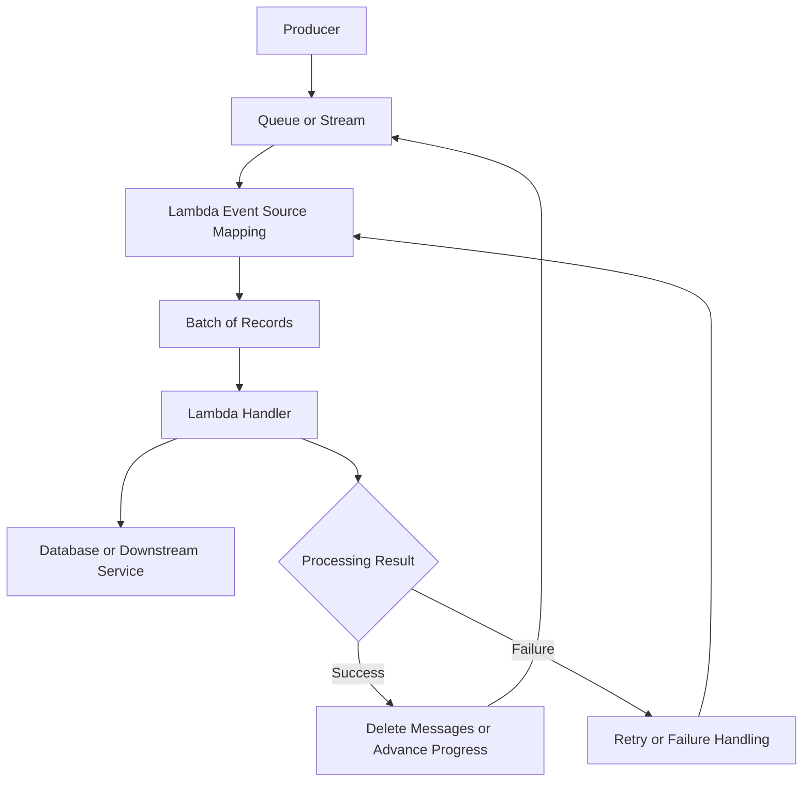

# 05- Event Source Mapping

## Overview

AWS Lambda event source mappings connect Lambda functions to supported event sources and manage the delivery of records to the function. They are particularly important for queue-based and stream-based workloads where Lambda must retrieve records, batch them, invoke a handler, and track processing progress.

An event source mapping is a Lambda-managed integration resource. It defines how Lambda consumes records from a source such as Amazon SQS, Amazon Kinesis Data Streams, or Amazon DynamoDB Streams.

Event source mappings help separate application processing logic from the mechanics of consuming events. They provide configurable controls for batching, concurrency, filtering, retry behavior, and failure handling, depending on the source.

Common use cases include:

- Processing background jobs from SQS.
- Consuming database changes from DynamoDB Streams.
- Processing telemetry and application events from Kinesis Data Streams.
- Consuming records from Amazon MSK or supported self-managed Kafka clusters.
- Integrating supported Amazon MQ brokers with Lambda.

Understanding event source mappings is essential for designing reliable serverless systems. Incorrect configuration can cause duplicate processing, delayed events, excessive concurrency, downstream overload, or data loss after records exceed their retention period.

## What Is an Event Source Mapping?

An event source mapping (ESM) is a Lambda resource that reads records from a supported source and invokes a target Lambda function with those records.

It is not the same as a resource-based permission that allows another service to invoke a function.

For example, an S3 notification can directly invoke Lambda, while an SQS integration normally uses an event source mapping that polls the queue.

### Core responsibilities

An event source mapping can manage the following responsibilities, depending on the source:

- Reading or polling records.
- Accumulating records into batches.
- Invoking the Lambda function.
- Tracking processing progress or checkpoints.
- Applying retry and failure-handling rules.
- Filtering records before invocation.
- Controlling or influencing consumer concurrency.
- Sending information about certain failures to configured destinations.

The mapping does not automatically make application side effects idempotent. The function must still handle duplicate records and partial failures correctly.

### Architecture



The final acknowledgment or progress mechanism depends on the source. SQS uses message visibility and deletion, while stream integrations use source-specific checkpointing and record-processing behavior.

## Supported Event Sources

Event source mapping capabilities differ by source. Do not assume that a configuration option supported by SQS is also supported by a stream or Kafka integration.

| Event source | Consumption model | Important considerations |
|---|---|---|
| Amazon SQS Standard | Poll and process message batches | At-least-once delivery, visibility timeout, DLQ, partial batch responses |
| Amazon SQS FIFO | Poll and process ordered message groups | Ordering, message groups, concurrency, partial failures |
| DynamoDB Streams | Read change records | Checkpoints, ordering per item, iterator age, stream retention |
| Kinesis Data Streams | Read records from shards | Partition ordering, checkpoints, shard throughput, consumer lag |
| Amazon MSK | Consume Kafka records | Partitions, offsets, authentication, networking, consumer lag |
| Self-managed Kafka | Consume Kafka records | Broker connectivity, security, partition assignment, offsets |
| Amazon MQ | Consume supported broker messages | Broker configuration, networking, acknowledgment and redelivery behavior |

AWS continuously evolves service capabilities. Verify the current event source mapping documentation for supported sources, configuration fields, regional availability, and quotas before implementing a production integration.

## Event Source Mapping Lifecycle

An event source mapping has a lifecycle that describes its operational state.

Common states include:

| State | Meaning |
|---|---|
| `Creating` | AWS is creating the mapping |
| `Enabling` | The mapping is being enabled |
| `Enabled` | The mapping is active and can consume records |
| `Disabling` | The mapping is being disabled |
| `Disabled` | The mapping is not actively consuming records |
| `Updating` | AWS is applying configuration changes |
| `Deleting` | The mapping is being removed |
| `Failed` | The mapping encountered a failure that prevents normal operation |

The exact set of states and transitions can evolve. Use `get-event-source-mapping` to inspect the actual state and any reported error information.

### Lifecycle considerations

- A successful create or update API response does not guarantee that the mapping is already processing records.
- Wait for the mapping to reach the expected state before validating end-to-end behavior.
- A disabled mapping can allow source backlogs to grow.
- Deleting a mapping does not necessarily delete the underlying queue, stream, or function.
- Re-enabling a mapping does not guarantee that all old records remain available indefinitely; source retention and retry behavior still apply.

## Creating an Event Source Mapping

The AWS CLI can create an event source mapping between an existing source and a Lambda function.

### Prerequisites

Before creating a mapping, verify that:

- The Lambda function exists.
- The queue, stream, broker, or other supported source exists.
- The function has the required execution-role permissions.
- The source and function are compatible in terms of Region and integration requirements.
- Network access and authentication are configured when required.
- The source's batch, timeout, and concurrency requirements are understood.

### Example: SQS to Lambda

The following command creates a mapping from an existing SQS queue to an existing Lambda function.

```bash
aws lambda create-event-source-mapping \
  --function-name order-processor \
  --event-source-arn arn:aws:sqs:ap-south-1:123456789012:orders-queue \
  --batch-size 10 \
  --enabled
```

Replace the function name and ARN with values from your AWS account.

The command creates an AWS resource. It is not a read-only inspection operation.

For SQS, the execution role generally needs the appropriate permissions to receive and delete messages and inspect queue attributes. AWS service integrations can require additional permissions depending on the source.

### Verify the mapping

```bash
aws lambda list-event-source-mappings \
  --function-name order-processor
```

To inspect a specific mapping, use its UUID returned by the create or list operation:

```bash
aws lambda get-event-source-mapping \
  --uuid <event-source-mapping-uuid>
```

Check the following fields where available:

- `State`
- `StateTransitionReason`
- `LastProcessingResult`
- `EventSourceArn`
- `FunctionArn`
- `BatchSize`
- `MaximumBatchingWindowInSeconds`
- `ScalingConfig`
- `FilterCriteria`

The returned fields depend on the source and configured features.

## Batch Size and Batching Window

Event source mappings can deliver multiple records in a single invocation. Batching can reduce invocation overhead and improve throughput, but it also changes latency, memory use, and failure behavior.

### Batch size

Batch size is the maximum number of records or messages Lambda attempts to include in an invocation, subject to source-specific limits.

Larger batches can:

- Reduce the number of Lambda invocations.
- Improve throughput for efficient bulk operations.
- Reduce per-invocation overhead.

They can also:

- Increase execution duration.
- Increase memory requirements.
- Increase the number of records affected by an invocation failure.
- Make retry behavior more expensive when partial batch responses are not used.

### Maximum batching window

The maximum batching window controls how long Lambda waits to accumulate records before invoking the function, where supported.

A longer window can improve batch efficiency for low-volume workloads. It also increases processing latency.

For SQS, a batching window can be configured to allow more messages to accumulate. When using batching windows, ensure the queue visibility timeout and function timeout remain appropriate for the resulting processing behavior.

### Batch configuration example

```bash
aws lambda update-event-source-mapping \
  --uuid <event-source-mapping-uuid> \
  --batch-size 10 \
  --maximum-batching-window-in-seconds 5
```

This is a modifying operation. Confirm that the selected source supports the requested settings and that the configured values fall within its current limits.

### Choosing a batch size

| Workload | Starting approach | Reasoning |
|---|---|---|
| Short independent SQS jobs | Moderate batch size | Reduces invocation overhead while keeping failure impact manageable |
| CPU-intensive record processing | Smaller batches | Limits execution time and memory pressure |
| Bulk database writes | Larger batches when transactions permit | Can reduce database round trips |
| Stream processing with ordering requirements | Source-specific batch tuning | Must preserve required ordering and checkpoint behavior |
| Latency-sensitive processing | Small batches and short windows | Reduces waiting time before invocation |

Treat these as starting points. Benchmark using realistic event sizes, downstream latency, and failure scenarios.

## SQS Event Source Mapping

SQS mappings are commonly used for asynchronous backend workloads because queues provide buffering, retry opportunities, and separation between producers and consumers.

### Processing flow

1. A producer sends messages to an SQS queue.
2. Lambda polls the queue through the event source mapping.
3. The mapping receives messages and invokes the function with a batch.
4. The function processes the messages.
5. Successfully processed messages are deleted by the integration.
6. Failed or unacknowledged messages can become visible again and be retried.

### Visibility timeout

The visibility timeout controls how long a received message remains invisible to other consumers.

If the message is not successfully processed and deleted before becoming visible again, another processing attempt can occur.

A visibility timeout that is too short can cause overlapping processing attempts. A timeout that is excessively long can delay recovery after a failed consumer.

AWS recommends configuring the SQS visibility timeout to be at least six times the Lambda function timeout, with additional allowance for the maximum batching window when configured. Validate the current AWS guidance and your workload's processing characteristics before deployment.

### Dead-letter queues

An SQS redrive policy can move messages to a dead-letter queue after the configured number of receives.

A DLQ is useful for:

- Isolating poison messages.
- Investigating repeated processing failures.
- Preventing a permanently failing message from repeatedly consuming processing capacity.
- Supporting controlled replay after a problem is corrected.

Monitor DLQ depth and age. A DLQ without alerting or a recovery procedure can become a silent data-loss risk from the application's perspective.

## Partial Batch Responses

By default, an invocation failure can cause an entire batch to be retried, even if some records were processed successfully.

Partial batch responses allow a handler to identify the records that failed, where the source supports this feature and the mapping is configured appropriately.

This is especially useful for SQS and supported stream integrations.

### Enable partial batch responses

For an SQS mapping, configure the response type:

```bash
aws lambda update-event-source-mapping \
  --uuid <event-source-mapping-uuid> \
  --function-response-types ReportBatchItemFailures
```

This modifies the mapping configuration.

Verify the setting after the update:

```bash
aws lambda get-event-source-mapping \
  --uuid <event-source-mapping-uuid>
```

Inspect `FunctionResponseTypes` in the response.

### Python implementation for SQS

```python
import json
import logging

logger = logging.getLogger()
logger.setLevel(logging.INFO)


def lambda_handler(event, context):
    failures = []

    for record in event.get("Records", []):
        message_id = record["messageId"]

        try:
            payload = json.loads(record["body"])
            process_message(payload)

        except Exception:
            logger.exception(
                "Message processing failed",
                extra={"message_id": message_id},
            )
            failures.append({"itemIdentifier": message_id})

    return {"batchItemFailures": failures}


def process_message(payload):
    order_id = payload["order_id"]

    # Perform an idempotent business operation.
    logger.info("Processing order", extra={"order_id": order_id})
```

When `ReportBatchItemFailures` is enabled, Lambda uses the returned failure identifiers to determine which records should be retried.

The exact identifier format depends on the source. For SQS, use `messageId`. For stream integrations, use the required sequence number or record identifier specified by that integration.

### Important implementation rules

- Return only the records that failed processing.
- Do not report a record as successful if its business operation failed.
- Keep processing records independently when the business logic permits it.
- Preserve ordering when records have dependencies.
- Use idempotency because successful side effects can occur before a later failure.
- Configure a recovery path for records that continue failing.

For stream sources, the failure response and checkpoint behavior can differ from SQS. Follow the source-specific partial batch response contract.

## Stream Event Source Mappings

DynamoDB Streams and Kinesis Data Streams use event source mappings to consume ordered records from a stream.

Unlike SQS, these integrations rely on stream progress and checkpointing rather than deleting individual records from a queue.

### Checkpointing

A checkpoint represents progress through a stream. The mapping uses source-specific rules to track which records have been processed.

If a batch fails, the mapping can retry records and delay progress according to its configuration.

Repeated failures can increase processing lag. If records remain unprocessed until the source retention window expires, they may no longer be available for recovery.

### Ordering

Ordering guarantees differ by source:

- DynamoDB Streams preserves modification order for a given item.
- Kinesis Data Streams preserves record ordering within a shard.
- Kafka preserves record ordering within a partition.

Parallel processing, batch configuration, and failure behavior can affect how an application observes processing progress. Do not assume a global ordering guarantee across independent partitions or shards.

### Stream-specific controls

Depending on the source, an event source mapping may support:

- Parallelization factor.
- Maximum record age.
- Retry attempts.
- Bisect batch on error.
- Partial batch responses.
- On-failure destinations.
- Filtering criteria.

These controls are not universally available across all event source types.

### Parallelization factor

For supported stream sources, a parallelization factor allows additional concurrent processing for a shard.

Increasing it can improve throughput when records can be processed concurrently. However, it also increases downstream load and may complicate application-level ordering assumptions.

Use higher parallelism only after confirming that the processing model remains correct for records associated with the same business entity.

### Bisect batch on error

For supported stream mappings, bisecting a failed batch splits the batch into smaller batches to isolate problematic records.

This can be useful when a single malformed record repeatedly causes a larger batch to fail.

It can also increase invocation overhead and processing time. Use it with retry limits, monitoring, and a clear failure-recovery policy.

## Filtering Criteria

Event source mapping filters allow Lambda to invoke a function only for records matching configured criteria, where supported.

Filtering can reduce unnecessary invocations and avoid sending irrelevant records into application code.

For example, a DynamoDB Streams consumer may only need records that represent inserted or modified items with a particular attribute value.

### Example filter pattern

A representative filter for a DynamoDB stream can match an `INSERT` event:

```json
{
  "eventName": ["INSERT"]
}
```

The exact pattern must match the source's event structure and the filtering syntax supported by Lambda. Validate the filter against actual event payloads before deploying it.

### Filtering considerations

- Filter at the mapping when the rule is stable and supported.
- Keep business-critical validation in application code.
- Test both matching and non-matching records.
- Understand what happens to filtered records in the source.
- Do not assume filtering provides authorization or data security.
- Monitor processing behavior after filter changes.

An overly restrictive filter can prevent required records from reaching the handler. Treat filter changes as behavior changes and deploy them with verification.

## Concurrency and Scaling

Event source mappings can scale consumption based on the source and the mapping configuration. Scaling behavior is source-specific.

For SQS, Lambda can increase the number of concurrent invocations as the queue receives work, subject to service limits, mapping configuration, and function concurrency availability.

For stream sources, concurrency depends on shard or partition structure, parallelization settings, and integration-specific limits.

### Reserved concurrency

Reserved concurrency sets the maximum concurrency available to a Lambda function and reserves that amount from the account's regional concurrency pool.

It can protect downstream dependencies by limiting the number of simultaneous executions.

However, a low concurrency limit can cause the mapping to process records more slowly, increasing queue backlog or stream lag.

### Maximum concurrency for SQS mappings

SQS event source mappings support a maximum concurrency setting for applicable configurations. It limits how many concurrent function invocations that mapping can use.

Example:

```bash
aws lambda update-event-source-mapping \
  --uuid <event-source-mapping-uuid> \
  --scaling-config '{"MaximumConcurrency": 20}'
```

Use this only when supported by the configured source and current mapping configuration.

The function's reserved concurrency should be sufficient for the combined maximum concurrency of its mappings and any other invocation sources that need capacity. Otherwise, throttling can occur.

### Capacity planning

When setting concurrency limits, account for:

- Average and peak arrival rates.
- Average and high-percentile processing duration.
- Downstream request limits.
- Database connection capacity.
- Batch size and records processed per invocation.
- Retry traffic and failure bursts.
- The rate at which the source can accumulate or retain records.

Concurrency should be derived from workload and dependency capacity, not selected solely to maximize Lambda throughput.

## Failure Handling and Retry Configuration

Failure handling differs significantly between queue sources and stream sources.

### SQS

For SQS:

- Failed messages can become visible again after the visibility timeout.
- Repeated receives can trigger the queue's redrive policy.
- Partial batch responses can limit retries to failed messages.
- A DLQ can isolate messages that exceed the configured receive count.

### Stream sources

For supported stream mappings:

- Failed batches may be retried.
- Checkpoint advancement can be delayed by failed records.
- Retry attempts and maximum record age can limit how long Lambda continues trying.
- Bisecting a batch can isolate problematic records.
- On-failure destinations can preserve information about discarded failures.

A stream mapping's failure controls should be designed with source retention and replay requirements in mind.

### Failure-handling decision table

| Failure type | Recommended response |
|---|---|
| Temporary downstream outage | Retry with bounded behavior and protect the downstream service |
| Invalid message format | Isolate the message, record diagnostic context, and avoid infinite retries |
| Database throttling | Reduce concurrency or batch pressure and investigate capacity |
| One bad record in a batch | Use partial batch responses or supported batch isolation features |
| Repeated permanent failure | Route to a DLQ or supported failure destination and alert |
| Large processing backlog | Investigate arrival rate, processing latency, concurrency limits, and downstream constraints |
| Records approaching retention expiry | Prioritize recovery and consider replay or alternate recovery sources |

Retries are not a substitute for a recovery plan. Define how failures are detected, investigated, corrected, and safely replayed.

## Idempotency and Duplicate Processing

Event source mappings can deliver a record more than once. A function can complete a side effect and fail before the integration records successful processing.

For example, a Lambda function may create an invoice in a database and then time out before the message is deleted from SQS. The same message can be delivered again.

### Idempotency strategies

- Use a stable event identifier.
- Enforce uniqueness with a database constraint or conditional write.
- Record processing state durably.
- Use idempotency keys supported by downstream APIs.
- Separate transient failures from permanent failures.
- Make replay procedures safe.

An in-memory set is not sufficient for durable deduplication because Lambda execution environments are temporary and may run concurrently.

### Example database pattern

For a PostgreSQL-backed consumer, an event-processing table can use a unique event identifier:

```sql
CREATE TABLE processed_events (
    event_id TEXT PRIMARY KEY,
    processed_at TIMESTAMPTZ NOT NULL DEFAULT NOW()
);
```

The consumer must coordinate the idempotency record and the business transaction correctly. If both can be committed in the same database transaction, the unique constraint can help prevent duplicate business effects.

If the side effect occurs in an external service, a local database transaction alone cannot guarantee atomicity across both systems. Use downstream idempotency support or a durable workflow that can recover from uncertain outcomes.

## Monitoring and Troubleshooting

Monitor both the Lambda function and the source. A function can have few errors while the queue backlog grows because concurrency is restricted or processing is too slow.

### Useful signals

| Signal | Diagnostic value |
|---|---|
| Lambda `Errors` | Shows failed invocations |
| Lambda `Duration` | Identifies slow batches and timeout risk |
| Lambda `Throttles` | Indicates concurrency pressure |
| Lambda `ConcurrentExecutions` | Shows active execution load |
| SQS visible message count | Indicates queued backlog |
| SQS oldest-message age | Shows how long work waits |
| SQS DLQ message count | Shows messages exceeding retry policy |
| Stream iterator age | Shows delay between stream production and consumption |
| Event source mapping state | Indicates whether the mapping is active or failed |
| `LastProcessingResult` | Provides mapping-level processing status where available |

Metric names and availability differ by source. Confirm the relevant CloudWatch metrics for the selected integration.

### Diagnostic workflow

1. Inspect the event source mapping state.
2. Check the function's error, duration, and throttle metrics.
3. Inspect the source backlog or stream lag.
4. Review CloudWatch Logs for the affected time window.
5. Verify execution-role permissions and source configuration.
6. Check batch size, batching window, retry settings, and concurrency.
7. Reproduce the failure with a controlled test event.
8. Correct the cause and verify recovery without creating duplicate side effects.

### Inspect the mapping

```bash
aws lambda get-event-source-mapping \
  --uuid <event-source-mapping-uuid>
```

### Inspect function configuration

```bash
aws lambda get-function-configuration \
  --function-name order-processor
```

### Inspect recent logs

```bash
aws logs tail /aws/lambda/order-processor \
  --since 30m
```

These inspection commands do not create or modify the mapping. They require the caller to have appropriate read permissions.

## Security Considerations

Event source mappings create a security boundary between the source, the function, and the downstream resources accessed by the function.

### Execution-role permissions

The Lambda execution role must grant the permissions needed to consume from the source.

For example, an SQS consumer generally needs permissions such as:

- `sqs:ReceiveMessage`
- `sqs:DeleteMessage`
- `sqs:GetQueueAttributes`

The exact permission set can vary by source, encryption configuration, and integration requirements.

### Least privilege

Avoid granting broad permissions such as `sqs:*` on every queue when a function consumes from one specific queue.

Scope the role to the required actions and source resources. Where customer-managed KMS keys are involved, verify the applicable key permissions and policies.

### Additional controls

- Restrict who can create, update, disable, or delete event source mappings.
- Protect sensitive event payloads in logs.
- Validate input before performing privileged operations.
- Review source encryption and network access.
- Use secure authentication for Kafka and broker integrations.
- Monitor configuration changes and unexpected processing behavior.

A mapping being enabled does not guarantee that the function has sufficient permissions to read from the source or write to its downstream dependencies.

## Cost and Performance Considerations

Event source mappings influence cost indirectly and directly through polling, invocation frequency, batch size, processing duration, and downstream activity.

### Cost drivers

- Number of Lambda invocations.
- Function duration and configured memory.
- Provisioned concurrency, if used by the function.
- Source-service charges.
- Downstream database or API requests.
- Logging, tracing, and monitoring volume.
- Reprocessing caused by retries or failed batches.

### Optimization techniques

- Choose batch sizes based on measured processing behavior.
- Use batching windows when added latency is acceptable.
- Filter irrelevant records at the mapping where supported.
- Avoid repeated downstream calls for records that can be processed together.
- Tune concurrency to match downstream capacity.
- Reduce unnecessary retries through correct error classification and partial batch responses.
- Keep logging useful without recording large payloads on every invocation.

The cheapest configuration is not necessarily the best configuration. Evaluate processing cost alongside latency objectives, reliability, and the business impact of delayed events.

## Operational Best Practices

Use the following checklist before deploying a mapping to production.

- [ ] Confirm that the event source and integration support the required features.
- [ ] Verify the mapping reaches `Enabled`.
- [ ] Configure batch size and batching window using workload measurements.
- [ ] Set function timeout and source visibility or retention settings appropriately.
- [ ] Enable partial batch responses where supported and implement the correct response format.
- [ ] Design all business side effects to tolerate duplicate processing.
- [ ] Configure DLQs or supported failure destinations where appropriate.
- [ ] Limit concurrency to protect databases and downstream APIs.
- [ ] Alarm on errors, throttles, backlog, lag, and failed-message accumulation.
- [ ] Test temporary outages, malformed records, and repeated failures.
- [ ] Document recovery and replay procedures.
- [ ] Review execution-role permissions and sensitive-data handling.
- [ ] Verify changes in a non-production environment before rollout.

## Common Mistakes

### Assuming every source supports the same configuration

Batch sizes, retry controls, partial batch responses, and concurrency options vary by integration. Check the source-specific configuration contract.

### Increasing batch size without testing failure behavior

Large batches can amplify the effect of a single failing record. Test batch processing under partial failures and downstream outages.

### Enabling partial batch responses without returning failures correctly

A handler that catches exceptions but returns an empty failure list can cause failed records to be treated as successfully processed. Ensure the response matches the integration's required format.

### Setting concurrency too low

An unnecessarily low concurrency limit can cause backlogs and increase processing latency. Measure arrival rates and processing duration before selecting a limit.

### Ignoring source retention

Stream records may expire before the consumer recovers. Monitor lag and establish recovery procedures that operate within retention limits.

### Treating a DLQ as automatic recovery

A DLQ stores failed messages; it does not correct the problem or safely replay them. Assign operational ownership and alert on DLQ growth.

### Assuming retries guarantee successful processing

Retries cannot fix invalid data, permanent permission failures, or incompatible schemas. Separate transient and permanent failures and define a recovery path.

## Key Takeaways

- An event source mapping is a Lambda-managed resource that consumes records from supported queues and streams and invokes a function.
- Batch size, batching windows, concurrency, filtering, and failure controls must be configured according to the event source and workload.
- Partial batch responses can reduce unnecessary retries, but the handler must return the correct failed-record identifiers.
- Duplicate processing is expected in many event-driven systems; use durable idempotency and safe recovery procedures.
- Monitor both Lambda execution and source backlog or lag, and protect downstream dependencies through deliberate concurrency and retry settings.