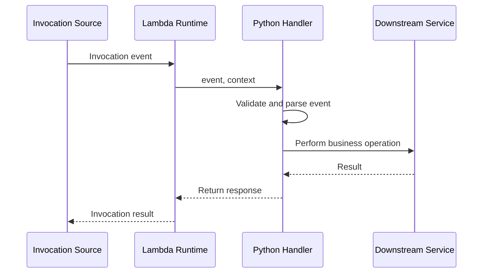

# 06- Lambda Context and Event Object

## Overview

AWS Lambda invokes a handler with two primary inputs: the **event object** and the **context object**.

- The **event object** contains the input data associated with the invocation. Its structure depends on the invocation source, such as API Gateway, Amazon SQS, Amazon S3, or a direct Lambda invocation.
- The **context object** provides runtime metadata about the current invocation and function environment, including the request ID, function name, configured timeout, and remaining execution time.

Understanding these objects is essential for writing handlers that are reliable, testable, observable, and compatible with different invocation sources.

A common mistake is to treat every Lambda event as an HTTP request or assume that all integrations provide the same event structure. Lambda does not automatically normalize events from different services into a common application schema.

## Lambda Handler Signature

For Python, a typical Lambda handler has this signature:

```python
def lambda_handler(event, context):
    ...
```

The parameters serve different purposes.

| Parameter | Purpose | Typical use |
|---|---|---|
| `event` | Input payload for the invocation | Parse request data, process messages, inspect records |
| `context` | Invocation and runtime metadata | Logging, request correlation, execution-time checks |

The handler name must match the configured handler module and function.

For example, if the file is `app.py` and the function is `lambda_handler`, configure the handler as `app.lambda_handler`.

### Invocation lifecycle



The exact response path depends on the invocation model. For example, API Gateway interprets the handler response according to its integration contract, while an SQS event source mapping interprets the response according to the configured batch-processing behavior.

## The Event Object

The event object is a Python representation of the input payload delivered to the handler. It is commonly a dictionary for AWS service integrations, but the handler should follow the actual event contract rather than assume a specific type in every invocation.

The structure depends on the source:

- API Gateway provides HTTP request information.
- S3 provides object-event records.
- SQS provides message records whose bodies are usually strings.
- EventBridge provides event metadata and an application-defined `detail` object.
- DynamoDB Streams provides records describing item changes.
- Direct invocation allows the caller to supply an application-defined payload.

### Example: Direct invocation

A caller can invoke a Lambda function with an application-defined JSON payload.

```json
{
  "operation": "recalculate_invoice",
  "invoice_id": "INV-10042",
  "requested_by": "billing-service"
}
```

The handler can access these fields directly:

```python
def lambda_handler(event, context):
    operation = event["operation"]
    invoice_id = event["invoice_id"]

    return {
        "operation": operation,
        "invoice_id": invoice_id,
        "request_id": context.aws_request_id,
    }
```

The event schema is defined by the caller and application. Lambda does not automatically validate the payload against a Python model or JSON Schema.

For production systems, validate the input and handle missing fields, invalid types, and unsupported operations explicitly.

## Event Objects by Invocation Source

### API Gateway

API Gateway passes request metadata such as the path, HTTP method, headers, query parameters, and request body. The exact schema depends on the API type and configured payload format version.

A simplified HTTP API payload using version `2.0` can resemble:

```json
{
  "version": "2.0",
  "routeKey": "GET /orders/{order_id}",
  "rawPath": "/orders/ORD-123",
  "rawQueryString": "",
  "headers": {
    "content-type": "application/json"
  },
  "pathParameters": {
    "order_id": "ORD-123"
  },
  "requestContext": {
    "http": {
      "method": "GET",
      "path": "/orders/ORD-123"
    }
  },
  "isBase64Encoded": false
}
```

A handler might extract the path parameter:

```python
def lambda_handler(event, context):
    path_parameters = event.get("pathParameters") or {}
    order_id = path_parameters.get("order_id")

    if not order_id:
        return {
            "statusCode": 400,
            "headers": {"content-type": "application/json"},
            "body": '{"error":"missing_order_id"}',
        }

    return {
        "statusCode": 200,
        "headers": {"content-type": "application/json"},
        "body": '{"order_id":"' + order_id + '"}',
    }
```

For production code, serialize response bodies with `json.dumps()` rather than manually concatenating JSON. Validate the identifier and use an established request-validation approach.

### Amazon S3

S3 notifications generally contain a `Records` list. Each record describes an event involving an object or another supported S3 event.

```json
{
  "Records": [
    {
      "eventSource": "aws:s3",
      "eventName": "ObjectCreated:Put",
      "s3": {
        "bucket": {
          "name": "application-files"
        },
        "object": {
          "key": "incoming/report.csv",
          "size": 2048
        }
      }
    }
  ]
}
```

A handler can extract the bucket and key:

```python
from urllib.parse import unquote_plus


def lambda_handler(event, context):
    for record in event.get("Records", []):
        if record.get("eventSource") != "aws:s3":
            continue

        bucket = record["s3"]["bucket"]["name"]
        key = unquote_plus(record["s3"]["object"]["key"])

        process_object(bucket, key)


def process_object(bucket, key):
    # Retrieve and process the object.
    pass
```

S3 object keys in event notifications are URL-encoded. Decode them before using them in operations that expect the original key.

S3 notifications can be delivered more than once, so object processing should tolerate duplicates.

### Amazon SQS

SQS events contain a `Records` list, with each record representing a message. The message body is typically a string, even when the producer sends JSON.

```json
{
  "Records": [
    {
      "messageId": "message-123",
      "body": "{\"order_id\":\"ORD-123\",\"operation\":\"fulfill\"}",
      "eventSource": "aws:sqs",
      "eventSourceARN": "arn:aws:sqs:ap-south-1:123456789012:orders"
    }
  ]
}
```

The handler must parse the body separately:

```python
import json


def lambda_handler(event, context):
    for record in event.get("Records", []):
        payload = json.loads(record["body"])
        process_order(payload)


def process_order(payload):
    order_id = payload["order_id"]
    operation = payload["operation"]

    # Apply idempotent business logic.
```

For SQS mappings, a handler's return value is not interpreted as an HTTP response. If partial batch responses are enabled, the handler must return the source-specific structure identifying failed messages. Otherwise, the mapping applies its configured batch-processing behavior.

### Amazon EventBridge

EventBridge events typically include metadata such as `id`, `source`, `detail-type`, `time`, and an application-defined `detail` object.

```json
{
  "version": "0",
  "id": "event-123",
  "source": "com.example.orders",
  "detail-type": "OrderCreated",
  "detail": {
    "order_id": "ORD-123",
    "status": "created"
  }
}
```

A handler can route processing based on the event type:

```python
def lambda_handler(event, context):
    detail_type = event.get("detail-type")
    detail = event.get("detail", {})

    if detail_type == "OrderCreated":
        handle_order_created(detail)
    else:
        raise ValueError(f"Unsupported event type: {detail_type}")


def handle_order_created(detail):
    order_id = detail["order_id"]
    status = detail["status"]

    # Persist or publish the business change.
```

The producer controls the schema of custom event details. Define and validate event contracts so that producer changes do not silently break consumers.

### DynamoDB Streams

DynamoDB Streams events contain records describing changes to table items. A record can include an event name, primary keys, sequence information, and old or new item images, depending on the stream configuration.

```json
{
  "Records": [
    {
      "eventName": "MODIFY",
      "eventSource": "aws:dynamodb",
      "dynamodb": {
        "SequenceNumber": "123456789",
        "Keys": {
          "PK": {
            "S": "ORDER#123"
          }
        },
        "NewImage": {
          "status": {
            "S": "PAID"
          }
        }
      }
    }
  ]
}
```

DynamoDB attribute values use typed representations, such as `S` for strings and `N` for numbers. Use a suitable deserialization approach when converting DynamoDB images into normal Python values.

The stream event schema and available images depend on the configured stream view type.

## Validating Event Payloads

An event is input data, not a guarantee that the payload is valid or complete. Validation should occur at the application boundary before business logic runs.

For Python applications, Pydantic can provide explicit schema validation for application-defined payloads.

```python
from pydantic import BaseModel, Field


class OrderCreatedEvent(BaseModel):
    order_id: str = Field(min_length=1)
    customer_id: str = Field(min_length=1)
    total_amount: float = Field(gt=0)


def lambda_handler(event, context):
    payload = OrderCreatedEvent.model_validate(event)

    process_order(payload)

    return {
        "status": "accepted",
        "order_id": payload.order_id,
    }


def process_order(event: OrderCreatedEvent):
    # Apply business logic.
    pass
```

This example expects the event itself to match the application-defined schema. For SQS, the body must first be decoded from JSON. For EventBridge or API Gateway, extract and validate the relevant portion of the event.

### Validation considerations

- Validate required fields, types, ranges, and supported event versions.
- Distinguish malformed data from transient infrastructure failures.
- Define whether invalid events should fail, be rejected, or be routed for investigation.
- Avoid silently dropping required business events.
- Keep validation separate from business operations so it can be tested independently.

## The Context Object

The context object exposes metadata about the current Lambda invocation and execution environment.

In Python, it is supplied by the Lambda runtime. It is not the event payload and should not be confused with an application-level request context used by web frameworks.

### Common context attributes

| Attribute | Description | Typical use |
|---|---|---|
| `aws_request_id` | Unique identifier for the current invocation | Log correlation and troubleshooting |
| `function_name` | Name of the Lambda function | Diagnostic logging |
| `function_version` | Version executing the invocation | Release and deployment diagnostics |
| `invoked_function_arn` | ARN used to invoke the function | Identifying invocation targets and qualifiers |
| `memory_limit_in_mb` | Configured memory limit | Runtime diagnostics |
| `log_group_name` | CloudWatch Logs group name | Operational metadata |
| `log_stream_name` | CloudWatch Logs stream name | Locating invocation logs |
| `get_remaining_time_in_millis()` | Approximate execution time remaining | Deadline-aware processing |

Context attributes are runtime metadata. Do not use them as a replacement for application-defined identifiers such as an order ID, payment ID, or business event ID.

### Example: Logging context metadata

```python
import json
import logging

logger = logging.getLogger()
logger.setLevel(logging.INFO)


def lambda_handler(event, context):
    logger.info(
        json.dumps(
            {
                "message": "Invocation started",
                "request_id": context.aws_request_id,
                "function_name": context.function_name,
                "function_version": context.function_version,
                "remaining_time_ms": (
                    context.get_remaining_time_in_millis()
                ),
            }
        )
    )

    return {"status": "ok"}
```

This example demonstrates explicit structured logging. In production, choose one consistent logging format and ensure that the application does not accidentally emit duplicate or inconsistently encoded log records.

### Request ID

`context.aws_request_id` identifies a Lambda invocation. It is useful for correlating application logs with Lambda execution logs.

It is not necessarily the same as:

- An API Gateway request ID.
- A client-generated correlation ID.
- An SQS message ID.
- An EventBridge event ID.
- A business transaction ID.

Log these identifiers separately when available.

## Deadline-Aware Processing

Lambda enforces a configured maximum execution duration. The context object exposes the remaining time through `get_remaining_time_in_millis()`.

This can help a handler avoid starting work that is unlikely to complete before the function times out.

```python
def lambda_handler(event, context):
    minimum_time_required_ms = 5_000

    if context.get_remaining_time_in_millis() < minimum_time_required_ms:
        raise TimeoutError("Insufficient time remaining to start processing")

    return perform_operation(event)


def perform_operation(event):
    # Perform work with explicit downstream timeouts.
    return {"status": "completed"}
```

The threshold is illustrative and should be derived from measured processing time.

### Production recommendations

- Set explicit timeouts on HTTP clients and database operations.
- Leave time for cleanup and response serialization.
- Avoid starting long-running work near the Lambda deadline.
- Use asynchronous processing or workflow orchestration when work may exceed the request's latency budget.
- Do not assume the remaining-time check eliminates race conditions or guarantees completion.

A deadline check is only a local decision aid. It cannot guarantee that downstream work finishes before the Lambda timeout.

## Execution Environment and Context Reuse

Lambda can reuse an execution environment across multiple invocations. Module-level objects, SDK clients, and other reusable resources may persist between invocations in the same environment.

For example, initializing a boto3 client outside the handler can avoid recreating it for every invocation.

```python
import boto3

dynamodb = boto3.resource("dynamodb")
table = dynamodb.Table("orders")


def lambda_handler(event, context):
    order_id = event["order_id"]

    response = table.get_item(Key={"order_id": order_id})

    return {
        "order": response.get("Item"),
        "request_id": context.aws_request_id,
    }
```

### Safe reuse

Good candidates for reuse include:

- SDK clients and resources.
- Immutable configuration.
- Compiled regular expressions.
- Connection pools designed for the runtime and workload.

Do not rely on the execution environment surviving between invocations. Lambda can create new environments, freeze and resume existing environments, or terminate environments according to its lifecycle.

Avoid retaining invocation-specific or user-specific state in module-level variables. Such state can leak across requests handled by the same environment.

### Unsafe example

```python
current_user_id = None


def lambda_handler(event, context):
    global current_user_id

    current_user_id = event["user_id"]
    process_user(current_user_id)

    return {"status": "ok"}
```

This example unnecessarily stores request data globally. It makes the function harder to reason about and can produce incorrect behavior if state is reused or modified unexpectedly.

Prefer invocation-local variables:

```python
def lambda_handler(event, context):
    user_id = event["user_id"]
    process_user(user_id)

    return {"status": "ok"}
```

## Correlation IDs and Distributed Tracing

A request can pass through API Gateway, Lambda, SQS, and downstream services. The Lambda request ID identifies only one Lambda invocation; it does not automatically represent the complete business workflow.

Use explicit correlation identifiers to connect related operations across service boundaries.

A useful logging context may include:

- Lambda request ID.
- Application correlation ID.
- Business entity ID.
- Source event or message ID.
- Trace ID, when distributed tracing is configured.

Do not trust an arbitrary client-supplied correlation ID as an authorization identity. Validate its format and avoid using it as a security decision.

For asynchronous systems, include stable event identifiers in published messages when possible. This helps trace retries and correlate duplicate deliveries.

## Error Handling and Event Semantics

The correct error-handling strategy depends on the invocation source.

| Source | Typical error implication |
|---|---|
| Synchronous invocation | Caller receives an invocation error or integration-specific failure response |
| Asynchronous Lambda invocation | Lambda can retry function errors according to asynchronous invocation configuration |
| SQS event source mapping | Failed messages can be retried according to queue visibility, mapping behavior, and redrive policy |
| Stream event source mapping | Failed records can affect checkpoint progress and retry behavior |
| EventBridge target | Delivery retries and target failure handling are managed according to EventBridge configuration |

Do not catch every exception and return success without an explicit reason. Doing so can prevent the invocation system from recognizing a failure and can silently discard required work.

For batch events, distinguish between:

- A failure affecting the entire batch.
- A failure affecting one record.
- A permanent input validation error.
- A transient dependency failure.

Use partial batch responses where supported and configure an appropriate recovery path.

## Testing Event and Context Handling

Handlers should be testable without invoking AWS for every unit test.

### Example unit test

```python
from types import SimpleNamespace

from app import lambda_handler


def test_lambda_handler():
    event = {
        "operation": "recalculate_invoice",
        "invoice_id": "INV-10042",
    }

    context = SimpleNamespace(
        aws_request_id="test-request-id",
        function_name="invoice-processor",
        function_version="$LATEST",
        get_remaining_time_in_millis=lambda: 10_000,
    )

    result = lambda_handler(event, context)

    assert result["operation"] == "recalculate_invoice"
    assert result["invoice_id"] == "INV-10042"
    assert result["request_id"] == "test-request-id"
```

This test uses a lightweight context substitute. Tests should provide only the attributes the handler actually accesses.

### Recommended test cases

- Valid payloads.
- Missing required fields.
- Invalid types and malformed JSON.
- Empty record lists.
- Unexpected event-source identifiers.
- Duplicate event identifiers.
- Insufficient remaining execution time.
- Downstream timeouts and exceptions.
- Partial batch failure responses.
- Different versions of the application event schema.

Use integration tests to validate the real event shape and service-specific behavior. Unit tests alone cannot verify IAM permissions, mapping configuration, or the delivery behavior of the actual AWS integration.

## Security Considerations

Event and context data should be treated carefully because logs and downstream calls can expose information beyond the original invocation.

- Do not log complete event payloads by default.
- Redact tokens, credentials, personal information, and sensitive business data.
- Validate untrusted fields before using them in database queries or external API calls.
- Do not assume a field in an event proves the caller's identity or authorization.
- Use IAM to control access to AWS resources.
- Keep application correlation identifiers separate from authentication and authorization decisions.
- Avoid returning internal exception details to external clients.

The context object provides operational metadata, not a set of application permissions.

## Common Mistakes

### Assuming all events have the same schema

SQS, S3, EventBridge, and API Gateway provide different payload structures. Use source-specific parsers or explicit adapters.

### Treating an SQS body as an already-parsed dictionary

SQS message bodies are generally strings. Parse JSON explicitly and handle malformed payloads.

### Confusing the Lambda request ID with a business ID

A retry can produce a new invocation request ID for the same logical event. Use stable event identifiers for idempotency.

### Storing invocation state globally

Execution environments may be reused. Keep request-specific state local to the handler.

### Ignoring the remaining execution time

A handler can begin expensive work just before its timeout. Use explicit downstream timeouts and deadline-aware decisions.

### Swallowing exceptions

Returning success after an unhandled business failure can prevent retries or failure reporting. Choose an error policy that matches the invocation source.

### Trusting event fields without validation

Event payloads can be malformed, stale, duplicated, or produced by an unexpected source. Validate data and enforce authorization independently.

## Key Takeaways

- The event object contains invocation input, while the context object provides Lambda runtime and invocation metadata.
- Event structures vary by integration; parse and validate payloads according to the actual source contract.
- Use `context.aws_request_id` for invocation-level diagnostics and stable application identifiers for business correlation and idempotency.
- Reuse SDK clients and other safe resources across invocations, but never rely on execution-environment persistence or retain request-specific state globally.
- Use remaining-time checks, explicit downstream timeouts, structured logging, and source-appropriate error handling to improve reliability.