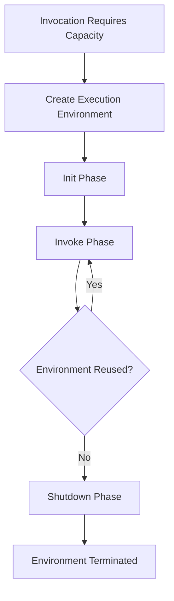
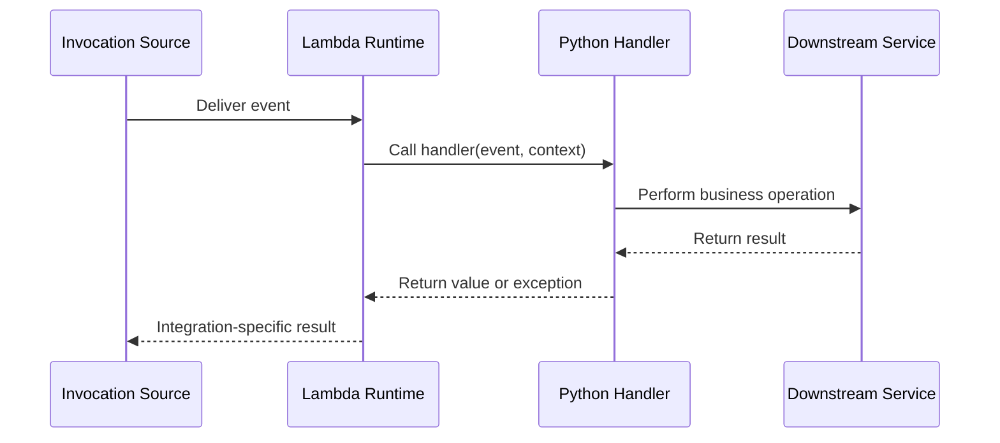
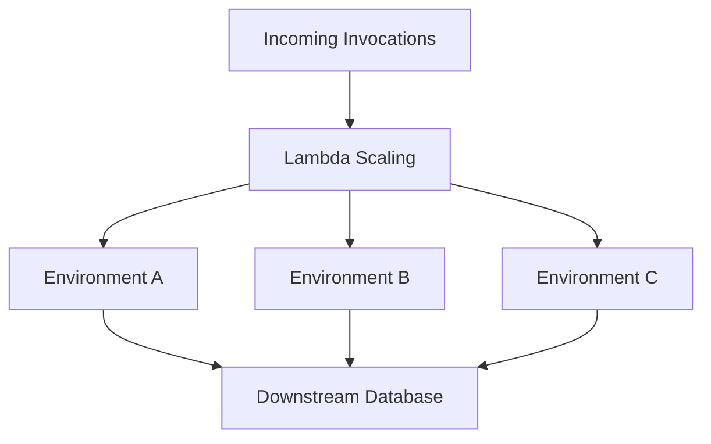

# 07- Lambda Runtime Lifecycle

## Overview

The AWS Lambda runtime lifecycle describes how Lambda prepares an execution environment, initializes the function, executes invocations, reuses the environment, and eventually shuts it down.

Understanding this lifecycle is important for backend engineers because it directly affects cold-start latency, dependency initialization, connection management, memory usage, concurrency, and application reliability.

Lambda abstracts server provisioning and runtime management, but it does not eliminate the need to understand application startup and resource lifecycles. Inefficient initialization, unsafe global state, and incorrect connection handling can create production latency and reliability problems.

The lifecycle is generally divided into three phases:

- **Init:** Lambda prepares the execution environment and initializes the runtime and function code.
- **Invoke:** Lambda executes the handler for an invocation.
- **Shutdown:** Lambda terminates the execution environment and gives the runtime and extensions an opportunity to perform supported cleanup.

These phases describe the general execution model. Their precise behavior depends on the runtime, invocation pattern, execution environment, and advanced features such as provisioned concurrency or SnapStart.

## Lambda Execution Environment

An execution environment is the isolated environment in which a Lambda function's runtime and handler execute.

It contains the resources needed to run the function, including:

- The language runtime.
- The function code and dependencies.
- Environment variables and configuration.
- Available memory and temporary storage.
- Runtime-managed invocation infrastructure.
- Any configured extensions.

Lambda can create multiple execution environments for the same function when concurrent invocations require additional capacity.

An execution environment can also be reused for subsequent invocations. However, reuse is not guaranteed, and applications must remain correct when Lambda creates a fresh environment.

### Lifecycle diagram



The diagram represents the general lifecycle rather than a guarantee that every environment follows the same number of invocations or shutdown sequence.

### Execution environment versus invocation

These are different concepts.

| Concept | Meaning |
|---|---|
| Lambda function | The deployed code and configuration |
| Execution environment | The isolated runtime environment that executes the code |
| Invocation | One execution of the handler for a request or event |
| Runtime | The component that manages communication between Lambda and the language handler |
| Extension | An optional component that can participate in the environment lifecycle and provide additional capabilities |

A single function can have many execution environments operating concurrently. A reused environment can execute multiple invocations over time.

## The Init Phase

The Init phase prepares an execution environment to run the function.

For a conventional Python Lambda function, this typically includes runtime initialization, loading the handler module, importing dependencies, and executing module-level initialization code.

### Typical initialization sequence

1. Lambda creates or prepares an execution environment.
2. The runtime starts.
3. The runtime loads the handler module.
4. Python imports required dependencies.
5. Module-level code executes.
6. The environment becomes ready to process an invocation.

Initialization can include operations such as creating SDK clients, loading configuration, compiling regular expressions, and preparing reusable application resources.

The Init phase is a major contributor to cold-start latency, particularly when dependencies are large or initialization performs network operations.

### Example: Initialization outside the handler

```python
import boto3
import json
import logging
import os

logger = logging.getLogger()
logger.setLevel(logging.INFO)

TABLE_NAME = os.environ["ORDERS_TABLE"]

dynamodb = boto3.resource("dynamodb")
orders_table = dynamodb.Table(TABLE_NAME)


def lambda_handler(event, context):
    order_id = event["order_id"]

    response = orders_table.get_item(
        Key={"order_id": order_id}
    )

    return {
        "order": response.get("Item"),
        "request_id": context.aws_request_id,
    }
```

The environment variable is read and the DynamoDB resource is initialized when the module is imported, rather than on every invocation.

This can reduce repeated setup overhead. The actual benefit depends on the initialization cost and how frequently the environment is reused.

### What belongs in initialization?

Good candidates include:

- Creating reusable AWS SDK clients.
- Loading static configuration.
- Compiling reusable regular expressions.
- Initializing immutable application configuration.
- Preparing lightweight resources needed by most invocations.

Use caution with:

- Network calls that can make every cold start slow.
- Database connections that may become stale.
- Large dependency imports that are unnecessary for most invocation paths.
- Expensive computation that can be performed during deployment or cached safely.
- Secrets or credentials stored in global variables without an appropriate refresh strategy.

Initialization should be predictable, bounded, and failure-aware.

## The Invoke Phase

The Invoke phase begins when Lambda delivers an invocation to a ready execution environment.

The runtime passes the event and context to the configured handler. The handler performs application work and returns a result or raises an exception.

### Invocation sequence



The final result depends on the invocation mechanism. A synchronous caller can receive the result directly, an asynchronous invocation can be handled through Lambda's asynchronous processing system, and an event source mapping applies source-specific acknowledgment or checkpoint behavior.

### Handler execution

```python
import json


def lambda_handler(event, context):
    operation = event.get("operation")

    if operation == "health_check":
        return {
            "status": "ok",
            "request_id": context.aws_request_id,
        }

    if operation == "process_order":
        order_id = event["order_id"]

        return {
            "status": "accepted",
            "order_id": order_id,
        }

    raise ValueError(f"Unsupported operation: {operation}")
```

This example illustrates dispatching based on an application-defined event. Production code should validate input and implement the required business operations.

### Invocation duration

Lambda enforces a configured timeout. If the handler does not finish within the allowed duration, the invocation can time out.

Production handlers should:

- Set explicit timeouts for outbound HTTP and database operations.
- Avoid starting expensive work when insufficient execution time remains.
- Use idempotent operations when retries can occur.
- Keep request-specific state local to the invocation.
- Log enough context to diagnose failures without exposing sensitive payloads.

A Lambda timeout does not necessarily cancel an operation already accepted by a downstream service. For example, a database transaction or external API request might complete even if the function times out before receiving its response.

## The Shutdown Phase

The Shutdown phase occurs when Lambda terminates an execution environment.

During a supported shutdown sequence, the runtime and registered extensions may receive an opportunity to perform cleanup. The exact behavior depends on the runtime and extension lifecycle.

Potential cleanup operations include:

- Closing local resources.
- Flushing buffered telemetry.
- Stopping extension processes.
- Releasing temporary resources.

Applications must not depend on graceful shutdown occurring for every environment termination. Abrupt termination, timeouts, and infrastructure events can prevent application cleanup code from completing.

### Production guidance

- Use context managers and `try/finally` for resources that must be cleaned up during normal handler execution.
- Keep critical state in durable systems rather than process memory.
- Flush important telemetry during the normal invocation path when possible.
- Treat shutdown hooks as best-effort cleanup, not as the only place where business state is committed.
- Avoid relying on a final handler invocation to release resources.

A Lambda function should remain correct even if its execution environment disappears without application-controlled cleanup.

## Warm Starts and Cold Starts

A cold start occurs when Lambda must initialize an execution environment before processing an invocation. A warm invocation reuses an environment that is already initialized.

The term *warm start* is commonly used to describe reuse, although it is not a guarantee that a particular future invocation will reuse the same environment.

### Cold-start contributors

Cold-start latency can include:

- Execution-environment provisioning.
- Runtime startup.
- Dependency imports.
- Module-level initialization.
- Extension startup.
- Network-related initialization.
- Additional setup required by the configured runtime or deployment model.

The relative cost of each step depends on the function, runtime, architecture, configuration, and AWS execution features.

### Cold start versus warm invocation

| Characteristic | Cold start | Warm invocation |
|---|---|---|
| Environment initialization | Required | Already completed for a reused environment |
| Module imports | Performed during initialization | Usually not repeated |
| Global clients | Created during initialization | Can be reused if still valid |
| Startup latency | Usually higher | Often lower |
| Guaranteed behavior | No | No guarantee of future reuse |
| Main optimization target | Initialization and startup overhead | Handler and downstream processing efficiency |

### Reducing cold-start latency

- Minimize unnecessary dependencies.
- Avoid expensive network calls during module import.
- Use an appropriate runtime and deployment package.
- Initialize reusable resources efficiently.
- Measure cold and warm latency separately.
- Consider provisioned concurrency when predictable startup latency is required and its cost is justified.
- Evaluate SnapStart when the runtime and function configuration support it.

Do not optimize solely for cold-start time. A function that spends most of its duration waiting for a database may gain more from connection and query optimization.

## Execution Environment Reuse

Lambda can reuse an initialized environment for multiple invocations. This makes module-level initialization useful for reusable clients and immutable resources.

### Reusable SDK clients

```python
import boto3

s3_client = boto3.client("s3")


def lambda_handler(event, context):
    bucket = event["bucket"]
    key = event["key"]

    response = s3_client.get_object(
        Bucket=bucket,
        Key=key,
    )

    body = response["Body"]

    try:
        content = body.read()
        return {
            "bucket": bucket,
            "key": key,
            "size": len(content),
        }
    finally:
        body.close()
```

Creating the client outside the handler avoids reconstructing it for every invocation in a reused environment.

For large objects, prefer streaming or incremental processing rather than reading the entire body into memory, as shown here for simplicity.

### Avoid global mutable request state

Unsafe example:

```python
current_customer = None


def lambda_handler(event, context):
    global current_customer
    current_customer = event["customer_id"]

    return process_customer(current_customer)
```

The code introduces shared mutable state that is unnecessary for a single invocation. It makes the application harder to reason about and can create incorrect behavior if the value is changed or accessed unexpectedly.

Prefer invocation-local variables:

```python
def lambda_handler(event, context):
    customer_id = event["customer_id"]
    return process_customer(customer_id)
```

Global variables are not inherently unsafe. Reusable clients and immutable configuration are common patterns. The risk comes from relying on mutable process state to represent independent requests.

### Resource reuse limitations

Reused resources can become stale. For example:

- Database connections can be closed by the server.
- Authentication tokens can expire.
- DNS or network conditions can change.
- A remote dependency can become temporarily unavailable.

Design resource usage to detect failures and recover safely. Reuse is a performance optimization, not a guarantee that a resource remains valid indefinitely.

## Concurrency and Multiple Execution Environments

Lambda creates additional execution environments as needed to process concurrent invocations, subject to service quotas, concurrency settings, and source-specific scaling behavior.

For example, if a function receives enough simultaneous requests, Lambda can run multiple environments in parallel.



Each environment has its own process memory and module-level objects. A Python global variable in one environment is not shared with other environments.

### Why this matters

Suppose each execution environment opens a database connection during initialization. Increasing Lambda concurrency can increase the number of simultaneous connections.

If a database supports only a limited number of connections, rapid scaling can exhaust that capacity even when each individual function behaves correctly.

Mitigations include:

- Limiting function concurrency where appropriate.
- Reusing database connections safely.
- Using Amazon RDS Proxy when suitable for the database workload.
- Keeping transactions short.
- Using bounded connection pools.
- Monitoring connection counts and database saturation.

Do not assume that global clients or in-memory caches are shared across Lambda environments. Use external services such as DynamoDB or Redis when state must be shared across concurrent environments.

## Execution Environment Reuse and Caching

In-memory caching can reduce repeated reads or expensive computations within a reused environment.

```python
import time

_configuration_cache = None
_configuration_loaded_at = 0
CACHE_TTL_SECONDS = 60


def lambda_handler(event, context):
    configuration = get_configuration()
    return process_request(event, configuration)


def get_configuration():
    global _configuration_cache
    global _configuration_loaded_at

    now = time.monotonic()

    if (
        _configuration_cache is None
        or now - _configuration_loaded_at >= CACHE_TTL_SECONDS
    ):
        _configuration_cache = load_configuration()
        _configuration_loaded_at = now

    return _configuration_cache


def load_configuration():
    # Load configuration from an appropriate source.
    return {"feature_enabled": True}


def process_request(event, configuration):
    return {
        "feature_enabled": configuration["feature_enabled"],
    }
```

This example illustrates a process-local TTL cache. It is not a distributed cache and does not guarantee consistency between execution environments.

### Caching considerations

- Set an appropriate TTL when configuration or data can change.
- Do not cache sensitive data longer than necessary.
- Account for stale data and invalidation requirements.
- Avoid assuming all concurrent environments see the same cache.
- Use Redis or another shared store when cross-environment consistency is required.
- Consider memory usage when caching large objects.

A local cache can improve performance, but it must not be the source of truth for critical business state.

## Initialization Optimization

Initialization overhead can become significant when functions import large dependency trees or perform expensive setup operations.

### Common sources of unnecessary initialization work

- Importing packages that are only used on rare execution paths.
- Loading large configuration files on every cold start.
- Calling multiple remote services before the handler begins.
- Performing computations that could be completed during deployment.
- Initializing clients for services the invocation does not use.

### Optimization techniques

**Reduce dependency size.** Package only the libraries needed by the function. Smaller dependency trees can reduce import work and deployment overhead.

**Use lazy initialization selectively.** Create expensive resources only when they are needed. This can help functions with multiple execution paths, although it moves some latency into the invocation.

**Move static work out of startup.** Precompute immutable configuration during the build process where practical.

**Measure before refactoring.** Use CloudWatch metrics, logs, and appropriate tracing to determine whether initialization is actually a significant latency contributor.

### Eager versus lazy initialization

| Strategy | Advantage | Trade-off |
|---|---|---|
| Eager initialization | Resources are ready before handler logic needs them | Can increase cold-start duration even when resources are unused |
| Lazy initialization | Avoids initializing resources on unused code paths | First use can increase invocation latency |
| Precomputed configuration | Reduces runtime work | Requires deployment or configuration processes to refresh generated data |
| External shared cache | Shares cached values across environments | Adds network calls and an external dependency |

Choose based on invocation patterns, startup latency requirements, and operational complexity.

## Provisioned Concurrency

Provisioned concurrency prepares a specified number of execution environments for a Lambda function version or alias.

It is useful for latency-sensitive workloads where the application needs to reduce the chance that an invocation waits for environment initialization.

### How it changes the lifecycle

Provisioned environments are initialized ahead of demand. This moves much of the initialization work away from the invocation path for the provisioned capacity.

Provisioned concurrency does not eliminate every source of latency. Handler execution, downstream calls, scaling beyond the provisioned capacity, and other runtime behavior can still affect response times.

### Appropriate use cases

- Interactive APIs with strict latency targets.
- Traffic patterns where cold-start variability is operationally important.
- Predictable high-traffic periods.
- Workloads that need pre-initialized capacity for a specific version or alias.

### Trade-offs

- You pay for configured provisioned capacity while it is allocated.
- Capacity planning is required.
- Traffic exceeding provisioned capacity can still experience different latency behavior.
- Initialization failures can prevent environments from becoming ready.

Provisioned concurrency is a latency and capacity decision, not a general replacement for efficient initialization.

## Lambda SnapStart

Lambda SnapStart can reduce startup latency by creating and reusing snapshots of initialized execution environments for supported function configurations.

Its availability and compatibility depend on the runtime, function configuration, and AWS service support. Verify the current AWS documentation before choosing it.

### Engineering implications

SnapStart changes initialization behavior by allowing an initialized environment snapshot to be restored. This can reduce repeated initialization work for eligible functions.

However, snapshot restoration introduces important correctness considerations:

- Do not assume that resources created during initialization remain valid after restoration.
- Avoid embedding time-sensitive credentials or tokens in a snapshot without an appropriate refresh strategy.
- Use supported runtime mechanisms for post-restore initialization where required.
- Validate random-number generation, time-dependent state, and connection handling.
- Test restored environments under realistic workloads.

SnapStart and provisioned concurrency address related startup-latency concerns through different mechanisms. They are not interchangeable, and their compatibility, lifecycle, and cost models differ.

## Runtime and Extension Lifecycle

Lambda's runtime and any configured extensions participate in the execution environment lifecycle.

Extensions can support observability, telemetry collection, security tooling, or other integrations. Their startup and shutdown behavior can influence initialization and environment lifecycle characteristics.

### Operational considerations

- Extensions consume execution-environment resources.
- Extension startup can increase initialization overhead.
- Telemetry delivery should account for buffering and possible shutdown limitations.
- Extension failures can affect application behavior depending on the integration.
- Validate runtime and extension compatibility during upgrades.

Keep extension configuration minimal and test its effects on latency, memory, and error rates.

## Monitoring Runtime Lifecycle Behavior

Lifecycle performance should be measured rather than inferred from whether a function appears to have started quickly.

### Useful signals

| Signal | What it helps identify |
|---|---|
| Lambda `Duration` | Handler execution time |
| Lambda `Init Duration` in applicable logs | Initialization time for cold starts |
| Lambda `Errors` | Failed invocations |
| Lambda `Throttles` | Concurrency pressure |
| Lambda `ConcurrentExecutions` | Active execution load |
| Maximum memory used in logs | Memory pressure |
| Application initialization logs | Expensive startup operations |
| Downstream latency metrics | Time spent waiting on external dependencies |

The exact metrics and log fields available depend on the runtime and configuration. Use CloudWatch Logs and metrics to distinguish initialization time from handler execution time where the available telemetry permits it.

### Example: Explicit initialization logging

```python
import logging
import time

logger = logging.getLogger()
logger.setLevel(logging.INFO)

initialization_started_at = time.perf_counter()

# Initialize reusable resources here.
# For example, create SDK clients.

initialization_duration_ms = (
    time.perf_counter() - initialization_started_at
) * 1000

logger.info(
    "Module initialization completed",
    extra={
        "initialization_duration_ms": round(
            initialization_duration_ms,
            2,
        )
    },
)


def lambda_handler(event, context):
    logger.info(
        "Invocation started",
        extra={
            "request_id": context.aws_request_id,
            "remaining_time_ms": (
                context.get_remaining_time_in_millis()
            ),
        },
    )

    return {"status": "ok"}
```

This measures the application's explicit initialization block, not the entire Lambda cold start. Runtime startup, module imports before the measurement, and other platform work are not included.

### Diagnostic workflow

When investigating slow invocations:

1. Compare initialization time with handler duration.
2. Inspect dependency imports and module-level operations.
3. Measure downstream request latency.
4. Check memory pressure and timeout behavior.
5. Compare cold-start and warm-invocation distributions.
6. Evaluate provisioned concurrency or SnapStart when appropriate.
7. Re-test after changes under representative traffic.

Avoid relying on a single average. Tail latency and traffic bursts can reveal problems that averages hide.

## Common Mistakes

### Assuming every invocation gets a fresh environment

Lambda can reuse an environment. Module-level state can persist across invocations, so handlers must not assume all global variables are reset automatically.

### Assuming an environment will always be reused

Lambda can create or terminate environments at any time according to its execution model. Important state must be stored durably.

### Performing expensive network calls during initialization

Remote configuration or database calls can make cold starts slow and can prevent initialization from succeeding during a dependency outage. Keep initialization bounded and design failure handling carefully.

### Opening too many database connections

Scaling creates more execution environments, each potentially opening its own connections. Limit concurrency and use suitable connection management.

### Relying on shutdown cleanup for correctness

Graceful cleanup is not guaranteed in every termination scenario. Commit important business state during normal processing.

### Treating provisioned concurrency as a universal performance fix

Provisioned concurrency reduces initialization-related latency for provisioned capacity, but it does not fix slow database queries, excessive handler work, or downstream bottlenecks.

### Ignoring initialization costs introduced by extensions

Monitoring and security extensions can add startup time and consume memory. Measure their impact rather than assuming their overhead is negligible.

## Key Takeaways

- Lambda execution environments follow a general Init, Invoke, and Shutdown lifecycle, but reuse and graceful shutdown are not guaranteed.
- Module-level initialization can improve warm-invocation performance when used for reusable clients and immutable resources.
- Keep request-specific state local to the handler and store important shared state in durable external systems.
- Cold-start optimization requires measuring initialization, handler execution, and downstream latency separately.
- Provisioned concurrency and SnapStart can reduce startup latency for supported configurations, but neither removes the need for efficient initialization and resilient resource management.