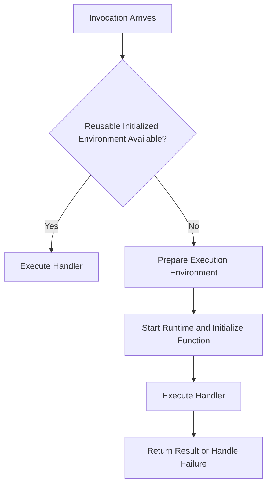
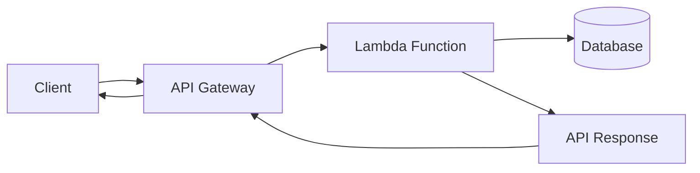
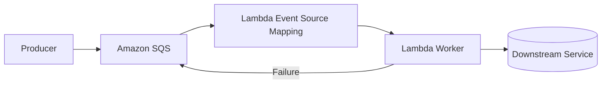

# 08- Cold Starts

## Overview

A cold start occurs when AWS Lambda must prepare an execution environment before it can process an invocation. This preparation can add latency to the first invocation handled by that environment.

Cold starts matter most for latency-sensitive workloads, such as REST APIs, authentication endpoints, interactive applications, and synchronous microservice calls. For asynchronous processing, a cold start may be less visible to the caller but can still affect queue age, processing throughput, and end-to-end completion time.

Cold-start latency is not a fixed value. It depends on the runtime, deployment artifact, initialization logic, extensions, memory configuration, networking requirements, and Lambda features in use.

The primary engineering goal is not necessarily to eliminate every cold start. It is to ensure that cold-start latency is acceptable for the workload, measurable in production, and managed using an appropriate combination of code optimization, capacity planning, and service configuration.

## How Cold Starts Work

A Lambda execution environment must be initialized before it can execute a handler. When Lambda can reuse an already initialized environment, a subsequent invocation can avoid repeating most initialization work.

### Cold-start lifecycle



The diagram shows the general execution model. Actual initialization behavior depends on the runtime and configuration. Features such as provisioned concurrency and SnapStart can change when or how initialization work occurs.

### What happens during a cold start?

Typical contributors include:

- **Environment preparation:** Lambda prepares the execution environment needed to run the function.
- **Runtime startup:** The configured language runtime starts.
- **Dependency loading:** The runtime loads the handler module and its dependencies.
- **Static initialization:** Module-level code executes, including client creation and configuration loading.
- **Extension initialization:** Configured extensions start and perform their setup.
- **Application initialization:** The function may perform additional setup, such as loading configuration or preparing reusable resources.

Not every cold start has the same cost. A small Python function with lightweight imports can initialize quickly, while a function that imports a large framework, loads many dependencies, or performs network calls during initialization can take longer.

## Cold Starts Versus Warm Invocations

A warm invocation reuses an initialized execution environment. The runtime and module-level initialization do not ordinarily need to be repeated for that environment.

| Characteristic | Cold start | Warm invocation |
|---|---|---|
| Environment preparation | Required when a new environment is needed | Existing environment is reused |
| Runtime startup | Required for the new environment | Runtime is already running |
| Module imports | Performed during initialization | Usually not repeated |
| Global client initialization | Performed for the new environment | Existing clients may be reused |
| Latency | Includes initialization overhead | Usually avoids most initialization overhead |
| Availability | Can occur when new capacity is needed | Depends on environment reuse |
| Guarantee | Not guaranteed to happen for every invocation | Not guaranteed for future invocations |

A function may experience both cold and warm invocations during normal operation. Lambda can create multiple environments for concurrent requests, so one invocation being warm does not imply that every concurrent invocation will be warm.

**Important:** Do not design application correctness around environment reuse. Reuse is an optimization opportunity, not a persistence guarantee.

## Factors That Influence Cold-Start Latency

### Runtime and runtime initialization

Different runtimes have different startup characteristics. Even within one runtime, framework imports, dependency size, and initialization logic can dominate the overall duration.

For Python functions, review:

- Imported libraries and their transitive dependencies.
- Framework startup costs when using Django, FastAPI-related components, or other large libraries.
- Module-level network requests.
- Dynamic imports and expensive initialization.
- Unnecessary initialization of resources that some invocation paths never use.

Choose a runtime based on compatibility, support lifecycle, performance, and operational requirements rather than assuming one runtime is always faster.

### Deployment package size

A large deployment package can increase initialization and deployment overhead, particularly when it contains many dependencies that are imported at startup.

Useful practices include:

- Package only required dependencies.
- Remove unused libraries and unnecessary assets.
- Avoid importing large optional components on every invocation.
- Use Lambda layers when dependency sharing provides a real maintenance benefit.
- Consider container-image deployment when it simplifies dependency management, but do not assume container images automatically eliminate cold starts.

The total artifact size is not the only factor. The number and complexity of imports, runtime startup, and application initialization also matter.

### Initialization code

Module-level code runs during initialization. Any expensive work there can affect cold-start latency.

Potentially expensive operations include:

- Calling Secrets Manager or Parameter Store.
- Establishing database connections.
- Fetching remote configuration.
- Loading large files.
- Initializing telemetry extensions.
- Performing CPU-intensive setup.

Move static work to the build process where practical. For dynamic resources, use bounded network timeouts and appropriate failure handling.

### Memory and CPU allocation

Lambda allocates CPU power in proportion to configured memory. Increasing memory can improve CPU-bound initialization and handler execution, but it also changes the cost profile.

A function with heavy imports or CPU-intensive startup may initialize faster with more memory. A function dominated by network latency may see less improvement.

Benchmark multiple memory settings and compare total execution time and cost rather than optimizing memory in isolation.

### VPC networking

A VPC-connected Lambda function can access private resources through configured VPC networking. The networking configuration can affect application behavior, particularly when the function needs access to databases or other private services.

Do not assume that attaching a function to a VPC always causes a fixed cold-start penalty. Modern Lambda networking behavior differs from older implementations, and latency depends on the complete configuration and workload.

Investigate DNS resolution, routing, security groups, network interfaces, and downstream connection setup when measurements indicate networking is contributing to latency.

### Extensions

Extensions can provide monitoring, security, and telemetry capabilities, but their startup work consumes time and resources.

Review extension startup behavior and configuration when cold-start latency increases after adding observability or security tooling.

## Measuring Cold Starts

Cold-start optimization should begin with measurement. Without separating initialization latency from handler execution, it is easy to optimize the wrong component.

### CloudWatch Logs

Lambda logs can include an initialization report for cold starts. A typical report contains fields such as:

```text
REPORT RequestId: ... Duration: ... ms
Billed Duration: ... ms
Memory Size: ... MB
Max Memory Used: ... MB
Init Duration: ... ms
```

The exact fields depend on the runtime and logging configuration. `Init Duration`, when present, helps identify initialization overhead; it is not the same as handler execution duration.

Use CloudWatch Logs Insights to examine recent Lambda reports.

```sql
fields @timestamp, @message
| filter @message like /REPORT/
| sort @timestamp desc
| limit 100
```

This query retrieves recent report messages. For detailed analysis, parse relevant fields or use Lambda metrics and application telemetry to compare initialization and invocation behavior.

### Useful metrics and signals

| Signal | What it helps diagnose |
|---|---|
| `Duration` | Handler execution duration |
| `Init Duration` in applicable logs | Initialization overhead |
| `Errors` | Failed invocations, including initialization-related failures reflected in invocation reporting |
| `Throttles` | Capacity or concurrency pressure |
| `ConcurrentExecutions` | Active execution load |
| Maximum memory used | Potential memory pressure |
| Application initialization logs | Expensive module-level work |
| Downstream latency | Time spent waiting for databases or external services |

Use percentiles such as p50, p95, and p99 when evaluating latency. Averages can hide cold-start spikes that affect a small but important fraction of requests.

### Application-level timing

You can measure specific initialization operations inside the module:

```python
import logging
import time

logger = logging.getLogger()
logger.setLevel(logging.INFO)

started_at = time.perf_counter()

# Initialize reusable resources here.

application_init_ms = (
    time.perf_counter() - started_at
) * 1000

logger.info(
    "Application initialization completed",
    extra={
        "application_init_ms": round(application_init_ms, 2),
    },
)


def lambda_handler(event, context):
    handler_started_at = time.perf_counter()

    result = process_event(event)

    handler_duration_ms = (
        time.perf_counter() - handler_started_at
    ) * 1000

    logger.info(
        "Handler completed",
        extra={
            "request_id": context.aws_request_id,
            "handler_duration_ms": round(
                handler_duration_ms,
                2,
            ),
        },
    )

    return result


def process_event(event):
    return {"status": "ok"}
```

This measures only the code inside the explicit timing boundaries. It does not measure the entire Lambda platform initialization process, and the application initialization message is emitted only when the module is initialized.

## Reducing Cold-Start Latency

### Minimize imports and dependencies

Import only what the function needs. Large frameworks and unnecessary transitive dependencies can increase startup time and package maintenance costs.

Prefer clear dependency boundaries over premature micro-optimizations. Measure import costs before restructuring a codebase.

### Keep initialization lightweight

Avoid unnecessary network operations during module import.

If configuration must be retrieved remotely, consider whether it can be loaded lazily, cached safely, or supplied through an appropriate deployment-time configuration mechanism.

Do not move all initialization into the handler automatically. Doing so can make every invocation pay the initialization cost instead of paying it once per execution environment.

### Reuse SDK clients

Initialize reusable SDK clients outside the handler when safe:

```python
import boto3

s3_client = boto3.client("s3")


def lambda_handler(event, context):
    response = s3_client.head_object(
        Bucket=event["bucket"],
        Key=event["key"],
    )

    return {
        "content_length": response["ContentLength"],
    }
```

This avoids reconstructing the client for every invocation in a reused environment. It does not guarantee that every invocation reuses the same client, and application code must handle transient service failures appropriately.

### Avoid expensive eager initialization

If a function has multiple execution paths and only one requires a costly resource, lazy initialization can avoid paying the cost for unrelated requests.

```python
import boto3

_dynamodb = None


def get_dynamodb_resource():
    global _dynamodb

    if _dynamodb is None:
        _dynamodb = boto3.resource("dynamodb")

    return _dynamodb


def lambda_handler(event, context):
    if event.get("operation") == "health_check":
        return {"status": "ok"}

    dynamodb = get_dynamodb_resource()
    table = dynamodb.Table(event["table_name"])

    response = table.get_item(
        Key={"id": event["id"]}
    )

    return {"item": response.get("Item")}
```

This is useful when some invocations do not need DynamoDB. For operations that always need the resource, eager initialization may be simpler and can keep resource setup out of the handler path.

### Tune memory based on benchmarks

Test representative workloads with several memory settings. Measure initialization, handler duration, maximum memory use, and cost.

A memory increase can improve CPU-bound work but may not solve latency caused by a slow database or remote API.

### Reduce unnecessary extensions

Review extensions when their initialization cost is material. Retain those required for security, compliance, or operational visibility, and tune their configuration rather than removing important monitoring blindly.

## Provisioned Concurrency

Provisioned concurrency keeps a configured number of execution environments initialized and ready for invocations. It is useful when predictable startup latency matters more than minimizing idle capacity cost.

### How it helps

Lambda initializes environments for the provisioned capacity before requests arrive. Invocations routed to ready provisioned capacity can avoid the normal initialization work on the request path.

Provisioned concurrency does not eliminate all latency. Handler execution, downstream calls, traffic exceeding provisioned capacity, and other scaling behavior can still affect response times.

### When to use it

- Interactive APIs with strict latency objectives.
- Workloads with predictable traffic peaks.
- Services where cold-start variability creates measurable user impact.
- Functions that require initialized capacity before scheduled traffic arrives.

### Trade-offs

- Provisioned capacity incurs additional charges while configured.
- Capacity planning and scaling configuration require operational attention.
- Provisioned environments can fail to initialize if the function or its dependencies are broken.
- Requests beyond available provisioned capacity can have different latency behavior.

Provisioned concurrency is a capacity and latency strategy. It should follow measurement and workload analysis rather than being enabled by default for every function.

## Lambda SnapStart

Lambda SnapStart can reduce startup latency for supported function configurations by creating a snapshot of an initialized execution environment and using it to prepare environments more quickly.

Its availability depends on the runtime, function configuration, Region, and current AWS service support. Verify the current compatibility requirements before adopting it.

### Engineering considerations

Snapshot-based initialization changes how application state is restored. Initialization-time assumptions must therefore be reviewed carefully.

Pay attention to:

- Network connections and resources that may not remain valid after restoration.
- Time-sensitive values and authentication tokens.
- Random-number generation and unique identifier generation.
- Runtime-supported after-restore initialization mechanisms.
- Compatibility with extensions and other function features.

Test restored environments under realistic conditions. Do not assume that a resource created during initialization will always be valid when an invocation uses it.

### SnapStart versus provisioned concurrency

| Consideration | Provisioned concurrency | SnapStart |
|---|---|---|
| Primary mechanism | Keeps configured environments initialized and ready | Uses initialized environment snapshots for supported configurations |
| Main objective | Reduce initialization latency for provisioned capacity | Reduce startup latency during environment preparation |
| Capacity planning | Required for provisioned capacity | Does not replace normal concurrency planning |
| Compatibility | Depends on function and alias configuration | Depends on supported runtimes and configuration |
| Cost model | Includes provisioned-capacity charges | Follows its own feature and execution pricing rules |
| Best decision criterion | Need for ready capacity and predictable latency | Compatibility and measured benefit from snapshot-based startup |

These features are not interchangeable. Check current AWS documentation for feature compatibility, limitations, and pricing before making a production decision.

## Cold Starts in Different Architectures

### Lambda behind API Gateway



In synchronous API workloads, initialization latency contributes to request latency. If the client has a strict timeout, a slow cold start can cause the client to abandon the request even though the function may still be executing.

Mitigations include:

- Measure end-to-end latency and Lambda initialization separately.
- Set appropriate API and Lambda timeouts.
- Optimize dependency imports and initialization.
- Use provisioned concurrency when the latency target justifies its cost.
- Monitor downstream database and service latency.

### SQS-triggered processing



For queue-driven processing, a cold start may increase message processing time and queue age rather than directly increasing a caller's HTTP latency.

Evaluate:

- `ApproximateAgeOfOldestMessage`.
- Queue depth and incoming message rate.
- Lambda concurrency and batch configuration.
- Visibility timeout and retry behavior.
- Downstream service capacity.

Do not respond to queue backlog by increasing concurrency without checking whether the database or downstream API can handle the additional load.

## Cold Starts and Python Backend Frameworks

Python is a common choice for Lambda functions, but framework startup and dependency loading can become significant for larger applications.

### Django and FastAPI-related workloads

When adapting a framework-based application to Lambda:

- Avoid importing unrelated application modules during startup.
- Keep framework initialization predictable.
- Separate lightweight request routing from expensive business-service initialization where practical.
- Reuse safe SDK clients and other reusable resources.
- Measure database connection setup and query latency separately.
- Avoid creating a large connection pool independently in every execution environment.

For a small Lambda API, a lightweight handler may be sufficient. For an existing Django or FastAPI application, using an adapter can reduce migration effort, but framework and adapter startup costs should be benchmarked.

A cold-start optimization should not compromise request validation, authentication, observability, or maintainability.

## Common Mistakes and Production Pitfalls

### Assuming warm environments are guaranteed

Lambda may terminate environments or create new ones as capacity changes. Treat process-local caches as temporary and never store critical state only in memory.

### Moving every operation into the handler

This avoids module-level setup but can cause repeated initialization work on every invocation. Use lazy initialization selectively and measure the trade-off.

### Performing unbounded network calls during initialization

A remote dependency outage can prevent new environments from initializing. Use explicit timeouts, bounded retries where appropriate, and a clear failure strategy.

### Optimizing only the package size

Package size is only one contributor. Import complexity, extensions, runtime startup, and remote initialization can be more significant.

### Increasing memory without benchmarking

More memory can increase CPU allocation, but it does not necessarily improve network-bound workloads. Compare performance and cost under representative traffic.

### Enabling provisioned concurrency without a latency objective

Provisioned capacity introduces additional cost and operational responsibilities. Use it when measured latency requirements justify the expense.

### Ignoring concurrency and downstream capacity

More execution environments can mean more simultaneous database connections and API calls. Protect downstream services with appropriate concurrency limits, pooling, backpressure, and monitoring.

### Treating initialization logs as total cold-start latency

Application timing captures only the operations explicitly measured. Use Lambda's own logs and service telemetry to understand the broader lifecycle.

## Troubleshooting Cold-Start Latency

Use a consistent diagnostic process rather than immediately changing runtime or memory settings.

| Symptom | Possible cause | Investigation | Corrective action |
|---|---|---|---|
| First invocation is slow | Runtime startup or expensive initialization | Inspect initialization reports and startup logs | Reduce imports and initialization work |
| Latency increases after adding a dependency | Larger import tree or additional setup | Compare package and import behavior before and after the change | Remove unused dependencies or use selective imports |
| New environments fail during a dependency outage | Network calls during initialization | Inspect initialization errors and downstream logs | Bound calls and consider lazy initialization |
| Latency rises during traffic bursts | New environment creation or downstream saturation | Compare concurrency, latency, and dependency metrics | Tune capacity and protect downstream services |
| High latency despite low initialization time | Handler or downstream work dominates | Inspect duration and dependency-level timing | Optimize queries, remote calls, or business logic |
| Database errors appear during scaling | Connection exhaustion or stale connections | Inspect connection counts and database logs | Adjust connection handling and concurrency |
| Performance improves after enabling provisioned concurrency | Initialization latency was significant | Compare latency distributions before and after | Validate capacity and cost against the service objective |

### Verification checklist

- Confirm whether slow requests actually include initialization overhead.
- Compare p50, p95, and p99 latency instead of relying on averages.
- Check runtime logs and application initialization measurements.
- Measure downstream dependency latency.
- Review memory usage, concurrency, and throttling.
- Test representative cold and warm scenarios.
- Compare cost and latency before and after optimization.
- Recheck behavior under traffic spikes and dependency failures.

## Key Takeaways

- Cold starts occur when Lambda must prepare an execution environment; their latency depends on runtime startup, dependencies, initialization, extensions, and configuration.
- Measure initialization separately from handler execution and downstream latency before optimizing.
- Keep initialization lightweight, reuse safe clients, and use lazy initialization only when it avoids meaningful unnecessary work.
- Provisioned concurrency and SnapStart can reduce startup latency for supported workloads, but they have different mechanisms, compatibility requirements, and cost trade-offs.
- Cold-start optimization must account for concurrency, downstream capacity, reliability, and end-to-end latency rather than focusing only on startup time.