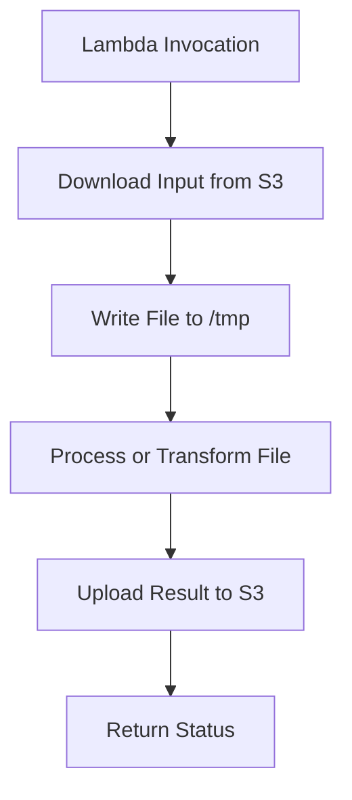

# 09- Memory, CPU and Ephemeral Storage

## Overview

AWS Lambda exposes three important resource configuration controls that influence function performance, workload capacity, and execution cost:

- **Memory:** The memory available to the execution environment and a primary control for CPU allocation.
- **CPU allocation:** CPU capacity scales with the configured memory size rather than being configured independently.
- **Ephemeral storage:** Temporary filesystem storage available to a function during execution, configurable independently of memory.

These resources affect different aspects of a workload. A CPU-intensive Python function may benefit from additional memory because it receives more CPU capacity. A function processing large files may need additional ephemeral storage. A function waiting on a database may benefit more from connection management and query optimization than from either change.

The objective is to select resource settings based on measured workload behavior, latency requirements, concurrency, and cost—not simply to choose the largest available configuration.

## Lambda Memory Configuration

### What memory means in Lambda

The memory setting defines the memory available to the function's execution environment. It is not a reservation exclusively for Python objects or application code; runtime processes, libraries, extensions, and other execution-environment components also consume resources.

Lambda memory is configurable from **128 MB to 10,240 MB**, in 1 MB increments. Confirm current service limits before depending on them in automation or architecture specifications.

Memory configuration affects more than the amount of memory available. Lambda allocates CPU power proportionally to the configured memory, so increasing memory can improve CPU-bound execution and initialization performance.

### Why memory affects CPU performance

Consider a Python function that parses a large JSON document, transforms records, and computes aggregates. Its execution time may be dominated by CPU work rather than network latency.

Increasing memory can provide more CPU capacity, reducing execution duration. If the reduction is sufficiently large, the total invocation cost may remain similar or even decrease despite the higher configured memory.

By contrast, a function that spends most of its time waiting for a remote API may see little improvement from additional memory.

| Workload characteristic | Likely effect of increasing memory |
|---|---|
| CPU-intensive parsing or transformation | Often improves execution time |
| Large in-memory datasets | Provides more memory headroom |
| Heavy runtime initialization | May reduce initialization duration |
| Network-bound API requests | May have limited benefit |
| Database queries dominated by server-side execution | Often limited benefit |
| Memory exhaustion | Can prevent out-of-memory failures |
| File processing with temporary files | Does not increase `/tmp` capacity |

The correct configuration depends on the workload's resource bottleneck.

### Memory configuration example

The following AWS CLI command updates a function's memory configuration.

```bash
aws lambda update-function-configuration \
    --function-name order-processor \
    --memory-size 2048 \
    --region ap-south-1
```

This is a **mutating operation**. It changes the function's memory setting and can affect performance and cost.

Verify the resulting configuration:

```bash
aws lambda get-function-configuration \
    --function-name order-processor \
    --query '{MemorySize:MemorySize,State:State,LastUpdateStatus:LastUpdateStatus}' \
    --output table \
    --region ap-south-1
```

Wait for the configuration update to complete before relying on the new setting. For production workloads, apply configuration changes through the established deployment pipeline where possible.

## CPU Allocation and Performance

### CPU is coupled to memory

Lambda does not expose an independent CPU-count setting for ordinary function configuration. CPU allocation increases with configured memory.

At higher memory settings, a function can receive more compute capacity, subject to Lambda's execution model and service limits.

This is particularly useful for:

- JSON and CSV transformation.
- Image processing.
- Compression and decompression.
- Cryptographic operations.
- Data validation and serialization.
- Python workloads involving CPU-heavy calculations.
- Framework and dependency initialization.

However, more CPU does not guarantee linear speedup. A single-threaded operation, an external network dependency, or a database bottleneck may limit the improvement.

### Python-specific considerations

Python backend workloads frequently combine CPU work and I/O.

For example, an API handler may:

1. Validate a request.
2. Read a database record.
3. Call an external service.
4. Transform the response.
5. Serialize JSON.

Increasing memory may improve validation, transformation, and serialization. It will not necessarily make the database query or external service respond faster.

Python's Global Interpreter Lock also affects CPU-bound multithreaded code running on conventional CPython builds. More CPU allocation does not automatically make a single Python thread execute CPU-bound Python bytecode in parallel. Workload design and the libraries being used determine whether additional CPU capacity can be utilized effectively.

### Benchmark before choosing a memory setting

Use representative payloads and production-like dependencies to compare candidate configurations.

Measure:

- Execution duration.
- Initialization duration where available.
- Maximum memory used.
- Error and timeout rates.
- Downstream latency.
- Cost per successful business operation.
- p95 and p99 latency where the workload is latency-sensitive.

A configuration that minimizes average duration may not be the best choice if it increases cost substantially without improving the required latency percentile.

## Understanding Memory Pressure and Out-of-Memory Failures

### Symptoms of insufficient memory

Common indicators include:

- Lambda logs reporting that the runtime exited because it ran out of memory.
- Abrupt runtime termination.
- Failed invocations during large payload processing.
- High maximum memory usage relative to configured memory.
- Memory failures that occur only for particular input sizes or concurrent execution paths.

The `Max Memory Used` field in Lambda execution reports is useful for investigation, but a successful invocation's observed maximum is not proof that the configured memory is sufficient for all future workloads.

### Diagnose memory usage

Retrieve the function's recent logs:

```bash
aws logs tail /aws/lambda/order-processor \
    --since 1h \
    --follow \
    --region ap-south-1
```

Look for runtime termination messages, out-of-memory indicators, and report records showing configured and maximum memory.

Inspect the configured memory:

```bash
aws lambda get-function-configuration \
    --function-name order-processor \
    --query '{MemorySize:MemorySize,Timeout:Timeout}' \
    --output json \
    --region ap-south-1
```

If the function processes large files or batches, test with the largest expected input and a realistic concurrency level.

### Reduce memory pressure in Python

Increasing Lambda memory may solve a legitimate capacity problem, but code-level improvements can also reduce memory consumption.

Useful techniques include:

- Process large files in chunks rather than loading them entirely into memory.
- Avoid unnecessary copies of large lists, dictionaries, and byte arrays.
- Stream data when supported by the API or storage client.
- Limit batch sizes according to available memory.
- Release references to large intermediate objects when they are no longer needed.
- Use efficient parsing and transformation libraries where appropriate.
- Avoid caching unbounded amounts of data in module-level variables.

Example of chunked processing:

```python
import csv
from collections.abc import Iterator
from typing import TextIO


def iter_rows(file_obj: TextIO) -> Iterator[dict[str, str]]:
    reader = csv.DictReader(file_obj)

    for row in reader:
        yield row


def process_rows(file_obj: TextIO) -> int:
    processed = 0

    for row in iter_rows(file_obj):
        process_row(row)
        processed += 1

    return processed


def process_row(row: dict[str, str]) -> None:
    # Apply validation and business transformations.
    if not row.get("order_id"):
        raise ValueError("Missing order_id")
```

This example avoids materializing the entire CSV as a list. Actual memory usage still depends on the current row, parser behavior, downstream processing, and any retained references.

## Ephemeral Storage

### What ephemeral storage is

Lambda provides a temporary filesystem mounted at `/tmp`. This storage is useful when a function needs files during execution without storing them in a durable external filesystem.

Examples include:

- Downloading an object from Amazon S3 before processing it.
- Extracting ZIP archives.
- Generating reports or documents.
- Performing image or video transformations.
- Staging temporary data for an external command-line tool.
- Caching reusable temporary artifacts.

The configurable ephemeral storage allocation is **512 MB to 10,240 MB**, in 1 MB increments.

Ephemeral storage is separate from configured memory. Increasing Lambda memory does not automatically increase the `/tmp` allocation.

### How `/tmp` behaves

The `/tmp` directory is local temporary storage associated with a Lambda execution environment.

Files can remain available when that environment is reused, but the application must not depend on their persistence. Lambda may replace an environment, and temporary files may disappear.

Treat `/tmp` as a performance optimization or workspace, not as a durable database, shared filesystem, or authoritative cache.



For durable output, upload the result to an appropriate service such as Amazon S3 before reporting success.

### Configure ephemeral storage

The following command increases `/tmp` storage to 4 GB.

```bash
aws lambda update-function-configuration \
    --function-name file-processor \
    --ephemeral-storage '{"Size":4096}' \
    --region ap-south-1
```

This changes the function configuration. Verify the result:

```bash
aws lambda get-function-configuration \
    --function-name file-processor \
    --query '{EphemeralStorage:EphemeralStorage,MemorySize:MemorySize,State:State,LastUpdateStatus:LastUpdateStatus}' \
    --output json \
    --region ap-south-1
```

The returned `EphemeralStorage.Size` value is expressed in MB.

### Use `/tmp` safely

Create application-specific temporary paths and avoid predictable shared filenames that can cause collisions between concurrent work inside the same environment.

```python
import tempfile
from pathlib import Path


def create_temp_file() -> Path:
    with tempfile.NamedTemporaryFile(
        dir="/tmp",
        prefix="order-report-",
        suffix=".csv",
        delete=False,
    ) as temp_file:
        return Path(temp_file.name)
```

The returned path identifies a file that must be managed by the caller. The application should remove it when it is no longer needed, particularly when processing many files in a reused environment.

A safer lifecycle is:

```python
import tempfile
from pathlib import Path


def process_report(content: bytes) -> dict[str, int]:
    with tempfile.TemporaryDirectory(
        dir="/tmp",
        prefix="report-",
    ) as temp_dir:
        input_path = Path(temp_dir) / "input.csv"
        input_path.write_bytes(content)

        result = analyze_file(input_path)

        return result


def analyze_file(path: Path) -> dict[str, int]:
    return {"size_bytes": path.stat().st_size}
```

Using a temporary directory context manager ensures that files created inside it are cleaned up when the context exits, provided cleanup itself succeeds.

## Memory and Ephemeral Storage Are Different Resources

These settings solve different problems and should be tuned independently.

| Resource | Controls | Typical failure | Common solution |
|---|---|---|---|
| Memory | Available execution-environment memory and proportional CPU allocation | Out-of-memory termination or insufficient compute performance | Increase memory, reduce allocations, or optimize processing |
| CPU allocation | Compute capacity coupled to memory | Excessive CPU-bound execution time | Benchmark higher memory settings or optimize computation |
| Ephemeral storage | Temporary filesystem capacity under `/tmp` | `No space left on device` or failed file writes | Increase ephemeral storage, clean up files, or stream processing |
| Durable storage | Long-term data retention | Data loss when temporary resources disappear | Use S3, a database, or another durable service |

A function may have sufficient memory but insufficient `/tmp` space. It may also have sufficient `/tmp` space while exhausting memory because it loads a large file entirely into a Python object.

Diagnose the actual resource constraint before changing configuration.

## Practical File-Processing Example

Consider a Lambda function that downloads a compressed report from S3, extracts it, processes the contents, and uploads a result.

```python
import csv
import gzip
import os
import tempfile
from pathlib import Path

import boto3

s3 = boto3.client("s3")


def lambda_handler(event, context):
    bucket = event["bucket"]
    key = event["key"]
    output_bucket = event["output_bucket"]

    with tempfile.TemporaryDirectory(
        dir="/tmp",
        prefix="report-job-",
    ) as temp_dir:
        directory = Path(temp_dir)
        compressed_path = directory / "input.csv.gz"
        extracted_path = directory / "input.csv"
        output_path = directory / "output.csv"

        s3.download_file(
            bucket,
            key,
            str(compressed_path),
        )

        with gzip.open(
            compressed_path,
            "rt",
            newline="",
            encoding="utf-8",
        ) as source:
            with extracted_path.open(
                "w",
                newline="",
                encoding="utf-8",
            ) as destination:
                reader = csv.DictReader(source)

                writer = csv.DictWriter(
                    destination,
                    fieldnames=["order_id", "status"],
                )
                writer.writeheader()

                for row in reader:
                    writer.writerow(
                        {
                            "order_id": row["order_id"],
                            "status": normalize_status(
                                row["status"]
                            ),
                        }
                    )

        output_key = f"processed/{os.path.basename(key)}.csv"

        s3.upload_file(
            str(output_path),
            output_bucket,
            output_key,
        )

    return {
        "status": "completed",
        "output_key": output_key,
    }


def normalize_status(value: str) -> str:
    return value.strip().lower()
```

This example demonstrates temporary file management and streaming CSV transformation. The S3 client is created outside the handler so it can be reused in an initialized execution environment.

Production considerations:

- Validate event fields and object keys before processing.
- Confirm the execution role permits the required S3 operations.
- Restrict input and output bucket permissions to the required resources.
- Check compressed and extracted file sizes; compression ratios can be very large.
- Handle malformed CSV records and partial failures explicitly.
- Use a unique output key or an idempotency strategy to avoid duplicate side effects.
- Ensure the Lambda timeout is sufficient for the expected workload.
- Configure memory and `/tmp` capacity based on measured peak usage.
- Avoid logging sensitive file contents.
- Consider S3 multipart upload or streaming architectures for large outputs.
- Account for the fact that temporary storage and local state are not durable.

The example intentionally writes the transformed output to `output_path`; a production implementation should ensure the transformation produces the intended output before uploading it.

## Performance and Cost Optimization

### The memory-duration trade-off

Lambda invocation cost depends on configured memory and execution duration, alongside request charges and other applicable service charges.

A larger memory setting increases the resource allocation rate, but can reduce duration enough to make the total compute cost competitive. The outcome varies by workload.

A useful comparison is:

\[
\text{Relative compute consumption}
\propto
\text{Configured memory}
\times
\text{Execution duration}
\]

This relationship is useful for reasoning about memory-duration trade-offs, but it is not a complete billing formula. Actual billing depends on Lambda's pricing model, architecture, Region, duration measurement, free-tier eligibility, and applicable features.

### Benchmark candidate configurations

For a CPU-bound function, compare several memory settings with identical input data and dependencies.

Record:

| Configuration | Duration | Maximum memory used | Error rate | Cost per successful operation |
|---|---:|---:|---:|---:|
| Baseline memory | Measure | Measure | Measure | Calculate |
| Medium memory | Measure | Measure | Measure | Calculate |
| Higher memory | Measure | Measure | Measure | Calculate |

Use repeated trials and representative workloads. Account for cold starts, input variability, downstream latency, and concurrency when interpreting results.

Do not select a configuration based on a single successful invocation.

### Cost considerations for ephemeral storage

Additional ephemeral storage can incur charges beyond the included allocation under the applicable pricing model. Check current regional pricing and billing conditions before increasing storage substantially.

To control costs:

- Allocate only the storage required by the largest supported workload.
- Remove temporary files promptly.
- Avoid repeatedly downloading large objects when a suitable cache or data flow can reduce transfer and processing costs.
- Evaluate S3-based intermediate storage for workflows that exceed the practical limits of one invocation.
- Use the smallest configuration that satisfies performance and reliability requirements.

## Production Monitoring and Troubleshooting

### Memory failures

**Symptom:** Invocations fail when processing large payloads.

**Possible causes:**
- Python objects consume more memory than expected.
- The function loads the entire input into memory.
- Dependencies or extensions consume significant memory.
- Batch sizes are too large.

**Investigation:**
- Inspect CloudWatch logs for runtime termination messages.
- Compare maximum memory used across different payload sizes.
- Reproduce the failure using representative large inputs.
- Review the application's memory allocation and data-processing strategy.

**Corrective action:**
- Increase memory if the workload legitimately requires it.
- Stream or chunk large inputs.
- Reduce unnecessary object copies.
- Bound batch sizes and cached state.

### Ephemeral storage exhaustion

**Symptom:** File writes fail or the runtime reports that no space remains on the device.

**Possible causes:**
- Temporary files are not deleted.
- Extracted files are much larger than compressed inputs.
- Several files are staged simultaneously.
- Reused environments retain artifacts from earlier invocations.

**Investigation:**
- Log the sizes of inputs, extracted files, and intermediate outputs.
- Inspect `/tmp` usage during execution.
- Reproduce with worst-case input sizes.
- Check whether cleanup occurs on successful and failed execution paths.

**Corrective action:**
- Clean up temporary artifacts.
- Increase the ephemeral storage allocation when justified.
- Stream data where possible.
- Move large intermediate artifacts to durable object storage when appropriate.

### Latency and compute inefficiency

**Symptom:** Function duration is high despite low memory usage.

**Possible causes:**
- CPU-bound processing at a low memory setting.
- Slow downstream APIs or database queries.
- Inefficient algorithms or serialization.
- Cold-start overhead.

**Investigation:**
- Separate initialization, computation, and network timings.
- Benchmark different memory settings.
- Inspect downstream latency and application-level timing.
- Compare p95 and p99 duration under representative traffic.

**Corrective action:**
- Increase memory when CPU allocation is the bottleneck.
- Optimize algorithms and unnecessary serialization.
- Improve database access and remote-call behavior.
- Address initialization separately from handler performance.

## Best Practices

- **Benchmark rather than guess:** Select memory and ephemeral storage settings from representative workload measurements.
- **Separate resource constraints:** Memory, CPU allocation, and `/tmp` capacity address different bottlenecks.
- **Process large files incrementally:** Streaming and chunking reduce peak memory usage.
- **Manage temporary files explicitly:** Clean up artifacts to avoid exhausting storage in reused environments.
- **Reuse clients safely:** Initialize reusable SDK clients outside the handler when appropriate, but do not rely on execution-environment persistence for correctness.
- **Plan for worst-case inputs:** Validate maximum file sizes, decompression ratios, batch sizes, and concurrent processing.
- **Protect downstream systems:** Increased CPU and concurrency can increase database and API pressure.
- **Measure cost per successful operation:** A faster configuration is not automatically cheaper or more reliable.
- **Use infrastructure as code:** Keep resource settings version-controlled, reviewed, and consistent across environments.
- **Revalidate after changes:** New dependencies, larger payloads, or different traffic patterns can change resource requirements.

## Key Takeaways

- Lambda memory controls available memory and influences CPU allocation; increasing it can improve CPU-bound performance and reduce duration.
- Ephemeral storage provides temporary `/tmp` capacity independently of memory and must not be treated as durable storage.
- Diagnose out-of-memory failures, filesystem exhaustion, and slow execution as separate problems before changing configuration.
- Optimize memory and storage using representative benchmarks, realistic worst-case inputs, latency percentiles, and cost per successful operation.
- Production-ready resource tuning requires explicit cleanup, bounded workloads, downstream capacity planning, and repeatable configuration management.