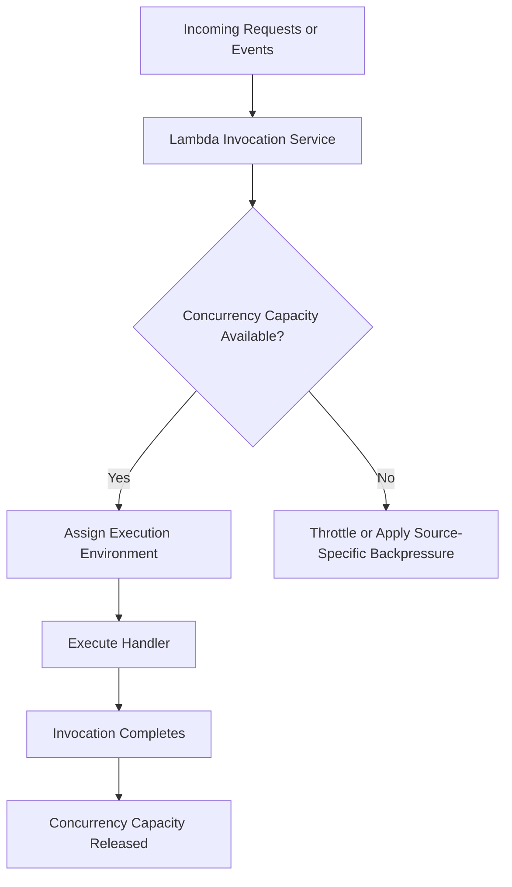
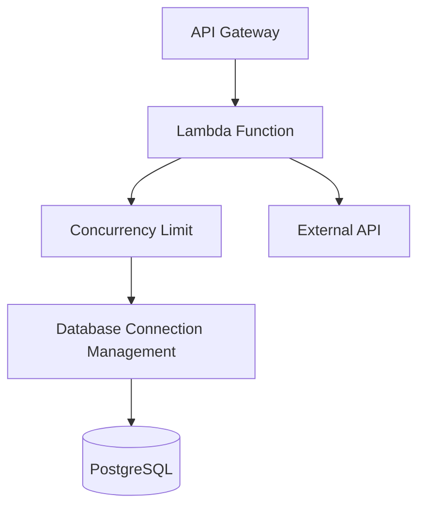
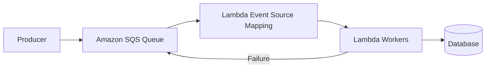

# 10- Lambda Concurrency

## Overview

Concurrency in AWS Lambda represents the number of function invocations being processed simultaneously. It is a fundamental capacity-control mechanism that determines how Lambda scales under load, how many requests can execute in parallel, and how much pressure the function can place on downstream services.

For backend engineers, concurrency is not merely a Lambda configuration setting. It is a distributed-systems capacity-planning problem involving request arrival rates, execution duration, database connection limits, external API quotas, and latency objectives.

Consider a Python Lambda function behind API Gateway that processes orders. When request volume increases, Lambda can create additional execution environments to handle concurrent invocations. If each environment opens database connections, scaling the function can overwhelm the database even when Lambda itself has sufficient capacity.

Understanding concurrency helps you:

- Estimate the capacity required for a workload.
- Prevent excessive load on databases and downstream APIs.
- Control scaling and throttling behavior.
- Design reliable asynchronous processing pipelines.
- Reduce latency and unexpected costs.
- Diagnose concurrency exhaustion in production.

## What Is Lambda Concurrency?

Lambda concurrency is the number of in-flight function invocations at a given time.

An invocation generally occupies concurrency from the time execution begins until it finishes, including time spent waiting on network operations. Consequently, a function performing slow database queries or waiting for an external HTTP API can consume concurrency even when it is not actively using CPU.

For example, if 100 invocations are executing simultaneously, the function has concurrency of approximately 100.

Concurrency is different from:

- **Invocation count:** The number of invocations over a period.
- **Throughput:** The number of completed operations per unit of time.
- **Execution duration:** The time taken by an invocation.
- **CPU utilization:** The amount of processor capacity being used.
- **Execution environments:** The environments Lambda uses to execute function code.

An execution environment normally processes one invocation at a time for a given function environment. Lambda can create additional environments to accommodate concurrent invocations.

## How Lambda Concurrency Works

### Invocation lifecycle



The exact behavior when capacity is unavailable depends on the invocation model and event source.

For synchronous invocations, the caller may receive a throttling response. For asynchronous invocations, Lambda manages an internal event queue and applies its asynchronous delivery and retry behavior. For event source mappings, the source-specific polling and retry model determines how processing responds to insufficient capacity.

### Concurrency calculation

A useful approximation is Little's Law:

\[
\text{Concurrency} \approx
\text{Request rate} \times \text{Average duration}
\]

For example, suppose a function receives 200 requests per second and each invocation takes 0.5 seconds on average.

\[
200 \times 0.5 = 100
\]

The approximate average concurrency is 100.

If average execution duration increases to 2 seconds while the arrival rate remains unchanged:

\[
200 \times 2 = 400
\]

The function now requires approximately 400 concurrent executions to sustain the same arrival rate without building a backlog or rejecting work.

This calculation is a planning approximation, not a guarantee of capacity or latency. Real workloads have bursty arrivals, variable durations, retries, and downstream dependencies. Production planning should account for tail latency and peak traffic.

## Types of Lambda Concurrency

Lambda provides several concurrency mechanisms that serve different purposes.

| Mechanism | Purpose | Capacity behavior | Typical use case |
|---|---|---|---|
| Unreserved concurrency | Uses account-level concurrency capacity not reserved for individual functions | Shared capacity | General-purpose functions |
| Reserved concurrency | Reserves capacity for a function and sets its concurrency ceiling | Function-specific allocation and limit | Protecting critical functions or limiting downstream load |
| Provisioned concurrency | Keeps a configured number of execution environments initialized and ready | Pre-initialized capacity | Latency-sensitive workloads |
| Event source mapping controls | Influence how event-driven processing scales | Depends on event source and mapping configuration | Queue consumers and stream processors |

Reserved concurrency and provisioned concurrency are not interchangeable.

Reserved concurrency controls how much concurrency a function can use and reserves that capacity from the account pool. Provisioned concurrency prepares execution environments in advance to reduce initialization latency for supported invocation configurations.

A function can use reserved concurrency without provisioned concurrency. Provisioned concurrency also requires appropriate function versions or aliases and additional configuration.

## Account-Level Concurrency

Lambda concurrency is subject to an account-level concurrency quota in each AWS Region. The default quota is commonly 1,000 concurrent executions per Region, but quotas can vary by account and can be increased through AWS Service Quotas.

Do not hardcode the default quota into production assumptions. Verify the current quota for the target account and Region.

Account concurrency is shared across functions, except for capacity allocated through reserved concurrency. Provisioned concurrency also consumes concurrency capacity and has specific allocation constraints.

### Inspect account concurrency

Use the AWS CLI to inspect the current account's Lambda concurrency configuration.

```bash
aws lambda get-account-settings \
    --query 'AccountLimit.{Total:ConcurrentExecutions,Unreserved:UnreservedConcurrentExecutions}' \
    --output table \
    --region ap-south-1
```

This is a read-only operation.

The returned values help identify the account's concurrency limit and the unreserved capacity currently available. They are not a complete real-time representation of every function's traffic or future scaling behavior.

### Why account-level limits matter

Consider an account with several functions:

- An order API.
- A reporting function.
- An SQS background worker.
- A scheduled reconciliation function.

If a background worker consumes most available concurrency, a latency-sensitive API may experience throttling even though the API itself is healthy.

Reserved concurrency can protect important functions by allocating capacity to them and limiting how much concurrency they can consume.

However, reserving too much concurrency across multiple functions can leave insufficient unreserved capacity for other workloads. Capacity allocation should be based on actual workload requirements.

## Reserved Concurrency

Reserved concurrency guarantees that a function can use its allocated concurrency when the account and function configuration permit it, while also establishing the maximum concurrency available to that function.

For example, reserving 100 concurrent executions for an order API means:

- The function can use up to 100 concurrent executions.
- That capacity is reserved from the account's unreserved pool.
- The function cannot scale beyond its reserved limit.
- Other functions cannot consume that reserved allocation.

Reserved concurrency is useful for workload isolation and downstream protection.

### Configure reserved concurrency

The following command sets the function's reserved concurrency to 100.

```bash
aws lambda put-function-concurrency \
    --function-name order-api \
    --reserved-concurrent-executions 100 \
    --region ap-south-1
```

This is a mutating operation.

Verify the configuration:

```bash
aws lambda get-function-concurrency \
    --function-name order-api \
    --query '{Reserved:ReservedConcurrentExecutions,Provisioned:ProvisionedConcurrentExecutions}' \
    --output json \
    --region ap-south-1
```

The provisioned concurrency field may be absent from this response or represented differently depending on the response shape. Inspect provisioned concurrency through the appropriate function or alias configuration commands when needed.

To remove a reserved concurrency setting:

```bash
aws lambda delete-function-concurrency \
    --function-name order-api \
    --region ap-south-1
```

Removing the setting returns the function to the unreserved concurrency pool. This changes capacity isolation and should be reviewed before execution in production.

### When reserved concurrency is useful

Use reserved concurrency when:

- A critical API needs isolation from background workloads.
- A function must not overwhelm a database or external API.
- A workload requires a known maximum execution level.
- You need to deliberately constrain an unstable or expensive workload.
- You want to prevent a runaway event-processing workload from consuming all shared capacity.

### Reserved concurrency as a safety boundary

Suppose a function opens one database connection per execution environment. If the function can create hundreds of environments, it can potentially create hundreds of database connections.

Setting a suitable reserved concurrency limit can reduce that risk.

However, the limit must be calculated from the database's connection budget, the number of Lambda functions accessing it, connection behavior, and other clients. A reserved concurrency value alone does not guarantee database safety.

## Provisioned Concurrency

Provisioned concurrency keeps a configured number of execution environments initialized and ready to handle invocations. It is designed to reduce cold-start latency for supported workloads.

For example, an API with predictable traffic during business hours may benefit from pre-initialized capacity before the traffic peak begins.

Provisioned concurrency does not guarantee that every invocation avoids a cold start. Requests exceeding available provisioned capacity may use other available capacity or experience different latency behavior, depending on the configuration and service conditions.

### When to use it

Provisioned concurrency is useful for:

- Latency-sensitive REST APIs.
- Authentication and authorization endpoints.
- Interactive applications with strict response-time objectives.
- Predictable traffic peaks.
- Functions with expensive initialization.

It introduces additional cost and requires capacity planning. Configure it only after measuring cold-start impact and validating the expected traffic pattern.

### Reserved concurrency versus provisioned concurrency

| Consideration | Reserved concurrency | Provisioned concurrency |
|---|---|---|
| Primary purpose | Capacity reservation and concurrency limit | Ready-to-use initialized environments |
| Limits maximum function concurrency | Yes | Not by itself |
| Reduces cold-start exposure | Not inherently | Yes, for invocations served by provisioned capacity |
| Protects downstream dependencies | Can limit maximum concurrent execution | Requires separate capacity planning and limits |
| Additional capacity cost | No separate reserved-concurrency charge, though executions incur normal charges | Additional provisioned-capacity charges apply |
| Common use | Isolation and backpressure | Predictable startup latency |

The two mechanisms can be used together where supported and appropriately configured.

## Concurrency and Execution Duration

Concurrency requirements increase as execution duration increases, even if the request arrival rate remains constant.

Consider an API receiving 300 requests per second.

| Average duration | Approximate average concurrency |
|---:|---:|
| 100 ms | 30 |
| 250 ms | 75 |
| 500 ms | 150 |
| 1 second | 300 |
| 2 seconds | 600 |

The calculation uses:

\[
C = \lambda \times W
\]

Where:

- \(C\) is average concurrency.
- \(\lambda\) is the average arrival rate per second.
- \(W\) is average execution duration in seconds.

This relationship explains why reducing unnecessary network calls, improving database queries, and avoiding repeated initialization can reduce concurrency requirements.

A slow downstream service can create a feedback loop:

1. Requests take longer.
2. Each request occupies concurrency for longer.
3. More concurrent executions are required to sustain the arrival rate.
4. Lambda scales or reaches a concurrency limit.
5. The downstream service receives more simultaneous requests.
6. Latency and errors may increase further.

The correct response is not always to increase Lambda concurrency. It may be necessary to reduce arrival pressure, optimize downstream operations, or introduce queue-based backpressure.

## Concurrency and Downstream Capacity

Lambda can scale faster than many databases or third-party services can safely accept requests.

For example, a PostgreSQL database may support a limited number of connections. If each Lambda execution environment opens a separate connection, rapid scaling can exhaust the database connection budget.

### Example architecture



The concurrency limit provides one control point, but it must be combined with appropriate connection management and downstream timeouts.

### Capacity planning for databases

A simple upper-bound estimate is:

\[
\text{Potential connections}
\approx
\text{Concurrent environments}
\times
\text{Connections per environment}
\]

Suppose 150 Lambda environments can execute concurrently and each maintains two database connections.

\[
150 \times 2 = 300
\]

The workload may require up to 300 database connections, excluding other applications and administrative connections.

This is a planning estimate. Actual connections depend on client lifecycle, environment reuse, pooling, transaction behavior, and whether connections are opened lazily.

For relational databases, consider:

- Using Amazon RDS Proxy where appropriate.
- Reusing database clients or connections safely.
- Setting bounded connection and query timeouts.
- Limiting Lambda concurrency to fit the database connection budget.
- Avoiding oversized per-environment connection pools.
- Monitoring database connection counts and query latency.

RDS Proxy can help manage connection pressure, but it does not remove the need to design appropriate concurrency and transaction behavior.

## Event Source Mappings and Concurrency

Lambda concurrency behaves differently depending on how a function is invoked.

For SQS, Kinesis, and DynamoDB Streams, Lambda commonly uses event source mappings to poll or consume records and invoke the function in batches. The mapping's configuration and the source's semantics influence how processing scales.

### SQS-triggered Lambda



For SQS workloads, concurrency depends on several factors:

- Available messages.
- Batch size and processing duration.
- Event source mapping scaling behavior.
- Function concurrency limits.
- Queue type and configuration.
- Visibility timeout and retry behavior.
- Downstream processing capacity.

Increasing concurrency can improve throughput when messages are independent and the downstream system can handle additional load. It can also cause connection exhaustion, throttling, or higher failure rates.

For standard SQS queues, message processing can occur concurrently and messages may be delivered more than once. FIFO queues have additional ordering and message-group constraints.

### Maximum concurrency for SQS event source mappings

An SQS event source mapping can be configured with a maximum concurrency value to limit how many concurrent function invocations that mapping uses.

This is useful when a queue consumer must not overwhelm a downstream database.

Maximum concurrency and reserved concurrency are different controls:

- **Maximum concurrency** limits the concurrency used by a particular SQS event source mapping.
- **Reserved concurrency** limits the function's total concurrency and reserves capacity at the function level.

If a function has multiple SQS event source mappings, ensure that their combined concurrency requirements fit within the function's reserved concurrency. Otherwise, mappings may compete for capacity and processing can be throttled.

For example, an SQS mapping's maximum concurrency can be configured through the event source mapping API or AWS CLI. The mapping must already exist, and the exact mapping UUID should be retrieved from the function's event source mapping configuration.

```bash
aws lambda list-event-source-mappings \
    --function-name order-worker \
    --query 'EventSourceMappings[].{UUID:UUID,State:State,Source:EventSourceArn,MaximumConcurrency:ScalingConfig.MaximumConcurrency}' \
    --output table \
    --region ap-south-1
```

This is a read-only operation.

To update an existing mapping:

```bash
aws lambda update-event-source-mapping \
    --uuid "<EVENT_SOURCE_MAPPING_UUID>" \
    --scaling-config '{"MaximumConcurrency":20}' \
    --region ap-south-1
```

This is a mutating operation. Replace the placeholder with the UUID returned by the inspection command and verify the updated mapping before relying on the new limit.

Maximum concurrency is not supported identically across all event source types. Confirm the current service documentation for the particular mapping type before applying this configuration.

## Concurrency and Throttling

Throttling occurs when Lambda cannot accept an invocation because the applicable concurrency or service limits have been reached.

The visible result depends on the invocation model.

| Invocation model | Typical behavior when capacity is unavailable |
|---|---|
| Synchronous invocation | The caller may receive a throttling error and must decide whether and when to retry |
| Asynchronous invocation | Lambda queues events internally and applies its asynchronous retry and delivery behavior |
| SQS event source mapping | The mapping's polling and retry behavior responds to limited processing capacity |
| Kinesis or DynamoDB Streams mapping | Processing and checkpoint progression depend on shard, batching, parallelization, and mapping configuration |

Do not assume every throttled invocation is retried automatically in the same way. Retry behavior depends on the invocation path and event source.

For synchronous API requests, uncontrolled client retries can amplify an incident. Use bounded retries, exponential backoff, jitter, and an overall deadline.

For queue-based processing, monitor queue age and backlog, and ensure the source's visibility timeout and retry configuration are consistent with expected processing duration.

## Monitoring Lambda Concurrency

Use CloudWatch metrics to understand concurrency and throttling behavior.

| Metric | Purpose |
|---|---|
| `ConcurrentExecutions` | Measures concurrent function executions |
| `UnreservedConcurrentExecutions` | Shows usage of account-level unreserved concurrency |
| `Throttles` | Counts invocations throttled by concurrency or applicable service limits |
| `Invocations` | Measures invocation volume |
| `Duration` | Helps explain concurrency requirements |
| `Errors` | Identifies failed invocations |
| `ApproximateAgeOfOldestMessage` for SQS | Indicates how long the oldest message has been waiting |
| `ApproximateNumberOfMessagesVisible` for SQS | Indicates visible queue backlog |

Metrics should be interpreted together. A rise in concurrency is not necessarily a problem if latency and error rates remain within the service objectives.

A rise in throttles combined with increasing queue age, duration, or API errors is a stronger signal that capacity or downstream behavior needs investigation.

### Inspect concurrency configuration

```bash
aws lambda get-function-concurrency \
    --function-name order-api \
    --output json \
    --region ap-south-1
```

Inspect function configuration and recent activity alongside this result.

For account-level capacity:

```bash
aws lambda get-account-settings \
    --output json \
    --region ap-south-1
```

Both commands are read-only.

### Recommended alarms

Consider alarms for:

- Sustained throttling on critical functions.
- High concurrency near a reserved limit.
- Increased p95 or p99 latency.
- Rising error rates.
- SQS queue age exceeding the processing objective.
- Database connection utilization approaching its limit.
- Unexpected invocation spikes or cost increases.

Alarm thresholds should be derived from service objectives and measured baselines rather than copied indiscriminately across functions.

## Troubleshooting Concurrency Problems

Use the following diagnostic flow:

**Symptom → Possible causes → Isolation strategy → Diagnostic commands → Root cause verification → Corrective action → Prevention**

### Symptom: Lambda invocations are throttled

**Possible causes:**
- Reserved concurrency is too low.
- Account-level unreserved concurrency is exhausted.
- A sudden traffic burst increases demand.
- Provisioned concurrency or event source mapping configuration is inappropriate for the workload.
- Another function is consuming shared capacity.

**Investigation:**
- Inspect reserved concurrency and account-level limits.
- Compare `ConcurrentExecutions`, `Throttles`, and `Invocations`.
- Review traffic spikes and deployment changes.
- Inspect event source mapping configuration if the function is event-driven.

**Corrective action:**
- Adjust concurrency settings based on measured demand.
- Request an account quota increase when justified.
- Protect critical functions with appropriate reserved concurrency.
- Apply backpressure or bounded retries where appropriate.

### Symptom: Lambda scales but database requests fail

**Possible causes:**
- Too many database connections.
- Slow queries or long-running transactions.
- Excessive connection pools.
- Database capacity is lower than the function's effective concurrency.

**Investigation:**
- Compare Lambda concurrency with database connection metrics.
- Inspect connection and query timeout errors.
- Review connection lifecycle and pool configuration.
- Check database CPU, memory, locks, and query latency.

**Corrective action:**
- Set a concurrency ceiling based on the database budget.
- Reuse connections safely.
- Consider RDS Proxy.
- Optimize queries and shorten transactions.
- Apply queue-based backpressure for asynchronous work.

### Symptom: SQS backlog continues to grow

**Possible causes:**
- Consumer concurrency is constrained.
- Each invocation processes too few records.
- Processing duration is too high.
- The downstream service cannot keep up.
- Repeated failures cause messages to be retried.

**Investigation:**
- Compare incoming message rate with successful processing throughput.
- Inspect queue depth and oldest-message age.
- Review event source mapping configuration and function concurrency.
- Examine logs for repeated failures and downstream timeouts.

**Corrective action:**
- Increase consumer capacity only when downstream capacity allows it.
- Optimize processing and batch handling.
- Use appropriate event source mapping scaling settings.
- Correct repeated failures and configure dead-letter handling.
- Introduce backpressure when the downstream system is the bottleneck.

## Production Best Practices

### Treat concurrency as a capacity budget

Estimate concurrency from arrival rate and execution duration, then validate the estimate under realistic traffic. Include burst patterns, retries, and tail latency.

### Protect critical functions

Use reserved concurrency to isolate important workloads from less critical background functions when the account capacity budget supports it.

### Protect downstream systems

Use concurrency limits, database connection management, request timeouts, and queue-based backpressure to prevent Lambda scaling from overwhelming dependencies.

### Configure event source mappings deliberately

For SQS and stream consumers, tune batch size, mapping concurrency, retry behavior, and visibility or checkpoint semantics together. These settings affect throughput and reliability.

### Design for retries and duplicate delivery

Concurrency controls do not guarantee exactly-once business outcomes. Events can be retried, and some sources can deliver duplicates. Use idempotency keys or durable deduplication where repeated processing could create duplicate business effects.

### Monitor the whole system

Lambda concurrency metrics alone do not reveal whether the database, queue, or external API is saturated. Correlate Lambda metrics with downstream latency, error rates, and backlog.

### Use gradual configuration changes

Apply concurrency changes through infrastructure as code or controlled deployment workflows. Verify the result, observe latency and errors, and retain a rollback plan.

## Key Takeaways

- Lambda concurrency is the number of simultaneous in-flight invocations and is influenced by request rate and execution duration.
- Reserved concurrency provides function-level capacity reservation and a concurrency ceiling; provisioned concurrency prepares initialized environments to reduce startup latency.
- Lambda can scale faster than databases and external APIs can safely handle, so concurrency must be planned around downstream capacity.
- Event source mappings have source-specific scaling, batching, retry, and throttling behavior; configure them alongside function-level concurrency limits.
- Monitor concurrency, throttles, latency, errors, queue age, and downstream capacity together to diagnose and prevent production overload.