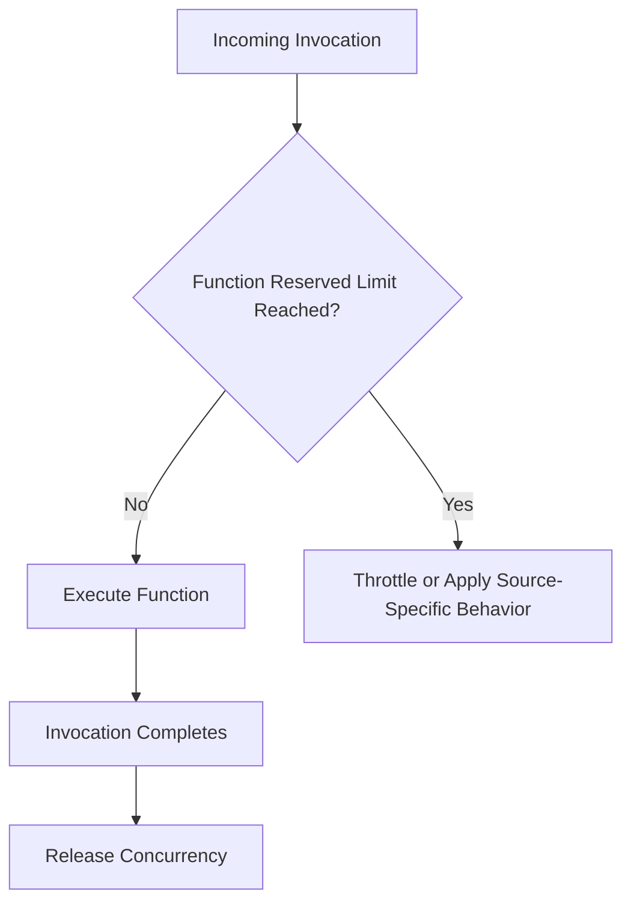
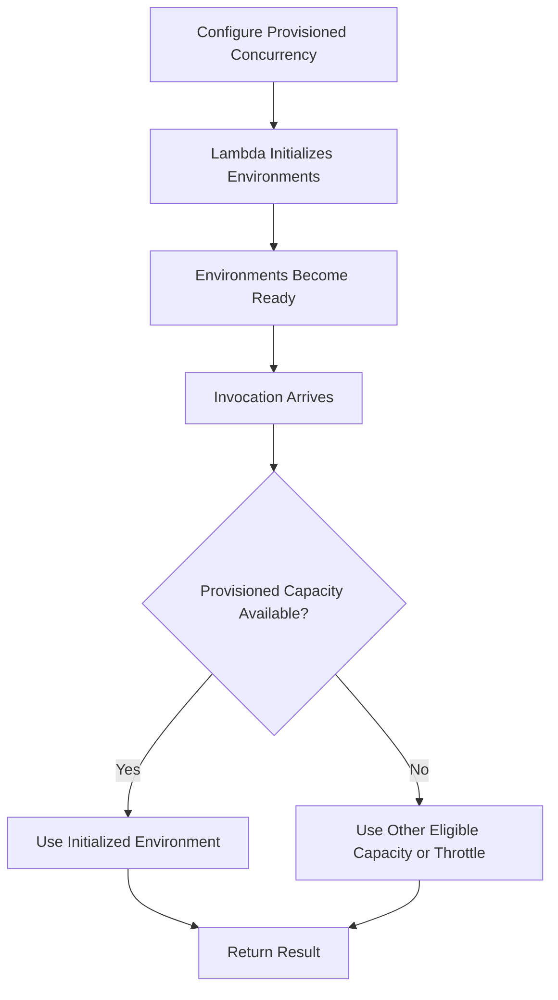
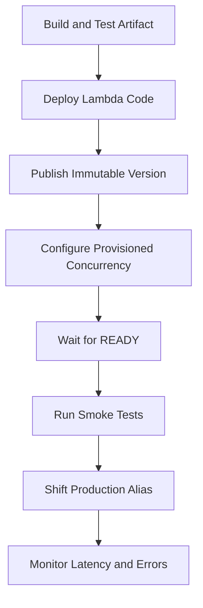

# 11- Reserved vs Provisioned Concurrency

## Overview

AWS Lambda provides two important concurrency controls: **reserved concurrency** and **provisioned concurrency**. Both influence how a function uses capacity, but they solve different engineering problems.

- **Reserved concurrency** reserves concurrency capacity for a function and establishes its maximum concurrent execution limit.
- **Provisioned concurrency** keeps a configured number of execution environments initialized and ready to handle invocations, reducing cold-start latency for requests served by that capacity.

Choosing between them requires understanding the workload's latency objectives, downstream capacity, traffic patterns, account-level concurrency limits, and cost constraints.

For example, an order-processing API may use reserved concurrency to protect its database from excessive parallel requests. A latency-sensitive authentication API may use provisioned concurrency to reduce initialization delays during predictable traffic peaks. A production system may use both mechanisms when it needs capacity isolation and predictable startup latency.

## Understanding the Two Mechanisms

### Reserved concurrency

Reserved concurrency is a function-level capacity reservation and concurrency ceiling.

If a function has reserved concurrency set to 100:

- Lambda reserves 100 concurrent executions for that function from the account's available concurrency pool.
- Other functions cannot consume that reserved allocation.
- The function cannot use more than its reserved concurrency.
- If all 100 concurrent executions are occupied, additional invocations can be throttled or handled according to the applicable invocation model.

Reserved concurrency is useful for workload isolation and downstream protection. It does not, by itself, keep execution environments initialized or eliminate cold starts.

### Provisioned concurrency

Provisioned concurrency allocates and initializes a specified number of execution environments for a published Lambda version or an alias that points to a published version.

If a function has provisioned concurrency set to 20, Lambda prepares 20 execution environments for the configured version or alias.

When invocations arrive, Lambda can route them to these initialized environments, reducing the initialization work on the request path. This is particularly valuable for synchronous workloads with strict latency objectives.

Provisioned concurrency does not guarantee that every invocation will use a provisioned environment. Traffic that exceeds the available provisioned capacity may use on-demand capacity when available, potentially encountering cold starts. If applicable concurrency limits prevent additional execution, invocations can be throttled.

Provisioned concurrency introduces additional charges for configured capacity and its execution time, according to the applicable pricing model.

## Side-by-Side Comparison

| Dimension | Reserved concurrency | Provisioned concurrency |
|---|---|---|
| Primary purpose | Capacity reservation and maximum concurrency control | Reduce cold-start latency by preparing execution environments |
| Reserves account concurrency | Yes | Consumes concurrency capacity and is subject to allocation constraints |
| Establishes a function concurrency ceiling | Yes | Not by itself |
| Pre-initializes environments | No | Yes |
| Eliminates all cold starts | No | No |
| Protects downstream services | Can cap function concurrency | Requires suitable capacity limits and downstream planning |
| Requires a published version or alias | Not necessarily | Yes |
| Additional capacity-specific charges | No separate reserved-concurrency charge | Additional provisioned-concurrency charges apply |
| Typical use case | Workload isolation and backpressure | Latency-sensitive APIs and predictable traffic peaks |
| Main operational concern | Allocating enough account capacity without starving other functions | Matching provisioned capacity to traffic while controlling cost |

The central distinction is that **reserved concurrency controls how much concurrency a function can consume, while provisioned concurrency controls how much initialized capacity is prepared in advance**.

## How They Work

### Reserved concurrency request flow



Reserved concurrency does not determine whether a new execution environment is needed. Lambda can still initialize environments as traffic increases within the configured limit.

### Provisioned concurrency request flow



The behavior of traffic exceeding provisioned capacity depends on available on-demand capacity, function limits, account quotas, and invocation configuration.

Provisioned concurrency reduces startup latency for requests served by its initialized capacity. It does not eliminate handler execution time, downstream latency, or every possible source of latency variation.

## Choosing the Right Mechanism

### Use reserved concurrency when capacity isolation matters

Choose reserved concurrency when:

- A critical function must retain capacity despite activity from other functions.
- A background worker must not overwhelm a database.
- A function's maximum parallelism needs to be controlled.
- You need to isolate a workload from other functions sharing the account's unreserved capacity.
- A runaway workload could cause excessive downstream load or cost.

For example, a PostgreSQL-backed API might have a reserved concurrency limit based on its database connection budget.

### Use provisioned concurrency when startup latency matters

Choose provisioned concurrency when:

- An API has a strict p95 or p99 latency objective.
- Cold-start latency materially affects customer experience.
- Traffic follows a predictable daily or weekly pattern.
- A function performs expensive initialization.
- Pre-initialized capacity is worth the additional cost.

For example, a payment authorization endpoint may use provisioned concurrency during known peak periods to reduce initialization-related latency.

### Use both when both problems exist

A latency-sensitive API may require both:

- Reserved concurrency to limit maximum parallel execution and isolate capacity.
- Provisioned concurrency to prepare a baseline number of initialized environments.

This combination requires careful configuration. Provisioned concurrency consumes concurrency capacity, and its allocation must fit the applicable function and account constraints.

Do not configure these mechanisms independently without validating their combined capacity requirements.

## Configuration and AWS CLI

The following examples use `ap-south-1` and illustrative function names. Run commands in the intended account and Region.

### Inspect account-level concurrency

```bash
aws lambda get-account-settings \
    --query 'AccountLimit.{Total:ConcurrentExecutions,Unreserved:UnreservedConcurrentExecutions}' \
    --output table \
    --region ap-south-1
```

This is a read-only command. The default account concurrency quota is commonly 1,000 per Region, but the actual quota must be verified for the account.

### Configure reserved concurrency

Set a reserved concurrency limit of 100:

```bash
aws lambda put-function-concurrency \
    --function-name order-api \
    --reserved-concurrent-executions 100 \
    --region ap-south-1
```

This changes the function configuration.

Verify it:

```bash
aws lambda get-function-concurrency \
    --function-name order-api \
    --output json \
    --region ap-south-1
```

Remove the reserved concurrency setting when appropriate:

```bash
aws lambda delete-function-concurrency \
    --function-name order-api \
    --region ap-south-1
```

Removing the setting returns the function to the unreserved concurrency pool. It removes the function-specific reservation and ceiling, so verify account capacity and downstream limits before doing this in production.

### Publish a version for provisioned concurrency

Provisioned concurrency is configured for a published version or alias, not the mutable `$LATEST` version.

Publish a version after deploying the intended code and configuration:

```bash
aws lambda publish-version \
    --function-name payment-api \
    --description "Provisioned concurrency release"
```

The command returns the published version number. Use that returned value in subsequent commands rather than assuming a particular version number.

### Configure provisioned concurrency for a version

For a function version represented by the placeholder `12`:

```bash
aws lambda put-provisioned-concurrency-config \
    --function-name payment-api \
    --qualifier 12 \
    --provisioned-concurrent-executions 20 \
    --region ap-south-1
```

This is a mutating operation. Replace `12` with the actual published version.

Inspect the configuration:

```bash
aws lambda get-provisioned-concurrency-config \
    --function-name payment-api \
    --qualifier 12 \
    --output json \
    --region ap-south-1
```

Provisioned concurrency initialization is asynchronous. The configuration may initially report a status such as `IN_PROGRESS`. Wait until the status is `READY` before routing latency-sensitive production traffic to the configured capacity.

### Configure provisioned concurrency for an alias

An alias allows callers to invoke a stable name while the deployment pipeline manages version changes.

```bash
aws lambda put-provisioned-concurrency-config \
    --function-name payment-api \
    --qualifier prod \
    --provisioned-concurrent-executions 20 \
    --region ap-south-1
```

This assumes that the `prod` alias already exists and points to a published version.

Verify the alias:

```bash
aws lambda get-alias \
    --function-name payment-api \
    --name prod \
    --query '{Name:Name,Version:FunctionVersion,Routing:RoutingConfig}' \
    --output json \
    --region ap-south-1
```

An alias-based configuration is generally more convenient for deployment pipelines because the application can invoke the stable alias while the pipeline updates its target version.

### Remove provisioned concurrency

If the configuration is no longer required:

```bash
aws lambda delete-provisioned-concurrency-config \
    --function-name payment-api \
    --qualifier prod \
    --region ap-south-1
```

This removes the provisioned concurrency configuration for that qualifier. Confirm that the qualifier matches the configuration being removed.

## Versions, Aliases, and Deployment Implications

Provisioned concurrency depends on a published version or alias because the initialized environments must correspond to a specific deployed configuration.

A production deployment commonly follows this sequence:



The exact order of alias updates and provisioned-concurrency configuration depends on the rollout strategy. The important requirement is to verify that the intended version is initialized and ready before relying on it for latency-sensitive traffic.

### Why aliases are useful

Aliases provide:

- Stable invocation names.
- Separation between deployed versions and production traffic.
- A convenient target for provisioned concurrency.
- Support for controlled rollout strategies.
- A consistent deployment interface for API Gateway and other callers.

However, changing an alias does not automatically make the new version's provisioned capacity ready. A deployment pipeline should explicitly verify the target version and provisioned concurrency status.

## Capacity Planning

### Calculate baseline concurrency

A useful approximation is Little's Law:

\[
\text{Concurrency} \approx
\text{Requests per second}
\times
\text{Average duration in seconds}
\]

Suppose an API receives 120 requests per second and has an average execution duration of 250 milliseconds.

\[
120 \times 0.25 = 30
\]

The estimated average concurrency is approximately 30.

This is a baseline estimate, not a sizing guarantee. Provisioned capacity must account for traffic variability, burst behavior, execution duration distribution, and the required latency objective.

### Estimate provisioned capacity

Use observed traffic and latency distributions to estimate how much traffic should be served by pre-initialized environments.

Consider:

- Typical and peak request rates.
- Traffic bursts and scheduled events.
- p95 and p99 duration.
- Cold-start frequency and latency impact.
- The proportion of traffic that can tolerate on-demand initialization.
- Available account and function concurrency.
- Cost of keeping provisioned capacity ready.

Provisioning too little capacity can leave a significant fraction of requests exposed to on-demand initialization. Provisioning too much can increase costs without meaningful latency improvement.

### Capacity planning for downstream systems

Concurrency limits must also protect dependencies.

Suppose a function opens two database connections per active execution environment. If the function can reach 100 concurrent environments, the workload may require up to 200 database connections.

This is an upper-bound planning estimate, not an exact prediction. Connection reuse, pooling, and transaction behavior affect actual usage.

Use reserved concurrency or other suitable controls to align the function's maximum concurrency with the database's available connection budget. Provisioned concurrency should not be used as a substitute for downstream capacity planning.

## Cost Considerations

### Reserved concurrency

Reserved concurrency does not incur a separate charge simply for reserving a concurrency allocation. Function invocations remain subject to applicable Lambda compute and request charges.

Its main cost impact is indirect: it may constrain throughput, cause throttling, or protect downstream systems from expensive overload.

### Provisioned concurrency

Provisioned concurrency introduces additional charges for configured provisioned capacity while it is allocated, in addition to applicable invocation and execution charges.

Cost depends on the configured capacity, the duration it is provisioned, the architecture and Region, and the applicable pricing model.

Review current AWS Lambda pricing for the target Region before estimating production cost.

### Cost optimization practices

- Provision capacity only for workloads that need lower initialization latency.
- Match provisioned capacity to observed traffic patterns.
- Consider scheduled scaling for predictable peaks where appropriate.
- Remove unused provisioned concurrency configurations.
- Benchmark memory and execution duration alongside concurrency.
- Track cost per successful business operation.
- Avoid overprovisioning as a substitute for fixing slow dependencies.

The lowest-latency configuration is not always the most cost-effective configuration. The correct choice depends on the service's latency objectives and business requirements.

## Monitoring and Troubleshooting

### Important CloudWatch metrics

| Metric or signal | What it helps identify |
|---|---|
| `ConcurrentExecutions` | Active execution demand |
| `Throttles` | Invocations rejected because of applicable limits |
| `Invocations` | Incoming workload volume |
| `Duration` | Execution time and concurrency pressure |
| `Errors` | Failed invocations |
| `ProvisionedConcurrentExecutions` | Usage of provisioned capacity |
| `ProvisionedConcurrencyUtilization` | How heavily provisioned capacity is being used |
| `ProvisionedConcurrencySpilloverInvocations` | Invocations not served by provisioned concurrency |
| Provisioned concurrency configuration status | Whether capacity is being prepared, ready, or failing to initialize |

Metric availability and dimensions depend on the function configuration and the metrics emitted for the workload. Confirm the current CloudWatch metric documentation when building alarms.

### Problem: Cold-start latency remains high

**Possible causes:**
- Provisioned concurrency is not configured for the qualifier receiving traffic.
- The configured version differs from the production alias target.
- Provisioned concurrency is not yet `READY`.
- Incoming concurrency exceeds the provisioned capacity.
- Handler execution or downstream latency dominates total response time.

**Investigation:**
- Inspect the alias target version.
- Check provisioned concurrency configuration status.
- Compare spillover invocations with total invocations.
- Separate initialization latency from handler and dependency latency.

**Corrective action:**
- Configure provisioned concurrency on the correct version or alias.
- Wait for readiness before shifting traffic.
- Adjust capacity using measured traffic.
- Optimize handler and downstream operations if initialization is not the primary bottleneck.

### Problem: A function is throttled despite provisioned concurrency

**Possible causes:**
- The function's reserved concurrency limit is reached.
- Account concurrency is exhausted.
- The configured provisioned capacity does not fit the applicable concurrency constraints.
- Traffic exceeds available capacity and no additional eligible capacity is available.

**Investigation:**
- Inspect account settings and function concurrency.
- Review provisioned concurrency configuration.
- Compare concurrency, throttles, and invocation volume.
- Check whether other functions are consuming shared capacity.

**Corrective action:**
- Recalculate account and function capacity requirements.
- Adjust reserved concurrency where justified.
- Review the provisioned concurrency allocation.
- Request a quota increase if the account-level limit is the bottleneck.

### Problem: Provisioned concurrency cost is higher than expected

**Possible causes:**
- Capacity remains allocated outside peak periods.
- The configured amount exceeds actual traffic requirements.
- A deployment leaves old configurations in place.
- The workload does not benefit enough from reduced initialization latency.

**Investigation:**
- Review provisioned capacity and allocation duration.
- Compare utilization with latency metrics.
- Inspect deployment automation for stale configurations.
- Calculate cost against the workload's latency objective.

**Corrective action:**
- Reduce excess capacity.
- Use scheduled or utilization-based scaling where appropriate.
- Remove unused configurations.
- Reassess whether provisioned concurrency is necessary.

## Common Mistakes

### Assuming reserved concurrency eliminates cold starts

Reserved concurrency reserves capacity but does not pre-initialize environments. Use provisioned concurrency when reducing initialization latency is an explicit requirement.

### Assuming provisioned concurrency limits total concurrency

Provisioned concurrency defines ready capacity, not the function's maximum concurrency by itself. Use reserved concurrency or other appropriate controls when a hard function-level limit is required.

### Configuring provisioned concurrency on `$LATEST`

Provisioned concurrency requires a published version or an alias pointing to a published version. Publish the deployment and configure the appropriate qualifier.

### Routing traffic before initialization completes

A provisioned concurrency configuration may be in progress or may have failed to initialize. Verify the status is `READY` before relying on that capacity.

### Ignoring downstream capacity

Provisioned capacity can increase the number of immediately ready executions, but the database and external services must still support the resulting traffic.

### Overprovisioning to compensate for slow application code

Provisioned concurrency does not fix inefficient queries, slow remote APIs, or expensive handler logic. Optimize the actual latency bottleneck before committing to higher capacity costs.

### Forgetting account-level capacity constraints

Reserved and provisioned concurrency consume account concurrency capacity under the service's allocation rules. Validate account quotas and function configuration together.

## Production Recommendations

- Use reserved concurrency for isolation and explicit maximum parallelism.
- Use provisioned concurrency only when startup latency materially affects service objectives.
- Configure aliases and immutable versions to make capacity changes repeatable.
- Wait for provisioned capacity to become ready before routing production traffic.
- Benchmark p95 and p99 latency, spillover, throttles, and cost.
- Protect databases and external APIs with concurrency limits and connection management.
- Monitor both Lambda and downstream service health.
- Automate configuration, verification, rollback, and cleanup through infrastructure as code and CI/CD.
- Revisit capacity after major traffic, runtime, dependency, or architecture changes.

## Key Takeaways

- Reserved concurrency reserves account capacity for a function and sets its maximum concurrency; provisioned concurrency prepares initialized execution environments to reduce cold-start latency.
- Reserved concurrency does not eliminate cold starts, and provisioned concurrency does not independently establish a hard maximum concurrency limit.
- Provisioned concurrency should be configured against a published version or alias and verified as `READY` before latency-sensitive traffic depends on it.
- Capacity planning must consider traffic, execution duration, account quotas, database connections, downstream limits, and the required latency objective.
- Monitor provisioned capacity utilization, spillover, throttles, latency, and cost together to determine whether the configuration is effective.