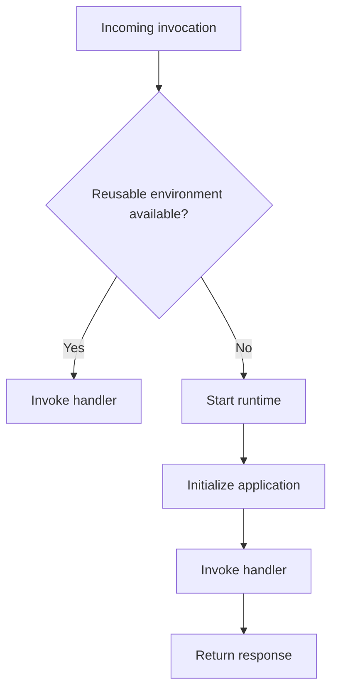
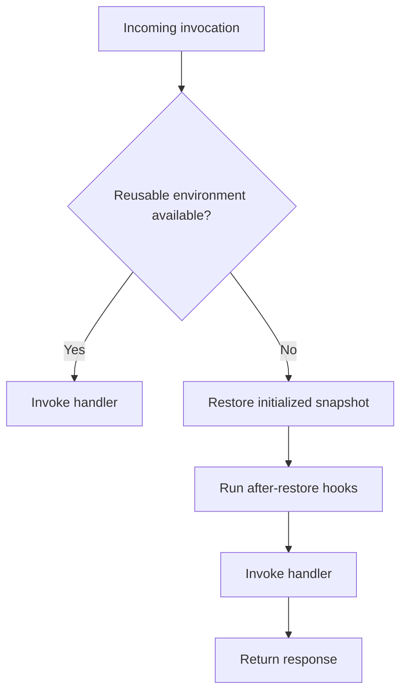
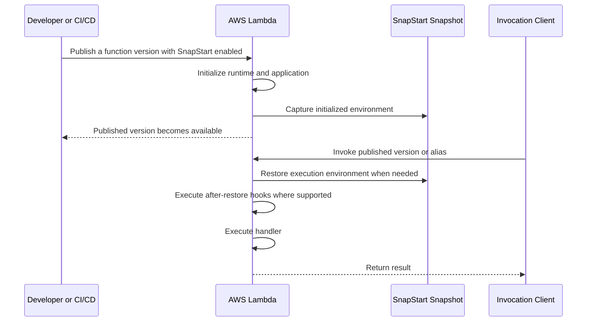

# 12- Lambda SnapStart

## Overview

AWS Lambda SnapStart is a performance optimization feature that reduces cold-start latency by creating a snapshot of a function's initialized execution environment and restoring from that snapshot when new execution environments are needed.

Normally, a new Lambda execution environment must initialize the runtime, load application code and dependencies, and execute initialization logic before processing an invocation. For applications with expensive initialization, this can add noticeable latency to the first request handled by a new environment.

SnapStart captures the initialized environment during version publication and uses the snapshot to accelerate subsequent environment initialization. Instead of repeating the entire initialization process for every new environment, Lambda restores the environment from the snapshot and runs the appropriate after-restore hooks before processing requests.

SnapStart is particularly useful for Java applications and other supported runtimes where startup work can be expensive. It is not a universal replacement for provisioned concurrency, and its availability depends on the runtime, Region, and current Lambda feature support.

## Why Lambda SnapStart Exists

Lambda automatically creates execution environments as demand increases. When a request cannot be handled by an existing environment, Lambda may need to initialize another one.

A cold start can include several stages:

- Runtime startup.
- Loading application code and dependencies.
- Framework initialization.
- Dependency injection and configuration loading.
- Establishing or preparing application resources.
- Executing static initializers and other initialization code.

For example, a Java-based REST API might initialize a dependency injection container, load application configuration, construct service objects, and initialize database clients before processing its first request.

These steps can increase request latency even when the handler itself performs very little work.

SnapStart reduces the initialization work required when new environments are created by restoring a previously captured snapshot.

### Cold Start Without SnapStart



### Cold Start With SnapStart



SnapStart primarily reduces initialization latency. It does not eliminate handler execution time, downstream network latency, database query time, or every possible source of cold-start overhead.

## How Lambda SnapStart Works

SnapStart operates on published Lambda function versions rather than providing a continuously refreshed snapshot of an arbitrary mutable `$LATEST` environment.

The process has three important stages:

- **Initialization:** Lambda initializes the runtime and application code.
- **Snapshot creation:** Lambda captures the initialized execution environment when the version is published.
- **Snapshot restoration:** Lambda restores execution environments from the snapshot when additional environments are needed.

The exact implementation details and available hooks depend on the runtime.

### Lifecycle



### Initialization Phase

During initialization, Lambda loads the runtime, imports or loads application code, and executes initialization logic outside the handler.

Examples include:

- Creating application service objects.
- Loading static configuration.
- Initializing framework components.
- Preparing reusable clients.
- Loading metadata or reference data.

SnapStart captures the environment after the initialization phase for the published version. Initialization code must therefore be designed with snapshot and restore behavior in mind.

### Snapshot Creation

When a version is published with SnapStart enabled, Lambda initializes the function and creates a snapshot of the initialized environment.

The snapshot is associated with the published version. Updating the function configuration or code and publishing a new version creates a new version-specific initialization and snapshot lifecycle.

This makes immutable versions and aliases important for deployment management.

### Snapshot Restoration

When Lambda needs an execution environment for a SnapStart-enabled version, it can restore that environment from the snapshot.

Restoration avoids repeating much of the original initialization work. Runtime-specific restore hooks can perform operations that must happen after restoration.

A restored environment is not the same as a new, independently initialized application process. In-memory state captured during initialization may be present, so code must account for the possibility that values and objects have been restored from an earlier point in time.

## Runtime Support and Compatibility

SnapStart support is runtime-specific. Historically, it has been especially relevant to Java runtimes, where virtual machine startup and framework initialization can be expensive.

Do not assume that every Lambda runtime supports SnapStart or that support is identical across runtime versions and Regions.

Before designing a deployment around SnapStart, verify:

- Whether the selected runtime is supported.
- Whether SnapStart is available in the target Region.
- Whether the required runtime hooks are supported.
- Whether the application uses features incompatible with snapshot restoration.
- Whether the deployment tool and Lambda configuration support the intended setup.

Consult the current [AWS Lambda SnapStart documentation](https://docs.aws.amazon.com/lambda/latest/dg/snapstart.html) and the [AWS Lambda runtime documentation](https://docs.aws.amazon.com/lambda/latest/dg/lambda-runtimes.html) before adopting it in production.

### Runtime-Specific Considerations

| Concern | Engineering implication |
|---|---|
| Runtime support | SnapStart cannot be assumed to work with every runtime. |
| Initialization hooks | Available hooks and their semantics depend on the runtime. |
| Native libraries | Native state and runtime-specific behavior require compatibility testing. |
| Randomness | Values generated before snapshot creation may be copied into restored environments. |
| Network connections | Connections created before snapshotting may not remain valid after restoration. |
| In-memory state | Mutable state captured in a snapshot can be inherited by restored environments. |
| Framework initialization | Expensive initialization may benefit significantly, but actual improvement must be measured. |

## Enabling SnapStart

SnapStart is configured on a Lambda function and applies to published versions. The following AWS CLI workflow illustrates the deployment model.

The commands assume that the AWS CLI is installed and configured, the selected Region supports the chosen runtime and feature, and the function already exists.

### Verify the Function

```bash
aws sts get-caller-identity

aws lambda get-function-configuration \
  --function-name orders-api \
  --region ap-south-1
```

Confirm the function name, runtime, Region, and current configuration before changing anything.

### Enable SnapStart for Published Versions

```bash
aws lambda update-function-configuration \
  --function-name orders-api \
  --snap-start ApplyOn=PublishedVersions \
  --region ap-south-1
```

Wait for the configuration update to finish:

```bash
aws lambda wait function-updated-v2 \
  --function-name orders-api \
  --region ap-south-1
```

The wait command confirms that the configuration update has completed. It does not, by itself, prove that a published version has been successfully created or that SnapStart has improved latency.

### Publish a Version

```bash
aws lambda publish-version \
  --function-name orders-api \
  --description "SnapStart-enabled release" \
  --region ap-south-1
```

Record the returned version number. SnapStart applies to the published version, not simply to an unqualified invocation of `$LATEST`.

### Verify the Published Version

Replace `42` with the actual published version number.

```bash
aws lambda get-function-configuration \
  --function-name orders-api \
  --qualifier 42 \
  --region ap-south-1 \
  --query '{
    Version:Version,
    State:State,
    LastUpdateStatus:LastUpdateStatus,
    SnapStart:SnapStart
  }'
```

Inspect the version's state and SnapStart configuration. Confirm that the version is usable before routing production traffic to it.

### Invoke the Published Version

```bash
aws lambda invoke \
  --function-name orders-api \
  --qualifier 42 \
  --region ap-south-1 \
  --payload '{"operation":"health-check"}' \
  --cli-binary-format raw-in-base64-out \
  response.json

cat response.json
```

The invocation should target the published version or an alias that points to it. An unqualified invocation does not demonstrate that the SnapStart-enabled published version was used.

## Using Aliases for Deployment

In production, an alias provides a stable invocation target while allowing the underlying published version to change.

For example, an alias named `production` can point to version `42`. A later deployment can publish version `43`, validate it, and update the alias when it is ready.

```bash
aws lambda create-alias \
  --function-name orders-api \
  --name production \
  --function-version 42 \
  --region ap-south-1
```

For an existing alias, update its target:

```bash
aws lambda update-alias \
  --function-name orders-api \
  --name production \
  --function-version 43 \
  --region ap-south-1
```

Use the actual version numbers returned by publication commands. For gradual releases, Lambda aliases also support weighted routing between published versions, subject to the applicable deployment constraints.

SnapStart does not replace deployment validation. A version can restore successfully but still contain application defects, invalid configuration, incompatible dependencies, or broken downstream integrations.

## Initialization and Restore Hooks

Some supported runtimes provide hooks for work that must occur at specific points in the SnapStart lifecycle.

Initialization-time work can be performed before the snapshot is captured. Restore-time work can be performed after an environment is restored and before it processes an invocation.

The distinction is important because not every value or resource created during initialization remains valid indefinitely.

| Operation | Appropriate phase |
|---|---|
| Load immutable application configuration | Initialization |
| Construct reusable application objects | Initialization, if snapshot-safe |
| Generate environment-specific transient state | Restore, when required |
| Refresh expired credentials or tokens | Restore or another controlled refresh mechanism |
| Re-establish invalid network connections | Restore or lazy connection establishment |
| Perform per-request authorization | Handler invocation |

The exact hooks and their invocation semantics must be verified for the selected runtime.

Avoid placing all initialization logic into restore hooks indiscriminately. Doing so can recreate the expensive work SnapStart is intended to avoid.

## Managing State and Resources Safely

SnapStart introduces an important lifecycle concern: an initialized object may be captured and later restored into multiple execution environments.

Application correctness must not depend on every environment receiving newly generated state or newly established external resources during restoration.

### Random Values and Unique Identifiers

Suppose initialization generates a random value:

```python
import secrets

INITIAL_TOKEN = secrets.token_hex(16)
```

If the runtime and feature combination snapshots this value, restored environments may inherit the same value. This is unsafe if the value is expected to be unique per environment or per invocation.

Generate values at the appropriate lifecycle boundary instead:

```python
import secrets

def handler(event, context):
    request_token = secrets.token_hex(16)

    return {
        "request_token": request_token
    }
```

This example illustrates the lifecycle principle; it is not a claim that Python is supported by SnapStart in every Region or runtime configuration. Apply runtime-specific SnapStart guidance to the actual deployment.

### Timestamps and Expiring Credentials

Values such as timestamps, temporary credentials, signed requests, and cached authentication tokens can become stale between snapshot creation and restoration.

Do not assume that a value remains valid because it was valid during initialization.

Prefer mechanisms that:

- Refresh credentials through supported AWS credential providers.
- Validate expiry before using cached tokens.
- Recreate time-sensitive request state at the point of use.
- Avoid embedding short-lived credentials into static initialization state.

### Database and Network Connections

Network connections are external resources. A connection that was valid before snapshot creation might no longer be usable after restoration.

For database clients and HTTP connection pools:

- Verify the behavior of the chosen runtime and client library.
- Avoid assuming that an established connection remains valid after restore.
- Use connection validation, reconnect logic, or lazy connection establishment where appropriate.
- Set connection and read timeouts.
- Apply bounded retries to transient failures.
- Monitor database connection counts and downstream saturation.

A Lambda function connected to PostgreSQL, for example, must still respect database connection limits. SnapStart can reduce startup work, but it does not remove the risk of exhausting database connections when Lambda scales horizontally.

## Performance Tuning

SnapStart is most useful when initialization contributes significantly to cold-start latency. Its impact depends on the runtime, application architecture, snapshot size, initialization work, and restore behavior.

Measure the complete invocation path rather than assuming that a faster restore automatically makes the entire request fast.

### Identify Initialization Cost

Break the request latency into meaningful components:

- Environment initialization or restoration.
- Runtime and framework startup.
- Handler execution.
- Downstream API and database calls.
- Serialization and response transfer.

For an API that spends most of its time waiting for a remote database, reducing initialization latency may have a limited effect on total response time.

### Benchmark the Correct Scenarios

Compare at least these scenarios:

| Scenario | What it measures |
|---|---|
| Warm invocation | Latency when an existing environment is reused |
| Cold start without SnapStart | Baseline initialization overhead |
| Restoration with SnapStart | Startup performance for a restored environment |
| First request after restoration | Restore and application behavior on the first request |
| Concurrent scale-out | Behavior when Lambda creates additional environments |
| Downstream degradation | Application behavior when dependencies are slow or unavailable |

Run tests against published versions and control for differences in traffic, payload size, concurrency, memory, and downstream performance.

Use production-like dependencies when safe. A local benchmark that excludes database and network behavior cannot establish end-to-end production latency.

### SnapStart Versus Provisioned Concurrency

SnapStart and provisioned concurrency address related but different performance requirements.

| Dimension | SnapStart | Provisioned concurrency |
|---|---|---|
| Primary mechanism | Restores initialized environments from snapshots | Keeps a configured number of environments initialized and ready |
| Main benefit | Reduces startup latency when new environments are needed | Reduces initialization latency for requests handled by pre-initialized environments |
| Capacity behavior | Does not reserve a fixed number of ready environments | Provides a configured pool of pre-initialized environments |
| Traffic spikes | Additional environments can still require restoration | Requests exceeding provisioned capacity can use other available capacity and may experience different latency |
| Cost model | Snapshot-related costs and applicable invocation or duration charges | Additional charges for provisioned capacity, plus applicable invocation and compute charges |
| Best fit | Workloads where initialization is expensive and supported | Workloads with strict latency objectives and predictable or explicitly provisioned capacity needs |

Verify current pricing and compatibility before combining or choosing these features. Their availability and interaction can depend on runtime and deployment configuration.

## Security Considerations

SnapStart does not replace Lambda's security controls. Execution roles, resource-based policies, network boundaries, secret management, and deployment permissions remain essential.

Pay particular attention to state captured during initialization.

- Do not hardcode credentials or secrets in application code.
- Avoid embedding temporary credentials in objects that may be captured in a snapshot.
- Use IAM roles and supported credential providers for AWS API access.
- Retrieve secrets through appropriate services and refresh them according to their lifecycle.
- Restrict invocation permissions to trusted principals.
- Separate deployment permissions from runtime permissions.
- Protect published versions and aliases through controlled deployment processes.
- Validate that logging does not expose credentials, tokens, or sensitive request data.

Treat a snapshot as application state that must be handled according to the security properties of the initialized environment. Follow current AWS guidance for snapshot encryption, retention, and supported runtime-specific security behavior.

## Observability and Operational Verification

SnapStart changes initialization behavior, so monitoring should distinguish startup-related latency from handler execution and downstream latency.

Use CloudWatch metrics and logs to establish a baseline before enabling SnapStart. Where supported, use tracing and structured application logs to correlate invocation latency with dependency calls.

Monitor:

- Invocation count and errors.
- Duration and latency percentiles.
- Throttles and concurrency.
- Initialization and restoration-related behavior exposed by the runtime or service.
- Database connection failures and downstream latency.
- Failed deployments and unusable published versions.
- Unexpected changes in cost.

A successful version publication is not sufficient evidence of a performance improvement. Verify that the deployed alias targets the intended version, exercise the real invocation path, and compare measurements against a baseline.

## Common Mistakes

### Enabling SnapStart Without Publishing a Version

Configuring `ApplyOn=PublishedVersions` does not make an unqualified `$LATEST` invocation a SnapStart invocation.

**Prevention:** Publish a version, verify its configuration, and invoke the published version or an alias targeting it.

### Assuming Every Runtime Supports SnapStart

Feature availability varies by runtime and Region.

**Prevention:** Check the current AWS runtime and SnapStart compatibility documentation before choosing an architecture.

### Capturing Stale State

Initialization-time timestamps, credentials, random values, and external resource state can become invalid or unsafe after restoration.

**Prevention:** Separate snapshot-safe initialization from state that must be generated, refreshed, or re-established after restoration.

### Expecting SnapStart to Fix All Latency

Slow SQL queries, network calls, oversized responses, and inefficient handlers remain slow.

**Prevention:** Profile initialization and handler execution separately, then optimize the dominant source of latency.

### Ignoring Downstream Capacity

Faster environment startup can change how quickly an application handles new demand, but downstream systems still have finite capacity.

**Prevention:** Set concurrency limits where appropriate, use backpressure, bound connection pools, and test scale-out behavior against downstream limits.

### Treating Publication as Production Validation

A published version may be available while still containing application-level defects or incorrect external configuration.

**Prevention:** Run smoke tests, validate integrations, inspect logs and metrics, and promote aliases only after the release meets defined acceptance criteria.

## Production Readiness Checklist

Before enabling SnapStart for a production function, verify the following:

- [ ] The runtime and Region support SnapStart.
- [ ] Initialization logic has been reviewed for snapshot safety.
- [ ] Time-sensitive state and external connections are refreshed or re-established appropriately.
- [ ] The function has explicit timeout, memory, and concurrency configuration.
- [ ] IAM permissions follow least-privilege principles.
- [ ] The published version is verified before production traffic is routed to it.
- [ ] The deployment process uses versions and aliases where appropriate.
- [ ] Latency is measured under warm, restored, and concurrent scale-out conditions.
- [ ] Logs, metrics, alarms, and failure handling cover the relevant runtime behavior.
- [ ] Pricing, quotas, compatibility constraints, and rollback procedures have been reviewed.

## Key Takeaways

- Lambda SnapStart reduces initialization latency by capturing initialized execution environments for published function versions and restoring them when needed.
- SnapStart is runtime- and Region-dependent; verify current AWS support and compatibility before relying on it.
- Snapshot-safe initialization is essential because restored environments can inherit in-memory state that may be stale, duplicated, or otherwise unsuitable.
- SnapStart improves startup behavior but does not eliminate handler latency, downstream bottlenecks, concurrency limits, or the need for observability.
- Use published versions, aliases, performance benchmarks, and production validation to deploy SnapStart safely and measure its actual benefit.