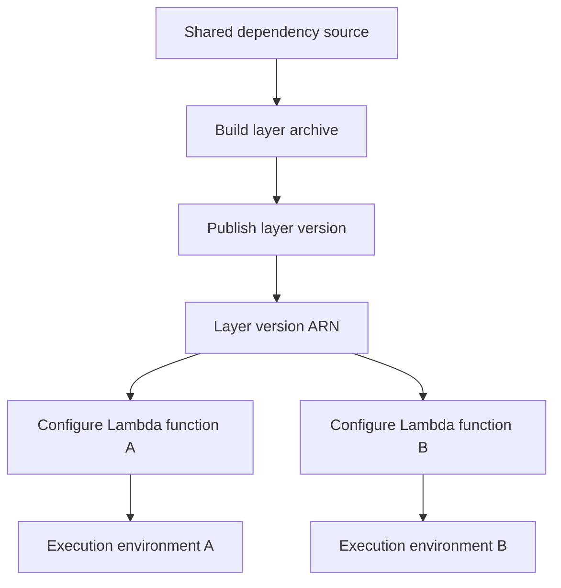

# 13- Lambda Layers

## Overview

AWS Lambda layers provide a mechanism for packaging and sharing dependencies, libraries, custom runtimes, and supporting files across multiple Lambda functions. A layer is a separately versioned archive that Lambda extracts into a standard directory within the execution environment.

Layers help reduce duplication when multiple functions use the same dependencies. For example, several Python Lambda functions might share an internal logging library, common validation utilities, or a collection of third-party packages.

A layer is not an independently executable service. It does not have its own handler, execution role, scaling policy, or invocation lifecycle. Its contents become available to a function when the function is configured to use that layer.

Use layers when shared dependencies have a clear lifecycle and are compatible with the consuming functions. Avoid treating layers as a universal dependency-management solution: they introduce versioning, compatibility, deployment, and debugging considerations.

## How Lambda Layers Work

A layer is published as an immutable, numbered version. A Lambda function references a specific layer version through its configuration.

When Lambda prepares an execution environment, it makes the layer contents available alongside the function's deployment package. The runtime can then load the relevant libraries or files.



For example, a team might publish a shared Python layer containing internal observability utilities. Several functions can reference the same published version without embedding a separate copy of the utilities in each function's ZIP package.

### Layer Structure

For Python, Lambda searches standard directories in the layer archive for packages and modules. A common layout is:

```text
python/
    lib/
        python3.12/
            site-packages/
                shared_logging/
                    __init__.py
                requests/
                urllib3/
```

For Python layers, the top-level directory can also be named `python/` with packages directly beneath it:

```text
python/
    shared_logging/
        __init__.py
    requests/
```

The correct layout depends on the runtime and package installation method. Follow the current AWS documentation for the selected runtime.

For other runtimes, layers use runtime-specific directory conventions. Layers can also include files under the `/opt` directory in the execution environment, making them useful for configuration assets, executables, and other shared resources.

## When to Use Lambda Layers

Layers are useful when shared dependencies can be versioned and released independently from application code.

| Use case | Example | Consideration |
|---|---|---|
| Shared third-party libraries | Common Python packages | Keep versions compatible with consuming functions |
| Internal utilities | Logging, validation, or tracing helpers | Maintain a clear ownership and release process |
| Shared executables | Command-line tools required by multiple functions | Ensure executable permissions and runtime compatibility |
| Custom runtime components | Runtime support files | Verify the required runtime and execution conventions |
| Common certificates or assets | Organization-managed supporting files | Protect sensitive material and define a rotation strategy |

Layers are less useful when a dependency is used by only one function, changes frequently with the application, or requires incompatible versions across consuming functions.

## Advantages and Limitations

| Advantages | Limitations |
|---|---|
| Reuse common dependencies across functions | Layer versions must be managed explicitly |
| Reduce duplicated dependency packaging | Runtime and architecture compatibility still matter |
| Release shared libraries independently | Updating a layer does not automatically update consumers |
| Separate shared code from application code | Troubleshooting can involve multiple packages and versions |
| Support common executables and supporting files | Layers add deployment configuration and package-size considerations |

Lambda layers are immutable by version. Publishing a new version does not change functions that already reference an older version. Consumers must explicitly update their configuration to use the new version.

## Creating a Python Layer

This example builds a layer containing a third-party Python dependency. The example uses `requests`; choose versions compatible with the application and maintain them through the project's dependency-management process.

### Create the Directory Structure

```bash
mkdir -p python-layer/python
```

Install the dependency into the layer's Python directory:

```bash
python -m pip install \
  --target python-layer/python \
  requests
```

Create the ZIP archive from the correct directory:

```bash
cd python-layer
zip -r ../requests-layer.zip python
cd ..
```

The archive must contain `python/` at its root. An archive containing `python-layer/python/` instead will not follow the expected layout.

### Build for the Target Runtime

Python dependencies can include native extensions that depend on operating system libraries, CPU architecture, and Python ABI compatibility.

For production layers:

- Build dependencies for the target Lambda runtime and architecture.
- Use a compatible Linux environment when packages contain native extensions.
- Verify compatibility with the function's Python version.
- Pin dependency versions and record the build inputs.
- Scan dependencies for known vulnerabilities.
- Avoid packaging unnecessary development dependencies.

A package that installs successfully on Windows may fail in Lambda because its native binary targets a different operating system or architecture.

## Publishing a Layer

The following AWS CLI commands publish a layer version. They create AWS resources and may be subject to service-specific limits and charges.

```bash
aws lambda publish-layer-version \
  --layer-name shared-python-dependencies \
  --zip-file fileb://requests-layer.zip \
  --compatible-runtimes python3.12 \
  --region ap-south-1
```

Specify only runtime values supported by the current Lambda service and your deployment target. Add compatible architectures when appropriate and supported by the CLI options for the current service API.

The command returns a layer version ARN, similar to:

```text
arn:aws:lambda:ap-south-1:123456789012:layer:shared-python-dependencies:1
```

The account ID and version number above are illustrative. Use the ARN returned by your own command.

Inspect the published layer:

```bash
aws lambda list-layer-versions \
  --layer-name shared-python-dependencies \
  --region ap-south-1
```

To inspect a particular version:

```bash
aws lambda get-layer-version \
  --layer-name shared-python-dependencies \
  --version-number 1 \
  --region ap-south-1
```

Layer publication does not automatically attach the layer to any function.

## Attaching a Layer to a Lambda Function

A function can reference one or more layer versions. When updating its layer configuration, provide the complete desired list of layer version ARNs rather than assuming that an update will append a single layer automatically.

```bash
aws lambda update-function-configuration \
  --function-name orders-api \
  --layers \
    arn:aws:lambda:ap-south-1:123456789012:layer:shared-python-dependencies:1 \
  --region ap-south-1
```

Wait for the function configuration update:

```bash
aws lambda wait function-updated-v2 \
  --function-name orders-api \
  --region ap-south-1
```

Inspect the function configuration:

```bash
aws lambda get-function-configuration \
  --function-name orders-api \
  --region ap-south-1 \
  --query '{
    FunctionName:FunctionName,
    Runtime:Runtime,
    Architectures:Architectures,
    Layers:Layers[*].Arn,
    LastUpdateStatus:LastUpdateStatus
  }'
```

When replacing or adding layers to an existing function, preserve every required layer ARN in the final configuration. Accidentally omitting an existing layer can break imports or remove required extensions.

## Cross-Account Layer Sharing

Layers can be shared with other AWS accounts through layer resource-based permissions, subject to AWS Lambda's sharing rules.

A consuming function in another account must be authorized to use the layer version. The consumer must reference the layer version ARN, and the layer owner must configure the appropriate permissions.

For example, the layer owner can grant a specific account permission to use a layer version:

```bash
aws lambda add-layer-version-permission \
  --layer-name shared-python-dependencies \
  --version-number 1 \
  --statement-id allow-consumer-account \
  --action lambda:GetLayerVersion \
  --principal 210987654321 \
  --region ap-south-1
```

The example principal is illustrative. Replace it with the authorized consumer account ID.

Verify the permission:

```bash
aws lambda get-layer-version-policy \
  --layer-name shared-python-dependencies \
  --version-number 1 \
  --region ap-south-1
```

Apply least privilege when sharing layers. Avoid broad public access unless it is an intentional, reviewed distribution model. Shared layers should also have a documented owner, release process, compatibility policy, and vulnerability-management process.

## Layer Versioning and Release Management

A layer version is immutable. If a shared library changes, publish a new layer version and update the functions that consume it.

A safe release process is:

1. Build the layer from pinned dependencies.
2. Run automated tests and security checks.
3. Publish a new layer version.
4. Attach the version to a test or staging function.
5. Verify imports, handler behavior, and integration tests.
6. Promote the new layer version through the deployment pipeline.
7. Monitor errors and latency after rollout.
8. Retain the previous known-good version for rollback.

The function's configuration determines which layer versions it uses. Rolling back the function configuration to a previous layer ARN can restore the prior dependency set, provided that version remains available and accessible.

For production workloads, manage layer ARNs through infrastructure as code or controlled deployment configuration instead of manually updating functions across environments.

## Dependency Conflicts and Import Resolution

Python import behavior can cause subtle problems when a dependency exists in both the function package and a layer.

For example, if the function ZIP contains one version of a library while a layer contains another, the runtime's search path determines which version is imported. The resulting behavior may differ from the developer's local environment.

Avoid relying on undocumented import precedence. Inspect `sys.path`, test the deployed artifact, and keep dependency ownership clear.

A basic diagnostic handler can report the module location and version:

```python
import requests

def lambda_handler(event, context):
    return {
        "module_path": requests.__file__,
        "version": requests.__version__,
    }
```

Use this only as a diagnostic example. Do not expose internal filesystem paths or dependency details through a public production API.

For deeper diagnostics, inspect the function configuration and test the packaged artifacts in a runtime-compatible environment.

## Layers Versus Bundling Dependencies

Not every shared dependency should be moved into a layer. Choose the packaging strategy based on deployment independence, compatibility, and operational complexity.

| Dimension | Lambda layer | Dependencies in function package |
|---|---|---|
| Sharing | Reusable across multiple functions | Usually packaged per function |
| Independent updates | Layer can be released separately | Dependency changes are released with the function |
| Version control | Function references a specific layer version | Dependency versions are tied to the function artifact |
| Debugging | Must inspect function and layer artifacts | Usually inspect one application artifact |
| Compatibility | Shared layer must fit all consumers | Each function can have a more tailored dependency set |
| Best fit | Stable, broadly reused dependencies | Function-specific or frequently changing dependencies |

For a small service with a handful of functions, packaging dependencies with each function may be simpler and more reproducible. For a platform with many functions sharing a stable internal library, layers may reduce duplicated build work and improve consistency.

## Security and Production Considerations

Layers are executable application dependencies and should be treated as part of the function's trusted software supply chain.

- **Dependency integrity:** Build from trusted sources and lock dependency versions.
- **Vulnerability management:** Scan dependencies and rebuild layers when required security fixes become available.
- **Least privilege:** Restrict who can publish layers, change layer permissions, and update function configurations.
- **Artifact provenance:** Record the source revision, dependency lock file, build environment, and published layer version.
- **Compatibility testing:** Test every supported runtime and architecture combination.
- **Release ownership:** Assign responsibility for maintaining shared layers and communicating breaking changes.
- **Rollback:** Retain and document known-good versions so function configurations can be reverted safely.
- **Observability:** Correlate application errors with the deployed function version and layer versions.

A layer does not create a separate IAM execution boundary. Its code runs as part of the Lambda function and can generally exercise the permissions available to that function. Do not put untrusted code into a layer simply because it is shared or separately packaged.

Also, do not use layers as a secret-distribution mechanism. Sensitive credentials belong in appropriate secret-management systems, with access governed by IAM and the application's operational requirements.

## Common Mistakes

### Incorrect Archive Layout

**Problem:** The ZIP archive contains an extra parent directory, so the runtime cannot find the expected packages.

**Prevention:** Inspect the archive before publishing:

```bash
unzip -l requests-layer.zip
```

Confirm that the expected top-level directory, such as `python/`, appears at the archive root.

### Assuming a New Layer Version Updates Consumers

**Problem:** A new version is published, but existing functions continue using the previous version.

**Prevention:** Update each consuming function's configuration through the deployment pipeline and verify the resulting layer ARNs.

### Building Native Dependencies on an Incompatible Platform

**Problem:** A package works locally but fails in Lambda with import errors or missing shared libraries.

**Prevention:** Build for the target runtime, operating system, Python version, and architecture. Test the actual deployment artifact.

### Overusing Layers

**Problem:** Simple functions become difficult to debug because their dependencies are spread across several artifacts.

**Prevention:** Use layers when shared ownership and reuse justify the extra versioning and deployment complexity.

### Replacing the Entire Layer List Accidentally

**Problem:** An update removes previously configured layers that the function still requires.

**Prevention:** Treat the layer list as complete desired state and preserve all required layer ARNs in configuration updates.

### Sharing Layers Without a Release Contract

**Problem:** A change to a shared dependency breaks several functions simultaneously.

**Prevention:** Define compatibility guarantees, release notes, testing requirements, and a controlled rollout strategy.

## Key Takeaways

- Lambda layers package reusable libraries, executables, and supporting files that functions can reference through immutable layer versions.
- Runtime-specific directory layouts, operating system compatibility, CPU architecture, and dependency versions must be validated before deployment.
- Publishing a new layer version does not update consuming functions; each function must explicitly reference the intended version.
- Layers simplify dependency reuse but introduce versioning, debugging, security, and deployment responsibilities.
- Treat layers as trusted executable artifacts, manage them through controlled CI/CD workflows, and preserve known-good versions for rollback.