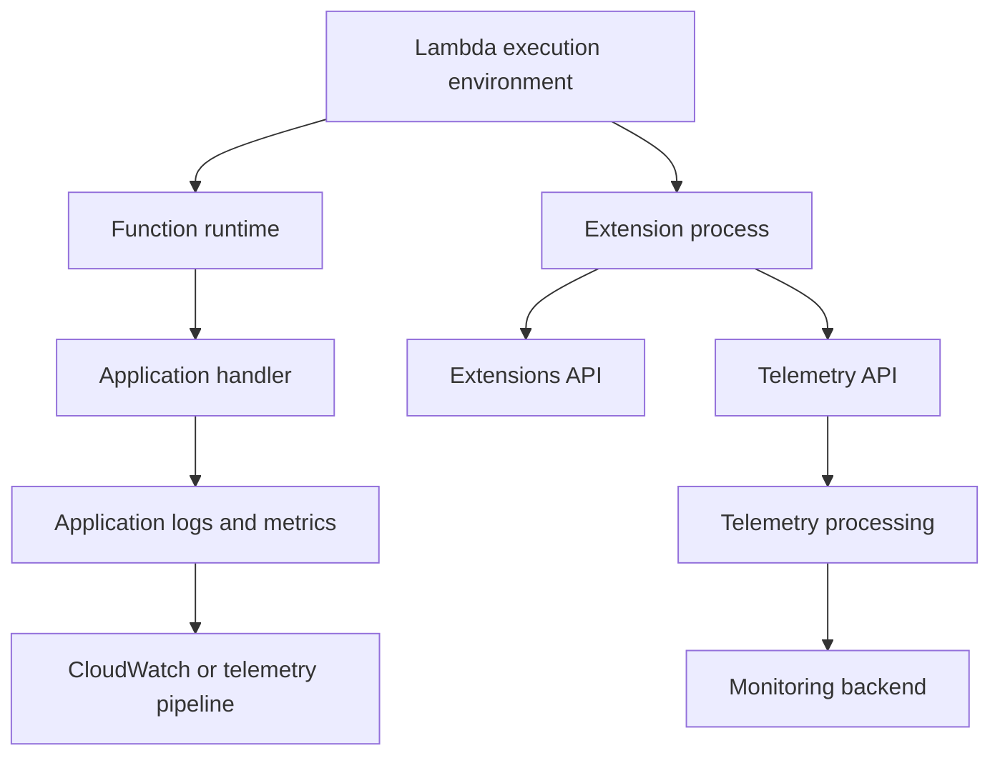
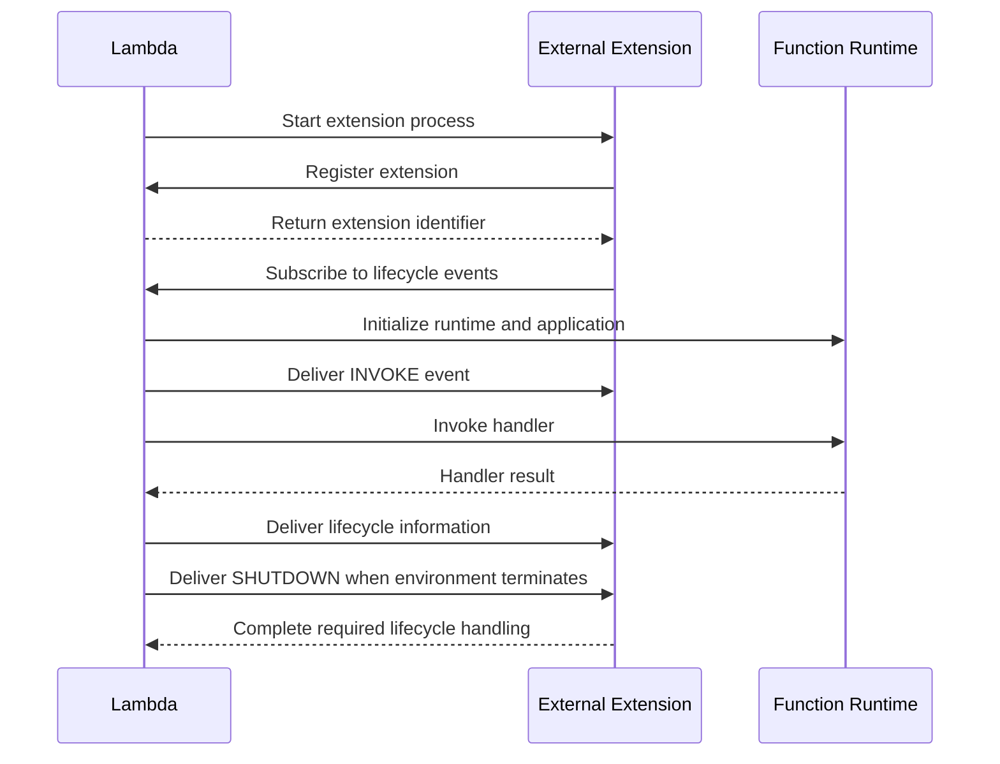

# 14- Lambda Extensions

## Overview

AWS Lambda extensions allow external processes to augment a Lambda function's execution environment. They are commonly used for observability, security monitoring, configuration management, and integration with external tooling.

A Lambda extension runs alongside the function runtime within the Lambda execution environment. It can interact with the Lambda Extensions API, participate in the execution environment lifecycle, and, where supported, receive telemetry through the Lambda Telemetry API.

Extensions help integrate operational capabilities without requiring all of their implementation to live inside the application handler. For example, an observability extension can collect logs or telemetry and forward them to a monitoring platform.

Extensions are not separate Lambda functions. They share the execution environment's resource constraints and lifecycle, so their CPU and memory consumption, startup behavior, network activity, and shutdown handling can affect application reliability.

## Why Lambda Extensions Exist

Without extensions, monitoring and security integrations often require application code to communicate directly with external systems. This can create several problems:

- Repeated instrumentation across multiple functions.
- Application code coupled to a specific monitoring vendor.
- Additional logic inside request handlers.
- Inconsistent telemetry collection across services.
- Operational work that competes with business logic.

Extensions provide a mechanism for integrating supporting processes with the Lambda runtime.

For example, a Python API might emit structured logs while an external extension collects telemetry and forwards it to a monitoring backend. The application remains responsible for business behavior, while the extension handles its own collection and delivery responsibilities.

Extensions do not eliminate the need for application instrumentation, and they do not guarantee that telemetry is delivered successfully.

## Lambda Extension Architecture

A Lambda execution environment can contain the function runtime and one or more extensions. Lambda starts registered extensions as part of environment initialization and coordinates lifecycle events through the Extensions API.



The diagram represents a logical architecture. The exact data path depends on the extension implementation, subscription type, logging configuration, and telemetry destination.

### Components

| Component | Responsibility |
|---|---|
| Function runtime | Executes the application handler |
| Extension process | Performs supporting operational tasks |
| Extensions API | Coordinates extension registration and lifecycle events |
| Telemetry API | Provides subscribed extensions with supported telemetry streams |
| Application instrumentation | Emits business metrics, traces, and contextual information |
| External backend | Stores or analyzes collected telemetry |

Extensions may use the Extensions API without subscribing to telemetry. A telemetry-collecting extension may use both APIs.

## Types of Lambda Extensions

Lambda supports two broad extension models.

### Internal Extensions

Internal extensions integrate with the language runtime rather than running as a separate external process. They can use runtime-specific mechanisms to instrument application behavior.

Their capabilities and limitations depend on the runtime and implementation. They should not be confused with ordinary application libraries or with the external extension lifecycle API.

### External Extensions

External extensions run as separate processes within the execution environment. They can be implemented using supported executable formats and interact with Lambda through the Extensions API.

Typical use cases include:

- Telemetry collection and forwarding.
- Security and compliance monitoring.
- Secret retrieval and caching.
- Configuration retrieval.
- Integration with third-party observability platforms.
- Runtime support and operational automation.

External extensions are commonly distributed through Lambda layers or container images, depending on the extension's packaging and deployment model.

## Lambda Extensions API

The Extensions API enables an external extension to register with Lambda and receive lifecycle events.

The extension typically performs the following operations:

1. Starts during execution environment initialization.
2. Registers itself with the Extensions API.
3. Receives its assigned extension identifier.
4. Subscribes to relevant lifecycle events.
5. Performs work associated with those events.
6. Reports completion where the API requires it.
7. Handles subsequent invocations and shutdown according to the extension's design.

### Lifecycle Events

| Event | Purpose | Engineering consideration |
|---|---|---|
| `INVOKE` | Signals an invocation lifecycle event | Keep extension work bounded so it does not interfere with application performance |
| `SHUTDOWN` | Signals environment shutdown | Flush buffered data and release resources within the available time |

The exact lifecycle behavior depends on the event and extension API contract. An extension must follow the API's registration and event-completion requirements.

### Lifecycle Flow



This diagram is conceptual; the runtime and extension operate concurrently, and their precise event ordering must follow the documented API contract.

## Lambda Telemetry API

The Telemetry API allows an extension to subscribe to supported telemetry streams generated by the Lambda execution environment.

Depending on the subscription and configuration, telemetry can include platform events, function logs, and extension logs.

A typical observability extension can:

- Subscribe to relevant telemetry.
- Receive telemetry in batches.
- Buffer or transform events.
- Forward telemetry to an external destination.
- Track delivery failures and apply bounded retry logic.

The Telemetry API is particularly useful when monitoring infrastructure requires a standardized collection mechanism across many Lambda functions.

### Telemetry Delivery Considerations

Telemetry processing is a distributed system. A successful subscription does not guarantee that every event reaches the final monitoring backend.

Potential failure points include:

- Extension crashes.
- Buffer exhaustion.
- Network timeouts.
- Authentication failures at the destination.
- Backend throttling.
- Environment shutdown before buffered data is delivered.

Production extensions should define buffer limits, delivery timeouts, retry policies, and behavior when the destination is unavailable.

Avoid unlimited buffering or unbounded retries. Both can increase memory consumption and compete with application execution.

## Packaging Extensions with Layers

Lambda extensions are commonly distributed through Lambda layers. An extension layer includes an executable under the expected extension directory, typically `/opt/extensions/`.

A simplified package structure might look like this:

```text
extension-layer/
    extensions/
        telemetry-agent
    bin/
        telemetry-helper
    config/
        extension.yaml
```

After extraction, the extension executable is available under `/opt/extensions/telemetry-agent`.

The executable must have the appropriate permissions and be compatible with the target Lambda execution environment and CPU architecture.

For example, a Linux-based extension binary built for x86-64 may not work in an ARM64 Lambda environment.

### Packaging Considerations

- Place extension executables in the documented directory.
- Set executable permissions during the build.
- Compile or package dependencies for the target operating system and architecture.
- Keep extension binaries and supporting files as small as practical.
- Test initialization and shutdown behavior in a Lambda-compatible environment.
- Pin extension versions and manage updates through CI/CD.

A layer can contain both libraries and extension files, but their runtime paths and responsibilities should remain clear.

For container-image-based functions, include extension files in the image according to the documented packaging requirements.

## Example: A Minimal External Extension

The following Python example illustrates an external extension that registers with the Extensions API and waits for lifecycle events. It is an educational skeleton rather than a production telemetry collector.

```python
import json
import os
import urllib.request

LAMBDA_RUNTIME_API = os.environ["AWS_LAMBDA_RUNTIME_API"]
EXTENSIONS_API = f"http://{LAMBDA_RUNTIME_API}/2020-01-01/extension"


def api_request(method: str, path: str, extension_id: str | None = None):
    headers = {
        "Lambda-Extension-Name": "example-extension",
    }

    if extension_id:
        headers["Lambda-Extension-Identifier"] = extension_id

    request = urllib.request.Request(
        f"{EXTENSIONS_API}{path}",
        method=method,
        headers=headers,
    )

    with urllib.request.urlopen(request, timeout=5) as response:
        body = response.read()
        return response.headers, body


def main():
    headers, _ = api_request(
        "POST",
        "/register",
    )

    extension_id = headers["Lambda-Extension-Identifier"]

    api_request(
        "PUT",
        "/event/next",
        extension_id,
    )

    while True:
        headers, body = api_request(
            "GET",
            "/event/next",
            extension_id,
        )

        event = json.loads(body)

        if event.get("eventType") == "SHUTDOWN":
            break


if __name__ == "__main__":
    main()
```

The example demonstrates registration and event retrieval, but a production implementation must handle API response semantics, supported lifecycle events, errors, shutdown deadlines, process supervision, and extension-specific work. A complete extension must also package its executable correctly and comply with the Extensions API protocol.

For production development, consult the [AWS Lambda Extensions API documentation](https://docs.aws.amazon.com/lambda/latest/dg/runtimes-extensions-api.html).

## Performance and Resource Management

Extensions share the execution environment with the function runtime. Although they run as separate processes, they are not isolated from the function's memory, CPU, startup, or overall operational constraints.

An extension that consumes significant CPU during initialization can increase startup latency. An extension that uses excessive memory can increase the risk of function failure. A synchronous telemetry-forwarding operation can also delay extension progress and contribute to operational problems.

### Resource Considerations

| Concern | Potential impact | Recommended approach |
|---|---|---|
| CPU consumption | Slower handler execution or initialization | Bound background work and benchmark under load |
| Memory consumption | Reduced memory headroom and possible out-of-memory failures | Set buffer limits and monitor memory behavior |
| Initialization work | Increased cold-start latency | Defer nonessential work and minimize startup dependencies |
| Network calls | Additional latency or failed telemetry delivery | Use timeouts, bounded retries, and controlled buffering |
| Logging volume | Increased processing and delivery costs | Filter unnecessary events and avoid recursive logging |
| Shutdown work | Lost telemetry or incomplete cleanup | Keep shutdown processing bounded and test termination behavior |

Do not assume that a separate process has dedicated compute resources. Extension performance must be evaluated as part of the whole Lambda execution environment.

## Reliability and Failure Handling

Extensions should fail gracefully wherever possible. Monitoring and telemetry failures should not unnecessarily turn successful business operations into failed requests.

For example, if an extension cannot deliver a log batch to a remote observability backend, it should apply its documented retry and buffering policy rather than indefinitely blocking work.

Important design practices include:

- Use bounded queues and buffers.
- Apply network timeouts.
- Retry transient failures with backoff and jitter where appropriate.
- Avoid unbounded background tasks.
- Define behavior when the telemetry backend is unavailable.
- Monitor extension crashes and delivery failures.
- Test shutdown during active telemetry delivery.
- Ensure that extension logs do not recursively trigger their own collection pipeline.

The right failure policy depends on the extension's purpose. A telemetry exporter may tolerate temporary data loss, while a security extension may have stricter requirements. Evaluate these requirements explicitly instead of assuming all extensions should fail open or fail closed.

## Security Considerations

Extensions execute within the Lambda function's security context and can access resources according to the permissions and network access available to the environment.

Treat extension binaries and configuration as part of the application's trusted software supply chain.

- Use trusted extension publishers and verify provenance where available.
- Pin extension and layer versions.
- Scan extension dependencies for known vulnerabilities.
- Grant the function only the IAM permissions required by the application and extension.
- Protect API tokens and external service credentials.
- Avoid writing secrets to logs or temporary files unnecessarily.
- Restrict network access where feasible.
- Review extension updates before production rollout.
- Separate deployment permissions from runtime permissions.

A third-party extension may need permissions beyond those required by the application handler. Review its documented IAM requirements and grant only the actions it actually needs.

Do not assume that packaging an extension as a layer gives it an independent IAM role or security boundary.

## Observability and Cost

Extensions can improve observability, but they also introduce additional operational and financial considerations.

Monitor both the Lambda function and the extension's behavior. Depending on the implementation, useful signals include:

- Function errors and duration.
- Initialization latency.
- Extension startup failures.
- Telemetry delivery errors.
- Buffer saturation or dropped events.
- Network timeout rates.
- Extension memory and CPU consumption where measurable.
- Log ingestion and monitoring-platform costs.

Extensions can increase logging volume and external telemetry traffic. Forwarding every event from every function can become expensive, especially in high-volume systems.

Apply filtering and sampling where appropriate, while preserving the data needed for incident response, security monitoring, and compliance.

## Lambda Extensions Versus Application Instrumentation

Extensions and application instrumentation solve related but distinct problems.

| Dimension | Lambda extension | Application instrumentation |
|---|---|---|
| Primary role | Supporting process for collection or operational integrations | Emits business-aware logs, metrics, and traces |
| Application code changes | May reduce integration-specific code | Usually requires application integration |
| Business context | May have limited knowledge of business operations | Can capture domain events and application context |
| Runtime coupling | Depends on extension and packaging compatibility | Depends on instrumentation library and runtime |
| Resource usage | Consumes execution-environment resources | Adds overhead within the application process |
| Best use | Standardized telemetry transport and supporting operations | Business metrics, trace context, and meaningful application events |

A mature observability strategy often combines both. The application emits useful, structured telemetry, while an extension or managed integration handles collection and transport.

## Common Mistakes

### Assuming Extensions Run Outside the Function's Resource Boundary

**Problem:** An extension consumes memory or CPU and degrades handler performance.

**Prevention:** Benchmark the complete execution environment and monitor resource behavior under realistic workloads.

### Treating Telemetry Delivery as Guaranteed

**Problem:** Events are buffered locally but lost when the extension crashes or the environment terminates.

**Prevention:** Define delivery guarantees, buffer limits, retry policies, and acceptable data-loss behavior.

### Blocking Application Progress on Optional Telemetry

**Problem:** An unavailable monitoring backend creates unnecessary delays or failures.

**Prevention:** Use bounded asynchronous processing where appropriate and define an explicit policy for telemetry delivery failures.

### Packaging an Incompatible Binary

**Problem:** The extension fails to start because it targets a different operating system or CPU architecture.

**Prevention:** Build for the intended Lambda runtime environment and test the published artifact.

### Granting Excessive IAM Permissions

**Problem:** A monitoring extension receives broad permissions unrelated to its actual responsibilities.

**Prevention:** Review extension documentation, restrict permissions, and verify access through policy analysis and deployment testing.

### Ignoring Extension Updates

**Problem:** An outdated extension contains vulnerable dependencies or stops working with an updated runtime.

**Prevention:** Maintain version inventories, scan artifacts, test upgrades, and deploy changes through a controlled release process.

## Key Takeaways

- Lambda extensions run alongside the function runtime and support capabilities such as observability, security monitoring, and configuration integration.
- The Extensions API coordinates extension registration and lifecycle events, while the Telemetry API supports subscriptions to documented telemetry streams.
- Extensions share execution-environment resources and can affect initialization latency, memory usage, CPU consumption, and application reliability.
- Production extensions need bounded buffering, timeouts, retry policies, secure permissions, compatible packaging, and tested shutdown behavior.
- Combine extensions with application-level instrumentation when business context is needed, and monitor both telemetry delivery and its operational cost.