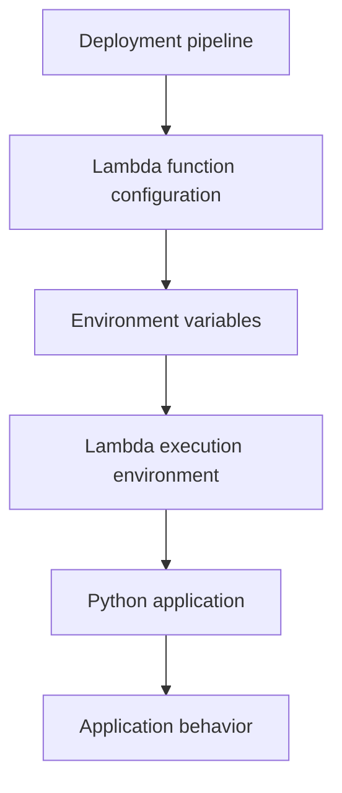
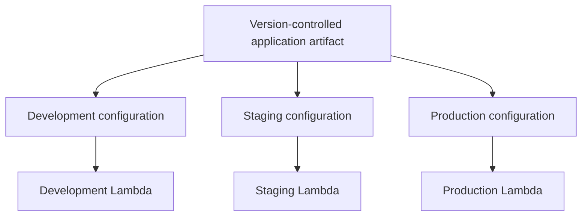

# 15- Environment Variables

## Overview

AWS Lambda environment variables provide key-value configuration that is available to a function during execution. They allow application code to use environment-specific settings without hardcoding those settings into the deployment package.

Typical configuration values include:

- Application environment, such as development, staging, or production.
- Database hostnames and connection settings.
- Feature flags and external service endpoints.
- Log levels and application behavior settings.
- Resource identifiers, such as DynamoDB table names and SQS queue URLs.
- References to secrets stored in AWS Secrets Manager or AWS Systems Manager Parameter Store.

Environment variables separate application configuration from application code. The same function artifact can therefore be deployed across multiple environments with different configuration.

However, environment variables are not a complete configuration-management or secrets-management solution. Sensitive values require deliberate access control, and frequently changing configuration may be better managed through dedicated AWS services.

## How Lambda Environment Variables Work

Environment variables are configured as part of a Lambda function's configuration. Lambda makes them available to the function runtime when an execution environment starts.

For Python, the standard `os.environ` mapping provides access to these values.



For example, an order-processing function might receive a DynamoDB table name through an environment variable. The application uses that value to initialize its client and access the intended table.

Environment variables are configuration, not a mechanism for dynamically updating every running execution environment. Configuration changes are applied through Lambda's function configuration lifecycle, and already initialized application objects may retain values derived from the previous configuration.

### Configuration Example

```text
APP_ENV=production
LOG_LEVEL=INFO
ORDERS_TABLE=orders-production
AWS_REGION=ap-south-1
```

These values are illustrative. AWS also provides certain runtime and execution-environment variables automatically, so avoid redefining AWS-managed variables unless explicitly supported.

For AWS Region selection, prefer the appropriate AWS-provided Region environment variable or SDK configuration rather than assuming that a custom `AWS_REGION` value is always necessary.

## Accessing Environment Variables in Python

Use `os.environ` when a required configuration value must exist. Use `os.getenv()` when a value is optional or has a reasonable default.

```python
import os
import logging

logger = logging.getLogger()
logger.setLevel(os.getenv("LOG_LEVEL", "INFO").upper())

ORDERS_TABLE = os.environ["ORDERS_TABLE"]
APP_ENV = os.getenv("APP_ENV", "development")


def lambda_handler(event, context):
    logger.info(
        "Processing request",
        extra={
            "app_env": APP_ENV,
            "function_name": context.function_name,
        },
    )

    return {
        "statusCode": 200,
        "body": "Request processed",
    }
```

In this example, the function fails during module initialization if `ORDERS_TABLE` is missing. This is often preferable to discovering an invalid configuration only after processing a request.

The example illustrates configuration access; a real order-processing handler would also need the appropriate DynamoDB client and business logic.

### `os.environ` Versus `os.getenv()`

| Method | Behavior | Appropriate use |
|---|---|---|
| `os.environ["KEY"]` | Raises `KeyError` if the variable is missing | Required configuration |
| `os.getenv("KEY")` | Returns `None` if the variable is missing | Optional configuration |
| `os.getenv("KEY", "default")` | Returns the supplied default when missing | Configuration with a safe default |

Avoid silently assigning production-critical settings to development defaults. A missing database or resource identifier should normally cause an explicit configuration failure rather than an unexpected connection to a default resource.

## Configuring Environment Variables with the AWS CLI

The AWS CLI supports setting, inspecting, and removing Lambda environment variables.

**Important:** `update-function-configuration` updates the function's environment-variable configuration as a whole. When changing variables, preserve the existing variables that must remain configured.

### Inspect Existing Configuration

This is a read-only operation:

```bash
aws lambda get-function-configuration \
  --function-name orders-api \
  --region ap-south-1 \
  --query 'Environment.Variables'
```

Environment-variable values may be returned in the response. Do not publish command output indiscriminately, especially when configuration contains sensitive information.

### Set Environment Variables

The following command modifies the function configuration:

```bash
aws lambda update-function-configuration \
  --function-name orders-api \
  --environment 'Variables={APP_ENV=production,LOG_LEVEL=INFO,ORDERS_TABLE=orders-production}' \
  --region ap-south-1
```

This example supplies the complete desired environment-variable map. Existing variables omitted from the map may be removed.

For production automation, generate the complete configuration from a controlled source rather than manually replacing the map without reviewing its current contents.

Wait for the update to finish:

```bash
aws lambda wait function-updated-v2 \
  --function-name orders-api \
  --region ap-south-1
```

Then verify the configuration:

```bash
aws lambda get-function-configuration \
  --function-name orders-api \
  --region ap-south-1 \
  --query '{
    State:State,
    LastUpdateStatus:LastUpdateStatus,
    Variables:Environment.Variables
  }'
```

The wait operation confirms that the configuration update has completed. Application-level smoke tests are still necessary to verify that the new configuration works correctly.

### Remove Environment Variables

To remove a variable, update the complete map without that key.

For example, if the desired configuration contains only `APP_ENV` and `LOG_LEVEL`:

```bash
aws lambda update-function-configuration \
  --function-name orders-api \
  --environment 'Variables={APP_ENV=production,LOG_LEVEL=INFO}' \
  --region ap-south-1
```

Do not run this example blindly against an existing production function. First inspect its configuration and preserve every variable required by the application, extensions, and deployment tooling.

## Environment Variables and Deployment Environments

The same application artifact can use different settings in development, staging, and production.



For example, each environment may use a different DynamoDB table, queue URL, log level, and secret identifier.

Good environment separation prevents accidental cross-environment operations, such as a staging function writing to a production database.

Recommended practices:

- Keep application code and environment-specific configuration separate.
- Use explicit resource names or identifiers for each environment.
- Validate configuration before processing events.
- Apply separate IAM permissions and deployment controls to production.
- Keep configuration changes in infrastructure-as-code or deployment configuration.
- Avoid embedding environment-specific values directly in source code.

Environment variables alone do not provide environment isolation. IAM policies, resource policies, network controls, and deployment boundaries must enforce the actual separation.

## Environment Variables and Secrets Management

Environment variables can hold sensitive values, but storing a secret directly in a variable is not always the best design.

Examples of sensitive values include:

- Database passwords.
- Third-party API tokens.
- Signing keys.
- Credentials used to authenticate to external services.

Lambda encrypts environment variables at rest using AWS-managed encryption by default. A customer-managed AWS KMS key can be configured when additional key-management control is required.

Encryption at rest does not remove the risk of exposing a secret through application logs, configuration inspection, deployment tooling, or overly broad permissions.

### Direct Secret Versus Secret Reference

| Approach | Benefits | Trade-offs |
|---|---|---|
| Secret stored directly in an environment variable | Simple access during initialization | Secret changes require configuration updates; values can be exposed through configuration access |
| Secret identifier stored in an environment variable | Separates secret storage from application configuration | Application must retrieve the secret and handle access, caching, and failures |
| Secret retrieved through a managed credential provider | Can support temporary credentials and automatic refresh | Requires the appropriate provider and service integration |

For production credentials, prefer AWS Secrets Manager or Systems Manager Parameter Store when centralized storage, rotation, controlled access, or operational management is required.

### Example: Retrieving a Secret from Secrets Manager

Store the secret identifier in a non-sensitive environment variable:

```text
DB_SECRET_ARN=arn:aws:secretsmanager:ap-south-1:123456789012:secret:orders-db-example
```

The ARN is illustrative.

A Python function can retrieve the secret using the AWS SDK:

```python
import json
import os

import boto3

secrets_client = boto3.client("secretsmanager")
DB_SECRET_ARN = os.environ["DB_SECRET_ARN"]


def load_database_credentials() -> dict:
    response = secrets_client.get_secret_value(
        SecretId=DB_SECRET_ARN
    )

    return json.loads(response["SecretString"])
```

The Lambda execution role must allow the required `secretsmanager:GetSecretValue` action for the intended secret. If the secret uses a customer-managed KMS key, the relevant KMS permissions and key policy must also permit access.

In production, avoid fetching the secret unnecessarily on every invocation. Use a controlled caching strategy when appropriate, with explicit expiry and rotation handling. Do not assume that a cached password remains valid indefinitely.

Also, avoid logging the returned secret or including it in exception messages.

## Environment Variables and Configuration Validation

Configuration errors should be detected early. Invalid values can otherwise produce failures deep inside request handling or background processing.

A configuration module can validate required variables during initialization:

```python
import os


def required_env(name: str) -> str:
    value = os.getenv(name)

    if value is None or not value.strip():
        raise RuntimeError(
            f"Required environment variable {name} is missing"
        )

    return value


APP_ENV = required_env("APP_ENV")
ORDERS_TABLE = required_env("ORDERS_TABLE")
```

For numeric configuration, validate the value and enforce sensible bounds.

```python
import os


def read_positive_int(name: str, default: int) -> int:
    raw_value = os.getenv(name, str(default))

    try:
        value = int(raw_value)
    except ValueError as exc:
        raise RuntimeError(
            f"Environment variable {name} must be an integer"
        ) from exc

    if value <= 0:
        raise RuntimeError(
            f"Environment variable {name} must be positive"
        )

    return value


HTTP_TIMEOUT_SECONDS = read_positive_int(
    "HTTP_TIMEOUT_SECONDS",
    5,
)
```

Do not include secret values in validation errors. Error messages should identify the configuration key and expected format without revealing the configured value.

## Configuration Changes and Lambda Versions

Lambda environment variables are part of function configuration and interact with Lambda versions and aliases.

Published versions provide an immutable deployment target that includes the function code and version-specific configuration. An alias can point to a particular published version.

A typical deployment sequence is:

1. Update the intended function configuration.
2. Wait for the configuration update to complete.
3. Run configuration and application validation.
4. Publish a new version when using versioned deployments.
5. Test the published version.
6. Move the appropriate alias to the validated version.

A configuration update does not automatically guarantee that every running execution environment immediately uses newly initialized application objects. Design configuration changes as controlled deployments, especially when application clients or global variables are constructed during initialization.

Environment variables also have service-imposed size and value constraints. Verify current Lambda quotas before storing large configuration documents or many individual values.

## Performance and Reliability Considerations

Environment variables are useful for relatively small, stable configuration values that are needed by the application.

Reading a value from `os.environ` is generally inexpensive. The larger performance impact often comes from work performed using that value, such as retrieving a secret, opening a database connection, or loading a large configuration document.

For production functions:

- Parse and validate stable configuration during initialization.
- Reuse safe application objects across invocations.
- Avoid remote configuration lookups on every request unless freshness requirements justify them.
- Apply timeouts and error handling to external configuration services.
- Define behavior for missing, malformed, or unavailable configuration.
- Test configuration changes before routing production traffic.
- Keep the environment-variable map small and focused.

Do not treat environment variables as a dynamic configuration bus. If configuration must change frequently without deploying a new function configuration, use an appropriate managed configuration service and design for caching, consistency, and failure behavior.

## Security Considerations

Environment-variable access is governed by the Lambda configuration and deployment security model.

Review the following controls:

- **IAM permissions:** Restrict who can inspect and modify function configuration.
- **Secret storage:** Keep high-value secrets in a dedicated secrets-management service when appropriate.
- **KMS access:** Apply least privilege to customer-managed key usage and key policies.
- **Logging:** Never log complete environment maps or secret values.
- **CI/CD:** Prevent sensitive values from appearing in build logs, command output, and deployment artifacts.
- **Configuration separation:** Use distinct resource identifiers and permissions for development and production.
- **Rotation:** Define how secret changes propagate to clients and cached configuration.
- **Auditing:** Review configuration changes and access through appropriate AWS audit controls.

Avoid assuming that a value is safe simply because it is encrypted at rest. Any principal or process with sufficient access to retrieve or use the value may still expose it.

## Common Mistakes

### Replacing the Entire Environment Map Accidentally

**Problem:** A configuration update removes variables required by the application or an extension.

**Prevention:** Treat the environment map as complete desired state and preserve required keys during updates.

### Hardcoding Secrets in Configuration Files

**Problem:** Credentials enter source control, build artifacts, or deployment logs.

**Prevention:** Store sensitive values in an appropriate secrets-management service and grant the function narrowly scoped access.

### Using Defaults for Required Production Settings

**Problem:** A missing setting silently points the function to an unintended resource.

**Prevention:** Validate required variables during initialization and fail clearly when configuration is invalid.

### Expecting Secret Rotation to Update Cached Values Automatically

**Problem:** The application continues using an old password or token after the secret changes.

**Prevention:** Define cache expiry, refresh behavior, and connection renewal as part of the rotation strategy.

### Logging Environment Variables for Debugging

**Problem:** Logs expose secrets, internal endpoints, and operational identifiers.

**Prevention:** Log only explicitly approved, non-sensitive configuration fields.

### Using Environment Variables for Large or Frequently Changing Configuration

**Problem:** Configuration updates become cumbersome and can require deployment operations.

**Prevention:** Use environment variables for small, stable settings and managed configuration services for values that need independent lifecycle management.

## Key Takeaways

- Lambda environment variables separate application code from environment-specific configuration and are accessed in Python through `os.environ` or `os.getenv()`.
- Configuration updates replace the desired environment-variable map, so preserve required keys and verify changes before deploying.
- Use environment variables for small, stable settings; use Secrets Manager or Parameter Store when centralized secret or configuration management is needed.
- Validate required values during initialization, avoid logging sensitive configuration, and design secret caching and rotation deliberately.
- Manage configuration through controlled deployment workflows, least-privilege IAM permissions, versioning, and production smoke tests.