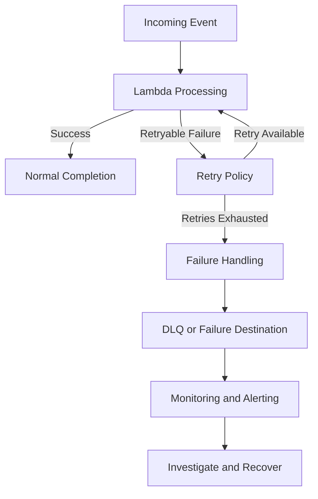
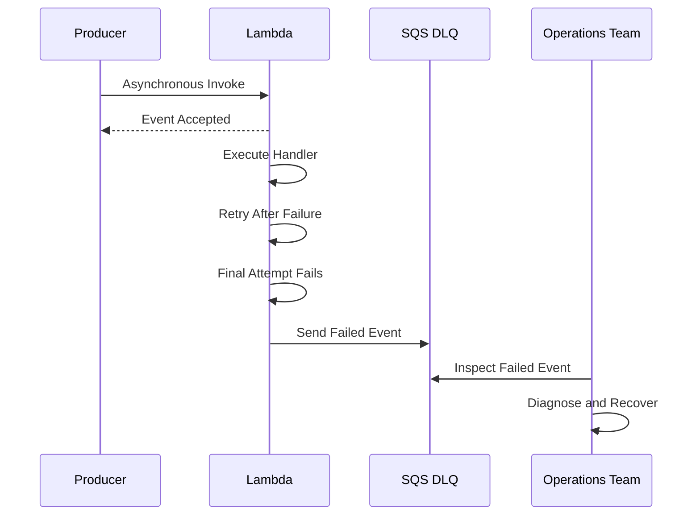
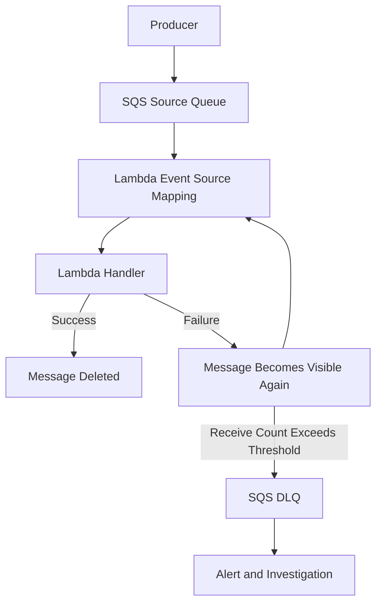

# 16- Destinations and Dead Letter Queues

## Overview

AWS Lambda supports multiple mechanisms for handling failed function executions and failed event processing. Two important mechanisms are **dead-letter queues (DLQs)** and **Lambda destinations**.

Both help preserve information about failures and support recovery workflows, but they operate differently and apply to different invocation models.

- **Dead-letter queues (DLQs)** capture failed events from supported asynchronous invocation workflows.
- **Lambda destinations** route invocation outcomes to another service, such as Amazon SQS, Amazon SNS, Amazon EventBridge, or another Lambda function.
- **Event source mapping failure destinations** handle records that cannot be successfully processed from supported event sources, such as Amazon SQS, Amazon Kinesis Data Streams, and Amazon DynamoDB Streams, subject to source-specific configuration and limitations.

These mechanisms are essential for production systems because retries alone do not guarantee successful processing. An event may repeatedly fail because of malformed data, unavailable dependencies, authorization errors, downstream outages, or application defects.

The objective is not merely to store failed messages. A production failure-handling design must preserve diagnostic context, prevent data loss, control retry amplification, and provide a reliable recovery process.

## Why Failure Handling Matters

Consider a Python Lambda function that processes payment-related events. The function calls an external service, updates a database, and publishes a result.

Failures can occur at several points:

- The event contains invalid data.
- The external service is temporarily unavailable.
- The database connection times out.
- The Lambda function exceeds its configured timeout.
- The event repeatedly fails because of a programming defect.
- The function succeeds, but the event is delivered again.

Without an explicit failure-handling strategy, these conditions can result in repeated execution, increased cost, delayed processing, missing business operations, or messages that require manual investigation.

A reliable design separates the normal processing path from the failure recovery path.



The exact flow depends on how Lambda receives the event. Direct asynchronous invocation, SQS event source mappings, and stream event source mappings have different retry and failure semantics.

## Dead Letter Queues

### What Is a Dead Letter Queue?

A dead-letter queue is a designated queue or topic that receives events that could not be successfully processed under a supported asynchronous delivery configuration.

For Lambda's asynchronous invocation model, the DLQ is configured on the Lambda function's asynchronous invocation configuration. Amazon SQS and Amazon SNS are supported DLQ destinations for this mechanism.

A DLQ retains the original event so that it can be inspected, investigated, and potentially reprocessed.

### Why DLQs Exist

Retries are useful for transient failures, but retries cannot fix every failure.

For example, retrying an event with a missing required field is unlikely to succeed. Repeatedly retrying such an event consumes resources while delaying other work.

A DLQ allows the system to stop retrying an event after the configured failure policy is exhausted and retain it for investigation.

### When to Use a DLQ

Use a DLQ when:

- An asynchronously invoked Lambda function needs to preserve events that fail delivery or processing.
- Failed events must remain available for manual inspection or controlled replay.
- The original event is the primary artifact required for recovery.
- An operational team needs to separate failed messages from normal processing.

A DLQ is not a universal failure mechanism for every Lambda invocation type. Synchronous invocations and event source mappings must be handled according to their own error semantics.

### How Lambda Asynchronous DLQs Work

For asynchronous invocation, Lambda accepts the event into its internal asynchronous processing system and returns an acceptance response to the caller. Lambda then attempts to execute the function.

If execution fails, Lambda applies the asynchronous retry policy. If the event still cannot be processed, Lambda can send it to the configured DLQ when the applicable failure conditions are met.

The DLQ configuration is separate from the function's execution role in an important respect: the function's asynchronous invocation service configuration must have the necessary permissions to deliver the failure record to the destination. Verify the relevant resource policy or IAM permissions for the selected destination and configuration.

A simplified flow is:



Acceptance of an asynchronous event does not mean that the handler completed successfully. The producer should not interpret a successful asynchronous invocation response as proof of business completion.

### Configure an Asynchronous DLQ

The following example creates an SQS queue for failed asynchronous Lambda events.

```bash
aws sqs create-queue \
  --queue-name order-processor-dlq \
  --region ap-south-1
```

Retrieve the queue URL:

```bash
aws sqs get-queue-url \
  --queue-name order-processor-dlq \
  --region ap-south-1
```

Retrieve the queue ARN:

```bash
aws sqs get-queue-attributes \
  --queue-url "<DLQ_QUEUE_URL>" \
  --attribute-names QueueArn \
  --region ap-south-1
```

Configure the DLQ on an existing Lambda function:

```bash
aws lambda update-function-configuration \
  --function-name order-processor \
  --dead-letter-config TargetArn="<DLQ_QUEUE_ARN>" \
  --region ap-south-1
```

This updates the function configuration. Confirm that the destination type is supported and that the required permissions are in place.

Verify the configuration:

```bash
aws lambda get-function-configuration \
  --function-name order-processor \
  --query 'DeadLetterConfig' \
  --output json \
  --region ap-south-1
```

Expected output resembles:

```json
{
  "TargetArn": "arn:aws:sqs:ap-south-1:123456789012:order-processor-dlq"
}
```

The account ID and ARN are illustrative.

**Operational note:** Lambda configuration updates can take time to become fully effective. Verify the final configuration before testing the failure path.

## Lambda Destinations

### What Is a Lambda Destination?

A Lambda destination routes a record describing an asynchronous invocation outcome to another AWS service.

Destinations can be configured for successful and failed asynchronous invocations.

| Destination type | Purpose | Example |
|---|---|---|
| On-success destination | Receives invocation outcome information after successful execution | Publish a processing result to EventBridge |
| On-failure destination | Receives invocation outcome information after execution fails | Send failure details to SQS |

Supported destination types include:

- Amazon SQS queues
- Amazon SNS topics
- Amazon EventBridge event buses
- Another Lambda function

The exact configuration and permissions depend on the destination type.

### Why Destinations Exist

A DLQ focuses on retaining failed events. Destinations provide a broader outcome-routing mechanism.

For example, a successful Lambda execution may need to trigger a subsequent workflow. A failed execution may need to notify an operations system with information about the original request and the invocation failure.

Destinations support these workflows without requiring the function handler to implement all outcome-routing logic itself.

### How Destinations Work

For asynchronous invocation, Lambda evaluates the function's execution outcome after processing and retries according to its asynchronous invocation configuration.

When the invocation reaches a terminal outcome, Lambda routes an invocation record to the configured destination.

The record includes information about the request and invocation result. The exact fields differ between successful and failed outcomes.

A destination record is not simply the original application event. It contains an envelope with metadata about the invocation and its outcome, which is useful for diagnostics and downstream orchestration.

### Configure an On-Failure Destination

Create an SQS queue:

```bash
aws sqs create-queue \
  --queue-name order-processor-failures \
  --region ap-south-1
```

Retrieve its ARN using the `get-queue-url` and `get-queue-attributes` commands shown in the DLQ section.

Configure the Lambda asynchronous invocation settings:

```bash
aws lambda put-function-event-invoke-config \
  --function-name order-processor \
  --maximum-retry-attempts 2 \
  --maximum-event-age-in-seconds 3600 \
  --destination-config '{
    "OnFailure": {
      "Destination": "<FAILURE_QUEUE_ARN>"
    }
  }' \
  --region ap-south-1
```

This command configures asynchronous invocation behavior for the specified function. The retry count and event age are example values, not universal recommendations.

Inspect the configuration:

```bash
aws lambda get-function-event-invoke-config \
  --function-name order-processor \
  --region ap-south-1
```

The configuration applies to asynchronous invocations. It does not configure retry behavior for synchronous API calls or an SQS event source mapping.

### Configure an On-Success Destination

A success destination can route successful invocation records to an event bus or another supported target.

For example, configure EventBridge as the destination:

```bash
aws lambda put-function-event-invoke-config \
  --function-name order-processor \
  --destination-config '{
    "OnSuccess": {
      "Destination": "<EVENT_BUS_ARN>"
    },
    "OnFailure": {
      "Destination": "<FAILURE_QUEUE_ARN>"
    }
  }' \
  --region ap-south-1
```

Use this pattern when successful processing should trigger a separate workflow and failures must be preserved independently.

**Important:** `put-function-event-invoke-config` manages the asynchronous invocation configuration for the specified qualifier. If the function already has settings that must be retained, include the intended complete configuration when updating it. Use a version or alias qualifier when the configuration must be scoped to a published deployment.

## DLQs Versus Destinations

DLQs and destinations are related, but they are not interchangeable.

| Characteristic | Dead Letter Queue | Lambda Destination |
|---|---|---|
| Primary purpose | Retain failed events | Route invocation outcomes |
| Success handling | Not its primary purpose | Supported through an on-success destination |
| Failure handling | Supported for asynchronous invocation | Supported through an on-failure destination |
| Message content | Original event is retained | Invocation record includes outcome metadata and request details |
| Typical targets | SQS queue or SNS topic | SQS, SNS, EventBridge, or Lambda |
| Operational use | Inspect and replay failed events | Trigger recovery, reporting, or follow-up workflows |
| Configuration | Asynchronous invocation DLQ configuration | Asynchronous invocation destination configuration |

Use a DLQ when retaining the original failed event is the central requirement. Use destinations when downstream systems need structured information about successful or failed invocation outcomes.

For an asynchronous Lambda function, avoid configuring overlapping failure mechanisms without deciding which system is authoritative for recovery. The resulting operational behavior should be tested rather than assumed.

## Invocation Model Determines Failure Handling

The same Lambda handler can behave differently depending on how it is invoked. Select the failure mechanism based on the invocation model, not merely on the fact that a Lambda function is involved.

| Invocation model | Failure behavior | Appropriate recovery mechanism |
|---|---|---|
| Synchronous invocation | Error is returned to the caller | Caller retries or applies its own recovery policy |
| Asynchronous invocation | Lambda manages delivery retries | On-failure destination or asynchronous DLQ |
| SQS event source mapping | Records are received in batches and may become visible again after processing failures | SQS redrive policy, visibility timeout, and partial batch responses |
| Kinesis or DynamoDB Streams event source mapping | Records are processed in stream batches; failures can affect checkpoint progression | Retry configuration, partial batch responses, and supported failure destinations |
| EventBridge invoking Lambda asynchronously | Lambda asynchronous invocation behavior applies after EventBridge delivers the event to Lambda | EventBridge delivery retry/DLQ configuration and Lambda asynchronous failure handling, as appropriate |

There can be more than one failure boundary in an event-driven architecture. For example, EventBridge can fail to deliver an event to its target, while Lambda can accept the event and later fail to execute the handler. These are separate failure conditions and may require separate policies.

### Synchronous Invocation

For synchronous invocation, the caller receives the function's response or an invocation error. Lambda does not automatically apply the asynchronous retry policy to a synchronous request.

For example, API Gateway can return an error to an API client when a synchronous Lambda invocation fails. A queue or destination should not be assumed to capture this failure automatically.

If the request must survive a temporary application failure, use an explicit asynchronous workflow, durable queue, or orchestration mechanism rather than relying solely on the synchronous request path.

### Asynchronous Invocation

For asynchronous invocation, Lambda retries eligible failed executions according to its configured policy. A failure destination or DLQ can preserve the terminal failure for recovery.

The event is not guaranteed to execute exactly once. Duplicate processing is possible, so the handler must be idempotent for business operations that cannot safely be repeated.

### Event Source Mappings

Event source mappings poll or otherwise consume records from supported sources and invoke Lambda with batches. They have source-specific retry, checkpoint, visibility, and failure-destination behavior.

For example, an SQS-triggered Lambda function receives records from an SQS queue. If processing fails, the message can become visible again after the visibility timeout. The queue's redrive policy can eventually move repeatedly failed messages to a configured SQS DLQ.

This is a queue-level redrive mechanism, not the same configuration as a Lambda asynchronous invocation DLQ.

For stream sources, a failure can prevent progress beyond a record or batch, depending on the source and configuration. Configure partial batch responses and failure destinations where supported to reduce unnecessary reprocessing and preserve failed records.

## Failure Handling with Amazon SQS

SQS has its own dead-letter queue mechanism through a redrive policy. This is commonly used when SQS triggers Lambda through an event source mapping.

### Architecture



The SQS event source mapping invokes Lambda with messages from the source queue. When the handler successfully processes the batch, Lambda's event source mapping acknowledges successful processing by deleting the messages. When processing fails, messages can be retried according to the queue and event source mapping configuration.

Configure a redrive policy on the source queue to move messages to a DLQ after the configured number of receives.

### Configure an SQS Redrive Policy

Create a source queue and a DLQ:

```bash
aws sqs create-queue \
  --queue-name order-events-dlq \
  --region ap-south-1

aws sqs create-queue \
  --queue-name order-events \
  --region ap-south-1
```

Retrieve both queue ARNs. Then configure the source queue's redrive policy:

```bash
aws sqs set-queue-attributes \
  --queue-url "<SOURCE_QUEUE_URL>" \
  --attributes '{
    "RedrivePolicy": "{\"deadLetterTargetArn\":\"<DLQ_QUEUE_ARN>\",\"maxReceiveCount\":\"5\"}"
  }' \
  --region ap-south-1
```

Verify the policy:

```bash
aws sqs get-queue-attributes \
  --queue-url "<SOURCE_QUEUE_URL>" \
  --attribute-names RedrivePolicy \
  --region ap-south-1
```

The `maxReceiveCount` value is illustrative. Set it based on the expected duration of transient failures, processing time, and the consequences of delayed recovery.

### Configure the Visibility Timeout

The SQS visibility timeout must be long enough to cover normal processing and retry behavior. For Lambda event source mappings, AWS recommends configuring the queue visibility timeout to at least six times the function timeout, plus the maximum batching window when one is configured, to accommodate retries and throttling.

The appropriate configuration also depends on workload behavior and AWS guidance for the selected integration.

A visibility timeout that is too short can cause a message to become visible and be processed again while a previous attempt is still running. A timeout that is excessively long delays retries and recovery.

### Partial Batch Responses

Without partial batch responses, a failed batch can cause records that were already processed successfully to be delivered again.

Enable the appropriate event source mapping configuration when the handler returns partial batch failures for a supported source.

Example Python handler for SQS:

```python
import json
import logging

logger = logging.getLogger()
logger.setLevel(logging.INFO)


def process_order(payload: dict) -> None:
    # Replace with idempotent business processing.
    order_id = payload["order_id"]
    logger.info("Processing order_id=%s", order_id)


def lambda_handler(event: dict, context: object) -> dict:
    batch_item_failures = []

    for record in event.get("Records", []):
        message_id = record["messageId"]

        try:
            payload = json.loads(record["body"])
            process_order(payload)
        except Exception:
            logger.exception(
                "Failed to process SQS message_id=%s",
                message_id,
            )
            batch_item_failures.append(
                {"itemIdentifier": message_id}
            )

    return {"batchItemFailures": batch_item_failures}
```

Configure the event source mapping to enable `ReportBatchItemFailures`. Without that configuration, returning the `batchItemFailures` structure does not enable partial batch failure behavior.

Example command for an existing mapping:

```bash
aws lambda update-event-source-mapping \
  --uuid "<EVENT_SOURCE_MAPPING_UUID>" \
  --function-response-types ReportBatchItemFailures \
  --region ap-south-1
```

Verify:

```bash
aws lambda get-event-source-mapping \
  --uuid "<EVENT_SOURCE_MAPPING_UUID>" \
  --query 'FunctionResponseTypes' \
  --output json \
  --region ap-south-1
```

Partial batch responses reduce unnecessary reprocessing, but they do not eliminate duplicates. A record may still be retried after a failure, and business processing must remain idempotent.

## Failure Handling with Kinesis and DynamoDB Streams

Kinesis Data Streams and DynamoDB Streams use event source mappings that process records in batches and maintain progress through stream checkpoints.

If a batch fails, retries can block progress depending on the source and configuration. This can increase iterator age and delay subsequent records.

Configure the event source mapping's retry behavior and, where supported, a failure destination to preserve records that cannot be processed successfully.

Important considerations include:

- **Batch size:** Larger batches can improve throughput but increase the amount of work associated with a failed batch.
- **Retry attempts:** Unlimited retries can cause a poison record to block progress for an extended period.
- **Maximum record age:** Records can expire from the processing window before recovery.
- **Partial batch responses:** These allow the function to identify failed records when supported and correctly configured.
- **Failure destinations:** Supported configurations can send discarded or failed records to a destination for later investigation.
- **Ordering:** Stream processing order and shard-level progress must be considered when designing recovery.

The exact behavior differs between Kinesis and DynamoDB Streams. Validate the supported parameters and semantics for the selected source before applying a shared configuration template.

## Failure Record Structure and Recovery

A failed event is useful only if the recovery system can identify what failed, why it failed, and how to retry safely.

For Lambda destinations, the invocation record contains an outcome envelope with request and response or error information. The original application payload is embedded in the record rather than necessarily appearing as the top-level message body.

A simplified conceptual failure record resembles:

```json
{
  "version": "1.0",
  "timestamp": "2026-10-11T10:00:00.000Z",
  "requestContext": {
    "requestId": "example-request-id",
    "functionArn": "arn:aws:lambda:ap-south-1:123456789012:function:order-processor",
    "condition": "RetriesExhausted",
    "approximateInvokeCount": 3
  },
  "requestPayload": {
    "order_id": "order-123"
  },
  "responseContext": {
    "statusCode": 200,
    "executedVersion": "$LATEST"
  },
  "responsePayload": {
    "errorMessage": "Example processing failure",
    "errorType": "RuntimeError"
  }
}
```

This is illustrative, not a complete or universally accurate schema for every invocation outcome. Actual fields and values depend on the outcome and invocation configuration. Do not assume a failure record always contains an HTTP status code or the same response fields.

### Recovery Workflow

A robust recovery process should:

1. Detect the failure through queue metrics, destination delivery monitoring, or application alarms.
2. Inspect the original payload and available invocation metadata.
3. Determine whether the failure is transient, data-related, authorization-related, or caused by an application defect.
4. Correct the underlying issue before replaying the event.
5. Validate that replay cannot duplicate an already-completed business operation.
6. Replay through a controlled mechanism.
7. Confirm successful processing and record the recovery outcome.

Avoid automatically replaying every failed event as soon as it reaches a DLQ. If the underlying defect remains, this can create a repeated failure loop.

## Idempotency and Duplicate Processing

Lambda and its event sources can deliver or process an event more than once. A DLQ or destination does not provide exactly-once business processing.

For financial operations, order creation, inventory updates, and other non-idempotent actions, duplicate processing can produce incorrect outcomes.

Use a stable business identifier as an idempotency key and enforce uniqueness at the system that owns the operation.

For example, a database transaction can record the processed event identifier and apply the business update atomically. A separate check followed by an update without transactional protection can still allow concurrent duplicate requests to race.

Conceptually:

```python
def process_event(event: dict) -> None:
    event_id = event["event_id"]

    # In a real implementation, use a database transaction and
    # a unique constraint on event_id to prevent concurrent duplicates.
    if event_already_processed(event_id):
        return

    apply_business_operation(event)
    record_processed_event(event_id)
```

The functions above are placeholders. In production, use a transaction, conditional write, or another atomic idempotency mechanism appropriate to the persistence layer.

For DynamoDB, a conditional write can prevent duplicate insertion of an idempotency record. For relational databases, a unique constraint combined with a transaction is often appropriate.

Idempotency retention must also be considered. If the idempotency record expires before a delayed event is replayed, the operation may be executed again.

## Monitoring and Alerting

A configured DLQ or destination is not sufficient without monitoring. Failure records can accumulate silently if no one observes them.

Monitor the source workflow and the failure-handling path.

| Signal | What it indicates | Operational response |
|---|---|---|
| DLQ visible message count | Failed messages awaiting investigation | Alert when count exceeds an expected threshold |
| Oldest message age | How long failed work has remained unprocessed | Escalate when recovery delay breaches the operational objective |
| Lambda `Errors` | Function execution failures | Inspect logs, exceptions, and dependency health |
| Lambda `Throttles` | Invocations rejected because of concurrency or capacity limits | Review concurrency allocation and downstream capacity |
| Lambda `AsyncEventsDropped` | Asynchronous events discarded without successful processing or delivery under applicable conditions | Investigate delivery, retry, age, and destination issues |
| Lambda `DestinationDeliveryFailures` | Failure delivering invocation records to configured destinations | Check destination availability and permissions |
| SQS `ApproximateNumberOfMessagesVisible` | Messages available for consumption, including possible DLQ backlog | Investigate rising backlog and consumer health |
| Stream `IteratorAge` | Delay in processing stream records | Check function duration, throttling, errors, and shard throughput |

Metric availability and dimensions depend on the service and integration. Confirm the relevant CloudWatch metric for the configured workflow before building alarms.

A useful alert should indicate an actionable condition. For example, an increasing DLQ backlog combined with a high oldest-message age is often more meaningful than a single transient failed event.

Also monitor the failure destination itself. If destination delivery fails, the intended recovery mechanism may not receive the record.

## Security Considerations

Failure queues frequently contain original application events, including customer identifiers, internal metadata, or sensitive business information.

Apply the same security standards to failure records as to the original processing path.

- Grant only the required permissions to publish to or consume from the destination.
- Use resource policies that restrict principals and source resources where supported.
- Enable SQS server-side encryption when required by the data classification.
- Restrict DLQ consumption to authorized operational or recovery roles.
- Avoid logging complete sensitive payloads during investigation.
- Define retention and deletion policies for failed records.
- Monitor changes to queue policies and Lambda invocation configurations.
- Keep deployment permissions separate from runtime permissions.

A DLQ can become an unintended data exposure point if it is less protected than the source system.

## Common Mistakes

### Treating a DLQ as a Retry Policy

A DLQ stores events after an applicable failure condition. It does not itself define how all retries occur.

Configure retry behavior at the correct layer: Lambda asynchronous invocation, the source queue, EventBridge target delivery, or the event source mapping.

### Assuming Every Lambda Failure Reaches a DLQ

Synchronous invocations and event source mappings do not automatically use the Lambda asynchronous DLQ configuration.

Identify the invocation model and configure the corresponding failure mechanism.

### Replaying Without Fixing the Root Cause

If a function consistently fails because of invalid data or a code defect, replaying the same event merely repeats the failure.

Classify failures before replay and use controlled retry procedures.

### Ignoring Destination Delivery Failures

The destination is another dependency. Permission errors, deleted queues, or destination service issues can prevent failure records from being delivered.

Monitor destination delivery failures and validate permissions during deployment.

### Assuming Exactly-Once Processing

Retries, redelivery, and manual replay can all result in duplicates.

Use durable idempotency controls and atomic business operations.

### Forgetting DLQ Retention and Capacity

A DLQ can accumulate records indefinitely until its retention period expires or the records are removed. Unmonitored backlogs increase recovery risk and may eventually cause messages to expire.

Define retention, alerting, ownership, and recovery procedures.

## Production Best Practices

- Choose failure handling based on the invocation model and event source.
- Use asynchronous destinations when downstream systems need invocation outcome records.
- Use SQS redrive policies for SQS-triggered workloads.
- Configure stream retry and failure handling to avoid prolonged blocking by poison records.
- Implement idempotency before enabling automated replay.
- Monitor failed-event count, age, destination delivery failures, and processing latency.
- Use structured logs with stable business identifiers and invocation request IDs.
- Define ownership for DLQ investigation and recovery.
- Test transient failures, permanent failures, destination permission errors, and duplicate delivery.
- Keep failure records encrypted and access-controlled.
- Document whether replay is manual, automated, or performed through a dedicated recovery workflow.
- Use infrastructure as code to keep retry settings, queue policies, permissions, and monitoring consistent across environments.

## Key Takeaways

- **DLQs retain failed events**, while Lambda destinations route asynchronous invocation outcomes to supported downstream services.
- **Failure handling depends on the invocation model**; asynchronous invocation, SQS event source mappings, and stream event source mappings have different retry semantics.
- **DLQs and destinations do not guarantee exactly-once business outcomes**; idempotency and atomic persistence are required to make replay safe.
- **Monitoring and recovery procedures are part of the design**, including destination delivery failures, message age, backlog growth, and controlled replay.
- **Failure records are sensitive operational data** and must be protected through least-privilege permissions, encryption, retention policies, and auditing.