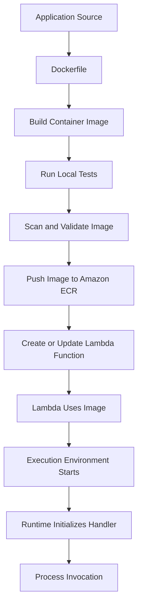

# 17- Lambda Container Images

## Overview

AWS Lambda supports two deployment package formats: ZIP archives and container images. Container images allow developers to package a Lambda function, its runtime, application dependencies, and supporting files into an OCI-compatible image that is stored in Amazon Elastic Container Registry (Amazon ECR).

This model is useful when an application has complex dependencies, requires operating-system libraries, or benefits from a reproducible container-based build pipeline.

Unlike a conventional Docker container running on Amazon ECS or Kubernetes, a Lambda container image runs within the Lambda execution environment. AWS manages the underlying compute infrastructure, invocation lifecycle, scaling, and execution environment.

Container-image deployment changes how an application is built and distributed, but it does not remove Lambda's execution limits, event model, security boundaries, or operational responsibilities.

## Why Lambda Supports Container Images

ZIP deployment packages work well for many Python, Node.js, Java, and other Lambda workloads. However, they can become difficult to manage when applications require extensive native dependencies or custom operating-system components.

Container images address these challenges by allowing the application to define its runtime environment during the build process.

Typical use cases include:

- Python functions requiring native libraries such as image-processing or scientific-computing dependencies.
- Applications with large dependency trees.
- Custom runtimes or specialized runtime configurations.
- Teams standardizing build, vulnerability scanning, and artifact promotion around container tooling.
- Workloads that benefit from reproducible builds across local development and deployment environments.

For example, a Python function processing uploaded images may require Pillow and native libraries. A container image provides a controlled environment in which those dependencies can be installed and tested before deployment.

Container images are not automatically faster, cheaper, or more scalable than ZIP packages. The appropriate choice depends on package size, initialization behavior, build complexity, and operational requirements.

## How Lambda Container Images Work

A Lambda container image is built using Docker or another compatible OCI image builder, pushed to Amazon ECR, and referenced by a Lambda function.

The image must comply with Lambda's container-image requirements. Lambda supports Linux-based images and does not support deploying Windows container images.

The deployment flow is:



### Deployment Lifecycle

1. **Build:** The Dockerfile defines the base image, runtime, dependencies, application files, and startup configuration.
2. **Validate:** The image is tested locally or in CI using the intended architecture and runtime assumptions.
3. **Publish:** The image is pushed to an Amazon ECR repository in the same AWS Region as the Lambda function.
4. **Deploy:** The Lambda function is created or updated to reference the image URI.
5. **Initialize:** Lambda provisions an execution environment and starts the configured runtime.
6. **Invoke:** The runtime processes events through the Lambda handler interface.

Lambda manages the execution environment and invocation lifecycle. Developers remain responsible for the image contents, dependency compatibility, handler configuration, permissions, and application behavior.

### Lambda Images Versus Ordinary Containers

A Lambda container image is not a general-purpose long-running container.

| Characteristic | Lambda container image | ECS/Fargate container |
|---|---|---|
| Compute lifecycle | Managed by Lambda around invocation demand | Managed through ECS task and service lifecycle |
| Startup contract | Must integrate with the Lambda runtime interface | Uses the container's configured process |
| Invocation | Lambda event and handler model | Application-defined process and protocol |
| Scaling | Lambda invocation concurrency | ECS service or task scaling |
| Long-running process | Not a general-purpose daemon | Suitable for continuously running services |
| Runtime integration | Lambda runtime or Runtime Interface Client | Application process and container runtime |
| Operational control | Limited control over the underlying host | More control over task configuration and service lifecycle |
| Billing model | Invocation duration and allocated resources, plus applicable extras | Provisioned task resources and running time |

Choose ECS/Fargate when the application needs a continuously running worker, custom process supervision, or long-lived service behavior that does not fit Lambda's execution model.

## Lambda Container Image Requirements

A Lambda container image must satisfy several requirements.

| Requirement | Engineering implication |
|---|---|
| Linux-based image | Windows container images are not supported |
| Supported architecture | The image architecture must match the Lambda function architecture |
| Lambda-compatible runtime interface | The image must correctly receive and process Lambda invocations |
| Amazon ECR image repository | The deployed image must be available through a supported ECR configuration |
| Image size limit | The total uncompressed image size must not exceed 10 GB |
| Read-only root filesystem | The application must not depend on writing arbitrary files into the image filesystem |
| Writable temporary storage | Use `/tmp` for temporary files, subject to configured ephemeral-storage capacity |
| Handler configuration | The runtime must know which handler or entry point to execute |

The image size limit refers to the uncompressed image, including its layers. Keep images substantially smaller where possible because large images increase transfer, storage, and deployment overhead.

Lambda container images must also satisfy applicable ECR and Lambda configuration requirements. Consult current AWS documentation when designing cross-account image access, repository policies, or deployment pipelines.

## AWS Lambda Base Images

AWS provides Lambda base images for supported managed runtimes. These images include the runtime components and runtime interface required to integrate with Lambda.

For Python, an AWS-provided base image is often the simplest starting point.

Example:

```dockerfile
FROM public.ecr.aws/lambda/python:3.12

COPY requirements.txt ${LAMBDA_TASK_ROOT}/

RUN pip install \
    --no-cache-dir \
    -r ${LAMBDA_TASK_ROOT}/requirements.txt

COPY app.py ${LAMBDA_TASK_ROOT}/

CMD ["app.lambda_handler"]
```

The example assumes that the chosen base-image tag is available and supported for the target Lambda runtime.

The `CMD` value identifies the handler using the format `module.function`. Here, `app.lambda_handler` refers to the `lambda_handler` function in `app.py`.

### Python Handler

```python
import json
import logging

logger = logging.getLogger()
logger.setLevel(logging.INFO)


def lambda_handler(event: dict, context: object) -> dict:
    logger.info(
        "Processing invocation request_id=%s",
        context.aws_request_id,
    )

    return {
        "statusCode": 200,
        "headers": {
            "Content-Type": "application/json",
        },
        "body": json.dumps(
            {
                "message": "Processed by Lambda container image",
            }
        ),
    }
```

The response shape is appropriate for integrations that expect an HTTP-style proxy response, such as a compatible API Gateway integration. Other event sources may expect application-specific return values.

### Why Use AWS Base Images?

AWS-provided base images reduce the amount of runtime integration work required. They contain the components needed to run supported managed runtimes within Lambda.

Advantages include:

- A runtime environment aligned with the selected Lambda runtime.
- Less custom runtime-interface configuration.
- A straightforward path for Python and other managed runtimes.
- A familiar Docker-based build workflow.

Limitations include dependency on the chosen base-image version, image update management, and the need to rebuild and redeploy when runtime or operating-system updates become available.

Do not assume that rebuilding a Docker image automatically updates a deployed Lambda function. The function must be updated to use the intended image version.

## Custom Base Images and the Runtime Interface Client

A custom base image can provide more control over the operating system, installed packages, and application environment.

However, a custom image must implement the Lambda runtime contract. For supported languages, AWS provides Runtime Interface Clients (RICs) that communicate with the Lambda Runtime API and dispatch invocation events to the application handler.

For Python, a custom image generally needs the Lambda Runtime Interface Client package or another compatible implementation.

Example using a generic Python base image:

```dockerfile
FROM python:3.12-slim

WORKDIR /var/task

COPY requirements.txt .

RUN pip install \
    --no-cache-dir \
    -r requirements.txt \
    awslambdaric

COPY app.py .

ENTRYPOINT ["python", "-m", "awslambdaric"]
CMD ["app.lambda_handler"]
```

This example demonstrates the runtime-interface arrangement. Before using it in production, verify that the Python version, operating-system libraries, package architecture, and selected Runtime Interface Client version are compatible with the target Lambda environment.

For local testing, AWS provides the Lambda Runtime Interface Emulator (RIE), which can help simulate the Lambda invocation interface. The emulator is a development aid, not a replacement for testing in the actual Lambda service.

### Runtime Interface Components

| Component | Responsibility |
|---|---|
| Runtime | Executes application code |
| Runtime Interface Client | Communicates with the Lambda Runtime API and invokes the handler |
| Runtime Interface Emulator | Enables local testing of the invocation interface |
| Lambda service | Manages invocation delivery, execution environments, scaling, and infrastructure |

A custom base image gives additional flexibility but also increases responsibility for runtime compatibility, security updates, and lifecycle maintenance.

## Image Architecture

Lambda container images support specific processor architectures, notably `x86_64` and `arm64`, subject to the selected runtime and service configuration.

The image architecture must match the architecture configured for the Lambda function.

For example, building an image on an x86-64 workstation does not guarantee that it will run correctly when deployed as an ARM64 function.

Build for the intended target architecture:

```bash
docker buildx build \
  --platform linux/arm64 \
  --provenance=false \
  -t order-processor:latest \
  .
```

For an x86-64 deployment:

```bash
docker buildx build \
  --platform linux/amd64 \
  --provenance=false \
  -t order-processor:latest \
  .
```

The `--provenance=false` option is commonly used for Lambda image builds because Lambda has specific requirements concerning image manifests and build metadata. Verify current AWS requirements when changing build tooling.

Use an architecture that matches the compiled dependencies and native libraries in the image.

### Configure the Function Architecture

When creating a function, specify the architecture explicitly:

```bash
aws lambda create-function \
  --function-name order-processor \
  --package-type Image \
  --code ImageUri="<ECR_IMAGE_URI>" \
  --role "<LAMBDA_EXECUTION_ROLE_ARN>" \
  --architectures arm64 \
  --region ap-south-1
```

The command creates a resource. The execution role must already exist and trust the Lambda service, and the image must be accessible to Lambda.

For an existing function, inspect the architecture:

```bash
aws lambda get-function-configuration \
  --function-name order-processor \
  --query 'Architectures' \
  --output json \
  --region ap-south-1
```

A mismatch can lead to deployment or runtime failures, particularly when native extensions or compiled executables are involved.

## Amazon ECR Integration

Amazon Elastic Container Registry stores the image that Lambda deploys.

The image repository and Lambda function must be configured according to Lambda's ECR requirements. In the standard deployment model, the image repository is in the same AWS Region as the Lambda function.

### Create an ECR Repository

```bash
aws ecr create-repository \
  --repository-name order-processor \
  --image-scanning-configuration scanOnPush=true \
  --region ap-south-1
```

Retrieve the repository URI:

```bash
aws ecr describe-repositories \
  --repository-names order-processor \
  --query 'repositories[0].repositoryUri' \
  --output text \
  --region ap-south-1
```

Authenticate Docker to ECR:

```bash
aws ecr get-login-password \
  --region ap-south-1 \
  | docker login \
      --username AWS \
      --password-stdin "<AWS_ACCOUNT_ID>.dkr.ecr.ap-south-1.amazonaws.com"
```

Build and tag the image:

```bash
docker build \
  --platform linux/amd64 \
  --provenance=false \
  -t order-processor:latest \
  .

docker tag \
  order-processor:latest \
  "<ECR_REPOSITORY_URI>:v1"
```

Push the image:

```bash
docker push "<ECR_REPOSITORY_URI>:v1"
```

Use immutable release tags or image digests for production deployments rather than relying on a mutable `latest` tag.

### ECR Permissions

The deployment identity needs permissions to upload and manage images. Lambda also needs permission to retrieve the image under the applicable ECR access model.

For same-account deployments, AWS can manage the required repository permissions as part of supported deployment workflows. Cross-account deployments require deliberate repository and Lambda permissions configuration.

Do not assume that successful Docker authentication proves that Lambda can retrieve the image. Docker's permissions and Lambda's image retrieval permissions are separate concerns.

## Create and Deploy a Lambda Function

Once the image is available in ECR, create the Lambda function.

```bash
aws lambda create-function \
  --function-name order-processor \
  --package-type Image \
  --code ImageUri="<ECR_IMAGE_URI>:v1" \
  --role "<LAMBDA_EXECUTION_ROLE_ARN>" \
  --memory-size 1024 \
  --timeout 30 \
  --region ap-south-1
```

This command creates a function using the image package type. The execution role must provide the runtime permissions required by the application.

Wait for the function to become active:

```bash
aws lambda wait function-active-v2 \
  --function-name order-processor \
  --region ap-south-1
```

Inspect its configuration:

```bash
aws lambda get-function-configuration \
  --function-name order-processor \
  --query '{
    State:State,
    PackageType:PackageType,
    Architectures:Architectures,
    MemorySize:MemorySize,
    Timeout:Timeout,
    ImageConfig:ImageConfigResponse
  }' \
  --output json \
  --region ap-south-1
```

Invoke the function synchronously:

```bash
aws lambda invoke \
  --function-name order-processor \
  --payload '{"source":"manual-test"}' \
  --cli-binary-format raw-in-base64-out \
  response.json \
  --region ap-south-1
```

Inspect the response:

```bash
cat response.json
```

A successful invocation should return a response consistent with the handler's return value. The CLI invocation status alone is not sufficient to establish application-level correctness; inspect the returned payload and logs.

## Updating a Lambda Container Image

Container images are immutable artifacts from the perspective of a specific image digest, but tags in ECR can be mutable unless repository settings prevent overwrites.

A safe deployment pipeline should:

1. Build a new image from a reviewed source revision.
2. Run tests and security scans.
3. Push the image using a unique release tag.
4. Record the resulting image digest.
5. Update the Lambda function to reference the intended image.
6. Wait for the update to complete.
7. Run smoke tests.
8. Publish a version and update an alias when using a versioned release strategy.

Example:

```bash
aws lambda update-function-code \
  --function-name order-processor \
  --image-uri "<ECR_IMAGE_URI>:v2" \
  --region ap-south-1
```

Wait for the update to finish:

```bash
aws lambda wait function-updated-v2 \
  --function-name order-processor \
  --region ap-south-1
```

Inspect the deployed image information:

```bash
aws lambda get-function \
  --function-name order-processor \
  --query 'Code' \
  --output json \
  --region ap-south-1
```

Lambda resolves the image reference for deployment. Pushing a new image to ECR under an existing tag does not automatically update the function to the new image content. An explicit function code update is required.

For production deployments, record the exact image digest associated with each release and avoid depending on mutable tags to identify deployed code.

## Image Configuration Overrides

Lambda supports image configuration settings that can override the image's configured entry point, command, and working directory where applicable.

These settings are useful when the same image supports multiple handlers or deployment configurations.

Inspect the current configuration:

```bash
aws lambda get-function-configuration \
  --function-name order-processor \
  --query 'ImageConfigResponse' \
  --output json \
  --region ap-south-1
```

Update the configuration:

```bash
aws lambda update-function-configuration \
  --function-name order-processor \
  --image-config '{
    "Command": ["app.lambda_handler"]
  }' \
  --region ap-south-1
```

The command above changes the image command override. It is appropriate only when the image's entry point expects that command format.

Do not blindly override the entry point of an AWS-provided base image. The base image already defines runtime integration behavior, and incorrect overrides can prevent the function from starting.

## Filesystem and Temporary Storage

Lambda container images run with a read-only root filesystem. Applications that need to create temporary files should use `/tmp`.

The available ephemeral storage can be configured within Lambda's supported range. The default is 512 MB, and it can be increased up to 10,240 MB.

For example, image processing may download an object from S3, transform it, and upload the result. Temporary data should be stored in `/tmp`, not in the application directory.

```python
import os
import tempfile


def process_file(data: bytes) -> str:
    with tempfile.NamedTemporaryFile(
        mode="wb",
        dir="/tmp",
        suffix=".bin",
        delete=False,
    ) as temporary_file:
        temporary_file.write(data)
        temporary_path = temporary_file.name

    try:
        # Perform the required processing here.
        return temporary_path
    except Exception:
        os.remove(temporary_path)
        raise
```

This example demonstrates temporary-file creation. Production code must ensure files are removed when no longer needed, including on failure paths. A safer implementation may use a context manager around the entire processing operation so that cleanup is guaranteed.

Execution environments can be reused, so files left in `/tmp` may remain available to later invocations in the same environment. Never assume that temporary storage is automatically empty at the start of each invocation, and never use it as durable application storage.

## Performance Considerations

Container images provide packaging flexibility, but image design still affects deployment efficiency and runtime performance.

### Image Size

Large images can increase image storage, distribution, and deployment overhead. Keep the image focused on runtime dependencies and application files.

Useful techniques include:

- Using a minimal compatible base image.
- Installing only required dependencies.
- Removing package-manager caches and build artifacts.
- Using multi-stage builds when compilation tools are unnecessary at runtime.
- Avoiding unnecessary development dependencies.
- Pinning dependencies to reproducible versions.

Multi-stage builds are particularly useful when native libraries or compilers are needed only during the build stage. Ensure the final image still contains every shared library required by the compiled artifacts.

### Cold Starts

Cold-start latency depends on multiple factors, including runtime initialization, dependency loading, image retrieval, and application initialization.

A smaller image can reduce some deployment and startup overhead, but image size alone does not determine cold-start performance.

Measure:

- Initialization duration.
- Total invocation duration.
- Memory utilization.
- Dependency import time.
- Runtime startup behavior.
- Latency under realistic concurrency.

Provisioned concurrency may reduce startup latency for supported workloads, but it incurs additional cost and must be configured for the appropriate published version or alias.

### Memory and CPU

Lambda allocates CPU resources in relation to the configured memory. Increasing memory may improve CPU-bound processing and reduce execution duration.

Benchmark multiple memory settings using realistic payload sizes and concurrency. The cheapest memory setting is not necessarily the lowest-cost configuration if it makes each invocation significantly slower.

## Security Best Practices

Container-image deployment introduces an additional software supply chain that must be secured.

### Dependency and Image Security

- Pin base-image versions and application dependencies.
- Scan images for known vulnerabilities.
- Rebuild images when relevant base-image or dependency fixes become available.
- Keep build tools and unnecessary packages out of the final image.
- Avoid copying credentials, `.env` files, SSH keys, or cloud credentials into image layers.
- Use a controlled CI/CD pipeline to publish trusted artifacts.
- Restrict ECR access and Lambda deployment permissions.
- Verify the image digest and source revision associated with each release.

Deleting a secret in a later Docker layer does not guarantee that the secret is absent from earlier layers. Never introduce secrets into an image build context unless the build process uses an appropriate secret mechanism and ensures that the secret is not persisted in the resulting image.

### Execution Role Versus Image Permissions

The image does not grant AWS service permissions by itself. The Lambda execution role determines which AWS APIs the running function can access.

For example, an image that processes S3 objects may need `s3:GetObject` for an input prefix and `s3:PutObject` for an output prefix. It should not receive broad access to every bucket unless the workload requires it.

Use least-privilege IAM policies and validate access to each resource.

## Logging and Monitoring

Container-based Lambda functions use the same general CloudWatch observability model as other Lambda deployment packages.

The application should write useful logs to standard output or standard error, and the execution role must permit the required CloudWatch Logs operations.

Monitor:

- Invocation count and error rate.
- Duration and initialization latency.
- Throttles and concurrency.
- Memory usage and timeout failures.
- Downstream service errors.
- Image deployment and startup failures.
- ECR scanning findings and image update status.

For Python applications, use structured logging with request identifiers and business correlation IDs. Avoid logging sensitive payloads or credentials.

Container packaging does not automatically provide container-level host access, nor does it remove Lambda's execution-environment restrictions. Use Lambda metrics, logs, tracing, and supported extensions rather than assuming access to an underlying container host.

## Common Mistakes

### Using an Incompatible Image Architecture

A native dependency compiled for `x86_64` will not necessarily work in an `arm64` Lambda function.

**Prevention:** Build for the intended architecture and test native dependencies in a compatible environment.

### Forgetting the Runtime Interface

A generic Docker image that starts a web server or ordinary process may not implement Lambda's invocation protocol.

**Prevention:** Use an AWS Lambda base image or include a compatible Runtime Interface Client and correct entry point.

### Assuming ECR Tag Changes Update Lambda

Pushing new content to a mutable ECR tag does not automatically update an existing Lambda function.

**Prevention:** Explicitly update the function code and verify the deployed image version or digest.

### Writing to the Root Filesystem

Applications may fail when they attempt to write into the image filesystem.

**Prevention:** Use `/tmp` for temporary files and configure sufficient ephemeral storage.

### Building Images with Embedded Secrets

Secrets included in Docker layers may remain recoverable even if removed later in the Dockerfile.

**Prevention:** Exclude secrets from the build context and retrieve runtime secrets from an appropriate AWS secret-management service.

### Deploying Oversized Images

Unnecessary dependencies and build artifacts increase image size and deployment overhead.

**Prevention:** Minimize dependencies, use multi-stage builds where appropriate, and scan the final image rather than only the build stage.

### Ignoring Base-Image Updates

A container image does not automatically inherit future runtime or operating-system fixes.

**Prevention:** Establish a rebuild and redeployment process that tracks base-image updates and dependency vulnerabilities.

## Lambda Container Images Versus ZIP Packages

| Consideration | ZIP package | Container image |
|---|---|---|
| Packaging | ZIP archive containing code and dependencies | OCI-compatible image stored in ECR |
| Maximum package size | Smaller deployment limits apply | Up to 10 GB uncompressed |
| Native dependencies | Supported, but packaging must match Lambda's environment | Can be installed or compiled during the image build |
| Build workflow | ZIP packaging tools | Docker-compatible image tooling |
| Runtime customization | More constrained by the selected runtime | Greater control over the image environment |
| Artifact distribution | Lambda deployment package mechanism | ECR |
| Security workflow | Scan source dependencies and deployment artifact | Scan dependencies and image layers |
| Operational complexity | Often simpler for ordinary functions | Includes image build, registry, scanning, and update management |
| Best fit | Lightweight functions with conventional dependencies | Complex dependencies or container-standardized build pipelines |

Choose ZIP packages when the deployment is straightforward and image-specific capabilities provide little value. Choose container images when dependency control, package size, or build standardization materially improves the engineering workflow.

## Production Readiness Checklist

Before deploying a Lambda container image to production, verify the following:

- [ ] The image uses a supported Linux base and runtime configuration.
- [ ] The image architecture matches the Lambda function architecture.
- [ ] The handler and runtime interface are correctly configured.
- [ ] The final image remains within Lambda's uncompressed size limit.
- [ ] Temporary file operations use `/tmp`.
- [ ] Dependencies and base-image versions are controlled.
- [ ] Image scanning and dependency vulnerability management are enabled.
- [ ] No credentials or secrets are embedded in image layers.
- [ ] The execution role follows least-privilege principles.
- [ ] ECR permissions support the deployment and runtime retrieval model.
- [ ] CI tests the image before publishing it.
- [ ] Deployment uses an identifiable release tag or digest.
- [ ] The Lambda function is explicitly updated after a new image is published.
- [ ] Smoke tests verify the deployed image.
- [ ] Logs, metrics, alarms, and rollback procedures are defined.
- [ ] Old image retention and cleanup policies are documented.

## Key Takeaways

- Lambda container images package application code, runtime dependencies, and supporting files into OCI-compatible images stored in Amazon ECR.
- Lambda images must satisfy the Lambda runtime contract, supported architecture requirements, read-only filesystem constraints, and the 10 GB uncompressed image limit.
- Publishing a new ECR image does not automatically update a Lambda function; deployment must explicitly reference the intended image.
- Image size, dependency initialization, memory allocation, and runtime startup all influence performance, so benchmark realistic workloads rather than assuming containers are faster.
- Production deployments require secure image builds, vulnerability management, least-privilege IAM, immutable release identification, observability, and tested rollback procedures.