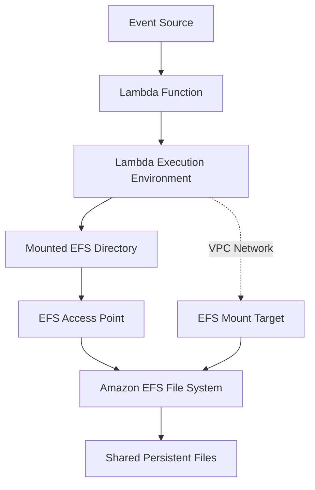
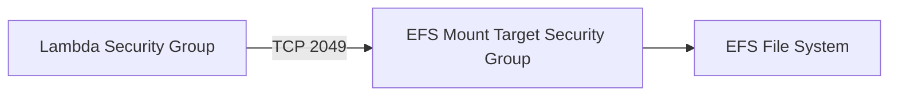

# 18- Lambda with Amazon EFS

## Overview

AWS Lambda can mount an Amazon Elastic File System (Amazon EFS) file system to provide shared, persistent file storage for function execution environments. This enables Lambda functions to access files that must survive individual invocations, be shared across concurrent execution environments, or exceed the practical scope of temporary local storage.

Unlike Lambda's `/tmp` directory, which is temporary storage associated with an execution environment, EFS provides a shared file system that persists independently of a function's lifecycle.

Typical use cases include:

- Processing large files that do not fit comfortably in memory.
- Sharing machine-learning models or reference datasets across function invocations.
- Reading and writing files shared by multiple Lambda functions.
- Integrating Lambda with applications that require POSIX-compatible file access.
- Processing uploaded documents, images, reports, or media files.
- Supporting legacy applications that expect a mounted file system rather than object-storage APIs.

EFS introduces additional networking, security, capacity, and cost considerations. It should be used when shared file-system semantics are required, not simply as a replacement for Amazon S3.

## Why Lambda Needs Amazon EFS

Lambda provides local ephemeral storage through `/tmp`. This is appropriate for temporary files, downloaded artifacts, intermediate processing, and caches that can be reconstructed.

However, `/tmp` has important limitations:

- It is associated with an execution environment rather than shared across all function instances.
- Its contents are not a durable storage contract.
- Concurrent execution environments do not share the same local directory.
- Sharing files across different Lambda functions requires an external storage mechanism.

Amazon EFS addresses these requirements by providing a managed network file system that can be mounted by multiple compute clients.

For example, several Lambda functions may need to read the same machine-learning model. Storing the model independently inside every deployment package can increase package size and complicate updates. An EFS mount allows the functions to access a shared copy.

## How Lambda and EFS Work Together

Lambda accesses EFS through a mount target in the function's VPC. The function uses a configured EFS access point and mount path to access files.

The main components are:

| Component | Responsibility |
|---|---|
| Lambda function | Executes application code that reads or writes files |
| Lambda execution role | Grants required AWS permissions, including EFS client authorization where applicable |
| VPC | Provides the network path between Lambda and EFS |
| EFS file system | Stores shared files persistently |
| EFS mount target | Provides network access to the file system within a VPC subnet |
| EFS access point | Provides an application-specific entry point with optional POSIX identity and directory enforcement |
| Local mount path | Directory through which application code accesses the file system |

The architecture follows this flow:



Lambda manages the execution environment, while EFS manages the shared file-system storage. The application sees files through a mount path rather than calling an object-storage API for every operation.

### Important Architectural Implication

EFS is network storage. File operations depend on network connectivity, mount availability, access permissions, and file-system performance.

A successful Lambda deployment does not prove that the function can access EFS correctly. Networking, mount targets, access-point configuration, and authorization must all be validated.

## EFS Versus Lambda Ephemeral Storage

| Characteristic | Lambda `/tmp` | Amazon EFS |
|---|---|---|
| Storage type | Local ephemeral storage | Managed network file system |
| Persistence | Not guaranteed across execution-environment replacement | Persists independently of Lambda execution environments |
| Sharing | Not shared between execution environments | Shared across authorized clients |
| Access method | Local filesystem operations | POSIX-style filesystem operations over a network mount |
| Network dependency | No separate EFS network path required | Requires VPC connectivity to EFS |
| Configuration | Configure Lambda ephemeral storage | Configure EFS, mount targets, access point, VPC, and Lambda mount |
| Typical use | Temporary files, intermediate artifacts, local caches | Shared datasets, persistent files, common application assets |
| Performance profile | Local ephemeral storage | Network filesystem; latency and throughput depend on workload and EFS configuration |
| Cost model | Ephemeral storage pricing may apply above the included allocation | EFS storage, throughput, and applicable transfer charges |

Use `/tmp` when files are temporary and isolated to a function execution environment. Use EFS when multiple execution environments need shared access to persistent files.

## EFS Versus Amazon S3

EFS and S3 solve different storage problems.

| Requirement | Better fit |
|---|---|
| Shared POSIX filesystem | EFS |
| Object storage for uploaded files | S3 |
| Access through file paths and directory operations | EFS |
| Durable storage of objects addressed by keys | S3 |
| Shared files that multiple concurrent functions must update | EFS, with appropriate coordination |
| Event-driven processing of uploaded objects | S3 with Lambda |
| Large datasets requiring mounted filesystem access | EFS, depending on workload |
| Static artifacts that can be downloaded to `/tmp` | Often S3 plus `/tmp` |

EFS supports filesystem operations such as directory traversal, file creation, and file locking mechanisms provided by the filesystem. S3 provides object APIs and has different consistency and concurrency semantics.

Do not choose EFS simply because an application processes files. S3 is often simpler and more cost-effective for object-oriented workloads that do not require shared filesystem access.

## VPC and Networking Requirements

Lambda must be configured for VPC access to mount EFS. The function's network configuration must allow connectivity to EFS mount targets.

### Networking Components

- **VPC:** The network containing the Lambda function's configured subnets and EFS mount targets.
- **Subnets:** Lambda is configured with subnets in which its network interfaces can be created.
- **Mount targets:** EFS provides network endpoints in selected Availability Zones.
- **Security groups:** Control network traffic between Lambda and EFS.
- **DNS:** The EFS mount mechanism uses filesystem DNS resolution as part of connecting to the file system.
- **Routing:** Network paths must permit connectivity between the function and the mount targets.

EFS uses NFS over TCP port `2049`.

The EFS mount target security group must permit inbound TCP `2049` from the Lambda function's security group. The Lambda security group must permit the corresponding outbound connectivity.

Example security-group relationship:



A narrowly scoped security-group rule is preferable to allowing NFS traffic from an entire VPC CIDR range when a dedicated Lambda security group can be used.

### Availability Zone Considerations

For production workloads, provide EFS mount targets across the Availability Zones in which the function may execute, following AWS's supported regional networking configuration.

The mount-target and subnet design should account for Availability Zone coverage, network reachability, and operational resilience.

Avoid assuming that an EFS mount target in one subnet automatically provides an optimal network path for every Lambda execution environment.

## EFS Access Points

An EFS access point provides an application-specific entry point into a file system. It can enforce a configured root directory and a POSIX user and group identity for operations through that access point.

Access points are useful when several applications share one EFS file system but need separate directory boundaries or filesystem identities.

For example:

```text
/shared
    /orders
    /reports
    /ml-models
```

Different Lambda functions can mount different access points that expose only the appropriate directory.

### Why Access Points Matter

Without deliberate access-point and POSIX permission design, applications may have broader filesystem access than necessary.

Access points help standardize:

- The directory visible to a client.
- The POSIX identity used for filesystem operations.
- Application-specific filesystem boundaries.
- Ownership and permission behavior for configured root directories.

An access point is not a complete replacement for network controls, IAM authorization, or POSIX permissions. These mechanisms must work together.

### IAM Authorization and POSIX Permissions

EFS access is governed by multiple layers:

1. Network reachability to the EFS mount target.
2. EFS file-system and access-point configuration.
3. IAM authorization when IAM authorization for EFS client operations is used.
4. POSIX permissions and ownership on files and directories.

A function may have network connectivity but still receive permission errors when accessing a directory.

Likewise, filesystem permissions cannot compensate for a security group that blocks NFS connectivity.

## Mount EFS in a Lambda Function

A Lambda function can mount EFS using a configured access point and a local mount path.

For example, the function may expose the EFS directory at:

```text
/mnt/shared
```

Application code can then access files using ordinary Python file operations.

### Python Example

```python
import json
import logging
from pathlib import Path

logger = logging.getLogger()
logger.setLevel(logging.INFO)

SHARED_DIRECTORY = Path("/mnt/shared")


def lambda_handler(event: dict, context: object) -> dict:
    report_path = SHARED_DIRECTORY / "processing-report.json"

    try:
        with report_path.open("r", encoding="utf-8") as report_file:
            report = json.load(report_file)
    except FileNotFoundError:
        logger.warning("Report does not exist: %s", report_path.name)
        return {
            "statusCode": 404,
            "body": json.dumps({"error": "Report not found"}),
        }
    except json.JSONDecodeError:
        logger.exception("Report contains invalid JSON")
        raise

    return {
        "statusCode": 200,
        "body": json.dumps(report),
    }
```

The example assumes that the EFS file system is mounted at `/mnt/shared` and that the Lambda function has permission to read the file.

The response shape is appropriate for an HTTP-style integration. An event-processing function may instead return an application-specific result.

### Production Considerations

- Do not assume that a file exists simply because the mount succeeded.
- Handle filesystem errors separately from application-data errors.
- Avoid logging sensitive file contents.
- Use explicit encoding for text files.
- Keep filesystem operations bounded by the function's timeout.
- Avoid repeatedly reading large files when safe reuse or caching is possible.
- Do not assume that multiple concurrent invocations can safely write the same file without coordination.

## Configure a Lambda Function with EFS

The following sequence outlines the main configuration steps. The commands create or modify AWS resources, so verify the target account and Region before executing them.

### Prerequisites

You need:

- An AWS account with appropriate IAM permissions.
- A VPC and suitable subnets.
- Lambda and EFS security groups with the required NFS connectivity.
- An EFS file system.
- EFS mount targets in appropriate Availability Zones.
- An EFS access point.
- A Lambda execution role with the required permissions.
- A Lambda function that supports the chosen deployment package and runtime.

### Retrieve the EFS File System ID

```bash
aws efs describe-file-systems \
  --query 'FileSystems[].{Id:FileSystemId,State:LifeCycleState,Encrypted:Encrypted}' \
  --output table \
  --region ap-south-1
```

This is a read-only inspection command.

### Inspect Mount Targets

```bash
aws efs describe-mount-targets \
  --file-system-id "<EFS_FILE_SYSTEM_ID>" \
  --query 'MountTargets[].{Id:MountTargetId,Subnet:SubnetId,AZ:AvailabilityZoneName,State:LifeCycleState}' \
  --output table \
  --region ap-south-1
```

Verify that the mount targets are available in the intended network configuration.

### Inspect Access Points

```bash
aws efs describe-access-points \
  --file-system-id "<EFS_FILE_SYSTEM_ID>" \
  --query 'AccessPoints[].{Id:AccessPointId,State:LifeCycleState,Root:RootDirectory.Path}' \
  --output table \
  --region ap-south-1
```

Use an access point that has the correct root directory and POSIX identity for the application.

### Inspect the Lambda Function's VPC Configuration

```bash
aws lambda get-function-configuration \
  --function-name file-processor \
  --query '{
    State:State,
    Vpc:VpcConfig,
    FileSystemConfigs:FileSystemConfigs
  }' \
  --output json \
  --region ap-south-1
```

This command verifies the current configuration. It does not mount EFS or change any resources.

### Configure the EFS Mount

For an existing function, configure the EFS access point and local mount path:

```bash
aws lambda update-function-configuration \
  --function-name file-processor \
  --file-system-configs '[
    {
      "Arn": "<EFS_ACCESS_POINT_ARN>",
      "LocalMountPath": "/mnt/shared"
    }
  ]' \
  --region ap-south-1
```

The Lambda function must also have a suitable VPC configuration. Configure or verify its subnets and security groups before expecting the mount to work.

Wait for the update to finish:

```bash
aws lambda wait function-updated-v2 \
  --function-name file-processor \
  --region ap-south-1
```

Verify the resulting configuration:

```bash
aws lambda get-function-configuration \
  --function-name file-processor \
  --query 'FileSystemConfigs' \
  --output json \
  --region ap-south-1
```

A successful configuration update does not guarantee that every file operation will succeed. Test the function against the actual mounted filesystem and permissions.

## IAM Permissions

The Lambda execution role must have the permissions required for EFS client access when IAM authorization is enabled.

Relevant EFS client actions include:

- `elasticfilesystem:ClientMount`
- `elasticfilesystem:ClientWrite`
- `elasticfilesystem:ClientRootAccess`

Grant only the permissions required by the application. A read-only consumer generally should not receive client-write access, and client-root access should be granted only when explicitly justified.

An illustrative policy for a function that needs to mount and write through a specific access point may include the following actions:

```json
{
  "Version": "2012-10-17",
  "Statement": [
    {
      "Sid": "AllowEFSClientAccess",
      "Effect": "Allow",
      "Action": [
        "elasticfilesystem:ClientMount",
        "elasticfilesystem:ClientWrite"
      ],
      "Resource": "<EFS_FILE_SYSTEM_ARN>",
      "Condition": {
        "StringEquals": {
          "elasticfilesystem:AccessPointArn": "<EFS_ACCESS_POINT_ARN>"
        }
      }
    }
  ]
}
```

This is an illustrative identity-based policy, not a complete deployment template. Validate the applicable EFS IAM authorization requirements, resource-policy behavior, and access-point conditions for the chosen configuration.

The execution role's trust policy must also allow the Lambda service to assume the role. Permissions to create or modify the Lambda function belong to the deployment identity and should not automatically be granted to the runtime role.

## POSIX Permissions and File Ownership

EFS uses POSIX ownership and permissions. A Lambda function may successfully mount the filesystem but still be unable to read or write particular files.

For example, a directory may be owned by one UID and GID while the access point enforces another identity.

Common symptoms include:

- `PermissionError` when opening a file.
- Failure to create a directory.
- Read access succeeding while write access fails.
- Newly created files having unexpected ownership or permission behavior.

Use an access point with an intentional POSIX identity and root-directory configuration. Verify the permissions of existing files and directories.

Do not solve every permission issue by granting root access. Root access expands the function's filesystem privileges and should be avoided unless a documented requirement makes it necessary.

## Concurrency and Shared File Access

Multiple Lambda execution environments can access the same EFS file system concurrently. This is useful for shared datasets but introduces ordinary concurrent-filesystem concerns.

Consider a workload in which several functions update the same report file.

Without coordination, concurrent writes may overwrite data or expose partially updated content to readers.

### Safer File Update Pattern

For file replacement, a common approach is to write a temporary file in the same filesystem and rename it into place after the write completes.

```python
import json
import os
import uuid
from pathlib import Path

SHARED_DIRECTORY = Path("/mnt/shared")


def write_report(report: dict) -> None:
    destination = SHARED_DIRECTORY / "report.json"
    temporary = SHARED_DIRECTORY / (
        f".report-{uuid.uuid4().hex}.tmp"
    )

    try:
        with temporary.open("w", encoding="utf-8") as file:
            json.dump(report, file)
            file.flush()
            os.fsync(file.fileno())

        os.replace(temporary, destination)
    finally:
        temporary.unlink(missing_ok=True)
```

The temporary file is created in the same directory to keep the replacement within the same filesystem. This pattern helps prevent readers from observing a partially written replacement file, but it does not provide transaction isolation for multiple writers or coordinate multi-file business operations.

If several invocations can update the same logical record, use an explicit concurrency-control strategy, such as file locking where appropriate, unique per-job files, or a database that provides transactional updates.

### Design Recommendations

- Prefer immutable shared files for reference data and machine-learning models.
- Use unique file names for independent processing jobs.
- Avoid shared mutable state when possible.
- Use locks or another coordination mechanism when concurrent updates are unavoidable.
- Define cleanup policies for temporary files and abandoned jobs.
- Treat EFS as shared storage, not as an automatic distributed transaction system.

## Performance and Throughput

EFS performance depends on the file system's throughput configuration, storage characteristics, access patterns, concurrency, and network behavior.

Performance-sensitive Lambda workloads should measure the complete operation, including filesystem reads and writes, rather than only the time spent executing Python code.

Important considerations include:

- File size and access pattern.
- Number of concurrent Lambda execution environments.
- Metadata-heavy operations, such as repeatedly listing directories or opening many small files.
- Throughput mode and applicable throughput limits.
- Data access locality and Availability Zone placement.
- Whether the application can cache reusable data safely.
- The effect of network filesystem latency on the Lambda timeout.

A function that performs thousands of small filesystem operations may behave differently from a function that reads a single large file sequentially.

### Caching and Execution-Environment Reuse

Lambda may reuse an execution environment across multiple invocations. An application can cache immutable data in memory or `/tmp` to reduce repeated EFS reads.

For example, a function can load a configuration file during initialization and reuse the parsed configuration across invocations.

However, cache invalidation becomes important when the underlying file changes. Do not assume that every execution environment will observe updates at the same time as another environment's cache.

Use explicit versioning, refresh strategies, or immutable filenames for shared artifacts that change over time.

## Cost Considerations

Amazon EFS introduces storage and performance-related charges beyond Lambda's own invocation costs.

Depending on the selected configuration and usage, relevant charges can include:

- EFS storage consumption.
- EFS throughput or performance-related charges under the selected mode.
- Applicable data transfer charges.
- Lambda execution duration and configured resources.
- Additional networking or observability resources used by the architecture.

A mounted filesystem does not automatically reduce cost compared with S3 or `/tmp`. The result depends on storage volume, request patterns, concurrency, throughput requirements, and the alternative architecture.

Before production deployment, estimate the storage footprint and expected access pattern. Monitor actual usage and review the current AWS pricing model for the selected Region and configuration.

## Monitoring and Troubleshooting

EFS integration failures can originate from the Lambda configuration, VPC networking, IAM authorization, POSIX permissions, or filesystem performance.

Use a consistent diagnostic process.

### Lambda Cannot Mount EFS

**Possible causes:**

- Incorrect file-system or access-point ARN.
- Missing or unavailable mount targets.
- Lambda and EFS network configuration is incompatible.
- Security groups do not permit TCP `2049`.
- DNS or routing problems.
- Required permissions are missing.

**Diagnostic commands:**

```bash
aws lambda get-function-configuration \
  --function-name file-processor \
  --query '{Vpc:VpcConfig,EFS:FileSystemConfigs,State:State,Reason:StateReason}' \
  --output json \
  --region ap-south-1
```

```bash
aws efs describe-mount-targets \
  --file-system-id "<EFS_FILE_SYSTEM_ID>" \
  --output table \
  --region ap-south-1
```

```bash
aws efs describe-access-points \
  --access-point-id "<EFS_ACCESS_POINT_ID>" \
  --output json \
  --region ap-south-1
```

Verify the actual security-group rules and subnet relationships in addition to the command output.

### Function Mounts EFS but Cannot Write

**Possible causes:**

- POSIX ownership or mode does not allow writes.
- The access point enforces an unexpected identity.
- IAM client-write authorization is missing when IAM authorization is enabled.
- The filesystem is mounted read-only by application configuration or the relevant mount setup.

**Isolation strategy:**

1. Test reading a known file.
2. Test creating a uniquely named file in the intended writable directory.
3. Inspect access-point root-directory and POSIX identity settings.
4. Review IAM policies and EFS resource policies.
5. Verify ownership and permissions using an appropriately authorized client.

Do not grant unrestricted root access as the first troubleshooting step.

### Function Times Out During File Processing

**Possible causes:**

- Large files or excessive metadata operations.
- EFS throughput contention.
- Repeated reads of the same files.
- High concurrent load.
- A network or filesystem issue.

**Corrective actions:**

- Inspect Lambda duration and timeout metrics.
- Measure filesystem operation latency.
- Reduce unnecessary file operations.
- Cache immutable data where safe.
- Review EFS performance configuration.
- Benchmark under realistic concurrency.

### Missing or Unexpected Files

**Possible causes:**

- Incorrect local mount path.
- Incorrect access-point root directory.
- A file was written by another execution environment to a different location.
- Concurrent updates or cleanup removed the file.
- POSIX permissions prevent the expected operation.

Inspect the configured mount path and access point, then validate the expected file and directory structure.

## High Availability and Disaster Recovery

EFS is a managed regional file-system service, but application-level availability still depends on network configuration, access permissions, filesystem capacity, and the way the application handles file failures.

For production systems:

- Configure mount targets across the intended Availability Zones.
- Ensure Lambda subnets and EFS mount targets have a supported network path.
- Monitor filesystem performance and application-level file errors.
- Define backup and recovery requirements for persistent business data.
- Use EFS backup capabilities where appropriate.
- Test recovery procedures rather than relying only on backup configuration.
- Consider whether the data can be reconstructed from S3, a database, or another authoritative source.

EFS is not a substitute for a disaster-recovery plan. The required recovery point objective (RPO) and recovery time objective (RTO) should determine backup frequency, retention, and recovery testing.

## Common Mistakes

### Using EFS When `/tmp` Is Sufficient

A function that only needs temporary files may not benefit from network filesystem access.

**Prevention:** Use `/tmp` for execution-local temporary data and EFS only when shared or persistent filesystem semantics are required.

### Treating EFS Like S3

EFS provides filesystem semantics, while S3 provides object-storage APIs.

**Prevention:** Select the storage model based on access patterns, consistency requirements, and operational complexity.

### Ignoring POSIX Permissions

Successful mounting does not guarantee that the function can access every file.

**Prevention:** Define access-point identity, root directory, ownership, and permissions deliberately.

### Allowing Broad NFS Access

Opening TCP `2049` to a broad network range increases the attack surface.

**Prevention:** Use dedicated security groups and allow access from only the intended Lambda security group.

### Assuming Shared Files Are Automatically Safe

Concurrent Lambda invocations can read and write the same filesystem at the same time.

**Prevention:** Use immutable artifacts, unique job files, locking, or transactional storage where required.

### Ignoring EFS Performance Costs

High concurrency and metadata-heavy access can create latency and throughput problems.

**Prevention:** Benchmark realistic access patterns and monitor filesystem performance as part of capacity planning.

## Production Best Practices

- Use EFS only when shared or persistent filesystem access is an actual requirement.
- Prefer S3 for object-centric workflows and `/tmp` for temporary execution-local files.
- Use access points to establish application-specific filesystem boundaries.
- Apply least-privilege IAM policies and restrictive security-group rules.
- Validate NFS connectivity, mount-target availability, and POSIX permissions.
- Use explicit timeouts and handle filesystem exceptions deliberately.
- Design concurrent writes to avoid lost updates and partial data.
- Cache immutable files only when cache invalidation is understood.
- Monitor Lambda duration, errors, timeouts, and EFS performance.
- Estimate storage, throughput, and transfer costs before deployment.
- Define backup, recovery, retention, and cleanup procedures.
- Test EFS integration in a deployed environment because local tests do not reproduce the complete AWS networking and authorization model.

## Key Takeaways

- Amazon EFS provides shared, persistent filesystem storage for Lambda functions, while `/tmp` provides execution-environment-local temporary storage.
- Lambda requires appropriate VPC connectivity, EFS mount targets, security-group rules, access-point configuration, and filesystem permissions to use EFS successfully.
- EFS access points and least-privilege IAM policies help isolate applications, but network security and POSIX permissions remain essential.
- Shared storage introduces concurrency, latency, throughput, and cost considerations; immutable files and explicit coordination simplify production workloads.
- Production EFS integration requires monitoring, backup and recovery planning, realistic performance testing, and validation of the deployed networking configuration.
```