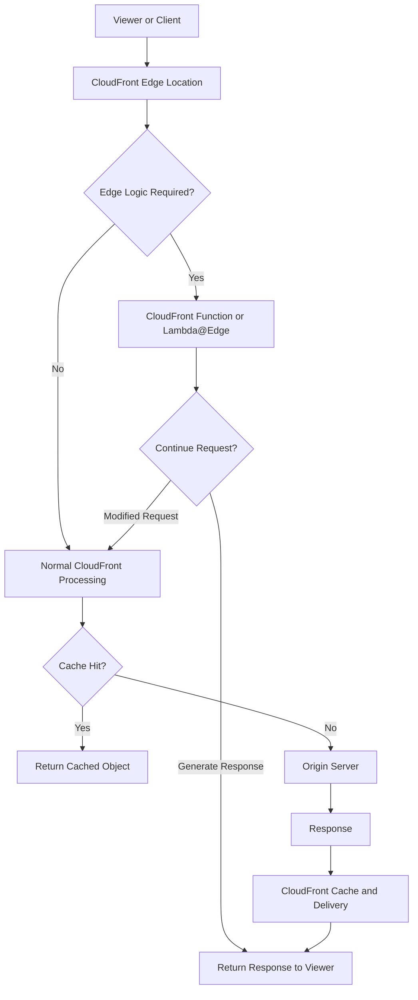
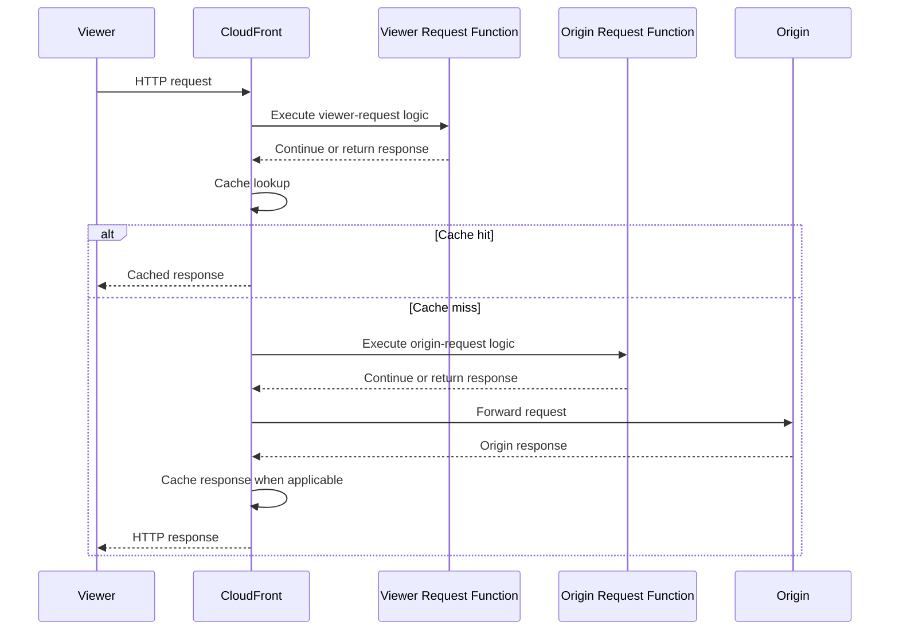
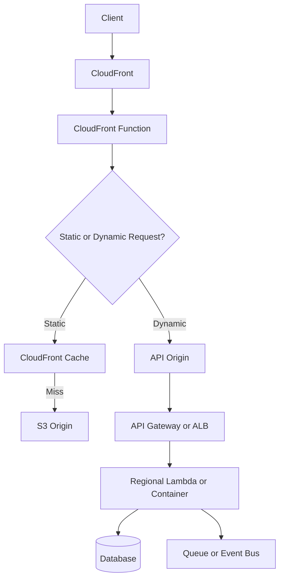

# 19- Lambda@Edge and CloudFront Functions

## Overview

Amazon CloudFront provides a globally distributed content delivery network (CDN) that caches and delivers content close to users. CloudFront also supports lightweight compute at the edge, allowing applications to execute logic near viewers or origin servers without routing every request through a centralized backend.

Two edge-compute options are particularly important:

- **CloudFront Functions** — lightweight JavaScript functions designed for high-scale, low-latency operations on viewer requests and responses.
- **Lambda@Edge** — AWS Lambda functions associated with CloudFront distributions that support more complex request and response processing, including origin-facing events.

Both can modify HTTP requests and responses, enforce access rules, normalize URLs, and personalize content. However, they differ substantially in supported events, runtimes, execution capabilities, deployment workflows, and operational constraints.

Use edge compute when logic benefits from executing near the viewer or within the CloudFront request lifecycle. Keep business-critical domain logic, database transactions, and complex workflows in regional backend services unless there is a compelling architectural reason to move them to the edge.

## Why Edge Compute Exists

Without edge compute, a request generally travels through CloudFront to an origin such as API Gateway, an Application Load Balancer, or an application server before application-specific request processing occurs.

Consider a backend that needs to redirect legacy URLs, normalize paths, or reject requests with invalid headers. Implementing these operations in the origin application introduces unnecessary network latency and consumes origin capacity.

Edge compute can perform suitable operations before the request reaches the origin.



The exact execution order depends on the selected CloudFront event and cache behavior. Viewer-request logic executes before the cache lookup, while origin-request logic executes only when CloudFront forwards a request to the origin.

### Benefits

- Reduce latency by processing requests close to viewers.
- Reduce unnecessary origin requests and application-server work.
- Implement redirects, URL normalization, and request validation centrally.
- Apply lightweight security and routing decisions at the CDN boundary.
- Customize cached responses or select origins based on request attributes.

### Limitations

- Edge execution environments have stricter constraints than regional Lambda functions.
- Available runtimes, network access, execution duration, and event types differ.
- Distributed execution complicates configuration rollout and troubleshooting.
- Incorrect cache behavior can cause incorrect content delivery or security problems.
- Edge compute is not a substitute for a regional application backend.

## CloudFront Request Lifecycle

CloudFront exposes several event points where edge code can execute.

| Event | Execution point | Typical use |
|---|---|---|
| Viewer request | When a viewer sends a request, before cache lookup | URL normalization, redirects, lightweight authentication checks |
| Viewer response | When CloudFront prepares a response for the viewer | Response-header changes, security headers |
| Origin request | When CloudFront forwards a cache miss to the origin | Origin selection, origin-request transformation |
| Origin response | When CloudFront receives a response from the origin, before caching | Response transformation and selected header changes |

**CloudFront Functions** support viewer-request and viewer-response events.

**Lambda@Edge** supports all four event types, subject to event-specific restrictions. For example, Lambda@Edge viewer-response functions have restrictions on changing HTTP status codes and are not invoked for every possible response path.

The event point determines both what information is available and how frequently the function executes.

### Viewer Request Versus Origin Request

A viewer-request function runs before CloudFront checks its cache. It can therefore execute for requests that eventually result in cache hits.

An origin-request function executes only when CloudFront needs to contact the origin. It can be useful for dynamic origin selection, but it cannot be relied upon to process every viewer request.



This distinction is critical for performance and cost. A function attached to a viewer event may execute far more frequently than one attached to an origin event when the cache hit ratio is high.

## CloudFront Functions

### What They Are

CloudFront Functions are lightweight JavaScript functions integrated directly into CloudFront's viewer request and viewer response processing.

They are designed for very fast execution at high request volumes. They are not general-purpose Node.js applications and do not provide the full Lambda runtime environment.

Typical use cases include:

- URL rewriting and normalization.
- Redirects based on paths or hostnames.
- Adding or modifying request and response headers.
- Simple authorization decisions based on request metadata.
- Cache-key normalization.
- Lightweight routing and content selection.

### Execution Model

CloudFront Functions use a constrained JavaScript runtime optimized for edge execution. They execute synchronously within the CloudFront request lifecycle and must complete within the service's execution limits.

They do not support arbitrary outbound network calls, filesystem access, or the full Node.js module ecosystem. They are therefore unsuitable for workloads that require database queries, calls to external identity providers, or complex computation.

A function receives an event containing the request or response data and returns the modified object or a response.

### Example: Normalize URLs

Suppose an application serves the same content for `/products`, `/products/`, and requests with inconsistent capitalization. If the application wants a canonical trailing-slash policy, a CloudFront Function can normalize the path before cache lookup.

The following example redirects a request to a canonical path when it lacks a trailing slash, excluding the root path and paths that appear to reference files.

```javascript
function handler(event) {
    var request = event.request;
    var uri = request.uri;

    if (
        uri !== "/" &&
        !uri.endsWith("/") &&
        !uri.split("/").pop().includes(".")
    ) {
        return {
            statusCode: 308,
            statusDescription: "Permanent Redirect",
            headers: {
                location: {
                    value: uri + "/"
                }
            }
        };
    }

    return request;
}
```

This example assumes that a path containing a dot represents a file-like resource. That assumption is application-specific; it is not a universal property of URLs.

If query strings must be preserved, test the complete redirect behavior with the actual CloudFront event and cache configuration. CloudFront represents the query string separately from `request.uri`.

A `308` redirect preserves the HTTP method and request body when the client follows the redirect. Use permanent redirects only when the canonicalization policy is stable.

### Example: Add a Response Header

A viewer-response function can add a security header to responses that pass through the applicable CloudFront response path.

```javascript
function handler(event) {
    var response = event.response;

    response.headers["x-content-type-options"] = {
        value: "nosniff"
    };

    return response;
}
```

This header helps prevent browsers from interpreting a response as a different content type than the declared type. It does not replace an appropriate `Content-Type` header or a complete browser security policy.

Viewer-response functions are subject to CloudFront restrictions. Do not assume that they execute for every HTTP response, including responses generated by every cache, origin, or error path. Validate behavior using the actual distribution configuration.

### Advantages

- Very low execution overhead.
- Suitable for high request volumes.
- Direct integration with CloudFront viewer events.
- No separate regional Lambda function deployment lifecycle.
- Useful for transformations that should occur before cache lookup.

### Limitations

- JavaScript-only, with a constrained runtime.
- No arbitrary outbound network requests.
- No general filesystem access or unrestricted third-party packages.
- Limited execution time and memory compared with general-purpose Lambda.
- Only viewer-request and viewer-response events are supported.

### Production Considerations

Keep CloudFront Functions deterministic and small. Avoid embedding complex business rules or large configuration structures directly in function code.

When a function changes cache keys, URL paths, or headers, validate its behavior against every relevant cache behavior. An incorrect transformation can fragment the cache, reduce the hit ratio, or expose content across users.

## Lambda@Edge

### What It Is

Lambda@Edge extends AWS Lambda into CloudFront's distributed request-processing infrastructure. It allows developers to run Lambda functions at selected CloudFront events, including origin-facing events that CloudFront Functions do not support.

It is useful when edge logic requires capabilities beyond the CloudFront Functions runtime, such as supported Node.js or Python runtime features, external dependencies included in a deployment package, or more sophisticated request processing.

Typical use cases include:

- Dynamic origin selection.
- More complex request and response transformations.
- Origin-facing authorization or routing logic.
- Integration with application-specific request formats.
- Generating responses for selected requests.
- Legacy URL migration with more complex rules.

Lambda@Edge still has service-specific restrictions. It should not be treated as an ordinary regional Lambda function that happens to run closer to a user.

### Execution and Deployment Model

Lambda@Edge functions are created in **US East (N. Virginia), `us-east-1`**. A numbered, published Lambda version is associated with a CloudFront distribution.

CloudFront distributes the function configuration to its edge infrastructure. Depending on the selected event, the function executes in the appropriate CloudFront request-processing path.

Important constraints include:

- Use a published function version, not `$LATEST` or an alias.
- The function must be created in `us-east-1`.
- Lambda@Edge does not support every regional Lambda feature.
- VPC attachment is not supported for Lambda@Edge functions.
- Environment variables are not supported in the same way as ordinary regional Lambda configuration; do not design an edge deployment around runtime environment-variable configuration.
- Function logging and operational investigation must account for execution across multiple AWS Regions.
- CloudFront propagation takes time, so deployment is not instantaneous.

Check the current AWS Lambda@Edge restrictions before selecting a runtime or designing integrations. Runtime support, quotas, and supported configuration options can change.

### Example: Modify an Origin Request

A Lambda@Edge origin-request function can inspect a request and adjust supported request properties before forwarding it to the origin.

For example, a service might route requests for a specific path prefix to a dedicated application origin. The following Python handler illustrates the event structure and request modification pattern; the CloudFront distribution must be configured with compatible origins and cache behaviors.

```python
def lambda_handler(event, context):
    request = event["Records"][0]["cf"]["request"]
    uri = request["uri"]

    headers = request.setdefault("headers", {})

    if uri.startswith("/catalog/"):
        headers["x-edge-route"] = [
            {
                "key": "X-Edge-Route",
                "value": "catalog"
            }
        ]

    return request
```

This example adds a header; it does **not** change the origin by itself. Actual origin selection requires modifying the supported `request["origin"]` structure and, where necessary, the associated `Host` header according to CloudFront's origin-request event schema.

Do not use a client-supplied routing header as an authorization signal. If a routing decision has security implications, derive it from trusted request data and enforce authorization at the origin as well.

### Origin Selection Considerations

Dynamic origin selection can be useful for multi-tenant systems, migration strategies, or path-based routing. However, it introduces operational risks:

- The selected origin must be trusted and explicitly controlled.
- Host headers and TLS certificate names must match the target origin.
- Cache keys must distinguish requests that can produce different responses.
- Origin changes must not allow an attacker to direct CloudFront to arbitrary hosts.
- Health, failover, and routing policy should remain understandable during incidents.

For ordinary origin failover and geographic routing, consider native CloudFront origin groups or other managed routing mechanisms before implementing custom logic.

### Advantages

- Supports viewer and origin-facing CloudFront events.
- More capable runtime than CloudFront Functions.
- Supports packaged dependencies within Lambda@Edge's restrictions.
- Can implement more complex transformations and routing decisions.
- Integrates with CloudFront's global delivery path.

### Limitations

- More deployment complexity than CloudFront Functions.
- Distribution updates and global propagation take time.
- Runtime, networking, IAM, and configuration restrictions differ from regional Lambda.
- Debugging is more complex because executions occur across Regions.
- Additional execution cost and latency may be unnecessary for simple transformations.

## CloudFront Functions Versus Lambda@Edge

| Capability | CloudFront Functions | Lambda@Edge |
|---|---|---|
| Primary purpose | Lightweight viewer-side logic | More capable edge request processing |
| Runtime | Constrained JavaScript runtime | Supported Lambda@Edge runtimes, including eligible Node.js and Python versions |
| Viewer request | Yes | Yes |
| Viewer response | Yes | Yes |
| Origin request | No | Yes |
| Origin response | No | Yes |
| Arbitrary outbound network access | No | Subject to Lambda@Edge restrictions; do not assume unrestricted access |
| General filesystem access | No | Restricted Lambda environment; package and runtime limitations apply |
| Dependency support | Constrained runtime capabilities | Deployment-package dependencies, subject to restrictions |
| VPC attachment | Not applicable | Not supported |
| Published Lambda version required | No Lambda version association | Yes |
| Deployment Region | CloudFront function management workflow | `us-east-1` |
| Best fit | Rewrites, redirects, header manipulation, lightweight decisions | Complex transformations and origin-facing logic |

### Decision Guide

| Requirement | Recommended approach |
|---|---|
| Simple URL rewrite before cache lookup | CloudFront Functions |
| Redirect a legacy URL | CloudFront Functions |
| Add a lightweight response header | CloudFront Functions, subject to event restrictions |
| Perform logic on origin requests | Lambda@Edge |
| Select an origin dynamically | Lambda@Edge or native CloudFront routing, depending on complexity |
| Query a database for every request | Regional backend or a redesigned caching strategy |
| Call an external identity provider on every request | Regional authorization service or a carefully designed token-validation strategy |
| Execute a complex business workflow | Regional Lambda, Step Functions, or a containerized service |
| Process large files or run long jobs | S3-triggered regional Lambda, ECS/Fargate, or another suitable processing service |

A useful default is to choose CloudFront Functions for simple viewer transformations and Lambda@Edge only when its additional execution capabilities are necessary.

## Integration with a Regional Backend

Edge compute should usually complement rather than replace the regional application backend.

A typical architecture uses CloudFront for content delivery and request normalization, API Gateway or an Application Load Balancer for regional API entry, and Lambda or containers for business logic.



### Responsibilities by Layer

- **CloudFront:** Content delivery, TLS termination, caching, and CDN-level routing.
- **CloudFront Functions:** Lightweight viewer request and response transformations.
- **Lambda@Edge:** More complex edge logic where the relevant event and restrictions support the requirement.
- **API Gateway or ALB:** Regional API entry, integration routing, and supported authentication or traffic controls.
- **Regional Lambda or containers:** Business rules, database operations, integrations, and domain workflows.
- **Queues and event buses:** Durable asynchronous processing and decoupling.

Avoid moving transactional logic to edge functions merely to reduce latency. A regional backend is often the better location for operations that need authoritative database state, consistent authorization, or complex retry and observability behavior.

## Security Considerations

### Treat Viewer Input as Untrusted

Headers, cookies, query strings, and URL paths supplied by a viewer can be manipulated. Edge functions should validate input and avoid treating arbitrary client metadata as proof of identity.

For example, a client can send:

```http
X-User-Role: administrator
```

A function must not grant privileged access merely because this header exists. Authentication claims should be cryptographically verified or obtained through a trusted authorization mechanism.

### Avoid Open Redirects

Do not construct redirect destinations directly from an unvalidated query parameter or `Host` header.

Unsafe conceptual pattern:

```javascript
// Unsafe: the destination is controlled by the client.
var destination = request.querystring.next.value;
```

A safer approach uses a fixed allowlist of destination paths or hostnames, rejects unexpected values, and emits a redirect only after validation.

### Protect Origin Access

If an origin is intended to be accessible only through CloudFront, configure origin access controls or other appropriate restrictions for the origin type. Do not assume that using CloudFront automatically prevents direct access to an S3 bucket, load balancer, or application endpoint.

Where origin requests include headers inserted by edge code, the origin should still validate the trust boundary. A public client may be able to send a header with the same name unless the request path reliably strips or replaces it.

### IAM and Deployment Permissions

Lambda@Edge deployment requires permissions for the relevant Lambda and CloudFront operations. The deployment identity should have only the permissions needed to publish the function version and update the intended distribution.

Separate deployment permissions from runtime behavior. Review resource policies and execution roles against the services the function actually needs.

CloudFront Functions have a different management model and should not be assigned Lambda execution roles that they do not use.

### Logging and Sensitive Data

Avoid logging authorization headers, session cookies, access tokens, personal data, or complete query strings containing secrets. Edge logs may be distributed across Regions and can increase both data exposure and operational complexity.

Define retention, access controls, and redaction policies before enabling verbose request logging.

## Caching and Correctness

Edge compute and CloudFront caching must be designed together.

### Cache-Key Normalization

A cache key determines which requests can reuse the same cached response. If two requests are normalized to the same cache key but should return different content, users may receive incorrect or sensitive responses.

For example, removing a language parameter from the cache key is safe only if language does not affect the response or the normalized request determines the correct language independently.

Review:

- URI and query-string normalization.
- Relevant cookies and headers.
- Authorization-dependent content.
- Tenant-specific response variations.
- Cache policies and origin request policies.
- Redirect and error-response caching.
- Whether changes occur before or after cache lookup.

### Cache Invalidation and Function Updates

Publishing new edge logic does not automatically make every previously cached object irrelevant. If the function changes URL normalization, cache-key behavior, or content routing, existing cached objects may still affect observed behavior.

A safe rollout should account for both distribution propagation and cached content. Use versioned asset paths or targeted invalidations when appropriate, and test cache-hit and cache-miss paths separately.

## Performance and Cost

### Performance Trade-Offs

Edge execution can reduce origin traffic and network round trips, but it is not automatically faster for every workload.

Consider:

- The event point and its frequency.
- Function execution duration.
- Cache hit ratio.
- Whether the function causes additional redirects.
- The cost of executing logic on every viewer request.
- The latency and availability of any downstream dependency.
- The operational impact of globally distributed configuration.

CloudFront Functions are generally the better fit for tiny, high-volume transformations. Lambda@Edge is justified when the required functionality cannot be implemented safely with CloudFront Functions or native CloudFront features.

### Cost Considerations

Costs depend on request volume, function type, execution characteristics, and current AWS pricing. Lambda@Edge and CloudFront Functions use different pricing models, so compare the current pricing pages for the intended workload rather than assuming equivalent per-request costs.

For a rough planning exercise, estimate:

- Requests reaching the relevant event.
- Expected cache hit ratio.
- Function invocations per viewer request.
- Function duration and any applicable compute charges.
- Logging volume and retention.
- Additional origin requests caused by redirects or cache fragmentation.

A viewer-request function may execute for nearly every viewer request, while an origin-request function generally runs only when CloudFront forwards a request to the origin. This difference can materially affect cost.

## Deployment and Verification

### CloudFront Functions Deployment Workflow

A typical workflow is:

1. Create a CloudFront Function.
2. Upload or update the code.
3. Test the function against representative events.
4. Publish the function to make the intended version available for association.
5. Associate it with the relevant distribution cache behavior and event type.
6. Wait for distribution deployment to complete.
7. Verify the behavior using real HTTP requests and CloudFront logs or metrics where applicable.

Illustrative AWS CLI commands:

```bash
# Create a function.
aws cloudfront create-function \
  --name normalize-viewer-uri \
  --function-config '{"Comment":"Normalize viewer URLs","Runtime":"cloudfront-js-2.0"}' \
  --function-code fileb://function.js

# Retrieve the function configuration and ETag.
aws cloudfront describe-function \
  --name normalize-viewer-uri

# Publish the function using the ETag returned by describe-function.
aws cloudfront publish-function \
  --name normalize-viewer-uri \
  --if-match <ETAG>
```

The exact configuration must satisfy the selected CloudFront Functions runtime and the current CLI API schema. The `--if-match` value is used for optimistic concurrency control; retrieve a fresh ETag before updating a function.

Association with a distribution is a separate configuration operation. Before changing a production distribution, inspect its current configuration, preserve unrelated settings, and submit the required configuration update with the correct distribution ETag.

### Lambda@Edge Deployment Workflow

A typical workflow is:

1. Create the function in `us-east-1`.
2. Configure its runtime, execution role, timeout, and memory within Lambda@Edge constraints.
3. Test the handler with representative CloudFront event objects.
4. Publish a numbered Lambda version.
5. Associate that version with the selected CloudFront distribution event.
6. Wait for the distribution deployment to complete.
7. Verify the request path, response, logs, and cache behavior.
8. Roll back by restoring the previous known-good association if needed.

Illustrative commands:

```bash
# Confirm the deployment account and Region.
aws sts get-caller-identity
aws configure get region

# Create or update the function in us-east-1.
aws lambda get-function \
  --function-name edge-request-handler \
  --region us-east-1

# Publish a version after the code and configuration are ready.
aws lambda publish-version \
  --function-name edge-request-handler \
  --region us-east-1

# Inspect the published version.
aws lambda list-versions-by-function \
  --function-name edge-request-handler \
  --region us-east-1
```

These commands inspect and publish Lambda resources; they do not associate a version with CloudFront. Distribution association requires a separate CloudFront distribution configuration update.

For production automation, use infrastructure as code or a deployment pipeline that validates the published version, distribution configuration, and deployment status. Avoid manual edits that can silently diverge from the repository's declared infrastructure.

### Verification Checklist

- Test the intended viewer and origin event paths.
- Confirm both cache-hit and cache-miss behavior.
- Verify redirects, status codes, and query-string handling.
- Check that origin routing cannot be manipulated by untrusted input.
- Confirm the function is associated with the intended cache behavior.
- Verify the deployed distribution status before declaring the rollout complete.
- Inspect logs and metrics for errors and latency changes.
- Confirm the rollback procedure and previous known-good configuration.

## Common Mistakes

| Mistake | Why it is problematic | Better approach |
|---|---|---|
| Using Lambda@Edge for a simple URL rewrite | Adds deployment and operational complexity | Prefer CloudFront Functions |
| Assuming CloudFront Functions can call an external API | Their runtime does not support arbitrary network calls | Use an appropriate regional service or redesign the request flow |
| Associating `$LATEST` with Lambda@Edge | Lambda@Edge requires a published version | Publish and associate a numbered version |
| Creating Lambda@Edge in the wrong Region | Lambda@Edge functions must be created in `us-east-1` | Make the deployment Region explicit in automation |
| Treating origin-request logic as viewer-request logic | Origin-request functions do not execute for every cache hit | Select the event based on required semantics |
| Trusting client-supplied identity headers | Allows spoofing and privilege escalation | Verify identity using a trusted mechanism |
| Changing URL normalization without cache analysis | Can create cache fragmentation or incorrect content reuse | Review cache policies and test representative variants |
| Assuming edge deployment is instantaneous | CloudFront configuration propagation takes time | Wait for deployment and verify actual behavior |
| Logging complete request headers | Can expose credentials or personal information | Redact sensitive fields and minimize log volume |
| Moving database transactions to edge code | Adds complexity and does not remove regional data-access latency | Keep authoritative domain operations in the regional backend |

## Key Takeaways

- CloudFront Functions are optimized for lightweight viewer-request and viewer-response logic; Lambda@Edge supports more complex processing, including origin-facing events.
- Choose the event point according to the required request lifecycle semantics, especially the distinction between viewer requests and cache misses.
- Treat viewer-controlled headers, paths, cookies, and query strings as untrusted, and design cache keys to prevent incorrect content reuse.
- Deploy edge logic through controlled releases, verify distribution propagation and cache behavior, and maintain a tested rollback path.
- Keep database transactions and complex business workflows in regional services unless edge execution provides a clear, justified architectural benefit.