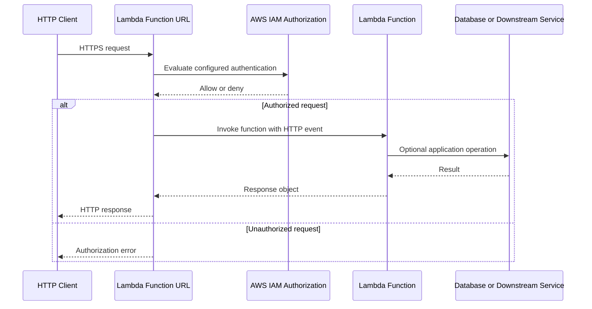

# 20- Lambda Function URLs

## Overview

AWS Lambda Function URLs provide an HTTPS endpoint directly associated with a Lambda function. They allow clients to invoke a function without requiring Amazon API Gateway or an Application Load Balancer.

Function URLs are useful for lightweight HTTP APIs, webhooks, internal tools, prototypes, and services that need a straightforward HTTPS entry point. They support synchronous request-response invocation and can be configured with authentication controls and response streaming.

A Function URL does not turn Lambda into a complete API management platform. Features such as advanced request validation, API keys, usage plans, managed API throttling policies, and sophisticated routing may require API Gateway or another component.

The primary architectural decision is whether a direct HTTPS endpoint provides sufficient functionality for the application or whether the additional capabilities of API Gateway justify the extra configuration and cost.

## How Lambda Function URLs Work

A Function URL is an AWS-managed HTTPS endpoint associated with a Lambda function or a qualified function version or alias. The endpoint accepts HTTP requests and invokes Lambda synchronously.

The handler receives an event describing the HTTP request and returns a response object that Lambda converts into an HTTP response.



The main components are:

- **Function URL endpoint:** The AWS-managed HTTPS address.
- **Authentication configuration:** Determines whether requests use IAM authorization or the `NONE` mode.
- **Lambda execution role:** Controls the function's access to AWS resources.
- **Handler:** Parses the request event, executes application logic, and constructs the HTTP response.
- **Optional downstream services:** Databases, queues, object storage, or other APIs used by the application.

The Function URL endpoint is separate from the Lambda function's execution role. Authentication determines whether a caller can invoke the endpoint; the execution role determines what the function can access after invocation.

## Authentication and Authorization

Function URLs support two authentication modes.

| Mode | Behavior | Appropriate use |
|---|---|---|
| `AWS_IAM` | Requests must be authorized using AWS Signature Version 4 and applicable IAM permissions | Trusted AWS workloads, controlled service-to-service access, and IAM-governed clients |
| `NONE` | Function URL requests do not require IAM authentication at the endpoint | Public endpoints where application-level controls are implemented as needed |

### AWS_IAM Authentication

With `AWS_IAM`, the caller must sign the request using AWS Signature Version 4. The caller's identity must have the permissions required to invoke the function URL.

The relevant Lambda permissions include:

- `lambda:InvokeFunctionUrl` for invoking the Function URL.
- `lambda:InvokeFunction` for invocation authorization, subject to the current Function URL authorization requirements.

AWS introduced additional authorization requirements for Function URLs in October 2025. For URLs configured with `AWS_IAM`, ensure that the caller and applicable resource policies grant the permissions required by the current authorization model. Do not assume that an older policy granting only `lambda:InvokeFunctionUrl` is sufficient.

Example caller policy:

```json
{
  "Version": "2012-10-17",
  "Statement": [
    {
      "Sid": "InvokeSpecificFunctionUrl",
      "Effect": "Allow",
      "Action": [
        "lambda:InvokeFunctionUrl",
        "lambda:InvokeFunction"
      ],
      "Resource": "arn:aws:lambda:ap-south-1:123456789012:function:orders-api",
      "Condition": {
        "StringEquals": {
          "lambda:FunctionUrlAuthType": "AWS_IAM",
          "lambda:InvokedViaFunctionUrl": "true"
        }
      }
    }
  ]
}
```

Replace the account ID, Region, and function name with the actual deployment values. This is an identity-based policy example; the effective permission decision also depends on applicable resource policies, permission boundaries, service control policies, and other authorization controls.

For cross-account access, configure the appropriate resource-based permissions on the target function and caller-side permissions. Test the complete authorization path rather than assuming that an identity policy in the caller's account is sufficient.

### NONE Authentication

The `NONE` mode permits invocation without IAM authentication at the Function URL boundary. This is appropriate only when the endpoint is intentionally accessible without AWS credentials.

A public Function URL can expose business operations to any client that can reach it. If the endpoint processes sensitive data or changes application state, implement suitable authentication, authorization, validation, rate controls, and abuse protection.

For example, a webhook endpoint may validate a provider's signature using the raw request body and a shared secret. Do not rely on an obscure URL or a custom header that an attacker can freely supply.

### Authentication Is Not Application Authorization

Even with `AWS_IAM`, application-level authorization remains necessary when users or tenants have different permissions.

A valid AWS principal may be allowed to invoke the function but should not automatically be allowed to read every customer's data. The handler must still validate the requested operation against the authenticated identity and application access rules.

## Request and Response Format

Function URLs use a Lambda-specific HTTP event format. This format differs from API Gateway's REST API payload format and its HTTP API payload formats.

A handler must be written for the actual event schema configured by the invocation mechanism.

### Example Request Event

A simplified Function URL event may look like this:

```json
{
  "version": "2.0",
  "routeKey": "$default",
  "rawPath": "/orders/123",
  "rawQueryString": "include_items=true",
  "headers": {
    "content-type": "application/json"
  },
  "queryStringParameters": {
    "include_items": "true"
  },
  "requestContext": {
    "http": {
      "method": "GET",
      "path": "/orders/123",
      "sourceIp": "203.0.113.10",
      "userAgent": "example-client"
    }
  },
  "isBase64Encoded": false
}
```

The event contains HTTP request information, including the method, path, headers, query parameters, and request context.

Do not assume that every header or context field is present. Header names should be treated case-insensitively, and values should be validated before use.

### Example Response

A handler typically returns a response object similar to:

```python
{
    "statusCode": 200,
    "headers": {
        "content-type": "application/json"
    },
    "body": "{\"order_id\":\"123\",\"status\":\"processed\"}",
    "isBase64Encoded": False
}
```

The `body` is a string. For JSON responses, serialize Python dictionaries using `json.dumps()` rather than returning a dictionary directly as the body.

For binary responses, encode the body appropriately and set `isBase64Encoded` to `True` when required by the Function URL response contract. Verify the supported behavior for the specific content type and client.

## Implementing a Python Function URL

Consider a small HTTP endpoint that exposes a health check and a basic order lookup.

### Handler Implementation

Create `app.py`:

```python
import json
import logging

logger = logging.getLogger()
logger.setLevel(logging.INFO)


def response(status_code: int, payload: dict) -> dict:
    return {
        "statusCode": status_code,
        "headers": {
            "content-type": "application/json; charset=utf-8",
            "cache-control": "no-store"
        },
        "body": json.dumps(payload),
        "isBase64Encoded": False
    }


def lambda_handler(event, context):
    http = event.get("requestContext", {}).get("http", {})
    method = http.get("method", "GET")
    path = event.get("rawPath", "/")

    logger.info(
        "HTTP request method=%s path=%s request_id=%s",
        method,
        path,
        context.aws_request_id
    )

    if method == "GET" and path == "/health":
        return response(200, {"status": "ok"})

    if method == "GET" and path.startswith("/orders/"):
        order_id = path.removeprefix("/orders/")

        if not order_id or "/" in order_id:
            return response(400, {"error": "invalid_order_id"})

        # Replace this placeholder with an authorized data-access operation.
        return response(
            200,
            {
                "order_id": order_id,
                "status": "lookup_not_implemented"
            }
        )

    return response(404, {"error": "not_found"})
```

This is a minimal HTTP handler, not a complete production order API. The example deliberately avoids a database integration so that the Function URL request-response contract remains clear.

For production use:

- Authenticate callers according to the endpoint's trust model.
- Authorize access to individual orders and tenants.
- Validate identifiers and request payloads.
- Use structured logs and avoid logging secrets or personal data.
- Apply explicit timeouts and handle downstream failures.
- Add unit and integration tests.
- Configure concurrency and downstream capacity deliberately.

### Request Lifecycle

1. A client sends an HTTPS request to the Function URL.
2. AWS evaluates the configured endpoint authentication requirements.
3. Lambda invokes the function synchronously with the HTTP event.
4. The handler processes the request and returns a response object.
5. Lambda returns the response through the Function URL to the client.

Because the invocation is synchronous, the caller waits for the function's response. A timeout, unhandled exception, or malformed response can cause the client to receive an error instead of the expected application response.

## Creating a Function URL with AWS CLI

The following workflow assumes that the Lambda function already exists and that the AWS CLI is configured with appropriate permissions.

### Verify the Account and Region

```bash
aws sts get-caller-identity

aws configure get region
```

Use an explicit Region in production automation to avoid accidentally creating resources in the wrong Region.

### Create a URL with IAM Authentication

The following command creates a Function URL with `AWS_IAM` authentication.

```bash
aws lambda create-function-url-config \
  --function-name orders-api \
  --auth-type AWS_IAM \
  --region ap-south-1
```

This is a resource-creating command. It returns the Function URL configuration, including the endpoint URL.

If the function is already configured with a Function URL, the command can fail because a function can have only one Function URL configuration for a given qualified function target. Inspect the existing configuration before retrying.

### Inspect the Configuration

```bash
aws lambda get-function-url-config \
  --function-name orders-api \
  --region ap-south-1
```

This is a read-only operation. Verify the authentication mode and endpoint URL before testing the endpoint.

### Create a Public URL

Only use this configuration when public invocation is intentional.

```bash
aws lambda create-function-url-config \
  --function-name public-webhook \
  --auth-type NONE \
  --region ap-south-1
```

Creating a URL with `NONE` authentication is not a substitute for reviewing the function's resource policy and application security. Confirm who can invoke the function and whether public access is acceptable.

### Test the Endpoint

```bash
curl -i \
  "https://example-id.lambda-url.ap-south-1.on.aws/health"
```

Replace the example URL with the actual endpoint returned by AWS.

For an IAM-authenticated URL, an ordinary unsigned `curl` request will not provide the required AWS authorization. Use a SigV4-capable client or an AWS SDK with valid credentials.

### Delete a Function URL

```bash
aws lambda delete-function-url-config \
  --function-name orders-api \
  --region ap-south-1
```

This removes the Function URL configuration; it does not delete the Lambda function itself. Verify that no clients depend on the endpoint before removal.

## CORS Configuration

Cross-Origin Resource Sharing (CORS) determines whether browsers allow frontend JavaScript hosted on one origin to access a response from another origin.

Function URLs can be configured with CORS settings. These settings help browsers evaluate cross-origin requests, but CORS is not an authentication or authorization mechanism.

A basic configuration can be created or updated using the CLI:

```bash
aws lambda update-function-url-config \
  --function-name orders-api \
  --cors '{
    "AllowOrigins": ["https://app.example.com"],
    "AllowMethods": ["GET", "POST"],
    "AllowHeaders": ["content-type", "authorization"],
    "MaxAge": 300
  }' \
  --region ap-south-1
```

Use an explicit allowlist of frontend origins when possible. Avoid `*` when credentials or sensitive cross-origin access are involved.

Consider the following:

- Allow only the required origins, methods, and headers.
- Include the headers used by preflight requests.
- Test browser preflight `OPTIONS` requests.
- Do not assume that CORS prevents non-browser clients from invoking the endpoint.
- Keep authentication and authorization independent of CORS.

If the application needs complex CORS behavior, extensive request validation, or standardized API policies, API Gateway may be a better fit.

## Function URLs Versus API Gateway

Both services can expose Lambda-backed HTTP endpoints, but they serve different architectural needs.

| Capability | Lambda Function URLs | API Gateway |
|---|---|---|
| Direct HTTPS endpoint for Lambda | Built in | Supported through Lambda integration |
| Setup complexity | Low | Higher, depending on API type and features |
| IAM-based invocation | Supported | Supported through API authorization and integration configuration |
| Public endpoint | Supported with `NONE` authentication | Supported with suitable API configuration |
| API keys and usage plans | Not provided as native Function URL features | Available for supported API types and configurations |
| Request validation | Primarily application-managed | Supported features vary by API type |
| Routing and API organization | Primarily handler-managed | Managed route and resource configuration |
| Request throttling controls | Requires appropriate surrounding controls and Lambda concurrency planning | API Gateway provides API-level throttling features |
| API lifecycle and stages | No API Gateway stage model | Supported |
| Response streaming | Supported in applicable Function URL configurations | Depends on API type and integration capabilities |
| Best fit | Lightweight direct HTTP access | Managed APIs requiring richer gateway capabilities |

### When to Use Function URLs

Choose a Function URL when:

- A small service needs a direct HTTPS endpoint.
- An internal integration can use IAM authentication.
- A webhook or simple application endpoint does not need API Gateway's advanced features.
- You want to reduce gateway configuration and operational complexity.
- The application can implement its own request validation and authorization requirements.

### When to Use API Gateway

Prefer API Gateway when:

- Multiple routes and API lifecycle management are important.
- You need gateway-level throttling and usage controls.
- You need supported request validation, API keys, or managed authorization integrations.
- You need stage-based deployments, custom domain management, or API-specific observability features.
- The API is a formal public interface consumed by multiple clients.

A Function URL may be simpler and cheaper for a narrow use case, but compare the complete architecture rather than evaluating the endpoint in isolation.

## Security Best Practices

### Keep Authentication Explicit

Choose the authentication mode based on the intended trust boundary. Do not select `NONE` simply because it makes testing easier and then deploy it without reviewing the public exposure.

### Validate Input

HTTP headers, query parameters, paths, and request bodies are untrusted. Validate content types, payload sizes, identifiers, and business constraints before performing expensive or privileged operations.

### Apply Least-Privilege IAM

The Lambda execution role should grant only the permissions needed by the handler. A function that reads an order should not automatically have broad write access to every DynamoDB table or S3 bucket.

For IAM-authenticated URLs, also review the caller identity policies and function resource policy. Invocation permission and downstream AWS access are separate authorization decisions.

### Protect Secrets

Do not hardcode API tokens, database passwords, or webhook secrets in source code. Use an appropriate secrets-management mechanism, restrict access through IAM, and avoid including secret values in logs or error responses.

### Control Public Abuse

For public endpoints, consider:

- Application-level rate controls and abuse detection.
- Lambda reserved concurrency to limit the function's maximum concurrency.
- Input validation and request-size limits.
- Appropriate monitoring and alarms.
- Upstream protection where stricter request filtering or rate enforcement is required.

Reserved concurrency limits concurrent executions, but it is not a complete API rate-limiting mechanism. A burst of requests may still create throttling errors, and legitimate users may be affected.

### Avoid Exposing Internal Errors

Return stable error responses to clients and record useful diagnostic details in protected logs. Do not return stack traces, database connection strings, IAM error details, or internal resource identifiers unnecessarily.

## Reliability, Performance, and Operations

### Timeout Management

Set the Lambda timeout according to the expected request duration and downstream service behavior. Avoid allowing HTTP requests to wait for long-running processing when an asynchronous workflow is more appropriate.

For work that may take substantial time, accept the request, enqueue the job, and return an appropriate response such as `202 Accepted` with a job identifier.

### Concurrency and Downstream Capacity

Function URLs do not remove Lambda concurrency limits or downstream capacity constraints. A traffic spike can create concurrent executions that overwhelm a database, external API, or connection pool.

Plan for:

- Reserved concurrency when isolation or downstream protection is required.
- Reuse of SDK clients and database connections where safe.
- Bounded database connection counts.
- Appropriate backpressure and retry behavior.
- Queue-based processing for bursty workloads.
- Graceful handling of throttling and dependency failures.

### Monitoring

Monitor both Lambda execution and the HTTP behavior observed by clients.

Useful Lambda metrics include:

- `Invocations`
- `Errors`
- `Duration`
- `Throttles`
- `ConcurrentExecutions`

Add application metrics for request outcomes, validation failures, authorization denials, and downstream dependency latency. Use structured logs with request identifiers and avoid logging sensitive data.

Set alarms based on service objectives rather than relying only on raw invocation counts. For example, sustained error rates, rising p95 latency, or repeated throttling may indicate a production problem even when the function remains available.

### Cost Considerations

Function URLs do not eliminate Lambda charges. Invocations, execution duration, memory allocation, and any downstream resources can contribute to total cost.

For a public endpoint, estimate request volume and execution time under realistic traffic. Monitor unexpected invocation spikes and configure appropriate concurrency controls. If the endpoint performs database operations, include database capacity and connection-management costs in the architecture decision.

## Common Mistakes

| Mistake | Consequence | Prevention |
|---|---|---|
| Assuming Function URLs behave exactly like API Gateway events | Handler parsing and response handling may fail | Use the correct event schema for the configured invocation mechanism |
| Returning a Python dictionary as the response body | Response may not match the expected HTTP response contract | Serialize JSON using `json.dumps()` |
| Treating `NONE` authentication as safe for production | Unintended public invocation and resource abuse | Review exposure and implement appropriate application security |
| Assuming CORS protects an endpoint | Non-browser clients can still call it | Enforce authentication and authorization independently |
| Granting broad execution-role permissions | A function compromise can expose unrelated resources | Apply least privilege and review resource access |
| Ignoring the post-October-2025 IAM authorization requirements | Previously working callers may fail authorization | Verify current caller and resource policy requirements |
| Using reserved concurrency as a complete rate limiter | Requests can still arrive in bursts and be throttled | Use appropriate upstream and application-level controls |
| Running long jobs synchronously | High latency, timeouts, and poor client experience | Move long-running work to queues or workflows |
| Exposing internal errors to callers | Sensitive implementation details may leak | Return stable error responses and log diagnostics securely |

## Key Takeaways

- Lambda Function URLs provide direct HTTPS invocation without API Gateway, making them suitable for lightweight HTTP endpoints and webhooks.
- `AWS_IAM` requires SigV4 authorization and the applicable invocation permissions; `NONE` permits unauthenticated endpoint invocation and demands careful security review.
- Function URL events and responses have a specific schema, so handlers must parse requests and serialize responses correctly.
- CORS is a browser access policy, not an authentication or authorization mechanism.
- Use API Gateway when managed routing, API-level throttling, usage controls, validation, or richer API lifecycle features justify the additional architecture.