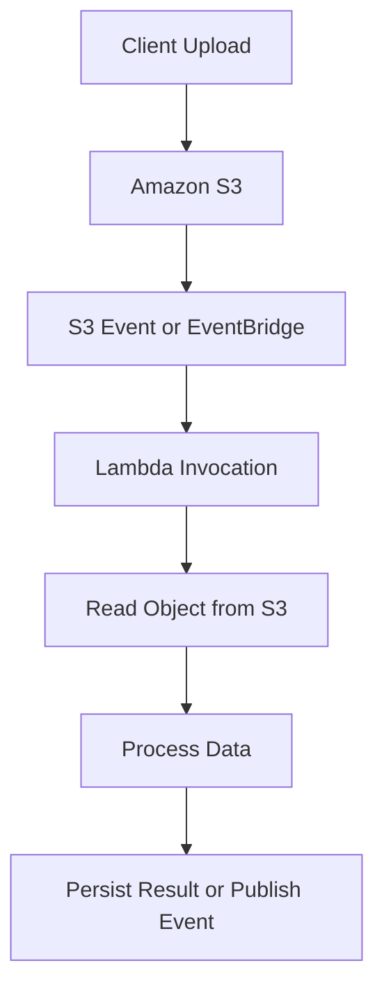

# 21- Lambda Quotas and Service Limits

## Overview

AWS Lambda quotas and service limits define the maximum resources, throughput, payload sizes, execution durations, and configuration values available to Lambda functions and their integrations.

Understanding these limits is essential when designing scalable backend services. A function may have efficient code and sufficient memory but still fail under load because of concurrency exhaustion, invocation throttling, payload restrictions, or downstream service limits.

Lambda quotas fall into several categories:

- **Account-level quotas:** Shared capacity available to Lambda functions within an AWS account and Region.
- **Function-level configuration limits:** Values such as memory, timeout, and ephemeral storage configured for an individual function.
- **Invocation and payload limits:** Restrictions on request and response sizes or invocation behavior.
- **Event source limits:** Constraints imposed by SQS, Kinesis, DynamoDB Streams, API Gateway, and other integrations.
- **Operational quotas:** Limits on resources such as concurrent executions, deployment packages, and event source mappings.

A production architecture must account for the limits of the entire request path, not only Lambda itself. For example, increasing Lambda concurrency does not increase PostgreSQL connection capacity, API Gateway throttling limits, or the throughput of a downstream third-party API.

> **Important:** AWS quotas can change and may differ by Region, account, runtime, invocation mode, and integration. Treat the values in this document as planning references, not as a substitute for the current [AWS Lambda quotas documentation](https://docs.aws.amazon.com/lambda/latest/dg/gettingstarted-limits.html). Verify the effective quotas for the target account and Region before production deployment.

## Lambda Quota Categories

| Category | Examples | Primary engineering concern |
|---|---|---|
| Concurrency | Regional concurrency, reserved concurrency, provisioned concurrency | Throughput, throttling, and downstream protection |
| Execution configuration | Memory, timeout, ephemeral storage | Runtime performance and resource consumption |
| Invocation payloads | Synchronous and asynchronous request limits | Request design and data transfer |
| Deployment artifacts | ZIP packages, layers, container images | Build and deployment reliability |
| Scaling | Concurrent execution growth and burst capacity | Traffic spikes and cold starts |
| Event source mappings | Batch size, polling, concurrent processing | Queue lag and stream processing |
| Networking and dependencies | Database connections, API limits, VPC capacity | End-to-end throughput |
| Observability | Logs, metrics, tracing, service quotas | Incident detection and diagnosis |

## Core Lambda Quotas

The following table lists commonly referenced Lambda limits. AWS can revise these values, and some limits depend on the invocation type or deployment method.

| Resource or setting | Commonly documented limit | Engineering implication |
|---|---:|---|
| Function timeout | Up to 900 seconds (15 minutes) | Longer workflows generally need orchestration or a different compute service |
| Memory allocation | 128 MB to 10,240 MB | Memory selection also affects available CPU |
| Ephemeral `/tmp` storage | 512 MB to 10,240 MB | Temporary files and intermediate processing must fit the configured capacity |
| Synchronous invocation request payload | Up to 6 MB for buffered invocation requests | Large HTTP or direct-invocation payloads may need object storage or another transfer mechanism |
| Synchronous buffered response payload | Up to 6 MB | Large responses may require response streaming or object storage |
| Asynchronous invocation event payload | Up to 1 MB | Large event data should generally be stored externally and referenced by key |
| ZIP deployment package, direct upload | Up to 50 MB compressed | Larger packages can be uploaded through Amazon S3, subject to the applicable package limits |
| ZIP package, uncompressed contents | Up to 250 MB, including layers | Dependencies and application artifacts must fit the uncompressed limit |
| Container image | Up to 10 GB uncompressed | Large images increase image-management and startup considerations |
| Function timeout precision | Whole seconds | Configure enough time for expected work without masking dependency failures |

These are not interchangeable limits. For example, the synchronous request payload limit is different from the asynchronous event payload limit. Response streaming also has its own behavior and constraints, so do not assume that enabling streaming removes every payload or integration limit.

Always verify current values and the precise definition of each limit before implementing an architecture.

## Account-Level Concurrency

Concurrency represents the number of function executions running simultaneously.

A function's concurrency requirement depends on its arrival rate and the time each invocation spends executing.

A useful approximation is Little's Law:

\[
\text{Concurrency} \approx \text{Request rate} \times \text{Average execution duration}
\]

For example, if a function processes 200 requests per second and each invocation takes an average of 0.4 seconds:

\[
200 \times 0.4 = 80
\]

The function needs approximately 80 concurrent executions under steady-state conditions. Production capacity planning must include traffic bursts, tail latency, retries, and downstream capacity.

### Regional Concurrency

Lambda has an account-level concurrency quota in each Region. The default has historically been 1,000 concurrent executions per Region for many accounts, but the effective quota can differ and may be increased.

Regional concurrency is shared across functions, subject to reserved concurrency allocations and other applicable controls.

A function may experience throttling even when its own code is healthy if other functions consume the available regional capacity.

Inspect current usage and quota configuration before deciding how much capacity is available to a new workload.

### Reserved Concurrency

Reserved concurrency allocates a portion of the account's concurrency capacity to a function and establishes its maximum concurrency.

It serves two purposes:

- Reserves capacity for a function, subject to the account's concurrency allocation rules.
- Limits the function's maximum simultaneous executions to protect downstream services.

Example:

```bash
aws lambda put-function-concurrency \
  --function-name orders-api \
  --reserved-concurrent-executions 100 \
  --region ap-south-1
```

This is a configuration-changing command. It sets the function's reserved concurrency to 100.

Verify the result:

```bash
aws lambda get-function-concurrency \
  --function-name orders-api \
  --region ap-south-1
```

Use reserved concurrency when a workload needs capacity isolation or when a downstream system cannot safely handle unrestricted Lambda scaling.

Be careful with low values. A function limited to 10 concurrent executions cannot process an arbitrarily large request burst immediately. Excess requests may be throttled or delayed depending on the invocation mechanism.

Setting reserved concurrency to zero intentionally stops normal function execution and can be useful during incident response.

### Provisioned Concurrency

Provisioned concurrency initializes execution environments in advance to reduce initialization latency.

It is useful for latency-sensitive APIs, but it does not eliminate all sources of latency or guarantee that every request will use a provisioned environment.

Provisioned concurrency:

- Requires an appropriate published version or alias.
- Consumes configured concurrency capacity.
- Can incur charges while configured, even when traffic is low.
- Must be sized according to expected demand and scaling behavior.
- Does not remove downstream bottlenecks or application execution time.

Reserved concurrency and provisioned concurrency are not substitutes for each other. Reserved concurrency controls the function's concurrency allocation and ceiling; provisioned concurrency prepares execution environments for predictable latency.

## Scaling and Throttling

Lambda scales by creating execution environments as demand increases, subject to account quotas, function configuration, event source behavior, and service-specific scaling rules.

A sudden traffic spike may exceed available concurrency before additional capacity is ready. This can result in throttling, elevated latency, or retry amplification.

### Common Throttling Causes

- Regional concurrency exhaustion.
- A function reaching its reserved concurrency limit.
- Provisioned concurrency being insufficient for incoming demand.
- A downstream dependency causing executions to run longer and consume concurrency.
- An event source mapping attempting to process more work than the function or dependency can handle.
- Account or service quotas that have not been raised to meet production demand.

### Diagnose Throttling

Inspect the function's configuration:

```bash
aws lambda get-function-concurrency \
  --function-name orders-api \
  --region ap-south-1
```

Inspect regional account settings:

```bash
aws lambda get-account-settings \
  --region ap-south-1
```

Review CloudWatch metrics such as:

- `ConcurrentExecutions`
- `Throttles`
- `Invocations`
- `Errors`
- `Duration`

The correct remediation depends on the cause. Increasing a quota will not fix a database connection bottleneck, and increasing reserved concurrency may make downstream overload worse.

## Payload Limits and Large Data Processing

Lambda invocation payload limits affect both direct invocation and integrated architectures.

A common mistake is to pass an entire file, image, or large dataset through an event when a reference would be sufficient.

A better design stores the payload in Amazon S3 and sends a small event containing the object key and relevant metadata.



This pattern reduces event size and separates data transfer from event notification.

The handler must still account for object size, memory usage, execution duration, and retry behavior. Very large files or long-running transformations may be better suited to ECS, AWS Batch, or another processing service.

### Synchronous Invocation

Synchronous invocation returns the function's response directly to the caller. Payload limits depend on the invocation API or integration.

For HTTP APIs, the effective end-to-end request and response limits may be lower than or different from Lambda's own limits because API Gateway, an Application Load Balancer, or a client imposes additional constraints.

### Asynchronous Invocation

Asynchronous invocation places the event into Lambda's internal asynchronous processing system. The caller does not wait for the function's business result.

The event payload limit is lower than the commonly documented synchronous payload limit. Store large data externally and pass a reference.

Asynchronous delivery and retries do not provide exactly-once business processing. Design handlers to tolerate duplicate events and configure appropriate failure handling.

## Deployment Package and Image Limits

Deployment artifacts must fit the constraints of the selected packaging approach.

### ZIP Packages

ZIP packages are suitable for many Python applications, especially when dependencies are modest.

Important considerations include:

- Direct upload size versus S3-based upload.
- Compressed package size versus uncompressed size.
- Dependencies included in the deployment artifact.
- Lambda layers contributing to the uncompressed package limit.
- Runtime compatibility and native library requirements.

A dependency that is small when compressed can expand substantially after extraction. Build and inspect artifacts in CI rather than discovering package-size problems during deployment.

### Container Images

Lambda supports container images for functions, with a commonly documented maximum uncompressed image size of 10 GB.

Container images are useful when dependencies, native libraries, or build workflows are easier to manage as an image. They do not remove Lambda's invocation, execution-duration, concurrency, or runtime constraints.

Large images can increase image-management complexity and may affect startup behavior. Keep images as small as practical and use a reproducible build process.

## Event Source Mapping Limits

Event source mappings connect Lambda to supported event sources such as Amazon SQS, Kinesis, and DynamoDB Streams. Lambda polls or reads the source and invokes the function with batches of records.

The scaling and retry behavior depends on the event source.

| Event source | Important constraints | Engineering concern |
|---|---|---|
| Amazon SQS | Batch size, visibility timeout, queue throughput, event source mapping scaling | Duplicate processing and backlog growth |
| Kinesis Data Streams | Shard throughput, batching, iterator age, ordering within a shard | Hot shards and delayed checkpoint progress |
| DynamoDB Streams | Shard behavior, batch size, stream retention, ordering requirements | Processing lag and replay considerations |
| Amazon S3 notifications | Notification delivery and downstream event processing behavior | Duplicate notifications and idempotency |
| EventBridge | Event size, target delivery behavior, retry policies | Failed deliveries and asynchronous recovery |

Do not assume that all event sources share the same retry semantics or concurrency behavior.

### SQS Batch Processing

For SQS, Lambda can process multiple messages in one invocation. A larger batch can improve efficiency but also increases the amount of work associated with a failed invocation.

For standard queues, duplicate delivery is possible. For FIFO queues, ordering and message-group behavior affect how work can be processed concurrently.

When supported and correctly configured, partial batch responses allow the function to identify failed messages so successful messages do not need to be treated as failed solely because another message in the batch failed.

The SQS visibility timeout must be configured with the Lambda timeout and retry behavior in mind. A visibility timeout that is too short can cause a message to become visible again while the original invocation is still processing it.

### Stream Processing

Kinesis and DynamoDB Streams require careful consideration of record ordering, checkpoints, and iterator age.

Increasing concurrency is not always the correct solution. If processing is constrained by shard throughput or per-shard ordering, additional Lambda concurrency may not increase useful throughput.

Monitor event source mapping metrics and the relevant source-service metrics before changing scaling configuration.

## Downstream Service Limits

Lambda can scale more quickly than many databases and third-party services can accept connections or requests.

For example, suppose each invocation opens a new PostgreSQL connection. A burst of 300 concurrent Lambda executions could create hundreds of simultaneous connection attempts, potentially exhausting the database connection limit.

Mitigations include:

- Reusing clients and connections safely within an execution environment.
- Using Amazon RDS Proxy where appropriate for supported database workloads.
- Setting reserved concurrency based on downstream capacity.
- Using bounded retries with exponential backoff and jitter.
- Introducing SQS to absorb traffic bursts.
- Applying circuit breakers or graceful degradation when dependencies fail.
- Monitoring connection counts, latency, and error rates in the downstream system.

Lambda concurrency should be treated as a capacity multiplier. It is not an unlimited throughput guarantee.

## Discovering and Requesting Quota Increases

Use AWS Service Quotas and the Lambda account settings API to inspect relevant limits.

### Inspect Account Settings

```bash
aws lambda get-account-settings \
  --region ap-south-1
```

This read-only command reports Lambda account settings, including concurrency-related information.

### Use AWS Service Quotas

In the AWS Console:

1. Open **Service Quotas**.
2. Select **AWS Lambda**.
3. Locate the quota relevant to the workload.
4. Inspect the applied quota and current usage where available.
5. Request an increase if the quota is adjustable and the workload requires it.
6. Test the application against the new capacity before relying on it.

Not every service limit is adjustable, and some quotas are managed differently. Check the quota's current adjustment policy and allow time for approval.

A quota increase should be supported by a capacity plan explaining expected traffic, average and tail execution duration, downstream capacity, and the intended concurrency allocation.

## Capacity Planning Example

Assume an HTTP backend has the following characteristics:

- Average request rate: 250 requests per second.
- Average Lambda duration: 300 milliseconds.
- Peak traffic: three times the average.
- Expected downstream processing time: included in the function duration.

Approximate average concurrency:

\[
250 \times 0.3 = 75
\]

Approximate concurrency at three times the traffic:

\[
750 \times 0.3 = 225
\]

These calculations provide an initial estimate, not a guarantee. Actual concurrency depends on the arrival pattern, latency distribution, retries, and execution time under load.

A production capacity plan should also evaluate:

- p95 and p99 execution duration.
- Burst behavior and scaling.
- Regional concurrency shared by other functions.
- Reserved concurrency allocations.
- Provisioned concurrency requirements.
- Database and external API limits.
- Queue backlog and retry amplification.
- Cost at expected and peak request volumes.

Use load testing and CloudWatch metrics to validate the assumptions before a production rollout.

## Monitoring Quota Pressure

Create alarms that reveal capacity pressure before it becomes a widespread incident.

| Signal | What it indicates | Possible response |
|---|---|---|
| Rising `Throttles` | Requests are exceeding available invocation capacity | Inspect concurrency and event source behavior |
| High `ConcurrentExecutions` | Increasing demand or longer execution duration | Compare demand against quota and downstream capacity |
| Rising `Duration` | Slower processing or dependency degradation | Investigate application and dependency latency |
| Growing SQS backlog | Processing throughput is below arrival rate | Investigate failures, batch behavior, and safe scaling |
| Increasing stream iterator age | Stream records are being processed late | Investigate shard throughput, function latency, and errors |
| Rising database connections | Lambda scaling is stressing the database | Review connection reuse, pooling, and concurrency limits |
| Increasing asynchronous failures | Events cannot be processed successfully | Inspect function errors, retry behavior, and failure destinations |

Monitor both Lambda and the services that Lambda calls. A function may have low error rates while a queue accumulates work, or it may execute successfully while response latency violates the application's service-level objective.

## Common Mistakes

| Mistake | Why it fails | Better approach |
|---|---|---|
| Assuming Lambda scales without limits | Account and function quotas still apply | Plan concurrency and inspect effective quotas |
| Increasing concurrency without checking database capacity | Can exhaust connections and increase failures | Bound concurrency and use suitable connection management |
| Treating all payload limits as identical | Invocation models and integrations have different limits | Verify the exact API and event source contract |
| Sending large files through events | Increases payload and memory pressure | Store data in S3 and pass references |
| Using retries as the only recovery mechanism | Persistent failures can create retry amplification | Add idempotency, bounded retries, and failure destinations |
| Assuming a quota increase is instantaneous | Requests may require approval or be unavailable | Request early and maintain tested fallback behavior |
| Setting very low reserved concurrency | Can throttle legitimate traffic | Size the limit against workload and downstream capacity |
| Ignoring event source scaling rules | More concurrency may not increase useful throughput | Diagnose the source-specific bottleneck |
| Using average latency alone | Tail latency can cause higher concurrency than expected | Include p95/p99 and burst traffic in capacity planning |
| Treating documented defaults as guaranteed account settings | Quotas can vary by account and Region | Verify the effective quota before deployment |

## Production Readiness Checklist

Before launching a Lambda-backed service, verify:

- [ ] The effective concurrency quota is known for every deployment Region.
- [ ] Reserved concurrency is configured where isolation or downstream protection is required.
- [ ] Provisioned concurrency is justified by latency requirements and budget.
- [ ] Memory, timeout, and ephemeral storage are sized from measurements.
- [ ] Request, response, and asynchronous event payloads fit the relevant limits.
- [ ] Deployment packages or container images fit the applicable size restrictions.
- [ ] Event source batch sizes, visibility timeouts, retries, and failure handling are configured correctly.
- [ ] Database connections and downstream API throughput can handle peak concurrency.
- [ ] CloudWatch alarms cover throttling, errors, latency, and relevant queue or stream lag.
- [ ] Quota increases have been requested early where required.
- [ ] Load testing validates capacity assumptions.
- [ ] Cost estimates include peak traffic, retries, provisioned concurrency, and downstream services.

## Key Takeaways

- Lambda quotas cover account concurrency, function configuration, payload sizes, deployment artifacts, and event-source behavior; verify the effective limits for the target account and Region.
- Estimate concurrency using request rate and execution duration, then validate it with burst testing, tail latency, and production metrics.
- Protect downstream databases and APIs with deliberate concurrency limits, connection management, queues, and bounded retry strategies.
- Treat invocation payload limits and event-source semantics separately; use S3 references for large data and design event handlers for duplicate delivery.
- Monitor throttling, execution latency, queue or stream lag, and downstream capacity together so that quota pressure is detected before it becomes a production incident.