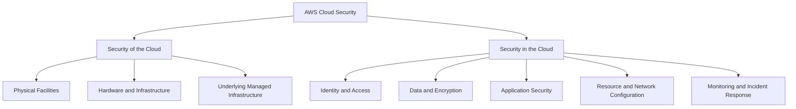
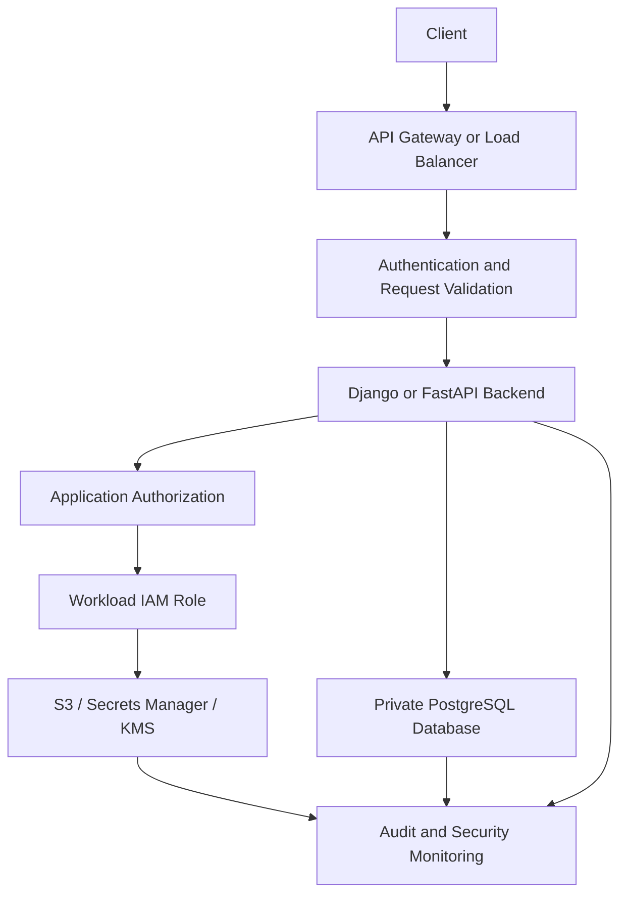

# 01- Introduction

## Overview

AWS Security encompasses the identity, access control, data protection, network security, threat detection, auditing, and operational controls required to protect workloads running on Amazon Web Services (AWS).

For backend engineers, AWS security is not limited to configuring IAM policies or enabling encryption. It requires designing systems in which identities receive only the permissions they need, sensitive information remains protected throughout its lifecycle, service communication is controlled, and suspicious activity can be detected and investigated.

A typical production backend may include Django or FastAPI services, PostgreSQL databases, Redis caches, Celery workers, S3 object storage, Lambda functions, API Gateway, and event-driven integrations. Each component introduces security boundaries that must be explicitly defined.

AWS provides managed security services and infrastructure controls, but their effectiveness depends on correct configuration, application design, and operational discipline.

Consider a backend application that exposes REST APIs, processes asynchronous jobs, stores files in S3, retrieves credentials from Secrets Manager, and uses KMS to protect sensitive data. Securing this system requires coordinated controls across application, identity, network, data, and operational boundaries.

## Why AWS Security Matters

Security failures frequently result from excessive permissions, exposed credentials, incorrect resource policies, insecure network configurations, insufficient monitoring, or weaknesses in application authorization.

Common production scenarios include:

- An application role can delete objects from an S3 bucket even though the application only requires read access.
- A compromised EC2 instance exposes long-lived AWS access keys stored in a configuration file.
- A database becomes publicly reachable because of an incorrect network configuration.
- A backend cannot decrypt an object because the caller lacks the required KMS permissions.
- An authenticated user accesses another customer's records because the application does not enforce object-level authorization.
- A security incident cannot be investigated because the relevant audit events were not recorded or retained.

These failures demonstrate that security must be enforced at multiple layers. No individual AWS service can compensate for every weakness in application logic, identity configuration, network design, or operational processes.

## The AWS Shared Responsibility Model

AWS follows a shared responsibility model: AWS is responsible for security *of* the cloud, while customers are responsible for security *in* the cloud. The precise division depends on the service and its deployment model.



### AWS Responsibilities

AWS protects the underlying infrastructure required to operate its cloud services. Depending on the service, this includes physical facilities, hardware, networking infrastructure, and managed service infrastructure.

For managed services, AWS also operates significant portions of the service implementation. This reduces the amount of infrastructure customers must maintain directly.

### Customer Responsibilities

Customers remain responsible for securely configuring and using AWS services. Depending on the service, these responsibilities include:

- Defining IAM identities, policies, and trust relationships.
- Protecting application data and credentials.
- Configuring resource access and network exposure.
- Securing application code, dependencies, APIs, and business logic.
- Configuring encryption and key permissions.
- Enabling appropriate audit logging and monitoring.
- Responding to security incidents and maintaining compliance.

| Service | AWS responsibilities | Customer responsibilities |
|---|---|---|
| Amazon EC2 | Physical infrastructure and virtualization layer | Guest operating system, patches, application runtime, IAM configuration, and application security |
| AWS Lambda | Managed execution infrastructure | Function code, dependencies, execution-role permissions, and data handling |
| Amazon S3 | Storage infrastructure and underlying service security | Access policies, data protection settings, encryption configuration, and application authorization |
| Amazon RDS | Managed database infrastructure and supported service operations | Database access controls, credentials, data protection configuration, and workload-specific security |
| Amazon VPC | Underlying networking infrastructure | Network topology, routing, security groups, network ACLs, and resource exposure |

These responsibilities are representative rather than exhaustive. The exact division depends on service features and configuration.

**Production consideration:** A managed service reduces infrastructure-management responsibilities; it does not automatically make the application secure. IAM permissions, application authorization, resource configuration, and data protection remain essential.

## Core AWS Security Principles

### Least Privilege

Least privilege means granting an identity only the permissions required to perform its intended responsibilities.

For example, a backend service that reads objects from a particular S3 bucket should not automatically receive permission to delete objects, modify bucket policies, or access unrelated buckets.

A least-privilege policy should constrain:

- **Actions:** The API operations an identity can perform.
- **Resources:** The AWS resources on which those operations are allowed.
- **Conditions:** Additional requirements governing when access is permitted, where supported and appropriate.

The advantages include reduced blast radius, fewer accidental destructive operations, and easier auditing.

The primary challenge is determining the actual permissions a workload needs. Excessively restrictive policies can break production workflows, while overly broad policies increase the impact of compromised credentials.

Use application requirements, observed access patterns, controlled testing, and policy analysis to refine permissions. Do not resolve an authorization error by automatically granting administrator access.

### Defense in Depth

Defense in depth uses multiple complementary controls so that failure of one control does not automatically compromise the entire system.

A public backend API might use:

- AWS WAF to filter selected HTTP traffic.
- Authentication to establish the caller's identity.
- Application authorization to enforce business rules.
- IAM roles to control access to AWS services.
- Private networking for databases.
- KMS-backed encryption for sensitive data.
- CloudTrail and security monitoring to support investigation.

These controls address different risks. A WAF does not replace authentication, and authentication does not establish that a user is authorized to retrieve a particular record.

### Zero-Trust Principles

Zero trust means access should be explicitly evaluated rather than implicitly trusted because a request originates from an internal network or previously trusted component.

In AWS architectures, this approach includes:

- Verifying identities and permissions for service access.
- Restricting network connectivity to required communication paths.
- Using temporary credentials for workloads.
- Separating administrative, deployment, and application privileges.
- Enforcing application-level authorization independently of network location.
- Monitoring access and configuration changes.

Zero trust is an architectural approach rather than a single AWS service or configuration switch.

### Secure by Default

Secure-by-default design begins with restrictive configurations and requires deliberate authorization for additional access.

Examples include keeping databases private, restricting public access to storage, assigning dedicated workload roles, requiring encryption where appropriate, and avoiding embedded credentials.

Security controls should be incorporated into infrastructure-as-code definitions, code reviews, and CI/CD validation instead of relying exclusively on manual console configuration.

## AWS Security Control Categories

AWS security capabilities can be grouped by their primary responsibilities.

| Category | Representative services and mechanisms | Primary responsibility |
|---|---|---|
| Identity and access management | AWS IAM, AWS STS, IAM Identity Center | Define identities, permissions, and trusted access |
| Data protection | AWS KMS, AWS Secrets Manager, Systems Manager Parameter Store | Protect sensitive configuration and manage encryption keys |
| Network security | Amazon VPC, security groups, network ACLs, AWS PrivateLink | Control network connectivity and service exposure |
| Application protection | AWS WAF, AWS Shield | Filter supported web traffic and protect against supported DDoS threats |
| Auditing and observability | AWS CloudTrail, Amazon CloudWatch | Record supported API activity and collect operational telemetry |
| Threat detection | Amazon GuardDuty, AWS Security Hub | Identify security findings and improve security visibility |
| Configuration assessment | AWS Config | Evaluate resource configurations against supported rules |
| Incident response | IAM controls, service-specific containment actions, audit evidence | Restrict compromised access, investigate activity, and recover securely |

These categories overlap. For example, an S3 operation involving an encrypted object can depend on both S3 permissions and KMS authorization, while CloudTrail can help investigate the operation.

### Preventive, Detective, and Responsive Controls

Security controls can also be classified by when they act.

| Control type | Purpose | Examples |
|---|---|---|
| Preventive | Reduce the likelihood of unauthorized actions | IAM policies, resource policies, private networking, organization policies |
| Detective | Identify suspicious activity or insecure configurations | CloudTrail analysis, GuardDuty findings, AWS Config evaluations, Security Hub findings |
| Responsive | Contain an incident and restore a secure state | Restricting compromised identities, revoking applicable access, isolating affected resources, rotating exposed credentials |

A mature security architecture combines all three. Preventive controls reduce exposure, detective controls improve visibility, and response procedures limit the impact of failures that still occur.

## How AWS Security Fits Into a Backend Architecture

Consider a Python backend deployed on AWS. The API receives a request, authenticates the caller, enforces application-level authorization, accesses a database, and may invoke other AWS services.

Security must be enforced throughout this request lifecycle.



This diagram represents logical responsibilities rather than a mandatory deployment topology. Logging coverage and service integrations depend on the selected services and their configuration.

### Workload Identity

Applications running on EC2, ECS, or Lambda should normally obtain AWS credentials through their assigned workload identity mechanism instead of embedding long-lived access keys in source code.

Examples include:

- EC2 instance profiles for EC2 workloads.
- ECS task IAM roles for containers running on ECS.
- Lambda execution roles for Lambda functions.
- Supported federation and role-assumption mechanisms for external deployment systems.

The application should receive only the permissions needed for its workload.

### Application Authorization

AWS IAM controls access to AWS resources. It does not automatically enforce every business-level authorization rule inside an application.

A Django or FastAPI endpoint must still determine whether a user can access a specific order, invoice, document, or administrative operation.

For example, an authenticated user should not be able to retrieve another customer's invoice merely because the backend has permission to read the corresponding S3 object.

Application-level authorization and AWS resource authorization solve related but distinct problems.

### Sensitive Configuration

Database passwords, third-party API tokens, and other sensitive values should not be hardcoded into source files or committed to Git.

AWS Secrets Manager and Systems Manager Parameter Store provide centralized configuration storage for different requirements. The choice depends on sensitivity, rotation needs, parameter type, operational requirements, and cost.

Applications should retrieve sensitive configuration through authorized identities. Secret values must not be exposed through application logs, exception messages, debug endpoints, or CI/CD output.

### Auditing and Investigation

Security-relevant activity should be observable.

- **CloudTrail** records supported AWS API activity.
- **CloudWatch** collects application and infrastructure telemetry.
- **GuardDuty** identifies supported threat indicators.
- **Security Hub** aggregates and prioritizes security findings from supported sources and integrations.
- **AWS Config** evaluates resource configurations against configured rules and compliance requirements.

These services serve different purposes. Application logs may explain why an API request failed, while CloudTrail can help establish which AWS identity attempted a resource operation.

Logging must be configured appropriately, protected against unauthorized modification, and retained according to operational and compliance requirements.

## Security Boundaries and Trust Relationships

A security boundary separates components with different permissions, responsibilities, or exposure levels.

In AWS, important boundaries include:

- AWS accounts and organizational units.
- IAM roles and their trust policies.
- VPCs, subnets, and network access rules.
- Resource policies on services such as S3.
- Application authentication and authorization boundaries.
- Encryption-key permissions and data access paths.
- CI/CD identities and production deployment permissions.

A secure architecture defines these boundaries deliberately.

For example, a CI/CD deployment role should not automatically inherit the same privileges as an application runtime role. The deployment role may need permission to update a specific workload, while the runtime role may need permission to read application secrets and write application data.

Separating these identities limits the impact of a compromised pipeline or application.

Cross-account access requires particular care. The caller's permissions and the target account's trust and resource authorization configuration must support the intended access path. Organization policies, permission boundaries, explicit denies, and service-specific controls can impose additional restrictions.

## Foundational Security Workflow

A practical AWS security workflow begins by identifying assets and trust boundaries, then assigning controls to each risk.

1. **Identify assets and boundaries.** Inventory workloads, data stores, identities, public endpoints, and service integrations.
2. **Define access requirements.** Determine which users, services, and deployment systems need access to each resource.
3. **Apply preventive controls.** Configure IAM permissions, resource policies, network restrictions, encryption, and application authorization.
4. **Validate the implementation.** Test permitted and denied operations, including cross-account access and failure scenarios.
5. **Enable detection and auditing.** Configure appropriate CloudTrail coverage, security findings, metrics, alerts, and log retention.
6. **Prepare response procedures.** Define how to investigate suspicious activity, contain compromised identities, preserve evidence, and restore normal operation.
7. **Review continuously.** Reassess permissions, configurations, exposed resources, and security findings as the application evolves.

Integrate this workflow into infrastructure-as-code reviews, CI/CD pipelines, deployment validation, and periodic access reviews.

## Common Mistakes and Production Pitfalls

### Treating Network Isolation as Authorization

A service inside a private subnet is not automatically authorized to access every other service. Network controls must be combined with identity verification, resource permissions, and application authorization.

### Using Broad IAM Permissions to Resolve Errors

Granting `AdministratorAccess` or unrestricted resource permissions to resolve an `AccessDenied` error can hide the actual configuration problem.

Instead, inspect the failing API operation, principal, resource ARN, applicable policies, trust relationships, and service-specific authorization requirements.

### Storing Long-Lived Credentials in Applications

Hardcoded access keys and credentials committed to repositories create persistent exposure risks. Use supported credential-provider mechanisms and temporary credentials wherever practical.

### Assuming Encryption Guarantees Access Security

Encryption protects data under specific threat conditions, but it does not replace access control. An identity authorized to retrieve plaintext through an application may still expose that data even when storage encryption is enabled.

### Enabling Security Tools Without Operational Ownership

Collecting logs or generating findings is insufficient if nobody reviews alerts, investigates incidents, or maintains the underlying controls.

Define alert ownership, severity criteria, escalation procedures, retention requirements, and incident-response responsibilities.

### Confusing Authentication With Authorization

Authentication establishes or verifies identity. Authorization determines what that identity is allowed to do. A successfully authenticated user must still pass the relevant permission checks.

## Key Takeaways

- AWS security follows a shared responsibility model: AWS protects the underlying cloud infrastructure, while customers configure and operate their workloads securely.
- Least privilege, defense in depth, zero-trust principles, and secure-by-default configurations are foundational to production AWS security.
- IAM, application authorization, network controls, encryption, and secrets management protect different boundaries and must work together.
- CloudTrail, GuardDuty, Security Hub, CloudWatch, and AWS Config provide complementary auditing, monitoring, threat-detection, and configuration-assessment capabilities.
- Production security requires continuous validation, actionable monitoring, controlled incident response, and regular reviews of permissions and resource configurations.
```
Is this conversation helpful so far?