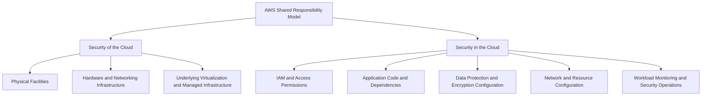
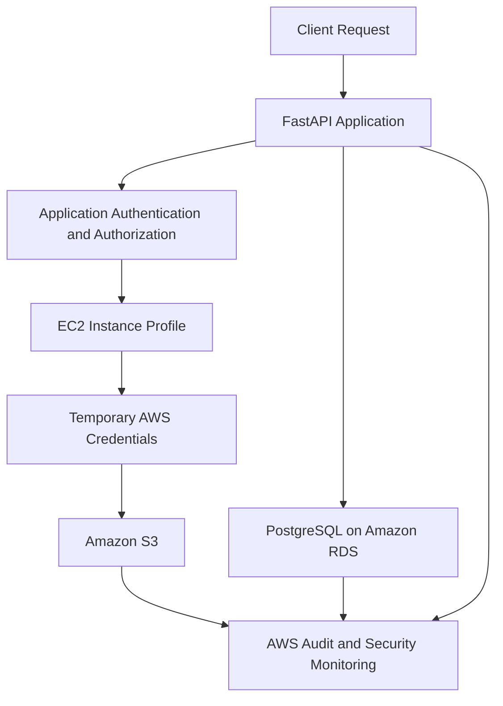

# 02- AWS Shared Responsibility Model

## Overview

The AWS Shared Responsibility Model defines how security responsibilities are divided between Amazon Web Services (AWS) and its customers. AWS is responsible for security *of* the cloud, while customers are responsible for security *in* the cloud.

This distinction is fundamental to designing secure backend systems because using managed infrastructure does not eliminate customer responsibility for application security, identity management, data protection, or resource configuration.

For example, AWS operates the physical infrastructure supporting Amazon EC2, but customers are responsible for securing the guest operating system and applications running on their instances. With AWS Lambda, AWS manages the execution infrastructure, while customers remain responsible for function code, dependencies, execution-role permissions, and application data handling.

Understanding this model helps backend engineers determine which controls they must implement, which infrastructure responsibilities AWS manages, and where security gaps can emerge.

## Why the Shared Responsibility Model Exists

AWS offers services with different levels of abstraction and operational responsibility. A customer managing a virtual machine has different responsibilities from a customer deploying code to a fully managed execution environment.

The shared responsibility model establishes these boundaries so that security tasks can be assigned to the party responsible for the relevant layer.

It helps organizations:

- Identify security responsibilities before deploying workloads.
- Avoid assuming that managed services automatically secure application data.
- Establish ownership for patching, access control, monitoring, and incident response.
- Design appropriate security controls for each service.
- Meet organizational and regulatory requirements.
- Reduce ambiguity during security incidents and operational reviews.

The model is not a fixed checklist that applies identically to every service. Responsibilities depend on the AWS service, its configuration, the deployment model, and the features being used.

## Security of the Cloud vs. Security in the Cloud

### Security of the Cloud

AWS is responsible for protecting the infrastructure that runs AWS services.

Depending on the service, this includes:

- Physical data centers and facilities.
- Physical servers and storage hardware.
- Underlying networking infrastructure.
- Virtualization infrastructure.
- Infrastructure supporting managed AWS services.

Customers consume these capabilities without directly managing the underlying physical infrastructure.

For example, customers do not patch the physical host operating systems used by AWS to operate Amazon S3. AWS manages the infrastructure required to deliver the service.

### Security in the Cloud

Customers are responsible for securely configuring and using AWS services.

Depending on the service, this includes:

- IAM users, roles, policies, and trust relationships.
- Application code, libraries, and runtime configuration.
- Data classification, access control, and encryption settings.
- Network topology, routing, and exposure.
- Operating system patching for customer-managed instances.
- Database access controls and application credentials.
- Security monitoring, incident response, and compliance configuration.

For example, AWS provides Amazon S3 storage infrastructure, but customers must ensure that the appropriate identities can access their objects and that sensitive data is not unintentionally exposed.

**Engineering principle:** AWS manages the security of its underlying infrastructure, but customers must secure their workloads and use AWS security capabilities correctly.

## How Responsibilities Change Across AWS Services

The level of customer responsibility generally decreases as AWS manages more of the underlying infrastructure. However, application security, access permissions, and data protection remain important across deployment models.

| Responsibility | Amazon EC2 | Amazon RDS | AWS Lambda |
|---|---|---|---|
| Physical infrastructure | AWS | AWS | AWS |
| Underlying virtualization and managed infrastructure | AWS | AWS | AWS |
| Guest operating system management | Customer | AWS manages the underlying host infrastructure; customer responsibilities depend on the database service and features | AWS |
| Application code and dependencies | Customer | Customer manages application-side integrations and any customer-controlled database code or configuration | Customer |
| Workload IAM permissions | Customer configures | Customer configures applicable access | Customer configures the execution role |
| Network configuration | Customer configures applicable VPC and instance controls | Customer configures applicable database networking and access controls | Customer configures applicable function networking and permissions |
| Data access and application authorization | Customer | Customer | Customer |
| Data protection configuration | Shared responsibilities, depending on the control | Shared responsibilities, depending on the control | Shared responsibilities, depending on the control |

The table is a practical overview rather than a complete allocation of every security responsibility. Consult the applicable service documentation for exact boundaries.

### Amazon EC2: Infrastructure-Level Control

With EC2, customers control the guest operating system and the applications running on it.

Typical customer responsibilities include:

- Applying operating system security patches.
- Restricting administrative access.
- Configuring host firewalls where appropriate.
- Securing installed software and application dependencies.
- Assigning an appropriate instance profile.
- Configuring security groups and other network controls.
- Monitoring operating system and application activity.

Consider a Django application running on an EC2 instance. AWS protects the underlying infrastructure, but the customer must patch the operating system, configure the application server, secure environment configuration, and restrict inbound access.

A vulnerable package or exposed administrative endpoint remains a customer security issue even if the EC2 infrastructure itself is operating correctly.

### Amazon RDS: Managed Database Operations

Amazon RDS reduces the operational burden of managing database infrastructure and supported database maintenance tasks.

AWS manages the underlying infrastructure and service operations according to the selected database engine and configuration. Customers remain responsible for appropriate database access, application credentials, data handling, and supported security configuration.

Customer responsibilities commonly include:

- Restricting database network access.
- Configuring database authentication and authorization.
- Protecting database credentials.
- Selecting appropriate encryption settings.
- Configuring backups and retention according to requirements.
- Ensuring application queries enforce business-level authorization.
- Monitoring database access and relevant security events.

For example, a PostgreSQL database can use encryption at rest while the application still exposes sensitive records because its authorization logic is incorrect.

Encryption and managed database operations do not replace application security.

### AWS Lambda: Managed Execution

AWS Lambda abstracts much of the infrastructure management required to execute application code.

AWS manages the underlying execution infrastructure, while customers remain responsible for:

- Function code and dependencies.
- Execution-role permissions.
- Event-source and invocation permissions.
- Application input validation.
- Secrets and sensitive data handling.
- Appropriate network configuration.
- Logging and application-level monitoring.

A Lambda function that processes S3 events should receive only the permissions necessary to process the intended objects and interact with its required downstream services.

Broad permissions on the execution role can increase the impact of a compromised function or vulnerable dependency.

## Shared Responsibility in Common Security Areas

### Identity and Access Management

AWS provides IAM capabilities for defining identities, permissions, and trust relationships. Customers must configure them according to workload requirements.

Customer responsibilities include:

- Applying least privilege.
- Restricting administrative access.
- Configuring workload roles.
- Reviewing trust policies.
- Controlling cross-account access.
- Avoiding unnecessary long-lived credentials.
- Reviewing permission changes.

For example, an EC2 application should normally obtain temporary credentials through its instance profile instead of using access keys embedded in its source code.

AWS supplies the identity and credential mechanisms; the customer determines which identities should have access and which actions they may perform.

### Data Protection and Encryption

AWS provides encryption capabilities through services such as AWS KMS and service-specific encryption features.

Customers must determine which data requires protection and configure appropriate controls.

Typical responsibilities include:

- Selecting appropriate encryption settings.
- Managing access to customer-controlled keys.
- Protecting sensitive data during transmission.
- Restricting access to plaintext.
- Managing secrets and credentials.
- Defining retention and deletion requirements.
- Validating that application authorization protects sensitive records.

For example, encrypting an S3 object with a KMS key does not mean every application identity should be able to decrypt it.

The identity must have the necessary S3 permissions and satisfy the applicable KMS authorization requirements.

### Network Security

AWS provides networking capabilities such as VPCs, security groups, network ACLs, and private connectivity options.

Customers are responsible for configuring these capabilities to meet workload security requirements.

This includes:

- Defining appropriate subnet boundaries.
- Restricting inbound and outbound traffic.
- Avoiding unnecessary public exposure.
- Restricting database connectivity.
- Configuring private access paths where appropriate.
- Reviewing routing and network access rules.

A database placed in a VPC is not automatically protected from every unauthorized access path. Security depends on routing, network controls, database authentication, and application authorization.

### Application Security

Customers remain responsible for application behavior, including code developed using Django, FastAPI, Flask, or other frameworks.

Typical responsibilities include:

- Input validation.
- Authentication and authorization.
- Secure session management.
- Dependency vulnerability management.
- Protection against injection and other application vulnerabilities.
- Safe error handling.
- Secure logging.
- Prevention of sensitive information leakage.

AWS WAF can filter supported web requests, but it does not replace secure application code or business-level authorization.

### Monitoring and Incident Response

AWS provides auditing, logging, threat detection, and security assessment capabilities. Customers must enable and configure the appropriate capabilities, establish monitoring processes, and respond to relevant findings.

Examples include:

- Configuring CloudTrail coverage and log retention.
- Reviewing GuardDuty findings.
- Using Security Hub for supported security-finding aggregation.
- Configuring CloudWatch metrics, logs, and alerts.
- Evaluating resource configurations through AWS Config.
- Defining incident escalation and containment procedures.

The exact coverage depends on service configuration, supported event types, enabled integrations, and the selected AWS features.

A security tool that produces findings without operational ownership does not provide an effective incident-response process.

## Responsibility Assignment by Security Control

The following table provides a practical way to identify ownership during architecture reviews.

| Security control | AWS responsibility | Customer responsibility |
|---|---|---|
| Physical access security | Operate and protect facilities | Understand applicable compliance evidence and service boundaries |
| EC2 operating system | Secure underlying infrastructure | Patch and harden the guest operating system |
| IAM | Provide IAM capabilities | Define identities, policies, and trust relationships |
| S3 | Operate storage infrastructure | Configure data access and appropriate protection settings |
| KMS | Operate the key management service | Configure applicable key policies, grants, and access requirements |
| Secrets Manager | Operate the managed service | Store secrets appropriately, authorize retrieval, and manage rotation requirements |
| Application code | Not responsible for customer application correctness | Secure code, dependencies, and business logic |
| Network configuration | Provide networking infrastructure | Configure VPCs, routes, security groups, and network ACLs |
| Audit logging | Provide supported logging capabilities | Enable appropriate coverage, protect logs, and investigate activity |
| Incident response | Respond to AWS-side infrastructure and service issues within applicable responsibilities | Investigate customer workload incidents, contain compromised access, and recover workloads |

The allocation is not always exclusively one party's responsibility. Some controls involve both AWS service capabilities and customer configuration.

## Practical Backend Example

Consider a FastAPI service deployed on EC2 that reads customer documents from S3 and stores metadata in PostgreSQL.

The system relies on several distinct security responsibilities.

### AWS-Managed Responsibilities

AWS manages the underlying infrastructure for EC2, S3, RDS, and the relevant AWS security services.

For RDS and other managed services, AWS also performs supported service-management activities according to the selected configuration.

### Customer-Managed Responsibilities

The customer must ensure that:

- The EC2 operating system is patched.
- The instance profile grants only the required permissions.
- S3 access is restricted to the intended bucket and objects.
- RDS is not unnecessarily exposed.
- Database credentials are stored and retrieved securely.
- FastAPI enforces authorization for each customer's documents.
- Audit logging and monitoring are configured.
- Incident-response procedures exist for compromised credentials or unauthorized access.

The distinction matters because an application vulnerability can expose data even when the underlying AWS infrastructure is functioning securely.

For example, a missing tenant-level authorization check could allow one customer to retrieve another customer's document. AWS cannot infer the application's intended business authorization rules from the fact that the request originated from an authenticated client.

## Applying the Model to CI/CD and Containers

The shared responsibility model also applies to deployment pipelines and containerized applications.

### CI/CD Pipelines

A CI/CD platform may build an image, publish it to Amazon ECR, and deploy it to an AWS workload.

AWS provides the underlying services, but customers must configure deployment permissions and protect the pipeline.

Recommended controls include:

- Use federation and temporary credentials where supported.
- Separate build, deployment, and runtime identities.
- Restrict production deployment permissions.
- Scan dependencies and container images.
- Avoid logging secrets in pipeline output.
- Protect deployment configuration and approval controls.
- Audit changes to production infrastructure.

A compromised deployment pipeline can introduce malicious application code even when the AWS infrastructure itself remains secure.

### Docker and Kubernetes

When running containers on AWS, responsibility depends on the selected platform and operating model.

For example, Amazon ECS on Fargate and Amazon EKS with customer-managed worker nodes do not have identical infrastructure responsibilities.

Customers must still secure container images, application dependencies, workload permissions, secrets, network access, and application behavior. The exact infrastructure-management responsibilities vary by service and configuration.

Do not assume that containerization or orchestration automatically provides isolation between every workload. Configure task roles, Kubernetes access controls where applicable, network policies where supported, and workload-specific permissions deliberately.

## How to Operationalize the Shared Responsibility Model

The model is most useful when translated into explicit engineering ownership.

### During Architecture Design

Identify:

- Which infrastructure components AWS manages.
- Which operating systems and runtimes the team must maintain.
- Which identities can access each resource.
- Which data requires encryption or restricted access.
- Which network paths must remain private.
- Which security events must be recorded.
- Who owns investigation and recovery.

Record these responsibilities in architecture documentation and operational runbooks.

### During Infrastructure Provisioning

Use infrastructure as code to make security configuration repeatable and reviewable.

Examples include:

- Defining IAM roles and policies in version-controlled templates.
- Restricting security-group ingress.
- Configuring private database networking.
- Enabling required encryption settings.
- Configuring CloudTrail and other appropriate audit mechanisms.
- Applying supported organization-level preventive controls.

Review both the desired configuration and the effective permissions it produces.

### During Deployment

Integrate security checks into CI/CD:

- Scan application dependencies and container images.
- Validate infrastructure configuration.
- Detect exposed credentials.
- Verify deployment roles and resource permissions.
- Test access restrictions in non-production environments.
- Prevent unauthorized production changes.

Automated checks should be supplemented with security reviews for high-risk changes.

### During Operations

Maintain clear ownership for:

- Operating system and application patching.
- IAM access reviews.
- Secret rotation.
- Security findings and alert triage.
- Audit log retention.
- Incident containment and recovery.
- Compliance evidence and configuration drift.

Responsibilities should be assigned to specific teams or roles rather than treated as an undefined shared obligation.

## Common Mistakes and Interview Traps

### Assuming AWS Secures Everything Automatically

AWS protects its underlying infrastructure, but customers must still secure identities, workloads, data, and configurations.

**Avoid it:** Identify customer-managed controls for each AWS service before production deployment.

### Assuming Managed Services Eliminate All Patching Responsibilities

Managed services reduce infrastructure maintenance, but customers still need to maintain application dependencies, client libraries, customer-managed operating systems, and other components under their control.

**Avoid it:** Determine which layers are managed by AWS and which remain under customer control.

### Assuming Encryption Eliminates Data Exposure Risks

Encryption does not prevent an authorized application from exposing plaintext through an insecure endpoint.

**Avoid it:** Combine encryption with least privilege, application authorization, and secure data-handling practices.

### Assuming Private Networking Is Sufficient

Private networking reduces exposure but does not replace authentication, authorization, or database access controls.

**Avoid it:** Enforce access restrictions at network, identity, resource, and application layers.

### Treating Security Monitoring as AWS's Exclusive Responsibility

AWS provides security and auditing capabilities, but customers must configure appropriate coverage and act on findings affecting their workloads.

**Avoid it:** Define monitoring ownership, alert severity, investigation procedures, and incident-response responsibilities.

### Interview Trap: Who Is Responsible for Security in AWS?

The correct answer is not that AWS or the customer handles all security. AWS protects the underlying cloud infrastructure, while customers secure their workloads and configure AWS services according to their responsibilities. The exact boundary depends on the service and deployment model.

## Key Takeaways

- AWS is responsible for security of the cloud, while customers are responsible for security in the cloud; exact responsibilities vary by service.
- Infrastructure-management responsibilities decrease with managed services, but application security, access control, and data protection remain critical customer responsibilities.
- Secure backend systems combine IAM, application authorization, network restrictions, encryption, and monitoring rather than relying on a single control.
- Infrastructure as code, CI/CD security checks, access reviews, and explicit operational ownership help enforce the model consistently.
- Security incidents require both AWS-provided capabilities and customer-led investigation, containment, remediation, and recovery.