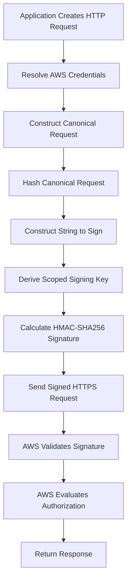
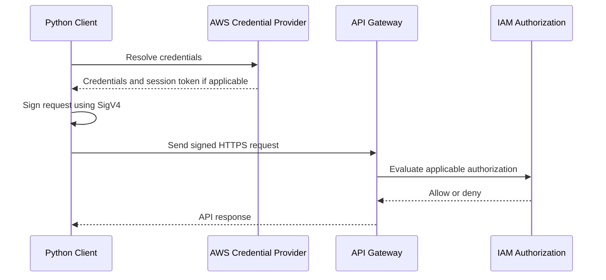

# 03- API Authentication and SigV4

## Overview

AWS API authentication determines how a caller proves its identity when accessing AWS services, while authorization determines which operations that identity is permitted to perform. AWS Signature Version 4 (SigV4) is a request-signing protocol used by many AWS APIs to authenticate requests using AWS credentials and protect the integrity of signed request components.

For backend engineers, SigV4 is particularly relevant when Python applications, microservices, CI/CD pipelines, or custom HTTP clients call AWS APIs directly.

Examples include:

- A FastAPI service uploading documents to Amazon S3.
- A Python worker invoking an AWS service API.
- A deployment pipeline calling AWS control-plane APIs.
- A custom HTTP client invoking an API Gateway endpoint configured with `AWS_IAM` authorization.
- A service assuming an IAM role and using temporary credentials to sign requests.

SigV4 does not replace TLS, IAM authorization, or application-level authorization. It is one component of the AWS request-security model.

## Authentication, Authorization, and Request Signing

These concepts solve different problems and should not be treated as interchangeable.

| Concept | Purpose | Example |
|---|---|---|
| Authentication | Establish or verify the caller's identity | AWS verifies that a request uses valid credentials |
| Request signing | Cryptographically authenticate a request and protect signed components against modification | SigV4 signs an AWS API request |
| Authorization | Determine whether the caller may perform the requested operation | IAM evaluates permission to access an S3 object |
| Transport security | Protect data in transit | HTTPS with TLS protects communication between the client and endpoint |
| Application authorization | Enforce application-specific access rules | A Django API verifies that a user owns the requested invoice |

A request can be correctly signed and still receive `AccessDenied` because the caller lacks permission. Similarly, a caller may have valid IAM permissions but fail authentication because its credentials are invalid or its signature is incorrect.

## AWS Credentials and Request Identity

AWS requests are signed using credentials associated with an IAM identity or another supported AWS credential provider.

The main credential types are:

| Credential type | Components | Typical usage |
|---|---|---|
| Long-term IAM user credentials | Access key ID and secret access key | Limited legacy or specialized use cases where federation or roles are not suitable |
| Temporary STS credentials | Access key ID, secret access key, and session token | Assumed roles, federated access, and temporary sessions |
| Workload-provided credentials | Credentials obtained through an AWS-supported provider mechanism | EC2, ECS, Lambda, and other supported workloads |

The access key ID identifies the credential set. The secret access key is used to derive the signing key and must remain confidential. Temporary credentials also require a session token.

An access key ID is not a secret by itself, but it should still be handled appropriately. Never log secret access keys, session tokens, or complete credential-provider responses.

### Prefer Temporary Credentials

Production applications should normally use temporary credentials obtained through supported workload identity mechanisms rather than embedding long-lived AWS access keys.

Examples include:

- EC2 instance profiles.
- ECS task IAM roles.
- Lambda execution roles.
- IAM roles assumed through AWS STS.
- Supported federation mechanisms for external CI/CD systems.

These mechanisms reduce the need to distribute and rotate long-lived credentials manually.

## What Is AWS Signature Version 4?

SigV4 is a request-signing protocol used by many AWS services. It derives a signing key from the secret access key and request-specific scope information, then calculates a cryptographic signature over a canonical representation of the request.

The signature enables AWS to verify that the request was signed using the corresponding secret credential and that the signed request components have not been altered.

A typical SigV4 request includes:

- An access key ID.
- A timestamp.
- A credential scope.
- A canonical request hash.
- A string to sign.
- A calculated signature.
- A session token when temporary credentials are used.

The exact signed headers and request requirements depend on the AWS service and the signing configuration.

### Why SigV4 Exists

HTTP requests contain multiple components that can affect request interpretation, including the HTTP method, URI, query parameters, headers, and body.

Without a defined signing procedure, client and server implementations could calculate different signatures for the same intended operation.

SigV4 specifies how request components are normalized and incorporated into the signature. This allows AWS to verify signed requests consistently.

### High-Level Signing Flow



A valid signature establishes the cryptographic validity of the signed request. The AWS service must still evaluate the applicable authorization rules before permitting the operation.

## Components of a SigV4 Request

### Canonical Request

The canonical request is a normalized representation of the HTTP request that is used as input to the signing process.

Its structure is:

```text
HTTPMethod
CanonicalURI
CanonicalQueryString
CanonicalHeaders
SignedHeaders
HashedPayload
```

Each component has a specific purpose.

| Component | Description |
|---|---|
| HTTP method | The request method, such as `GET`, `PUT`, or `POST` |
| Canonical URI | The normalized and encoded request path |
| Canonical query string | Query parameters normalized and sorted according to the signing rules |
| Canonical headers | Selected headers normalized and ordered according to the signing rules |
| Signed headers | The ordered list of headers included in the signature |
| Hashed payload | The hash of the request payload or the service-specific supported payload-signing representation |

Whitespace, URI encoding, query parameter ordering, and header normalization can affect the resulting signature.

A client and AWS must derive equivalent canonical representations for signature validation to succeed.

### String to Sign

The string to sign incorporates the signing algorithm, request timestamp, credential scope, and hash of the canonical request.

Its general structure is:

```text
AWS4-HMAC-SHA256
YYYYMMDDTHHMMSSZ
YYYYMMDD/region/service/aws4_request
Hex(SHA256(CanonicalRequest))
```

The timestamp and scope bind the signature to a particular date, AWS Region, and service.

### Credential Scope

The credential scope identifies the date, Region, service, and signing termination value used during signature derivation.

For example:

```text
20261012/ap-south-1/s3/aws4_request
```

This represents a scope for the date `20261012`, Region `ap-south-1`, and service `s3`.

The Region and service must match the intended endpoint and signing requirements. Signing an S3 request for the wrong Region or using the wrong service identifier can cause signature validation failures.

### Signing Key

SigV4 derives a signing key through a sequence of HMAC-SHA256 operations using the secret access key, date, Region, service, and the `aws4_request` termination value.

Conceptually:

```text
kDate    = HMAC("AWS4" + SecretAccessKey, Date)
kRegion  = HMAC(kDate, Region)
kService = HMAC(kRegion, Service)
kSigning = HMAC(kService, "aws4_request")
```

The final signature is calculated using the signing key and the string to sign.

This derivation binds the signature to the selected scope. It does not mean the original secret access key is transmitted in the request.

**Security consideration:** Do not implement custom credential handling or signature generation casually. Use AWS SDKs or supported signing libraries unless direct protocol implementation is genuinely required.

## The SigV4 Request Lifecycle

A typical signed AWS API request follows this sequence.

1. The client resolves credentials from its configured credential provider.
2. The client constructs the HTTP request and determines the signing Region and service.
3. The signer normalizes the required request components.
4. The signer calculates the canonical request hash.
5. The signer derives the signing key and calculates the signature.
6. The client sends the signed request over HTTPS.
7. AWS validates the signature, credential status, timestamp, and applicable request requirements.
8. The AWS service evaluates authorization and processes the operation if permitted.

The exact validation sequence and error returned can vary by service and failure type.

## Using SigV4 with Python

For most backend applications, use an AWS SDK rather than generating signatures manually.

### Example: Uploading an Object to S3

The following example uses Boto3. Credentials are resolved through the configured AWS credential provider chain, and the SDK handles request signing.

```python
import boto3


def upload_document(
    bucket_name: str,
    object_key: str,
    file_path: str,
) -> None:
    s3 = boto3.client("s3")

    with open(file_path, "rb") as document:
        s3.upload_fileobj(
            document,
            bucket_name,
            object_key,
        )
```

The client automatically signs supported requests using the resolved credentials. When the application runs with an EC2 instance profile, ECS task role, or Lambda execution role, it can use the corresponding temporary credentials without embedding access keys in the source code.

The application's IAM permissions must authorize the upload. For a typical S3 upload, the role may require `s3:PutObject` on the relevant object resources, together with any additional permissions required by the upload configuration.

The object key and bucket should be validated against application requirements. A signed request does not prevent an application from uploading data to an unintended location if its logic and permissions permit that operation.

### Example: Signing an API Request with Boto3 and Botocore

When direct HTTP access is required, Botocore provides a SigV4 signer that can be used with credentials resolved through the SDK's session.

```python
import boto3
import requests
from botocore.auth import SigV4Auth
from botocore.awsrequest import AWSRequest


def invoke_iam_authorized_api(
    endpoint_url: str,
    region: str,
) -> requests.Response:
    session = boto3.Session()
    credentials = session.get_credentials()

    if credentials is None:
        raise RuntimeError("AWS credentials are unavailable")

    frozen_credentials = credentials.get_frozen_credentials()

    aws_request = AWSRequest(
        method="GET",
        url=endpoint_url,
        headers={"Accept": "application/json"},
    )

    SigV4Auth(
        frozen_credentials,
        "execute-api",
        region,
    ).add_auth(aws_request)

    prepared_request = requests.Request(
        method=aws_request.method,
        url=aws_request.url,
        headers=dict(aws_request.headers.items()),
    ).prepare()

    with requests.Session() as http:
        return http.send(
            prepared_request,
            timeout=(3.05, 15),
        )
```

This example is intended for an API Gateway endpoint configured for IAM authorization, using a compatible endpoint and Region. It assumes the endpoint URL and request are constructed correctly.

The example demonstrates the signing mechanism, but it is not a complete application client. Production code should also validate the endpoint, handle HTTP errors, apply appropriate retry policies, and avoid logging sensitive headers. For most API Gateway integrations, an AWS SDK or a maintained AWS-aware HTTP client is preferable.

If the API request includes a body, additional headers, query parameters, or a nontrivial URI, ensure the exact transmitted request matches the signed representation. Changing signed request components after signing can invalidate the signature.

## Temporary Credentials and Session Tokens

AWS STS issues temporary credentials for supported operations such as role assumption and federation.

Temporary credentials consist of:

- Access key ID.
- Secret access key.
- Session token.
- Expiration time.

When signing a request with temporary credentials, the client must include the session token using the appropriate header or credential mechanism required by the service.

The SDK normally handles this automatically.

### Why Temporary Credentials Matter

Temporary credentials reduce the risks associated with persistent access keys because they expire and can be issued with permissions appropriate to a particular workload or session.

For example, a deployment pipeline can assume a deployment role in a target AWS account and receive temporary credentials instead of storing a permanent access key for that account.

However, temporary credentials do not eliminate risk. An attacker who obtains valid temporary credentials may use them until they expire or are otherwise rendered unusable.

Production controls should include least-privilege role policies, appropriately restricted trust policies, secure credential handling, and monitoring of suspicious API activity.

## API Gateway and IAM Authorization

API Gateway can use IAM authorization for supported API types and methods. With this configuration, a caller signs requests using SigV4 or the applicable supported signing mechanism, and API Gateway evaluates whether the caller is authorized to invoke the API.

The effective access decision depends on the configured authorization model, IAM policies, resource policies where applicable, and other relevant controls.

A typical request flow is:



A valid signature is necessary for the applicable IAM-authorized request, but it does not independently grant permission to invoke the API.

For example, the caller may need an appropriate `execute-api:Invoke` permission for the target API, stage, method, and resource path. Cross-account access and resource-policy configurations may introduce additional authorization requirements.

## SigV4 and Transport Security

SigV4 and TLS protect different aspects of a request.

| Property | SigV4 | TLS |
|---|---|---|
| Primary purpose | Authenticate signed request components using AWS credentials | Protect communication over a network |
| Integrity | Protects signed request components against undetected modification | Protects transmitted data against in-transit modification |
| Confidentiality | Does not encrypt the HTTP request by itself | Provides confidentiality when correctly configured |
| Identity validation | Supports AWS request authentication | Authenticates the server through certificate validation and can support client authentication in applicable configurations |
| Authorization | Does not independently grant permissions | Does not determine AWS IAM permissions |

Use HTTPS for AWS API calls. SigV4 does not replace transport encryption, and TLS does not replace AWS request signing when the service requires it.

## Common SigV4 Errors

Signature failures commonly arise when the signer and the receiving service interpret the request differently or when the credentials or signing scope are invalid.

| Symptom | Possible cause | Diagnostic approach |
|---|---|---|
| `SignatureDoesNotMatch` | Canonical request mismatch, incorrect secret key, or changed signed headers | Inspect the signing inputs and compare the actual transmitted request with the signed request |
| `InvalidSignatureException` | Invalid signature or request-signing configuration | Verify the credential source, signing algorithm, Region, service identifier, and request components |
| `ExpiredToken` | Temporary credentials have expired | Refresh credentials through the configured provider |
| `InvalidClientTokenId` | Invalid, inactive, or unrecognized access key or token-related configuration | Verify the credential provider and identity configuration |
| `RequestExpired` or a clock-related error | Request timestamp is outside the service's accepted window | Check system time synchronization and request timestamp generation |
| `AuthorizationHeaderMalformed` | Incorrect or malformed authorization header, sometimes involving Region mismatch | Inspect the canonical request, credential scope, and endpoint Region |
| `AccessDenied` | The request may be validly signed but lacks permission, or another access control denies it | Inspect IAM policies, resource policies, trust relationships, organization policies, and service-specific controls |

Error names and details can vary by service. Avoid assuming that every authorization failure is a signing failure.

### Troubleshooting Workflow

1. **Verify the credential source.** Confirm which IAM identity or role the application is using.
2. **Check credential expiration.** Refresh temporary credentials through the configured provider rather than reusing expired values.
3. **Verify Region and service.** Confirm the signer uses the intended AWS Region and service identifier.
4. **Check system time.** Ensure the host clock is synchronized.
5. **Inspect request construction.** Check URI encoding, query parameters, headers, payload hashing, and changes made after signing.
6. **Inspect authorization.** If signing succeeds but access is denied, evaluate the relevant IAM and resource authorization controls.
7. **Retest safely.** Reproduce the request with the intended identity in a controlled environment.

Never print secret access keys, session tokens, or complete authorization headers to diagnose signature problems.

## Operational and Security Best Practices

### Credential Management

- Prefer temporary credentials from AWS-supported identity mechanisms.
- Avoid embedding access keys in source code, container images, environment files committed to Git, or CI/CD configuration.
- Use dedicated roles for application runtime and deployment activities.
- Restrict role trust policies and permissions to the intended identities and resources.
- Ensure applications refresh temporary credentials through supported credential providers.

### Request Construction

- Use AWS SDKs where possible.
- Keep the signing Region and service identifier aligned with the endpoint.
- Do not modify signed headers or request components after signing.
- Validate request paths, query parameters, and destination endpoints.
- Use HTTPS and validate TLS certificates.
- Configure timeouts and controlled retry behavior for network calls.

### Logging and Monitoring

Log operational details that help diagnose failures without exposing credentials.

Useful fields may include:

- AWS service and operation.
- Target Region.
- HTTP status code and AWS request ID, when available.
- Application correlation ID.
- Relevant non-sensitive resource identifiers.
- Error category and retry count.

Do not log secret access keys, session tokens, complete authorization headers, or sensitive payloads.

Use CloudTrail and appropriate application telemetry to investigate suspicious activity. The available audit evidence depends on the service, operation, logging configuration, and event type.

### Reliability and Performance

SigV4 signing introduces cryptographic processing and request preparation overhead, but for most backend workloads the dominant costs are network latency and service processing.

Avoid unnecessary custom signing implementations. Use maintained SDKs, configure connection reuse where appropriate, and apply service-aware retries with bounded backoff.

Retries must account for the operation's semantics. Retrying a non-idempotent operation without an appropriate idempotency strategy can cause duplicate side effects.

## Common Mistakes

### Using the Wrong Region

The endpoint and signing scope must be consistent. A request signed for one Region may fail when sent to a service endpoint that expects another Region.

**Prevention:** Configure the Region explicitly where necessary and use service-aware SDK clients.

### Omitting the Session Token

Temporary credentials require the corresponding session token. Omitting it can cause authentication failures.

**Prevention:** Use the full credential set from a supported provider and let the SDK handle token inclusion.

### Modifying a Request After Signing

Changing signed headers, the URI, query parameters, or payload after the signature is calculated can invalidate the request.

**Prevention:** Finalize request construction before signing and transmit the same request representation that was signed.

### Treating a Valid Signature as Authorization

A valid signature does not imply that the caller can perform the requested action.

**Prevention:** Evaluate IAM permissions, resource policies, trust relationships, and service-specific authorization requirements separately.

### Implementing SigV4 from Scratch Without a Need

Custom signing code introduces risks around canonicalization, encoding, credential refresh, and edge cases.

**Prevention:** Prefer AWS SDKs and maintained signing libraries. If a custom implementation is required, validate it against the relevant AWS signing specification and service requirements.

## Key Takeaways

- SigV4 signs AWS API requests using credentials, a canonical request, a scoped signing key, and a cryptographic signature.
- Authentication, request signing, authorization, and TLS are separate mechanisms that provide complementary protections.
- Temporary credentials and workload identity mechanisms reduce dependence on long-lived access keys, while least-privilege policies restrict their impact.
- Signature failures require checking credentials, timestamps, signing scope, canonical request construction, and the actual transmitted request.
- AWS SDKs, HTTPS, careful credential handling, and safe operational logging are the preferred foundations for production request signing.
```