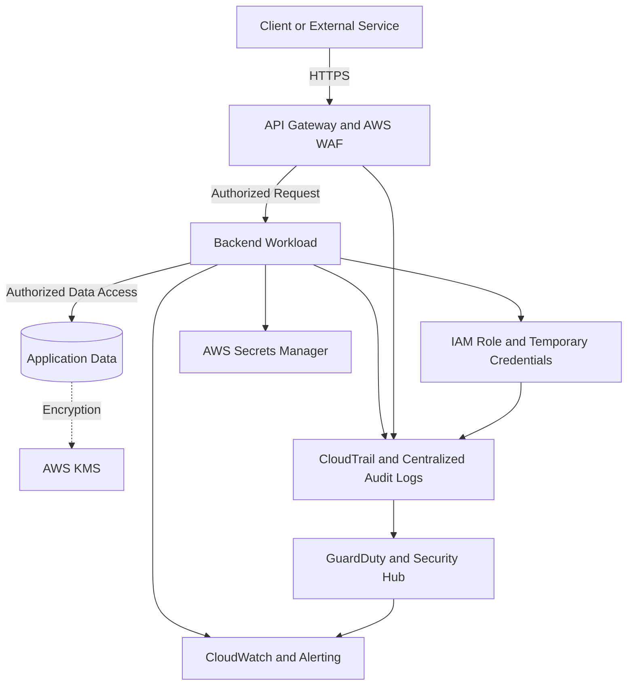

# README

## Overview

AWS Security is a foundational part of designing, deploying, and operating reliable backend systems on Amazon Web Services. It covers identity and access management, authentication, authorization, encryption, network isolation, secrets management, threat detection, audit logging, and incident response.

This section of the Backend Engineering Playbook provides a structured reference for implementing AWS security controls in Python applications, REST APIs, microservices, containerized workloads, serverless systems, and CI/CD pipelines.

The focus is on practical security engineering: understanding how controls interact, diagnosing failures systematically, minimizing privileges, protecting sensitive data, and designing architectures that remain secure as systems scale.

## Navigation

| # | File | Description |
|---|---|---|
| 01 | [01- Introduction](./01-%20Introduction.md) | Introduction to AWS security fundamentals, core principles, and the security services landscape |
| 02 | [02- AWS Shared Responsibility Model](./02-%20AWS%20Shared%20Responsibility%20Model.md) | AWS vs customer responsibilities, IaaS/PaaS/Serverless comparison, and shared responsibility boundaries |
| 03 | [03- API Authentication and SigV4](./03-%20API%20Authentication%20and%20SigV4.md) | AWS Signature Version 4 signing process, canonical requests, presigned URLs, and temporary credentials |

## Why AWS Security Matters

Backend applications routinely handle sensitive data, invoke AWS services, communicate across service boundaries, and execute automated deployments. A security failure in any of these areas can expose data, enable unauthorized operations, compromise workloads, or disrupt production systems.

AWS provides security capabilities, but customers must configure and operate them correctly.

Common security risks include:

- Overly permissive IAM policies and unintended privilege escalation.
- Publicly accessible resources and incorrectly configured network boundaries.
- Long-lived credentials embedded in source code, container images, or CI/CD configuration.
- Incorrect authorization decisions in backend APIs.
- Misconfigured KMS key policies and encryption permissions.
- Missing audit logs or delayed detection of suspicious activity.
- Inadequate incident response procedures and credential revocation processes.

Effective AWS security combines preventive controls, detective controls, and responsive operational procedures rather than relying on a single service or configuration.

## Documentation Structure

This section is organized into focused documents covering security fundamentals, identity, cryptography, network controls, monitoring, architecture, implementation, and operational troubleshooting.

| Area | Primary focus |
|---|---|
| Security fundamentals | Shared responsibility, defense in depth, least privilege, zero trust, and threat modeling |
| IAM and identity | Principals, policies, roles, trust relationships, STS, and policy evaluation |
| API authentication | AWS Signature Version 4, signed requests, credential scope, and authentication failures |
| Encryption and key management | TLS, encryption at rest, AWS KMS, key policies, grants, and envelope encryption |
| Secrets management | AWS Secrets Manager, Systems Manager Parameter Store, secret rotation, and secure configuration |
| Network security | VPC boundaries, security groups, network ACLs, private connectivity, WAF, and DDoS protection |
| Security monitoring | CloudTrail, GuardDuty, Security Hub, CloudWatch, AWS Config, and security findings |
| Security architecture | Multi-account environments, workload isolation, centralized logging, and incident containment |
| CLI operations | Security inspection, IAM diagnostics, KMS inspection, CloudTrail investigation, and findings retrieval |
| Troubleshooting | Access-denied errors, trust-policy failures, SigV4 issues, KMS errors, network misconfigurations, and missing audit evidence |
| Practical exercises | IAM role assumption, secure secrets retrieval, encryption, audit investigations, and security-event analysis |
| Interview preparation | Core concepts, policy evaluation, architecture decisions, incident response, and senior-level scenarios |

Each technical document is intended to be independently maintainable while connecting to the broader AWS security model. Shared concepts should be referenced rather than unnecessarily duplicated across documents.

## Core Security Principles

### Least Privilege

Grant each identity only the permissions required to perform its responsibilities. Prefer narrowly scoped actions, resources, and conditions over broad permissions such as `Action: "*"` and `Resource: "*"`.

Review effective permissions across identity policies, resource policies, permission boundaries, session policies, and organization-level controls where applicable.

### Defense in Depth

Use multiple complementary controls to reduce the likelihood and impact of a security failure.

For example, a backend API can combine IAM-based service authentication, application-level authorization, private networking, TLS, KMS-backed encryption, audit logging, and threat detection. A single misconfiguration should not automatically expose every layer.

### Temporary Credentials and Workload Identity

Prefer short-lived credentials obtained through IAM roles and supported workload identity mechanisms. Avoid embedding long-lived AWS access keys in application source code, container images, deployment scripts, or repositories.

Use the AWS SDK credential provider chain and the appropriate execution role for the workload, such as an EC2 instance profile, Lambda execution role, or ECS task role.

### Secure Defaults

Keep resources private unless public exposure is explicitly required. Enable appropriate encryption, establish audit logging, restrict inbound and outbound connectivity, and validate deployment configuration before production release.

Security requirements should be enforced through reusable infrastructure definitions, CI/CD checks, organization policies, and continuous monitoring.

### Continuous Detection and Response

Preventive controls reduce exposure, but they cannot eliminate every risk. Centralized audit logs, threat detection, configuration monitoring, and documented incident response procedures help identify and contain failures that bypass preventive controls.

## How the Security Controls Fit Together

The following diagram illustrates a representative security model for a backend workload running on AWS.

The diagram represents logical relationships rather than a complete deployment specification. The exact controls depend on the workload, AWS services involved, account structure, data classification, and threat model.

## Recommended Engineering Workflow

Use a repeatable process when designing or reviewing an AWS workload.

1. **Identify assets and threats.** Determine which data, credentials, APIs, and infrastructure components require protection. Assess exposure, trust boundaries, and likely attack paths.
2. **Define identities and permissions.** Identify the principals involved, their required actions, resource scopes, trust relationships, and applicable organization-level restrictions.
3. **Establish network boundaries.** Minimize public exposure and define permitted communication paths between clients, applications, AWS services, and data stores.
4. **Protect sensitive data.** Select encryption controls, establish KMS permissions and key ownership, and define how secrets are stored, retrieved, cached, and rotated.
5. **Implement preventive controls.** Apply IAM policies, resource policies, network rules, API protections, and secure deployment configuration.
6. **Enable audit and detection.** Configure appropriate CloudTrail coverage, centralized log storage, threat detection, configuration monitoring, and actionable alerts.
7. **Validate the deployment.** Test both permitted and denied operations. Verify that legitimate workflows work without granting unnecessary permissions.
8. **Prepare for incidents.** Establish procedures for credential compromise, unauthorized access, exposed secrets, encryption-key failures, and suspicious API activity.
9. **Review continuously.** Reassess permissions, public exposure, key policies, security findings, configuration drift, and deployment identities.

## Security in Backend Applications

AWS security controls must integrate with application-level controls rather than replace them.

For Python applications built with Django, Django REST Framework, or FastAPI, consider the following boundaries:

| Layer | Security responsibility |
|---|---|
| API edge | TLS termination, request filtering, rate limiting, and protection against unwanted traffic |
| Application authentication | Validate the caller's identity using the authentication mechanism appropriate to the API |
| Application authorization | Enforce user, tenant, object, and business-level access rules |
| AWS identity | Use workload credentials to authorize calls to AWS services |
| Network | Restrict connectivity between workloads, data stores, and external services |
| Data protection | Apply encryption, access restrictions, and appropriate retention controls |
| Operations | Record security-relevant events, monitor failures, and support investigation and recovery |
| CI/CD | Use restricted deployment identities, protect build artifacts, and prevent credential leakage |

IAM authorization for an AWS API does not automatically authorize a user to access every object exposed by a backend application. Similarly, authenticating a user to a REST API does not automatically grant the application permission to access arbitrary AWS resources.

Each trust boundary requires explicit authorization decisions.

## Operational Standards

Apply the following standards when implementing and reviewing AWS security.

- **Identity:** Prefer temporary credentials, narrowly scoped policies, protected privileged access, and regular permission reviews.
- **Secrets:** Store sensitive values in an appropriate secrets service, restrict retrieval permissions, design for rotation, and prevent accidental logging.
- **Encryption:** Define encryption requirements for data in transit and at rest. Govern KMS keys, policies, grants, and lifecycle operations.
- **Networking:** Minimize public endpoints, restrict security-group rules, and use private connectivity where appropriate and supported.
- **Auditing:** Establish required CloudTrail coverage, protect audit records, and centralize evidence for investigation.
- **Detection:** Configure relevant GuardDuty, Security Hub, CloudWatch, and AWS Config capabilities based on the environment.
- **CI/CD:** Use dedicated deployment identities, short-lived credentials, controlled permissions, and automated security validation.
- **Incident response:** Document containment, evidence preservation, credential revocation, remediation, recovery, and follow-up actions.
- **Verification:** Test the intended access paths and denied operations after changes to IAM, KMS, network rules, or resource policies.
- **Cost and operations:** Account for logging volume, monitoring charges, key usage, service quotas, retention requirements, and the operational burden of additional controls.

Never resolve an unexplained `AccessDenied` error by indiscriminately granting administrator access. Identify the principal, action, resource, applicable conditions, and relevant policy or service boundary before making a targeted change.

## Key Takeaways

- AWS security is a shared responsibility that requires correctly configured identity, application, data, network, and operational controls.
- Least privilege, temporary credentials, and defense in depth are foundational to secure backend workloads.
- IAM, KMS, networking, secrets management, and application authorization must work together across explicit trust boundaries.
- Audit logging, threat detection, and incident response are essential because preventive controls alone cannot eliminate risk.
- Production security requires systematic verification, continuous review, and targeted remediation rather than broad permission grants.