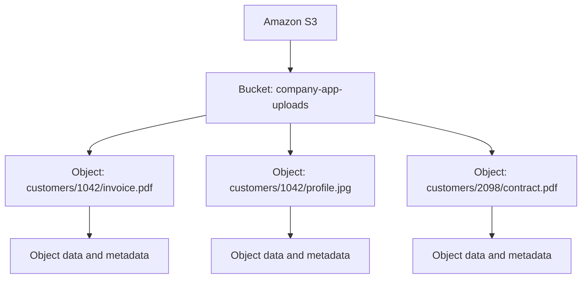
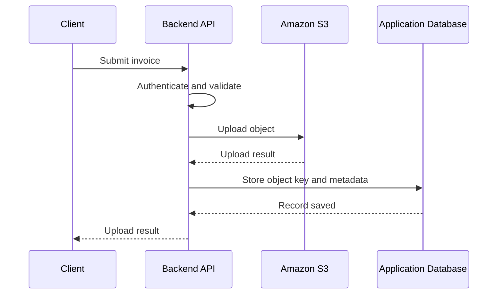

# 01- What is Amazon S3

## Overview

Amazon Simple Storage Service (Amazon S3) is a fully managed object storage service provided by Amazon Web Services (AWS). It enables applications to store, retrieve, and manage large volumes of unstructured data without provisioning or operating storage servers.

S3 exposes storage through HTTP-based APIs, AWS SDKs, and command-line tools. Applications can upload and download objects using standard AWS interfaces while AWS manages the underlying storage infrastructure.

S3 is commonly used for file uploads, media assets, application documents, backups, application logs, data lakes, static website assets, and event-driven data processing.

Unlike a relational database, S3 is not primarily designed for querying individual fields in structured records. Unlike a traditional file server, it does not expose a general-purpose POSIX filesystem interface. Its fundamental abstraction is an **object identified by a key inside a bucket**.

### Why Amazon S3 Matters in Backend Engineering

Backend applications frequently need to store files that are significantly larger than ordinary database records. Keeping these files inside a relational database or directly on an application server creates unnecessary coupling between application compute and storage.

S3 separates these concerns.

For example, a Django application can store customer records in PostgreSQL while storing uploaded documents in S3. PostgreSQL maintains document metadata and ownership information, while S3 stores the actual file content.

This separation allows the application and its storage to scale independently.

The key engineering benefits are:

- **Elastic storage:** Capacity grows with application requirements without manual disk provisioning.
- **Durability:** Supported storage classes are designed to protect objects against data loss.
- **Scalability:** Applications can handle large volumes of objects and concurrent requests.
- **Integration:** S3 works with Lambda, CloudFront, event notifications, analytics services, and backend SDKs.
- **Lifecycle management:** Objects can transition between storage classes or expire according to configured policies.
- **Operational flexibility:** Storage, application processing, and data access can be managed independently.

## What Type of Storage Is Amazon S3?

S3 is an object storage service. Understanding its differences from block and file storage is important when choosing the correct storage technology.

| Characteristic | Object Storage | Block Storage | File Storage |
|---|---|---|---|
| Primary abstraction | Object with a key | Fixed-size data blocks | Files and directories |
| Access model | HTTP APIs, SDKs, and CLI | Attached volume and block device | Filesystem interface |
| Typical use cases | Documents, images, backups, data lakes | Database disks, boot volumes | Shared file directories |
| Data organization | Buckets and object keys | Volume layout and filesystem structures | Directories and files |
| Common AWS service | Amazon S3 | Amazon EBS | Amazon EFS |
| Application access | Object operations | Block-level reads and writes | Filesystem operations |

The choice depends on the application's access patterns and consistency requirements.

For example, PostgreSQL may use an EBS-backed volume for its database files, while the same application stores exported reports and customer-uploaded documents in S3.

S3 is not a direct replacement for every filesystem or database workload. Applications that need block-level access, filesystem locking, or frequent transactional updates to small records require a different storage abstraction.

## Core Components of Amazon S3

S3 organizes stored data using buckets and objects.

### Buckets

A bucket is a container for objects. It provides a resource boundary for configuration, access control, storage management, and other bucket-level capabilities.

A backend application might use separate buckets for different operational responsibilities:

- `company-app-uploads`: customer-uploaded files.
- `company-app-assets`: application-generated assets.
- `company-app-archive`: long-term retained documents.

These names are illustrative; actual bucket names must follow the applicable naming rules for the selected bucket type and namespace.

Bucket configuration can control properties such as default encryption, versioning, public access restrictions, and lifecycle policies.

A bucket is created in a selected AWS Region. Region selection influences data location, service availability, latency, regulatory considerations, and data transfer costs.

### Objects

An object contains the data stored in S3, together with associated metadata.

An object can represent a PDF, image, video, JSON document, CSV file, application export, backup, or any other supported byte sequence.

An object generally consists of:

| Component | Purpose |
|---|---|
| Object key | Identifies the object within its bucket |
| Object data | The actual stored content |
| System metadata | Properties such as content length, content type, and modification time |
| User-defined metadata | Additional metadata supplied by the application |
| Version ID | Identifies a particular version when versioning is enabled |
| Tags | Key-value labels used for supported management and policy operations |

Not every object needs every optional attribute. Version IDs depend on bucket versioning behavior, and tags must be explicitly managed when needed.

### Object Keys and Prefixes

An object key is the name used to identify an object within a bucket.

Consider these objects:

```text
customer-uploads/
    customers/1042/invoice.pdf
    customers/1042/profile.jpg
    customers/2098/contract.pdf
```

The strings `customers/1042/invoice.pdf` and `customers/2098/contract.pdf` are object keys.

Although the S3 console displays a folder-like hierarchy, a general-purpose bucket uses object keys and prefixes rather than a conventional filesystem directory hierarchy.

For example, the key:

```text
customers/1042/invoice.pdf
```

is a single key containing slash characters. The prefix `customers/1042/` helps organize and retrieve related objects.

This distinction matters when writing applications that list, copy, delete, or migrate objects.

### Bucket and Object Relationship



S3 does not automatically provide relational integrity between objects or maintain application-level relationships between them. If a document belongs to a particular user, the application must enforce that relationship through its authorization and data model.

## How Amazon S3 Works

S3 exposes object storage operations through service endpoints. An application can interact with S3 using the AWS SDK for its programming language, the AWS CLI, or direct API requests.

A typical request follows this conceptual flow:

1. The application determines the target bucket, object key, and required operation.
2. The application sends an HTTPS request through an AWS SDK, CLI, or API client.
3. The request is authenticated and authorized using the applicable credentials, IAM permissions, bucket policies, and other relevant controls.
4. S3 performs the requested operation.
5. The application receives a response containing the result or an error.

AWS manages the underlying physical storage infrastructure and internal replication mechanisms. Application developers generally interact with S3 through its documented APIs rather than managing individual disks or storage servers.

### Example: Uploading a Document

Suppose a customer uploads an invoice through a backend API.



This example represents a server-mediated upload. Another common design allows the backend to issue a short-lived presigned URL so the client can upload directly to S3.

The choice depends on file size, application requirements, security controls, and network costs.

A production application should account for the possibility that the S3 upload succeeds but the database transaction fails. The application must define a recovery strategy, such as reconciling incomplete uploads or removing unreferenced objects.

## Fundamental S3 Operations

S3 supports several core object operations.

| Operation | Typical purpose | Common API operation |
|---|---|---|
| Create a bucket | Establish a storage container | `CreateBucket` |
| Upload an object | Store new content or replace content at a key | `PutObject` |
| Download an object | Retrieve content | `GetObject` |
| Inspect an object | Retrieve object metadata | `HeadObject` |
| List objects | Find objects matching a prefix or supported filters | `ListObjectsV2` |
| Delete an object | Remove an object or create a delete marker, depending on versioning | `DeleteObject` |
| Copy an object | Copy data to another key or bucket | `CopyObject` |

Some operations have additional constraints involving permissions, object size, encryption, versioning, and bucket type.

For large files, applications commonly use multipart upload rather than a single upload request. Multipart upload allows a file to be transferred in multiple parts, with opportunities for parallelism and retrying individual parts.

### Object Size and Upload Constraints

For current Amazon S3 object limits, an object can be up to 50 TB in size. A single `PutObject` operation supports objects up to 5 GB; multipart upload is required for larger objects.

For uploads above approximately 100 MB, AWS recommends considering multipart upload to improve resilience and transfer efficiency.

These limits describe S3's documented object and upload capabilities, not a recommendation to use very large objects for every workload. File-transfer strategy should account for network conditions, memory usage, retry behavior, and application requirements.

Official reference: [Uploading and copying objects in Amazon S3](https://docs.aws.amazon.com/AmazonS3/latest/userguide/upload-objects.html).

## S3 Data Consistency

Amazon S3 provides strong read-after-write consistency for object PUT and DELETE operations in all AWS Regions. This includes newly written objects, overwrites, and supported reads of object metadata.

For example, after a successful object upload, a subsequent read initiated after the successful response can retrieve the written object.

Strong consistency simplifies application design because an application does not ordinarily need to introduce arbitrary delays before reading a newly written object.

However, strong consistency does not mean that S3 offers database transactions across multiple objects.

Consider an application that stores an invoice PDF in S3 and an invoice record in PostgreSQL. S3 and PostgreSQL do not participate in one shared atomic transaction. A successful write to one service does not guarantee a successful write to the other.

Applications must design for partial failures, retries, duplicate events, and reconciliation.

Concurrent operations on the same object key also require careful consideration. When multiple writers can modify an object, use an appropriate concurrency strategy, such as versioning, conditional requests where supported, or application-level coordination.

Reference: [Amazon S3 data consistency model](https://docs.aws.amazon.com/AmazonS3/latest/userguide/Welcome.html).

## Amazon S3 Storage Classes

S3 provides multiple storage classes optimized for different access patterns, retrieval requirements, and cost profiles.

The storage class is a data-placement and pricing decision, not a separate application database or object model.

| Storage class | Typical use case | Important consideration |
|---|---|---|
| S3 Standard | Frequently accessed application data | Suitable for general-purpose, frequently accessed objects |
| S3 Intelligent-Tiering | Data with uncertain or changing access patterns | Monitoring and automation charges may apply |
| S3 Standard-IA | Long-lived, infrequently accessed data | Retrieval charges and minimum storage-duration rules apply |
| S3 One Zone-IA | Re-creatable or less critical infrequently accessed data | Data is stored in one Availability Zone |
| S3 Glacier Instant Retrieval | Archive data requiring millisecond access | Retrieval charges and minimum storage-duration rules apply |
| S3 Glacier Flexible Retrieval | Archive data with flexible retrieval requirements | Retrieval generally involves an archive retrieval process |
| S3 Glacier Deep Archive | Long-term retention with rare retrieval | Retrieval can take considerably longer |
| S3 Express One Zone | Latency-sensitive, high-request workloads | Uses directory buckets and has different operational characteristics |

The appropriate class depends on actual access frequency, retention, recovery expectations, and the complete cost of storing and retrieving data.

Do not automatically move every old object into an archival class. Minimum storage durations, retrieval charges, request costs, and restore requirements can make an apparently cheaper option more expensive for a particular workload.

Reference: [Understanding Amazon S3 storage classes](https://docs.aws.amazon.com/AmazonS3/latest/userguide/storage-class-intro.html).

## Common Backend Use Cases

### File and Document Storage

Applications can store customer documents, reports, invoices, exports, and attachments in S3 while maintaining authorization and business metadata in a relational database.

For example, a document record might contain:

```json
{
  "document_id": "doc_8f14e45f",
  "owner_id": 1042,
  "bucket": "company-app-uploads",
  "object_key": "documents/1042/8f14e45f.pdf",
  "content_type": "application/pdf",
  "status": "available"
}
```

This record is an illustrative application data model; it is not an S3 object format.

The database holds application-level information such as ownership and processing status. S3 stores the file itself.

The backend must validate access to the document before allowing a user to download it.

### Media and Static Assets

S3 can store images, videos, CSS files, JavaScript bundles, and other static assets. CloudFront can distribute eligible content through an edge network, improving the delivery experience for geographically distributed users.

For private content, access can be controlled through a suitable combination of S3 policies, CloudFront configuration, and application authorization.

### Backups and Archives

Applications can store database exports, periodic snapshots, logs, and retained documents in S3.

Versioning, lifecycle policies, replication, and other data-protection controls can support recovery requirements. These features must be configured and validated according to the application's recovery objectives.

High durability is not a substitute for a backup strategy. Accidental deletion, compromised credentials, incorrect retention settings, and regional incidents require explicit protection and recovery planning.

### Event-Driven Processing

S3 event notifications can trigger downstream processing, such as generating image thumbnails, validating uploaded documents, or starting data ingestion workflows.

An application may combine S3 with Lambda, SQS, EventBridge, or other services. Distributed processing introduces concerns such as duplicate events, retries, partial failures, and idempotency.

The processing design must account for these conditions rather than assuming that each uploaded object will be processed exactly once.

## Integrating S3 with a Python Backend

Python applications commonly use Boto3 to interact with S3. Credentials should come from the AWS credential provider chain, such as an IAM role, IAM Identity Center session, or an appropriately configured local profile.

Avoid hardcoding access keys in application source code.

The following example uploads a local PDF using the Boto3 managed transfer interface.

```python
import logging
from pathlib import Path

import boto3
from botocore.exceptions import BotoCoreError, ClientError

logger = logging.getLogger(__name__)


def upload_invoice(
    file_path: Path,
    bucket_name: str,
    object_key: str,
) -> None:
    """Upload an invoice PDF to a configured S3 bucket."""
    if not file_path.is_file():
        raise FileNotFoundError(f"File does not exist: {file_path}")

    s3 = boto3.client("s3")

    try:
        s3.upload_file(
            str(file_path),
            bucket_name,
            object_key,
            ExtraArgs={"ContentType": "application/pdf"},
        )
    except (BotoCoreError, ClientError):
        logger.exception(
            "Failed to upload invoice to S3: bucket=%s, key=%s",
            bucket_name,
            object_key,
        )
        raise
```

This example illustrates the storage operation rather than a complete production upload endpoint. A real backend should also implement authorization, file validation, safe object-key generation, request limits, appropriate retry behavior, and application-level error handling.

The function uses the default AWS credential and Region configuration. For production workloads, configure these through the deployment environment and grant only the S3 permissions the application actually requires.

Reference: [Boto3 documentation](https://boto3.amazonaws.com/v1/documentation/api/latest/index.html).

## Basic AWS CLI Operations

The AWS CLI is useful for validating configuration, inspecting resources, and testing access during development and operations.

Create a bucket in the `us-east-1` Region:

```bash
aws s3 mb s3://your-unique-bucket-name --region us-east-1
```

Upload a file:

```bash
aws s3 cp ./invoice.pdf \
    s3://your-unique-bucket-name/documents/invoice.pdf
```

List objects under a prefix:

```bash
aws s3 ls s3://your-unique-bucket-name/documents/
```

Inspect object metadata:

```bash
aws s3api head-object \
    --bucket your-unique-bucket-name \
    --key documents/invoice.pdf
```

Download an object:

```bash
aws s3 cp \
    s3://your-unique-bucket-name/documents/invoice.pdf \
    ./invoice-downloaded.pdf
```

These commands assume that the selected AWS identity has the relevant permissions and that the bucket exists in the configured account and Region. Use a controlled development bucket for experiments, and verify the target bucket before executing destructive commands.

## Security Fundamentals

S3 security depends on both service-level capabilities and correct application design.

Important considerations include:

- **Access control:** Grant the minimum required permissions through IAM and applicable resource policies.
- **Public access prevention:** Keep Block Public Access enabled unless public exposure is explicitly required and reviewed.
- **Encryption at rest:** S3 encrypts new object uploads by default using server-side encryption with S3-managed keys. Additional encryption options are available for workloads with specific requirements.
- **Encryption in transit:** Use HTTPS for requests to S3.
- **Credential management:** Prefer temporary credentials and IAM roles for application workloads.
- **Application authorization:** Check whether the caller can access a requested object before issuing a download URL or reading its contents.
- **Auditability:** Use appropriate AWS logging and monitoring capabilities to investigate access and operational activity.

A private bucket does not automatically make an application secure. An authorization flaw in the application could still expose sensitive objects to an unintended user if the application grants access incorrectly.

Similarly, default encryption protects data at rest but does not replace access controls, credential management, or monitoring.

References: [Amazon S3 security best practices](https://docs.aws.amazon.com/AmazonS3/latest/userguide/security-best-practices.html) and [Amazon S3 access management](https://docs.aws.amazon.com/AmazonS3/latest/userguide/security-access-management.html).

## Reliability, Scalability, and Performance

### Durability vs Availability

Durability and availability describe different properties.

- **Durability** concerns the likelihood that stored data will not be lost.
- **Availability** concerns the ability to access the service or data when needed.

Amazon S3 Standard is designed for 99.999999999% object durability and 99.99% availability. These are design targets, not a guarantee that every request will always succeed.

Storage classes have different availability characteristics, and some use different Availability Zone placement models.

For critical applications, select the appropriate storage class and separately define backup, retention, replication, and recovery requirements.

### Scalability

S3 is designed to scale with growing storage volumes and request workloads. Applications do not need to provision disks or storage servers in advance.

However, application architecture still affects scalability. Excessive request overhead, inefficient listing strategies, large concurrent transfers, retry storms, or poor coordination between processing components can create performance and cost problems.

Use appropriate SDK transfer facilities, bounded concurrency, retries with backoff, and workload-specific monitoring. Validate performance under realistic data sizes and request patterns instead of assuming that elastic storage removes every application bottleneck.

### Cost Considerations

S3 cost is influenced by several factors:

| Cost factor | Engineering implication |
|---|---|
| Storage volume and duration | Retention and storage-class selection affect recurring cost |
| API requests | High request volumes may create significant charges |
| Retrieval and transitions | Some storage classes charge for retrievals or lifecycle transitions |
| Data transfer | Transfers between services, Regions, or the internet may incur charges |
| Replication and additional copies | Redundant copies consume storage and can add request and transfer costs |
| Monitoring and management | Certain optional capabilities introduce additional charges |

For example, storing large volumes of rarely retrieved documents may favor an archival class, whereas frequently accessed application images may be more suitable for S3 Standard or another class based on the access pattern.

Cost optimization must consider the complete access lifecycle, not just the monthly storage price.

## Common Mistakes and Production Pitfalls

### Treating S3 as a traditional filesystem

S3 object keys can resemble filesystem paths, but prefix-based organization is not equivalent to filesystem semantics. Applications should use the documented object APIs and avoid assuming that operations behave exactly like local filesystem operations.

### Using the original filename as the object key

Two users can upload files with the same filename. A key such as `invoice.pdf` can cause one upload to overwrite another object's current value.

Use a controlled key-generation strategy, such as a unique identifier scoped to the relevant application entity.

### Storing all application metadata inside S3

S3 metadata is not a substitute for a relational database or a general-purpose query engine. Keep business relationships, authorization ownership, and frequently queried application state in an appropriate database when required.

### Assuming S3 and the database share a transaction

They do not share an atomic transaction. Handle partial failures, define object cleanup and reconciliation strategies, and ensure that asynchronous processing can recover safely.

### Making uploaded objects public by default

Public object access is not an appropriate default for customer documents or private media. Keep buckets private and use authorized backend downloads, presigned URLs, or a suitable controlled content-delivery architecture.

### Ignoring lifecycle and retrieval economics

A lower storage price does not automatically mean a lower total cost. Retrieval charges, minimum storage-duration rules, request costs, and recovery delays must be considered.

### Treating high durability as a complete disaster-recovery plan

Versioning, replication, backups, access controls, and recovery runbooks address different failure scenarios. Select and test them according to business requirements.

## When to Use Amazon S3

S3 is a strong choice when an application needs durable, scalable object storage with API-based access and integration with AWS services.

Typical use cases include user-uploaded documents, images and videos, generated reports, backups, log archives, static assets, and data lake storage.

A relational database is more appropriate for transactional records requiring structured queries and relationships. Block storage is more appropriate for workloads that require a disk device, while file storage is better suited to applications requiring filesystem semantics.

For backend engineers, the important design decision is not simply whether to use S3. It is how to combine object storage with application authorization, metadata persistence, processing workflows, data protection, and operational monitoring.

## Further Reading

- [What is Amazon S3?](https://docs.aws.amazon.com/AmazonS3/latest/userguide/Welcome.html)
- [Amazon S3 FAQs](https://aws.amazon.com/s3/faqs/)
- [Amazon S3 storage classes](https://docs.aws.amazon.com/AmazonS3/latest/userguide/storage-class-intro.html)
- [Amazon S3 performance guidelines](https://docs.aws.amazon.com/AmazonS3/latest/userguide/optimizing-performance-guidelines.html)
- [Amazon S3 security best practices](https://docs.aws.amazon.com/AmazonS3/latest/userguide/security-best-practices.html)

## Key Takeaways

- Amazon S3 is object storage organized around buckets and object keys, not a conventional filesystem or relational database.
- S3 provides strong read-after-write consistency for supported object operations, but it does not provide atomic transactions across S3 and application databases.
- Production applications must combine appropriate access controls, encryption, object-key design, and failure handling with the storage service.
- Storage class selection and lifecycle management must account for access patterns, retrieval charges, retention, and recovery requirements.
- High durability and elastic scaling do not eliminate the need for tested backups, monitoring, cost controls, and application-level reliability strategies.