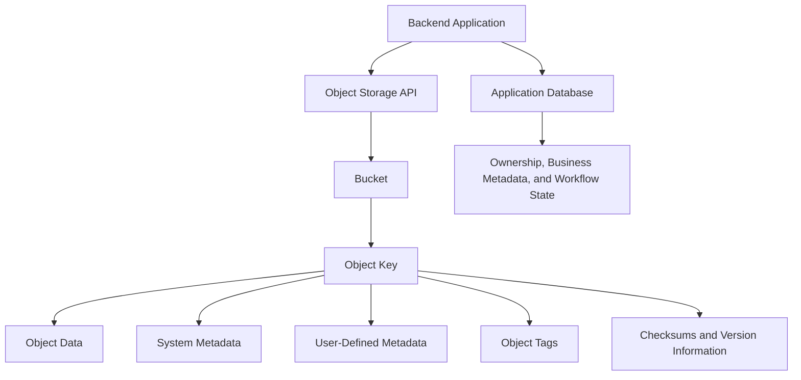
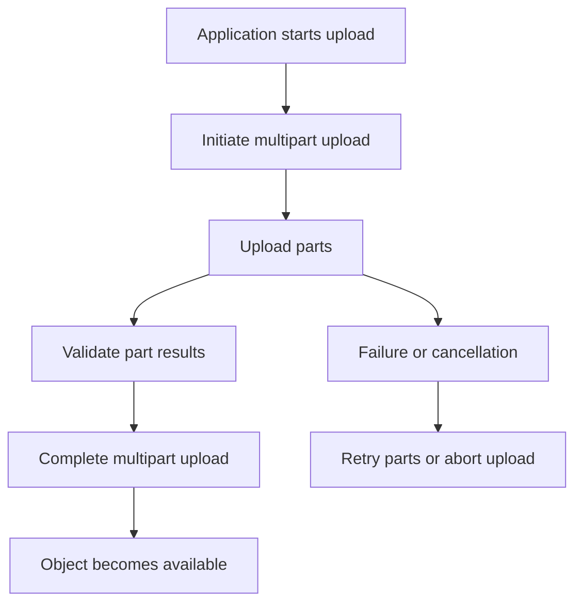
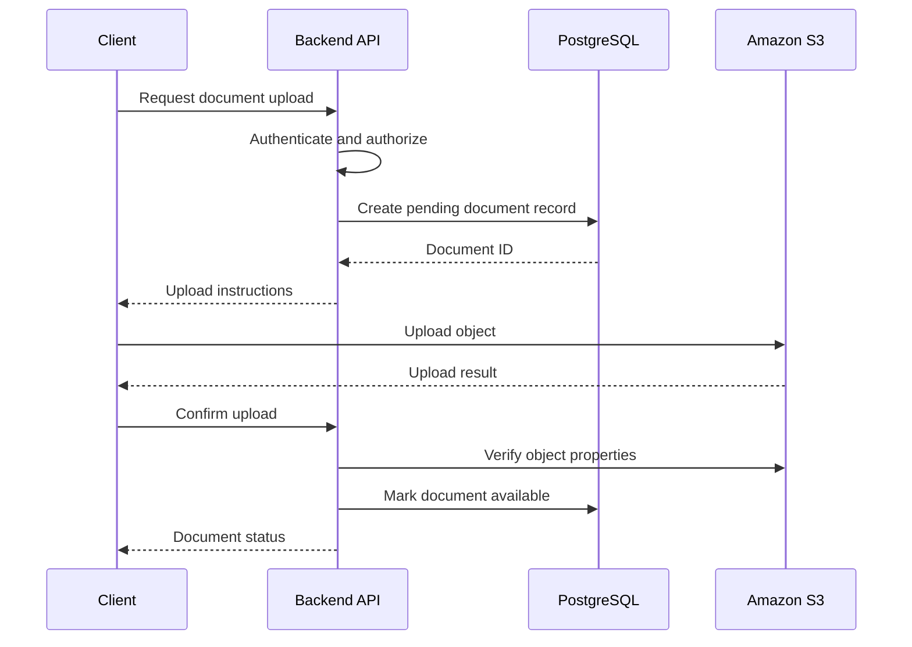

# 02- Object Storage

## Overview

Object storage is a data storage model in which information is stored as individually addressable objects rather than as fixed disk blocks or files managed through a conventional filesystem.

In Amazon S3, an object is identified by its bucket and object key. It contains the stored data, associated metadata, and other optional attributes such as tags, checksums, and version information.

This model is well suited to backend systems that store documents, images, videos, reports, backups, logs, and datasets. Applications interact with stored objects through APIs rather than directly manipulating the underlying storage devices.

Object storage separates the lifecycle of stored data from the lifecycle of application compute. A Django API, FastAPI service, or background worker can read and write S3 objects without maintaining local disks or managing storage servers.

Understanding object storage requires more than knowing how to upload a file. Backend engineers must understand object identity, metadata, key organization, write semantics, consistency, concurrency, data integrity, partial reads, and the trade-offs involved in using object storage as part of a distributed application.

## Object Storage Fundamentals

### What Is an Object?

An object is a logical unit of stored data. In S3, an object consists of the object data and associated attributes that describe or control how the object is managed.

Consider a customer-uploaded invoice:

```text
Bucket:
    company-app-documents

Object key:
    customers/1042/invoices/invoice-2026-001.pdf

Object data:
    Binary contents of the PDF

Metadata:
    Content-Type: application/pdf
    Content-Length: 248193

Custom metadata:
    x-amz-meta-document-type: invoice

Tags:
    department = finance
    retention = standard
```

The PDF bytes constitute the object data. The key identifies the object within the bucket, while metadata and tags provide additional information used by applications and AWS capabilities.

The object itself does not automatically understand that the PDF represents an invoice belonging to a particular customer. That business relationship must be maintained and validated by the application.

### Why Object Storage Exists

Traditional application servers often store uploaded files on local disks. This creates several operational problems:

- Files may become inaccessible when the application instance is replaced or fails.
- Multiple application instances need a shared storage mechanism.
- Storage capacity must be provisioned and monitored.
- Backups, replication, and retention require additional infrastructure.
- Large files can consume application server disk space and network bandwidth.
- Database storage becomes expensive or inefficient when used for large binary payloads.

Object storage addresses these concerns by providing a separately managed storage service accessible through network APIs.

For example, a horizontally scaled Django application can run on multiple application instances while storing all customer documents in S3. Any authorized instance can retrieve an object by using the appropriate credentials and object identifier.

This decoupling allows compute and storage to scale independently.

## Object Storage vs Block Storage vs File Storage

These storage models solve different problems.

| Characteristic | Object Storage | Block Storage | File Storage |
|---|---|---|---|
| Storage unit | Object | Block | File |
| Organization | Bucket and key | Blocks within a volume | Directory and file hierarchy |
| Access method | Object APIs | Block device operations | Filesystem operations |
| Data updates | Object-level write operations | Individual block writes | Filesystem-managed reads and writes |
| Typical workloads | Documents, media, backups, data lakes | Database volumes, boot disks | Shared directories and filesystem-oriented applications |
| AWS example | Amazon S3 | Amazon EBS | Amazon EFS |
| Application responsibility | Object keys, metadata, access logic | Filesystem and storage management | Directory and file management |

### Object Storage

Object storage is appropriate when data is accessed as complete objects or byte ranges through a defined API.

Examples include document repositories, media storage, static assets, backups, and data ingestion pipelines.

It is not a general-purpose filesystem. Applications should not assume that an object can be opened and modified in place using ordinary filesystem operations.

### Block Storage

Block storage exposes a volume that an operating system or application can use as a block device. Filesystems and databases manage the layout and modification of data within that volume.

For example, PostgreSQL generally uses filesystem-backed storage on a volume rather than storing each database page as an independently managed S3 object.

### File Storage

File storage provides a directory-oriented filesystem interface. It is suitable when applications require file operations, shared directory access, or filesystem semantics.

The important distinction is that these models are not interchangeable. Choose the abstraction based on the application's data access pattern rather than assuming one storage service can replace all others.

## The S3 Object Data Model

### Bucket and Object Identity

An S3 object is addressed through a bucket and an object key.

Conceptually:

```text
Object identity = Bucket + Key
```

For example:

```text
Bucket:
    company-app-documents

Key:
    customers/1042/invoices/invoice-2026-001.pdf
```

The same key can exist in different buckets. Within a bucket, an object key identifies the object name.

When bucket versioning is enabled, an object can have multiple versions. A specific version can be identified using its version ID in addition to the bucket and key.

An application may therefore maintain a more specific reference:

```text
Bucket + Key + Version ID
```

This is useful for applications that need to refer to an exact historical document version instead of whichever version is currently visible.

### Object Data

Object data is the actual byte sequence stored by S3.

The data may contain:

- PDF, DOCX, or other document contents.
- JPEG, PNG, or other image data.
- Audio or video streams.
- JSON, CSV, or Parquet datasets.
- Database backups.
- Compressed archives.
- Application-generated binary files.

S3 does not automatically interpret the business meaning of these bytes. Application code or downstream processing systems determine how to parse and use them.

An object can also be zero bytes. Empty objects are useful for certain markers and application workflows, although they should not be confused with actual filesystem directories.

### Object Metadata

Metadata describes an object without being part of its primary data payload.

S3 distinguishes system metadata from user-defined metadata.

| Type | Purpose | Examples |
|---|---|---|
| System metadata | Describes object properties managed by S3 or supplied through supported request headers | Content length, last-modified time, content type, ETag |
| User-defined metadata | Stores application-supplied metadata associated with the object | Document category, source system, external reference |
| Object tags | Provides key-value labels for supported management and policy operations | `department=finance`, `environment=production` |
| Checksums | Supports validation of stored or transferred data integrity | CRC32C, SHA-256 |

Metadata, tags, and checksums serve different purposes. A checksum helps validate data integrity, metadata describes object properties, and tags support classification and selected management workflows.

Do not put every business attribute into object metadata. If fields must be queried, joined, updated independently, or used to enforce business relationships, a database is generally a better choice.

### Object Storage Architecture



The database and object storage have separate responsibilities. S3 stores the object, while the application database can maintain relationships, ownership, processing status, and other structured information.

## Object Keys and Logical Organization

### Understanding the Flat Namespace

S3 uses a flat object namespace within a bucket. It does not require actual nested directories to organize objects.

Consider these keys:

```text
customers/1042/invoice.pdf
customers/1042/profile.jpg
customers/2098/invoice.pdf
```

The slash characters are part of each key. S3 and its console use prefixes and delimiters to present a directory-like view.

For example:

```text
customers/1042/
customers/2098/
```

These are prefixes, not necessarily physical directories.

A folder-like marker can be represented by a zero-byte object whose key ends with a delimiter, such as `customers/1042/`. That marker is still an object.

### Designing Object Keys

Object keys should be predictable, safe, and consistent with the application's access patterns.

A practical organization for a document platform could be:

```text
documents/
    tenant-17/
        customer-1042/
            8b7e1e8d-invoice.pdf
            129c8f11-contract.pdf
    tenant-28/
        customer-2098/
            14d7a002-report.pdf
```

This organization supports prefix-based listing and logical grouping. It does not itself enforce tenant or customer authorization.

A secure backend must validate access to the requested object independently of the key structure.

Recommended key-design practices include:

- Use stable identifiers instead of relying only on original filenames.
- Avoid embedding unnecessary sensitive information in keys.
- Establish consistent tenant, document, and environment naming conventions.
- Ensure generated keys cannot be controlled arbitrarily by untrusted input.
- Choose prefixes that support the listing and lifecycle operations the application needs.
- Keep the key structure stable enough that future services can consume the same objects.

S3 object keys can be up to 1,024 bytes in length. Use the current AWS object-key naming guidance when keys contain unusual characters, Unicode, periods, or URL-sensitive characters.

Reference: [Naming Amazon S3 objects](https://docs.aws.amazon.com/AmazonS3/latest/userguide/object-keys.html).

### Object Keys Are Not Authorization Boundaries

Suppose an application exposes this endpoint:

```http
GET /documents/{document_id}
```

A user requests a document associated with another customer.

The backend must verify the caller's authorization against the application database or another authoritative permission system before returning the object or generating a presigned URL.

Knowing or guessing an object key must not be sufficient to access the underlying data.

Prefix-based policies can be useful for constraining access, but authorization must be designed around the actual identities, permissions, and resources involved.

## Object Write and Read Semantics

### Writing an Object

A write operation creates an object or replaces the current object at an existing key, subject to the relevant API, bucket configuration, permissions, and conditional-write requirements.

For example:

```text
PUT customers/1042/invoice.pdf
```

If the key does not currently exist, the operation creates an object.

If the key already exists, a normal unconditional write replaces the current object value. If versioning is enabled, the overwrite can create a new object version rather than permanently removing the earlier version.

This means the object key is an identifier, not necessarily an immutable record.

For business documents, unique keys are often safer than repeatedly writing different content to the same key. When overwrites are required, conditional writes or versioning can help control their effects.

### Reading an Object

A GET operation retrieves the stored object data.

Applications may read the entire object or request a specific byte range where supported. Range requests are useful for large media files, resumable downloads, and applications that do not need to transfer the full object at once.

An application also needs to distinguish between:

- The object not existing.
- The caller lacking permission to read the object.
- The request using an incorrect bucket or Region.
- The request failing because of transient network or service errors.

An application should not treat all failed reads as evidence that an object is missing.

### Deleting an Object

Deletion behavior depends on the bucket's versioning configuration and the particular API operation.

In a bucket without versioning, deleting an object removes the current object.

In a versioned bucket, a normal delete generally creates a delete marker, which changes what an ordinary GET by key returns. Previous versions may remain available and may incur storage charges until they are explicitly removed or expired according to the applicable configuration.

Consequently, an application that needs to preserve historical documents must understand the distinction between deleting the current object and permanently deleting a particular version.

Detailed versioning and deletion behavior belongs in dedicated S3 versioning documentation.

## Strong Consistency and Concurrent Access

### Strong Read-After-Write Consistency

Amazon S3 provides strong read-after-write consistency for supported object PUT and DELETE operations, including overwrites, in all AWS Regions.

After a successful write response, subsequent reads and list operations initiated after that response reflect the completed write.

For example:

```text
1. Upload report.csv.
2. S3 returns a successful response.
3. Read report.csv.
4. Retrieve the newly written contents.
```

Applications do not need to add arbitrary delays simply to wait for the object to become readable.

Reference: [Amazon S3 data consistency model](https://docs.aws.amazon.com/AmazonS3/latest/userguide/Welcome.html).

### Strong Consistency Does Not Mean Multi-Object Transactions

S3 does not provide a general atomic transaction spanning multiple objects or independent services.

Consider this workflow:

```text
1. Upload a document to S3.
2. Insert the document record into PostgreSQL.
3. Return success to the client.
```

The S3 upload may succeed while the PostgreSQL insert fails. Strong consistency does not roll back the successful S3 operation.

Possible solutions include:

- Removing unreferenced objects during reconciliation.
- Maintaining explicit upload and processing states.
- Using idempotent workflows and retry-safe operations.
- Performing periodic cleanup of abandoned uploads.
- Recording durable workflow state before starting asynchronous processing, where appropriate.

The correct approach depends on the business requirements and the order in which operations are performed.

### Concurrent Writes to the Same Key

If multiple workers write to the same key, the application must decide whether overwrites are acceptable.

For example, two image-processing workers may generate different outputs for the same object key. Without appropriate coordination, the last successful write can determine the currently visible contents.

Useful strategies include:

- Assigning unique keys to independently generated outputs.
- Using conditional writes to prevent unintended overwrites.
- Tracking object versions where historical recovery is required.
- Coordinating writers through application state or a suitable distributed workflow.

S3 supports conditional writes using supported request headers such as `If-Match` and `If-None-Match`. These allow a request to proceed only when the relevant object condition is satisfied.

For example, the AWS CLI can create an object only if the current key does not exist:

```bash
aws s3api put-object \
    --bucket company-app-documents \
    --key immutable/reports/report-001.json \
    --body report.json \
    --if-none-match "*"
```

This command requires appropriate permissions and a supported bucket configuration. Applications should handle precondition failures as an explicit outcome rather than repeatedly retrying the same write unconditionally.

Reference: [Conditional writes in Amazon S3](https://docs.aws.amazon.com/AmazonS3/latest/userguide/conditional-writes.html).

## Metadata, Tags, and Checksums

### When to Use Metadata

Use metadata for attributes that should travel with the object and are primarily needed when the object is retrieved or inspected.

Examples include:

- Content type.
- Content disposition.
- A source-system identifier.
- A stable external correlation reference.
- Other application-defined descriptors with appropriate size and sensitivity constraints.

For example, an upload can specify a content type and custom metadata using Boto3:

```python
from pathlib import Path

import boto3


def upload_document(
    file_path: Path,
    bucket: str,
    object_key: str,
    document_type: str,
) -> None:
    """Upload a document with descriptive metadata."""
    s3 = boto3.client("s3")

    s3.upload_file(
        str(file_path),
        bucket,
        object_key,
        ExtraArgs={
            "ContentType": "application/pdf",
            "Metadata": {
                "document-type": document_type,
            },
        },
    )
```

The caller should validate `document_type` and ensure the metadata does not expose unnecessary sensitive information.

Metadata updates generally require replacing or copying an object with updated metadata rather than modifying arbitrary metadata fields in place. This can make metadata unsuitable for frequently changing business state.

### When to Use Object Tags

Tags are useful for supported classification and management operations.

Examples include:

```text
department = finance
retention = long-term
data-classification = confidential
```

Tags can be used by supported lifecycle policies, access controls, and operational processes.

They are not a substitute for application authorization checks or a relational data model. Tag values and changes must be controlled if they influence security-sensitive policies or data retention.

### Checksums and Data Integrity

A checksum helps determine whether data has changed unexpectedly or was transferred incorrectly.

For example, an application might calculate a checksum before an upload and compare it with a supported checksum value associated with the stored object.

S3 supports several checksum algorithms and can validate checksums during supported upload operations.

Do not assume that an object's ETag always equals the MD5 digest of its complete contents. ETag behavior depends on how the object was uploaded, its encryption configuration, and other factors. For multipart uploads, the ETag is not a reliable substitute for a full-object checksum.

Use an explicitly supported checksum when the application requires reliable integrity validation.

Reference: [Checking object integrity in Amazon S3](https://docs.aws.amazon.com/AmazonS3/latest/userguide/checking-object-integrity.html).

## Listing and Retrieving Objects Efficiently

### Prefix-Based Listing

Applications commonly list objects using a prefix.

For example:

```bash
aws s3api list-objects-v2 \
    --bucket company-app-documents \
    --prefix "customers/1042/invoices/"
```

This returns objects whose keys begin with the specified prefix, subject to the API's pagination and filtering behavior.

For programmatic listing, use the appropriate AWS SDK paginator. A single list response is not guaranteed to contain every matching object in a large bucket.

Avoid downloading or listing an entire bucket when the application needs only a narrow group of objects.

### Efficient Object Retrieval

Choose the retrieval strategy based on the data size and access pattern.

| Access pattern | Suitable approach |
|---|---|
| Small document download | Ordinary GET request |
| Large file download | SDK-managed transfer or a suitable streaming approach |
| Media seeking | HTTP range requests where supported |
| Bulk dataset processing | Bounded-concurrency workers and batch workflows |
| Large object upload | Multipart upload or SDK-managed transfer |
| Frequently referenced business state | Store the lookup information in an appropriate database |

In Python backends, reading every object into memory at once can exhaust application memory when files are large or requests are concurrent. Prefer streaming or managed transfer approaches and enforce request-size and concurrency limits.

### Avoid Full-Bucket Scans for Online Queries

S3 is designed for object storage and key-based listing, not arbitrary relational queries over object contents.

If a request needs to find all documents matching complex business conditions, querying PostgreSQL or another suitable indexing system is generally more appropriate than listing a large bucket and inspecting every object.

A scalable application can combine:

- S3 for file content.
- PostgreSQL for document identity, ownership, and searchable attributes.
- An asynchronous processing pipeline for indexing and enrichment.

The index and S3 object store must be reconciled when operations fail independently.

## Large Objects and Multipart Upload

For large objects, multipart upload divides the content into multiple parts. S3 accepts the parts independently and assembles the final object when the multipart upload is completed.

A simplified workflow is:



Multipart upload supports efficient transfers, parallelism, and recovery from selected part-level failures.

However, applications must manage incomplete uploads. Abandoned multipart uploads can continue consuming storage until they are completed or aborted, so suitable cleanup policies and operational monitoring are important.

For very large files, avoid buffering the complete file in application memory. Use SDK transfer managers, streaming mechanisms, or controlled multipart workflows appropriate to the runtime.

Always validate current object-size and multipart constraints against AWS documentation before designing a transfer system.

Reference: [Uploading objects using multipart upload](https://docs.aws.amazon.com/AmazonS3/latest/userguide/mpuoverview.html).

## Object Storage in a Backend Application

A common production design uses the database as the source of truth for application-level relationships and S3 as the source of truth for the stored bytes.

Consider a document management service.



This is one possible workflow, not a universally required sequence. The upload may be mediated by the backend or performed directly using a presigned URL.

The important design requirements are:

- The application validates the user's permissions before issuing upload or download instructions.
- Object keys are generated or validated by the backend.
- The application has a strategy for failed uploads and incomplete database updates.
- File size and content types are validated appropriately.
- Document processing occurs asynchronously when it would otherwise block a request.
- The application does not assume that a client-reported upload result is sufficient proof that the expected object exists and has the required properties.

For direct-to-S3 uploads, the backend should verify the completed object's identity and relevant properties before marking it as available to other users or downstream services.

## Operational and Security Considerations

### Object Storage Is Not Application Authorization

A successful object retrieval depends on AWS-level permissions, but customer-level authorization is often a separate application concern.

For example, a service may have permission to read objects from a bucket. That does not mean every authenticated user should be able to retrieve every object in that bucket.

The application must determine which objects the caller is authorized to access before performing the read or issuing a presigned URL.

### Data Retention and Deletion

Deleting a database row does not automatically delete the corresponding S3 object. Similarly, deleting an object does not automatically clean up every database reference, event, or downstream copy.

Define ownership and retention rules for both the object and its application metadata.

Where the system requires recovery, auditability, or regulated retention, design versioning, retention controls, replication, and deletion workflows as part of the data lifecycle.

### Cost and Performance

Object storage cost is influenced by stored bytes, request volume, storage class, retrieval operations, data transfer, replication, and related management features.

Performance also depends on client behavior. Unbounded concurrency, repeated full downloads, oversized responses, and inefficient listing can increase both latency and expense.

Use metrics and realistic workload tests to choose an appropriate transfer strategy and storage design.

## Common Object Storage Mistakes

### Treating a Prefix as a Real Directory

A prefix such as `customers/1042/` is a logical grouping of keys. Applications must not assume ordinary filesystem directory semantics.

### Using Filenames as Unique Identifiers

Different customers can upload files named `invoice.pdf`. If the backend uses the original filename directly as a key, one upload may overwrite another.

Generate stable, unique keys and keep the original filename separately as application metadata when needed.

### Storing Frequently Updated Business State in Object Metadata

Object metadata is not intended to replace a database. Frequent independent field updates and complex queries are better handled by an appropriate structured data store.

### Assuming ETag Is Always an MD5 Checksum

ETag is useful as an object identifier for certain conditional operations, but its value is not always the MD5 digest of the complete object. Use explicit checksum capabilities when data integrity verification is required.

### Assuming Strong Consistency Provides Transactions

S3 strongly reflects completed object operations, but multiple object writes or operations spanning S3 and PostgreSQL are not one atomic transaction.

Design for partial failure and provide reconciliation or recovery mechanisms.

### Listing the Entire Bucket for Every Request

Large listings add unnecessary API calls and processing overhead. Use prefix-based queries for object retrieval and a database or index for complex application-level search.

### Reading Large Objects Entirely into Memory

An application that buffers many large files can exhaust memory under concurrent load. Use bounded concurrency, streaming, and appropriate SDK transfer mechanisms.

## Further Reading

- [Amazon S3 objects overview](https://docs.aws.amazon.com/AmazonS3/latest/userguide/UsingObjects.html)
- [Organizing objects using prefixes](https://docs.aws.amazon.com/AmazonS3/latest/userguide/using-prefixes.html)
- [Naming Amazon S3 objects](https://docs.aws.amazon.com/AmazonS3/latest/userguide/object-keys.html)
- [Working with object metadata](https://docs.aws.amazon.com/AmazonS3/latest/userguide/UsingMetadata.html)
- [Conditional writes in Amazon S3](https://docs.aws.amazon.com/AmazonS3/latest/userguide/conditional-writes.html)
- [Checking object integrity in Amazon S3](https://docs.aws.amazon.com/AmazonS3/latest/userguide/checking-object-integrity.html)

## Key Takeaways

- Object storage manages data as individually addressable objects; in S3, the bucket and object key form the primary object identifier.
- Object keys and prefixes provide logical organization, but they do not automatically create filesystem semantics or enforce application authorization.
- Strong read-after-write consistency simplifies object access, but transactions across objects and external systems require application-level failure handling.
- Metadata, tags, checksums, and version information serve different purposes and should be selected according to the application's data model and integrity requirements.
- Production object storage requires deliberate key design, efficient transfer and listing strategies, access validation, and operational handling of retries, deletion, and partial failures.