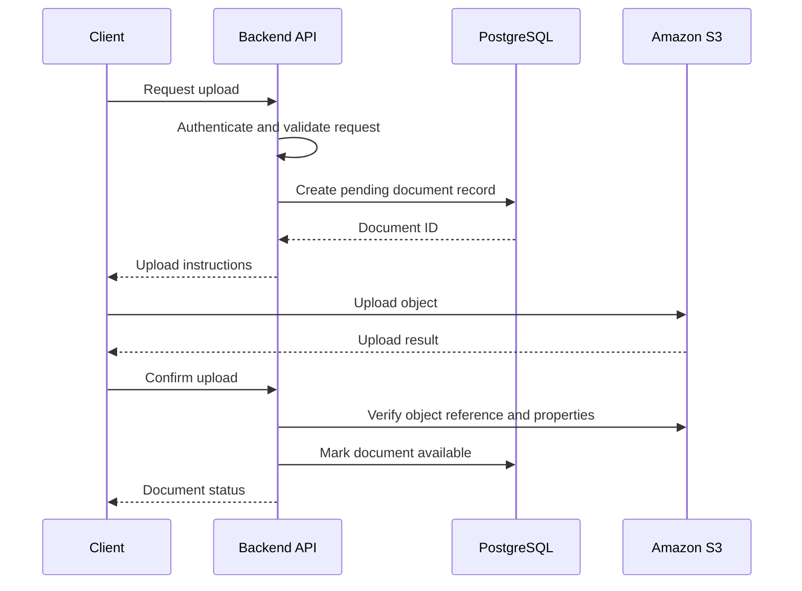

# 05- Objects

## Overview

An Amazon S3 object is the fundamental unit of data stored in a bucket. It contains the object data, an object key, system metadata, and optional attributes such as user-defined metadata, tags, checksums, and version information.

Backend applications interact with S3 objects through APIs rather than directly manipulating storage devices. Typical operations include uploading, downloading, inspecting, copying, and deleting objects.

For example, a document management system may store PDF files in S3 while PostgreSQL maintains document ownership, business attributes, and processing status. The S3 object contains the actual file bytes; the database maintains the application's view of that file.

Understanding S3 objects requires attention to object identity, write behavior, metadata semantics, versioning, data integrity, concurrency, and efficient data transfer. These details directly affect the reliability and security of production applications.

## Anatomy of an S3 Object

An S3 object consists of several logically distinct components.

| Component | Purpose | Example |
|---|---|---|
| Bucket | Identifies the containing S3 resource | `acme-documents-prod` |
| Object key | Identifies the object within the bucket | `invoices/2026/invoice-001.pdf` |
| Object data | Contains the actual bytes | PDF document contents |
| System metadata | Describes object properties | Content length, content type, last-modified time |
| User-defined metadata | Stores application-supplied key-value attributes | `document-type=invoice` |
| Object tags | Supplies labels used by supported management and policy features | `department=finance` |
| Checksum | Supports data-integrity verification | CRC64NVME or SHA-256 |
| Version ID | Identifies a particular object version when versioning is enabled | An S3-generated version identifier |

These components serve different purposes. An object key identifies the object, metadata describes it, tags support classification and management, and checksums help verify data integrity.

### Object Identity

For an unversioned reference, an object is identified by its bucket and key:

```text
Bucket:
    acme-documents-prod

Key:
    customers/1042/invoices/invoice-001.pdf
```

Conceptually:

```text
Object reference = Bucket + Key
```

When bucket versioning is enabled, the same key can have multiple versions. Applications that need to reference a specific historical version should retain its version ID as well.

A key is not necessarily an immutable identifier for one permanent set of bytes. An ordinary write to an existing key can replace its current contents.

This distinction matters when applications store object references in databases, cache object metadata, or process asynchronous events.

## Object Data

Object data is the actual byte sequence stored by S3.

Common examples include:

- Documents such as PDF, DOCX, and CSV files.
- Images, audio, and video.
- JSON and XML payloads.
- Database backups and compressed archives.
- Machine-learning datasets and generated reports.
- Static website assets.

S3 stores the data without automatically understanding its business meaning. An application or downstream service must interpret the contents.

For example, S3 can store an object with the key `invoices/invoice-001.pdf`, but it does not automatically validate that the bytes form a valid invoice or that the invoice belongs to a particular customer.

Those checks belong to the application or an appropriate processing workflow.

### Object Size and Upload Constraints

A general purpose S3 bucket supports individual objects up to 50 TB, subject to the documented S3 object and multipart upload constraints.

A single `PutObject` request supports an object up to 5 GB. Larger objects require multipart upload.

| Upload approach | Appropriate use |
|---|---|
| Single-request upload | Small and moderately sized objects within the API limit |
| Multipart upload | Large files, parallel transfers, and retrying individual parts |
| Presigned upload | Allowing an authorized client to upload directly to S3 |
| Streaming or managed SDK transfer | Limiting application memory usage during large transfers |

For multipart uploads, S3 assembles independently uploaded parts when the upload is completed. The upload workflow must handle incomplete uploads and failures during part transfer or finalization.

Choose the transfer approach based on object size, network reliability, memory constraints, and concurrency. Do not buffer very large files completely in a backend process simply because the object ultimately resides in S3.

Reference: [Uploading and copying objects in Amazon S3](https://docs.aws.amazon.com/AmazonS3/latest/userguide/upload-objects.html).

## Object Keys and Prefixes

An object key is the name used to identify an object within its bucket.

Consider these keys:

```text
tenants/tenant-17/documents/contract.pdf
tenants/tenant-17/images/profile.jpg
tenants/tenant-28/documents/contract.pdf
```

Each complete path-like string is a single object key. S3 uses a flat object namespace; slash characters provide logical organization through prefixes rather than conventional filesystem directories.

### Designing Object Keys

Production applications should generate keys according to predictable naming rules instead of trusting arbitrary client-supplied paths.

For example:

```text
documents/
    tenant-17/
        7f42c19e-invoice.pdf
        c819aa23-contract.pdf
```

A suitable design usually has the following characteristics:

- Uses unique identifiers to avoid unintended overwrites.
- Separates application identity from the original filename.
- Avoids unnecessary personal or confidential information in keys.
- Supports the application's listing and retrieval patterns.
- Remains stable enough for references stored in databases and asynchronous messages.

The original filename can be retained separately as display metadata.

For example, the database may store:

```json
{
  "document_id": "doc_7f42c19e",
  "original_filename": "October Invoice.pdf",
  "bucket": "acme-documents-prod",
  "object_key": "tenants/tenant-17/documents/7f42c19e.pdf",
  "status": "available"
}
```

The object key is controlled by the application, while the original filename is retained for user-facing display.

### Object Keys Are Not Security Controls

A prefix such as `tenants/tenant-17/` does not automatically isolate one tenant from another.

If an application receives a document ID or object key from a client, it must verify that the authenticated user is authorized to access that document.

Avoid using the following pattern without authorization checks:

```python
# Unsafe design: accepting an arbitrary object key from the caller.
object_key = request.query_params["key"]
```

Prefer resolving a document through an application-controlled identifier, verifying its ownership, and then using the stored object reference.

This prevents clients from accessing objects simply by guessing another customer's key.

Reference: [Naming Amazon S3 objects](https://docs.aws.amazon.com/AmazonS3/latest/userguide/object-keys.html).

## Object Metadata

Metadata describes an object and can be inspected without downloading its full contents.

S3 metadata is useful when applications need to communicate content properties, record descriptive attributes, or configure how an object is handled by compatible clients.

### System Metadata

System metadata includes properties managed by S3 and supported object properties supplied through request headers.

Common examples include:

| Property | Purpose |
|---|---|
| `Content-Type` | Describes the media type |
| `Content-Length` | Indicates the object size in bytes |
| `Content-Encoding` | Describes an encoding applied to the representation |
| `Content-Disposition` | Suggests how a client should present the object |
| Last-modified time | Indicates when the current object was modified |
| ETag | An entity tag useful for certain conditional requests and object identification |
| Storage class | Identifies the storage class used for the object |

Not every property is freely writable. Some are system-managed, while others can be supplied through supported upload or copy operations.

### User-Defined Metadata

User-defined metadata allows applications to associate additional key-value attributes with an object.

For example:

```text
x-amz-meta-document-type: invoice
x-amz-meta-source-system: billing-api
x-amz-meta-schema-version: 2
```

These metadata entries can be supplied during an upload through an SDK or supported API request.

Use user-defined metadata for relatively stable attributes that belong with the stored object. Do not treat it as a general-purpose database.

Metadata is not designed for arbitrary relational queries, and changing metadata usually requires copying or replacing the object with updated metadata rather than editing a field in place.

### Uploading an Object with Metadata Using Boto3

```python
import logging
from pathlib import Path

import boto3
from botocore.exceptions import BotoCoreError, ClientError

logger = logging.getLogger(__name__)


def upload_invoice(
    file_path: Path,
    bucket: str,
    object_key: str,
) -> None:
    """Upload a PDF invoice with descriptive metadata."""
    if not file_path.is_file():
        raise FileNotFoundError(f"File does not exist: {file_path}")

    s3_client = boto3.client("s3")

    try:
        s3_client.upload_file(
            str(file_path),
            bucket,
            object_key,
            ExtraArgs={
                "ContentType": "application/pdf",
                "Metadata": {
                    "document-type": "invoice",
                    "source-system": "billing-api",
                },
            },
        )
    except (BotoCoreError, ClientError):
        logger.exception(
            "S3 invoice upload failed: bucket=%s, key=%s",
            bucket,
            object_key,
        )
        raise
```

This example uses the configured AWS credential provider chain. The application should obtain the bucket name and other environment-specific values from its configuration and grant the execution role only the permissions required for the operation.

The metadata values must be validated if they originate from untrusted input. Do not place secrets, authentication tokens, or unnecessary personal information in object metadata.

### When to Store Metadata in PostgreSQL Instead

Use PostgreSQL or another suitable database for information that requires frequent updates, relational integrity, complex queries, or business-level authorization.

For example, a document service might store the following in its database:

- Document owner and tenant.
- Original filename.
- Upload and processing state.
- Business category and relationships.
- Retention policy selection.
- Audit and workflow state.

S3 then stores the object bytes and object-specific attributes.

This separation prevents the application from having to list and inspect large numbers of objects every time it needs to answer a business query.

## Object Tags

Object tags are separate from user-defined metadata. They provide key-value labels used by supported S3 management and policy features.

Example:

```text
department = finance
retention = long-term
data-classification = confidential
```

Tags can be useful for lifecycle policies, classification, and selected access-control or operational workflows.

Use tags when an attribute needs to participate in supported S3 management operations. Use a database when the information must support general-purpose business queries.

Tags should be controlled when they influence retention or other security-sensitive behavior. An unauthorized change to a classification tag can have operational consequences if an automated policy depends on it.

## Object Checksums and Data Integrity

Data integrity is an important concern when storing documents, backups, media, and other objects that must remain unchanged during transfer.

A checksum is calculated from object data using a supported algorithm. During supported upload operations, S3 can validate the checksum provided by the client and reject data that does not match the expected value.

S3 supports checksum algorithms such as CRC32, CRC32C, CRC64NVME, SHA-1, and SHA-256, with supported algorithms and checksum modes depending on the upload operation.

### Why Checksums Matter

Checksums can help with:

- Detecting data corruption during transfer.
- Verifying that an uploaded backup matches the expected data.
- Confirming object integrity in ingestion pipelines.
- Validating migrated or copied datasets.
- Improving confidence in large-object processing workflows.

For production workloads, prefer documented S3 checksum capabilities rather than relying on assumptions about other object attributes.

### ETag Is Not Always an MD5 Checksum

An ETag is often useful for identifying a particular object representation and for conditional operations. However, it is not universally equivalent to the MD5 digest of the complete object contents.

In particular, multipart upload ETags are not the MD5 hash of the complete object. Other upload or encryption configurations can also affect ETag interpretation.

Do not build a universal integrity-validation mechanism by assuming:

```text
ETag == MD5(object bytes)
```

Use an explicitly supported checksum algorithm when reliable content-integrity validation is required.

References:

- [Checking object integrity during uploads](https://docs.aws.amazon.com/AmazonS3/latest/userguide/checking-object-integrity-upload.html)
- [Multipart upload overview](https://docs.aws.amazon.com/AmazonS3/latest/userguide/mpuoverview.html)

### Inspecting Object Attributes

The `HeadObject` operation retrieves object metadata without returning the object body.

For example:

```bash
aws s3api head-object \
    --bucket acme-documents-prod \
    --key tenants/tenant-17/documents/invoice.pdf
```

The response can include properties such as content length, content type, last-modified time, ETag, and version-related or encryption-related information where applicable.

Requesting checksum information through the SDK or API may require additional parameters and permissions for the relevant encryption configuration.

Use `HeadObject` when an application needs to inspect an object before downloading it or verify that a particular object reference is present.

A failed request must be interpreted with its authorization context. A missing object and an unauthorized request can produce different observable behaviors depending on the caller's permissions.

## Reading Objects Efficiently

S3 supports full-object reads and byte-range reads through its object APIs.

### Full-Object Retrieval

A normal GET operation retrieves object content. Small objects can be read into memory, but large objects and concurrent downloads require a deliberate memory strategy.

For Python applications, Boto3 returns a streaming response body:

```python
import boto3


def read_object_prefix(
    bucket: str,
    object_key: str,
    length: int = 1024,
) -> bytes:
    """Read the first bytes of an object without downloading it all."""
    s3_client = boto3.client("s3")

    response = s3_client.get_object(
        Bucket=bucket,
        Key=object_key,
        Range=f"bytes=0-{length - 1}",
    )

    body = response["Body"]
    try:
        return body.read()
    finally:
        body.close()
```

The example reads only the requested byte range. A production implementation should validate `length`, handle exceptions, and account for the object's actual size.

For large files, avoid calling `body.read()` without an appropriate size limit when doing so would load the entire response into application memory.

### Range Requests

Range requests retrieve a selected byte interval from an object.

They are useful for:

- Partial file previews.
- Media seeking.
- Resumable download implementations.
- Large binary files where only a section is needed.
- Efficient inspection of formats with predictable headers.

The request must be designed around the object's layout and the format being processed. An arbitrary byte range is useful only when the application knows what the returned bytes represent.

### Pagination When Listing Objects

Object listings are paginated. A single list request may not return every object matching a prefix.

Use SDK paginators or continuation tokens when traversing large collections. Do not assume that a single response represents the entire prefix.

For online business queries, use a database or index when it is more appropriate than repeatedly listing a large set of objects.

## Copying Objects and Updating Metadata

S3 supports copying an object to another key or bucket. Copy operations are commonly used for renaming-like workflows, migration, or updating object properties.

S3 does not provide a general in-place rename operation. A move-like workflow typically copies the object to a destination key and then deletes the source key.

This sequence requires careful failure handling because the copy may succeed while deletion fails, or the workflow may terminate between the two operations.

### Metadata Replacement During Copy

Object metadata generally cannot be edited as an arbitrary in-place field update. A copy operation with the appropriate metadata directive can replace metadata as part of copying the object.

When performing such a copy, explicitly preserve any metadata that must remain. Replacing metadata without retaining the relevant values can remove attributes that downstream applications depend on.

For large objects, copying may require multipart copy rather than a single copy request. Choose the appropriate SDK or API workflow based on the object's size and the supported operation limits.

Do not implement a rename operation as an unguarded copy followed by delete when other workflows may concurrently update the source key.

## Object Versioning and Deletion

When versioning is enabled, a bucket can retain multiple versions of an object under the same key.

A normal write to a versioned key can create a new version, allowing previous content to be recovered when the appropriate permissions and retention conditions permit it.

A normal delete in a versioned bucket generally creates a delete marker rather than immediately removing all previous versions.

This has several implications:

- The key can continue to refer to an object with different contents over time.
- Applications may need to store a specific version ID.
- Historical versions may continue to consume storage.
- Permanent deletion of a version is distinct from creating a delete marker.
- Lifecycle rules can influence how noncurrent versions are retained or removed.

If a document reference must always resolve to the exact content originally processed, store the relevant version ID or use a uniquely generated key.

Do not assume that a bucket versioning configuration automatically preserves all historical data forever. Retention and lifecycle settings must be evaluated together.

For detailed behavior and recovery procedures, refer to the dedicated versioning documentation.

Reference: [Working with delete markers](https://docs.aws.amazon.com/AmazonS3/latest/userguide/DeleteMarker.html).

## Conditional Writes and Concurrent Updates

When multiple workers or clients can write the same key, unconditional writes may overwrite data unexpectedly.

Conditional writes let supported operations depend on the existing object state.

Common conditions include:

| Condition | Intended use |
|---|---|
| `If-None-Match: *` | Create an object only when an existing current object does not satisfy the condition |
| `If-Match: <ETag>` | Perform an operation only when the existing object's ETag matches the supplied value |

These mechanisms are useful for immutable object creation and selected optimistic concurrency workflows.

For example, an ingestion pipeline should not overwrite an already-created immutable result simply because a retry occurs. A conditional write can help prevent that behavior.

Conditional writes are not a universal distributed transaction mechanism. Applications still need to handle precondition failures, concurrent deletes, retries, and service responses correctly.

Some multipart workflows also require conditional handling during the final completion request, so the condition must be supported and applied at the appropriate stage.

Reference: [Conditional writes in Amazon S3](https://docs.aws.amazon.com/AmazonS3/latest/userguide/conditional-writes.html).

## Object Storage in a Backend Application

A typical file-management backend separates application state from stored object contents.



This illustrates one possible workflow using direct client-to-S3 upload. A backend-mediated upload can use a different sequence.

The application should:

- Generate or validate the object key.
- Enforce the caller's authorization before issuing upload or download instructions.
- Keep object references and business relationships in the database when appropriate.
- Verify the uploaded object before making it available to downstream consumers.
- Handle failed database updates and abandoned uploads.
- Use idempotency and retry-safe processing for asynchronous operations.
- Keep S3 credentials out of client-side application code.

### Handling Partial Failures

The object upload and database update do not form one atomic transaction.

For example:

```text
1. S3 upload succeeds.
2. Database update fails.
3. Object exists, but the application record remains pending.
```

A production design should define how to reconcile this state. Options include retrying the state transition, using an explicit processing state machine, cleaning up unreferenced objects, or scheduling reconciliation jobs.

The correct behavior depends on the business requirements and retention policy.

## Common Object Operation Mistakes

| Mistake | Why it causes problems | Better approach |
|---|---|---|
| Using original filenames as unique keys | Different users can upload the same filename | Generate stable, unique object keys |
| Treating prefixes as security boundaries | Users may access objects belonging to other tenants | Enforce application authorization and appropriate AWS policies |
| Treating metadata as a database | Metadata is not designed for relational queries or frequent field updates | Keep business state in a suitable database |
| Assuming ETag always equals the MD5 hash | Multipart upload and other configurations invalidate that assumption | Use supported checksum mechanisms |
| Reading large objects entirely into memory | Concurrent downloads can exhaust application memory | Stream data or use bounded transfers |
| Assuming a list response contains every object | Listings are paginated | Use continuation tokens or SDK paginators |
| Deleting a versioned object and expecting all versions to disappear | A normal delete can create a delete marker | Understand version-specific deletion behavior |
| Updating metadata without preserving existing values | Required metadata can be lost | Explicitly preserve or replace metadata intentionally |
| Retrying unconditional writes blindly | A retry can overwrite an object created by another worker | Use idempotency and conditional writes where appropriate |
| Treating a successful S3 write as a completed database transaction | Independent systems can fail separately | Implement retry, reconciliation, and recovery mechanisms |

## Further Reading

- [Amazon S3 objects overview](https://docs.aws.amazon.com/AmazonS3/latest/userguide/UsingObjects.html)
- [Working with object metadata](https://docs.aws.amazon.com/AmazonS3/latest/userguide/UsingMetadata.html)
- [Naming Amazon S3 objects](https://docs.aws.amazon.com/AmazonS3/latest/userguide/object-keys.html)
- [Checking object integrity during uploads](https://docs.aws.amazon.com/AmazonS3/latest/userguide/checking-object-integrity-upload.html)
- [Uploading and copying objects using multipart upload](https://docs.aws.amazon.com/AmazonS3/latest/userguide/mpuoverview.html)
- [Conditional writes in Amazon S3](https://docs.aws.amazon.com/AmazonS3/latest/userguide/conditional-writes.html)
- [Working with delete markers](https://docs.aws.amazon.com/AmazonS3/latest/userguide/DeleteMarker.html)

## Key Takeaways

- An S3 object combines data with a bucket-and-key identity and optional metadata, tags, checksums, and version information.
- Object keys are identifiers, not authorization boundaries; backend applications must validate access independently.
- Use metadata for object-associated attributes, tags for supported management workflows, and a database for frequently queried business state.
- Use explicit checksums for data-integrity validation and conditional writes when concurrent updates or duplicate creation must be controlled.
- Production object workflows must account for pagination, large-file transfers, version-aware deletion, and partial failures between S3 and external systems.