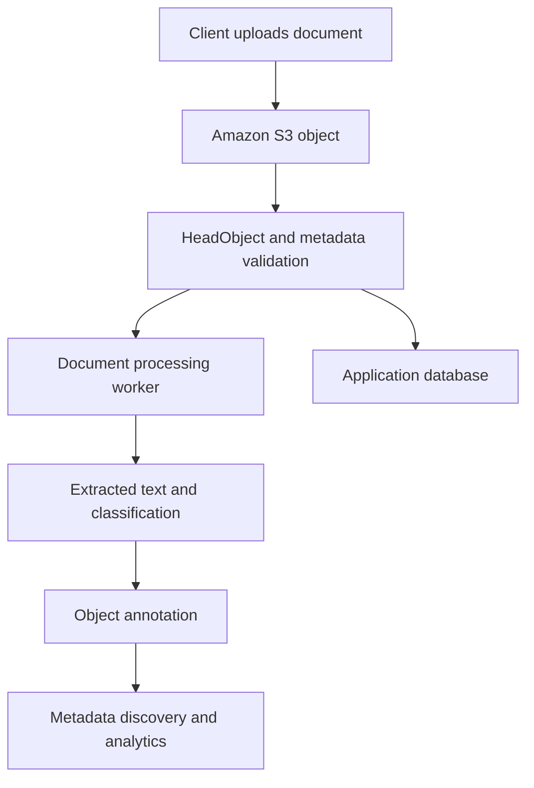

# 07- Object Metadata

## Overview

Object metadata is information associated with an Amazon S3 object that describes its properties, controls selected aspects of how it is handled, or provides additional context for applications consuming the object.

For example, a document stored in S3 may have the following properties:

```text
Object key:
    tenants/tenant-1042/documents/invoice-001.pdf

System metadata:
    Content-Type: application/pdf
    Content-Length: 248193
    Last-Modified: 2026-10-13T12:30:00Z

User-defined metadata:
    document-type: invoice
    source-system: billing-api

Object tags:
    department = finance
    retention = standard
```

These categories serve different purposes. System metadata describes properties maintained by S3 or controlled through supported operations. User-defined metadata associates application-specific attributes with an object. Object tags support classification and selected management and access-control operations.

Amazon S3 also supports object annotations, which can store richer textual information separately from the object's data, and S3 Metadata, which can make object metadata available through queryable metadata tables.

For backend engineers, choosing the right metadata mechanism affects API design, searchability, lifecycle management, caching, data integrity, and application maintainability.

## Types of Amazon S3 Object Metadata

Amazon S3 supports multiple mechanisms for describing and managing objects.

| Mechanism | Managed by | Typical purpose | Can be changed without replacing object data? |
|---|---|---|---|
| System-controlled metadata | S3 | Object creation time, size, version information | Generally no; values are maintained by S3 |
| User-controlled system metadata | Application through supported S3 operations | Content type, cache behavior, storage class, encryption configuration | Depends on the property and operation; metadata updates generally use copy or replacement operations |
| User-defined metadata | Application | Small, stable application-specific attributes | No; changing it requires copying the object with the desired metadata |
| Object tags | Application or authorized automation | Classification, lifecycle filtering, policy conditions, cost allocation | Yes, through object-tagging operations |
| Object annotations | Application or authorized automation | Larger textual payloads such as extraction results and processing information | Yes, through annotation operations without modifying the object data |
| S3 Metadata tables | Managed by S3 | Querying metadata across objects | The tables are read-only; S3 maintains their contents |

These mechanisms are complementary rather than interchangeable.

For example, an application's document category could be stored as user-defined metadata, an object tag, an annotation, or a database field. The appropriate choice depends on whether the category needs to support simple object inspection, lifecycle filtering, richer processing results, or application-level queries.

Official reference: [Working with object metadata](https://docs.aws.amazon.com/AmazonS3/latest/userguide/UsingMetadata.html).

## System-Defined Metadata

S3 maintains system metadata for objects. Some values are controlled exclusively by S3, while other system metadata values can be configured through supported operations.

### System-Controlled Metadata

System-controlled metadata describes properties that S3 determines.

Examples include:

- Object content length.
- Last-modified time.
- Version ID when versioning is enabled.
- ETag.
- System-calculated checksum values.

Applications can retrieve these properties, but they cannot arbitrarily assign their values.

For example, an application cannot update an object's stored content length by changing a metadata field. The value is determined by the stored object.

### User-Controlled System Metadata

Some system metadata values can be specified or changed using supported S3 operations.

| Property | Purpose | Backend application use case |
|---|---|---|
| `Content-Type` | Describes the media type | Serve a PDF as `application/pdf` |
| `Content-Disposition` | Influences how a client presents the response | Suggest downloading a report as an attachment |
| `Cache-Control` | Defines HTTP caching directives | Configure cache behavior for static assets |
| `Content-Encoding` | Describes an encoding applied to the object representation | Indicate supported content encodings |
| Storage class | Determines the object's storage class | Manage the storage characteristics of an object |
| Server-side encryption settings | Describe or configure supported encryption behavior | Apply appropriate encryption settings |
| Website redirect location | Specifies a redirect destination for supported website hosting behavior | Redirect a stored website object |

These properties have different modification rules. A property being user-controlled does not mean that it can be edited independently in place.

For a complete reference, see [System-defined object metadata](https://docs.aws.amazon.com/AmazonS3/latest/userguide/UsingMetadata.html).

### Why Content-Type Matters

A backend can successfully store a file while assigning an incorrect content type.

For example, a PDF might be stored with:

```text
Content-Type: application/octet-stream
```

instead of:

```text
Content-Type: application/pdf
```

Depending on the client and delivery architecture, this can affect rendering, browser behavior, download handling, and downstream processing.

Set the content type deliberately when creating the object, but do not trust a client-supplied MIME type without validation.

The file extension and HTTP content type alone do not prove that the uploaded bytes match the claimed format.

### Why Cache-Control Matters

For static assets and frequently accessed files, `Cache-Control` can influence how HTTP clients and compatible intermediaries cache responses.

For example:

```text
Cache-Control: public, max-age=31536000, immutable
```

This is appropriate only when the content is immutable for the lifetime of the cache entry. It should not be applied indiscriminately to mutable objects or sensitive documents.

For private files, cache directives must be considered together with the authorization model and delivery path.

## User-Defined Metadata

User-defined metadata allows applications to attach small, custom key-value attributes to objects.

Typical examples include:

```text
document-type: invoice
source-system: billing-api
schema-version: 2
processing-profile: standard
```

User-defined metadata is useful when an attribute should be retrieved along with the object or inspected without downloading its full contents.

### Metadata Header Format

When using S3 REST APIs, user-defined metadata names use the `x-amz-meta-` prefix.

For example:

```http
x-amz-meta-document-type: invoice
x-amz-meta-source-system: billing-api
```

With Boto3, provide the logical metadata keys without manually adding the HTTP prefix:

```python
import boto3

s3 = boto3.client("s3")

s3.put_object(
    Bucket="acme-documents-prod",
    Key="invoices/invoice-001.pdf",
    Body=b"Example invoice content",
    ContentType="application/pdf",
    Metadata={
        "document-type": "invoice",
        "source-system": "billing-api",
    },
)
```

The code illustrates the upload interface. A production application should supply the actual file contents, validate the document, obtain credentials through the appropriate AWS credential provider chain, and use an identity with the required permissions.

S3 stores user-defined metadata keys in lowercase. Design metadata keys consistently so applications do not depend on their original casing.

### User-Defined Metadata Limits

User-defined metadata is constrained by S3 request-header limits.

| Constraint | Limit or behavior |
|---|---|
| User-defined metadata size | 2 KB total |
| PUT request header size | 8 KB total |
| Key representation | Stored in lowercase |
| Mutation after upload | Requires copying the object with the desired metadata |
| Appropriate data type | Small key-value attributes |

AWS measures user-defined metadata size using the UTF-8 byte lengths of the keys and values. The overall PUT request header limit also includes other applicable headers.

Although Unicode metadata values are supported, ASCII values are often easier to handle across HTTP clients and integrations. Establish an encoding convention when metadata crosses multiple systems.

These limits make user-defined metadata unsuitable for large JSON documents, extensive extraction results, or frequently changing application state.

Reference: [User-defined object metadata](https://docs.aws.amazon.com/AmazonS3/latest/userguide/UsingMetadata.html).

### Choosing What Belongs in Metadata

Use user-defined metadata for information that is small, relatively stable, and closely associated with the object.

Good candidates include:

- An external correlation identifier.
- A source-system identifier.
- A document classification used during object inspection.
- A processing schema version.
- A small attribute needed by downstream consumers.

Avoid storing the complete business model of a document in object metadata.

For example, customer ownership, invoice status, payment state, searchable business fields, and relationships to other entities usually belong in PostgreSQL or another suitable application database.

S3 metadata is not a general-purpose relational query interface.

## Object Tags

Object tags are key-value pairs associated with an object. They are designed for classification and integration with supported S3 management, authorization, and cost-allocation features.

For example:

```text
department = finance
environment = production
retention = long-term
data-classification = confidential
```

An object can have up to 10 tags.

### When to Use Tags

Tags are useful when object classification needs to influence supported AWS behavior.

Common use cases include:

- Filtering objects for S3 Lifecycle rules.
- Evaluating supported tag-based conditions in IAM and bucket policies.
- Grouping resources for cost allocation.
- Supporting operational classification and inventory workflows.

Tags can be updated without copying the object data.

However, updating a tag set must be handled deliberately. A `PutObjectTagging` operation replaces the object's existing tag set with the supplied set; it should not be treated as an automatic append operation.

Applications that need to preserve existing tags should retrieve the current set when appropriate, merge the desired changes, validate the result, and write the complete set back.

### Example: Adding Object Tags with Boto3

```python
import boto3

s3 = boto3.client("s3")

s3.put_object_tagging(
    Bucket="acme-documents-prod",
    Key="invoices/invoice-001.pdf",
    Tagging={
        "TagSet": [
            {"Key": "department", "Value": "finance"},
            {"Key": "retention", "Value": "standard"},
        ]
    },
)
```

This operation changes the tag set independently of the object bytes.

The caller needs the relevant tagging permission. Object-level tagging permissions are separate from permissions to upload or retrieve object data.

If tags determine retention or access-control behavior, restrict who can modify them. An incorrect tag could cause a lifecycle rule to select an unintended object or alter an authorization decision.

Reference: [Managing object tags](https://docs.aws.amazon.com/AmazonS3/latest/userguide/tagging-managing.html).

## Object Annotations

Object annotations provide a mechanism for attaching richer textual information to an object after the object has been uploaded.

An annotation is distinct from user-defined metadata and object tags.

According to the current S3 documentation, an annotation can contain up to 1 MB of UTF-8 text. Annotations can be created, retrieved, listed, and deleted using dedicated operations without modifying the object data itself.

### Use Cases

Annotations can hold information such as:

- Extracted document text.
- AI-generated descriptions.
- Content classification results.
- Processing summaries.
- Structured processing output serialized as JSON.
- Other larger textual payloads associated with a stored object.

For example, a document pipeline might store the PDF bytes as the S3 object and attach an annotation containing extraction results.

```text
S3 object:
    documents/tenant-1042/doc-8f14e45f.pdf

Annotation:
    document-analysis

Annotation payload:
    {
        "document_type": "invoice",
        "extraction_status": "completed",
        "currency": "INR",
        "schema_version": 2
    }
```

The example is an illustrative application design. The JSON shown is an annotation payload, not an automatic S3-generated structure.

### Annotations vs User-Defined Metadata

The distinction is important when deciding how to store processing output.

| Requirement | Better fit |
|---|---|
| Store a small, stable attribute at upload time | User-defined metadata |
| Classify objects for lifecycle or supported policy operations | Object tags |
| Store a richer textual extraction result after upload | Object annotations |
| Query complex business fields and join them with other records | Application database or analytics system |
| Discover and query metadata across large object collections | S3 Metadata tables, where suitable |

Annotations allow application processing results to be attached without rewriting the object data, making them useful when the primary object must remain unchanged.

For objects that require transactional application state, versioned business records, or complex querying, annotations should complement rather than replace a suitable database.

Reference: [Annotating your objects](https://docs.aws.amazon.com/AmazonS3/latest/userguide/annotations-overview.html).

## S3 Metadata Tables

S3 Metadata is a data-discovery capability that automatically captures metadata for supported objects in general purpose buckets and exposes it through managed, read-only Apache Iceberg metadata tables.

These tables can contain information such as:

- System-defined metadata.
- User-defined metadata.
- Object tags.
- Annotations.
- Event metadata describing object changes.

The metadata tables are stored in S3 table buckets and can be queried through supported analytics integrations, including Amazon Athena and Amazon Redshift.

### Why Metadata Tables Matter

Without a dedicated discovery mechanism, an application may need to enumerate large numbers of objects, retrieve their properties, and maintain its own index.

S3 Metadata can make this type of discovery and analysis more manageable.

For example, a data platform may want to analyze object creation activity, identify datasets by storage class, or discover objects that match selected metadata conditions.

Instead of treating object listing as the primary analytics mechanism, the application can query the managed metadata tables using supported analytics services.

### Important Boundaries

S3 Metadata tables are read-only managed tables; they are not a replacement for an application's source-of-truth database.

Their purpose is metadata discovery and analysis. Do not assume that a query against a metadata table provides a transactional control plane for modifying the original S3 objects.

Review current Region support, setup requirements, update behavior, and service pricing before adopting S3 Metadata in production.

References:

- [Discovering your data with S3 Metadata tables](https://docs.aws.amazon.com/AmazonS3/latest/userguide/metadata-tables-overview.html)
- [S3 Metadata restrictions and limitations](https://docs.aws.amazon.com/AmazonS3/latest/userguide/metadata-tables-restrictions.html)

## Retrieving Object Metadata

Applications often need to inspect an object's properties without downloading its content.

The S3 `HeadObject` operation retrieves object metadata and related response information.

Typical use cases include:

- Verifying that an object exists and is accessible.
- Checking its content length before downloading.
- Inspecting the content type.
- Retrieving user-defined metadata.
- Checking selected storage and encryption properties.
- Reading ETag and version-related information where applicable.

### Using AWS CLI

```bash
aws s3api head-object \
    --bucket acme-documents-prod \
    --key invoices/invoice-001.pdf
```

An illustrative response might contain:

```json
{
  "ContentLength": 248193,
  "ContentType": "application/pdf",
  "ETag": "\"example-etag-value\"",
  "Metadata": {
    "document-type": "invoice",
    "source-system": "billing-api"
  },
  "ServerSideEncryption": "AES256"
}
```

This response is illustrative rather than a captured response from an actual object. The properties returned depend on the object's configuration and the operation.

The calling identity must have suitable read permissions to retrieve object metadata. Interpret errors in their authorization context: an unsuccessful `HeadObject` request does not always prove that the object is absent.

### Using Boto3

```python
import boto3
from botocore.exceptions import ClientError


def get_object_metadata(
    bucket: str,
    key: str,
) -> dict:
    """Return selected metadata without downloading the object body."""
    s3 = boto3.client("s3")

    try:
        response = s3.head_object(
            Bucket=bucket,
            Key=key,
        )
    except ClientError as exc:
        error_code = exc.response.get("Error", {}).get("Code", "")
        if error_code in {"404", "NoSuchKey", "NotFound"}:
            raise FileNotFoundError(
                f"Object not found: s3://{bucket}/{key}"
            ) from exc
        raise

    return {
        "content_length": response.get("ContentLength"),
        "content_type": response.get("ContentType"),
        "last_modified": response.get("LastModified"),
        "etag": response.get("ETag"),
        "metadata": response.get("Metadata", {}),
    }
```

The example separates expected missing-object handling from other client errors. Exact errors can vary with the operation and permissions, so production systems should avoid interpreting every authorization or service failure as a missing object.

For API design, return only the metadata fields the caller is authorized to see. Do not expose internal processing attributes, storage configuration, or sensitive values merely because they are present on the object.

## Modifying Object Metadata

S3 does not provide a general operation that edits arbitrary user-defined metadata fields in place after an object is uploaded.

To change user-defined metadata or update relevant user-controlled system metadata, applications generally copy the object with the desired properties. The copy can target the same key or a different key, depending on the operation and bucket configuration.

### Example: Replacing Metadata

The following command copies an object onto the same key while replacing its metadata.

```bash
aws s3api copy-object \
    --bucket acme-documents-prod \
    --key invoices/invoice-001.pdf \
    --copy-source acme-documents-prod/invoices/invoice-001.pdf \
    --metadata-directive REPLACE \
    --content-type application/pdf \
    --metadata document-type=invoice,source-system=billing-api
```

This example is illustrative and assumes the caller has the permissions required for the source read and destination write, as well as any applicable encryption permissions.

When replacing metadata, explicitly specify all user-configurable metadata values that must remain, not just the field being changed. Depending on the copy request, failing to preserve existing settings can remove previously configured properties.

If bucket versioning is enabled, copying onto the same key can create a new current object version. It does not simply edit an immutable historical version in place.

For objects that require specialized handling, including large objects, review the appropriate copy or multipart-copy workflow.

Reference: [Copying, moving, and renaming objects](https://docs.aws.amazon.com/AmazonS3/latest/userguide/copy-object.html).

### Updating Tags Instead

If the requirement is to change an object's classification, a tag update is often preferable to copying the object solely for that purpose.

For example, changing:

```text
retention = standard
```

to:

```text
retention = long-term
```

can be performed through the object-tagging API.

This avoids copying the object's bytes merely to modify its tag set. However, evaluate the effect of the new tag on applicable lifecycle rules, policies, and reporting.

### Updating Annotations

Annotations can be modified using their dedicated operations without modifying the object data.

This makes them appropriate for processing results that may be generated, revised, or removed independently of the stored file.

As with other metadata mechanisms, the caller must have the relevant permissions, and the application should define how annotations relate to the particular object version being processed.

## Metadata and Data Integrity

Metadata describes an object, but it is not itself a substitute for validating the object bytes.

For example, setting:

```text
Content-Type: application/pdf
```

does not prove that the uploaded content is a valid PDF.

Likewise, user-defined metadata such as:

```text
verified: true
```

has no automatic cryptographic or validation meaning. It is simply an application-supplied attribute.

For integrity-sensitive workflows, use supported S3 checksum functionality.

S3 supports multiple checksum algorithms and can validate supported checksum values during upload operations. The specific checksum behavior depends on the algorithm and transfer method.

Do not assume that an object's ETag is always the MD5 digest of its complete data. Multipart upload ETags are not the full-object MD5 checksum, and other upload or encryption configurations can also affect ETag interpretation.

Use checksums for data integrity and independently validate the meaning and trustworthiness of application metadata.

Reference: [Checking object integrity in Amazon S3](https://docs.aws.amazon.com/AmazonS3/latest/userguide/checking-object-integrity.html).

## Metadata in Backend Architecture

Object metadata frequently participates in backend workflows that combine S3 with a database and asynchronous processing.

Consider a document-ingestion pipeline:



The components have separate responsibilities:

- **S3 object:** Stores the source file.
- **System metadata:** Describes object properties and storage characteristics.
- **User-defined metadata:** Carries small attributes associated with the object.
- **Tags:** Supports classification and selected S3 management behavior.
- **Annotations:** Holds richer textual processing information.
- **Application database:** Maintains business relationships, ownership, and workflow state.
- **S3 Metadata tables:** Supports querying and discovery of metadata across eligible object collections.

Not every application needs all these mechanisms. Use the simplest design that meets the workload's operational and data-access requirements.

### Handling Partial Failures

Object upload, database updates, and downstream processing are independent operations. A successful upload does not guarantee that a database transaction or annotation update has succeeded.

A reliable workflow should track processing states, use idempotent operations where appropriate, and reconcile incomplete work.

For example:

```text
Object uploaded
    |
    v
Metadata validated
    |
    v
Database record updated
    |
    v
Processing completed
    |
    v
Annotation persisted
```

This is an illustrative sequence, not a built-in S3 state machine. Production systems should explicitly define retry behavior, failure recovery, and the point at which an object becomes available to users or downstream consumers.

## Security and Operational Considerations

Metadata can be useful for access decisions and automation, but it must not be treated as inherently trustworthy.

Follow these practices:

- Validate metadata derived from client input.
- Avoid placing credentials, tokens, or unnecessary personal information in metadata or annotations.
- Restrict permission to modify tags when tag changes influence security or retention policies.
- Use the minimum permissions required for metadata retrieval and modification.
- Preserve required metadata intentionally when copying objects.
- Account for versioning and retention when updating an object's properties.
- Avoid placing frequently changing workflow state exclusively in user-defined metadata.
- Monitor storage, request activity, and any additional metadata-management capabilities used by the workload.
- Confirm service availability and pricing before enabling optional metadata discovery capabilities.

Metadata values can appear in API responses, logs, and downstream processing systems. Apply the same data-classification and access-control principles used for other application information.

## Common Object Metadata Mistakes

| Mistake | Consequence | Recommended approach |
|---|---|---|
| Using metadata as a relational database | Complex queries and frequent updates become difficult | Keep business state in an appropriate database |
| Assuming user-defined metadata can be updated in place | Update workflow fails or requires unexpected copying | Use an appropriate copy operation or another metadata mechanism |
| Replacing metadata without preserving existing fields | Required content or cache settings can be lost | Explicitly specify all metadata that must remain |
| Treating tags as an append-only list | Existing tags may be removed during replacement | Retrieve, merge, and write the intended complete tag set |
| Storing large processing outputs in user-defined metadata | Request-header limits are exceeded or the design becomes difficult to maintain | Use annotations or another suitable data store |
| Assuming `Content-Type` validates file contents | Invalid or malicious content may be accepted | Validate file content separately |
| Treating a custom `verified` field as proof of integrity | Metadata can be supplied or changed by authorized writers | Use actual validation and supported checksums |
| Assuming ETag always equals the full-object MD5 | Integrity checks fail for some upload methods | Use an appropriate checksum algorithm |
| Allowing unrestricted modification of security-sensitive tags | Lifecycle or access behavior can change unexpectedly | Restrict tag modification permissions and review policy dependencies |
| Assuming metadata tables are writable application state | Incorrect architectural assumptions | Treat S3 Metadata tables as managed, read-only discovery tables |

## Further Reading

- [Working with object metadata](https://docs.aws.amazon.com/AmazonS3/latest/userguide/UsingMetadata.html)
- [System-defined object metadata](https://docs.aws.amazon.com/AmazonS3/latest/userguide/UsingMetadata.html)
- [Editing object metadata in the Amazon S3 console](https://docs.aws.amazon.com/AmazonS3/latest/userguide/add-object-metadata.html)
- [Managing object tags](https://docs.aws.amazon.com/AmazonS3/latest/userguide/tagging-managing.html)
- [Annotating S3 objects](https://docs.aws.amazon.com/AmazonS3/latest/userguide/annotations-overview.html)
- [Discovering data with S3 Metadata tables](https://docs.aws.amazon.com/AmazonS3/latest/userguide/metadata-tables-overview.html)
- [Checking object integrity](https://docs.aws.amazon.com/AmazonS3/latest/userguide/checking-object-integrity.html)

## Key Takeaways

- S3 metadata includes system-defined metadata, user-defined metadata, object tags, and annotations, each serving a different purpose.
- User-defined metadata has a 2 KB limit and generally requires copying the object to change it after upload; tags and annotations can be managed independently through their supported operations.
- Use tags for supported classification and management workflows, annotations for richer textual processing information, and application databases for relational business state.
- S3 Metadata tables support metadata discovery and analytics through managed, read-only Apache Iceberg tables.
- Production metadata design must account for permissions, data integrity, partial failures, retention, and the consequences of changing object properties.