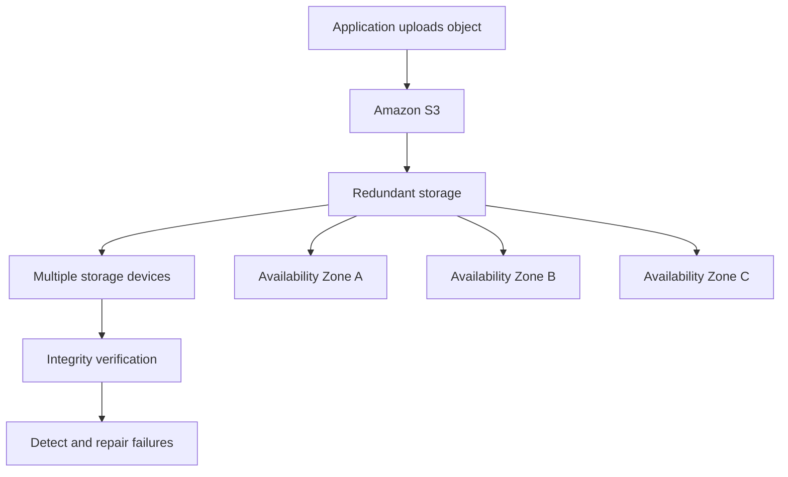
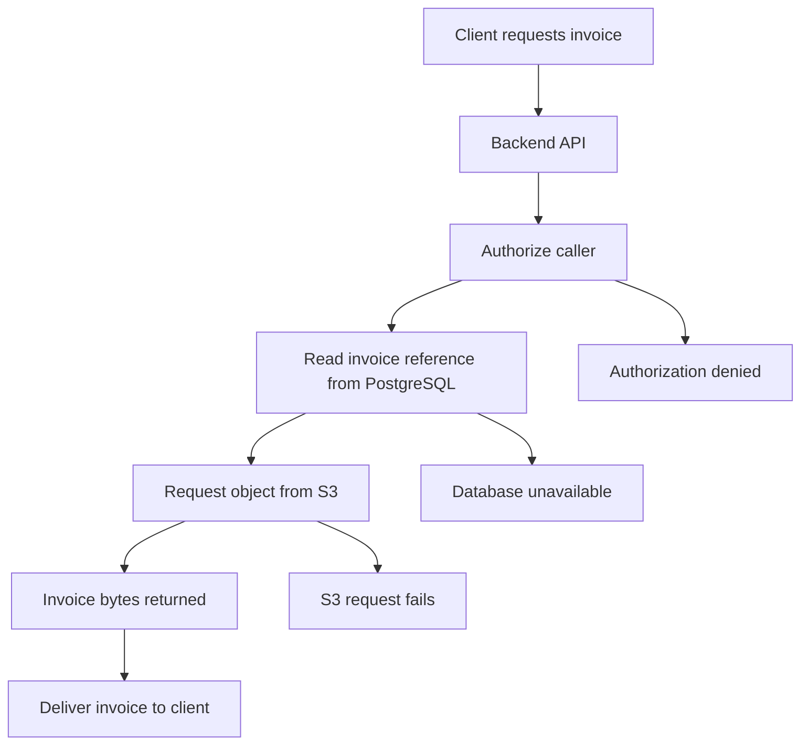

# 08- Durability vs Availability

## Overview

Durability and availability are two distinct properties of storage systems. They are often discussed together, but they protect against different failure scenarios.

- **Durability** describes how likely stored data is to remain intact and not be permanently lost.
- **Availability** describes how likely stored data or a storage service is to be accessible when required.

Amazon S3 is designed for extremely high data durability, but this does not mean every object is always immediately accessible or that every application request will succeed.

For backend engineers, the distinction matters when designing document storage, backups, media delivery, data pipelines, disaster recovery, and other systems that depend on S3.

Consider a document management application:

- If an invoice is permanently lost because every stored copy has failed, the problem is durability.
- If the invoice still exists but an S3 request temporarily fails, the problem is availability.
- If the invoice exists and S3 is healthy but the application has an incorrect IAM policy, the application may still be unable to access it.
- If an invoice is stored in an archive class and must be restored before retrieval, the delay is related to the storage class's access model rather than necessarily indicating a service outage.

A resilient architecture must account for all these scenarios independently.

## Understanding Durability

### What Is Durability?

Durability measures the ability of a storage system to preserve stored data over time despite failures.

Amazon S3 Standard is designed to provide **99.999999999% durability**, commonly described as 11 nines, over a given year.

This is a design target based on S3's storage architecture, not a guarantee that data loss is mathematically impossible.

High durability is achieved through mechanisms such as redundant storage across multiple devices, integrity verification, detection of failures, and repair of lost redundancy.

For the standard multi-Availability-Zone S3 storage classes, data is redundantly stored across a minimum of three Availability Zones within an AWS Region.

### How S3 Protects Durability

S3 manages the underlying storage infrastructure. Applications do not need to create their own replicas of every object just to obtain S3's baseline durability characteristics.

Conceptually, the process involves:

1. Receiving an object upload request.
2. Storing the object redundantly according to the selected storage class.
3. Validating data integrity through supported mechanisms.
4. Detecting storage-device failures and reduced redundancy.
5. Repairing lost redundancy according to the service's internal processes.

The precise internal implementation is managed by AWS and should not be treated as an application-controlled replication protocol.

This diagram illustrates the resilience model for a standard multi-AZ storage class, not the literal physical implementation of every S3 operation.

### What Durability Protects Against

High durability is designed to protect stored objects against storage-device failures and other failures covered by the selected storage class's redundancy model.

For multi-AZ S3 storage classes, the architecture is designed to sustain the loss of an entire Availability Zone without losing the stored objects.

However, S3 durability does not automatically protect an application against every way data can become unavailable or unusable.

For example:

- An authorized user can delete an object.
- A faulty application can overwrite the contents of an object.
- An overly broad lifecycle rule can expire data prematurely.
- Compromised credentials can be used to modify or delete objects.
- A database record containing the object's key can be lost.
- A customer-managed KMS key can become inaccessible or be scheduled for deletion.

These are primarily application, security, configuration, or key-management risks rather than ordinary storage-device durability failures.

### Durability Is Not the Same as Backup

S3's baseline durability should not be confused with an independent backup strategy.

Suppose a backend application accidentally uploads incorrect content to an existing object key. S3 can store that content with extremely high durability. The service has successfully preserved the bytes it received, even though those bytes are not the intended data.

Similarly, deleting an object is a valid storage operation, not necessarily a durability failure.

For data that must be recoverable from accidental changes, deletion, or security incidents, consider versioning, appropriate retention controls, independent backups, and tested recovery procedures.

## Understanding Availability

### What Is Availability?

Availability describes whether a service or data resource is accessible when requested.

S3 availability depends partly on the selected storage class. Different classes have different designed availability characteristics and access models.

For example, S3 Standard is designed for 99.99% availability, while S3 Standard-IA is designed for 99.9% availability.

Even when an object remains durably stored, a request can fail because of a temporary service problem, a permissions error, incorrect application configuration, or an unavailable dependency.

### How Availability Differs from Durability

Consider the following scenarios:

| Scenario | Durability concern | Availability concern |
|---|---|---|
| A storage device fails, but redundant copies preserve the object | Redundancy and integrity must be maintained | Requests may remain available |
| An Availability Zone becomes unavailable | Multi-AZ storage is designed to protect the object from zone loss | Access behavior depends on the selected storage class and service condition |
| An S3 request returns a transient server error | The stored object may remain intact | The request cannot complete successfully at that moment |
| An IAM policy denies the application access | The object may remain intact | The application cannot access the object |
| A database containing an object reference is unavailable | The S3 object may remain intact | The application may be unable to locate or serve it |
| An archived object requires restoration | The object remains stored | Access is delayed until the required restore process completes |

Durability concerns the preservation of data. Availability concerns the ability to use it when required.

### What Can Reduce Application-Level Availability?

An S3 application may experience access failures even when the underlying S3 storage service is operating normally.

Common causes include:

- Incorrect IAM permissions or bucket policies.
- Incorrect bucket names, Regions, or endpoint configuration.
- Expired credentials.
- KMS key access failures.
- Application networking or DNS problems.
- Throttling or transient service errors.
- Client-side timeouts or exhausted connection pools.
- Dependencies such as a database or authentication provider being unavailable.

This distinction is important during incident response. A failed download must not automatically be classified as an S3 outage.

A production service should capture enough information to distinguish AWS service errors from client, authorization, application, and dependency failures.

## S3 Storage Classes: Durability and Availability

Storage classes balance cost, retrieval behavior, performance, and availability. Choosing a lower-cost storage class does not always mean accepting substantially lower durability, but it can change the resilience model and access experience.

The following table summarizes the current AWS documentation's designed availability characteristics for common S3 storage classes.

| Storage class | Designed durability | Designed availability | Availability Zone model | Important access consideration |
|---|---|---|---|---|
| S3 Standard | 99.999999999% | 99.99% | Minimum of 3 AZs | Millisecond access for frequently accessed data |
| S3 Intelligent-Tiering | 99.999999999% | 99.9% | Minimum of 3 AZs | Some archive access tiers require restoration |
| S3 Standard-IA | 99.999999999% | 99.9% | Minimum of 3 AZs | Millisecond access; retrieval charges apply |
| S3 One Zone-IA | 99.999999999% | 99.5% | 1 AZ | Not designed to withstand the physical loss of that AZ |
| S3 Express One Zone | 99.999999999% | 99.95% | 1 AZ | Designed for low-latency access within a selected AZ |
| S3 Glacier Instant Retrieval | 99.999999999% | 99.9% | Minimum of 3 AZs | Millisecond access for rarely accessed data |
| S3 Glacier Flexible Retrieval | 99.999999999% | 99.99% after restoration | Minimum of 3 AZs | Archived objects must be restored before retrieval |
| S3 Glacier Deep Archive | 99.999999999% | 99.99% after restoration | Minimum of 3 AZs | Archived objects must be restored before retrieval |

These are AWS-designed characteristics, not contractual availability guarantees for every individual request. Availability for archived classes is qualified by their restoration requirements.

Source: [Comparing Amazon S3 storage classes](https://docs.aws.amazon.com/AmazonS3/latest/userguide/storage-class-intro.html).

### S3 Standard

S3 Standard is a suitable starting point for frequently accessed application data that needs low-latency access and multi-AZ resilience.

Typical use cases include:

- Customer documents and uploaded files.
- Application images and media.
- Frequently accessed reports.
- Active data-processing inputs.
- Common application assets.

It is often appropriate when the application needs immediate object access and should not depend on an archival restoration process.

### S3 Standard-IA

S3 Standard-IA is intended for long-lived data that is accessed infrequently but still requires millisecond retrieval and multi-AZ resilience.

Its designed availability is lower than that of S3 Standard, and retrieval charges and minimum storage-duration requirements apply.

Use it when the reduced storage cost justifies the retrieval economics and the workload's access requirements.

### S3 One Zone-IA

S3 One Zone-IA stores data redundantly across multiple devices within a single Availability Zone.

It has the same designed durability figure as S3 Standard-IA, but it is not designed to withstand the physical loss of the Availability Zone where the data resides.

It is most appropriate for infrequently accessed data that can be recreated or for workloads with another recoverable copy.

Do not use it as the only copy of irreplaceable data when the business requires resilience to an AZ-level disaster.

### S3 Glacier Storage Classes

S3 Glacier Instant Retrieval supports millisecond access for rarely accessed data. Glacier Flexible Retrieval and Glacier Deep Archive require restoration before archived content can be retrieved.

For these classes, a distinction is needed between the durability of stored data and the time required to make an object accessible to the application.

An application that requires immediate downloads should not assume that all Glacier storage classes behave like S3 Standard simply because they are part of Amazon S3.

## Designed Availability vs Service-Level Agreement

A designed availability percentage and a contractual Service-Level Agreement (SLA) are related but different concepts.

- **Designed availability** describes the service's design target for availability.
- **SLA** defines the contractual service commitment, how availability is measured, and the circumstances under which service credits may apply.

For example, S3 Standard is designed for 99.99% availability, but eligibility for service credits is determined by the applicable AWS SLA and its measurement rules.

An SLA is not a promise that every individual request will succeed. It also does not compensate for application errors, incorrect IAM permissions, unavailable dependencies, or every possible interruption.

For contractual questions, use the current [Amazon S3 Service Level Agreement](https://aws.amazon.com/s3/sla/).

### Availability Percentages Are Not Outage Predictions

A designed availability percentage should not be interpreted as a schedule of expected outages. Availability may vary across time, workload, storage class, and the service conditions that affect a particular request.

Likewise, a monthly SLA calculation is not necessarily equivalent to converting a designed annual availability percentage into a simple number of outage minutes.

For capacity planning and service objectives, distinguish the service's documented design characteristics from the application's actual measurements and contractual SLA terms.

## Durability and Availability in Production Architecture

A production architecture should specify separate requirements for data preservation and access.

Consider a document management service that stores invoices in S3 Standard and document metadata in PostgreSQL.

Possible failure outcomes include:

- PostgreSQL is unavailable, preventing the application from resolving the invoice key.
- S3 is temporarily unable to complete the request.
- IAM or KMS permissions prevent object access.
- The object was deleted or overwritten incorrectly.
- The object exists, but its storage class requires restoration.

Each outcome requires a different response. Retries may help with transient errors, but they do not fix invalid authorization, deleted data, or an unavailable database.

### Define the Required Guarantees

Before choosing a storage class or recovery architecture, clarify the requirements:

| Requirement | Engineering question |
|---|---|
| Data durability | How much risk of permanent data loss is acceptable? |
| Service availability | How often must users be able to access an object? |
| Retrieval latency | Can the application wait for restoration, or must access be immediate? |
| Recovery Point Objective (RPO) | How much recent data loss is acceptable after a failure? |
| Recovery Time Objective (RTO) | How long can recovery take? |
| Geographic resilience | Must data survive a regional incident? |
| Deletion recovery | Must accidentally deleted or overwritten objects remain recoverable? |

RPO and RTO should come from business requirements rather than being inferred from S3's durability percentage.

## Versioning, Replication, and Backup

Different data-protection mechanisms address different failure modes.

### Versioning

S3 Versioning preserves multiple object versions under the same key, subject to the bucket's versioning and retention configuration.

It helps recover from accidental overwrites and certain deletion scenarios. However, it does not independently protect against every account compromise, retention mistake, or intentional deletion of historical versions.

### Replication

S3 Replication can copy eligible objects to a destination bucket, including a bucket in another Region when using Cross-Region Replication.

Replication can support disaster recovery and geographic resilience requirements. However, replication is not automatically an independent backup: replicated changes, delete behavior, permissions, and retention settings must be understood.

Cross-Region replication can also have asynchronous propagation behavior. Do not assume that a newly written object is immediately available in the destination Region simply because S3 provides strong read-after-write consistency for operations against the source object.

### Independent Backups and Retention Controls

For critical workloads, consider:

- Versioning and suitable lifecycle rules.
- Separate backup copies where required.
- S3 Object Lock when retention or WORM protection is needed.
- Replication for geographic resilience.
- Independent IAM and account controls.
- Regular recovery testing.

An application that needs to recover from accidental deletion or malicious modification must design those scenarios explicitly. High durability alone is not a complete backup or disaster-recovery strategy.

Reference: [Data protection in Amazon S3](https://docs.aws.amazon.com/AmazonS3/latest/userguide/DataDurability.html).

## Improving Application Availability

S3 provides highly durable storage, but application-level availability also depends on how requests are executed and failures are handled.

### Retry Transient Failures

Transient connection errors, timeouts, throttling, and certain server errors may recover when retried.

Use exponential backoff with jitter and bounded retry attempts. Respect SDK retry behavior and avoid creating multiple uncontrolled retry layers that multiply requests.

Do not retry permanent failures such as invalid configuration or authorization denial indefinitely.

### Use Appropriate Timeouts

Set timeouts for network calls so requests do not remain blocked indefinitely. Timeout values should reflect the expected operation, object size, network behavior, and application latency budget.

Large downloads and archive restoration require different handling from small metadata requests.

### Separate Critical and Noncritical Operations

If an application needs to serve a document immediately, do not put synchronous operations such as a long-running archive restoration into its ordinary request path without explicitly accounting for the delay.

For processing workflows, use a background job or state machine where appropriate. For archived content, expose a restore-request workflow and report when the object is ready.

### Avoid Single Points of Failure

Application availability can depend on more than S3.

Examples include:

- A single API instance that cannot accept requests.
- An unavailable database that holds object references.
- A centralized credentials service that is inaccessible.
- A mandatory downstream service that must be called for every download.
- A cache that incorrectly serves stale authorization information.

Design the complete request path to meet the required service objective, rather than assuming the storage service's designed availability automatically becomes the application's availability.

## Monitoring Durability and Availability

Durability and availability are not monitored in exactly the same way.

### Availability Monitoring

Useful indicators include:

- S3 request error rates.
- Request latency and timeouts.
- HTTP 5xx responses.
- Authorization and configuration errors.
- Failed application downloads and uploads.
- Database access failures that prevent object retrieval.
- Archive restoration status and duration.
- End-to-end application success rate.

Use CloudWatch metrics, CloudTrail where appropriate, application logs, and synthetic monitoring according to the workload.

For example, a synthetic check can periodically upload, inspect, download, and validate a test object. This helps measure the complete application's ability to perform critical operations rather than relying only on a service-level metric.

### Durability and Data Protection Monitoring

Durability is not directly measured by simply counting failed GET requests.

Data-protection monitoring instead focuses on signals such as:

- Unexpected object deletions or overwrite patterns.
- Versioning and retention configuration drift.
- Replication failures and excessive replication lag.
- Backup job failures.
- Integrity-check failures.
- Incomplete multipart uploads.
- Lifecycle changes that affect retention.
- Unexpected changes to access permissions.

Monitoring should be paired with tested recovery procedures. Detecting an issue is not sufficient unless the organization knows how to restore the required data or service.

## Common Misconceptions

| Misconception | Correct interpretation |
|---|---|
| High durability means every request succeeds | Durability concerns data loss; availability concerns access |
| S3 Standard's 11 nines means zero risk | It is a design target, not an absolute guarantee |
| Strong consistency means 100% availability | Consistency and availability are different properties |
| Every S3 storage class has identical availability | Designed availability and access models differ by class |
| An S3 request failure means the object is lost | The object may remain intact despite a temporary error or permission failure |
| Replication automatically provides a complete backup | Replication behavior, deletion propagation, retention, and account separation matter |
| High durability prevents accidental deletion | Valid deletion operations can remove or hide data; recovery controls are separate |
| Archive objects are always immediately retrievable | Some storage classes require a restoration operation |
| The S3 SLA guarantees uninterrupted service | The SLA is a contractual commitment measured using defined terms and exclusions |
| S3's designed availability equals application availability | The full application depends on IAM, networking, databases, and other components |

## Further Reading

- [Data protection in Amazon S3](https://docs.aws.amazon.com/AmazonS3/latest/userguide/DataDurability.html)
- [Understanding and managing Amazon S3 storage classes](https://docs.aws.amazon.com/AmazonS3/latest/userguide/storage-class-intro.html)
- [Amazon S3 data consistency model](https://docs.aws.amazon.com/AmazonS3/latest/userguide/Welcome.html)
- [Resilience in Amazon S3](https://docs.aws.amazon.com/AmazonS3/latest/userguide/disaster-recovery-resiliency.html)
- [Amazon S3 Service Level Agreement](https://aws.amazon.com/s3/sla/)

## Key Takeaways

- **Durability** describes protection against permanent data loss, while **availability** describes the ability to access data when needed.
- Amazon S3 Standard is designed for 99.999999999% durability and 99.99% availability; these are different metrics with different meanings.
- Storage class selection affects designed availability, resilience to Availability Zone loss, retrieval latency, and cost.
- Versioning, replication, backups, and retention controls address different failure scenarios and should be selected according to recovery requirements.
- Production systems must monitor end-to-end application behavior and distinguish transient service failures, authorization problems, and data-loss risks.