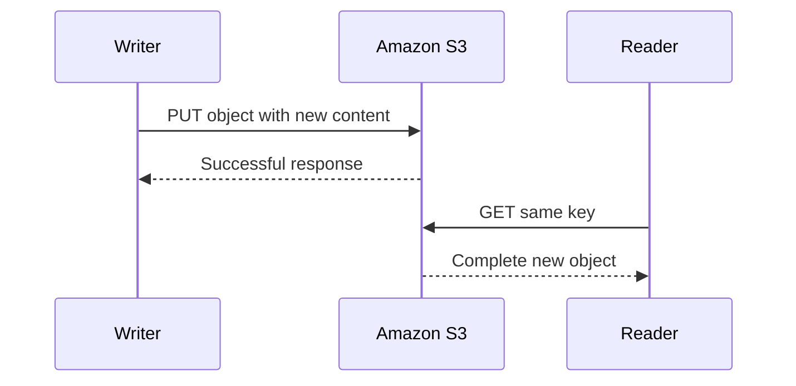
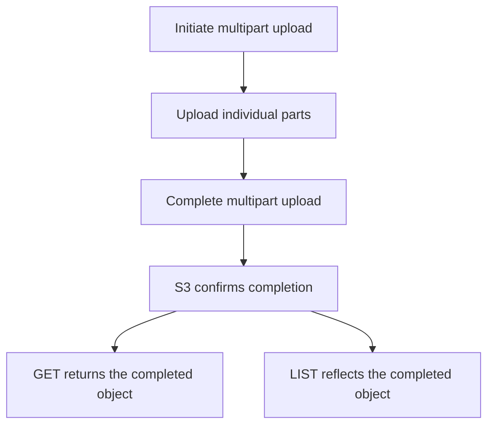
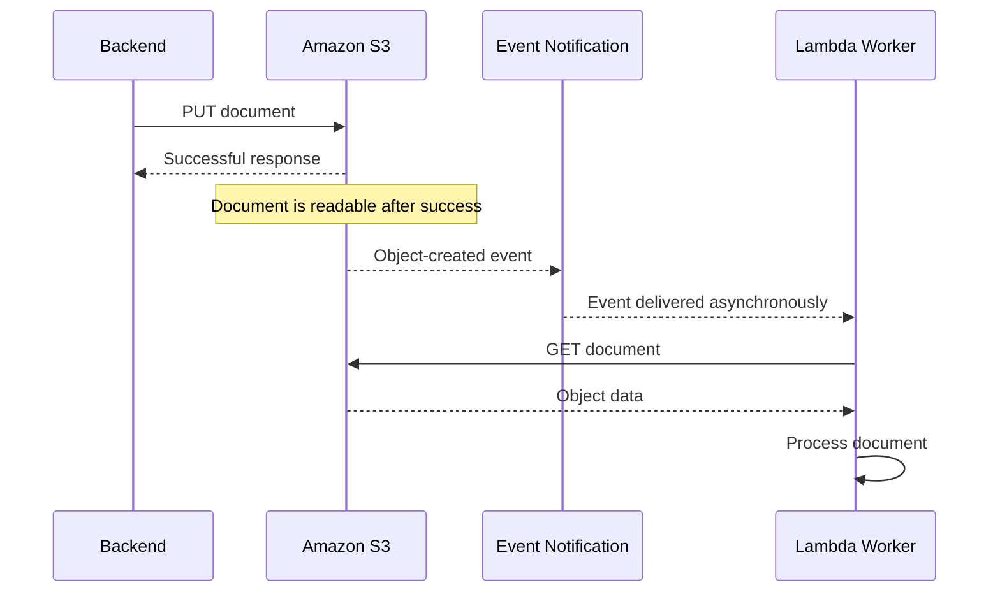

# 09- Strong Consistency

## Overview

Amazon S3 provides strong read-after-write consistency for object operations across all AWS Regions. After a successful write or delete operation completes, subsequent supported reads reflect the resulting state of the object.

This behavior applies to:

- Creating new objects.
- Overwriting existing objects.
- Deleting objects.
- Reading objects using GET requests.
- Listing objects using supported listing APIs.
- Reading object metadata, tags, and access control lists after supported updates.

Strong consistency simplifies application design because developers do not need to insert arbitrary delays between a successful write and a subsequent read or listing operation.

For example, a FastAPI service can upload an invoice to S3 and immediately issue a metadata request for that object after the upload succeeds. The application does not need to wait several seconds for the object to become visible.

However, strong consistency does not provide transactions across multiple objects or external services, guarantee that every request succeeds, or make asynchronous integrations instantaneous. These distinctions are essential when designing reliable backend applications.

Official reference: [Amazon S3 data consistency model](https://docs.aws.amazon.com/AmazonS3/latest/userguide/Welcome.html).

## What Is Strong Consistency?

Strong consistency means that once a supported write operation has completed successfully, subsequent reads observe the completed change rather than an older state.

Consider a backend that uploads an object:

```text
1. Application uploads invoice.pdf.
2. S3 returns a successful response.
3. Application requests invoice.pdf.
4. S3 returns the newly written object.
```

The successful write provides the important boundary. A read initiated after the application receives the successful response observes the completed write.

This behavior applies to both new objects and overwrites of existing objects.

### Example: Read-After-Write Consistency

Suppose an object does not initially exist:

```text
Key: reports/monthly.csv

Before upload:
    Object does not exist.

PUT succeeds:
    Object is created.

GET immediately afterward:
    Returns the newly created object.

LIST immediately afterward:
    Reflects the newly created key.
```

For a successful overwrite:

```text
Before overwrite:
    reports/monthly.csv contains version A.

PUT version B succeeds:
    The current object contains version B.

Subsequent GET:
    Returns version B.
```

There is no need to retry a successful upload merely because the object has not yet become visible to ordinary S3 reads.

### Strong Consistency Does Not Mean Every Request Succeeds

Consistency describes the relationship between completed operations and subsequent observations. It does not guarantee that every request will complete successfully.

A GET request can still fail because of:

- Missing or incorrect IAM permissions.
- Incorrect bucket names or Regions.
- Invalid or expired credentials.
- Network failures and timeouts.
- Temporary service errors.
- KMS key access restrictions.

A strongly consistent service can return an authorization error without violating its consistency guarantees.

## S3 Operations Covered by Strong Consistency

Amazon S3 documents strong consistency for object PUT and DELETE operations, including overwrites, along with supported GET and LIST operations and reads of relevant metadata.

| Operation | Consistency implication |
|---|---|
| `PutObject` | A successful write is visible to subsequent reads |
| Overwrite of an existing object | Subsequent reads observe the completed overwrite |
| `GetObject` | Reads initiated after a successful write observe the resulting current object |
| `HeadObject` | Subsequent metadata reads reflect the completed object state |
| `ListObjectsV2` | Subsequent listings reflect completed object creation or deletion |
| Object tagging updates | Subsequent tag reads reflect the completed update |
| ACL updates | Subsequent ACL reads reflect the completed update |
| Object deletion | Subsequent reads and listings reflect the resulting object state |
| Multipart upload completion | The completed object becomes available through normal object reads |

The exact semantics of a particular API operation still matter. An in-progress multipart upload, for example, is not yet a completed object, and a delete request in a versioned bucket can create a delete marker rather than remove all historical versions.

Strong consistency does not mean that all AWS control-plane operations, third-party caches, or asynchronous downstream workflows update at the same instant.

## Atomicity of Individual Object Updates

S3 provides atomic updates for an individual object key.

When an object is overwritten, a concurrent reader does not receive a partially written mixture of the old and new object contents. It observes a complete object representation consistent with the applicable operation ordering.

Consider a key whose current content is `invoice-v1.pdf`. A writer replaces the object with `invoice-v2.pdf`.



The example shows a read performed after the successful write response.

If a GET request overlaps an in-progress overwrite, the reader may observe the previous or new complete object depending on the operation ordering. It does not receive a partially written object merely because the overwrite is concurrent.

### Atomic Object Updates Are Not Conflict Detection

Atomicity does not mean that S3 automatically rejects conflicting writes.

Suppose two workers update the same key:

```text
Worker A writes value A.
Worker B writes value B.
```

Both writes can succeed if neither request uses appropriate conditions to prevent an overwrite.

The resulting current object reflects the completed writes' ordering. An application must not assume that the write it considers most important will necessarily remain current simply because its request was initiated last.

For workloads that need immutable creation or protection against lost updates, use unique keys, conditional writes, or another appropriate coordination strategy.

## Strong Consistency for Object Listings

Before strong consistency, developers sometimes used retries or delays to ensure that a newly created object appeared in a listing.

S3's current consistency model removes that requirement for completed object operations.

For example, after uploading:

```text
reports/2026/october.csv
```

a subsequent listing of the `reports/2026/` prefix reflects the new object.

### Listing Objects with the AWS CLI

```bash
aws s3api put-object \
    --bucket acme-documents-prod \
    --key reports/2026/october.csv \
    --body october.csv

aws s3api list-objects-v2 \
    --bucket acme-documents-prod \
    --prefix reports/2026/
```

The example assumes the caller has the necessary permissions and the source file exists locally. Once the PUT succeeds, a subsequent listing reflects the change.

A listing remains subject to pagination. Strong consistency does not mean that every matching object must appear in a single response.

For large collections, use continuation tokens or SDK paginators. Listing also remains a separate API operation and can fail independently because of permissions or network conditions.

### Strong Consistency Does Not Eliminate Pagination

If a prefix contains thousands of objects, `ListObjectsV2` may return only one page at a time.

The consistency model concerns the visibility of completed changes, not the number of objects returned per response.

Applications must continue to implement pagination correctly and should avoid repeatedly scanning large prefixes when a database or index is more appropriate for business queries.

## Strong Consistency and Object Metadata

Strong consistency applies to supported metadata, tagging, and ACL operations as well as object data.

For example, an application can update object tags and then retrieve them without an arbitrary delay intended to compensate for eventual consistency.

A typical sequence is:

```text
1. Update object tags.
2. S3 confirms the update.
3. Retrieve the object's tags.
4. Observe the updated tag set.
```

The same principle applies to supported object metadata reads after the relevant operation completes.

However, strong consistency does not eliminate the need to understand how the attribute is modified.

User-defined metadata generally requires a copy or replacement operation to change it after upload. Object tags have dedicated operations that can change tags without copying the object's data.

If the change is performed through a separate AWS service, cache, or asynchronous workflow, that integration can introduce its own visibility delays.

## Strong Consistency and Versioning

S3 Versioning preserves multiple versions of an object under the same key. Strong consistency applies to the current object state after a successful operation, but the behavior of reads depends on whether the request asks for the current object or a specific version.

Suppose the current key contains version A and an overwrite creates version B:

```text
Key:
    reports/monthly.csv

Version history:
    Version A: Previous content
    Version B: New content
```

After the successful overwrite, an ordinary GET returns the new current object. A request that explicitly identifies version A can still retrieve that historical version if it remains available and the caller has permission to access it.

### Deletion in a Versioned Bucket

In a versioned bucket, a normal delete generally creates a delete marker as the current version.

After the delete succeeds:

- An ordinary GET by key no longer returns the previously current object as if it were still the current version.
- An ordinary listing reflects the current delete-marker state.
- Previous object versions may remain available through version-specific operations.

Therefore, strong consistency does not mean that every old version is physically removed after a DELETE request.

Applications must distinguish between deleting the current object, retrieving a historical version, and permanently deleting a particular version.

Reference: [Deleting object versions and working with delete markers](https://docs.aws.amazon.com/AmazonS3/latest/userguide/DeletingObjects.html).

## Strong Consistency and Multipart Uploads

Multipart upload separates the transfer of an object into independently uploaded parts. Uploading individual parts does not make the final object available as a completed object.

The object becomes available through normal GET and LIST operations after the multipart upload completes successfully.



This boundary is important for large-file ingestion pipelines.

A backend should not mark a document as available merely because all parts have been submitted. It should verify that the multipart upload has completed successfully and that any required application-level validation has finished.

Abandoned multipart uploads are separate from completed objects and should be managed through appropriate cleanup policies.

## Strong Consistency Does Not Provide Multi-Object Transactions

S3 provides strong consistency for supported object operations, but it does not provide a general-purpose transaction that atomically updates multiple keys.

Suppose a report-generation workflow writes two objects:

```text
reports/monthly.csv
reports/monthly-summary.json
```

The workflow may successfully write the CSV and then fail before writing the JSON summary.

Both individual operations can obey strong consistency, while the application still ends up with an incomplete logical dataset.

Strong consistency does not automatically roll back the CSV write when the summary write fails.

### Handling Multi-Object Workflows

Applications that need to publish multiple related objects together should implement an explicit publication strategy.

One approach is to write data into a staging prefix:

```text
staging/<job-id>/monthly.csv
staging/<job-id>/monthly-summary.json
```

The workflow validates all required objects before publishing a reference to the completed dataset.

A database record, manifest object, or other controlled publication mechanism can indicate which dataset version is ready for consumers.

The choice depends on the workload, but consumers should not infer that a multi-object operation is complete merely because one file has become visible.

### Strong Consistency Across S3 and PostgreSQL

S3 and PostgreSQL do not participate in one shared atomic transaction.

Consider a document upload:

```text
1. Upload the document to S3.
2. Insert a document row into PostgreSQL.
3. Return success to the client.
```

If the S3 write succeeds but the database insert fails, the object exists even though the application's database has no corresponding record.

This is not a violation of S3 consistency. It is a partial failure across independent services.

A production application can address the situation using:

- Explicit upload and processing states.
- Idempotent operations.
- Retry-safe database updates.
- Reconciliation jobs.
- Cleanup of unreferenced objects where appropriate.
- A controlled publication step before the object becomes visible to consumers.

Do not add arbitrary sleep intervals between S3 and database operations as a substitute for transactional workflow design.

## Conditional Writes and Concurrency Control

When different clients or workers write to the same object key, strong consistency ensures consistent observations of completed writes but does not inherently prevent lost updates.

S3 supports conditional writes that evaluate the state of the object before allowing a supported write operation to proceed.

### `If-None-Match: *`

This condition is used when the application should create an object only if a current object with that key does not already exist.

For example:

```bash
aws s3api put-object \
    --bucket acme-documents-prod \
    --key immutable/reports/report-001.json \
    --body report.json \
    --if-none-match "*"
```

If the condition fails because an object already exists, the operation returns a precondition failure rather than unconditionally overwriting the current object.

This is useful for create-only workflows, immutable outputs, and preventing duplicate object creation under concurrent requests.

For a versioned bucket, the condition evaluates against the current version. A current delete marker has different behavior from a current object version.

### `If-Match`

The `If-Match` condition compares the supplied ETag against the current object's ETag for supported conditional-write operations.

This can support optimistic concurrency control:

```text
1. Read current object and ETag.
2. Prepare an update.
3. Write only if the current ETag still matches.
4. Handle the precondition failure if another writer changed the object.
```

The ETag must not be assumed to be the MD5 digest of the full object in every upload scenario. Its use here is as a conditional request value.

A precondition failure should be treated as a concurrency outcome. The application may need to reload the current state, merge changes, or reject the update.

Conditional writes are not a substitute for every form of distributed coordination, and their behavior differs by API operation. Review the specific API's supported headers and semantics.

Reference: [Conditional writes in Amazon S3](https://docs.aws.amazon.com/AmazonS3/latest/userguide/conditional-writes.html).

## Strong Consistency and Event-Driven Processing

S3 event notifications and downstream integrations operate separately from the consistency guarantee for object reads.

For example, an object upload may succeed and the object may immediately be readable, while the corresponding event notification reaches a Lambda function or SQS queue later.

Strong consistency does not mean that notifications are delivered synchronously with the PUT request or that every notification is delivered exactly once.

S3 Event Notifications are designed for at-least-once delivery, and duplicate or out-of-order notifications can occur.

### A Typical Event-Driven Workflow



The diagram illustrates the expected flow, not a guarantee that the event will be delivered immediately.

The worker should be idempotent and should handle duplicate events, retries, and failures independently of S3's read-after-write consistency guarantees.

For a notification about an overwritten key, the worker should also consider how to identify the intended object content. When necessary, use the event's version information, an appropriate versioned reference, or a workflow identifier instead of assuming that the current object always corresponds to the event being processed.

Reference: [Amazon S3 Event Notifications](https://docs.aws.amazon.com/AmazonS3/latest/userguide/EventNotifications.html).

## Strong Consistency and Cross-Region Replication

Strong consistency within a bucket does not imply immediate consistency across replicated buckets.

S3 Replication copies eligible objects from a source bucket to a destination bucket. Cross-Region Replication uses a destination in another AWS Region, and replication can occur asynchronously.

Consider this sequence:

```text
1. Upload object to the source bucket.
2. Source PUT succeeds.
3. Read the source object immediately.
4. Replication is still pending.
5. Destination object becomes available after replication completes.
```

The successful source write and read are consistent with S3's consistency model. The delay before the replicated object is available in the destination is a separate replication concern.

Do not treat a destination bucket as though it instantly contains every recent source write. Applications that require immediate destination availability must design for replication status and lag.

Replication also has its own eligibility rules and limitations. It should not be treated as a cross-bucket transaction or an automatic guarantee that every write has been replicated.

Reference: [Replicating objects within and across Regions](https://docs.aws.amazon.com/AmazonS3/latest/userguide/replication.html).

## Strong Consistency and Caches

S3 strong consistency applies to the supported S3 operations themselves. It does not automatically invalidate caches maintained by CloudFront, browsers, application processes, Redis, or other intermediaries.

For example, an application can overwrite an object and immediately retrieve the new content directly from S3, while a CDN may still serve an older cached response according to its cache policy.

This is not an S3 consistency failure.

### Cache Invalidation and Object Versioning

When content is mutable, the application must decide how cache freshness should work.

Common strategies include:

- Using suitable cache-control headers.
- Invalidating cached content when necessary.
- Using versioned or content-addressed keys for immutable assets.
- Avoiding long-lived caching for content that changes frequently.
- Ensuring that caches are isolated appropriately for private content.

For example:

```text
assets/app.7f42c19e.js
assets/app.c819aa23.js
```

A versioned asset key allows clients to request new content under a new URL, reducing dependence on invalidating a cached mutable key.

Strong consistency ensures that a completed S3 write is visible to subsequent qualifying S3 reads. Cache behavior beyond the S3 endpoint remains the responsibility of the surrounding architecture.

## Testing Strong Consistency

Strong consistency simplifies application tests because a successful write can be followed directly by a read or listing operation.

The following Boto3 example verifies the basic behavior using a unique test key:

```python
import uuid

import boto3


def verify_s3_read_after_write(bucket: str) -> None:
    s3 = boto3.client("s3")
    key = f"consistency-tests/{uuid.uuid4().hex}.txt"
    expected = b"strong-consistency-check"

    try:
        s3.put_object(
            Bucket=bucket,
            Key=key,
            Body=expected,
            ContentType="text/plain",
        )

        response = s3.get_object(
            Bucket=bucket,
            Key=key,
        )
        try:
            actual = response["Body"].read()
        finally:
            response["Body"].close()

        assert actual == expected

        listing = s3.list_objects_v2(
            Bucket=bucket,
            Prefix=key,
        )
        keys = {
            item["Key"]
            for item in listing.get("Contents", [])
        }

        assert key in keys

    finally:
        s3.delete_object(
            Bucket=bucket,
            Key=key,
        )
```

The test uses a unique key to avoid overwriting existing data. It assumes the caller has the required permissions and that the bucket is configured to support the requested operations.

This test is intended to demonstrate normal S3 read-after-write behavior, not to prove the service's full consistency contract through a finite number of executions.

For production systems, also test application-level partial failures, retries, concurrency conflicts, cache invalidation behavior, and asynchronous event processing.

## Common Strong Consistency Misconceptions

| Misconception | Correct interpretation |
|---|---|
| S3 needs a delay after every upload | Supported reads and listings reflect a completed successful write |
| Strong consistency means every request succeeds | Requests can still fail because of permissions, networking, or service conditions |
| Strong consistency creates a transaction across objects | Each operation has its own semantics; multi-object workflows need explicit coordination |
| Two simultaneous writes cannot overwrite each other | Both can succeed unless an appropriate concurrency strategy prevents it |
| A successful source write guarantees immediate replication | Replication to another bucket may be asynchronous |
| Event notifications arrive instantly and exactly once | Notifications are asynchronous and can be duplicated or out of order |
| CloudFront always serves the newest S3 object immediately | CDN and application caches have independent freshness rules |
| A DELETE request permanently removes all versions | In a versioned bucket, a normal delete can create a delete marker |
| Strong consistency guarantees application-level availability | IAM, databases, networks, and other dependencies can still prevent access |
| A single LIST response includes every object | Listings are paginated regardless of the consistency model |

## Further Reading

- [Amazon S3 data consistency model](https://docs.aws.amazon.com/AmazonS3/latest/userguide/Welcome.html)
- [Amazon S3 conditional writes](https://docs.aws.amazon.com/AmazonS3/latest/userguide/conditional-writes.html)
- [Amazon S3 Event Notifications](https://docs.aws.amazon.com/AmazonS3/latest/userguide/EventNotifications.html)
- [Amazon S3 replication](https://docs.aws.amazon.com/AmazonS3/latest/userguide/replication.html)
- [Amazon S3 object deletion](https://docs.aws.amazon.com/AmazonS3/latest/userguide/DeletingObjects.html)
- [Amazon S3 performance and consistency considerations](https://aws.amazon.com/s3/consistency/)

## Key Takeaways

- Amazon S3 provides strong read-after-write consistency for supported object operations, so successful writes are immediately visible to subsequent reads and listings.
- Updates to an individual object are atomic, but strong consistency does not automatically prevent conflicting writes or provide transactions across multiple objects.
- Conditional writes can prevent unintended overwrites or implement selected optimistic concurrency workflows.
- Event notifications, cross-Region replication, and caches have independent timing and processing behavior that strong consistency does not eliminate.
- Production applications should combine S3's consistency guarantees with idempotency, explicit concurrency control, recovery workflows, and appropriate monitoring.