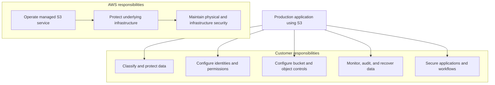
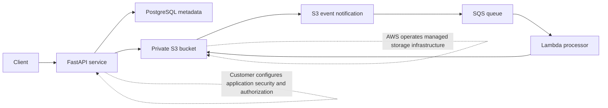

# 10- AWS Shared Responsibility Model

## Overview

The AWS Shared Responsibility Model defines how security and compliance responsibilities are divided between Amazon Web Services (AWS) and its customers. For Amazon S3, AWS manages the underlying cloud infrastructure and the operation of the managed storage service, while customers remain responsible for configuring access, protecting their data, managing identities, and meeting their organizational and regulatory requirements.

AWS describes this model using two complementary concepts:

- **Security of the cloud:** AWS protects the infrastructure that runs AWS services.
- **Security in the cloud:** Customers configure and operate their workloads securely using AWS services and controls.

Understanding this boundary is essential when designing production S3 systems. AWS operating a secure storage platform does not automatically make every bucket, object, application, or data-processing workflow secure.

For example, AWS operates the infrastructure supporting S3, but a customer can still expose sensitive documents by granting excessive permissions through a bucket policy or by generating a presigned URL with inappropriate access and expiration settings.

Reference: [Security in Amazon S3](https://docs.aws.amazon.com/AmazonS3/latest/userguide/security.html).

## Why the Shared Responsibility Model Matters

Amazon S3 is a managed service. Customers do not provision or patch the physical storage servers, maintain the underlying S3 operating systems, or manage the internal infrastructure responsible for delivering the service.

This abstraction reduces operational overhead, but it does not eliminate the need for application and security engineering.

The model helps engineering teams determine:

- Which security controls AWS implements and operates.
- Which configurations customers must establish and maintain.
- Who is responsible for protecting application data.
- Which controls must be continuously monitored.
- How responsibilities change when S3 integrates with other AWS services.
- Which operational and compliance risks remain with the customer.

A production team should treat the model as an input to architecture decisions, security reviews, operational runbooks, and compliance evidence collection.

## Security of the Cloud

AWS is responsible for protecting the infrastructure that runs AWS services, including the infrastructure supporting Amazon S3.

For S3, AWS responsibilities include the underlying managed-service infrastructure rather than the customer's bucket and object configuration.

| Responsibility | AWS ownership |
|---|---|
| Physical data-center security | Protecting AWS facilities and physical infrastructure |
| Underlying storage infrastructure | Operating the infrastructure supporting S3 |
| Managed-service infrastructure | Maintaining the service components AWS operates |
| Underlying host and service platform | Operating and securing the underlying infrastructure and software layers within AWS's managed-service boundary |
| Infrastructure-level availability mechanisms | Operating the infrastructure that supports S3's service-level resilience |
| Physical access controls | Controlling physical access to AWS facilities and infrastructure |

The exact scope of responsibility depends on the service and its operating model. For an abstracted service such as S3, customers generally consume service endpoints and configure their data and access controls rather than manage the underlying servers.

### What AWS Does Not Automatically Manage for You

AWS managing S3's infrastructure does not mean AWS automatically determines the correct security configuration for every workload.

AWS does not decide which employees should read confidential documents, which application roles can delete objects, how long customer data should be retained, or whether the application has a valid business reason to expose a file through a presigned URL.

Those decisions require customer configuration and governance.

## Security in the Cloud

For Amazon S3, customer responsibilities center on the data stored in S3, the access granted to that data, and the way the service is configured and integrated into applications.

Typical responsibilities include:

| Responsibility | Customer responsibility |
|---|---|
| Data ownership and classification | Identify sensitive, confidential, regulated, and public data |
| Identity and access management | Define IAM identities, roles, permissions, and resource policies |
| Bucket configuration | Configure bucket policies, Block Public Access, Object Ownership, and other required controls |
| Encryption | Select and configure encryption options appropriate to security and compliance requirements |
| Key management | Manage customer-controlled AWS KMS keys, key policies, grants, and related permissions where applicable |
| Application security | Prevent unauthorized uploads, downloads, deletions, and data exposure |
| Monitoring and auditing | Configure appropriate logging, auditing, and detective controls |
| Retention and recovery | Configure versioning, lifecycle rules, retention, replication, and backup mechanisms as required |
| Compliance | Determine applicable requirements and implement controls that satisfy them |
| Operational governance | Review configuration drift, access changes, incidents, and recovery readiness |

Not every control is mandatory for every workload. Appropriate controls depend on the sensitivity of the data, applicable laws and regulations, business requirements, and the architecture in which S3 is used.

## Understanding the Responsibility Boundary

The following diagram illustrates the main distinction for Amazon S3.



The customer and AWS responsibilities are complementary rather than interchangeable. AWS provides the managed service and its underlying protections; customers must configure and use that service in a way that meets their requirements.

## Applying the Model to Amazon S3

### Data Classification and Ownership

Customers decide what data belongs in S3, how sensitive it is, and how it should be protected.

A document-management backend might store:

```text
documents/
    public/
    internal/
    confidential/
```

These prefixes can help organize data, but prefixes alone do not enforce authorization. Customers must implement actual access controls through IAM, bucket policies, application authorization, or other appropriate mechanisms.

For example, a backend that stores customer invoices must ensure that one customer's identity cannot authorize access to another customer's invoice simply by changing an object key in an API request.

### Identity and Access Management

AWS provides IAM and S3 authorization mechanisms. Customers are responsible for configuring them correctly.

A backend running on EC2, ECS, EKS, or Lambda should generally use an appropriate IAM role and temporary credentials rather than static access keys embedded in application code.

A simplified access model is:

```text
FastAPI service
      |
      | Uses temporary credentials
      v
IAM role
      |
      | Grants specific S3 actions
      v
Private S3 bucket
```

The role should grant only the actions and resources required by the application.

For example, a service that uploads documents into a specific prefix may need permission to write objects there, but it should not automatically receive permission to delete every object in every bucket in the account.

The customer must also consider other applicable authorization layers, such as bucket policies, permissions boundaries, service control policies, VPC endpoint policies, and KMS key policies.

Detailed implementation guidance belongs in the S3 security and IAM documentation.

### Bucket and Object Security

Customers are responsible for configuring bucket and object access appropriately.

Examples include:

- Keeping sensitive buckets private.
- Enabling and maintaining S3 Block Public Access where appropriate.
- Using S3 Object Ownership with bucket-owner-enforced ownership unless ACLs are needed.
- Restricting bucket policies to approved principals and required actions.
- Preventing unintended cross-account access.
- Reviewing presigned URL issuance and lifetime.
- Separating public content from confidential application data.

AWS provides the controls; the customer selects, configures, and verifies them.

Reference: [Security best practices for Amazon S3](https://docs.aws.amazon.com/AmazonS3/latest/userguide/security-best-practices.html).

### Encryption and Key Management

Amazon S3 automatically applies server-side encryption to new object uploads using S3-managed encryption keys by default. Customers must still determine whether this default meets their requirements and configure additional encryption or key-management controls when necessary.

For example, an organization may require SSE-KMS with a customer-managed KMS key to enforce specific key policies, auditing requirements, or key-administration boundaries.

In that case, responsibilities include:

- Selecting the appropriate encryption configuration.
- Managing the KMS key lifecycle and key policy.
- Granting the required permissions to approved applications and users.
- Ensuring the application can use the key for permitted operations.
- Monitoring relevant access and key-management activity.

A user can have permission to access an S3 object but still be denied access because the required KMS permissions are missing.

Encryption also does not replace authorization. A correctly encrypted object can still be exposed if access policies permit unintended principals to retrieve it.

Reference: [Protecting data with encryption](https://docs.aws.amazon.com/AmazonS3/latest/userguide/UsingEncryption.html).

### Monitoring and Auditing

Customers are responsible for configuring the detective controls necessary to identify unauthorized access, configuration drift, and suspicious activity.

Depending on the workload, useful controls include:

| Control | Purpose |
|---|---|
| AWS CloudTrail | Audit relevant AWS API activity and investigate changes or access events |
| CloudTrail S3 data events | Capture selected object-level API activity when configured |
| Amazon CloudWatch | Monitor supported metrics, logs, and alarms |
| AWS Config | Evaluate resource configurations against selected rules |
| IAM Access Analyzer for S3 | Identify potentially unintended external or public access |
| Amazon GuardDuty protection for S3 | Help detect suspicious activity involving S3 data access |
| S3 Inventory | Generate object-level inventory reports, including selected security and management attributes |

The customer must choose suitable controls, configure them, define alert thresholds, and respond to findings.

Not every S3 object request is automatically recorded in the same way. For example, object-level CloudTrail data events require appropriate configuration and can generate additional charges.

## Shared Responsibility Across a Complete S3 Architecture

An S3-based application often combines several AWS services and customer-managed components. Responsibility must be assessed for the complete system, not just the bucket.

Consider a document-upload application using FastAPI, S3, Lambda, SQS, and PostgreSQL.



The architecture has multiple responsibility boundaries.

| Component | AWS responsibilities | Customer responsibilities |
|---|---|---|
| Amazon S3 | Operate and protect the managed S3 service infrastructure | Configure bucket access, data protection, lifecycle, and recovery controls |
| FastAPI on ECS or EC2 | Operate the underlying AWS infrastructure within the chosen service boundary | Secure application code, dependencies, authentication, authorization, and upload validation |
| AWS Lambda | Operate the Lambda service infrastructure and execution platform | Secure function code, dependencies, permissions, configuration, and processing logic |
| Amazon SQS | Operate the managed queue service infrastructure | Configure permissions, queue policies, retention, visibility timeout, retries, and dead-letter handling |
| Amazon RDS for PostgreSQL | Operate the managed database infrastructure and service components | Configure access, data models, application queries, backup requirements, and applicable database settings |
| AWS KMS | Operate the managed key service infrastructure | Configure key policies, grants, usage permissions, and key lifecycle decisions where applicable |
| CloudTrail and CloudWatch | Provide managed audit and monitoring capabilities | Enable appropriate logging, select retention, define alarms, and investigate findings |

The exact split depends on the service being used. For EC2, for example, customers have responsibilities for the guest operating system and installed software that they do not have when consuming S3 as an abstracted storage service.

### Application-Level Responsibility

Suppose a client uploads a PDF through a FastAPI endpoint.

The customer remains responsible for validating the file, authenticating the requester, enforcing tenant ownership, generating a safe object key, and preventing unauthorized downloads.

A private bucket is necessary for many sensitive-data architectures, but it does not correct an API that lets every authenticated user request any object by key.

Similarly, AWS cannot determine whether an application should reject an executable disguised as a PDF or whether a document contains sensitive information that must not be returned to an unauthorized user.

These are application and data-governance responsibilities.

## Availability, Durability, and Disaster Recovery

AWS operates the infrastructure supporting S3's documented durability and availability characteristics. Customers remain responsible for choosing appropriate storage configurations and designing the recovery strategy required by their workloads.

For example, S3's durability characteristics do not by themselves guarantee that an application can recover from every form of accidental deletion, malicious overwrite, or application-level corruption.

Customers may need to configure:

- S3 Versioning to preserve previous object versions.
- Lifecycle rules to manage versions and retention.
- Replication for additional copies in supported destinations.
- S3 Object Lock when appropriate for retention requirements.
- Backup and recovery workflows where replication alone is insufficient.
- Monitoring and recovery procedures with tested recovery objectives.

Replication should not automatically be considered an independent backup. Unwanted changes or deletions may be propagated depending on the configuration, and a replicated copy may not satisfy all recovery or isolation requirements.

The customer must determine the required recovery point objective (RPO) and recovery time objective (RTO), configure supporting controls, and test recovery.

References:

- [Amazon S3 data durability](https://docs.aws.amazon.com/AmazonS3/latest/userguide/DataDurability.html)
- [Amazon S3 disaster recovery and resilience](https://docs.aws.amazon.com/AmazonS3/latest/userguide/disaster-recovery-resiliency.html)

## Compliance and Governance

AWS provides information about its security controls and compliance programs for applicable services. Customers are responsible for determining whether those programs and service capabilities satisfy their own regulatory and contractual obligations.

Using S3 does not automatically make an application compliant with a particular standard or law.

For example, a system handling regulated personal information may need customer-defined controls for:

- Data classification and access restrictions.
- Encryption and key-management policies.
- Retention and deletion.
- Access auditability.
- Cross-Region storage restrictions.
- Data residency requirements.
- Incident response and breach notification.
- Evidence collection and periodic control validation.

The engineering team should identify the applicable requirements and map each requirement to technical controls, operational processes, and audit evidence.

AWS compliance reports can support this work, but the customer remains responsible for its own compliance posture.

Reference: [AWS Compliance Programs](https://aws.amazon.com/compliance/programs/).

## Verifying Customer-Controlled S3 Security Settings

The shared responsibility model is most useful when translated into observable configuration checks.

The following commands provide examples of how an operator can inspect selected bucket settings.

### Verify Block Public Access

```bash
aws s3api get-public-access-block \
    --bucket acme-documents-prod
```

This returns the bucket-level Block Public Access configuration if one is explicitly configured. Account-level settings must also be considered.

### Verify Default Encryption

```bash
aws s3api get-bucket-encryption \
    --bucket acme-documents-prod
```

Inspect the returned configuration to confirm which default server-side encryption settings apply. A missing explicit bucket encryption configuration does not necessarily mean objects are unencrypted because S3 applies server-side encryption by default to new object uploads.

### Verify Versioning

```bash
aws s3api get-bucket-versioning \
    --bucket acme-documents-prod
```

Check whether versioning is enabled or suspended. Versioning should be enabled when required by the application's recovery and retention design.

### Inspect the Bucket Policy

```bash
aws s3api get-bucket-policy \
    --bucket acme-documents-prod
```

Review the effective access design in conjunction with IAM policies, Block Public Access, Object Ownership, and applicable organizational restrictions. A bucket policy alone does not represent the entire authorization decision.

These commands assume the operator has the relevant permissions. A successful configuration query does not prove that every security requirement has been satisfied.

Production environments should automate configuration checks where possible, using infrastructure-as-code validation, policy-as-code, AWS Config rules, security monitoring, and periodic reviews.

## Common Mistakes

| Mistake | Why it is incorrect | Better approach |
|---|---|---|
| Assuming AWS secures all data automatically | AWS infrastructure protection does not determine application authorization or business data policies | Define and validate access controls at the identity, resource, and application layers |
| Treating private buckets as sufficient application security | An application may still expose data through permissive APIs or presigned URLs | Enforce user and tenant authorization before issuing access |
| Embedding permanent AWS credentials in source code | Credentials can leak and may remain valid beyond their intended use | Use IAM roles and temporary credentials where appropriate |
| Assuming encryption guarantees confidentiality against every threat | Encryption does not prevent misuse by an authorized principal or a compromised application | Combine encryption with least privilege, auditing, and application security |
| Assuming S3 Versioning is a complete backup strategy | Versioning alone does not satisfy every recovery, isolation, or retention requirement | Evaluate backups, replication, retention controls, and tested recovery procedures |
| Enabling logs without operational ownership | Logs that nobody reviews may not detect or resolve incidents promptly | Define alerts, retention, investigation procedures, and accountable owners |
| Assuming AWS compliance automatically makes an application compliant | Application architecture and organizational processes are also in scope | Map applicable requirements to technical controls and verifiable evidence |
| Treating shared responsibility as fixed for every AWS service | Managed services and self-managed infrastructure have different responsibility boundaries | Assess each service and its configuration independently |

## Production Readiness Checklist

Before releasing an S3-backed workload, confirm that the relevant customer-owned controls are implemented.

- [ ] Data is classified, and access is restricted according to sensitivity.
- [ ] Applications use appropriate IAM roles and temporary credentials.
- [ ] Bucket policies and IAM permissions follow least privilege.
- [ ] Block Public Access and Object Ownership settings match the intended architecture.
- [ ] Encryption and key-management controls satisfy workload requirements.
- [ ] Application endpoints validate uploads and enforce object-level authorization.
- [ ] Logs, metrics, alerts, and security investigations have defined ownership.
- [ ] Versioning, replication, retention, and backup decisions match recovery objectives.
- [ ] Configuration compliance is checked during deployment and ongoing operations.
- [ ] Recovery and incident-response procedures are tested.
- [ ] Regulatory and contractual requirements have been mapped to appropriate controls.

Not every workload needs every control in exactly the same form. The final design should document which controls apply, why they are needed, and how their effectiveness is verified.

## Further Reading

- [Security in Amazon S3](https://docs.aws.amazon.com/AmazonS3/latest/userguide/security.html)
- [AWS Shared Responsibility Model](https://aws.amazon.com/compliance/shared-responsibility-model/)
- [Shared Responsibility — AWS Well-Architected Security Pillar](https://docs.aws.amazon.com/wellarchitected/latest/security-pillar/shared-responsibility.html)
- [Security best practices for Amazon S3](https://docs.aws.amazon.com/AmazonS3/latest/userguide/security-best-practices.html)
- [Amazon S3 access management](https://docs.aws.amazon.com/AmazonS3/latest/userguide/access-management.html)

## Key Takeaways

- AWS is responsible for protecting and operating the infrastructure supporting Amazon S3, while customers configure and secure their data, identities, permissions, and workloads.
- S3 being a managed service reduces infrastructure-management responsibilities but does not eliminate application security, access-control, monitoring, or compliance obligations.
- Security requires coordinated controls across IAM, bucket policies, encryption, applications, logging, and data-governance processes.
- Durability and availability provided by AWS do not remove the customer's responsibility to define recovery objectives and configure appropriate recovery mechanisms.
- A production implementation should translate shared responsibility into measurable controls, automated configuration checks, operational ownership, and tested recovery procedures.