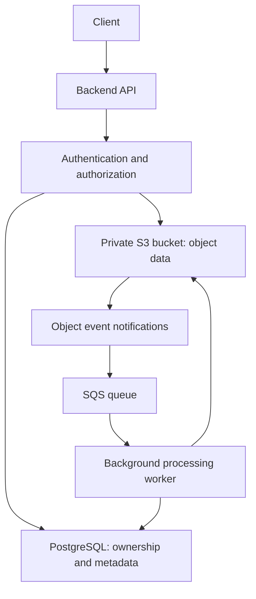

# README

## Overview

This directory contains the foundational Amazon S3 documentation for the Backend Engineering Playbook. It establishes the concepts required to design, implement, secure, and operate S3-backed systems in production.

Amazon S3 is an object storage service used for application uploads, document and media storage, static content delivery, backups, data lakes, analytics, and event-driven processing. Effective use of S3 requires an understanding of its object model, resource boundaries, consistency guarantees, reliability characteristics, and the responsibilities shared between AWS and its customers.

The documents in this directory progress from core object storage concepts to the operational behavior and reliability guarantees that influence production architecture. Specialized implementation guidance belongs in the corresponding Architecture, Integrations, Operations, Security, Hands-on, Best Practices, Advanced Features, and Deployment sections.

## Navigation

| No. | Document | Description |
|---|---|---|
| 01 | [What Is Amazon S3](./01-%20What%20is%20Amazon%20S3.md) | S3 fundamentals, core capabilities, object storage terminology, and backend engineering use cases |
| 02 | [Object Storage](./02-%20Object%20Storage.md) | Object storage architecture and the differences between object, block, and file storage |
| 03 | [Buckets](./03-%20Buckets.md) | Bucket fundamentals, supported bucket types, Regions, resource boundaries, and configuration |
| 04 | [Bucket Naming](./04-%20Bucket%20Naming.md) | Bucket naming rules, namespace considerations, naming conventions, and production naming strategies |
| 05 | [Objects](./05-%20Objects.md) | Object structure, reads and writes, metadata, tagging, versions, and object operations |
| 06 | [Object Keys](./06-%20Object%20Keys.md) | Key structure, prefixes, naming patterns, URL encoding, and safe key generation |
| 07 | [Object Metadata](./07-%20Object%20Metadata.md) | System metadata, user-defined metadata, object tags, and metadata management |
| 08 | [Durability vs Availability](./08-%20Durability%20vs%20Availability.md) | Durability, availability, failure domains, storage-class characteristics, and recovery considerations |
| 09 | [Strong Consistency](./09-%20Strong%20Consistency.md) | Read-after-write consistency, atomic object updates, conditional writes, and consistency boundaries |
| 10 | [AWS Shared Responsibility Model](./10-%20AWS%20Shared%20Responsibility%20Model.md) | AWS and customer responsibilities for infrastructure security, data protection, operations, and compliance |

## Recommended Learning Path

Follow the documents in order to develop a progressively deeper understanding of Amazon S3.

| Stage | Focus | Documents |
|---|---|---|
| Fundamentals | Understand S3's purpose, object storage, and core capabilities | What Is Amazon S3, Object Storage |
| Resource organization | Understand buckets, Regions, namespaces, and naming | Buckets, Bucket Naming |
| Object model | Understand object identity, keys, and associated attributes | Objects, Object Keys, Object Metadata |
| Reliability | Understand how S3 behaves during reads, writes, failures, and recovery scenarios | Durability vs Availability, Strong Consistency |
| Security boundaries | Understand the division of responsibilities between AWS and the customer | AWS Shared Responsibility Model |

This sequence establishes the concepts needed before working with advanced upload workflows, storage lifecycle policies, replication, presigned URLs, event notifications, and production deployment patterns.

## Core Concepts

### Amazon S3 Object Storage

S3 stores data as objects within buckets. An object includes its data, a key identifying it within its bucket, and associated attributes.

| Concept | Engineering significance |
|---|---|
| Bucket | Defines a resource boundary for object storage and many storage-related configurations |
| Object | Represents the stored data and its associated attributes |
| Object key | Identifies an object within its bucket and influences application-level organization |
| Prefix | Groups keys by a shared beginning and supports listing and organizational conventions |
| Metadata | Describes an object and supports selected application and storage workflows |
| Storage class | Influences storage cost, retrieval characteristics, and workload suitability |
| Consistency | Defines how completed object changes are observed by subsequent supported operations |
| Durability | Describes the likelihood of retaining stored data over time |
| Availability | Describes the expected availability of the storage service or selected storage class |

General-purpose S3 buckets use a flat object namespace rather than a traditional filesystem directory hierarchy. Prefixes provide a useful organizational convention, but they do not independently enforce access control.

### Foundational Engineering Principles

Keep the following principles in mind when designing S3-backed applications:

- **Treat object keys as application identifiers.** Define naming conventions deliberately and avoid blindly using client-provided paths as storage keys.
- **Separate storage from application metadata.** S3 stores object data, while a relational database may manage ownership, business metadata, workflow state, and relationships between entities.
- **Design for concurrency.** Strong consistency does not automatically prevent conflicting writes or protect an application from lost updates.
- **Distinguish object consistency from workflow consistency.** S3 does not provide a general-purpose transaction spanning multiple objects, databases, queues, and external services.
- **Design recovery intentionally.** Durability does not replace the need to evaluate versioning, retention, replication, backup, and disaster recovery requirements.
- **Keep authorization explicit.** Bucket privacy alone does not guarantee that application users can access only the objects they are authorized to retrieve.
- **Account for service boundaries.** Event delivery, replication, and external caching have behavior and timing characteristics that are separate from S3's object consistency guarantees.

## How These Concepts Apply to Backend Systems

Amazon S3 commonly acts as the data storage layer for backend services rather than the component responsible for all application state.

A document-management system, for example, might use FastAPI for HTTP endpoints, PostgreSQL for document ownership and processing status, and S3 for document contents.

In this design:

- The backend validates requests and enforces application-level authorization.
- PostgreSQL stores records such as document ownership, business status, and processing results.
- S3 stores the actual files.
- SQS and background workers support asynchronous processing.
- The application coordinates failures and retries across independently operated services.

The foundational concepts in this directory explain the storage behavior underlying these workflows. The detailed design and implementation of such systems belong in the related playbook sections.

## Related Documentation

Use the following sections for specialized guidance. Each section should contain the detailed implementation or operational material most appropriate to its purpose.

| Section | Purpose | Navigation |
|---|---|---|
| Architecture | End-to-end designs, component interactions, trust boundaries, multi-tenant storage, and disaster recovery | [Architecture](../../02-%20Architecture/) |
| Integrations | Boto3, Django, Django REST Framework, FastAPI, Flask, Celery, CloudFront, Lambda, SQS, SNS, EventBridge, KMS, Glue, and Athena | [Integrations](../../03-%20Integrations/) |
| Operations | Monitoring, lifecycle management, storage usage, replication health, cost analysis, and recovery procedures | [Operations](../../04-%20Operations/) |
| Security | IAM, bucket policies, encryption, KMS permissions, public access, presigned URLs, and auditing | [Security](../../05-%20Security/) |
| CLI | Reusable S3-specific AWS CLI commands and safe operational workflows | [CLI](../../06-%20CLI/) |
| Troubleshooting | Diagnostic workflows for authorization, uploads, replication, lifecycle, notifications, and deployment failures | [Troubleshooting](../../07-%20Troubleshooting/) |
| Interview Questions | Scenario-driven questions covering core concepts, implementation, architecture, and senior-level trade-offs | [Interview Questions](../../08-%20Interview%20Questions/) |
| Hands-on | Runnable implementation projects for file APIs, image processing, static websites, document pipelines, replication, and data lifecycle management | [Amazon S3 Hands-on Projects](../../09-%20Hands-on/12-%20Amazon%20S3/) |
| Best Practices | Cross-cutting recommendations for security, reliability, performance, cost, and maintainability | [Best Practices](../../10-%20Best%20Practices/) |
| Advanced Features | Specialized S3 capabilities, including multipart uploads, replication enhancements, Transfer Acceleration, and advanced access patterns | [Advanced Features](../../11-%20Advanced%20Features/) |
| Deployment | Terraform, CloudFormation, CDK, GitHub Actions, OIDC, infrastructure validation, release management, and rollback | [Deployment](../../12-%20Deployment/) |
| Cheat Sheets | Concise operational references, command summaries, and configuration checklists | [Cheat Sheets](../../13-%20Cheat%20Sheets/) |

The links assume the repository uses the corresponding top-level section names. Verify them against the actual repository structure if those directories are named differently.

## Documentation Boundaries

To keep the playbook navigable and avoid repeated explanations, use these boundaries when extending the Amazon S3 documentation.

| Subject | Primary location |
|---|---|
| Storage fundamentals, buckets, keys, metadata, and consistency | `01- Concepts/14- Amazon S3/` |
| End-to-end storage architectures and system design | `02- Architecture/` |
| SDK usage, framework integrations, and AWS service integrations | `03- Integrations/` |
| Recurring operational procedures and cost analysis | `04- Operations/` |
| Detailed authorization, encryption, and security controls | `05- Security/` |
| Reusable command references | `06- CLI/` |
| Structured failure diagnosis and corrective actions | `07- Troubleshooting/` |
| Interview preparation and architecture scenarios | `08- Interview Questions/` |
| Complete, reproducible implementation projects | `09- Hands-on/` |
| Cross-cutting engineering recommendations | `10- Best Practices/` |
| Specialized S3 functionality and advanced behavior | `11- Advanced Features/` |
| Infrastructure provisioning, CI/CD, and deployment recovery | `12- Deployment/` |
| Compact operational reference material | `13- Cheat Sheets/` |

When a topic affects multiple areas, maintain the detailed explanation in its primary location and link to it from related documents. Avoid duplicating entire implementations, IAM policies, operational procedures, or architecture designs across several sections.

## Practical Study and Implementation Workflow

A practical way to use this directory is to connect foundational reading with implementation:

- Read the relevant concept before making a storage or architecture decision.
- Identify the applicable security, reliability, and cost requirements.
- Consult the corresponding integration or architecture documentation.
- Reproduce the behavior in a hands-on project.
- Add tests for normal operations, authorization failures, concurrency, retries, and partial failures where applicable.
- Review the operational and deployment documentation before introducing the implementation into a production environment.

For example, when implementing direct-to-S3 uploads, first understand object keys and metadata, then review presigned URL security and multipart upload guidance, implement the workflow in a hands-on project, and validate the configuration using the security and troubleshooting references.

## Key Takeaways

- This directory establishes the foundational Amazon S3 concepts used throughout the Backend Engineering Playbook.
- Buckets, objects, keys, metadata, consistency, durability, and availability influence storage design and backend application behavior.
- S3 storage guarantees must be combined with application-level authorization, concurrency control, workflow coordination, and recovery strategies.
- Use the specialized Architecture, Integrations, Hands-on, Best Practices, Advanced Features, and Deployment sections for deeper implementation and production guidance.
- Maintain a single authoritative location for detailed material and use cross-links to keep the playbook consistent and easy to navigate.