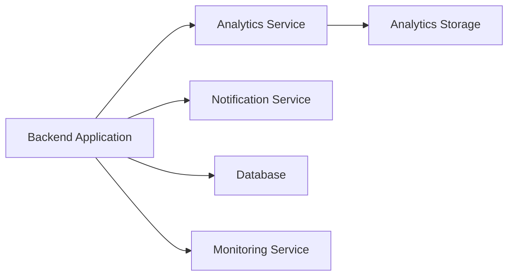
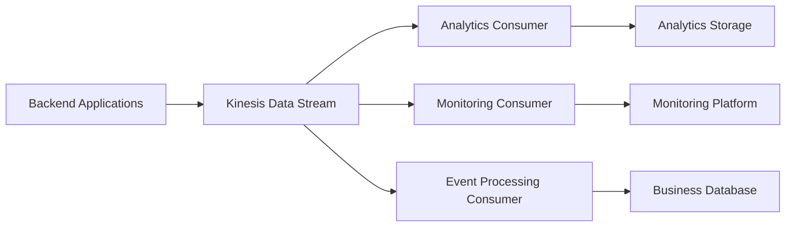
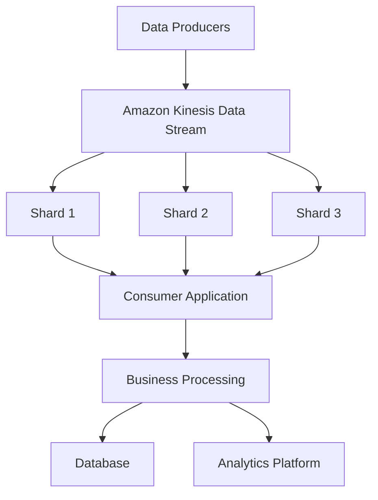
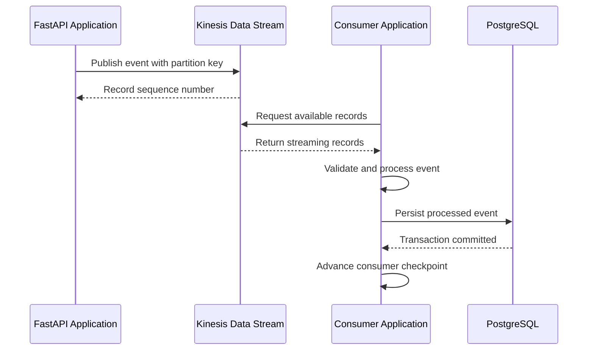
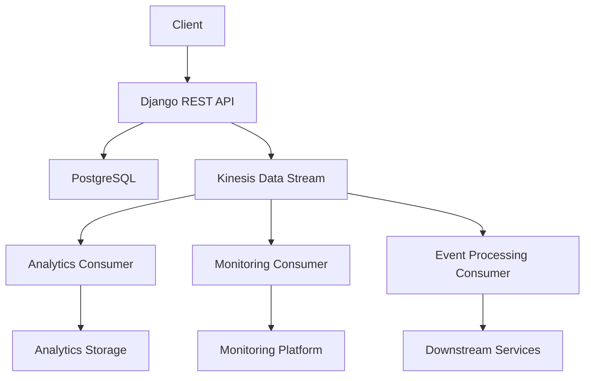

# 01- Introduction to Amazon Kinesis

## Overview

Amazon Kinesis is a managed AWS streaming data platform designed to collect, process, and distribute real-time data streams at scale.

It enables applications to continuously ingest events from multiple producers and make those events available to downstream consumers without requiring the application to manage the underlying streaming infrastructure.

Unlike traditional message queues, which primarily support asynchronous task distribution, Kinesis is designed for continuous data ingestion and stream processing.

Typical use cases include:

- Real-time application event processing.
- Application and infrastructure log ingestion.
- IoT telemetry collection.
- Clickstream analytics.
- Financial transaction monitoring.
- Real-time fraud detection.
- Operational metrics processing.
- Event-driven data pipelines.

For backend engineering systems, Kinesis provides a managed streaming layer between event producers and downstream processing applications.

A Python application, for example, can publish application events to a Kinesis Data Stream. Multiple consumers can independently process those events, persist them in databases, trigger business workflows, or deliver them to analytical storage.

## Why Amazon Kinesis Exists

Traditional backend architectures frequently rely on synchronous communication or message queues to transfer information between services.

These approaches work well for many workloads but introduce limitations when applications need to continuously ingest large volumes of events and support multiple independent consumers.

Consider an e-commerce platform generating the following events:

- User activity events.
- Product view events.
- Order placement events.
- Payment transaction events.
- Inventory updates.
- Application logs.

A synchronous architecture would require application services to communicate directly with downstream processing systems.

This creates several engineering problems:

- Producers become dependent on downstream service availability.
- High event volumes can overload consumers.
- Multiple consumers may require separate event distribution mechanisms.
- Real-time analytics becomes more difficult.
- Historical event replay may require additional infrastructure.
- Processing workloads become harder to scale independently.

Kinesis addresses these problems by introducing a managed streaming infrastructure.

### Traditional Architecture



In this architecture, the producer application is responsible for coordinating communication with multiple downstream systems.

A failure in one dependency can affect the producer's request-processing path if communication is synchronous.

### Kinesis-Based Architecture



The producer publishes events to Kinesis instead of directly coordinating every downstream consumer.

Consumers independently retrieve and process records from the stream.

This separates event ingestion from event processing and allows downstream workloads to scale independently.

## What Is Streaming Data?

Streaming data is a continuous sequence of records generated by applications, devices, infrastructure, or external systems.

Unlike batch processing, where data is collected and processed periodically, streaming systems process records continuously as they arrive.

Examples include:

| Data Source | Streaming Events |
|---|---|
| E-commerce application | Orders, payments, product views |
| Financial application | Transactions, account activity |
| IoT devices | Temperature, pressure, sensor readings |
| Backend infrastructure | Application logs, system metrics |
| Mobile applications | User activity, navigation events |
| Monitoring systems | Errors, alerts, performance metrics |

A streaming record typically contains:

- A record identifier or sequence number.
- A partition key.
- A payload containing application data.
- Metadata associated with the stream record.

For example, an e-commerce application might publish the following event:

```json
{
  "event_id": "evt-100245",
  "event_type": "order_created",
  "order_id": "ORD-90871",
  "customer_id": "CUS-1024",
  "amount": 2499.00,
  "currency": "INR",
  "timestamp": "2026-11-19T15:30:00Z"
}
```

This event can be consumed by multiple independent applications.

For example:

- An analytics consumer updates sales metrics.
- An inventory consumer processes stock-related events.
- A monitoring consumer tracks business activity.
- A data pipeline stores events for historical analysis.

The producer does not need to know how each consumer implements its processing logic.

## Amazon Kinesis Service Components

Amazon Kinesis is an AWS streaming service family rather than a single streaming implementation.

Its major services address different stages of streaming data ingestion and processing.

| Service | Primary Responsibility | Typical Use Case |
|---|---|---|
| Kinesis Data Streams | Real-time streaming data ingestion and consumption | Custom event-processing applications |
| Kinesis Data Firehose | Managed delivery of streaming data to destinations | Delivering events to S3 and analytics services |
| Managed Service for Apache Flink | Stateful stream processing and real-time analytics | Aggregations, transformations and event analysis |
| Kinesis Video Streams | Ingestion and processing of video streams | Video surveillance and media applications |

These services solve related but different problems.

### Kinesis Data Streams

Kinesis Data Streams is the core streaming service for applications that require programmatic access to streaming records.

It provides:

- Continuous data ingestion.
- Partition-based record distribution.
- Multiple independent consumers.
- Configurable data retention.
- Record replay within the retention period.
- Horizontal scaling through shard management or on-demand capacity.

Applications can publish records using AWS SDKs or supported AWS APIs.

Consumers can retrieve records using APIs, dedicated consumer applications, or integrations such as AWS Lambda.

Detailed architecture, shards, partition keys, producers, and consumers are covered separately in the Kinesis Data Streams documentation.

### Amazon Data Firehose

Amazon Data Firehose is a managed service for delivering streaming data to supported destinations.

It handles delivery buffering, optional transformation, and destination integration.

Common destinations include:

- Amazon S3.
- Amazon Redshift.
- Amazon OpenSearch Service.
- Supported third-party destinations.

It is useful when an application needs to deliver continuously generated data to storage or analytics destinations without implementing and operating its own consumer delivery infrastructure.

### Managed Service for Apache Flink

Managed Service for Apache Flink provides managed infrastructure for processing streaming data using Apache Flink.

It supports processing operations such as:

- Filtering.
- Transformation.
- Aggregation.
- Window-based computation.
- Stateful stream processing.
- Event-time processing.

For example, a financial application can continuously aggregate transaction amounts over time windows and identify unusual transaction patterns.

### Kinesis Video Streams

Kinesis Video Streams provides infrastructure for securely ingesting and processing video streams.

It is designed for workloads such as:

- Security camera systems.
- IoT video devices.
- Live video processing.
- Video analytics.
- Machine vision applications.

It addresses video-specific ingestion and processing requirements rather than ordinary application event streaming.

## How Kinesis Data Streaming Works

The fundamental Kinesis streaming workflow consists of producers, a data stream, and consumers.

### Core Components

| Component | Responsibility |
|---|---|
| Producer | Publishes records to a stream |
| Data Stream | Stores and distributes streaming records |
| Shard | Provides a unit of stream capacity and record distribution |
| Partition Key | Determines the shard assignment of a record |
| Consumer | Reads and processes records |
| Sequence Number | Identifies a record's position within a shard |
| Retention Period | Determines how long records remain available |

The basic data flow is:



### Producer

A producer generates and publishes records to a Kinesis Data Stream.

Examples include:

- Python backend applications.
- Django and FastAPI services.
- IoT devices.
- Log collection agents.
- AWS Lambda functions.
- External applications using supported APIs.

A producer sends records containing a partition key and application payload.

The partition key determines how Kinesis distributes the record across the stream's shards.

### Data Stream

A Kinesis Data Stream is a logical resource that stores streaming records and makes them available to consumers.

It acts as the central ingestion layer between producers and consumers.

The stream can contain multiple shards, depending on its capacity configuration.

### Shards

A shard is a fundamental unit of capacity and parallelism in Kinesis Data Streams.

Each shard supports a specific amount of record ingestion and retrieval throughput.

Records are distributed across shards based on partition keys.

For example:

```text
Kinesis Data Stream
    |
    |-- Shard 1
    |     |-- Customer A events
    |     |-- Customer D events
    |
    |-- Shard 2
    |     |-- Customer B events
    |     |-- Customer E events
    |
    |-- Shard 3
          |-- Customer C events
          |-- Customer F events
```

The actual distribution depends on partition-key hashing and shard hash-key ranges.

A poorly designed partition key can concentrate traffic on a single shard, creating a hot-shard problem.

Shard management, capacity limits, partition-key design, and resharding are covered in the dedicated Kinesis Data Streams documentation.

### Consumer

A consumer reads records from the stream and performs application-specific processing.

Examples include:

- Persisting records in PostgreSQL.
- Updating Redis caches.
- Triggering business workflows.
- Aggregating application metrics.
- Delivering events to downstream services.
- Writing records to Amazon S3.

Multiple consumers can independently read the same stream.

This enables event distribution without requiring producers to implement separate publishing mechanisms for every downstream application.

## Kinesis Data Flow

The following sequence illustrates a typical event-processing lifecycle.



The producer and consumer operate independently.

The producer receives an acknowledgment when the record is accepted by the stream.

The consumer retrieves records and processes them according to its own processing logic.

The sequence shown is conceptual. Actual consumer checkpointing depends on the consumption model and client implementation.

For example, an application using the Kinesis Client Library maintains checkpoint information through its coordination mechanisms.

## Kinesis vs Traditional Message Queues

Kinesis and traditional message queues solve different messaging requirements.

Kinesis is primarily designed for continuous streaming workloads, while queue services are generally designed around asynchronous message delivery and task processing.

| Feature | Kinesis Data Streams | Amazon SQS |
|---|---|---|
| Primary model | Data streaming | Message queuing |
| Record consumption | Consumers read records from streams | Consumers receive messages from queues |
| Record retention | Configurable retention period | Configurable message retention |
| Multiple consumers | Independent stream consumers | Multiple consumers compete for messages in a queue |
| Replay | Supported within retention period | Not a general-purpose historical replay mechanism |
| Ordering | Ordering within a shard for records sharing the same partition key | FIFO queues provide ordering within message groups |
| Scaling | Shard-based or on-demand capacity | Managed queue scaling |
| Typical workloads | Event streaming and analytics | Background jobs and asynchronous processing |

### When to Use Kinesis

Choose Kinesis Data Streams when:

- Applications continuously generate high-volume events.
- Multiple independent consumers need access to the same records.
- Consumers need to replay historical records.
- Real-time event processing is required.
- Stream partitioning and parallel processing are important.
- The application needs control over record consumption.

### When to Use SQS

Choose SQS when:

- Applications need asynchronous task processing.
- Workers should receive messages and delete them after processing.
- Background jobs need retry and visibility-timeout mechanisms.
- Queue-based workload distribution is sufficient.
- Dead Letter Queues are required for failed message handling.

### When to Use SNS

Choose SNS when:

- Applications need publish-subscribe messaging.
- Events must be distributed to multiple subscribers.
- Push-based event delivery is preferred.
- Topic-based fan-out is required.

These services can also be combined.

For example, SNS can distribute an event to multiple SQS queues, while Kinesis can independently ingest high-volume event streams for analytics.

## Backend Engineering Integration

Kinesis is particularly useful in microservice architectures where event ingestion and event processing need to be decoupled.

Consider a Django-based e-commerce backend.

When a customer places an order, the application can publish an event to Kinesis.

Independent consumer applications can process the event for analytics, reporting, and other downstream workflows.



The API should not wait for every downstream consumer to complete its work.

However, the application should distinguish between successfully committing its business transaction and successfully publishing its event.

If an order is committed to PostgreSQL but publishing to Kinesis fails, the system can lose an event.

A production implementation should consider the **Transactional Outbox Pattern**.

With this pattern:

1. The order and corresponding outbox event are committed in the same database transaction.
2. A background publisher reads unpublished outbox records.
3. The publisher sends events to Kinesis.
4. Successfully published records are marked as delivered.
5. Failed publishing attempts are retried.

This prevents the database transaction and event publication from becoming an uncoordinated dual-write operation.

For systems requiring stronger event delivery guarantees, the outbox publisher must also handle ambiguous publishing outcomes and duplicate delivery.

## Python Integration with Boto3

Python applications can interact with Kinesis using Boto3, the AWS SDK for Python.

Install the dependency:

```bash
pip install boto3
```

Configure AWS credentials using an appropriate AWS identity mechanism.

For local development, AWS CLI profiles can be used. In production, prefer IAM roles associated with the execution environment rather than hardcoded access keys.

### Creating a Kinesis Client

```python
import boto3

kinesis_client = boto3.client(
    "kinesis",
    region_name="ap-south-1",
)
```

The client provides access to Kinesis APIs such as:

- `create_stream()`
- `describe_stream_summary()`
- `put_record()`
- `put_records()`
- `get_records()`
- `get_shard_iterator()`

The required IAM permissions should be restricted to the resources and operations used by the application.

### Publishing a Record

```python
import json
import boto3

kinesis_client = boto3.client(
    "kinesis",
    region_name="ap-south-1",
)

event = {
    "event_id": "evt-100245",
    "event_type": "order_created",
    "order_id": "ORD-90871",
    "customer_id": "CUS-1024",
}

response = kinesis_client.put_record(
    StreamName="order-events",
    Data=json.dumps(event).encode("utf-8"),
    PartitionKey="CUS-1024",
)

print({
    "shard_id": response["ShardId"],
    "sequence_number": response["SequenceNumber"],
})
```

The partition key determines the hash-key distribution used to select a shard.

The returned sequence number identifies the record's position within that shard.

Production implementations should also handle:

- API throttling.
- Network failures.
- Retry policies.
- Duplicate publishing.
- Event serialization.
- Structured logging.
- Application-level event identifiers.

A successful `PutRecord` response confirms acceptance by Kinesis, not successful processing by downstream consumers.

### Consuming Records

Consumers retrieve records using the Kinesis APIs.

A typical consumer workflow involves:

1. Discovering stream shards.
2. Obtaining a shard iterator.
3. Reading records.
4. Processing records.
5. Managing checkpoints or processing progress.
6. Reacquiring iterators when necessary.

A simple record retrieval operation looks like this:

```python
response = kinesis_client.get_records(
    ShardIterator=shard_iterator,
    Limit=100,
)

for record in response["Records"]:
    payload = json.loads(record["Data"])

    print(payload)

next_iterator = response["NextShardIterator"]
```

This is an illustrative retrieval operation rather than a complete production consumer.

A production consumer must manage iterator expiration, polling intervals, processing failures, checkpoints, shard discovery, and duplicate processing.

For more complex consumer applications, the Kinesis Client Library or enhanced fan-out can provide additional coordination and consumption capabilities.

## Production Considerations

Kinesis should be treated as a distributed streaming infrastructure component rather than a simple message-publishing API.

### Scalability

The stream's capacity configuration determines how ingestion and consumption workloads scale.

Important considerations include:

- Record ingestion throughput.
- Number of shards.
- Partition-key distribution.
- Consumer read throughput.
- Consumer parallelism.
- Record size.
- Traffic spikes.

A high-volume application should estimate expected event throughput before selecting its stream capacity configuration.

Hot shards can limit effective throughput even when the stream has sufficient aggregate capacity.

### Reliability

Kinesis provides durable stream storage within its configured retention period.

However, applications remain responsible for reliable processing.

Important practices include:

- Use unique event identifiers.
- Implement idempotent consumers.
- Handle retries safely.
- Persist processing checkpoints.
- Monitor consumer lag.
- Avoid advancing checkpoints before successful processing.
- Design for duplicate record delivery.

Kinesis does not automatically guarantee exactly-once execution of arbitrary application business logic.

### Security

Production deployments should implement:

- IAM least-privilege permissions.
- Encryption at rest using AWS KMS where required.
- TLS for data transmission.
- VPC connectivity controls where appropriate.
- CloudTrail auditing.
- Secure credential management.
- Environment-specific stream access policies.

### Monitoring

CloudWatch provides metrics for monitoring stream health and performance.

Important metrics include:

| Metric | Engineering Significance |
|---|---|
| IncomingRecords | Number of records entering the stream |
| IncomingBytes | Incoming data volume |
| WriteProvisionedThroughputExceeded | Write throttling in provisioned capacity |
| ReadProvisionedThroughputExceeded | Read throttling in provisioned capacity |
| GetRecords.IteratorAgeMilliseconds | Age of the last record returned by a consumer |
| GetRecords.Bytes | Data retrieved by consumers |
| GetRecords.Records | Number of records retrieved |

Consumer applications should also expose application-level metrics such as:

- Processing latency.
- Failed record count.
- Duplicate event count.
- Checkpoint delay.
- Database write failures.
- End-to-end event processing latency.

### Cost Management

Kinesis costs depend on the selected capacity configuration, data ingestion and retrieval patterns, retention settings, and additional features.

Cost considerations include:

- Provisioned or on-demand capacity.
- Extended data retention.
- Enhanced fan-out consumers.
- Data retrieval volume.
- Additional processing services.
- Data transfer and destination storage.

Monitor actual traffic patterns rather than provisioning capacity based only on average workload estimates.

### High Availability and Disaster Recovery

Kinesis is a managed regional AWS service, but application-level disaster recovery still requires planning.

Consider:

- Regional failure scenarios.
- Cross-Region replication requirements.
- Consumer recovery and checkpoint restoration.
- Event replay after application outages.
- Downstream database recovery.
- Retention requirements.
- Infrastructure as Code for stream recreation.

A multi-Region architecture may require explicit event replication and recovery mechanisms. A stream in one Region should not be assumed to provide automatic cross-Region disaster recovery.

## Common Mistakes and Production Pitfalls

| Mistake | Why It Is a Problem | Recommended Approach |
|---|---|---|
| Treating Kinesis like SQS | Consumption and deletion semantics differ | Understand stream retention and consumer checkpoints |
| Using random partition keys | Can create uneven shard distribution | Select partition keys based on workload characteristics |
| Assuming exactly-once processing | Duplicate business operations can occur | Implement idempotency |
| Ignoring consumer lag | Processing delays can accumulate | Monitor iterator age and processing latency |
| Using synchronous processing in APIs | Increases request latency and coupling | Publish events and process asynchronously |
| Ignoring throttling | Causes failed or delayed ingestion | Implement retries and capacity planning |
| Advancing checkpoints prematurely | Can result in lost application processing | Checkpoint only after successful processing |
| Hardcoding AWS credentials | Creates credential exposure risks | Use IAM roles and temporary credentials |
| Ignoring retention limits | Historical records can become unavailable | Configure retention according to recovery requirements |
| Treating aggregate throughput as sufficient | Individual shards can become bottlenecks | Monitor partition-key distribution and shard utilization |

## Key Takeaways

- Amazon Kinesis is a managed streaming platform for continuously ingesting, storing, and processing real-time data.
- Kinesis Data Streams uses shards and partition keys to distribute records and support scalable consumption.
- Independent consumers allow multiple applications to process the same stream without tightly coupling producers to downstream services.
- Production implementations require careful attention to idempotency, checkpointing, consumer lag, partition-key design, security, and capacity planning.
- SQS, SNS, and Kinesis serve different messaging patterns and can be combined to build scalable event-driven backend architectures.