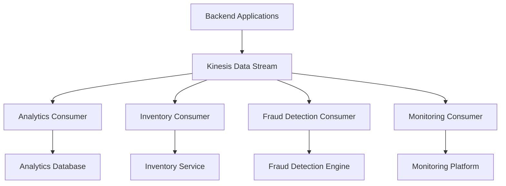
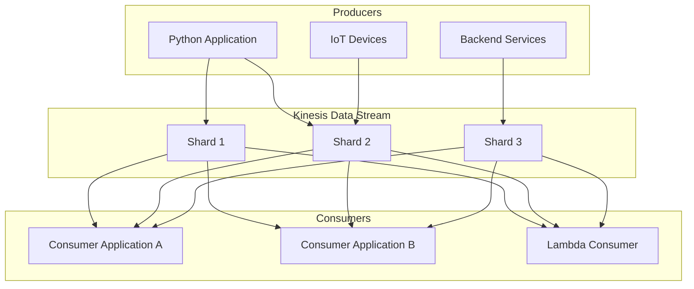
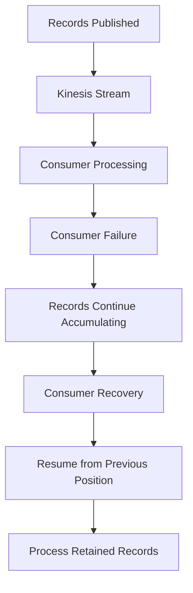
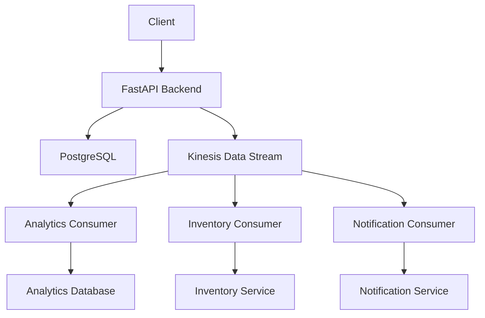

# 02- Kinesis Data Streams

## Overview

Amazon Kinesis Data Streams (KDS) is a fully managed AWS service for collecting, storing, and processing real-time streaming data at scale.

It provides a durable, continuously available stream of records that producers can publish to and multiple independent consumers can retrieve and process.

Unlike traditional message queues, where consumers typically receive and remove messages, Kinesis Data Streams retains records for a configurable period. Consumers independently track their processing progress and can replay records while those records remain within the retention window.

Kinesis Data Streams is designed for workloads that require:

- Continuous ingestion of high-volume events.
- Multiple independent consumers.
- Near-real-time data processing.
- Ordered record processing within a partition.
- Historical event replay.
- Horizontally scalable ingestion and consumption.

Common backend engineering use cases include:

- Application event ingestion.
- Real-time transaction processing.
- IoT telemetry pipelines.
- Clickstream analytics.
- Centralized application log processing.
- Fraud detection.
- Event-driven microservices.
- Real-time operational dashboards.

## Why Kinesis Data Streams Exists

Traditional application architectures frequently couple event producers with downstream processing services.

For example, an e-commerce application might need to distribute order events to:

- An analytics service.
- An inventory service.
- A notification service.
- A fraud detection system.
- A reporting platform.

Direct communication creates dependencies between the producer and downstream applications.

A failure in one downstream service can introduce latency, retries, or availability problems for the producer.

Kinesis Data Streams introduces a durable streaming layer between producers and consumers.

The producer publishes records once, and multiple consumers independently retrieve those records.



This architecture provides:

- Producer-consumer decoupling.
- Independent consumer scaling.
- Record retention and replay.
- Parallel stream processing.
- Better isolation between application workloads.

Kinesis does not automatically guarantee that every downstream consumer processes every record successfully. Consumer reliability, checkpoint management, retries, and failure recovery remain application responsibilities.

## Core Architecture

A Kinesis Data Stream consists of producers, a stream, shards, and consumers.



### Producers

Producers are applications or systems that publish records into a Kinesis Data Stream.

Common producers include:

- Python applications using Boto3.
- Java applications using AWS SDKs.
- Django and FastAPI services.
- IoT devices.
- AWS Lambda functions.
- Log collection systems.
- External applications using the Kinesis API.

A producer sends a record containing:

- A partition key.
- A data payload.
- Optional explicit hash-key information.

Kinesis uses the partition key to determine which shard receives the record.

### Data Stream

A data stream is the logical container that holds streaming records.

It provides the ingestion and retrieval interface between producers and consumers.

A stream can contain multiple shards, depending on its capacity configuration.

Each record belongs to a specific shard and receives a sequence number identifying its position within that shard.

### Shards

A shard is the fundamental unit of capacity and parallelism in Kinesis Data Streams.

Each shard provides independent record ingestion and retrieval capacity.

For provisioned capacity, the commonly documented per-shard limits are:

| Operation | Capacity per shard |
|---|---|
| Write throughput | Up to 1 MB/second or 1,000 records/second |
| Read throughput using shared-throughput consumers | Up to 2 MB/second |
| GetRecords retrieval | Up to 10 MB per call, subject to API limits and throttling behavior |

These limits apply to the relevant provisioned capacity model. Actual capacity and API constraints should be checked against current AWS documentation and the selected stream configuration.

A stream with multiple shards can distribute workload across multiple capacity units.

For example:

```text
OrderEvents Stream
    |
    |-- Shard 1
    |     |-- Order A
    |     |-- Order D
    |     |-- Order G
    |
    |-- Shard 2
    |     |-- Order B
    |     |-- Order E
    |     |-- Order H
    |
    |-- Shard 3
          |-- Order C
          |-- Order F
          |-- Order I
```

The actual distribution depends on partition-key hashing and shard hash-key ranges.

A poor partition-key strategy can create hot shards, where one shard receives substantially more traffic than others.

### Consumers

Consumers retrieve records from Kinesis Data Streams and execute application-specific processing.

Examples include:

- Persisting events into PostgreSQL.
- Updating Redis caches.
- Processing financial transactions.
- Generating analytics.
- Writing records to Amazon S3.
- Triggering downstream microservices.

Multiple consumers can independently read the same stream.

Unlike competing consumers in a traditional work queue, independent Kinesis consumers can process the same records without removing them from the stream.

## Record Structure

A Kinesis record contains several important fields.

| Field | Description |
|---|---|
| Data | Binary payload containing application data |
| PartitionKey | Key used to determine shard assignment |
| SequenceNumber | Unique sequence identifier within the shard |
| ApproximateArrivalTimestamp | Approximate time the record arrived in the stream |

A record's application payload is typically serialized into JSON, Avro, or another application-defined format before publishing.

Example event:

```json
{
  "event_id": "evt-100245",
  "event_type": "order_created",
  "order_id": "ORD-90871",
  "customer_id": "CUS-1024",
  "amount": 2499.00,
  "currency": "INR",
  "timestamp": "2026-11-19T15:30:00Z"
}
```

The application serializes this payload into bytes before publishing it.

Kinesis treats the payload as opaque binary data. It does not automatically understand application-specific JSON fields.

The consumer is responsible for deserialization and schema validation.

## Partition Keys and Record Distribution

Partition keys determine how records are distributed across shards.

Kinesis calculates a hash value from the partition key and uses the stream's hash-key ranges to select the destination shard.

The partition key is therefore an important architectural decision.

### How Partitioning Works

Consider an application generating events for different customers.

```python
import boto3
import json

kinesis = boto3.client(
    "kinesis",
    region_name="ap-south-1",
)

event = {
    "event_id": "evt-100245",
    "customer_id": "CUS-1024",
    "event_type": "order_created",
}

response = kinesis.put_record(
    StreamName="order-events",
    Data=json.dumps(event).encode("utf-8"),
    PartitionKey=event["customer_id"],
)
```

Here, `customer_id` is used as the partition key.

Records with the same partition key are mapped to the same shard while the relevant shard hash-key mapping remains unchanged.

This is useful when events associated with the same customer require ordering.

### Partition-Key Design

| Partition Key | Advantages | Limitations |
|---|---|---|
| Customer ID | Groups customer events | High-volume customers may create hot shards |
| Order ID | Distributes individual orders | Events for different orders may not share ordering |
| Device ID | Groups device telemetry | A highly active device may dominate one shard |
| Random identifier | Can improve distribution | Does not preserve entity-level ordering |
| Tenant ID | Groups tenant events | Large tenants can create uneven workloads |

A partition key should balance two requirements:

1. Distribute traffic evenly across shards.
2. Preserve ordering for records that must be processed sequentially.

For multi-tenant applications, a tenant ID may be appropriate when tenant-level ordering matters. However, large tenants should be evaluated for hot-shard risks.

## Sequence Numbers and Ordering

Kinesis assigns sequence numbers to records within a shard.

Sequence numbers identify the position of records within that shard.

Ordering guarantees are scoped to a shard, not to the entire stream.

If two records use the same partition key and are routed to the same shard, their ordering can be preserved according to their successful ingestion sequence.

However, Kinesis does not provide global ordering across multiple shards.

Example:

```text
Shard 1:
    Record A
    Record B
    Record C

Shard 2:
    Record D
    Record E
    Record F
```

A consumer processing multiple shards should not assume that records from Shard 1 and Shard 2 have a globally meaningful ordering.

### Production Implications

For applications that process business events:

- Use stable partition keys for entities requiring ordered processing.
- Include event timestamps and unique event identifiers.
- Avoid relying on timestamps as a substitute for guaranteed ordering.
- Make consumers idempotent.
- Handle records from different shards independently.

For example, payment events associated with the same order may use the order ID as the partition key when their processing order matters.

## Capacity Modes

Kinesis Data Streams supports different capacity modes.

The two primary modes are:

- Provisioned mode.
- On-demand mode.

### Provisioned Mode

In provisioned mode, the application configures the number of shards required by the stream.

Capacity is determined by the total provisioned shard count.

Advantages:

- Explicit capacity planning.
- Predictable shard-level throughput.
- Direct control over shard scaling.
- Suitable for workloads with predictable traffic.

Limitations:

- Requires capacity estimation.
- Under-provisioning can cause throttling.
- Over-provisioning can increase costs.
- Scaling requires capacity management.

### On-Demand Mode

On-demand mode automatically manages stream capacity according to workload requirements within AWS service limits.

It is useful when traffic patterns are variable or difficult to predict.

Advantages:

- Reduced manual shard management.
- Automatic capacity adjustment.
- Suitable for unpredictable ingestion workloads.
- Less operational overhead.

Limitations:

- Capacity scaling is still subject to service limits and scaling behavior.
- Sudden traffic increases can require careful capacity planning.
- Cost characteristics differ from provisioned mode.
- Partition-key distribution problems are not automatically eliminated.

### Capacity Mode Comparison

| Characteristic | Provisioned | On-Demand |
|---|---|---|
| Capacity management | Manual | AWS managed |
| Shard configuration | Explicit | Automatically managed |
| Predictable traffic | Suitable | Suitable |
| Variable traffic | Requires planning | Suitable |
| Operational overhead | Higher | Lower |
| Capacity cost model | Provisioned shard capacity | On-demand usage model |

The correct choice depends on traffic predictability, operational requirements, and cost constraints.

## Data Retention

Kinesis Data Streams retains records for a configurable period.

Consumers can retrieve records while they remain available within the retention window.

This enables:

- Consumer recovery after outages.
- Reprocessing of historical events.
- Backfilling analytical datasets.
- Recovery from temporary downstream failures.

The default retention period is 24 hours.

Retention can be extended up to 365 days.

Extended retention introduces additional costs.

### Why Retention Matters

Consider a consumer application that becomes unavailable for several hours.

When the application recovers, it can continue processing records from its previous position, provided those records are still retained.



Retention is not a substitute for durable archival storage.

If events must be preserved for months or years, use an appropriate archival destination such as Amazon S3.

## Consumer Models

Kinesis Data Streams supports different consumption approaches.

The main models include:

- Shared-throughput consumers.
- Enhanced fan-out consumers.
- AWS Lambda event source mappings.
- Kinesis Client Library-based consumers.

### Shared-Throughput Consumers

Shared-throughput consumers typically use the `GetRecords` API to retrieve records.

Multiple consumers share the shard's read throughput.

This approach is suitable when:

- Consumer throughput requirements are moderate.
- Multiple consumers can share available read capacity.
- Enhanced fan-out is unnecessary.

### Enhanced Fan-Out

Enhanced fan-out provides dedicated read throughput for registered consumers.

Each enhanced fan-out consumer receives its own dedicated throughput allocation per shard.

This reduces contention between independent consumers.

It is particularly useful when:

- Multiple consumers process the same stream.
- Consumer latency requirements are strict.
- Shared read throughput becomes a bottleneck.
- Independent consumer throughput is important.

Enhanced fan-out uses the SubscribeToShard API and a push-based HTTP/2 connection.

### Consumer Comparison

| Feature | Shared Throughput | Enhanced Fan-Out |
|---|---|---|
| Retrieval API | GetRecords | SubscribeToShard |
| Throughput | Shared | Dedicated per registered consumer |
| Consumer contention | Possible | Reduced |
| Connection model | Polling | Push-based subscription |
| Cost | Included in stream consumption model | Additional consumer charges |
| Typical usage | Moderate consumer workloads | Multiple high-throughput consumers |

### Lambda Consumers

AWS Lambda can consume Kinesis records through an event source mapping.

Lambda polls the stream and invokes the function with batches of records.

The application does not need to implement the low-level polling mechanism.

Important configuration options include:

- Batch size.
- Maximum batching window.
- Parallelization factor.
- Starting position.
- Retry behavior.
- Bisect batch on function error.
- Maximum record age.
- Destination configuration for failed records.

Lambda processing is not automatically exactly-once. Failed batches and retries can result in records being processed more than once.

Consumers must therefore implement idempotent processing.

## Publishing Records

Applications can publish individual records or batches of records.

### PutRecord

The `PutRecord` API publishes one record at a time.

```python
import boto3
import json

client = boto3.client(
    "kinesis",
    region_name="ap-south-1",
)

event = {
    "event_id": "evt-100245",
    "event_type": "order_created",
    "order_id": "ORD-90871",
}

response = client.put_record(
    StreamName="order-events",
    Data=json.dumps(event).encode("utf-8"),
    PartitionKey="ORD-90871",
)

print(response["SequenceNumber"])
```

Use this API when individual record publishing is required.

### PutRecords

The `PutRecords` API publishes multiple records in a single request.

Batch publishing can reduce request overhead and improve producer efficiency.

```python
import boto3
import json

client = boto3.client(
    "kinesis",
    region_name="ap-south-1",
)

events = [
    {
        "event_id": "evt-1001",
        "event_type": "order_created",
        "order_id": "ORD-1001",
    },
    {
        "event_id": "evt-1002",
        "event_type": "order_created",
        "order_id": "ORD-1002",
    },
]

records = [
    {
        "Data": json.dumps(event).encode("utf-8"),
        "PartitionKey": event["order_id"],
    }
    for event in events
]

response = client.put_records(
    StreamName="order-events",
    Records=records,
)

failed_count = response["FailedRecordCount"]

print(f"Failed records: {failed_count}")
```

An important production detail is that `PutRecords` can partially succeed.

A successful HTTP response does not mean every record was successfully published.

The producer must inspect individual record results and retry only failed records.

For reliable publishing:

- Use bounded retries with exponential backoff and jitter.
- Preserve each record's partition key.
- Track failed records.
- Include application-level event identifiers.
- Handle ambiguous outcomes safely.
- Avoid retrying the entire batch when only some records failed.

## Reading Records

Consumers can retrieve records using the Kinesis APIs.

The typical low-level consumption workflow is:

1. Discover stream shards.
2. Obtain a shard iterator.
3. Retrieve records.
4. Process the records.
5. Advance the iterator.
6. Manage application processing progress.

### Shard Iterators

A shard iterator identifies the position from which records should be read.

Kinesis supports several iterator types.

| Iterator Type | Behavior |
|---|---|
| TRIM_HORIZON | Start from the oldest retained record |
| LATEST | Start from records arriving after the iterator position is established |
| AT_SEQUENCE_NUMBER | Start at a specified sequence number |
| AFTER_SEQUENCE_NUMBER | Start after a specified sequence number |
| AT_TIMESTAMP | Start from a specified timestamp |

Example:

```python
response = client.get_shard_iterator(
    StreamName="order-events",
    ShardId="shardId-000000000000",
    ShardIteratorType="TRIM_HORIZON",
)

shard_iterator = response["ShardIterator"]
```

Retrieve records:

```python
response = client.get_records(
    ShardIterator=shard_iterator,
    Limit=100,
)

for record in response["Records"]:
    print(record["SequenceNumber"])
    print(record["Data"])

next_iterator = response["NextShardIterator"]
```

The returned `NextShardIterator` can be used to retrieve subsequent records.

Shard iterators expire after a limited period, so production consumers must periodically obtain fresh iterators.

### Important Consumer Consideration

The shard iterator represents a retrieval position. It is not equivalent to a durable application checkpoint.

For example, if a consumer retrieves 100 records but fails while processing record 80, advancing its application checkpoint beyond record 80 can result in lost processing.

A reliable consumer should track successfully processed progress separately from the latest retrieval position.

## Kinesis Client Library

The Kinesis Client Library (KCL) is a framework for building distributed Kinesis consumers.

It provides functionality for coordinating consumer applications across multiple worker instances.

Important capabilities include:

- Shard discovery.
- Shard assignment.
- Worker coordination.
- Checkpoint management.
- Lease management.
- Handling shard lifecycle changes.
- Recovery after worker failures.

KCL is useful when implementing distributed consumers that process many shards across multiple application instances.

For example, a Kubernetes deployment may run several consumer pods. KCL coordinates shard ownership and processing progress.

The library uses a coordination mechanism backed by DynamoDB for lease and checkpoint management.

KCL should not be confused with the low-level Boto3 APIs. It provides higher-level consumer coordination capabilities.

## Ordering and Delivery Semantics

Kinesis Data Streams provides ordering within individual shards.

However, application processing semantics depend on the consumer implementation.

A consumer may retrieve records in order but still create duplicate or out-of-order business effects if processing is parallelized incorrectly.

Consider:

```text
Order Created
    |
Payment Authorized
    |
Order Shipped
```

If these events share a partition key, they can be routed to the same shard.

However, processing them concurrently without coordination may still produce incorrect business state.

For ordered business workflows:

- Use a stable partition key.
- Process related records sequentially where required.
- Implement idempotency.
- Track application-level event identifiers.
- Avoid advancing checkpoints before successful processing.

Kinesis does not provide general-purpose exactly-once business processing.

A consumer can achieve effectively-once business effects through idempotency, transactional writes, deduplication, and carefully managed checkpoints.

## Practical Backend Architecture

Consider a FastAPI-based application that processes customer orders.

The API accepts order requests and publishes corresponding events to Kinesis.

Multiple consumer applications process those events independently.



### Processing Responsibilities

| Component | Responsibility |
|---|---|
| FastAPI | Validate requests and handle business operations |
| PostgreSQL | Persist transactional order data |
| Kinesis | Distribute order events |
| Analytics consumer | Aggregate order activity |
| Inventory consumer | Update inventory-related state |
| Notification consumer | Trigger customer notifications |

For transactional reliability, the backend can use the Transactional Outbox Pattern.

The order and its outbox event are written in a single PostgreSQL transaction.

A separate publisher reads outbox records and publishes them to Kinesis.

This prevents a successful database commit from being silently separated from an unsuccessful event publication.

## Security Considerations

Kinesis Data Streams supports security controls for authentication, authorization, and data protection.

### IAM Permissions

Use least-privilege IAM policies.

Typical producer permissions include:

- `kinesis:PutRecord`
- `kinesis:PutRecords`
- `kinesis:DescribeStreamSummary`

Typical consumer permissions may include:

- `kinesis:DescribeStream`
- `kinesis:ListShards`
- `kinesis:GetShardIterator`
- `kinesis:GetRecords`

Enhanced fan-out consumers may additionally require permissions such as:

- `kinesis:RegisterStreamConsumer`
- `kinesis:DescribeStreamConsumer`
- `kinesis:SubscribeToShard`

The exact permissions depend on the selected consumption model.

### Encryption

Kinesis Data Streams supports:

- Encryption in transit using TLS.
- Encryption at rest using AWS-managed or customer-managed KMS keys.

Customer-managed KMS keys provide additional control over key policies, access permissions, and auditing.

### Private Connectivity

Applications running inside VPCs can use supported Kinesis interface VPC endpoints to communicate privately with the service without requiring public internet routing.

Private connectivity should be combined with appropriate IAM policies, security groups, and network controls.

## Monitoring and Observability

CloudWatch provides metrics for monitoring stream ingestion and consumption.

Important metrics include:

| Metric | Purpose |
|---|---|
| IncomingRecords | Number of records entering the stream |
| IncomingBytes | Incoming data volume |
| PutRecord.Success | Successful individual record writes |
| PutRecord.ThrottledRecords | Throttled individual record writes |
| WriteProvisionedThroughputExceeded | Provisioned write capacity exceeded |
| ReadProvisionedThroughputExceeded | Provisioned read capacity exceeded |
| GetRecords.IteratorAgeMilliseconds | Consumer processing lag indicator |
| GetRecords.Bytes | Data retrieved through GetRecords |
| GetRecords.Records | Records retrieved through GetRecords |

Metric availability and dimensions depend on the API and consumption model.

### Consumer Lag

Consumer lag is one of the most important operational signals.

A consumer may continue running while falling increasingly behind the stream.

For example:

```text
Current Stream Position:  Record 100000
Consumer Position:        Record 85000

Unprocessed Backlog:      15000 Records
```

The `GetRecords.IteratorAgeMilliseconds` metric helps identify how far behind a consumer is processing.

For Lambda consumers, `IteratorAge` is also an important monitoring signal.

### Operational Monitoring

Monitor:

- Incoming record volume.
- Incoming data volume.
- Write throttling.
- Read throttling.
- Consumer iterator age.
- Consumer processing latency.
- Failed record count.
- Checkpoint delays.
- Application retry rates.
- Downstream database failures.

Create CloudWatch alarms for sustained throttling, elevated iterator age, and abnormal ingestion patterns.

## Scalability and Performance

Kinesis Data Streams scalability depends on stream capacity, partition-key distribution, record sizes, and consumer architecture.

### Producer Optimization

Recommended practices:

- Use `PutRecords` for suitable batch workloads.
- Avoid excessively large records.
- Distribute partition keys evenly.
- Implement exponential backoff with jitter.
- Monitor failed record responses.
- Use asynchronous publishing where appropriate.

### Consumer Optimization

Recommended practices:

- Process records in batches.
- Use parallel processing across independent shards.
- Avoid unnecessary downstream database calls.
- Apply bounded concurrency.
- Monitor consumer lag.
- Use enhanced fan-out when shared read throughput is insufficient.

### Hot-Shard Prevention

A hot shard occurs when a disproportionate amount of traffic is assigned to one shard.

For example:

```text
Shard 1:  10 MB/s
Shard 2:   1 MB/s
Shard 3:   1 MB/s
```

The aggregate stream capacity may appear sufficient, but Shard 1 can become a bottleneck.

Possible solutions include:

- Improving partition-key distribution.
- Using a higher-cardinality partition key.
- Evaluating explicit hash keys where appropriate.
- Increasing shard capacity in provisioned mode.
- Reviewing the on-demand capacity and scaling configuration.

Increasing the number of shards alone does not necessarily solve a poor partition-key distribution problem.

## Cost Considerations

Kinesis Data Streams pricing depends on the capacity mode and enabled features.

Relevant cost factors include:

- Provisioned shard capacity.
- On-demand stream capacity.
- Data ingestion and retrieval.
- Extended retention.
- Enhanced fan-out consumers.
- Additional monitoring and processing services.

For provisioned streams, unused shard capacity can increase costs.

For on-demand streams, continuously high ingestion volumes can have different cost characteristics from provisioned capacity.

Review actual traffic, consumer count, retention requirements, and throughput patterns before choosing a capacity model.

## High Availability and Disaster Recovery

Kinesis Data Streams is a regional managed service, but the complete event-processing architecture includes other components that also require availability planning.

Consider the following:

### Consumer Availability

- Deploy consumers across multiple Availability Zones where supported by the execution environment.
- Use KCL or equivalent coordination for distributed consumer ownership.
- Implement automatic worker recovery.
- Persist checkpoints appropriately.
- Monitor consumer health.

### Event Recovery

- Configure retention according to expected outage recovery time.
- Use S3 for long-term event archival.
- Implement replay procedures.
- Validate downstream idempotency before replaying historical records.

### Multi-Region Recovery

For multi-Region requirements:

- Plan event replication explicitly.
- Define recovery point objectives.
- Define recovery time objectives.
- Provision destination streams.
- Coordinate consumer checkpoints.
- Prevent duplicate business effects during failover.

Do not assume that Kinesis automatically replicates a stream to another AWS Region.

## AWS CLI Operations

The AWS CLI can be used to manage and inspect Kinesis Data Streams.

### Describe a Stream

```bash
aws kinesis describe-stream-summary \
    --stream-name order-events \
    --region ap-south-1
```

### List Shards

```bash
aws kinesis list-shards \
    --stream-name order-events \
    --region ap-south-1
```

### Publish a Record

```bash
aws kinesis put-record \
    --stream-name order-events \
    --partition-key ORD-90871 \
    --data '{"event_type":"order_created","order_id":"ORD-90871"}' \
    --region ap-south-1
```

### Check Stream Status

Use `describe-stream-summary` to inspect:

- Stream status.
- Stream mode.
- Retention period.
- Encryption configuration.
- Open shard count.

### Update Retention

```bash
aws kinesis increase-stream-retention-period \
    --stream-name order-events \
    --retention-period-hours 168 \
    --region ap-south-1
```

The retention period in this example is seven days.

Retention changes should be planned according to recovery requirements and cost implications.

## Common Mistakes and Production Pitfalls

| Mistake | Impact | Recommended Approach |
|---|---|---|
| Using low-cardinality partition keys | Creates hot shards | Design keys around workload distribution |
| Assuming global ordering | Produces incorrect event sequencing | Design around shard-level ordering |
| Ignoring partial batch failures | Records can be lost | Inspect individual `PutRecords` results |
| Treating sequence numbers as global IDs | Incorrect record tracking | Track shard and sequence number together |
| Advancing checkpoints prematurely | Can skip unprocessed records | Checkpoint only after successful processing |
| Ignoring duplicate delivery | Repeated business operations | Implement idempotency |
| Running too many shared-throughput consumers | Creates read contention | Evaluate enhanced fan-out |
| Using short retention for long recovery windows | Historical records expire | Align retention with recovery objectives |
| Assuming automatic cross-Region replication | Creates disaster recovery gaps | Implement explicit replication |
| Scaling shards without reviewing partition keys | Hot shards remain | Evaluate key distribution first |

## Key Takeaways

- Kinesis Data Streams is a managed, partitioned streaming platform that supports continuous ingestion, independent consumers, and record replay.
- Shards provide the fundamental capacity and parallelism model, while partition keys determine record distribution and influence ordering.
- Provisioned and on-demand modes provide different capacity-management approaches; the choice should reflect workload predictability and operational requirements.
- Reliable consumers require checkpoint management, idempotent processing, duplicate handling, and monitoring of consumer lag.
- Production streaming architectures must account for hot shards, partial publishing failures, retention, IAM, encryption, cost, and explicit disaster recovery strategies.