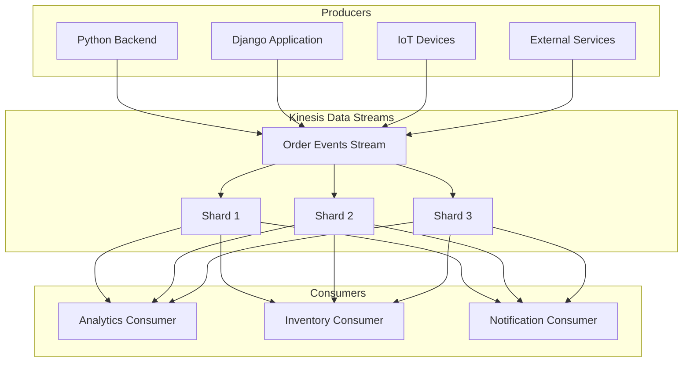
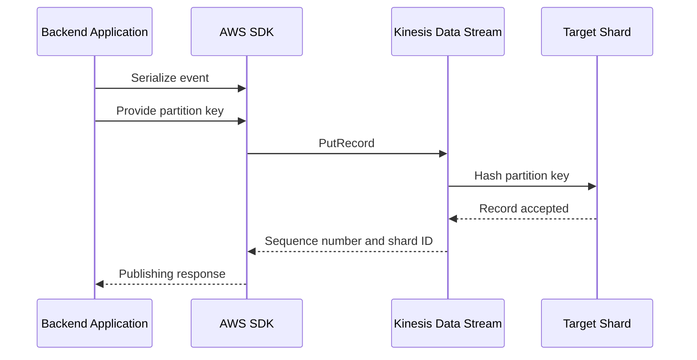
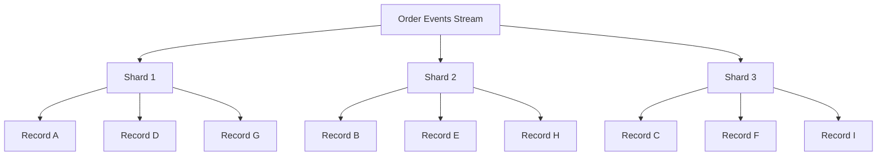
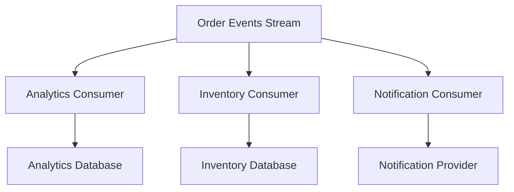
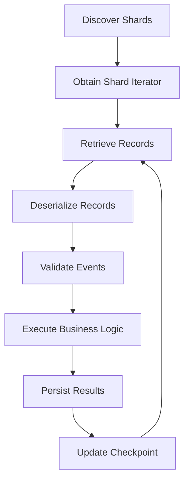
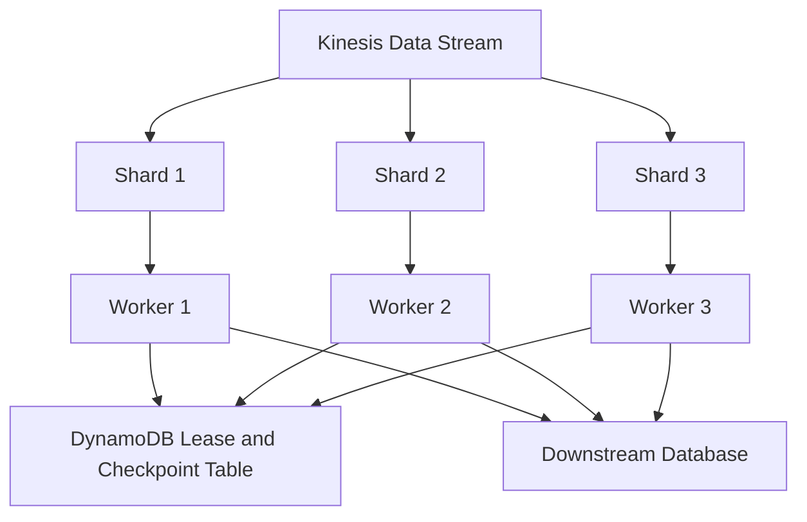
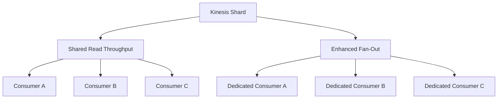
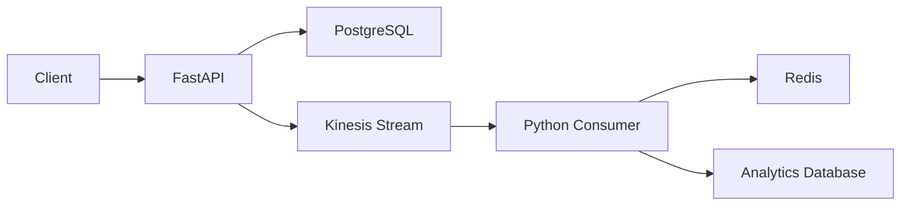
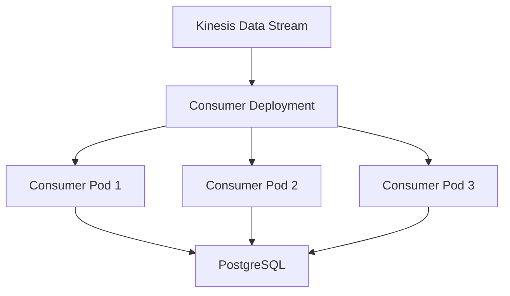

# 03- Stream Architecture and Components

## Overview

Amazon Kinesis Data Streams uses a distributed streaming architecture built around producers, data streams, shards, and consumers.

Understanding these components is essential when designing real-time backend systems because they determine how records are ingested, distributed, retained, consumed, and processed.

Unlike traditional queue-based systems, Kinesis separates record ingestion from record consumption. Producers publish records to a stream, while consumers independently retrieve and process those records.

The architecture provides:

- Distributed record ingestion.
- Partition-based data distribution.
- Independent consumer applications.
- Parallel record processing.
- Configurable data retention.
- Record replay.
- Horizontal scalability.
- Integration with AWS services and external applications.

A production Kinesis architecture must account for partition-key distribution, shard capacity, consumer coordination, checkpoint management, processing failures, and downstream system throughput.

## High-Level Architecture

A Kinesis Data Streams architecture consists of four primary components:

| Component | Responsibility |
|---|---|
| Producer | Publishes records to a Kinesis stream |
| Data Stream | Provides the logical streaming resource |
| Shard | Stores records and provides ingestion and retrieval capacity |
| Consumer | Retrieves and processes records |

Additional components support stream administration and distributed processing.

| Supporting Component | Responsibility |
|---|---|
| Partition Key | Determines record distribution across shards |
| Sequence Number | Identifies a record's position within a shard |
| Shard Iterator | Identifies the starting position for record retrieval |
| Enhanced Fan-Out Consumer | Provides dedicated read throughput |
| Kinesis Client Library | Coordinates distributed consumer applications |
| DynamoDB | Stores KCL lease and checkpoint information |
| CloudWatch | Provides operational metrics and monitoring |

### Architecture Diagram



Each consumer maintains its own processing progress. One consumer's progress does not automatically advance another consumer's position.

## Producer Architecture

### What Is a Producer?

A producer is an application or system that publishes records to a Kinesis Data Stream.

Producers are responsible for:

- Generating application events.
- Serializing event payloads.
- Selecting partition keys.
- Publishing records.
- Handling publishing failures.
- Implementing retries.
- Monitoring publishing performance.

Common producer implementations include:

- Python applications using Boto3.
- Java applications using AWS SDKs.
- Django and FastAPI services.
- AWS Lambda functions.
- IoT devices.
- Log collection agents.
- Applications using the Kinesis Producer Library (KPL).

### Producer Data Flow



The producer does not directly select a shard when using ordinary partition-key-based publishing.

Kinesis calculates the partition key's hash value and routes the record to the shard whose hash-key range contains that value.

### Producer Example Using Python

```python
import json
import boto3

kinesis = boto3.client(
    "kinesis",
    region_name="ap-south-1",
)

event = {
    "event_id": "evt-100245",
    "event_type": "order_created",
    "order_id": "ORD-90871",
    "customer_id": "CUS-1024",
}

response = kinesis.put_record(
    StreamName="order-events",
    Data=json.dumps(event).encode("utf-8"),
    PartitionKey=event["order_id"],
)

print({
    "shard_id": response["ShardId"],
    "sequence_number": response["SequenceNumber"],
})
```

In this example:

- The application generates an order event.
- JSON serialization converts the event into bytes.
- The order ID becomes the partition key.
- Kinesis calculates the hash value.
- The record is assigned to a shard.
- The API returns the shard ID and sequence number.

Using the order ID as the partition key can preserve ordering for records associated with the same order, provided they continue to map to the same shard.

### Producer Reliability

A production producer must handle failures carefully.

Important considerations include:

**Throttling**

A producer can receive throttling errors when it exceeds the available write capacity.

Use bounded retries with exponential backoff and jitter.

**Partial Batch Failures**

The `PutRecords` API can partially succeed. Each record result must be inspected independently.

**Duplicate Publishing**

A network timeout can occur after Kinesis accepts a record but before the producer receives the acknowledgment.

Retrying may publish the same business event again.

Include an application-level event ID and make consumers idempotent.

**Transactional Consistency**

If a backend writes business data to PostgreSQL and publishes an event to Kinesis, the two operations are not automatically atomic.

Use the Transactional Outbox Pattern when reliable database-to-stream publication is required.

## Data Stream Architecture

### What Is a Data Stream?

A Kinesis Data Stream is a logical resource that stores and distributes streaming records.

It acts as the central ingestion layer between producers and consumers.

A stream consists of one or more shards.

Each shard maintains its own record sequence and hash-key range.

A stream provides:

- Record ingestion.
- Record retention.
- Partition-based distribution.
- Independent consumption.
- Record replay within the retention period.

### Stream Characteristics

| Characteristic | Description |
|---|---|
| Stream name | Unique name within the applicable AWS account and Region |
| Stream ARN | Resource identifier |
| Capacity mode | Provisioned or on-demand |
| Shards | Capacity and partitioning units |
| Retention | Configurable record availability period |
| Encryption | Server-side encryption |
| Consumers | Applications that retrieve stream records |
| Monitoring | CloudWatch metrics and alarms |

### Stream Lifecycle

A stream must be created before producers can publish records.

Its lifecycle generally involves:

1. Creating the stream.
2. Waiting for the stream to become active.
3. Configuring encryption and retention.
4. Publishing records.
5. Registering consumers where required.
6. Monitoring stream performance.
7. Scaling or modifying configuration.
8. Deleting the stream when no longer needed.

A stream should be managed through Infrastructure as Code in production environments.

For example, Terraform or AWS CDK can define stream capacity, encryption, retention, and consumer configuration.

### Stream Creation Using AWS CLI

```bash
aws kinesis create-stream \
    --stream-name order-events \
    --stream-mode-details StreamMode=ON_DEMAND \
    --region ap-south-1
```

Inspect the stream:

```bash
aws kinesis describe-stream-summary \
    --stream-name order-events \
    --region ap-south-1
```

The stream must reach the `ACTIVE` state before it is used for normal record publishing.

## Shard Architecture

### What Is a Shard?

A shard is a fundamental unit of capacity and parallelism in Kinesis Data Streams.

Each shard provides independent write and read capacity.

A stream containing multiple shards can distribute records across multiple capacity units.

For provisioned capacity, the commonly documented shard limits are:

| Operation | Per-Shard Limit |
|---|---|
| Write throughput | Up to 1 MB/second or 1,000 records/second |
| Shared read throughput | Up to 2 MB/second |
| GetRecords API response | Up to 10 MB per call, subject to API constraints |

These are provisioned-capacity limits. Actual service behavior also depends on API request limits and the selected consumption model.

### Shard Structure



Each shard maintains an independent sequence of records.

The stream does not provide global ordering across all shards.

### Shard Hash-Key Ranges

Kinesis uses a partition key to calculate a hash value.

Each shard owns a particular hash-key range.

The record is assigned to the shard whose range contains the calculated hash value.

Conceptually:

```text
Partition Key
      |
      v
Hash Function
      |
      v
Hash Value
      |
      v
Shard Hash-Key Range
      |
      v
Selected Shard
```

The partition key therefore influences both workload distribution and ordering.

### Shard Capacity Planning

For provisioned streams, capacity planning requires estimating:

- Records generated per second.
- Average record size.
- Total incoming bytes per second.
- Distribution of partition keys.
- Consumer read throughput.
- Number of independent consumers.

A simplified write-capacity estimate is:

```text
Required Shards =
    max(
        Incoming Bytes Per Second / 1 MB,
        Incoming Records Per Second / 1000
    )
```

Round the result up to a whole number of shards.

For example, assume:

```text
Incoming Records:  2,500 records/second
Average Size:      2 KB

Incoming Throughput:
2,500 × 2 KB = 5 MB/second
```

The estimated provisioned shard requirement is:

```text
Records-based requirement:
2,500 / 1,000 = 2.5

Throughput-based requirement:
5 / 1 = 5

Required shards:
max(2.5, 5) = 5
```

This is only an initial aggregate capacity estimate.

Actual capacity planning must account for partition-key skew, record-size limits, traffic bursts, consumer throughput, and operational headroom.

### Hot Shards

A hot shard occurs when a disproportionate amount of traffic is assigned to one shard.

Example:

```text
Stream Capacity:

Shard 1:  950 KB/s
Shard 2:  120 KB/s
Shard 3:  100 KB/s
Shard 4:   80 KB/s
```

Although the total stream capacity may be sufficient, Shard 1 is approaching its write-throughput limit.

This commonly happens when applications use low-cardinality or highly skewed partition keys.

For example, using a single tenant ID for a large tenant can concentrate most traffic on one shard.

**Prevention strategies:**

- Choose partition keys with sufficient cardinality.
- Analyze actual event distribution.
- Avoid using constant values as partition keys.
- Evaluate explicit hash keys where appropriate.
- Monitor throttling and shard-level utilization.
- Consider application-level key sharding when ordering requirements permit it.

## Partition-Key Architecture

### Purpose

A partition key determines which shard receives a record.

It provides a mechanism for distributing records while preserving ordering for records sharing the same partition key within a shard.

### Partition-Key Distribution

Consider a multi-tenant SaaS platform.

```text
Tenant A Events --> Partition Key: tenant-A
Tenant B Events --> Partition Key: tenant-B
Tenant C Events --> Partition Key: tenant-C
```

Kinesis hashes each partition key and assigns the corresponding record to a shard.

All records sharing the same partition key map to the same shard under the current hash-key mapping.

### Partition-Key Design Strategies

| Strategy | Use Case | Potential Problem |
|---|---|---|
| Customer ID | Customer-specific event ordering | High-volume customers |
| Order ID | Order lifecycle events | Uneven order activity |
| Device ID | IoT telemetry | Highly active devices |
| Tenant ID | Multi-tenant event processing | Large tenants |
| Random ID | Distribution across shards | No entity-level ordering |
| Composite key | More granular distribution | More complex ordering semantics |

### Composite Partition Keys

A composite key can distribute traffic more evenly when a single entity generates excessive volume.

Example:

```python
partition_key = f"{customer_id}#{event_bucket}"
```

However, introducing buckets can distribute events from the same customer across multiple shards.

This weakens the ability to process all customer events in a single ordered sequence.

The design must balance distribution and ordering requirements.

## Record Architecture

### Record Components

A Kinesis record consists of:

| Field | Description |
|---|---|
| Data | Binary payload |
| PartitionKey | Partitioning identifier |
| SequenceNumber | Record position identifier within a shard |
| ApproximateArrivalTimestamp | Approximate ingestion timestamp |

The payload is application-defined.

Kinesis does not automatically validate JSON schemas or enforce business-level event contracts.

### Record Serialization

Applications generally serialize records before publishing them.

Common formats include:

- JSON.
- Avro.
- Protocol Buffers.
- Custom binary formats.

For backend microservices, JSON is convenient, while Avro or Protocol Buffers may be useful when schema governance and compact serialization are important.

A production event should generally contain:

- Unique event ID.
- Event type.
- Schema version.
- Aggregate or entity ID.
- Event timestamp.
- Correlation ID where applicable.
- Business payload.

Example:

```json
{
  "event_id": "evt-100245",
  "event_type": "order_created",
  "schema_version": 1,
  "aggregate_id": "ORD-90871",
  "correlation_id": "req-78901",
  "occurred_at": "2026-11-19T15:30:00Z",
  "data": {
    "customer_id": "CUS-1024",
    "amount": 2499.00,
    "currency": "INR"
  }
}
```

Explicit schema versions help consumers handle event evolution without assuming every producer deploys simultaneously.

## Consumer Architecture

### What Is a Consumer?

A consumer is an application that retrieves and processes records from a Kinesis Data Stream.

A consumer can:

- Read records.
- Deserialize payloads.
- Validate event schemas.
- Execute business logic.
- Persist data.
- Publish downstream events.
- Track processing progress.

Multiple consumers can independently process the same stream.

### Independent Consumer Architecture

Consider an order event stream with three consumers.



Each consumer has its own processing responsibility.

If the analytics consumer becomes unavailable, the inventory and notification consumers can continue processing independently.

This isolation is one of the major advantages of streaming architectures.

### Consumer Processing Lifecycle



The consumer should update its durable processing checkpoint only after successfully processing the corresponding records.

Otherwise, a failure can cause records to be skipped during recovery.

### Consumer Types

| Consumer Type | Description | Typical Use |
|---|---|---|
| Shared-throughput consumer | Uses GetRecords | Standard polling-based processing |
| Enhanced fan-out consumer | Uses SubscribeToShard | Independent high-throughput consumption |
| Lambda consumer | Uses Lambda event source mapping | Serverless processing |
| KCL consumer | Uses Kinesis Client Library | Distributed consumer coordination |

## Consumer Coordination and Checkpointing

### Why Coordination Is Required

A distributed consumer application may run multiple instances across multiple servers or containers.

If every instance independently processes every shard, records can be duplicated unnecessarily.

Consumer coordination assigns shard-processing responsibilities to workers.

The Kinesis Client Library provides this functionality through leases and checkpoints.

### KCL Architecture



KCL uses DynamoDB for coordination state.

Important concepts include:

**Lease**

A lease represents ownership of a shard by a worker.

Only the worker holding the relevant lease should process that shard through the coordinated KCL application.

**Checkpoint**

A checkpoint records the last successfully processed position within a shard.

It enables a consumer to resume processing after failures.

**Worker Coordination**

Workers periodically coordinate shard assignments and detect changes in ownership.

When a worker fails, its lease can be acquired by another worker.

### Checkpointing Considerations

Checkpointing too frequently can increase coordination overhead.

Checkpointing too infrequently can increase the amount of work repeated after a failure.

A practical approach is to checkpoint after a successfully processed batch, subject to the application's recovery requirements.

For database-backed consumers, a robust design can combine event processing and deduplication in a database transaction.

For example:

```text
Begin Transaction

    Check whether event_id was processed

    If not processed:
        Apply business changes
        Insert event_id into processed_events

Commit Transaction

Advance Consumer Checkpoint
```

The event-processing transaction should commit before the checkpoint advances.

This prevents a checkpoint from moving beyond uncommitted business operations.

## Enhanced Fan-Out Architecture

Enhanced fan-out provides dedicated read throughput to registered consumers.

Traditional shared-throughput consumers compete for the same shard-level read capacity.

Enhanced fan-out gives each registered consumer dedicated throughput per shard.

### Shared vs Enhanced Fan-Out



### Comparison

| Feature | Shared Throughput | Enhanced Fan-Out |
|---|---|---|
| API | GetRecords | SubscribeToShard |
| Throughput | Shared | Dedicated per registered consumer |
| Consumer contention | Possible | Reduced |
| Delivery mechanism | Polling | HTTP/2 subscription |
| Cost | Standard consumption model | Additional charges |
| Use case | Moderate consumption requirements | Multiple high-throughput consumers |

Enhanced fan-out is useful when independent consumers need predictable read throughput and lower contention.

It introduces additional cost and consumer registration management.

## Stream and Shard Lifecycle

Streams and shards have lifecycles that affect producers and consumers.

### Stream Lifecycle

A stream transitions through operational states such as:

```text
CREATING
    |
    v
ACTIVE
    |
    v
UPDATING
    |
    v
ACTIVE
    |
    v
DELETING
    |
    v
DELETED
```

The exact state transitions depend on the operation being performed.

Applications should not assume that a stream is immediately available after creation or configuration changes.

### Shard Lifecycle

Shards can be created, split, merged, and closed as stream capacity changes.

Important concepts include:

- Open shards.
- Closed shards.
- Parent shards.
- Child shards.
- Shard lineage.

When a shard is split, the original shard becomes closed and new child shards are created.

Consumers must handle these lifecycle changes.

KCL manages shard discovery and coordination, while custom consumers must implement appropriate shard discovery and lineage handling.

## Architecture Integration with Backend Systems

Kinesis commonly sits between backend applications and independent processing systems.

### FastAPI Integration



FastAPI handles request validation and business operations.

Kinesis distributes events to independent processing applications.

The API should avoid waiting for downstream analytics or notification processing.

### Kubernetes Consumer Deployment

Kinesis consumers can run as containerized applications inside Kubernetes.



For KCL-based applications:

- Configure lease coordination.
- Use appropriate worker identity.
- Provide graceful shutdown.
- Allow leases to be released correctly.
- Monitor processing lag.
- Scale according to shard count and processing workload.

Scaling the number of pods beyond the useful parallelism available from the shards does not automatically improve throughput.

## Reliability and Failure Handling

A production streaming architecture must account for failures at every layer.

| Failure | Potential Impact | Recommended Handling |
|---|---|---|
| Producer network failure | Publishing uncertainty | Retry safely and use event IDs |
| Write throttling | Delayed or failed ingestion | Backoff and capacity planning |
| Consumer crash | Processing interruption | Recover from checkpoint |
| Database failure | Records cannot be processed | Retry with bounded backoff |
| Duplicate records | Repeated business operations | Idempotent processing |
| Hot shard | Reduced ingestion throughput | Improve partition-key distribution |
| Expired records | Recovery data unavailable | Appropriate retention and archival |
| Worker failure | Lost shard ownership | KCL lease reassignment |
| Regional failure | Stream unavailable in that Region | Explicit multi-Region recovery design |

### Poison Records

A poison record is a record that repeatedly fails processing because of invalid data, incompatible schemas, or business validation errors.

A consumer should not allow one poison record to block an entire shard indefinitely.

Possible strategies include:

- Bounded retries.
- Failure classification.
- Quarantine storage.
- Dead-letter destinations implemented by the application.
- Alerting and manual replay.

Kinesis Data Streams does not provide an automatic queue-style DLQ for arbitrary consumer failures. Failure isolation must be implemented by the consumer architecture or supported integrations.

## Security Architecture

Kinesis security should be designed across the producer, stream, and consumer layers.

### Security Components

| Layer | Security Control |
|---|---|
| Producer | IAM role and least-privilege publishing permissions |
| Stream | Resource access controls and encryption |
| Consumer | IAM permissions for record retrieval |
| Encryption | AWS KMS |
| Network | TLS and VPC interface endpoints |
| Auditing | AWS CloudTrail |
| Credentials | IAM roles and temporary credentials |

### Recommended Security Practices

- Use IAM roles instead of hardcoded access keys.
- Restrict producer permissions to required streams.
- Restrict consumer permissions to required read operations.
- Use customer-managed KMS keys when additional key control is required.
- Apply TLS for data transmission.
- Use VPC endpoints for private connectivity where appropriate.
- Monitor administrative and data-plane API activity through supported CloudTrail logging.
- Avoid placing secrets or unnecessary sensitive information in event payloads.

## Monitoring the Architecture

CloudWatch provides operational visibility into stream ingestion and retrieval.

Important metrics include:

| Metric | Component | Purpose |
|---|---|---|
| IncomingRecords | Stream | Ingestion volume |
| IncomingBytes | Stream | Ingestion throughput |
| WriteProvisionedThroughputExceeded | Producer | Write capacity pressure |
| ReadProvisionedThroughputExceeded | Consumer | Read capacity pressure |
| GetRecords.IteratorAgeMilliseconds | Consumer | Processing lag |
| GetRecords.Records | Consumer | Retrieved record count |
| GetRecords.Bytes | Consumer | Retrieved data volume |

For enhanced fan-out consumers, monitor the relevant consumer-specific metrics as well.

### Application-Level Metrics

CloudWatch service metrics alone are insufficient for monitoring business processing.

Instrument consumer applications to expose:

- Processing latency.
- Records processed per second.
- Failed records.
- Duplicate events.
- Database transaction failures.
- Checkpoint delay.
- Retry counts.
- Quarantined records.

Use correlation IDs and event IDs to trace events across producer and consumer applications.

## Cost and Capacity Considerations

The architecture affects cost through capacity configuration, retention, consumer count, and data processing patterns.

Important considerations include:

- Number of provisioned shards.
- On-demand ingestion and retrieval usage.
- Extended retention.
- Enhanced fan-out consumers.
- KCL coordination resources.
- CloudWatch monitoring.
- Downstream processing services.
- Cross-Region replication and data transfer.

For provisioned streams, excessive shard capacity increases infrastructure costs.

For on-demand streams, cost should be evaluated against actual traffic patterns and workload characteristics.

A stream with several independent consumers may require additional read capacity or enhanced fan-out, depending on its consumption model.

## Architecture Best Practices

### Producer Design

- Use stable, high-cardinality partition keys.
- Batch records when appropriate.
- Inspect partial failures from `PutRecords`.
- Implement bounded retries with jitter.
- Include unique event IDs.
- Use a schema version in application events.
- Apply the Transactional Outbox Pattern when database and event publication consistency matters.

### Stream Design

- Separate streams according to workload and retention requirements.
- Select capacity modes based on traffic patterns.
- Configure retention according to recovery objectives.
- Enable encryption.
- Manage infrastructure using Terraform or AWS CDK.
- Monitor shard utilization and throttling.

### Consumer Design

- Make processing idempotent.
- Track durable processing progress.
- Checkpoint only after successful processing.
- Use bounded concurrency.
- Isolate poison records.
- Handle shard lifecycle changes.
- Monitor iterator age and application-level processing latency.

### Distributed Architecture

- Keep producer and consumer responsibilities independent.
- Avoid coupling API response times to downstream stream consumers.
- Design for duplicate delivery.
- Implement explicit recovery procedures.
- Use dedicated consumers when shared throughput is insufficient.
- Validate downstream database capacity before increasing consumer parallelism.

## Common Architecture Mistakes

| Mistake | Why It Happens | Correct Approach |
|---|---|---|
| Treating a stream as a traditional queue | Similar terminology creates confusion | Understand independent consumption and retention |
| Assuming global record ordering | Shards maintain separate sequences | Use partition keys and shard-level ordering |
| Using one partition key for all events | Simplifies application implementation | Select keys based on distribution and ordering |
| Running consumers without checkpoints | Initial implementations focus only on retrieval | Persist processing progress |
| Advancing checkpoints before database commits | Retrieval and processing are confused | Commit business processing before checkpointing |
| Scaling consumers without checking shard capacity | More workers are assumed to mean more throughput | Evaluate shard count and read capacity |
| Ignoring shard lineage | Custom consumers overlook resharding | Handle closed shards and child shards |
| Assuming Kinesis has a built-in consumer DLQ | Queue semantics are incorrectly applied | Implement application-level failure isolation |
| Assuming stream durability guarantees business processing | Storage and processing guarantees are confused | Implement idempotency and recovery mechanisms |
| Assuming automatic cross-Region recovery | Managed service capabilities are overestimated | Design explicit replication and failover |

## Key Takeaways

- Kinesis Data Streams architecture consists of producers, streams, shards, and independent consumers, with each component serving a distinct responsibility.
- Shards provide ingestion capacity and parallelism, while partition keys determine record distribution and influence ordering.
- Consumer coordination, leases, and checkpoints are essential for reliable distributed processing, particularly when using KCL.
- Production architectures must handle duplicate delivery, partial publishing failures, hot shards, poison records, and downstream processing bottlenecks.
- Security, observability, capacity planning, retention, and disaster recovery must be designed across the complete producer-to-consumer pipeline.