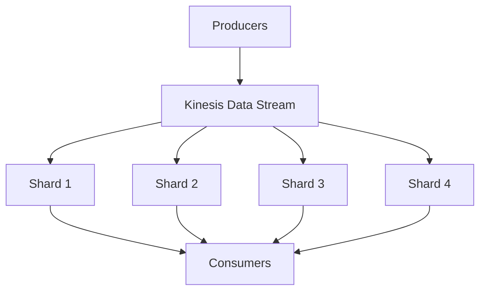
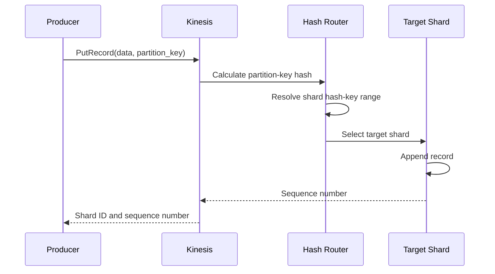
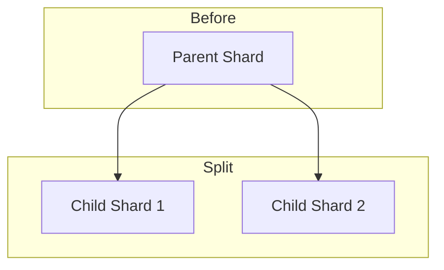
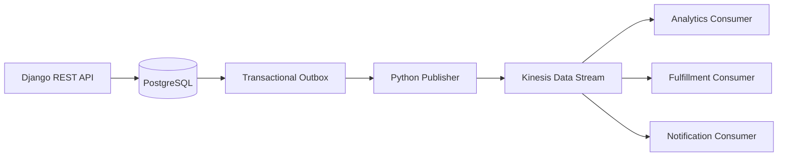

# 04- Shards and Partitions

## Overview

Shards are the fundamental units of capacity, parallelism, and ordering in Amazon Kinesis Data Streams. A stream is divided into one or more shards, and each shard stores an ordered sequence of records.

Partition keys determine which shard receives a record. Kinesis hashes each partition key and uses the resulting hash value to route the record to a shard based on the stream's shard hash-key ranges.

Understanding shards and partition keys is essential when designing producers and consumers because they directly influence:

- Write throughput and read throughput.
- Parallel processing capacity.
- Ordering guarantees.
- Consumer latency and scalability.
- Hot-shard behavior and uneven workload distribution.
- Stream capacity planning and operational cost.

A stream can have sufficient total capacity and still experience throttling if records are distributed unevenly across its shards.

## Shard Fundamentals

### What Is a Shard?

A shard is a uniquely identified sequence of records within a Kinesis Data Stream. It provides an independent unit of data ingestion and consumption.

Each shard has:

- A unique shard ID.
- A starting hash-key value.
- An ending hash-key value.
- An ordered sequence of records.
- Independent write and read capacity.
- A sequence-number progression for records written to that shard.

A stream containing four shards has four independently managed record sequences.



Records within an individual shard are ordered according to their sequence numbers. There is no global ordering guarantee across all shards.

### Why Shards Exist

Shards allow Kinesis to distribute streaming workloads across independently provisioned capacity units.

Without partitioning, a stream would have a single ingestion and consumption bottleneck. Shards provide a mechanism for scaling throughput and consumer parallelism.

Shards are useful when:

- Multiple services publish events concurrently.
- A stream processes high-volume application telemetry.
- Independent consumers process records in parallel.
- Events must retain ordering within a defined entity or partition.
- The workload requires predictable throughput capacity.

### Shard Capacity

In provisioned capacity mode, each shard provides a defined throughput allocation.

| Operation | Per-shard capacity |
|---|---:|
| Write throughput | Up to 1 MB/second |
| Write record rate | Up to 1,000 records/second |
| Shared read throughput | Up to 2 MB/second |

These are service capacity limits, not guaranteed application-level throughput. Actual throughput can be affected by record distribution, API request limits, consumer behavior, and throttling.

Enhanced fan-out consumers receive dedicated read throughput per shard rather than sharing the standard shared-throughput allocation.

Capacity limits and API quotas should be verified against current AWS documentation before production capacity planning.

## Shard Hash-Key Ranges

### How Hash-Key Ranges Work

Kinesis assigns every shard a hash-key range.

The range is defined by:

- Starting hash key.
- Ending hash key.

The hash-key space is a 128-bit unsigned integer range.

When a producer publishes a record with a partition key, Kinesis calculates an MD5 hash of that partition key. The resulting value determines the shard responsible for storing the record.

Conceptually:

```text
Partition Key
     |
     v
MD5 Hash
     |
     v
128-bit Hash Value
     |
     v
Find Matching Shard Hash-Key Range
     |
     v
Store Record in Selected Shard
```

For example, assume a stream has four shards with the following simplified ranges:

| Shard | Hash-key range |
|---|---|
| Shard 1 | 0–24 |
| Shard 2 | 25–49 |
| Shard 3 | 50–74 |
| Shard 4 | 75–99 |

These values are illustrative only. Actual Kinesis hash-key ranges cover the 128-bit hash space.

If the partition key `customer-1001` hashes to a value in Shard 2's range, Kinesis routes that record to Shard 2.

The producer does not normally need to know the physical shard assignment.

### Why Hashing Matters

Hashing distributes partition keys across the available hash-key space.

A well-distributed set of partition keys generally produces a balanced workload. However, hashing does not guarantee perfectly balanced traffic.

Uneven distribution can occur when:

- A small number of partition keys generate most of the traffic.
- A single partition key produces a very high volume of records.
- The workload has strong entity-level traffic concentration.
- Custom hash-key ranges are configured poorly.

A hash function distributes distinct keys across the hash space, but repeated use of the same key always produces the same hash value.

## Partition Keys

### What Is a Partition Key?

A partition key is a string supplied by the producer when publishing a record.

Kinesis uses the partition key to calculate the hash value that determines the target shard.

Example:

```python
import json
import boto3

kinesis = boto3.client("kinesis", region_name="ap-south-1")

event = {
    "event_id": "evt-10001",
    "customer_id": "customer-1001",
    "event_type": "order_created",
    "amount": 2499.00,
}

response = kinesis.put_record(
    StreamName="orders-stream",
    Data=json.dumps(event).encode("utf-8"),
    PartitionKey=event["customer_id"],
)

print(response["ShardId"])
print(response["SequenceNumber"])
```

In this example, `customer_id` is the partition key.

All records with the same customer ID are routed to the same shard while the relevant shard mapping remains unchanged.

### Choosing a Partition Key

Partition-key design is one of the most important decisions in a Kinesis architecture.

A good partition key should balance two requirements:

1. Distribute records across shards to avoid hot shards.
2. Preserve ordering for events that belong to the same logical entity.

Common partition-key choices include:

| Partition key | Typical use case | Consideration |
|---|---|---|
| `customer_id` | Customer activity streams | Preserves customer-level ordering |
| `order_id` | Order lifecycle events | Useful for order-specific processing |
| `device_id` | IoT telemetry | Can create hot shards for high-volume devices |
| `tenant_id` | Multi-tenant applications | Large tenants may create hot partitions |
| `session_id` | User session events | Distributes traffic across sessions |
| Random UUID | General load distribution | Does not preserve entity-level ordering |

The correct key depends on the ordering requirements and traffic distribution of the application.

### Partition Key and Ordering

Kinesis preserves record ordering within a shard.

If records for the same entity use the same partition key, they are routed to the same shard and can be consumed in shard order.

For example:

```text
customer-1001:
    order_created
    payment_completed
    order_shipped

customer-1002:
    order_created
    payment_completed
```

If `customer_id` is the partition key, events for each customer are routed to the same shard.

However, this does not create a global order across customers.

Ordering also does not guarantee that independent downstream consumers complete their business operations in the same order. Consumer concurrency and asynchronous processing can change completion order.

### Partition Key Stability

A partition key should remain consistent for the logical entity whose event ordering must be preserved.

For example, an order lifecycle might use:

```python
partition_key = order["order_id"]
```

Changing the partition key between events can route related events to different shards.

This can break the application's ability to rely on shard-level ordering for that entity.

## Partition Distribution

### How Records Are Distributed

The distribution process follows this sequence:

1. A producer constructs a record.
2. The producer supplies a partition key.
3. Kinesis hashes the partition key.
4. Kinesis identifies the shard whose hash-key range contains the hash.
5. Kinesis appends the record to that shard.
6. The record receives a sequence number within the shard.



The partition-key hash determines the target shard. Producers can use the returned shard ID and sequence number for diagnostics and application-level tracking.

### Balanced Distribution

A stream with multiple shards can process records in parallel.

For example:

```text
Orders Stream
    |
    +-- Shard 1: 25% of traffic
    +-- Shard 2: 25% of traffic
    +-- Shard 3: 25% of traffic
    +-- Shard 4: 25% of traffic
```

This represents an idealized balanced distribution.

Actual traffic distribution depends on the number of distinct partition keys, their hash values, and their individual event rates.

A large number of distinct keys does not automatically guarantee balanced traffic if a few keys dominate the workload.

### Uneven Distribution

Consider a multi-tenant SaaS platform:

```text
Tenant A: 70% of all events
Tenant B: 10% of all events
Tenant C: 10% of all events
Other tenants: 10% of all events
```

Using `tenant_id` as the partition key may cause Tenant A's records to concentrate on one shard.

Other shards may remain underutilized while the shard receiving Tenant A's traffic approaches its capacity limit.

This is a hot-shard problem.

## Hot Shards

### What Is a Hot Shard?

A hot shard is a shard receiving significantly more traffic than its available capacity can handle.

Hot shards can occur even when the overall stream has sufficient aggregate capacity.

For example:

```text
Stream Capacity: 4 Shards

Shard 1: 0.2 MB/s
Shard 2: 0.3 MB/s
Shard 3: 0.4 MB/s
Shard 4: 1.8 MB/s  <-- Hot Shard
```

The total traffic may be within the aggregate stream capacity, but Shard 4 exceeds its per-shard write capacity.

Kinesis can throttle writes targeting that shard.

### Common Causes

| Cause | Explanation |
|---|---|
| Low partition-key cardinality | Too few distinct keys distribute traffic across the stream |
| High-volume entity | One customer or device generates disproportionate traffic |
| Constant partition key | Every record uses the same key |
| Tenant concentration | A few tenants dominate the workload |
| Poor custom hash-key configuration | Records are concentrated in a restricted hash-key range |
| Uneven producer traffic | Some keys generate much higher event rates than others |

### Identifying Hot Shards

Monitor the following CloudWatch metrics:

| Metric | Purpose |
|---|---|
| `IncomingBytes` | Measures incoming data volume |
| `IncomingRecords` | Measures incoming record count |
| `WriteProvisionedThroughputExceeded` | Indicates write throttling due to provisioned throughput |
| `ReadProvisionedThroughputExceeded` | Indicates shared read throughput throttling |
| `GetRecords.IteratorAgeMilliseconds` | Indicates consumer processing lag |
| `OutgoingBytes` | Measures outgoing data volume |
| `OutgoingRecords` | Measures outgoing record count |

Use the `ShardId` dimension where supported to investigate individual shard behavior.

For shard-level diagnostics, inspect the stream's shard metadata and correlate it with producer errors and traffic patterns.

### Mitigating Hot Shards

Possible mitigation strategies include:

**Use a better partition key**

Replace a highly concentrated key with a key that provides more distribution while preserving required ordering.

For example:

```python
partition_key = event["order_id"]
```

This may distribute traffic better than using a high-volume `tenant_id`, provided order-level rather than tenant-level ordering is acceptable.

**Add controlled key salting**

When a single entity produces too much traffic, a suffix can distribute its events across multiple keys.

```python
partition_key = f"{customer_id}#{bucket_id}"
```

For example:

```text
customer-1001#0
customer-1001#1
customer-1001#2
customer-1001#3
```

This distributes the entity's traffic across multiple hash values.

However, salting changes the ordering model. Events for the same customer may now be stored in different shards.

Use this approach only when the application can tolerate the resulting ordering behavior or implements explicit downstream ordering.

**Increase stream capacity**

In provisioned mode, adding shards increases aggregate stream capacity.

However, adding shards does not necessarily resolve a hot partition key. A particular key still maps to a single shard at a given point in time.

**Use a different processing model**

If one entity requires extremely high throughput but strict ordering, reconsider whether a single ordered partition is appropriate. The architecture may need to divide the entity's workload into independently ordered substreams or use a different event-processing strategy.

## Shard Scaling

### Provisioned Mode

In provisioned mode, the application or operations team controls the number of shards.

Increasing shard count increases aggregate stream capacity and the number of independent shard sequences.

Reducing shard count decreases provisioned capacity.

Shard scaling should be based on measured workload rather than simply increasing shard count whenever throttling occurs.

### Resharding

Resharding changes the shard layout of a stream.

There are two primary operations:

- Split shard: Divides one shard into two child shards.
- Merge shards: Combines two eligible adjacent shards into one shard.



A split creates two child shards with hash-key ranges derived from the parent shard's range.

A merge combines adjacent shard hash-key ranges into a new shard.

Resharding is useful when:

- Write throughput is consistently approaching shard capacity.
- Read throughput is insufficient.
- The stream needs a different capacity allocation.
- Workload distribution has changed significantly.

### Split Shard

A shard split divides the parent's hash-key range into two smaller ranges.

For example:

```text
Before:

Shard A: 0–99

After:

Shard B: 0–49
Shard C: 50–99
```

These ranges are simplified for illustration.

A split increases the number of shards and can increase aggregate stream capacity.

However, a hot partition key may still map to only one of the child shards. Splitting does not divide an individual partition key's traffic.

### Merge Shards

A merge combines two adjacent shards.

For example:

```text
Before:

Shard A: 0–49
Shard B: 50–99

After:

Shard C: 0–99
```

Merging reduces the number of shards and aggregate capacity.

It is useful when sustained traffic is lower than the provisioned capacity and the application can operate with fewer shards.

### Resharding Considerations

Resharding has operational implications:

- New shards have different shard IDs.
- Consumers must discover and process new shards.
- Parent and child shard relationships matter during processing.
- Consumer checkpointing must account for shard lifecycle transitions.
- Shard count changes can affect throughput and cost.
- Resharding operations are subject to AWS service limits and quotas.

Applications using the Kinesis Client Library (KCL) should allow the library to manage shard discovery, lease coordination, and parent-child shard processing.

Custom consumers must implement equivalent lifecycle handling.

### Parent and Child Shards

When a shard is split or merged, Kinesis records lineage information.

A child shard may have one or more parent shards.

Consumers that require ordering across shard lineage must process parent shards to completion before processing their dependent child shards.

This is especially important when implementing custom consumers or using checkpointing systems that manage shard progress manually.

## On-Demand Capacity Mode

Kinesis Data Streams also supports on-demand capacity mode.

In this mode, AWS manages stream capacity based on traffic patterns rather than requiring the application to provision a fixed shard count.

On-demand mode is useful when:

- Traffic is unpredictable.
- Workload volume changes frequently.
- The application should reduce manual capacity management.
- Traffic patterns are difficult to forecast.

On-demand mode does not eliminate partition-key design requirements.

A hot partition key can still create a throughput bottleneck because one key maps to one shard at a time.

For workloads with predictable traffic, provisioned mode may provide more explicit capacity planning and cost control.

For workloads with variable traffic, on-demand mode can reduce operational overhead.

## Explicit Hash Keys

### What Is an Explicit Hash Key?

Kinesis allows a producer to provide an `ExplicitHashKey` instead of relying entirely on the partition-key hash.

The explicit hash key determines the position in the hash-key space used for shard selection.

Example:

```python
response = kinesis.put_record(
    StreamName="orders-stream",
    Data=json.dumps(event).encode("utf-8"),
    PartitionKey=event["customer_id"],
    ExplicitHashKey="170141183460469231731687303715884105727",
)
```

The explicit hash key is a decimal string representing a hash value in the valid 128-bit hash-key range.

It allows producers to control shard placement more directly.

### When to Use Explicit Hash Keys

Explicit hash keys can be useful when:

- A custom distribution strategy is required.
- Producers need to target specific hash-key ranges.
- A workload has specialized partitioning requirements.
- The application implements its own shard-routing logic.

### Limitations

Explicit hash keys introduce additional complexity:

- Producers must understand the stream's hash-key ranges.
- Resharding changes the shard layout.
- Routing logic can become stale.
- Poorly chosen values can create hot shards.
- Explicit routing can undermine the distribution benefits of partition-key hashing.

For most applications, a well-designed partition key is simpler and safer.

## Shard and Partition-Key Design Patterns

### Entity-Based Partitioning

Use a stable entity identifier as the partition key.

```python
partition_key = event["order_id"]
```

Suitable for:

- Order lifecycle events.
- Payment state transitions.
- Device-specific telemetry.
- Account activity streams.

Advantages:

- Preserves shard-level ordering for the entity.
- Makes event processing easier to reason about.
- Supports entity-specific state reconstruction.

Limitation:

- High-volume entities can create hot shards.

### Composite Partition Keys

A composite key combines multiple attributes.

```python
partition_key = f"{event['tenant_id']}:{event['region']}"
```

This can improve distribution when a tenant has traffic across multiple regions.

However, it changes the ordering boundary. Events for one tenant may be routed to different shards if their regions differ.

Use composite keys only when the resulting ordering semantics are acceptable.

### Time-Based Partition Keys

A time-based key may be used for workloads that naturally divide into independent time windows.

```python
partition_key = f"{event['device_id']}:{event['hour']}"
```

This can distribute traffic across time windows, but it does not automatically guarantee balanced distribution.

It can also break ordering across window boundaries.

Avoid using timestamps as the only partition key when strict entity-level ordering is required.

### Randomized Partition Keys

Randomized keys can distribute high-volume events across more shards.

```python
import uuid

partition_key = str(uuid.uuid4())
```

This is appropriate when events are independent and no entity-level ordering is required.

It is unsuitable when downstream processing depends on ordered events for a specific customer, order, or device.

## Backend Engineering Example

Consider an order-processing platform with these services:

- Django REST API receives customer orders.
- PostgreSQL stores transactional order state.
- An outbox publisher publishes order events.
- Kinesis distributes events to downstream consumers.
- FastAPI-based consumers process analytics and fulfillment events.

A possible architecture:



The producer uses `order_id` as the partition key:

```python
def publish_order_event(kinesis_client, stream_name, event):
    payload = json.dumps(event).encode("utf-8")

    return kinesis_client.put_record(
        StreamName=stream_name,
        Data=payload,
        PartitionKey=str(event["order_id"]),
    )
```

This design provides:

- Ordering of records for an order within its shard.
- Parallel processing across different orders.
- Independent consumer applications.
- A stable partitioning strategy across producer instances.

The outbox pattern helps avoid losing events between a database transaction and event publication. The publisher should also implement retries and idempotency because a successful Kinesis write followed by a publisher failure can result in duplicate publication attempts.

Consumers should use event IDs and idempotent business operations to handle duplicates safely.

## Operational Monitoring

Shard-level monitoring should be part of stream operations.

### Important Metrics

| Metric | What to investigate |
|---|---|
| `IncomingBytes` | Whether write volume is approaching capacity |
| `IncomingRecords` | Whether record rate is approaching limits |
| `WriteProvisionedThroughputExceeded` | Write throttling |
| `ReadProvisionedThroughputExceeded` | Shared read throttling |
| `OutgoingBytes` | Read traffic and consumer throughput |
| `OutgoingRecords` | Record consumption volume |
| `GetRecords.IteratorAgeMilliseconds` | Consumer lag |
| `ReadProvisionedThroughputExceeded` by shard | Potentially overloaded shard |

Metric availability and dimensions depend on the API, consumer type, and CloudWatch configuration.

### Monitoring Recommendations

Monitor both stream-level and shard-level behavior.

Recommended practices:

- Alert on sustained write throttling.
- Track consumer iterator age.
- Compare incoming traffic across shards.
- Monitor producer retry rates.
- Track record distribution by partition key in application telemetry.
- Review shard count and capacity utilization.
- Correlate hot-shard metrics with high-volume tenants or devices.

Do not rely exclusively on aggregate stream metrics. Aggregate metrics can hide individual hot shards.

### Application-Level Partition-Key Telemetry

Kinesis metrics do not automatically explain which business entity is responsible for an overloaded partition key.

Producers should emit structured telemetry containing:

- Stream name.
- Partition-key category or safely hashed identifier.
- Event type.
- Payload size.
- Publish latency.
- Throttling and retry count.

Avoid logging sensitive customer identifiers directly. Use controlled identifiers or hashes where appropriate.

## Security Considerations

Shard and partition-key design should not introduce unnecessary exposure of business identifiers.

Recommended practices:

- Use IAM policies that restrict producers and consumers to required streams.
- Encrypt stream data at rest using AWS-managed or customer-managed KMS keys.
- Use TLS for communication with Kinesis endpoints.
- Avoid placing sensitive information in partition keys.
- Do not treat partition keys as authorization boundaries.
- Restrict access to CloudWatch logs and application telemetry.
- Avoid logging complete event payloads when they contain sensitive data.

Partition keys are routing metadata, not a security mechanism.

## Performance and Scalability Considerations

| Design decision | Performance impact | Engineering consideration |
|---|---|---|
| High-cardinality partition keys | Can improve distribution | Confirm key traffic is reasonably balanced |
| Entity-based partitioning | Preserves entity-level shard ordering | Monitor high-volume entities |
| Random partition keys | Can distribute independent events | Loses entity-level ordering |
| More shards | Increases aggregate provisioned capacity | Does not split a single partition key |
| Enhanced fan-out | Dedicated consumer read throughput | Adds consumer-related cost |
| Explicit hash keys | Provides direct hash-space control | Requires careful routing and resharding logic |
| On-demand capacity | Reduces manual capacity management | Does not remove hot-key constraints |

### Capacity Planning

Estimate capacity using both record size and record rate.

For example, assume a workload generates:

- 5,000 records per second.
- Average record size of 2 KB.

Approximate incoming data volume:

```text
5,000 records/second × 2 KB
= 10,000 KB/second
≈ 10 MB/second
```

At the basic provisioned write limits, the stream would require at least:

- 10 shards based on 1 MB/second per shard.
- 5 shards based on 1,000 records/second per shard.

The larger requirement is 10 shards, before accounting for headroom, uneven distribution, request-level constraints, and traffic bursts.

A practical design should include additional capacity for workload variability.

This calculation assumes decimal units for simplicity. Actual capacity planning should use the service's documented byte limits and the application's measured record sizes.

## CLI Operations

### List Shards

```bash
aws kinesis list-shards \
    --stream-name orders-stream \
    --region ap-south-1
```

### Describe a Stream

```bash
aws kinesis describe-stream-summary \
    --stream-name orders-stream \
    --region ap-south-1
```

### Split a Shard

```bash
aws kinesis split-shard \
    --stream-name orders-stream \
    --shard-to-split shardId-000000000000 \
    --new-starting-hash-key 170141183460469231731687303715884105727 \
    --region ap-south-1
```

The supplied hash key must be valid for the selected shard's hash-key range and split operation.

### Merge Shards

```bash
aws kinesis merge-shards \
    --stream-name orders-stream \
    --shard-to-merge shardId-000000000001 \
    --adjacent-shard-to-merge shardId-000000000002 \
    --region ap-south-1
```

The shards must satisfy Kinesis merge requirements, including adjacency in the hash-key space.

Resharding operations should be planned carefully. Avoid running split or merge commands as an uncoordinated response to transient traffic spikes.

## Common Mistakes and Production Pitfalls

### Using a Constant Partition Key

**Problem:** Every record uses the same partition key, such as `"orders"`.

**Impact:** All records are routed to the same shard, creating a hot-shard bottleneck.

**Avoidance:** Use a key representing the entity or workload partition that should be independently ordered.

### Assuming More Shards Fix Every Throughput Problem

**Problem:** Increasing the stream's shard count is treated as a universal solution.

**Impact:** A high-volume partition key can continue to overload one shard.

**Avoidance:** Investigate partition-key distribution and per-shard metrics before changing capacity.

### Using Random Keys When Ordering Is Required

**Problem:** Every event receives a random partition key.

**Impact:** Related events can be routed to different shards, removing the ability to rely on shard-level ordering.

**Avoidance:** Define ordering requirements before choosing a partition key.

### Salting Without Considering Ordering

**Problem:** A hot entity is split across multiple partition keys without changing consumer logic.

**Impact:** Related events can be processed concurrently and out of order.

**Avoidance:** Use salting only when independent processing is acceptable or when downstream sequencing is explicitly implemented.

### Assuming Shard IDs Are Permanent

**Problem:** Consumers maintain a fixed list of shard IDs.

**Impact:** Resharding creates new shards, and static consumer configuration may fail to discover them.

**Avoidance:** Use KCL or implement dynamic shard discovery and lineage handling.

### Ignoring Parent-Child Shard Relationships

**Problem:** A custom consumer starts processing child shards without respecting parent completion requirements.

**Impact:** Applications that require ordered processing across shard lineage may observe incorrect processing order.

**Avoidance:** Track shard lineage and checkpoint completion correctly.

### Measuring Only Aggregate Throughput

**Problem:** Stream-level metrics appear healthy, so the stream is assumed to be operating normally.

**Impact:** One shard may be throttling while other shards remain underutilized.

**Avoidance:** Enable and inspect shard-level metrics and correlate them with application-level partition-key telemetry.

### Treating Partition Keys as Business-Level Locks

**Problem:** Developers assume that using the same partition key prevents concurrent processing or guarantees downstream completion order.

**Impact:** Multiple consumers or asynchronous workers can still process records concurrently.

**Avoidance:** Implement explicit concurrency controls, idempotency, and ordering mechanisms where business operations require them.

## Key Takeaways

- Shards are the fundamental units of Kinesis throughput, parallelism, and record ordering.
- Partition keys determine shard placement through MD5 hashing and should reflect the application's ordering requirements.
- Hot shards result from uneven traffic distribution; increasing total shard count does not necessarily solve a hot partition key.
- Resharding changes shard topology, so consumers must handle shard discovery, lineage, and checkpointing correctly.
- Monitor shard-level throughput and consumer lag, and validate partition-key distribution under realistic production traffic.