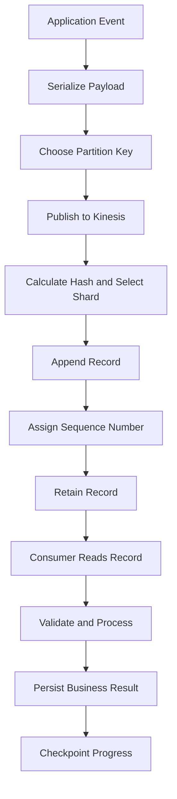
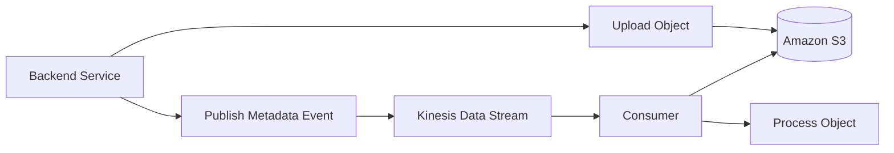
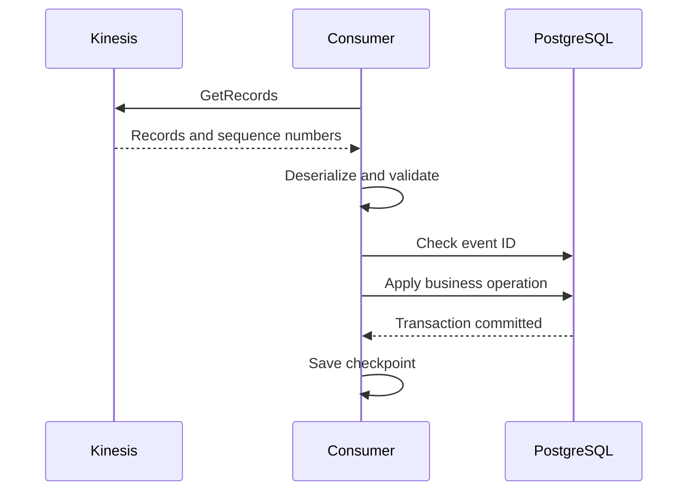
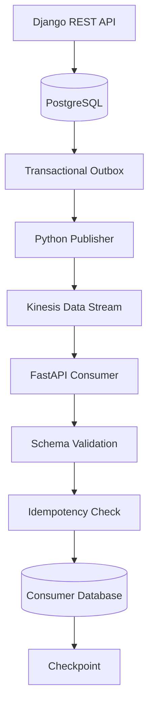

# 05- Data Records and Record Lifecycle

## Overview

Amazon Kinesis Data Streams stores data as records. A record is the basic unit of data written to a stream, retained within a shard, and subsequently retrieved by consumers.

Understanding the record lifecycle is important when designing event-driven backend systems because it affects:

- Data integrity and serialization.
- Record size and throughput.
- Ordering and sequence numbers.
- Retention and replay.
- Producer retries and duplicate delivery.
- Consumer checkpointing and recovery.
- End-to-end processing reliability.

A Kinesis record is not equivalent to a database row or a Kafka message in every respect. It has a specific structure, is assigned to a shard using its partition key, and receives a shard-specific sequence number when accepted by the service.

## Kinesis Record Structure

A Kinesis record consists of three primary elements:

| Field | Description |
|---|---|
| `Data` | Application payload, represented as bytes |
| `PartitionKey` | String used to determine the target shard |
| `SequenceNumber` | Service-generated identifier assigned after successful ingestion |

A record also has associated metadata, such as its approximate arrival timestamp and encryption-related context where applicable.

Conceptually:

```json
{
  "Data": "<binary payload>",
  "PartitionKey": "order-10001",
  "SequenceNumber": "4965..."
}
```

The example is illustrative. The actual Kinesis API represents record data as a binary blob, not necessarily JSON.

### Data

The `Data` field contains the application payload.

Kinesis treats the payload as opaque bytes. It does not automatically interpret JSON, validate schemas, or understand business-level fields.

Applications commonly serialize records as:

- JSON.
- Avro.
- Protocol Buffers.
- MessagePack.
- Other application-specific binary formats.

Example JSON event:

```json
{
  "event_id": "evt-10001",
  "event_type": "order_created",
  "order_id": "order-10001",
  "customer_id": "customer-1001",
  "occurred_at": "2026-11-19T10:30:00Z",
  "data": {
    "amount": 2499.00,
    "currency": "INR"
  }
}
```

Serialization should be explicit and consistent across producers and consumers.

### Partition Key

The partition key determines the shard to which Kinesis routes a record.

Kinesis calculates an MD5 hash of the partition key and uses the result to identify the shard whose hash-key range contains that value.

For example:

```python
partition_key = "order-10001"
```

Records using the same partition key are routed to the same shard while the relevant shard mapping remains unchanged.

Partition-key selection affects ordering and distribution. It should be designed around the application's logical ordering requirements rather than chosen arbitrarily.

### Sequence Number

Kinesis assigns a sequence number to each successfully ingested record.

A sequence number:

- Identifies a record within its shard.
- Establishes the record's position in that shard's sequence.
- Is used by consumers when tracking progress.
- Is not a globally ordered identifier across the stream.

Sequence numbers should be treated as opaque strings. Applications should not rely on parsing them as timestamps or using their numeric appearance to infer business ordering.

A sequence number is not a business event ID and does not provide application-level deduplication by itself.

## Record Lifecycle

A record moves through several stages from publication to consumption.



The stages have different reliability characteristics.

| Stage | Responsibility | Important consideration |
|---|---|---|
| Event creation | Application generates an event | Event identity and business consistency |
| Serialization | Converts event into bytes | Schema compatibility |
| Partitioning | Selects partition key | Ordering and distribution |
| Publication | Sends record to Kinesis | Retries and duplicate publication |
| Ingestion | Kinesis accepts and stores record | Sequence number and shard assignment |
| Retention | Record remains available | Retention configuration |
| Retrieval | Consumer reads records | Iterator and throughput management |
| Processing | Consumer performs business logic | Idempotency and failure handling |
| Checkpointing | Consumer records progress | Recovery and replay behavior |

## Record Serialization

### Why Serialization Matters

Kinesis accepts binary data. Producers and consumers must agree on how application events are encoded and decoded.

Poor serialization design can cause:

- Incompatible producer and consumer deployments.
- Deserialization failures.
- Increased payload size.
- Unnecessary CPU consumption.
- Difficult schema evolution.
- Data corruption caused by inconsistent encoding.

### JSON Serialization

JSON is commonly used for backend event streams because it is human-readable and supported by most programming languages.

Python example:

```python
import json
from datetime import datetime, timezone
from decimal import Decimal


def serialize_event(event: dict) -> bytes:
    payload = {
        **event,
        "occurred_at": datetime.now(timezone.utc).isoformat(),
    }

    def default_serializer(value):
        if isinstance(value, Decimal):
            return str(value)

        raise TypeError(f"Unsupported type: {type(value).__name__}")

    return json.dumps(
        payload,
        default=default_serializer,
        separators=(",", ":"),
    ).encode("utf-8")
```

Using compact separators reduces unnecessary whitespace.

For financial values, explicitly defining decimal representation avoids accidental precision loss caused by floating-point conversion.

### Binary Serialization

For high-throughput or schema-controlled systems, binary formats such as Avro or Protocol Buffers may be appropriate.

| Format | Advantages | Considerations |
|---|---|---|
| JSON | Human-readable and easy to debug | Larger payloads and runtime parsing overhead |
| Avro | Compact and schema-oriented | Requires schema management |
| Protocol Buffers | Compact and efficient | Requires generated or compatible schemas |
| MessagePack | Compact representation | Requires compatible serialization libraries |

The choice should consider interoperability, schema evolution, payload size, CPU cost, and operational tooling.

### Schema Evolution

Event schemas change as applications evolve.

For example, an initial order event may contain:

```json
{
  "event_id": "evt-10001",
  "order_id": "order-10001",
  "amount": 2499.00
}
```

A later version may introduce a currency field:

```json
{
  "event_id": "evt-10001",
  "order_id": "order-10001",
  "amount": 2499.00,
  "currency": "INR"
}
```

Consumers should handle optional fields and unknown fields according to an explicit compatibility policy.

Recommended practices:

- Include an event type.
- Include a schema version when version-specific interpretation is needed.
- Prefer additive changes.
- Avoid silently changing the meaning or type of existing fields.
- Maintain compatibility during rolling deployments.
- Validate event payloads at producer and consumer boundaries.

Example event envelope:

```json
{
  "event_id": "evt-10001",
  "event_type": "order.created",
  "schema_version": 1,
  "occurred_at": "2026-11-19T10:30:00Z",
  "producer": "orders-service",
  "payload": {
    "order_id": "order-10001",
    "customer_id": "customer-1001",
    "amount": "2499.00",
    "currency": "INR"
  }
}
```

## Record Size and Limits

Record size directly affects throughput and cost.

Kinesis Data Streams supports a maximum record data size of 10 MiB, including the partition key and other applicable record overhead. API request limits also apply and should be checked separately from individual record limits.

For example, `PutRecords` has a maximum request size and record-count limit. A batch must satisfy both the per-record and aggregate request constraints.

Large records can reduce the number of events that fit within a shard's byte-throughput allocation.

### Record Size Considerations

| Payload characteristic | Engineering impact |
|---|---|
| Small records | Lower byte consumption per event |
| Large records | Higher throughput consumption |
| Repeated metadata | Increases payload size |
| Binary compression | Can reduce bytes but adds CPU overhead |
| Large nested JSON | Increases serialization and parsing costs |

### Handling Large Payloads

When application payloads approach the Kinesis record limit, consider storing the large object in Amazon S3 and publishing a reference in Kinesis.



Example event:

```json
{
  "event_id": "evt-20001",
  "event_type": "document.uploaded",
  "document_id": "doc-10001",
  "s3": {
    "bucket": "application-documents",
    "key": "documents/doc-10001.pdf"
  }
}
```

This approach is useful for document processing, image processing, and large data ingestion pipelines.

Production considerations:

- Upload the object before publishing the reference event.
- Ensure consumers have the required S3 permissions.
- Define object retention and lifecycle policies.
- Handle the possibility that the object upload succeeds but event publication fails.
- Use encryption and appropriate access controls.
- Avoid publishing temporary or inaccessible object locations.

## Publishing Records

Kinesis supports individual and batch record publication.

### PutRecord

`PutRecord` publishes one record to a stream.

Python example:

```python
import json
import boto3

kinesis = boto3.client("kinesis", region_name="ap-south-1")


def publish_order_event(event: dict) -> dict:
    response = kinesis.put_record(
        StreamName="orders-stream",
        Data=json.dumps(event).encode("utf-8"),
        PartitionKey=str(event["order_id"]),
    )

    return {
        "shard_id": response["ShardId"],
        "sequence_number": response["SequenceNumber"],
    }
```

A successful response includes the shard ID and sequence number assigned to the accepted record.

### PutRecords

`PutRecords` publishes multiple records in a single API request.

It reduces the number of API calls when a producer has multiple events ready for publication.

```python
import json
import boto3

kinesis = boto3.client("kinesis", region_name="ap-south-1")


def publish_batch(events: list[dict]) -> dict:
    records = [
        {
            "Data": json.dumps(event).encode("utf-8"),
            "PartitionKey": str(event["order_id"]),
        }
        for event in events
    ]

    response = kinesis.put_records(
        StreamName="orders-stream",
        Records=records,
    )

    failed_count = response["FailedRecordCount"]

    return {
        "failed_count": failed_count,
        "records": response["Records"],
    }
```

A critical detail: `PutRecords` can partially succeed.

A successful HTTP response does not mean every record in the batch was accepted.

The response contains an entry corresponding to each submitted record. Failed entries contain error information, while successful entries contain shard and sequence metadata.

### Handling Partial Failures

A production publisher should retry only failed records rather than blindly resubmitting the entire batch.

```python
import json
import random
import time
import boto3
from botocore.exceptions import BotoCoreError, ClientError


kinesis = boto3.client("kinesis", region_name="ap-south-1")


def publish_records(
    stream_name: str,
    events: list[dict],
    max_attempts: int = 5,
) -> None:
    pending = [
        {
            "Data": json.dumps(event).encode("utf-8"),
            "PartitionKey": str(event["order_id"]),
        }
        for event in events
    ]

    for attempt in range(max_attempts):
        if not pending:
            return

        try:
            response = kinesis.put_records(
                StreamName=stream_name,
                Records=pending,
            )
        except (BotoCoreError, ClientError):
            if attempt == max_attempts - 1:
                raise

            delay = min(2 ** attempt, 20) + random.random()
            time.sleep(delay)
            continue

        failed_records = []

        for record, result in zip(pending, response["Records"]):
            if "ErrorCode" in result:
                failed_records.append(record)

        pending = failed_records

        if pending and attempt < max_attempts - 1:
            delay = min(2 ** attempt, 20) + random.random()
            time.sleep(delay)

    if pending:
        raise RuntimeError(
            f"Failed to publish {len(pending)} records after retries"
        )
```

This example demonstrates selective retries and bounded exponential backoff with jitter.

A production implementation should additionally:

- Classify retryable and non-retryable errors.
- Persist permanently failed events to a durable failure store.
- Enforce batch size and request-size limits.
- Apply backpressure when Kinesis is throttling.
- Record retry counts and publication latency.
- Avoid blocking application request threads for long retry periods.

The example uses a simple synchronous retry loop. High-volume publishers should generally use a dedicated publishing worker or an asynchronous producer architecture.

## Sequence Numbers

### Understanding Sequence Numbers

Each accepted record receives a sequence number within its shard.

Sequence numbers are used to identify record positions and support consumer progress tracking.

A consumer can retrieve records from a shard and use sequence information to resume reading.

Important characteristics:

- Sequence numbers are generated by Kinesis.
- They are scoped to a shard.
- They are not global stream offsets.
- They should be treated as opaque values.
- They are different from application-generated event IDs.

### Sequence Number Ordering

Within a shard, sequence numbers represent the order in which records were accepted.

For example:

```text
Shard 1:
    Record A -> Sequence 100
    Record B -> Sequence 101
    Record C -> Sequence 102
```

Another shard has its own sequence progression:

```text
Shard 2:
    Record D -> Sequence 200
    Record E -> Sequence 201
```

The sequence values across different shards cannot be used to establish a global event order.

### Sequence Number for Consumer Recovery

A consumer can store its last successfully processed sequence number.

When the consumer restarts, it can resume reading after that position using the appropriate shard iterator or consumer checkpointing mechanism.

However, checkpointing must happen only after the associated business work has been completed successfully.

Checkpointing before durable processing can result in lost business work after a failure.

## Sequence Number for Ordering Control

Kinesis supports `SequenceNumberForOrdering` in `PutRecord`.

It allows a producer to provide the sequence number from a previous successful write when publishing the next record to the same shard.

This can help enforce ordering for sequential writes from a producer.

Example:

```python
response = kinesis.put_record(
    StreamName="orders-stream",
    Data=b'{"event_type":"order_created"}',
    PartitionKey="order-10001",
)

previous_sequence_number = response["SequenceNumber"]

next_response = kinesis.put_record(
    StreamName="orders-stream",
    Data=b'{"event_type":"payment_completed"}',
    PartitionKey="order-10001",
    SequenceNumberForOrdering=previous_sequence_number,
)
```

This mechanism is useful when a producer needs to coordinate sequential writes.

Limitations:

- It does not establish ordering across different shards.
- It does not coordinate multiple independent producers automatically.
- It does not guarantee downstream business-operation completion order.
- It does not replace application-level concurrency control.

For distributed producer systems, partition-key consistency and application-level ordering design remain essential.

## Retention and Record Availability

Kinesis retains records for a configurable period.

The default retention period is 24 hours. Retention can be extended up to 365 days.

Retention determines how long consumers can retrieve records after ingestion.

| Retention setting | Purpose |
|---|---|
| Default retention | Supports normal near-real-time processing |
| Extended retention | Supports delayed consumers and longer recovery windows |
| Long-term archival | Usually implemented using Amazon S3 or another durable storage system |

Retention is not equivalent to permanent archival.

Once records expire, consumers can no longer retrieve them from the stream.

### Retention and Consumer Outages

Consider a consumer that is unavailable for 36 hours.

If the stream retains records for only 24 hours, the consumer cannot recover the complete missed history from Kinesis.

A longer retention period may allow recovery, but it does not eliminate the need for durable archival and disaster recovery planning.

Recommended practices:

- Set retention based on the maximum expected recovery time.
- Monitor consumer lag.
- Alert before consumers approach the retention boundary.
- Archive records when long-term replay is required.
- Test recovery from consumer outages.

## Record Retrieval

Consumers retrieve records using shard iterators or higher-level consumer frameworks.

A shard iterator identifies a position in a shard from which records should be read.

Common iterator types include:

| Iterator type | Behavior |
|---|---|
| `TRIM_HORIZON` | Starts at the oldest record still retained |
| `LATEST` | Starts at the latest position and reads newly arriving records |
| `AT_SEQUENCE_NUMBER` | Starts at a specified sequence number |
| `AFTER_SEQUENCE_NUMBER` | Starts immediately after a specified sequence number |
| `AT_TIMESTAMP` | Starts at a position determined by a timestamp |

Example:

```python
response = kinesis.get_shard_iterator(
    StreamName="orders-stream",
    ShardId="shardId-000000000000",
    ShardIteratorType="TRIM_HORIZON",
)

shard_iterator = response["ShardIterator"]
```

The consumer then retrieves records:

```python
response = kinesis.get_records(
    ShardIterator=shard_iterator,
    Limit=100,
)

records = response["Records"]
next_iterator = response.get("NextShardIterator")
```

Shard iterators expire. Consumers must use the next iterator returned by `GetRecords` and obtain a new iterator when necessary.

`GetRecords` does not automatically checkpoint processing progress. The application must maintain its own checkpoint or use a framework such as KCL.

## Consumer Processing and Checkpointing

### Processing Lifecycle

A consumer typically performs these operations:

1. Read records from a shard.
2. Deserialize the payload.
3. Validate the event schema.
4. Check whether the event has already been processed.
5. Execute business logic.
6. Persist the result.
7. Save processing progress.



The order of business persistence and checkpointing is important.

If a consumer checkpoints before committing its business transaction, a crash can cause records to be skipped during recovery.

If a consumer commits business work but crashes before checkpointing, records may be processed again.

This is why idempotent processing is essential.

### Idempotency

Kinesis consumers should assume that records can be delivered or processed more than once.

For example, a consumer might successfully update PostgreSQL but fail before saving its checkpoint.

After restart, it can read the same record again.

Use an application-level event ID to prevent duplicate business effects.

Example PostgreSQL table:

```sql
CREATE TABLE processed_events (
    event_id VARCHAR(100) PRIMARY KEY,
    processed_at TIMESTAMPTZ NOT NULL DEFAULT NOW()
);
```

A transaction can atomically register the event and apply its business operation:

```python
from sqlalchemy import text


def process_event(session, event: dict) -> bool:
    event_id = event["event_id"]

    result = session.execute(
        text("""
            INSERT INTO processed_events (event_id)
            VALUES (:event_id)
            ON CONFLICT (event_id) DO NOTHING
            RETURNING event_id
        """),
        {"event_id": event_id},
    )

    if result.scalar_one_or_none() is None:
        return False

    session.execute(
        text("""
            UPDATE orders
            SET status = :status
            WHERE order_id = :order_id
        """),
        {
            "status": "PROCESSING",
            "order_id": event["payload"]["order_id"],
        },
    )

    return True
```

The caller must execute this function within a database transaction and commit only after all business operations succeed.

The event registration and business update must be committed atomically. Otherwise, a partial failure can still create inconsistent state.

### Checkpointing with KCL

The Kinesis Client Library (KCL) manages important consumer responsibilities, including:

- Shard discovery.
- Shard processing coordination.
- Lease management.
- Checkpointing.
- Handling shard lineage.
- Recovery after worker failures.

KCL commonly uses DynamoDB to coordinate leases and checkpoint state.

A checkpoint represents the consumer application's progress through a shard.

Checkpointing should occur only after the records represented by that checkpoint have completed the required processing.

For parallel record processing, the consumer must ensure it does not checkpoint beyond unfinished earlier records when ordering matters.

## Duplicate Records and Delivery Semantics

Kinesis does not provide exactly-once business processing automatically.

Duplicates can arise from:

- Producer retries after an ambiguous network failure.
- Repeated publication by application workers.
- Consumer retries after processing failures.
- Consumer restarts before checkpoint persistence.

A successful write response means Kinesis accepted the record. If the producer does not receive the response due to a network failure, it may not know whether the write succeeded.

Retrying can create another record.

### Producer-Side Idempotency

Include a stable event ID in the payload:

```json
{
  "event_id": "evt-10001",
  "event_type": "order_created",
  "order_id": "order-10001"
}
```

Generate the event ID before publication and preserve it across retries.

Do not generate a new event ID for every retry attempt.

### Consumer-Side Idempotency

Consumers should use the event ID as an idempotency key.

Possible mechanisms include:

- PostgreSQL unique constraints.
- Redis deduplication keys with suitable expiration.
- DynamoDB conditional writes.
- Idempotent state transitions.
- Transactional inbox patterns.

The deduplication store must have a retention policy compatible with the maximum replay and recovery window.

## Record Timestamps

Kinesis records have an approximate arrival timestamp assigned by the service.

This timestamp represents the approximate time the record was accepted by Kinesis.

It is different from:

- The time the business event occurred.
- The time the producer created the event.
- The time a consumer processed the event.
- The time a downstream database committed the result.

For event-driven systems, include an application-level timestamp such as `occurred_at`.

Example:

```json
{
  "event_id": "evt-10001",
  "occurred_at": "2026-11-19T10:30:00Z",
  "event_type": "payment_completed"
}
```

Consumers can use this timestamp for business analytics and event-time processing.

Do not assume arrival order always matches business event time. Network delays, producer retries, and distributed clocks can cause differences.

## Failure Handling

Record processing failures should be handled without silently losing data or blocking a shard indefinitely.

### Common Failure Scenarios

| Failure | Possible consequence | Recommended handling |
|---|---|---|
| Invalid JSON | Deserialization failure | Quarantine or record in a failure store |
| Unsupported schema version | Consumer cannot interpret event | Compatibility handling and controlled rejection |
| Database unavailable | Business processing fails | Retry with bounded backoff |
| Duplicate publication | Repeated event delivery | Idempotent consumer |
| Consumer crash | Records may be read again | Checkpoint recovery |
| Expired retention | Historical records unavailable | Restore from an archive if available |
| Oversized record | Publication rejected | Validate payload size and use S3 references |

### Poison Records

A poison record is a record that repeatedly fails processing.

Examples include:

- Invalid payload structure.
- Unsupported event type.
- Missing required fields.
- Permanently invalid business data.

A single poison record can block progress if the consumer refuses to advance its checkpoint.

A robust design should:

1. Capture the event ID and failure reason.
2. Store the original payload securely.
3. Apply a bounded retry policy.
4. Send permanently failing records to a durable quarantine or failure store.
5. Continue processing only when doing so does not violate required ordering semantics.
6. Provide a replay mechanism after the issue is resolved.

Do not discard failed records without an auditable recovery path.

## Backend Architecture Example

Consider a Django-based order service publishing events to Kinesis.

The service stores orders in PostgreSQL and uses an outbox publisher to send events to Kinesis.

A separate FastAPI consumer processes order events and updates downstream systems.



The outbox pattern prevents the application from relying on a non-atomic sequence of database commit followed by network publication.

The publisher should:

- Read unpublished outbox records.
- Publish them using stable event IDs.
- Retry transient failures.
- Mark records as published only after successful publication.
- Handle ambiguous publication outcomes through idempotent downstream processing.

The consumer should:

- Validate event structure.
- Apply idempotency checks.
- Persist business changes transactionally.
- Checkpoint only after successful processing.
- Expose processing lag and failure metrics.

## Monitoring and Observability

Record lifecycle monitoring should cover both ingestion and consumption.

| Metric or signal | Purpose |
|---|---|
| `IncomingRecords` | Measures record ingestion rate |
| `IncomingBytes` | Measures ingestion volume |
| `WriteProvisionedThroughputExceeded` | Detects write throttling |
| `GetRecords.IteratorAgeMilliseconds` | Measures consumer lag for shared-throughput consumers |
| `ReadProvisionedThroughputExceeded` | Detects shared read throttling |
| `OutgoingRecords` | Measures records retrieved |
| Producer retry count | Identifies ingestion instability |
| Deserialization failures | Detects schema or payload problems |
| Duplicate event count | Tracks repeated processing attempts |
| Processing duration | Identifies slow consumers |
| Checkpoint delay | Indicates consumer progress problems |

For enhanced fan-out consumers, use the applicable enhanced fan-out metrics and consumer-specific observability rather than relying exclusively on shared-throughput metrics.

### Application-Level Observability

Include structured fields in producer and consumer logs:

- Event ID.
- Event type.
- Stream name.
- Shard ID where available.
- Sequence number where available.
- Producer service.
- Consumer application.
- Processing duration.
- Retry count.
- Failure category.

Avoid logging complete sensitive payloads.

Use event IDs and correlation IDs to trace an event across APIs, publishers, Kinesis, consumers, and databases.

## Security Considerations

Kinesis record payloads can contain sensitive business data.

Recommended practices:

- Encrypt stream data at rest using AWS KMS.
- Use TLS for service communication.
- Restrict producer and consumer access with IAM policies.
- Apply least-privilege permissions to stream operations.
- Protect encryption keys and restrict KMS usage.
- Avoid sensitive information in partition keys.
- Secure archived records in S3.
- Avoid exposing raw payloads in logs and tracing systems.
- Apply data retention policies based on business and regulatory requirements.

Encryption at rest does not replace application-level data protection. Sensitive fields may still require tokenization, masking, or encryption before publication.

## Performance and Cost Considerations

Record design affects throughput, processing latency, and cost.

### Payload Size

Larger records consume more shard byte throughput.

Compact serialization and removal of unnecessary metadata can improve throughput efficiency.

### Batching

`PutRecords` reduces request overhead by publishing multiple records in one API call.

However, batching introduces tradeoffs:

- Additional buffering latency.
- Partial failure handling.
- Memory consumption.
- Batch-size management.
- More complex retry logic.

Use bounded batches based on both record count and total payload size.

### Compression

Compression can reduce payload bytes when records contain repetitive data.

However, it introduces CPU overhead and requires consumers to decompress the payload.

Compression should be measured under realistic workloads rather than enabled automatically.

### Retention

Longer retention increases the amount of data stored by the stream and can increase cost.

Choose retention based on recovery requirements, replay needs, and archival strategy.

### Consumer Processing

Slow consumers increase iterator age and may approach the retention boundary.

Scale consumers according to shard parallelism, processing latency, and the selected consumer model.

## Best Practices

- Define a stable event envelope with an event ID, event type, schema version, and occurrence timestamp.
- Treat Kinesis payloads as opaque bytes and validate them at consumer boundaries.
- Use partition keys that reflect business ordering requirements.
- Keep records within documented service limits and prefer S3 references for large objects.
- Handle `PutRecords` partial failures at the individual-record level.
- Preserve event IDs across producer retries.
- Implement idempotent consumer processing.
- Commit business changes before checkpointing progress.
- Configure retention based on realistic recovery objectives.
- Monitor ingestion throttling, consumer lag, processing failures, and duplicate events.
- Maintain a durable quarantine and replay process for permanently failing records.
- Test schema compatibility and recovery behavior before deploying producer or consumer changes.

## Common Mistakes and Pitfalls

### Treating Sequence Numbers as Global IDs

**Problem:** A sequence number is used to identify an event across the entire stream.

**Impact:** Sequence numbers are shard-scoped and do not provide a global event identity.

**Avoidance:** Generate a stable application-level event ID.

### Assuming PutRecords Is All-or-Nothing

**Problem:** The publisher assumes a successful API response means every record was accepted.

**Impact:** Individual records may fail while others succeed.

**Avoidance:** Inspect each response entry and retry only failed records.

### Generating New Event IDs During Retries

**Problem:** Every retry creates a new event ID.

**Impact:** Consumer deduplication cannot identify repeated publication attempts as the same logical event.

**Avoidance:** Generate the event ID before the first publication attempt and preserve it across retries.

### Checkpointing Before Business Persistence

**Problem:** Consumer progress is saved before the database transaction commits.

**Impact:** A crash can cause the consumer to skip business work during recovery.

**Avoidance:** Commit durable business changes before advancing the checkpoint.

### Assuming Kinesis Validates JSON

**Problem:** Producers expect Kinesis to validate payload structure.

**Impact:** Invalid or incompatible records can be successfully ingested and fail later in consumers.

**Avoidance:** Validate payloads before publication and again at consumer boundaries where appropriate.

### Ignoring Retention Boundaries

**Problem:** A consumer remains unavailable longer than the configured retention period.

**Impact:** Records can expire before the consumer recovers.

**Avoidance:** Monitor consumer lag, configure adequate retention, and maintain durable archives when required.

### Treating Arrival Time as Business Event Time

**Problem:** Consumers use Kinesis arrival timestamps to reconstruct business chronology.

**Impact:** Network delays and retries can make arrival order differ from event occurrence order.

**Avoidance:** Include an application-generated `occurred_at` timestamp and define the ordering requirements explicitly.

## Key Takeaways

- A Kinesis record contains an opaque binary payload and partition key; Kinesis assigns its sequence number after successful ingestion.
- Serialization, event identity, and schema evolution should be designed as part of the producer-consumer contract.
- `PutRecords` can partially fail, and producer retries can create duplicate records.
- Consumers should implement idempotent business processing and checkpoint only after durable work succeeds.
- Retention, record size, monitoring, and replay strategy directly affect the reliability of production streaming systems.