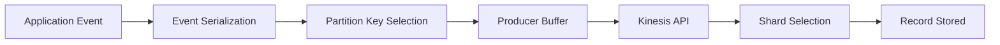
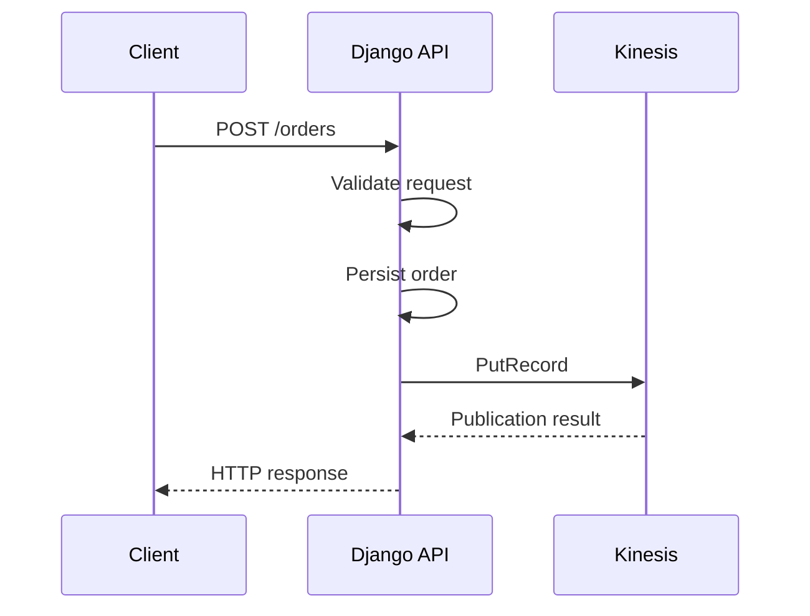
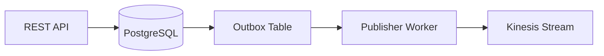
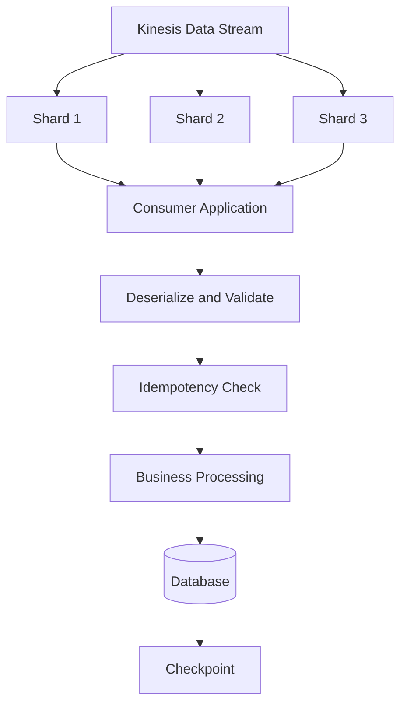
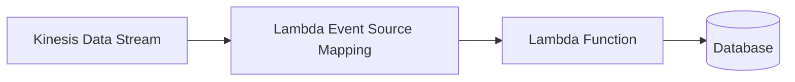
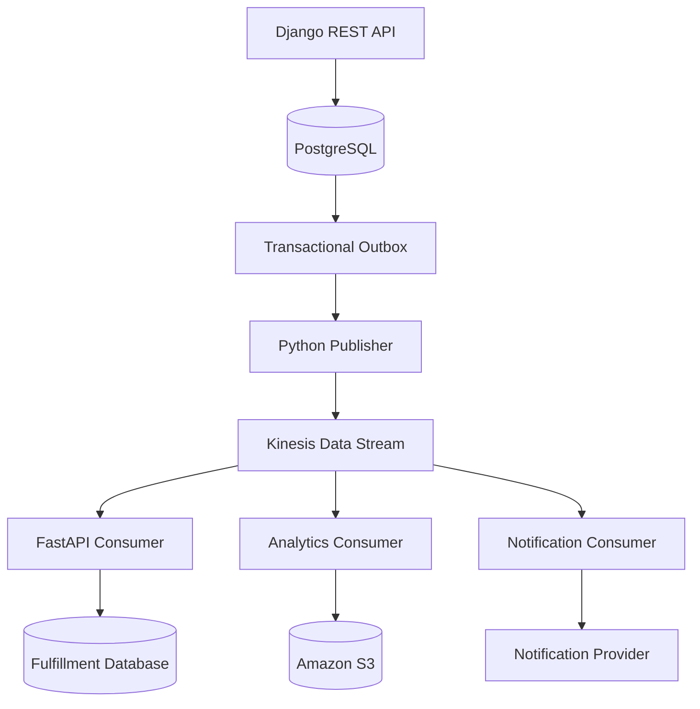

# 06- Producers and Consumers

## Overview

Amazon Kinesis Data Streams uses producers to publish records and consumers to retrieve and process them. Producers and consumers operate independently, allowing multiple backend services to exchange streaming data without requiring direct synchronous communication.

A producer writes records to a stream. Kinesis distributes those records across shards according to partition keys. Consumers retrieve records from the shards and execute application-specific processing.

This architecture supports:

- Event-driven microservices.
- Real-time analytics.
- Application and infrastructure telemetry.
- IoT data ingestion.
- Transaction and order processing.
- Data integration and streaming pipelines.

Producer and consumer design directly affects throughput, latency, ordering, reliability, and operational complexity.

## Producer Architecture

### What Is a Producer?

A producer is an application or service that publishes records to a Kinesis Data Stream.

Common producers include:

- Django and FastAPI applications.
- Background workers running Celery.
- Containerized services running on ECS or Kubernetes.
- IoT devices and gateways.
- Log and telemetry collection systems.
- AWS Lambda functions.

A producer is responsible for constructing valid events, serializing payloads, selecting partition keys, and publishing records.

### Producer Data Flow



A typical producer performs the following operations:

1. Receives or generates a business event.
2. Constructs a standardized event envelope.
3. Serializes the event into bytes.
4. Selects a partition key.
5. Publishes the record using `PutRecord` or `PutRecords`.
6. Handles throttling, retries, and publication failures.
7. Records publication metadata for observability.

### Producer Responsibilities

| Responsibility | Engineering consideration |
|---|---|
| Event construction | Include stable event identity and event type |
| Serialization | Use a consistent encoding and schema |
| Partitioning | Preserve required ordering and distribute traffic |
| Publication | Handle API errors and throttling |
| Batching | Balance request overhead and latency |
| Retry handling | Avoid uncontrolled duplicate publication |
| Security | Use least-privilege IAM permissions |
| Observability | Track latency, failures, and retry counts |

## Producer APIs

Kinesis provides APIs for publishing individual records and batches of records.

### PutRecord

`PutRecord` publishes one record to a stream.

Python example:

```python
import json
import boto3

kinesis = boto3.client(
    "kinesis",
    region_name="ap-south-1",
)


def publish_event(event: dict) -> dict:
    response = kinesis.put_record(
        StreamName="orders-stream",
        Data=json.dumps(event).encode("utf-8"),
        PartitionKey=str(event["order_id"]),
    )

    return {
        "shard_id": response["ShardId"],
        "sequence_number": response["SequenceNumber"],
    }
```

A successful response includes:

- `ShardId`: The shard that received the record.
- `SequenceNumber`: The sequence number assigned to the record.

Use `PutRecord` when individual publication semantics are important or when the application does not have enough records to justify batching.

### PutRecords

`PutRecords` publishes multiple records in one API request.

It reduces API request overhead and is commonly used in high-throughput ingestion systems.

```python
import json
import boto3

kinesis = boto3.client(
    "kinesis",
    region_name="ap-south-1",
)


def publish_batch(events: list[dict]) -> dict:
    records = [
        {
            "Data": json.dumps(event).encode("utf-8"),
            "PartitionKey": str(event["order_id"]),
        }
        for event in events
    ]

    response = kinesis.put_records(
        StreamName="orders-stream",
        Records=records,
    )

    return {
        "failed_count": response["FailedRecordCount"],
        "results": response["Records"],
    }
```

Important characteristics:

- A batch can contain multiple records.
- The API has record-count and aggregate request-size limits.
- Individual records can fail while others succeed.
- The response contains one result for each submitted record.
- Successful records include shard and sequence metadata.
- Failed records include error information.

A successful HTTP response does not mean that every record in the batch was successfully ingested.

### Handling Partial Batch Failures

A production producer must inspect each record result and retry only failed records.

```python
import json
import random
import time

import boto3
from botocore.exceptions import BotoCoreError, ClientError


kinesis = boto3.client(
    "kinesis",
    region_name="ap-south-1",
)


def publish_with_retries(
    stream_name: str,
    events: list[dict],
    max_attempts: int = 5,
) -> None:
    pending = [
        {
            "Data": json.dumps(event).encode("utf-8"),
            "PartitionKey": str(event["order_id"]),
        }
        for event in events
    ]

    for attempt in range(max_attempts):
        if not pending:
            return

        try:
            response = kinesis.put_records(
                StreamName=stream_name,
                Records=pending,
            )
        except (BotoCoreError, ClientError):
            if attempt == max_attempts - 1:
                raise

            time.sleep(
                min(2 ** attempt, 20) + random.random()
            )
            continue

        failed_records = []

        for record, result in zip(
            pending,
            response["Records"],
        ):
            if "ErrorCode" in result:
                failed_records.append(record)

        pending = failed_records

        if pending and attempt < max_attempts - 1:
            time.sleep(
                min(2 ** attempt, 20) + random.random()
            )

    if pending:
        raise RuntimeError(
            f"Failed to publish {len(pending)} records"
        )
```

This example demonstrates bounded retries and selective handling of partial failures.

A production implementation should also:

- Classify retryable and permanent errors.
- Persist permanently failed events.
- Apply backpressure during sustained throttling.
- Enforce batch record-count and request-size limits.
- Track retry counts and publication latency.
- Avoid indefinitely blocking application request handlers.

For high-volume systems, a dedicated publishing worker is generally preferable to synchronous publication inside an HTTP request.

## Producer Design Patterns

### Synchronous Publishing

The application publishes directly to Kinesis during request processing.



Advantages:

- Simple implementation.
- Immediate publication result.
- Fewer infrastructure components.

Limitations:

- API latency depends on Kinesis availability.
- Network failures can affect request handling.
- Database and Kinesis operations are not one atomic transaction.
- Retrying publication can create duplicates.

Use synchronous publishing only when the application can tolerate the coupling and has a clearly defined failure strategy.

### Asynchronous Publishing

The application writes an event to a durable intermediate store or queue. A background worker publishes it to Kinesis.



This architecture reduces coupling between request processing and Kinesis availability.

The transactional outbox pattern is useful when an application must persist business data and reliably record the intention to publish an event.

The publisher should mark an outbox event as published only after receiving a successful Kinesis response. Because publication outcomes can be ambiguous, consumers must still be idempotent.

### Buffered Publishing

A producer can buffer records before sending them in batches.

Buffering can improve throughput by reducing API request overhead.

However, buffering introduces additional considerations:

- Maximum batch size.
- Maximum buffering time.
- Memory consumption.
- Shutdown behavior.
- Retry handling.
- Durability of buffered events.

Do not keep critical business events only in volatile process memory. A process crash can destroy unflushed records.

## Producer Library: Kinesis Producer Library

The Kinesis Producer Library (KPL) is a high-performance producer library designed to simplify and optimize record publication.

It provides capabilities such as:

- Automatic batching.
- Record aggregation.
- Asynchronous publishing.
- Retry handling.
- Throughput optimization.

### Record Aggregation

KPL can aggregate multiple user records into a single Kinesis record.

This reduces the number of Kinesis records sent to the service and can improve ingestion efficiency.

Consumers must understand the aggregation format and deaggregate records when required.

This is an important compatibility consideration: a consumer that treats an aggregated Kinesis record as one application event may process the wrong logical payload.

KPL is different from the basic `PutRecords` API:

| Feature | PutRecords | KPL |
|---|---|---|
| Batch publication | Yes | Yes |
| User-record aggregation | No | Yes |
| Asynchronous buffering | Application-managed | Built in |
| Automatic retries | Application-managed | Built in |
| Language integration | AWS SDK support | Supported KPL language integrations |
| Consumer deaggregation | Not required for normal records | Required when consuming aggregated records |

KPL is useful for high-volume workloads where aggregation and producer-side buffering provide measurable benefits.

For Python applications, the standard Boto3 client is often sufficient. KPL integration may require additional runtime and deployment considerations.

## Producer Reliability

### Retry Strategy

Producers should retry transient failures such as throttling and temporary service errors.

Use exponential backoff with jitter:

```text
Delay = min(MaxDelay, BaseDelay × 2^Attempt) + RandomJitter
```

Jitter reduces synchronized retry spikes when many producers experience the same failure.

Retries should be bounded by:

- Maximum attempts.
- Maximum elapsed time.
- Application latency requirements.
- Event durability requirements.

### Duplicate Publication

A producer may successfully publish a record but fail to receive the response because of a network interruption.

The producer cannot always determine whether the record was accepted.

Retrying the same event may create a duplicate.

Recommended practices:

- Generate a stable event ID before publication.
- Preserve the ID across retries.
- Use idempotent consumers.
- Record publication attempts.
- Avoid assuming that a network timeout means the record was rejected.

### Producer Idempotency

Kinesis does not provide general application-level exactly-once publication.

An application can use stable event identifiers to make downstream processing idempotent.

Example event:

```json
{
  "event_id": "evt-10001",
  "event_type": "order.created",
  "schema_version": 1,
  "occurred_at": "2026-11-19T10:30:00Z",
  "payload": {
    "order_id": "order-10001"
  }
}
```

The event ID should remain unchanged when the same logical event is retried.

## Consumer Architecture

### What Is a Consumer?

A consumer is an application that reads records from a Kinesis Data Stream and processes them.

Consumers can perform operations such as:

- Updating application databases.
- Triggering downstream workflows.
- Generating analytics.
- Transforming records.
- Writing data to S3.
- Publishing events to other services.
- Invoking external APIs.

A stream can have multiple independent consumer applications.

For example, an order stream can feed fulfillment, analytics, and notification systems independently.

### Consumer Data Flow



### Consumer Responsibilities

| Responsibility | Engineering consideration |
|---|---|
| Shard discovery | Discover available shards dynamically |
| Record retrieval | Use appropriate consumer APIs |
| Deserialization | Decode the payload correctly |
| Validation | Enforce event schema and business rules |
| Processing | Execute application logic |
| Idempotency | Prevent duplicate business effects |
| Checkpointing | Persist progress after successful processing |
| Failure handling | Retry, quarantine, or recover failed records |
| Monitoring | Track lag, throughput, and processing errors |

## Consumer Models

Kinesis supports multiple approaches to consuming records.

### Shared Throughput Consumers

Consumers can retrieve records using the `GetShardIterator` and `GetRecords` APIs.

Multiple consumers reading through these APIs share the shard's read throughput allocation.

Characteristics:

- Relatively simple implementation.
- Consumers manage shard iterators.
- Consumers manage checkpointing.
- Read throughput is shared.
- Suitable for workloads with moderate read requirements.

### Enhanced Fan-Out Consumers

Enhanced fan-out provides dedicated read throughput for registered consumers.

Each enhanced fan-out consumer receives dedicated throughput per shard, rather than sharing the standard `GetRecords` read throughput allocation.

Characteristics:

- Dedicated read throughput.
- Lower contention between consumer applications.
- Push-based record delivery through HTTP/2.
- Consumer registration and lifecycle management are required.
- Additional charges apply.

Use enhanced fan-out when multiple consumers need independent, predictable read throughput or when low-latency delivery is important.

### AWS Lambda Consumers

Kinesis can invoke Lambda functions when records become available.

Lambda polls the stream and invokes the configured function with batches of records.



This model reduces the need to manage consumer infrastructure.

Important considerations:

- Configure batch size and batching window.
- Configure retry and failure behavior.
- Use partial batch response support where appropriate.
- Design the function to be idempotent.
- Monitor iterator age and invocation errors.
- Account for shard-level processing concurrency and ordering.

Lambda event source mappings process records from each shard in order, but application-level concurrency and downstream asynchronous work can still affect completion order.

### Consumer Model Comparison

| Feature | Shared throughput | Enhanced fan-out | Lambda event source mapping |
|---|---|---|---|
| Retrieval mechanism | `GetRecords` polling | HTTP/2 subscription | Managed polling |
| Throughput | Shared per shard | Dedicated per registered consumer | Depends on polling mode and configuration |
| Infrastructure | Application-managed | Application-managed | AWS-managed execution |
| Checkpointing | Application or framework | Application or framework | Managed by Lambda |
| Operational complexity | Moderate | Moderate to high | Lower infrastructure management |
| Custom processing control | High | High | Function-based |
| Typical use case | General-purpose consumers | Multiple high-throughput consumers | Event-driven serverless processing |

## Reading Records with Boto3

### Obtaining a Shard Iterator

A consumer first obtains a shard iterator.

```python
import boto3

kinesis = boto3.client(
    "kinesis",
    region_name="ap-south-1",
)


def get_initial_iterator(
    stream_name: str,
    shard_id: str,
) -> str:
    response = kinesis.get_shard_iterator(
        StreamName=stream_name,
        ShardId=shard_id,
        ShardIteratorType="TRIM_HORIZON",
    )

    return response["ShardIterator"]
```

Common iterator types:

| Type | Starting position |
|---|---|
| `TRIM_HORIZON` | Oldest record still retained |
| `LATEST` | Latest position for newly arriving records |
| `AT_SEQUENCE_NUMBER` | Specified sequence number |
| `AFTER_SEQUENCE_NUMBER` | Immediately after specified sequence number |
| `AT_TIMESTAMP` | Position associated with a timestamp |

Use `TRIM_HORIZON` when historical retained records must be processed. Use `LATEST` when the application intentionally wants to start with newly arriving records.

Be careful with `LATEST`: records published before the consumer establishes its starting position may not be included in its processing window.

### Retrieving Records

```python
def read_records(
    stream_name: str,
    shard_id: str,
) -> None:
    iterator = get_initial_iterator(
        stream_name,
        shard_id,
    )

    while iterator:
        response = kinesis.get_records(
            ShardIterator=iterator,
            Limit=100,
        )

        for record in response["Records"]:
            print({
                "sequence_number": record["SequenceNumber"],
                "partition_key": record["PartitionKey"],
                "data": record["Data"],
                "approximate_arrival_timestamp": (
                    record["ApproximateArrivalTimestamp"]
                ),
            })

        iterator = response.get("NextShardIterator")
```

This is a simplified retrieval example. A production consumer must also implement:

- Durable checkpointing.
- Shard discovery.
- Retry and throttling handling.
- Iterator expiration handling.
- Graceful shutdown.
- Processing failure management.
- Parent-child shard lifecycle handling.

`GetRecords` is a polling API. A consumer should not assume that an empty response means the stream is permanently empty.

### Polling and Backoff

Consumers should avoid continuously polling at maximum frequency when no records are available.

Use an appropriate polling interval and handle service throttling.

The polling strategy should account for:

- Expected event arrival rate.
- Processing capacity.
- Shard read limits.
- Consumer latency requirements.
- Number of consumers sharing throughput.

Excessive polling increases API request volume without necessarily improving processing latency.

## Consumer Checkpointing

### What Is a Checkpoint?

A checkpoint records the consumer's progress through a shard.

It allows a consumer to resume processing after a restart or failure.

A checkpoint normally references a sequence number or equivalent progress position.

### Why Checkpointing Matters

Without durable checkpoints, a consumer cannot reliably determine where it should resume.

Checkpointing supports:

- Recovery after process crashes.
- Restart after deployment.
- Controlled replay.
- Distributed consumer coordination.
- Progress tracking.

### Correct Processing Order

The safe processing sequence is:

```text
Read Record
    |
    v
Validate Record
    |
    v
Process Business Logic
    |
    v
Commit Durable Result
    |
    v
Checkpoint Record
```

Checkpointing before durable business processing can cause data loss from the application's perspective.

If the business transaction commits but checkpointing fails, the record may be processed again. Idempotency is therefore required.

### Checkpointing with KCL

The Kinesis Client Library provides higher-level consumer coordination.

KCL manages:

- Shard discovery.
- Lease assignment.
- Worker coordination.
- Checkpoint storage.
- Recovery from worker failures.
- Shard lineage processing.

KCL commonly uses DynamoDB for lease and checkpoint state.

A consumer should use KCL when managing multiple shards and distributed workers would otherwise require substantial custom coordination.

## Consumer Parallelism

### Shard-Based Parallelism

A shard is a unit of read parallelism.

A consumer application can process multiple shards concurrently, subject to its architecture and processing capacity.

For example:

```text
Kinesis Stream
    |
    +-- Shard 1 --> Worker 1
    +-- Shard 2 --> Worker 2
    +-- Shard 3 --> Worker 3
    +-- Shard 4 --> Worker 4
```

This is a simplified one-worker-per-shard model.

The actual worker allocation depends on the consumer implementation and framework.

### Parallel Processing Within a Shard

A consumer may read records in shard order and then dispatch work to multiple threads or asynchronous tasks.

This can increase throughput, but it introduces ordering concerns.

For example:

```text
Record 1 --> Task A (slow)
Record 2 --> Task B (fast)
Record 3 --> Task C (fast)
```

Tasks B and C may complete before Task A.

If business ordering matters, the consumer must preserve completion order or partition processing by entity.

Possible approaches:

- Process records sequentially per shard.
- Use per-entity ordered queues.
- Use keyed worker pools.
- Track completion positions before checkpointing.
- Separate independent workloads into different streams.

Do not checkpoint past unfinished records when doing so would violate recovery or ordering requirements.

## Consumer Scaling

Consumer scaling depends on:

- Number of shards.
- Record arrival rate.
- Average record size.
- Processing time.
- Consumer throughput.
- Downstream dependency capacity.

Adding worker instances does not automatically increase throughput if there are insufficient independent shards or if workers compete for shared read throughput.

For KCL-based consumers, worker scaling also depends on lease distribution and shard ownership.

### Scaling Example

Assume a stream has eight shards.

A consumer application can distribute shard processing across multiple worker instances:

```text
8 Shards

Worker A: Shard 1, Shard 2
Worker B: Shard 3, Shard 4
Worker C: Shard 5, Shard 6
Worker D: Shard 7, Shard 8
```

Adding more workers than available shards may not increase shard-level processing parallelism for that application.

However, additional workers can provide redundancy or capacity for other workloads depending on the consumer architecture.

### Backpressure

A consumer must avoid retrieving records faster than it can process them.

If records accumulate in application memory while database operations are slow, the consumer can experience:

- Increased memory usage.
- Longer processing latency.
- Growing iterator age.
- Connection pool exhaustion.
- Process instability.

Use bounded queues, controlled concurrency, and downstream capacity limits.

## Consumer Reliability

### Idempotent Processing

Consumers should assume that records can be processed more than once.

A consumer may commit a database transaction and crash before checkpointing.

When it restarts, it can read the same record again.

Use stable event IDs and durable deduplication mechanisms.

Example PostgreSQL table:

```sql
CREATE TABLE processed_events (
    event_id VARCHAR(100) PRIMARY KEY,
    processed_at TIMESTAMPTZ NOT NULL DEFAULT NOW()
);
```

Insert the event ID and apply business changes in the same transaction.

```python
from sqlalchemy import text


def process_event(session, event: dict) -> bool:
    result = session.execute(
        text("""
            INSERT INTO processed_events (event_id)
            VALUES (:event_id)
            ON CONFLICT (event_id) DO NOTHING
            RETURNING event_id
        """),
        {"event_id": event["event_id"]},
    )

    if result.scalar_one_or_none() is None:
        return False

    session.execute(
        text("""
            UPDATE orders
            SET status = :status
            WHERE order_id = :order_id
        """),
        {
            "status": "PROCESSING",
            "order_id": event["payload"]["order_id"],
        },
    )

    return True
```

The caller must commit the transaction only after all required database operations succeed.

### Poison Records

A poison record repeatedly fails processing because of invalid data or a permanent business error.

Examples:

- Invalid JSON.
- Unsupported schema version.
- Missing required fields.
- Invalid business state transition.

Recommended handling:

1. Capture the event ID and failure reason.
2. Store the original record in a durable quarantine.
3. Apply a bounded retry policy.
4. Alert on repeated failures.
5. Provide a controlled replay mechanism.
6. Preserve ordering requirements when deciding whether to skip a failed record.

Do not silently discard records.

### Graceful Shutdown

Consumers running in containers or Kubernetes should handle termination signals.

A graceful shutdown should:

- Stop accepting new work.
- Finish or safely cancel in-flight processing.
- Commit durable business changes.
- Persist valid checkpoints.
- Release leases or allow the framework to recover ownership.
- Close database and network connections.

Set Kubernetes termination grace periods based on realistic processing and shutdown times.

## Backend Integration Example

Consider an order-processing platform with the following components:

- Django REST API accepts customer orders.
- PostgreSQL stores transactional order state.
- An outbox publisher publishes order events.
- Kinesis distributes records.
- FastAPI-based consumer workers process events.
- PostgreSQL stores downstream processing state.



### Producer Design

The producer publishes a stable event envelope.

```python
import json
import boto3

kinesis = boto3.client(
    "kinesis",
    region_name="ap-south-1",
)


def publish_order_created(event: dict) -> dict:
    response = kinesis.put_record(
        StreamName="orders-stream",
        Data=json.dumps(event).encode("utf-8"),
        PartitionKey=str(event["order_id"]),
    )

    return {
        "shard_id": response["ShardId"],
        "sequence_number": response["SequenceNumber"],
    }
```

The publisher should retrieve events from a durable outbox rather than depending on in-memory request state.

### Consumer Design

A consumer should deserialize, validate, and process events transactionally.

```python
import json


def deserialize_record(record: dict) -> dict:
    event = json.loads(
        record["Data"].decode("utf-8")
    )

    required_fields = {
        "event_id",
        "event_type",
        "schema_version",
        "payload",
    }

    missing = required_fields - event.keys()

    if missing:
        raise ValueError(
            f"Missing required fields: {sorted(missing)}"
        )

    return event
```

The consumer should pass the validated event to an idempotent business-processing layer.

Avoid placing complex business logic directly inside the low-level Kinesis polling loop. Keep retrieval, validation, processing, and checkpointing responsibilities separate.

## Monitoring and Observability

Producer and consumer health must be monitored independently.

### Producer Metrics

| Metric | Purpose |
|---|---|
| Publication success count | Measures successful writes |
| Publication failure count | Detects ingestion failures |
| Publication latency | Measures producer-to-Kinesis response time |
| Retry count | Identifies throttling and transient failures |
| Failed batch record count | Detects partial batch failures |
| Payload size | Helps identify throughput pressure |
| Buffer size | Detects producer backlog |

### Consumer Metrics

| Metric | Purpose |
|---|---|
| `GetRecords.IteratorAgeMilliseconds` | Measures consumer lag for shared-throughput consumers |
| `ReadProvisionedThroughputExceeded` | Detects shared read throttling |
| `IncomingRecords` | Measures stream ingestion rate |
| `OutgoingRecords` | Measures records retrieved |
| Processing latency | Measures application processing time |
| Checkpoint age | Identifies delayed progress persistence |
| Duplicate count | Measures repeated processing |
| Deserialization failures | Detects incompatible or invalid payloads |
| Database errors | Identifies downstream dependency problems |

Enhanced fan-out consumers should also monitor their consumer-specific metrics.

### Alerting Recommendations

Create alerts for:

- Sustained producer throttling.
- Increasing consumer iterator age.
- Repeated processing failures.
- Consumer checkpoint stalls.
- High duplicate rates.
- Persistent database errors.
- Producer buffer growth.
- Records approaching retention expiration.

Use structured logs and correlation IDs to trace events across producers, Kinesis, consumers, and downstream services.

## Security Considerations

Producers and consumers should use separate IAM roles with least-privilege permissions.

Typical producer permissions include:

- `kinesis:PutRecord`
- `kinesis:PutRecords`
- Required stream description permissions.

Typical consumer permissions depend on the consumption model and may include:

- `kinesis:DescribeStreamSummary`
- `kinesis:ListShards`
- `kinesis:GetShardIterator`
- `kinesis:GetRecords`
- Enhanced fan-out registration and subscription permissions where applicable.

KCL consumers may additionally require DynamoDB permissions for lease and checkpoint management.

Recommended practices:

- Use IAM roles instead of long-lived access keys.
- Encrypt streams with AWS KMS.
- Use TLS for network communication.
- Restrict access to consumer checkpoint stores.
- Protect event payloads and application logs.
- Apply least-privilege access to downstream databases and services.
- Avoid embedding credentials in Docker images or source code.

## Deployment Considerations

### Containerized Producers and Consumers

Producers and consumers can run as independent Docker workloads.

Example deployment responsibilities:

| Component | Deployment concern |
|---|---|
| Producer API | Request latency and publication durability |
| Publisher worker | Buffering, retries, and outbox polling |
| Consumer worker | Shard ownership and processing concurrency |
| Checkpoint store | Durable progress and access permissions |
| Database | Connection pooling and transaction capacity |

### Kubernetes

When deploying consumers on Kubernetes:

- Use readiness and liveness probes appropriately.
- Handle `SIGTERM` gracefully.
- Configure resource requests and limits.
- Set termination grace periods.
- Avoid excessive replicas beyond useful shard parallelism.
- Monitor worker ownership and rebalance behavior.
- Ensure checkpoint storage remains durable across pod restarts.

For KCL consumers, worker coordination should be managed through KCL lease mechanisms rather than relying only on Kubernetes replica identity.

## Cost and Performance Considerations

### Producer Costs

Producer efficiency is influenced by:

- Number of API requests.
- Record sizes.
- Batching and aggregation.
- Retry volume.
- Provisioned or on-demand stream capacity.

Batching can reduce request overhead, but larger buffers may increase publication latency.

### Consumer Costs

Consumer costs depend on:

- Consumer type.
- Read throughput.
- Number of registered enhanced fan-out consumers.
- Processing infrastructure.
- Data retention.
- Downstream services.

Enhanced fan-out provides dedicated throughput but introduces additional charges.

### Performance Recommendations

- Use bounded batching for high-volume producers.
- Avoid excessive polling.
- Keep payloads compact.
- Use efficient serialization.
- Apply backpressure to downstream systems.
- Scale consumers based on shard count and measured processing capacity.
- Use enhanced fan-out when shared read throughput becomes a bottleneck.
- Benchmark with realistic payload sizes and traffic distributions.

## Common Mistakes and Production Pitfalls

### Publishing Directly Inside Every API Request

**Problem:** The REST API synchronously publishes every event to Kinesis.

**Impact:** Kinesis latency and availability become part of the request path, and database-to-stream consistency remains unresolved.

**Avoidance:** Use a transactional outbox and dedicated publisher when reliable asynchronous delivery is required.

### Assuming PutRecords Is Atomic

**Problem:** The producer treats the batch as a single all-or-nothing operation.

**Impact:** Some records can fail while others succeed.

**Avoidance:** Inspect each result and retry only failed records.

### Retrying Without Stable Event IDs

**Problem:** Every retry creates a new logical event identifier.

**Impact:** Consumers cannot reliably detect duplicate publication.

**Avoidance:** Generate the event ID before the first attempt and preserve it across retries.

### Running Consumers Without Checkpointing

**Problem:** A consumer reads records but does not persist progress.

**Impact:** Restarts can cause extensive reprocessing or uncontrolled replay.

**Avoidance:** Use durable checkpointing through KCL or a correctly designed custom implementation.

### Checkpointing Before Business Transactions Commit

**Problem:** Consumer progress advances before durable processing completes.

**Impact:** A crash can cause business work to be skipped.

**Avoidance:** Commit business changes before checkpointing.

### Adding Consumers to Solve Every Read Bottleneck

**Problem:** More consumer instances are deployed without considering shard throughput.

**Impact:** Consumers may compete for the same shared read capacity.

**Avoidance:** Evaluate enhanced fan-out, shard count, consumer processing capacity, and downstream bottlenecks.

### Processing Records Concurrently Without Ordering Controls

**Problem:** Records are dispatched to independent workers and completion order is ignored.

**Impact:** Business operations can complete out of order.

**Avoidance:** Preserve ordering for entities that require it and coordinate checkpoints with in-flight work.

### Ignoring Consumer Lag

**Problem:** Consumers appear healthy because their processes are running.

**Impact:** They may be falling behind while records approach expiration.

**Avoidance:** Monitor iterator age, processing latency, and checkpoint progress.

## Key Takeaways

- Producers should use stable event identities, appropriate partition keys, bounded retries, and selective handling of partial batch failures.
- The transactional outbox pattern helps reliably connect database transactions with asynchronous event publication.
- Consumers must manage shard processing, idempotency, durable business operations, and checkpointing.
- Shared-throughput, enhanced fan-out, and Lambda consumption models have different throughput and operational tradeoffs.
- Scale producers and consumers based on measured throughput, shard capacity, processing latency, and downstream system limits.