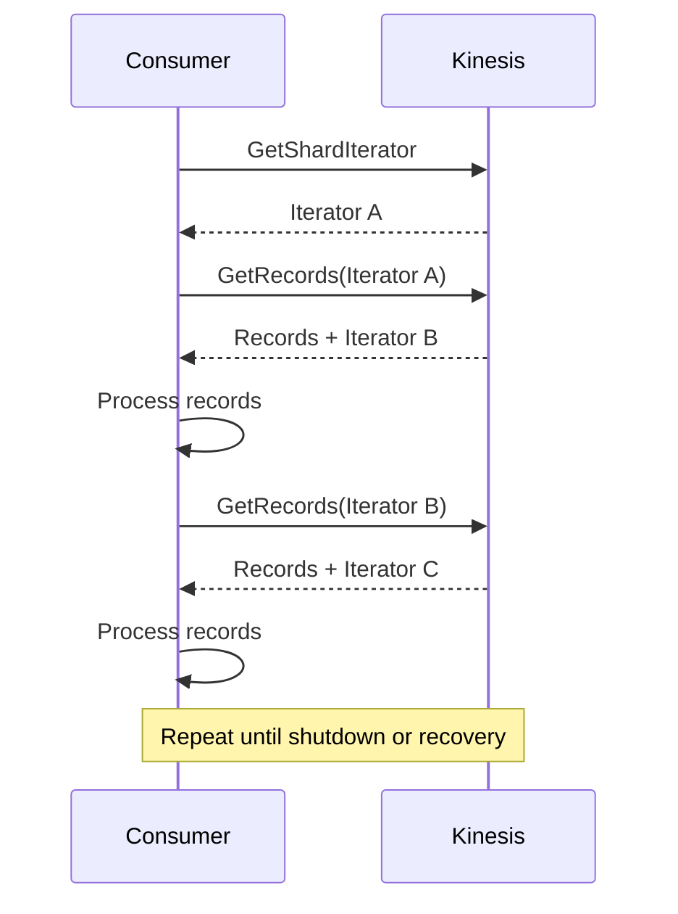
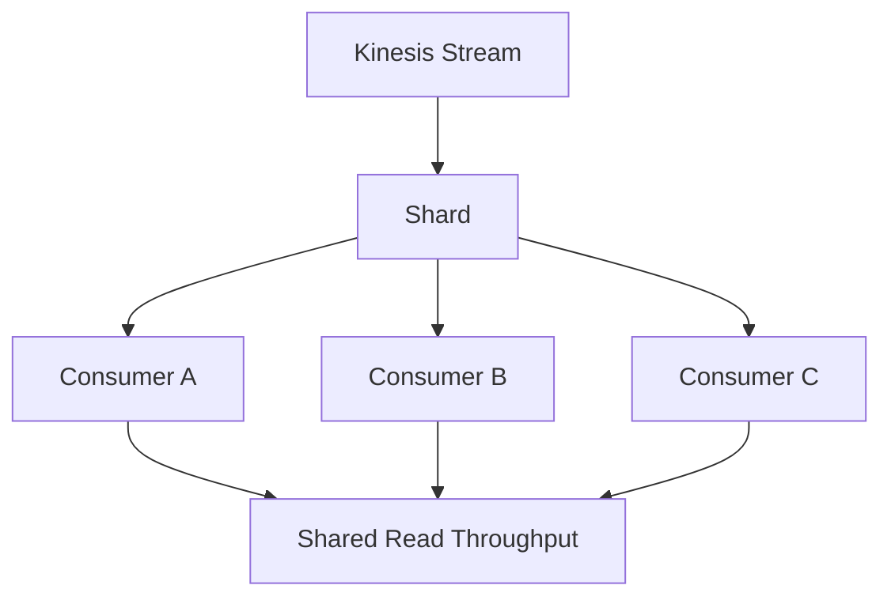
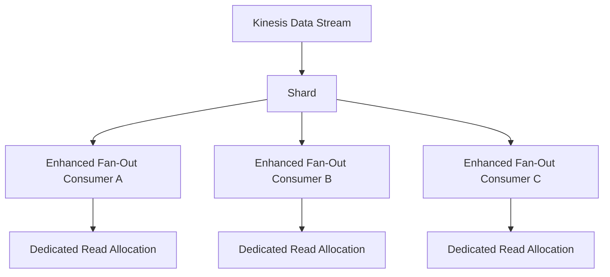
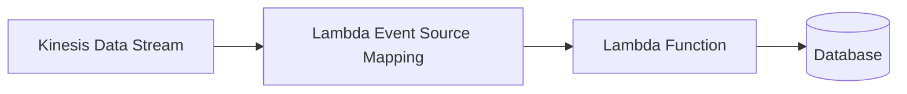
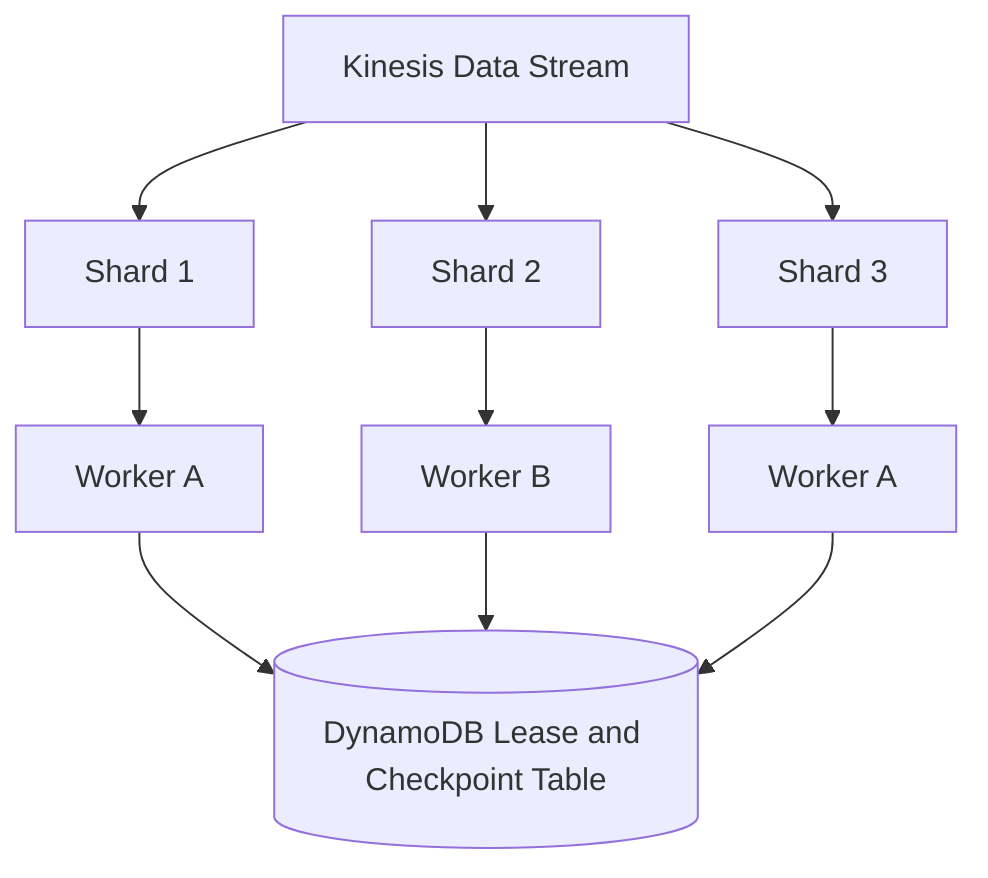

# 07- Shard Iterators and Consumer Models

## Overview

Amazon Kinesis Data Streams provides multiple mechanisms for reading records from shards. The retrieval mechanism determines how consumers discover records, manage reading positions, share throughput, and recover from failures.

A shard iterator represents a position in a shard's record sequence. Consumers use it to retrieve records from a specific point. The iterator is temporary and must be advanced using the next iterator returned by the `GetRecords` API.

Kinesis supports several consumer models:

- Shared-throughput consumers using `GetShardIterator` and `GetRecords`.
- Enhanced fan-out consumers using dedicated throughput and HTTP/2 subscriptions.
- AWS Lambda event source mappings.
- Higher-level consumer frameworks such as the Kinesis Client Library (KCL).

Choosing the correct model affects latency, throughput, ordering, checkpointing, operational complexity, and cost.

## Shard Iterators

### What Is a Shard Iterator?

A shard iterator is an opaque token that identifies a position in a Kinesis shard.

It tells Kinesis where a consumer should begin reading records.

A consumer obtains an iterator through `GetShardIterator` and supplies it to `GetRecords`.

```text
GetShardIterator
       |
       v
Shard Iterator
       |
       v
GetRecords
       |
       v
Records + NextShardIterator
       |
       v
GetRecords using NextShardIterator
```

A shard iterator is not a durable checkpoint. It expires after a short period, so consumers must manage their reading position independently if they need reliable recovery.

### Why Shard Iterators Exist

A stream can contain many records across multiple shards. Consumers need a way to read records incrementally without downloading the entire stream.

Shard iterators provide:

- Position-based record retrieval.
- Sequential reading within a shard.
- Support for starting at different positions.
- Incremental consumption.
- Recovery using sequence numbers or application-managed checkpoints.

Each shard has its own iterator and independent record sequence.

A consumer processing multiple shards must manage separate reading positions for each shard.

## Shard Iterator Types

Kinesis supports five iterator types.

| Iterator type | Starting position | Typical use case |
|---|---|---|
| `TRIM_HORIZON` | Oldest record still retained | Initial historical processing |
| `LATEST` | Latest position when the iterator is created | Consume newly arriving records |
| `AT_SEQUENCE_NUMBER` | Specified sequence number | Resume from a known record |
| `AFTER_SEQUENCE_NUMBER` | Immediately after a specified sequence number | Resume after a completed record |
| `AT_TIMESTAMP` | Position associated with a timestamp | Time-based replay |

### TRIM_HORIZON

`TRIM_HORIZON` starts reading from the oldest record still available in the shard.

Use it when:

- A new consumer must process retained historical records.
- A consumer needs to replay available stream data.
- A recovery operation must start from the earliest retained position.

Example:

```python
response = kinesis.get_shard_iterator(
    StreamName="orders-stream",
    ShardId="shardId-000000000000",
    ShardIteratorType="TRIM_HORIZON",
)

iterator = response["ShardIterator"]
```

The starting point is limited by the stream's retention period. It does not retrieve records that have already expired.

### LATEST

`LATEST` starts at the latest position when the iterator is created.

Use it when a consumer intentionally wants to process only newly arriving records.

```python
response = kinesis.get_shard_iterator(
    StreamName="orders-stream",
    ShardId="shardId-000000000000",
    ShardIteratorType="LATEST",
)
```

A consumer using `LATEST` does not automatically process all records published before its starting position.

This can be dangerous during deployment or recovery if historical records are required.

### AT_SEQUENCE_NUMBER

`AT_SEQUENCE_NUMBER` starts reading at the specified sequence number.

```python
response = kinesis.get_shard_iterator(
    StreamName="orders-stream",
    ShardId="shardId-000000000000",
    ShardIteratorType="AT_SEQUENCE_NUMBER",
    StartingSequenceNumber="4965...",
)
```

Use this when a consumer needs to resume from a known record position and include that record in its next read.

### AFTER_SEQUENCE_NUMBER

`AFTER_SEQUENCE_NUMBER` starts immediately after the specified sequence number.

```python
response = kinesis.get_shard_iterator(
    StreamName="orders-stream",
    ShardId="shardId-000000000000",
    ShardIteratorType="AFTER_SEQUENCE_NUMBER",
    StartingSequenceNumber="4965...",
)
```

This is commonly used when the specified sequence number represents the last successfully processed record.

The consumer resumes after that record.

### AT_TIMESTAMP

`AT_TIMESTAMP` starts reading from a position associated with a timestamp.

```python
from datetime import datetime, timezone

response = kinesis.get_shard_iterator(
    StreamName="orders-stream",
    ShardId="shardId-000000000000",
    ShardIteratorType="AT_TIMESTAMP",
    Timestamp=datetime(2026, 11, 19, 10, 0, tzinfo=timezone.utc),
)
```

Use this for:

- Time-based replay.
- Historical analysis.
- Recovery from a known time window.
- Reprocessing events from a specific point.

The timestamp is interpreted against Kinesis record arrival time, not necessarily the application's business event time.

## Iterator Lifecycle

### Getting the Initial Iterator

A consumer first requests an iterator for a particular shard.

The request includes:

- Stream name.
- Shard ID.
- Iterator type.
- Starting sequence number or timestamp when required.

Kinesis returns an opaque iterator token.

### Reading Records

The consumer passes the iterator to `GetRecords`.

The response contains:

- Retrieved records.
- The next shard iterator.
- Milliseconds behind the latest record, when available.

The next iterator should be used for subsequent reads.

### Iterator Expiration

Shard iterators expire after five minutes.

Consumers must not treat an iterator as durable state.

If an iterator expires, the consumer should obtain a new iterator from its durable checkpoint or another valid recovery position.

### Lifecycle Diagram



The iterator chain advances independently for each shard.

If a consumer processes multiple shards, it must maintain a separate iterator and checkpoint for every shard.

## GetRecords API

`GetRecords` retrieves records from a shard using a shard iterator.

Example:

```python
response = kinesis.get_records(
    ShardIterator=iterator,
    Limit=100,
)

records = response["Records"]
next_iterator = response.get("NextShardIterator")
```

### Important Response Fields

| Field | Description |
|---|---|
| `Records` | Retrieved records |
| `NextShardIterator` | Position for the next retrieval |
| `MillisBehindLatest` | Approximate delay behind the latest available record |

Each returned record can contain:

- `Data`
- `PartitionKey`
- `SequenceNumber`
- `ApproximateArrivalTimestamp`

### GetRecords Limits

In shared-throughput consumption, `GetRecords` has service limits that affect consumer design.

Important limits include:

- Up to 10,000 records per request.
- Up to 10 MiB of data per request.
- A maximum request frequency per shard for shared-throughput reads.
- A shared read-throughput allocation per shard.

The actual amount returned can be lower because of available records, request limits, and throughput constraints.

A request returning fewer records than its configured `Limit` is not necessarily an error.

Consumers should respect service throttling and avoid aggressive polling.

### Handling Empty Responses

An empty `Records` list does not mean the stream is permanently empty.

It can mean:

- No new records are currently available.
- The consumer has caught up with the shard.
- Records have not arrived since the previous read.

The consumer should continue polling according to its latency requirements and use bounded waiting rather than spinning continuously.

## Implementing a Shared-Throughput Consumer

### Basic Consumer

The following example demonstrates reading a shard using Boto3.

```python
import json
import time

import boto3
from botocore.exceptions import ClientError


kinesis = boto3.client(
    "kinesis",
    region_name="ap-south-1",
)


def get_iterator(
    stream_name: str,
    shard_id: str,
    sequence_number: str | None = None,
) -> str:
    if sequence_number:
        response = kinesis.get_shard_iterator(
            StreamName=stream_name,
            ShardId=shard_id,
            ShardIteratorType="AFTER_SEQUENCE_NUMBER",
            StartingSequenceNumber=sequence_number,
        )
    else:
        response = kinesis.get_shard_iterator(
            StreamName=stream_name,
            ShardId=shard_id,
            ShardIteratorType="TRIM_HORIZON",
        )

    return response["ShardIterator"]


def process_record(record: dict) -> None:
    event = json.loads(record["Data"].decode("utf-8"))

    print({
        "event_id": event["event_id"],
        "sequence_number": record["SequenceNumber"],
        "partition_key": record["PartitionKey"],
    })


def consume_shard(
    stream_name: str,
    shard_id: str,
) -> None:
    iterator = get_iterator(stream_name, shard_id)

    while iterator:
        try:
            response = kinesis.get_records(
                ShardIterator=iterator,
                Limit=100,
            )
        except ClientError:
            raise

        records = response["Records"]

        for record in records:
            process_record(record)

        iterator = response.get("NextShardIterator")

        if not records:
            time.sleep(1)
```

This example illustrates iterator usage, not a complete production consumer.

A production implementation must persist checkpoints, handle iterator expiration, classify service errors, manage shutdown, and coordinate processing across shards.

### Iterator Recovery

When a consumer restarts, it should not attempt to reuse an old iterator.

Instead, it should:

1. Load the last durable checkpoint for the shard.
2. Create a new iterator using `AFTER_SEQUENCE_NUMBER`.
3. Resume record retrieval.
4. Process records idempotently.
5. Persist progress after successful processing.

If no checkpoint exists, the application must choose an explicit starting policy, such as `TRIM_HORIZON` or `LATEST`.

## Checkpointing

### What Is a Checkpoint?

A checkpoint represents the last successfully processed position in a shard.

It is durable consumer state, unlike a shard iterator.

A checkpoint allows a consumer to recover after:

- Process crashes.
- Container restarts.
- Deployment rollouts.
- Worker replacement.
- Temporary infrastructure failures.

### Checkpoint vs Shard Iterator

| Characteristic | Shard iterator | Checkpoint |
|---|---|---|
| Purpose | Retrieve records from a position | Persist consumer progress |
| Lifetime | Temporary; expires after five minutes | Durable until changed or removed |
| Managed by | Kinesis | Consumer application or framework |
| Used for | `GetRecords` requests | Recovery and replay |
| Scope | One shard position | Usually one consumer application and shard |

### Safe Checkpointing

The correct sequence is:

```text
Read Records
     |
     v
Process Records
     |
     v
Commit Business Changes
     |
     v
Persist Checkpoint
```

If the consumer checkpoints before business processing completes, a failure can cause records to be skipped during recovery.

If business processing succeeds but checkpointing fails, records may be processed again.

This is why consumers should implement idempotent processing.

### Checkpoint Storage

A custom consumer can store checkpoints in DynamoDB or PostgreSQL.

Example checkpoint table:

```sql
CREATE TABLE kinesis_checkpoints (
    consumer_name VARCHAR(100) NOT NULL,
    stream_name VARCHAR(200) NOT NULL,
    shard_id VARCHAR(200) NOT NULL,
    sequence_number VARCHAR(200) NOT NULL,
    updated_at TIMESTAMPTZ NOT NULL DEFAULT NOW(),
    PRIMARY KEY (consumer_name, stream_name, shard_id)
);
```

The consumer should update the checkpoint only after the corresponding business work has been committed.

For distributed consumers, checkpoint updates must be coordinated with shard ownership. Otherwise, multiple workers can overwrite each other's progress.

## Consumer Models

Kinesis supports multiple consumption models. They differ in how records are delivered, how throughput is allocated, and how much infrastructure the application manages.

The main models are:

- Shared-throughput consumers.
- Enhanced fan-out consumers.
- AWS Lambda event source mappings.
- Kinesis Client Library-based consumers.

## Shared-Throughput Consumers

### Architecture

Shared-throughput consumers use the `GetShardIterator` and `GetRecords` APIs to poll shards.

Multiple consumers reading the same shard through these APIs share its read-throughput allocation.



### Characteristics

- Pull-based retrieval.
- Consumers control polling frequency.
- Read throughput is shared per shard.
- Applications manage iterators and checkpoints.
- No dedicated consumer throughput allocation.

### Advantages

- Straightforward implementation.
- Suitable for moderate read workloads.
- No enhanced fan-out subscription requirement.
- Flexible control over record retrieval.

### Limitations

- Multiple consumers compete for read capacity.
- Polling introduces request overhead.
- Consumers must manage iterator lifecycle.
- Custom checkpointing and shard coordination require additional engineering.

### When to Use

Use shared-throughput consumers when:

- There are relatively few consumer applications.
- Read throughput requirements are moderate.
- Polling latency is acceptable.
- The application needs direct control over retrieval.

## Enhanced Fan-Out Consumers

### What Is Enhanced Fan-Out?

Enhanced fan-out (EFO) provides dedicated read throughput to registered consumer applications.

Instead of competing for the shared `GetRecords` read throughput allocation, each registered enhanced fan-out consumer receives dedicated throughput per shard.

Enhanced fan-out uses the `SubscribeToShard` API and HTTP/2-based streaming.

### Architecture



Each consumer receives its own dedicated read throughput allocation.

### How It Works

The enhanced fan-out lifecycle generally involves:

1. Register a consumer against the stream.
2. Obtain the consumer ARN.
3. Subscribe to a shard using `SubscribeToShard`.
4. Receive records through the subscription.
5. Process records and maintain durable progress.
6. Reconnect and resume from an appropriate sequence position when needed.

### Registering a Consumer

```bash
aws kinesis register-stream-consumer \
    --stream-arn arn:aws:kinesis:ap-south-1:123456789012:stream/orders-stream \
    --consumer-name orders-analytics \
    --region ap-south-1
```

Consumer registration is associated with a stream.

### Listing Registered Consumers

```bash
aws kinesis list-stream-consumers \
    --stream-arn arn:aws:kinesis:ap-south-1:123456789012:stream/orders-stream \
    --region ap-south-1
```

### Advantages

- Dedicated read throughput per registered consumer.
- Reduced contention between independent consumers.
- Push-based record delivery.
- Useful for multiple high-throughput applications.
- Supports lower-latency delivery than repeated polling in suitable workloads.

### Limitations

- Additional charges apply.
- Consumer registration and lifecycle management are required.
- Consumers must handle subscription events and reconnections.
- Application-level checkpointing remains necessary.

### When to Use

Use enhanced fan-out when:

- Multiple applications consume the same stream.
- Shared read throughput becomes a bottleneck.
- Consumers require predictable read capacity.
- Lower delivery latency is important.

## Lambda Event Source Mapping

### What Is an Event Source Mapping?

An event source mapping connects a Kinesis Data Stream to an AWS Lambda function.

Lambda manages polling and invokes the function with batches of records.



The application does not need to manage shard iterators directly.

### How It Works

1. Configure a Lambda event source mapping for the stream.
2. Lambda polls the stream.
3. Records are collected into batches.
4. Lambda invokes the function.
5. The function processes the records.
6. Lambda manages progress and retries according to event source mapping configuration.

### Configuration Example

```bash
aws lambda create-event-source-mapping \
    --function-name process-order-events \
    --event-source-arn arn:aws:kinesis:ap-south-1:123456789012:stream/orders-stream \
    --starting-position TRIM_HORIZON \
    --batch-size 100 \
    --region ap-south-1
```

The function must have permission to read from the stream.

### Batch Processing

Lambda receives records in batches.

The function should process records efficiently and avoid unnecessary per-record network calls.

For example, records can be grouped into database operations where transaction semantics permit.

### Partial Batch Failure Handling

By default, a failed batch can cause records to be retried according to the event source mapping's retry behavior.

For workloads where only some records fail, partial batch response support can allow the function to report the earliest failed sequence number.

This reduces unnecessary reprocessing of records that were successfully handled.

The event source mapping must be configured to use the `ReportBatchItemFailures` response type.

Example response:

```python
def lambda_handler(event, context):
    failures = []

    for record in event["Records"]:
        sequence_number = record["kinesis"]["sequenceNumber"]

        try:
            process_record(record)
        except Exception:
            failures.append({
                "itemIdentifier": sequence_number
            })

            break

    return {
        "batchItemFailures": failures
    }
```

For Kinesis, the partial failure identifier is the record's sequence number.

Stopping at the first failure preserves the processing boundary for ordered records within the batch. The event source mapping can retry from the reported failure position.

### Advantages

- No custom polling infrastructure.
- Managed shard polling.
- Automatic scaling within service constraints.
- Integration with other AWS services.
- Suitable for event-driven workloads.

### Limitations

- Function execution duration affects processing throughput.
- Retry behavior can cause repeated processing.
- Batch size and batching windows affect latency.
- Lambda concurrency and shard-level parallelism must be considered.
- Long-running or highly stateful processing may be better suited to dedicated consumers.

### When to Use

Use Lambda event source mappings when:

- Processing is event-driven.
- Workloads are stateless or can manage state externally.
- Operational simplicity is important.
- Function execution limits are compatible with processing requirements.

## Kinesis Client Library

### What Is KCL?

The Kinesis Client Library is a higher-level consumer framework that simplifies distributed stream processing.

It manages shard discovery, worker coordination, lease management, and checkpointing.

KCL is useful when a consumer application must process many shards across multiple worker instances.

### KCL Architecture



Workers coordinate through a shared lease table.

A lease represents ownership of a shard by a worker within a consumer application.

KCL uses this coordination to distribute shard processing and recover from worker failures.

### Responsibilities Managed by KCL

- Discovering shards.
- Assigning leases.
- Coordinating workers.
- Checkpointing progress.
- Handling worker failures.
- Managing shard lineage.
- Redistributing work as workers join or leave.

### Advantages

- Reduces custom coordination code.
- Supports distributed consumer applications.
- Handles shard lifecycle changes.
- Provides checkpointing and lease management.
- Supports recovery after worker failures.

### Limitations

- Additional configuration and operational complexity.
- DynamoDB permissions and capacity considerations.
- Application compatibility with the selected KCL version.
- Checkpoint and lease behavior must be understood.
- Business processing still requires idempotency.

### When to Use

Use KCL when:

- Multiple workers share responsibility for a stream.
- The stream has many shards.
- Dynamic shard discovery is required.
- Worker failures must trigger automatic reassignment.
- Custom consumer coordination would otherwise become complex.

## Consumer Model Comparison

| Characteristic | Shared throughput | Enhanced fan-out | Lambda event source mapping | KCL |
|---|---|---|---|---|
| Retrieval | `GetRecords` | `SubscribeToShard` | Managed polling | Uses Kinesis consumer APIs |
| Delivery model | Pull | HTTP/2 subscription | Managed polling and invocation | Framework-managed retrieval |
| Read allocation | Shared per shard | Dedicated per registered consumer | Depends on configured polling mode | Depends on underlying retrieval mode |
| Checkpointing | Application-managed | Application-managed | Lambda-managed | KCL-managed |
| Shard coordination | Application-managed | Application-managed | Lambda-managed | KCL-managed |
| Infrastructure | Custom consumer | Custom consumer | Lambda | Worker infrastructure |
| Operational complexity | Moderate | Moderate to high | Lower infrastructure management | Moderate to high |
| Typical workload | General-purpose processing | Multiple high-throughput consumers | Serverless processing | Distributed long-running consumers |

KCL is a consumer framework, not a separate Kinesis delivery mode. It can use different retrieval mechanisms depending on its configuration and version.

## Shard Discovery and Lifecycle

Consumers must handle shard changes over time.

A stream can gain or lose shards through resharding.

A consumer that maintains a static list of shard IDs may fail to process newly created shards.

### List Shards

```bash
aws kinesis list-shards \
    --stream-name orders-stream \
    --region ap-south-1
```

### Describe Stream

```bash
aws kinesis describe-stream-summary \
    --stream-name orders-stream \
    --region ap-south-1
```

### Parent and Child Shards

When a shard is split or merged, Kinesis creates child shards with lineage information.

A child shard can have one or more parent shards.

Consumers that need to preserve ordering across shard lineage must process the parent shard or shards to completion before processing the dependent child shard.

This is especially important for custom consumers.

KCL handles shard discovery and lineage coordination as part of its processing model.

## Consumer Scaling and Parallelism

### Shard-Level Parallelism

A shard is a fundamental unit of parallel consumption.

A consumer application can process multiple shards concurrently, but a single shard's records remain ordered in the shard sequence.

For example:

```text
Stream: orders-stream

Shard 1 --> Worker A
Shard 2 --> Worker B
Shard 3 --> Worker C
Shard 4 --> Worker D
```

Adding more workers does not necessarily increase useful parallelism if there are fewer shards than workers.

### Processing Within a Shard

Consumers can dispatch records to parallel processing tasks, but doing so can break completion order.

For example:

```text
Record 1 --> Task A (slow)
Record 2 --> Task B (fast)
Record 3 --> Task C (fast)
```

Tasks B and C may finish before Task A.

If business ordering matters, the consumer must coordinate processing and checkpointing.

Possible strategies include:

- Sequential processing per shard.
- Per-entity ordered queues.
- Keyed worker pools.
- Completion tracking before checkpointing.
- Separate streams for independent processing domains.

### Backpressure

Consumers should avoid retrieving records faster than they can process them.

Use:

- Bounded in-memory queues.
- Controlled worker concurrency.
- Database connection-pool limits.
- Retry budgets.
- Monitoring of iterator age.
- Graceful pausing of retrieval when downstream systems are overloaded.

A consumer that continues polling while its internal queue grows can exhaust memory and fall further behind.

## Error Handling and Recovery

### Iterator Expiration

Shard iterators expire after five minutes.

When an iterator expires:

1. Load the last durable checkpoint.
2. Request a new iterator using the appropriate iterator type.
3. Resume reading.
4. Process records idempotently.

Never depend on an iterator surviving a process restart.

### Read Throttling

Shared-throughput consumers can experience read throttling when multiple consumers compete for shard capacity.

Recommended actions:

- Reduce unnecessary polling.
- Use bounded retry with backoff.
- Review consumer count.
- Consider enhanced fan-out.
- Evaluate whether shard capacity is appropriate.

### Consumer Failure

If a consumer fails during processing:

- Do not advance its checkpoint past unfinished work.
- Recover from the last durable checkpoint.
- Use idempotent business operations.
- Monitor repeated failures.
- Quarantine poison records when necessary.

### Retention Expiration

A consumer that falls behind beyond the stream's retention period cannot retrieve expired records from Kinesis.

Set retention according to recovery objectives and monitor consumer lag continuously.

For long-term replay, archive records to Amazon S3 or another durable storage system.

## Monitoring and Observability

Consumer health should be measured by progress, not merely process availability.

### Important CloudWatch Metrics

| Metric | Purpose |
|---|---|
| `GetRecords.IteratorAgeMilliseconds` | Measures lag for shared-throughput consumers |
| `ReadProvisionedThroughputExceeded` | Detects shared read throttling |
| `IncomingRecords` | Measures stream ingestion volume |
| `OutgoingRecords` | Measures record retrieval |
| `OutgoingBytes` | Measures read volume |
| `SubscribeToShard.RateExceeded` | Detects enhanced fan-out subscription throttling |
| `SubscribeToShard.Success` | Tracks successful enhanced fan-out subscriptions |
| `SubscribeToShardEvent.MillisBehindLatest` | Measures enhanced fan-out consumer lag |

Metric availability and dimensions depend on the consumer type and CloudWatch configuration.

### Application-Level Metrics

Track:

- Records received.
- Records processed.
- Processing duration.
- Checkpoint delay.
- Duplicate events.
- Deserialization failures.
- Database failures.
- Retry count.
- Consumer restarts.
- Per-shard processing lag.

### Alerting Recommendations

Create alerts for:

- Sustained iterator age growth.
- Consumer checkpoint stalls.
- Repeated read throttling.
- Enhanced fan-out subscription failures.
- Processing error spikes.
- Consumer inactivity.
- Records approaching retention expiration.

A running worker does not necessarily indicate a healthy consumer. Its checkpoint progress and processing lag are more meaningful signals.

## Security Considerations

Consumers require permissions to access streams and, depending on their model, additional resources.

Typical shared-throughput permissions include:

- `kinesis:DescribeStreamSummary`
- `kinesis:ListShards`
- `kinesis:GetShardIterator`
- `kinesis:GetRecords`

Enhanced fan-out consumers may additionally require:

- `kinesis:DescribeStreamConsumer`
- `kinesis:SubscribeToShard`

Consumer registration requires the appropriate stream-consumer registration permissions.

KCL applications also need access to their DynamoDB lease and checkpoint resources.

Recommended practices:

- Use IAM roles rather than static credentials.
- Apply least-privilege policies.
- Encrypt streams using AWS KMS.
- Protect checkpoint and lease tables.
- Use TLS for service communication.
- Avoid logging sensitive event payloads.
- Restrict access to consumer registration and stream administration operations.

## Cost and Performance Considerations

### Shared-Throughput Consumers

Shared-throughput consumption does not provide dedicated read capacity to each consumer.

Multiple applications share the shard's read allocation.

This can be cost-effective for moderate workloads but can create contention as consumer count and traffic increase.

### Enhanced Fan-Out

Enhanced fan-out provides dedicated read throughput per registered consumer.

It is useful when independent consumers need predictable throughput, but additional charges apply.

Evaluate:

- Number of registered consumers.
- Number of shards.
- Read volume.
- Consumer activity.
- Latency requirements.

### Lambda Consumers

Lambda costs depend on invocation count, execution duration, memory allocation, and other applicable pricing dimensions.

Batching can reduce invocation overhead, but oversized batches can increase execution duration and retry impact.

### KCL Consumers

KCL introduces worker infrastructure and commonly uses DynamoDB for lease and checkpoint state.

Account for:

- Compute capacity.
- DynamoDB operations.
- Logging and monitoring.
- Network and downstream processing costs.

### Performance Recommendations

- Select the consumer model based on throughput and latency requirements.
- Avoid aggressive polling.
- Use bounded batches and controlled concurrency.
- Monitor per-shard lag.
- Keep business processing efficient.
- Apply backpressure when downstream services are overloaded.
- Test recovery and replay behavior under realistic traffic.

## Common Mistakes and Production Pitfalls

### Treating a Shard Iterator as a Checkpoint

**Problem:** The consumer saves an iterator and expects to reuse it after a restart.

**Impact:** Iterators expire and cannot serve as durable recovery state.

**Avoidance:** Persist sequence-number-based progress and create a new iterator after recovery.

### Using LATEST for Every Consumer Restart

**Problem:** A restarted consumer always creates an iterator using `LATEST`.

**Impact:** Records published before the new iterator position may be skipped.

**Avoidance:** Resume from a durable checkpoint when historical processing is required.

### Polling Too Frequently

**Problem:** A consumer continuously calls `GetRecords` even when no records are available.

**Impact:** Unnecessary API requests and possible read throttling.

**Avoidance:** Use controlled polling intervals and appropriate backoff.

### Adding Consumers Without Considering Shared Throughput

**Problem:** Multiple consumers use `GetRecords` and compete for the same shard read allocation.

**Impact:** Consumers can experience throttling and increased lag.

**Avoidance:** Evaluate enhanced fan-out when independent read throughput is required.

### Checkpointing Before Processing Completes

**Problem:** Consumer progress advances before business transactions commit.

**Impact:** Records can be skipped after a failure.

**Avoidance:** Persist business results before advancing checkpoints.

### Processing Records Concurrently Without Completion Tracking

**Problem:** Records are processed asynchronously and checkpoints advance based only on the highest sequence number observed.

**Impact:** A checkpoint can move beyond unfinished records.

**Avoidance:** Track completion and preserve required ordering before checkpointing.

### Ignoring Shard Lineage

**Problem:** A custom consumer processes child shards without considering parent completion.

**Impact:** Processing can violate ordering requirements across resharding boundaries.

**Avoidance:** Track parent-child relationships or use KCL.

### Assuming Lambda Provides Exactly-Once Processing

**Problem:** The application assumes a successful Lambda integration prevents duplicate execution.

**Impact:** Retries and partial failures can cause records to be processed again.

**Avoidance:** Use stable event IDs and idempotent business operations.

## Key Takeaways

- Shard iterators are temporary read-position tokens, while checkpoints are durable consumer progress state.
- `TRIM_HORIZON`, `LATEST`, sequence-number-based iterators, and `AT_TIMESTAMP` support different consumption and recovery requirements.
- Shared-throughput consumers compete for shard read capacity; enhanced fan-out provides dedicated throughput to registered consumers.
- Lambda event source mappings simplify polling, while KCL manages distributed shard coordination and checkpointing.
- Reliable consumers require idempotent processing, correct checkpoint ordering, shard lifecycle handling, and continuous lag monitoring.