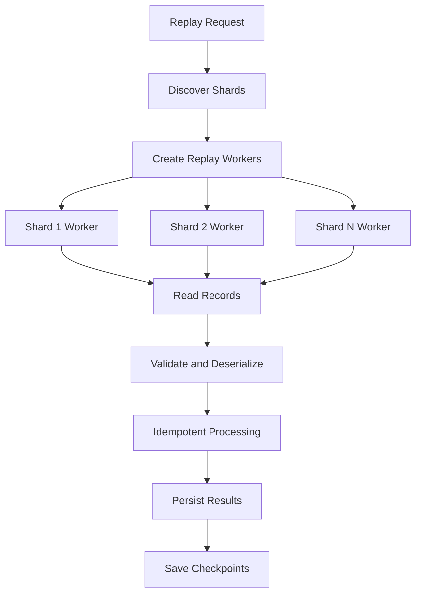
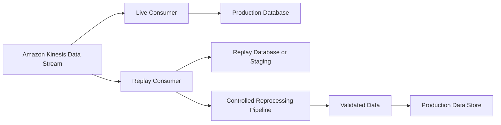
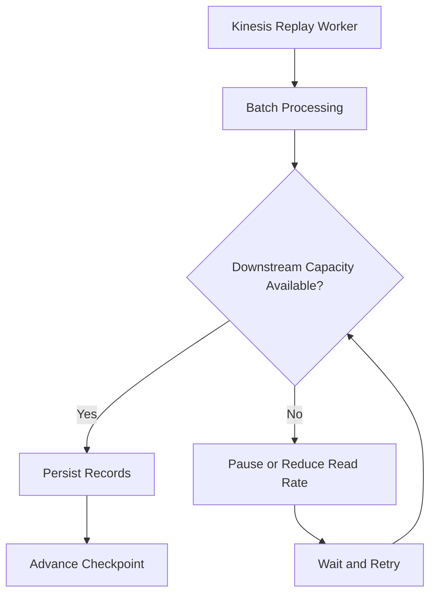
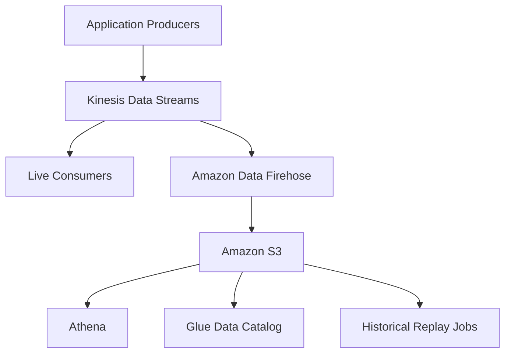
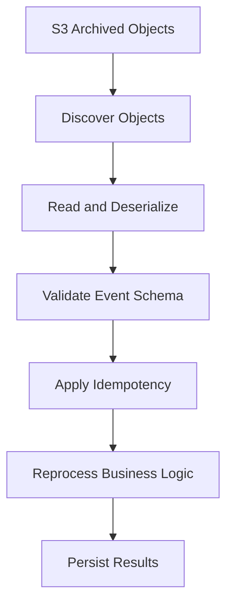

# 08- Data Retention and Replay

## Overview

Amazon Kinesis Data Streams retains streaming records for a configurable period, allowing consumers to process data asynchronously and replay previously published records when necessary.

Retention and replay are important for systems that require:

- Recovery from consumer failures or processing defects.
- Reprocessing after application logic changes.
- Rebuilding downstream databases, search indexes, or analytical datasets.
- Recovering from temporary downstream outages.
- Investigating production incidents using historical event data.
- Supporting multiple consumers with different processing speeds.

Kinesis separates record ingestion from consumer processing. Producers publish records to a stream, and consumers read them independently. A consumer can fall behind without immediately losing access to records, provided those records remain within the configured retention period.

Retention is not equivalent to permanent storage. Once a record expires, it is no longer available through normal Kinesis stream reads. Systems requiring long-term retention should archive records to durable storage such as Amazon S3.

## Data Retention Fundamentals

### What Retention Means

Data retention defines how long Kinesis Data Streams keeps records available for consumption after ingestion.

Each record has an approximate arrival timestamp. Kinesis uses the retention period to determine when that record expires.

The default retention period is 24 hours. It can be extended to a maximum of 365 days.

| Retention configuration | Duration |
|---|---:|
| Default | 24 hours |
| Extended retention | Up to 365 days |

The retention period applies to records in the stream, not to individual consumers.

All consumers reading the same stream operate against the same retained record history. Each consumer maintains its own position through the stream.

### Why Retention Exists

Without retention, a consumer outage could result in permanent data loss for that consumer.

For example, consider an order-processing architecture:

1. An application publishes order events to Kinesis.
2. A consumer processes events and updates PostgreSQL.
3. The consumer encounters a deployment failure.
4. Records continue arriving in Kinesis.
5. The consumer recovers and resumes processing from its last valid checkpoint.

Retention provides a recovery window during which the consumer can catch up.

It also allows engineers to reprocess data after fixing bugs or changing downstream data models.

### Retention and Consumer Position

Kinesis does not maintain one global consumption position for all consumers.

A consumer reads records using shard iterators or a higher-level consumer library. The consumer is responsible for maintaining its processing position.

For applications using the Kinesis Client Library (KCL), checkpoints are commonly stored in DynamoDB.

The relationship is:

- Kinesis stores records for the configured retention period.
- Consumers retrieve records from shards.
- Consumer applications track processing progress.
- Checkpoints identify the position from which processing can resume.

A checkpoint does not extend record retention.

If a consumer's checkpoint points to a record that has already expired, the consumer cannot retrieve that record from the stream.

## Configuring Data Retention

Retention can be configured when creating a stream or modified after creation.

### Create a Stream with Extended Retention

Using the AWS CLI:

```bash
aws kinesis create-stream \
    --stream-name order-events \
    --shard-count 2
```

The stream initially uses the default retention period.

Retention can then be extended:

```bash
aws kinesis increase-stream-retention-period \
    --stream-name order-events \
    --retention-period-hours 168
```

This configures seven days of retention.

### Increase Retention

Use the following command to increase retention:

```bash
aws kinesis increase-stream-retention-period \
    --stream-name order-events \
    --retention-period-hours 720
```

This sets retention to 30 days.

The maximum supported duration is 365 days.

### Decrease Retention

Retention can also be reduced:

```bash
aws kinesis decrease-stream-retention-period \
    --stream-name order-events \
    --retention-period-hours 24
```

Reducing retention can cause older records to become unavailable sooner.

Before decreasing retention, verify:

- Consumer processing lag.
- Recovery requirements.
- Replay requirements.
- Whether downstream systems need historical records.
- Whether archival pipelines have successfully persisted the required data.

Do not reduce retention solely to lower storage costs without evaluating recovery requirements.

### Inspect Stream Retention

```bash
aws kinesis describe-stream-summary \
    --stream-name order-events
```

The response includes stream metadata such as:

- Stream status.
- Retention period.
- Stream creation timestamp.
- Stream mode.
- Open and closed shard information.

### Retention Configuration with Boto3

```python
import boto3

kinesis = boto3.client("kinesis", region_name="ap-south-1")

stream_name = "order-events"

kinesis.increase_stream_retention_period(
    StreamName=stream_name,
    RetentionPeriodHours=168,
)

response = kinesis.describe_stream_summary(
    StreamName=stream_name,
)

print(
    response["StreamDescriptionSummary"]["RetentionPeriodHours"]
)
```

The application or deployment process should have the required IAM permissions.

Typical permissions include:

- `kinesis:IncreaseStreamRetentionPeriod`
- `kinesis:DecreaseStreamRetentionPeriod`
- `kinesis:DescribeStreamSummary`

Use narrowly scoped IAM policies rather than granting unrestricted Kinesis access.

## Retention Expiration and Record Availability

A record remains available only while it is within the stream's retention window.

For example, with 24-hour retention:

```text
Record A published: Monday 10:00
Record B published: Monday 14:00
Record C published: Tuesday 09:00

Retention: 24 hours
```

As records age beyond the retention period, they expire.

A consumer that is offline for longer than the retention window may permanently lose access to the records it has not processed.

### Consumer Lag and Retention Risk

Consumer lag measures how far behind a consumer is relative to the latest records in a shard.

Lag should be evaluated against the retention period.

For example:

| Metric | Value |
|---|---:|
| Retention period | 24 hours |
| Consumer lag | 18 hours |
| Remaining recovery window | Approximately 6 hours |

This consumer is at significant risk. If it continues falling behind, older unprocessed records may expire.

The remaining recovery window is an operational estimate, not a guarantee. Record arrival rates, shard distribution, processing throughput, and timestamp differences affect actual recovery time.

### Production Recommendation

Monitor consumer lag continuously and alert before it approaches the retention boundary.

A useful operational policy is to define thresholds based on the application's recovery objectives.

For example:

- Warning when lag exceeds 25% of the retention window.
- Critical alert when lag exceeds 50%.
- Escalation when lag approaches 75%.

These are example thresholds, not AWS service defaults. Tune them according to ingestion volume, processing capacity, and recovery requirements.

## Replay Fundamentals

### What Is Replay?

Replay is the process of reading previously published records again and processing them through a consumer.

Kinesis supports replay because records remain available for the configured retention period.

Replay is useful when:

- A consumer has processed records incorrectly.
- A deployment introduced a processing bug.
- A downstream database needs rebuilding.
- A new consumer needs historical data.
- An analytical transformation has changed.
- A consumer needs to recover from an outage.

Replay is performed by choosing an appropriate starting position when reading from a shard.

### Starting Positions

Kinesis supports different starting positions for reading records.

| Starting position | Behavior | Typical use |
|---|---|---|
| `TRIM_HORIZON` | Starts at the oldest available record | Full replay within retention |
| `LATEST` | Starts with records arriving after the iterator is established | New consumers interested in new events |
| `AT_SEQUENCE_NUMBER` | Starts at a specific sequence number | Resume from a known position |
| `AFTER_SEQUENCE_NUMBER` | Starts after a specific sequence number | Resume after a successfully processed record |
| `AT_TIMESTAMP` | Starts at or after a specified timestamp | Time-based replay |

The selected starting position applies to the shard being read.

A stream can contain multiple shards, so a complete replay requires handling every relevant shard.

### TRIM_HORIZON

`TRIM_HORIZON` starts reading from the oldest record still available in the shard.

Example:

```python
response = kinesis.get_shard_iterator(
    StreamName="order-events",
    ShardId="shardId-000000000000",
    ShardIteratorType="TRIM_HORIZON",
)
```

Use it when rebuilding a consumer's state from all records currently retained in the stream.

It does not retrieve records that have already expired.

### LATEST

`LATEST` starts reading from the latest position in the shard.

```python
response = kinesis.get_shard_iterator(
    StreamName="order-events",
    ShardId="shardId-000000000000",
    ShardIteratorType="LATEST",
)
```

This is appropriate for consumers that only need newly arriving records.

It is not appropriate for historical recovery when the consumer must process records that arrived before the iterator was established.

### AT_SEQUENCE_NUMBER

`AT_SEQUENCE_NUMBER` starts at the specified sequence number.

```python
response = kinesis.get_shard_iterator(
    StreamName="order-events",
    ShardId="shardId-000000000000",
    ShardIteratorType="AT_SEQUENCE_NUMBER",
    StartingSequenceNumber="49656812345678901234567890123456789012345678901234567890",
)
```

This is useful when a consumer needs to resume from a known record position.

### AFTER_SEQUENCE_NUMBER

`AFTER_SEQUENCE_NUMBER` starts immediately after the specified sequence number.

```python
response = kinesis.get_shard_iterator(
    StreamName="order-events",
    ShardId="shardId-000000000000",
    ShardIteratorType="AFTER_SEQUENCE_NUMBER",
    StartingSequenceNumber="49656812345678901234567890123456789012345678901234567890",
)
```

This is useful when the specified record has already been processed successfully and should not be processed again during normal recovery.

The sequence number must belong to the relevant shard.

### AT_TIMESTAMP

`AT_TIMESTAMP` starts reading from records at or after a specified timestamp.

```python
from datetime import datetime, timezone

replay_time = datetime(
    2026,
    11,
    18,
    10,
    0,
    tzinfo=timezone.utc,
)

response = kinesis.get_shard_iterator(
    StreamName="order-events",
    ShardId="shardId-000000000000",
    ShardIteratorType="AT_TIMESTAMP",
    Timestamp=replay_time,
)
```

Use timestamp-based replay when an incident affects records published during a known time window.

The timestamp is interpreted in UTC when using an aware Python `datetime`.

Timestamp-based replay depends on the records still being within the retention period.

## Reading Records for Replay

### GetShardIterator

A shard iterator represents a position from which records can be read.

The `GetShardIterator` API accepts:

- Stream name or stream ARN.
- Shard ID.
- Iterator type.
- Starting sequence number or timestamp, depending on iterator type.

Example:

```python
iterator_response = kinesis.get_shard_iterator(
    StreamName="order-events",
    ShardId="shardId-000000000000",
    ShardIteratorType="TRIM_HORIZON",
)

shard_iterator = iterator_response["ShardIterator"]
```

Shard iterators are temporary. They expire after five minutes.

Consumers must continue obtaining the next iterator returned by `GetRecords` rather than reusing an expired iterator indefinitely.

### GetRecords

`GetRecords` retrieves records starting from the supplied shard iterator.

```python
response = kinesis.get_records(
    ShardIterator=shard_iterator,
    Limit=100,
)

records = response["Records"]

for record in records:
    print(
        record["SequenceNumber"],
        record["PartitionKey"],
        record["Data"],
    )

next_iterator = response.get("NextShardIterator")
```

Important response fields include:

| Field | Purpose |
|---|---|
| `Records` | Records returned by the request |
| `NextShardIterator` | Iterator for the next read position |
| `MillisBehindLatest` | Approximate consumer lag relative to the latest record |

An empty `Records` array does not necessarily indicate that a shard has no future data. The consumer should continue polling when it expects more records.

### Replay Loop

A basic replay loop can be implemented as follows:

```python
import boto3
import time

kinesis = boto3.client("kinesis", region_name="ap-south-1")


def replay_shard(
    stream_name: str,
    shard_id: str,
    batch_size: int = 100,
) -> None:
    iterator_response = kinesis.get_shard_iterator(
        StreamName=stream_name,
        ShardId=shard_id,
        ShardIteratorType="TRIM_HORIZON",
    )

    shard_iterator = iterator_response["ShardIterator"]

    while shard_iterator:
        response = kinesis.get_records(
            ShardIterator=shard_iterator,
            Limit=batch_size,
        )

        for record in response["Records"]:
            process_record(record)

        shard_iterator = response.get("NextShardIterator")

        if response["MillisBehindLatest"] == 0:
            break

        if not response["Records"]:
            time.sleep(0.5)


def process_record(record: dict) -> None:
    payload = record["Data"]
    sequence_number = record["SequenceNumber"]

    print(
        f"Processing sequence {sequence_number}, "
        f"payload size={len(payload)}"
    )
```

This example illustrates the read flow. It is not a complete production replay worker.

A production implementation must additionally handle:

- Idempotency.
- Checkpoint persistence.
- Transient AWS errors and retries.
- Shard lifecycle changes.
- Iterator expiration.
- Processing failures.
- Controlled replay boundaries.
- Rate limiting and downstream capacity.
- Monitoring and operational cancellation.

The example also stops when it reaches the latest position. A continuous consumer must continue polling rather than terminate.

## Replaying Across Multiple Shards

A Kinesis stream can contain multiple shards. Each shard has its own sequence numbers and read position.

A replay operation must discover and process all relevant shards.

### List Shards

```python
def list_stream_shards(
    client,
    stream_name: str,
) -> list[str]:
    shard_ids = []
    paginator = client.get_paginator("list_shards")

    for page in paginator.paginate(
        StreamName=stream_name,
    ):
        for shard in page["Shards"]:
            shard_ids.append(shard["ShardId"])

    return shard_ids
```

The `ListShards` API supports pagination. Use a paginator or explicitly handle pagination rather than assuming all shards are returned in one response.

### Multi-Shard Replay Architecture



Each worker should maintain an independent position for its shard.

Do not assume that sequence numbers are globally ordered across shards. Sequence numbers identify positions within a shard.

If the application requires business-level ordering across records, it must implement that requirement explicitly.

### Shard Splits and Merges

Shard topology can change when shards are split or merged.

A replay implementation must account for:

- Open shards.
- Closed parent shards.
- Child shards.
- Shard lineage.
- Sequence-number ranges.
- The desired replay boundary.

For a simple historical replay, discover the relevant shard set and process the records available in those shards.

For long-running consumers, use a consumer library such as KCL to manage shard discovery, lease coordination, and shard lifecycle transitions.

Avoid building a production-grade shard coordination system around a one-time `ListShards` call.

## Replay with the Kinesis Client Library

### Why Use KCL?

The Kinesis Client Library provides higher-level consumer coordination and processing capabilities.

It manages responsibilities that otherwise require significant application code:

- Shard discovery.
- Worker coordination.
- Lease management.
- Checkpointing.
- Shard assignment.
- Recovery after worker failures.
- Shard split and merge handling.

KCL uses DynamoDB for coordination and checkpoint state in common deployments.

### Checkpointing

A checkpoint records the position successfully processed by a consumer.

Consider this processing sequence:

```text
Read records
    |
    v
Process records
    |
    v
Persist business changes
    |
    v
Checkpoint sequence number
```

The checkpoint should only advance after the corresponding business processing has completed successfully.

If a worker checkpoints before persisting its business changes, a failure can cause records to be skipped during recovery.

If a worker persists changes but fails before checkpointing, records may be processed again.

This is why consumers should be idempotent.

### Checkpoint Strategies

| Strategy | Behavior | Trade-off |
|---|---|---|
| Checkpoint every record | Saves progress after each record | Higher checkpoint overhead |
| Checkpoint every batch | Saves progress after a batch | More records may be replayed |
| Time-based checkpointing | Saves progress at intervals | Recovery window depends on interval |
| Application-controlled checkpointing | Saves progress after business transaction completion | More implementation complexity |

Checkpoint frequency should balance recovery granularity against checkpoint overhead.

### Replay with KCL

KCL applications normally persist checkpoints and resume from those positions.

A controlled replay can use a separate application identity or a deliberately managed checkpoint strategy to start from an earlier position.

Do not reset production checkpoints casually. A checkpoint reset can cause large-scale duplicate processing and downstream load.

Prefer an isolated replay consumer when historical reprocessing must not interfere with normal production consumption.

## Designing a Safe Replay Architecture

### Separate Replay from Normal Consumption

A common production mistake is to replay historical records through the same consumer that handles live traffic.

This can create:

- Increased processing latency.
- Database contention.
- Duplicate side effects.
- Delayed real-time event handling.
- Unexpected downstream API traffic.

A safer design separates live processing from replay processing.



Depending on the use case, both consumers may write to the same destination, but they should have independent execution controls and resource limits.

For a full rebuild, writing into a separate database or staging table is often safer than modifying live production state incrementally.

### Replay Workflow

A production replay process should follow a controlled workflow:

1. Identify the affected time range or sequence-number range.
2. Confirm that the required records remain within retention.
3. Identify all relevant shards.
4. Select the replay starting position.
5. Define the destination and processing version.
6. Enable idempotency and duplicate detection.
7. Set replay throughput limits.
8. Execute replay and monitor progress.
9. Validate record counts and business results.
10. Record the replay outcome and operational metadata.

A replay should be treated as an operational job, not as an informal script execution.

### Replay Metadata

Maintain metadata for each replay execution.

Example:

```json
{
  "replay_id": "replay-2026-11-18-001",
  "stream_name": "order-events",
  "started_at": "2026-11-18T10:00:00Z",
  "ended_at": null,
  "starting_position": "AT_TIMESTAMP",
  "processing_version": "v3",
  "status": "RUNNING",
  "initiated_by": "operations"
}
```

A replay control system should track:

- Replay ID.
- Stream ARN.
- Shard identifiers.
- Starting positions.
- Processing version.
- Start and end timestamps.
- Records read.
- Records successfully processed.
- Records failed.
- Checkpoint positions.
- Final status.

This makes replay auditable and easier to investigate.

## Idempotency During Replay

### Why Idempotency Matters

Kinesis consumers should assume that records can be delivered or processed more than once.

Duplicates can occur because:

- A consumer fails after processing but before checkpointing.
- A network failure causes an operation to be retried.
- A replay intentionally processes historical records again.
- A checkpoint is reset.
- A downstream transaction succeeds but its acknowledgement is lost.

Replay makes duplicate handling especially important.

### Use Stable Business Event IDs

A producer should include a stable event identifier in the payload.

Example:

```json
{
  "event_id": "evt-8f7d9a2c",
  "event_type": "order.created",
  "event_version": 1,
  "occurred_at": "2026-11-18T10:15:00Z",
  "data": {
    "order_id": "ORD-10042",
    "customer_id": "CUST-2001"
  }
}
```

The event ID should remain unchanged when the same business event is replayed.

Do not use the Kinesis `SequenceNumber` as the business event ID. Sequence numbers identify stream positions, not business event identity.

### Database-Based Idempotency

A PostgreSQL table can enforce uniqueness for processed event IDs.

```sql
CREATE TABLE processed_events (
    event_id TEXT PRIMARY KEY,
    processed_at TIMESTAMPTZ NOT NULL DEFAULT NOW()
);
```

The consumer can use a transaction to register the event and apply the business update atomically.

```python
import json
import psycopg


def process_order_event(
    connection: psycopg.Connection,
    payload: bytes,
) -> bool:
    event = json.loads(payload)

    event_id = event["event_id"]
    order_id = event["data"]["order_id"]

    with connection.transaction():
        with connection.cursor() as cursor:
            cursor.execute(
                """
                INSERT INTO processed_events (event_id)
                VALUES (%s)
                ON CONFLICT (event_id) DO NOTHING
                RETURNING event_id
                """,
                (event_id,),
            )

            inserted = cursor.fetchone()

            if inserted is None:
                return False

            cursor.execute(
                """
                UPDATE orders
                SET status = %s
                WHERE order_id = %s
                """,
                ("CREATED", order_id),
            )

    return True
```

The unique constraint prevents duplicate event registration.

Because the event registration and business update share one transaction, a failure rolls back both operations.

This pattern is appropriate when the destination database supports transactional updates and the idempotency record can be stored in the same transaction.

For external side effects such as payment APIs or email delivery, use the downstream system's idempotency mechanism where available.

### Idempotency Retention

The idempotency store must retain event IDs for at least as long as the application may replay those events.

If Kinesis retains records for 365 days but the idempotency table deletes entries after 30 days, a replay of older records may execute business operations again.

Define idempotency retention based on:

- Maximum Kinesis retention.
- Operational replay policy.
- Business duplicate-risk tolerance.
- Downstream side-effect characteristics.

## Replay and Ordering

Kinesis preserves ordering within a shard.

However, replaying multiple shards concurrently does not provide a global ordering guarantee across the stream.

### Ordering Considerations

Suppose an order produces these events:

```text
order.created
order.payment_confirmed
order.shipped
```

If these records use the same partition key, they are routed to the same shard under the normal partitioning model, preserving their shard-level order.

A replay consumer must still process them sequentially when business logic depends on that ordering.

Parallel processing within a shard can introduce application-level reordering even when records are read in sequence.

### Safe Ordering Strategy

Use these practices:

- Choose partition keys based on the entity whose events require ordering.
- Process order-dependent records sequentially within the relevant partition or shard.
- Use explicit event versions and timestamps where useful.
- Validate entity state transitions before applying updates.
- Avoid assuming that timestamps provide a total ordering across shards.

A partition key such as `order_id` is often appropriate for order lifecycle events.

## Replay Throughput and Backpressure

Replay can produce a large volume of historical records in a short period.

This can overload downstream systems even when Kinesis reads are operating within service limits.

Potential bottlenecks include:

- PostgreSQL connection pools.
- Database write throughput.
- Redis capacity.
- External REST APIs.
- Lambda concurrency.
- SQS queue depth.
- CPU and memory consumption in consumer workers.

### Control Replay Throughput

A replay worker should have configurable limits for:

- Records per batch.
- Concurrent shard workers.
- Database transaction size.
- API request rate.
- Retry count and backoff.
- Maximum runtime.
- Maximum acceptable downstream queue depth.

Example configuration:

```python
REPLAY_CONFIG = {
    "batch_size": 100,
    "max_concurrent_shards": 4,
    "database_batch_size": 50,
    "max_retries": 5,
    "initial_backoff_seconds": 1,
    "max_backoff_seconds": 30,
}
```

These values are illustrative. Tune them through load testing.

### Backpressure Architecture



A replay system should slow down when downstream systems cannot safely process the incoming workload.

Do not checkpoint records merely because they have been read. Checkpoint only after successful processing according to the application's delivery and recovery semantics.

## Long-Term Archival with Amazon S3

### Why Archive Records?

Kinesis retention is designed for stream processing and replay within a bounded period.

It is not a replacement for long-term archival storage.

For long-term retention, compliance, analytics, and historical reconstruction, archive records to Amazon S3.

S3 provides durable object storage and supports lifecycle policies, storage classes, encryption, and integration with analytics services.

### Typical Architecture



Amazon Data Firehose can deliver streaming data to S3 with configurable buffering and delivery behavior.

An archival pipeline should be monitored independently from application consumers.

A successful Kinesis write does not guarantee that the corresponding record has already been delivered to S3.

### S3 Partitioning

Organize archived records using time-based prefixes.

Example:

```text
s3://company-event-archive/
    event_type=order_created/
        year=2026/
            month=11/
                day=18/
                    hour=10/
                        data-0001.json.gz
```

Time-based partitioning improves query efficiency for tools such as Amazon Athena.

For high-volume event streams, use a columnar format such as Parquet when the archival and transformation pipeline supports it.

### Retention Policy in S3

S3 lifecycle policies can transition objects to lower-cost storage classes or expire them according to organizational retention requirements.

The archival policy should account for:

- Legal and regulatory retention requirements.
- Data classification.
- Encryption requirements.
- Recovery objectives.
- Retrieval latency and cost.
- Object versioning and deletion controls.

Do not apply automatic expiration until the organization has confirmed the required retention period.

## Replay from S3 Archives

When Kinesis records have expired, S3 archives can provide a historical source for reprocessing.

The process is different from replaying directly from Kinesis.



A replay job can:

1. Select S3 objects for a time range.
2. Read archived records.
3. Deserialize and validate event payloads.
4. Apply the appropriate transformation version.
5. Process records with idempotency controls.
6. Record progress and failures.

If records must be republished to Kinesis, the replay producer must respect partition-key design, write throughput, and duplicate-handling requirements.

Re-publishing creates new stream records with new sequence numbers. It does not restore the original Kinesis sequence numbers or original shard positions.

Preserve the original business event ID and original event timestamp in the payload.

## Failure Handling During Replay

### Transient Failures

Transient failures include:

- Throttling.
- Temporary network errors.
- Database connection interruptions.
- Service unavailability.
- Temporary downstream rate limits.

Use exponential backoff with jitter for retryable failures.

Example:

```python
import random
import time


def retry_delay(
    attempt: int,
    base_seconds: float = 1.0,
    max_seconds: float = 30.0,
) -> float:
    exponential_delay = min(
        max_seconds,
        base_seconds * (2 ** attempt),
    )

    return random.uniform(0, exponential_delay)


def retry_operation(
    operation,
    max_attempts: int = 5,
):
    for attempt in range(max_attempts):
        try:
            return operation()
        except Exception:
            if attempt == max_attempts - 1:
                raise

            time.sleep(retry_delay(attempt))
```

This is a generic illustration. Production retry logic should catch specific retryable exceptions and avoid retrying permanent failures.

### Poison Records

A poison record repeatedly fails processing because of malformed data, unsupported schemas, or invalid business state.

Do not allow one poison record to block an entire shard indefinitely without an explicit recovery strategy.

Possible approaches include:

- Persisting the failed record to a dead-letter destination.
- Recording its event ID and failure reason.
- Alerting operators.
- Continuing only when the application's ordering and consistency requirements permit it.
- Reprocessing the record after correction.

If later records depend on the failed record, skipping it may corrupt business state. The recovery strategy must reflect the domain's ordering requirements.

### Checkpoint Discipline

A consumer should not checkpoint beyond an unhandled record when doing so would permanently skip that record.

For batch processing, define whether a failed record blocks the entire batch or whether individual records can be handled independently.

The checkpoint strategy must match the application's processing guarantees.

## Monitoring Retention and Replay

Retention and replay require visibility into both stream-level and consumer-level health.

### Important CloudWatch Metrics

| Metric | Purpose |
|---|---|
| `GetRecords.IteratorAgeMilliseconds` | Measures how far behind the consumer is |
| `GetRecords.Bytes` | Measures bytes retrieved by consumers |
| `GetRecords.Records` | Measures records retrieved |
| `GetRecords.Success` | Tracks successful read requests |
| `ReadProvisionedThroughputExceeded` | Indicates read throttling |
| `IncomingBytes` | Measures incoming data volume |
| `IncomingRecords` | Measures incoming record volume |
| `PutRecord.Success` | Tracks successful single-record writes |
| `PutRecords.Success` | Tracks successful batch write requests |

Metric availability and dimensions depend on the API operation and monitoring configuration.

For KCL-based consumers, monitor application-level metrics such as:

- Checkpoint age.
- Records processed per second.
- Processing failures.
- Lease assignment.
- Worker health.
- Time since last successful checkpoint.

### Retention Risk Alerts

Create alarms based on consumer lag and the retention period.

For example, if the retention period is 168 hours:

```text
Warning threshold: 42 hours
Critical threshold: 84 hours
Escalation threshold: 126 hours
```

These thresholds are examples. A system with a strict recovery objective may require much lower limits.

### Replay Job Metrics

Track replay-specific metrics independently:

| Metric | Operational value |
|---|---|
| Records read | Measures replay input |
| Records processed | Measures successful work |
| Records failed | Identifies processing problems |
| Records duplicated | Measures idempotency behavior |
| Replay lag | Measures progress against the replay target |
| Processing rate | Measures throughput |
| Checkpoint age | Measures recovery exposure |
| Downstream latency | Identifies bottlenecks |

A replay job should expose a clear state such as `PENDING`, `RUNNING`, `COMPLETED`, `FAILED`, or `CANCELLED`.

## Security Considerations

Replay operations can access large volumes of historical business data. Treat replay permissions as privileged operational capabilities.

### IAM Permissions

Separate permissions for:

- Publishing records.
- Reading records.
- Managing retention.
- Listing shards.
- Reading archived S3 objects.
- Writing replay results.
- Managing consumer coordination resources.

Avoid giving normal application consumers permission to modify stream retention or delete unrelated resources.

### Encryption

Use server-side encryption for Kinesis streams and S3 archives.

For sensitive workloads, use AWS KMS customer-managed keys where required by the organization's security policy.

Ensure that consumer roles have the necessary KMS permissions.

### Data Protection

Replay pipelines should preserve the same data-protection controls as live processing.

Consider:

- Personally identifiable information.
- Data minimization.
- Access logging.
- Encryption in transit.
- Encryption at rest.
- Data masking in non-production environments.
- Audit records for replay operations.

Do not use historical replay as a mechanism to bypass normal authorization or data-governance controls.

## Cost Considerations

Retention increases the amount of time records remain stored in Kinesis.

Extended retention can increase stream storage costs.

Replay also increases consumption and downstream processing costs.

| Cost area | Main cost driver |
|---|---|
| Kinesis retention | Stored data volume and retention duration |
| Stream reads | Read throughput and consumer model |
| S3 archival | Stored bytes and storage class |
| S3 retrieval | Retrieval requests and data retrieval charges |
| Athena | Data scanned by queries |
| DynamoDB | KCL coordination and checkpoint activity |
| Downstream processing | Compute, database writes, and external API usage |

Cost optimization should not compromise recovery requirements.

Recommended practices:

- Choose retention based on realistic recovery objectives.
- Archive records to S3 when long-term retention is required.
- Use appropriate S3 lifecycle policies.
- Avoid unnecessary replay of entire streams.
- Limit replay concurrency according to downstream capacity.
- Use columnar formats for analytical archives where appropriate.
- Monitor storage and processing costs independently.

## Disaster Recovery Considerations

Retention is one part of a broader recovery strategy.

It does not automatically provide cross-Region disaster recovery or permanent backup.

A disaster recovery design should define:

- Recovery Point Objective (RPO).
- Recovery Time Objective (RTO).
- Stream recreation procedures.
- Producer recovery behavior.
- Consumer checkpoint recovery.
- Historical data availability.
- Cross-Region archival or replication.
- Validation procedures after recovery.

For critical workloads, consider archiving records to S3 and using an appropriate cross-Region replication strategy.

A recovery runbook should document how to restore stream infrastructure, replay archived events, and validate downstream state.

## Common Mistakes and Production Pitfalls

### Treating Retention as Permanent Storage

Kinesis only retains records for the configured period.

**Avoidance:** Archive important records to S3 or another durable storage system.

### Assuming Checkpoints Preserve Records

A checkpoint records consumer progress. It does not prevent Kinesis records from expiring.

**Avoidance:** Monitor iterator age and ensure recovery can complete within the retention window.

### Using LATEST for Historical Recovery

`LATEST` starts from the latest position rather than the oldest retained record.

**Avoidance:** Use `TRIM_HORIZON`, a sequence-number position, or `AT_TIMESTAMP` according to the replay requirement.

### Replaying Through Production Consumers Without Isolation

Historical replay can overload live processing and create duplicate side effects.

**Avoidance:** Use a dedicated replay worker, controlled concurrency, and independent operational tracking.

### Assuming Exactly-Once Processing

Kinesis does not guarantee exactly-once business processing.

**Avoidance:** Use stable event IDs, idempotent consumers, and transactional persistence where possible.

### Resetting Checkpoints Without a Recovery Plan

Resetting checkpoints can cause large volumes of duplicate processing.

**Avoidance:** Use a controlled replay identity or isolated replay pipeline.

### Ignoring Shard Lifecycle Changes

A custom replay implementation that assumes a fixed shard topology can miss records or fail during shard splits and merges.

**Avoidance:** Use KCL for long-running consumer coordination or implement complete shard-lineage handling.

### Overloading Downstream Systems

Replay can read historical records faster than downstream systems can process them safely.

**Avoidance:** Apply backpressure, limit concurrency, and monitor downstream capacity.

### Skipping Failed Records Without Understanding Dependencies

Skipping a failed event can leave downstream state inconsistent.

**Avoidance:** Define poison-record handling according to business ordering and consistency requirements.

### Confusing SNS, SQS, and Kinesis Replay Semantics

These services have different delivery and retention models.

**Avoidance:** Design replay around the actual service storing the records. Kinesis replay uses shard positions; SQS uses queue visibility and retention semantics; SNS is a pub/sub delivery service rather than a general-purpose historical event store.

## Production Best Practices

- Configure retention according to the maximum expected consumer recovery time.
- Monitor `IteratorAgeMilliseconds` and alert well before the retention boundary.
- Archive important records to S3 for long-term retention.
- Use KCL for applications requiring managed shard coordination and checkpointing.
- Make consumers idempotent using stable business event IDs.
- Keep replay processing isolated from normal live consumption where possible.
- Control replay concurrency and downstream write rates.
- Persist replay metadata and maintain an auditable execution history.
- Handle shard splits, merges, and iterator expiration correctly.
- Validate replay results using record counts and business-level consistency checks.
- Use exponential backoff with jitter for transient failures.
- Define explicit procedures for poison records and partial replay failures.
- Test recovery and replay procedures before production incidents occur.

## Key Takeaways

- Kinesis Data Streams retains records for a configurable period, from the default 24 hours up to 365 days.
- Replay uses shard starting positions such as `TRIM_HORIZON`, `LATEST`, sequence numbers, and timestamps.
- Consumer checkpoints track processing progress but do not extend record retention.
- Reliable replay requires idempotency, checkpoint discipline, shard-aware processing, and downstream backpressure.
- Use S3 for long-term archival and design replay as a controlled, monitored, and auditable operational workflow.