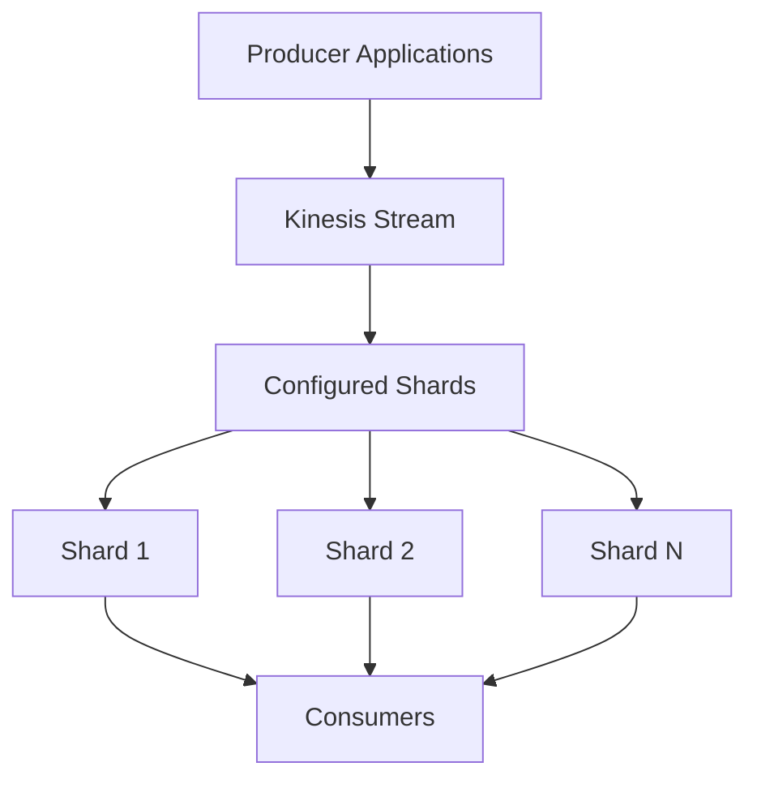
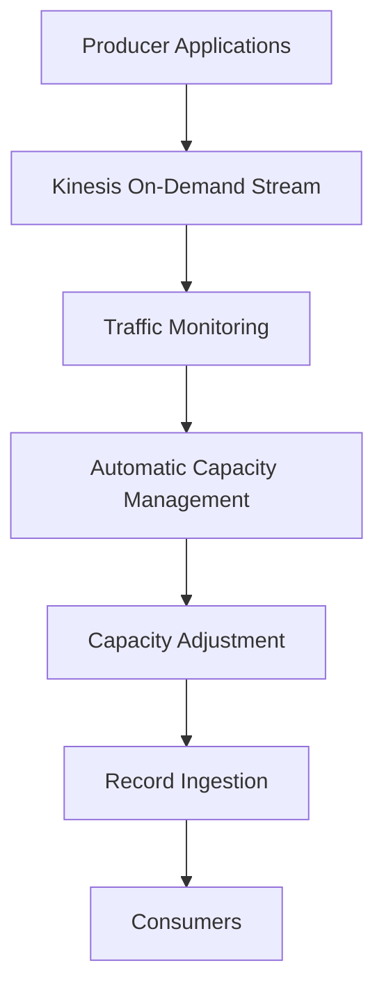
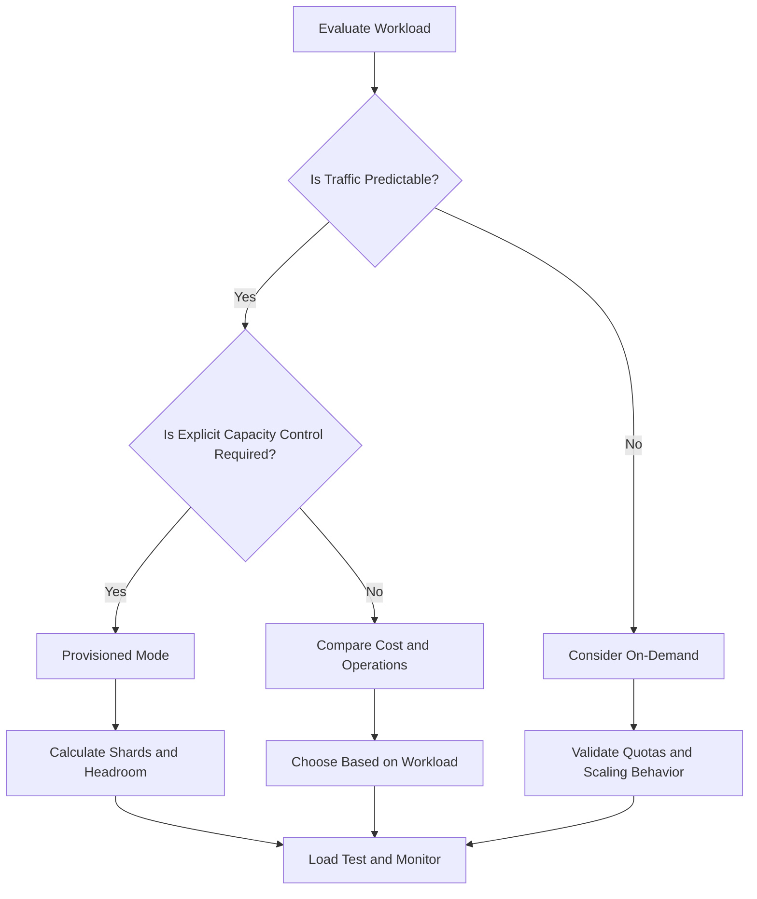

# 09- Capacity Modes

## Overview

Amazon Kinesis Data Streams supports two capacity modes for managing stream throughput:

- **Provisioned mode:** Capacity is configured explicitly using shards.
- **On-demand mode:** Capacity is managed automatically by Kinesis based on observed traffic.

Capacity mode determines how a stream handles ingestion and consumption throughput, how capacity scales, and how much operational management is required.

Choosing the correct mode affects:

- Throughput availability.
- Scaling behavior.
- Cost predictability.
- Operational complexity.
- Performance during traffic spikes.
- Capacity planning and monitoring.

A production decision should consider both ingestion and consumption patterns, partition-key distribution, traffic variability, and downstream processing capacity.

## Understanding Kinesis Capacity

Kinesis capacity is primarily measured in terms of shard throughput.

A shard provides a unit of write and read capacity.

For provisioned capacity, a shard traditionally supports:

| Operation | Per-shard throughput limit |
|---|---:|
| Write throughput | 1 MB/second |
| Write records | 1,000 records/second |
| Shared read throughput | 2 MB/second |

These limits apply to the shard, not independently to every producer or consumer.

Multiple producers share the shard's write capacity. Consumers using shared-throughput reads also share the shard's read capacity.

Enhanced fan-out provides dedicated read throughput for registered consumers, changing how consumer read capacity is allocated.

Actual service limits and quotas can vary by Region, stream configuration, and account quotas. Validate the current limits for the target workload before deployment.

### Write Capacity

Write capacity is constrained by both:

- Total data volume per second.
- Number of records per second.

For example, a shard receiving 800 records per second, each averaging 2 KB, receives approximately 1.6 MB per second.

This exceeds the traditional 1 MB/second write limit even though the record count is below 1,000.

### Read Capacity

Shared-throughput consumers compete for the shard's read capacity.

If multiple consumers read the same shard, their combined consumption can exceed the shared read limit.

Enhanced fan-out provides dedicated read throughput to registered consumers and is useful when multiple independent consumers require predictable read performance.

### Capacity and Partition Keys

Kinesis distributes records across shards using partition keys.

A partition key is hashed to determine the target shard.

Adding shards does not automatically solve every throughput problem. If traffic is concentrated on a single partition key, that key can continue to create a hot shard.

Capacity planning must consider:

- Total stream throughput.
- Number of records per second.
- Record size distribution.
- Partition-key cardinality.
- Traffic skew.
- Number of consumers.
- Consumer read model.

## Provisioned Capacity Mode

### What It Is

Provisioned mode requires the application owner to configure the number of shards for a stream.

Each shard contributes a defined amount of write and read capacity.

For example, a stream configured with 10 shards has an aggregate traditional write capacity of approximately:

- 10 MB/second.
- 10,000 records/second.

The actual usable throughput depends on how evenly records are distributed across those shards.

### When to Use Provisioned Mode

Provisioned mode is appropriate when:

- Traffic is relatively predictable.
- Capacity requirements are known.
- Cost control is important.
- The workload has stable throughput patterns.
- The team can operate shard scaling.
- Capacity must be planned around known peak workloads.

It is commonly used for steady ingestion pipelines, scheduled data processing, and workloads with predictable traffic.

### How Provisioned Mode Works



The application owner configures shard capacity.

Kinesis distributes records across shards based on partition keys or explicit hash keys.

When traffic increases beyond available capacity, write or read throttling can occur.

### Provisioned Capacity Example

Assume an order-processing platform has the following requirements:

| Parameter | Value |
|---|---:|
| Average ingestion | 3 MB/second |
| Peak ingestion | 7 MB/second |
| Average record size | 2 KB |
| Consumer count | 2 |
| Capacity mode | Provisioned |

Based on the traditional 1 MB/second write capacity per shard, the theoretical minimum for peak ingestion is seven shards.

However, this is not a sufficient production sizing decision.

The design must also account for:

- Records per second.
- Uneven partition-key distribution.
- Traffic bursts.
- Consumer read throughput.
- Operational headroom.
- Shard-level throttling.

A larger shard count may be required to provide sufficient headroom and reduce hot-shard risk.

### Configure Provisioned Mode with AWS CLI

Create a stream with a specified shard count:

```bash
aws kinesis create-stream \
    --stream-name order-events \
    --shard-count 10
```

Describe the stream:

```bash
aws kinesis describe-stream-summary \
    --stream-name order-events
```

Update shard count:

```bash
aws kinesis update-shard-count \
    --stream-name order-events \
    --target-shard-count 15 \
    --scaling-type UNIFORM_SCALING
```

Shard-count updates are subject to service constraints and account quotas.

Uniform scaling is not a substitute for partition-key analysis. It changes shard capacity but does not eliminate an individual hot partition key.

### Provisioned Mode with Boto3

```python
import boto3

kinesis = boto3.client("kinesis", region_name="ap-south-1")

stream_name = "order-events"

response = kinesis.update_shard_count(
    StreamName=stream_name,
    TargetShardCount=15,
    ScalingType="UNIFORM_SCALING",
)

print(response["StreamName"])
print(response["CurrentShardCount"])
print(response["TargetShardCount"])
```

Shard-count updates are asynchronous. Monitor the stream until the update has completed.

Do not assume that receiving a successful API response means the stream has immediately reached its target shard count.

### Advantages of Provisioned Mode

- Predictable shard-based capacity.
- Direct control over stream capacity.
- Suitable for stable workloads.
- Capacity can be planned around known traffic.
- Can provide predictable cost behavior for steady workloads.

### Limitations of Provisioned Mode

- Requires capacity planning.
- Requires operational management of shard scaling.
- Under-provisioning causes throttling.
- Over-provisioning increases cost.
- Hot partition keys can limit effective throughput.
- Scaling operations require monitoring and planning.

## On-Demand Capacity Mode

### What It Is

On-demand mode automatically manages stream capacity based on traffic.

The application owner does not configure a fixed shard count for normal capacity management.

Kinesis monitors traffic and adjusts capacity to accommodate changing workloads within the service's scaling behavior and quotas.

On-demand mode is useful when traffic is variable or difficult to predict.

### When to Use On-Demand Mode

Use on-demand mode when:

- Traffic fluctuates significantly.
- Workload patterns are unpredictable.
- Manual shard management is undesirable.
- The application experiences irregular traffic spikes.
- The team wants to reduce capacity-planning overhead.

Typical examples include:

- Event-driven applications.
- Variable API traffic.
- IoT telemetry ingestion.
- Unpredictable application activity.
- New workloads without reliable traffic estimates.

### How On-Demand Mode Works



Kinesis manages capacity based on observed traffic.

On-demand does not mean unlimited throughput or instantaneous accommodation of every possible traffic increase.

Service quotas and scaling behavior still apply.

### Scaling Behavior

For the On-demand Standard capacity mode, Kinesis can immediately accommodate up to twice the previous peak write throughput.

If traffic increases beyond that level, the stream may need additional time to scale.

This makes gradual traffic growth and previously observed peaks important considerations.

For example:

| Traffic pattern | Previous peak | New traffic | Consideration |
|---|---:|---:|---|
| Normal growth | 5 MB/s | 8 MB/s | Within twice the previous peak |
| Large sudden spike | 5 MB/s | 15 MB/s | Exceeds twice the previous peak |
| New stream burst | No established history | High initial traffic | Validate initial throughput and quotas |

Do not assume on-demand mode can absorb an unlimited sudden traffic spike without throttling.

### Configure On-Demand Mode with AWS CLI

Create an on-demand stream:

```bash
aws kinesis create-stream \
    --stream-name order-events \
    --stream-mode-details StreamMode=ON_DEMAND
```

Inspect stream configuration:

```bash
aws kinesis describe-stream-summary \
    --stream-name order-events
```

The response includes stream mode information.

### Switch an Existing Stream to On-Demand

```bash
aws kinesis update-stream-mode \
    --stream-arn arn:aws:kinesis:ap-south-1:123456789012:stream/order-events \
    --stream-mode-details StreamMode=ON_DEMAND
```

Use the actual stream ARN and account details from the deployment environment.

### On-Demand Mode with Boto3

```python
import boto3

kinesis = boto3.client("kinesis", region_name="ap-south-1")

stream_arn = (
    "arn:aws:kinesis:ap-south-1:123456789012:"
    "stream/order-events"
)

response = kinesis.update_stream_mode(
    StreamARN=stream_arn,
    StreamModeDetails={
        "StreamMode": "ON_DEMAND",
    },
)

print(response["StreamARN"])
```

The mode update is asynchronous. Monitor the stream status and verify the resulting configuration.

### Advantages of On-Demand Mode

- Automatic capacity management.
- Reduced shard-planning effort.
- Suitable for variable traffic.
- Less manual scaling intervention.
- Useful for workloads with uncertain throughput.

### Limitations of On-Demand Mode

- Capacity is still subject to service quotas.
- Sudden traffic increases can exceed scaling behavior.
- Cost may be less predictable for highly variable workloads.
- Hot partition keys remain a concern.
- Downstream consumers can still become bottlenecks.
- Automatic capacity management does not replace monitoring.

## Comparing Provisioned and On-Demand Modes

| Dimension | Provisioned | On-demand |
|---|---|---|
| Capacity management | Application owner configures shards | Kinesis manages capacity |
| Scaling | Explicit shard scaling | Automatic |
| Capacity planning | Required | Reduced, but still necessary |
| Traffic pattern | Predictable workloads | Variable or unpredictable workloads |
| Operational effort | Higher | Lower |
| Cost behavior | Shard-based capacity planning | Usage and capacity-based pricing |
| Hot partition risk | Present | Present |
| Throughput guarantees | Based on configured shard capacity and service limits | Subject to scaling behavior and service quotas |
| Best suited for | Stable workloads | Variable workloads |

Neither mode removes the need to understand the workload.

The decision should be based on traffic characteristics, cost requirements, scaling behavior, and operational capabilities.

## Choosing the Right Capacity Mode

### Decision Framework



### Example: E-Commerce Order Events

An e-commerce platform receives order events throughout the day.

Traffic is relatively stable during normal business hours but increases significantly during promotional campaigns.

Possible considerations:

- If traffic patterns are well understood and predictable, provisioned mode can be sized for expected peaks.
- If campaign traffic is highly variable, on-demand mode can reduce manual scaling work.
- If a sudden campaign launch can produce a large traffic spike, validate on-demand scaling behavior and quotas.
- If order events are concentrated on a small number of partition keys, fix partition-key distribution independently of capacity mode.

### Example: IoT Telemetry

An IoT platform receives telemetry from thousands of devices.

Traffic can vary based on device activity, deployment schedules, and network recovery events.

On-demand mode may reduce the need to predict every traffic change.

However, the engineering team should still evaluate:

- Device partition-key distribution.
- Reconnection storms.
- Burst traffic.
- Record size.
- Consumer throughput.
- Regional service quotas.

A large number of devices does not automatically guarantee even traffic distribution.

## Capacity Planning

Capacity planning is still important in both modes.

Provisioned mode requires explicit shard sizing. On-demand mode requires understanding traffic patterns, quotas, and scaling behavior.

### Calculate Write Capacity

For provisioned mode, estimate the required shards using both throughput dimensions.

```text
Required shards by data volume =
    Peak incoming bytes per second / 1 MB

Required shards by record count =
    Peak records per second / 1,000

Minimum shard count =
    max(
        Required shards by data volume,
        Required shards by record count
    )
```

Round the result up to the next whole shard.

These calculations use traditional per-shard write limits. Validate current service limits before using them for production sizing.

### Example Calculation

Assume:

| Parameter | Value |
|---|---:|
| Peak incoming data | 8 MB/second |
| Peak record rate | 6,000 records/second |
| Average record size | Approximately 1.33 KB |

Calculate capacity requirements:

```text
Shards by data volume = 8 / 1 = 8

Shards by record count = 6000 / 1000 = 6

Minimum shard count = max(8, 6) = 8
```

Eight shards are the theoretical minimum under these assumptions.

A production deployment should include headroom for bursts and uneven partition-key distribution.

### Account for Read Capacity

Read capacity must be evaluated separately from write capacity.

For shared-throughput consumers, the traditional per-shard read limit is 2 MB/second across consumers.

For example:

| Consumer | Required read throughput |
|---|---:|
| Order database consumer | 1 MB/s |
| Analytics consumer | 1 MB/s |
| Search indexing consumer | 1 MB/s |
| Total | 3 MB/s |

If all consumers use shared-throughput reads from the same shard, their combined demand exceeds the traditional 2 MB/second shared read capacity.

Possible solutions include:

- Increasing shard count where distribution allows.
- Reducing unnecessary reads.
- Using enhanced fan-out for consumers requiring dedicated read throughput.
- Separating workloads into different streams where appropriate.

## Enhanced Fan-Out and Capacity Modes

Enhanced fan-out is a consumer read capability, not a separate stream capacity mode.

It provides dedicated read throughput to registered consumers using the enhanced fan-out mechanism.

| Feature | Shared-throughput consumer | Enhanced fan-out |
|---|---|---|
| Read capacity | Shared across consumers | Dedicated per registered consumer |
| Delivery model | Polling with `GetRecords` | Push-based delivery through SubscribeToShard |
| Consumer isolation | Limited by shared read capacity | Better read-throughput isolation |
| Typical use | Small number of consumers | Multiple independent high-throughput consumers |

Enhanced fan-out can be useful with either provisioned or on-demand stream capacity.

It does not increase the stream's write capacity.

It also does not remove downstream processing constraints.

## Hot Shards and Partition-Key Skew

A hot shard occurs when one shard receives disproportionately high traffic.

This commonly happens when partition keys have low cardinality or uneven distribution.

Example:

```python
partition_key = "order-status"
```

If every event uses the same partition key, all records are directed to the same shard.

Adding more shards does not distribute records that share the same partition key.

### Better Partition-Key Design

For order events:

```python
partition_key = order_id
```

For device telemetry:

```python
partition_key = device_id
```

The correct key depends on the required ordering scope.

A high-cardinality partition key generally improves distribution, but it should not be selected without considering business ordering requirements.

### Diagnose Hot Shards

Monitor:

- Incoming bytes by shard.
- Incoming records by shard.
- Write throttling.
- Read throttling.
- Partition-key distribution in producer telemetry.

A stream can have sufficient aggregate capacity while an individual shard is overloaded.

Capacity decisions should be based on shard-level behavior, not only stream-wide averages.

## Monitoring and Operational Management

### CloudWatch Metrics

Monitor the following metrics:

| Metric | Purpose |
|---|---|
| `IncomingBytes` | Tracks ingestion volume |
| `IncomingRecords` | Tracks incoming record count |
| `WriteProvisionedThroughputExceeded` | Identifies write throttling |
| `ReadProvisionedThroughputExceeded` | Identifies shared-read throttling |
| `GetRecords.IteratorAgeMilliseconds` | Measures consumer lag |
| `GetRecords.Bytes` | Measures read throughput |
| `GetRecords.Records` | Measures records retrieved |

Use dimensions such as stream name and shard ID where supported.

### Operational Alerts

Recommended alerts include:

- Sustained write throttling.
- Sustained read throttling.
- Consumer lag approaching retention limits.
- Unexpected traffic spikes.
- Abnormal shard-level traffic imbalance.
- Failed capacity updates.
- Downstream processing backlog.

Do not rely exclusively on stream-wide aggregate metrics. A hot shard can be hidden by healthy aggregate throughput.

### Capacity Change Monitoring

For provisioned streams, monitor shard-count updates and verify that the resulting capacity matches the intended configuration.

For on-demand streams, monitor traffic changes, throttling, and service quotas.

Capacity management should be part of the operational runbook rather than an ad hoc response to production incidents.

## Infrastructure as Code

### Provisioned Mode with Terraform

```hcl
resource "aws_kinesis_stream" "order_events" {
  name             = "order-events"
  shard_count      = 10
  retention_period = 168

  encryption_type = "KMS"
  kms_key_id      = aws_kms_key.kinesis.arn

  stream_mode_details {
    stream_mode = "PROVISIONED"
  }

  tags = {
    Environment = "production"
    Application = "order-processing"
  }
}
```

### On-Demand Mode with Terraform

```hcl
resource "aws_kinesis_stream" "order_events" {
  name             = "order-events"
  retention_period = 168

  encryption_type = "KMS"
  kms_key_id      = aws_kms_key.kinesis.arn

  stream_mode_details {
    stream_mode = "ON_DEMAND"
  }

  tags = {
    Environment = "production"
    Application = "order-processing"
  }
}
```

Use the appropriate configuration for the selected capacity mode.

Do not configure a fixed shard count as if it were the normal capacity control for an on-demand stream.

Keep encryption keys, retention, stream configuration, and tags managed through the same infrastructure deployment process.

## Cost Considerations

Capacity mode affects the cost model.

Provisioned and on-demand streams have different pricing structures. Exact pricing depends on Region, usage, consumer features, retention, and other service options.

| Cost area | Provisioned considerations | On-demand considerations |
|---|---|---|
| Stream capacity | Configured shard capacity | Automatically managed capacity |
| Variable traffic | May require over-provisioning for peaks | Capacity adjusts to traffic |
| Stable traffic | Can provide predictable capacity costs | Compare usage-based pricing |
| Scaling operations | Requires shard management | Less manual capacity management |
| Consumer reads | Shared or enhanced fan-out costs | Shared or enhanced fan-out costs |

Additional costs may include:

- Extended data retention.
- Enhanced fan-out.
- AWS KMS requests.
- Data transfer.
- Downstream Lambda, ECS, or EKS processing.
- S3 archival and analytics.

Use the AWS Pricing Calculator and current regional pricing before making a financial decision.

### Cost Optimization

- Avoid unnecessary provisioned shard capacity.
- Review actual peak and average traffic.
- Monitor shard utilization and throttling.
- Compare on-demand and provisioned costs using real workload data.
- Avoid excessive replay and unnecessary consumer reads.
- Evaluate enhanced fan-out only when dedicated read throughput is required.
- Include downstream processing costs in the total architecture estimate.

## Security and Reliability Considerations

Capacity mode does not replace the need for a secure and reliable stream architecture.

Apply the following controls:

- Use IAM roles with least-privilege permissions.
- Encrypt streams at rest.
- Use TLS for communication with Kinesis APIs.
- Restrict stream administration permissions.
- Monitor unauthorized access and configuration changes.
- Design producers to handle throttling and transient failures.
- Use retries with exponential backoff and jitter.
- Make consumers idempotent.
- Monitor consumer lag against the configured retention period.
- Test scaling and recovery procedures before production deployment.

A capacity mode change should be treated as an infrastructure change with review, monitoring, and rollback planning.

## Common Mistakes and Production Pitfalls

### Assuming On-Demand Means Unlimited Capacity

On-demand capacity reduces manual shard management but remains subject to service quotas and scaling behavior.

**Avoidance:** Validate quotas, understand previous-peak scaling behavior, and load-test sudden traffic increases.

### Choosing Provisioned Capacity Using Only Average Traffic

Average traffic hides peak demand and short-lived bursts.

**Avoidance:** Size using peak bytes per second and peak records per second, with appropriate headroom.

### Ignoring Partition-Key Skew

A stream can have enough aggregate capacity while one shard is overloaded.

**Avoidance:** Measure traffic distribution and choose partition keys based on both cardinality and ordering requirements.

### Assuming More Shards Always Fix Throttling

Increasing shard count does not necessarily distribute traffic from a hot partition key.

**Avoidance:** Diagnose the affected shard and correct partition-key design before scaling.

### Ignoring Consumer Throughput

A stream can accept records successfully while consumers fall behind.

**Avoidance:** Monitor iterator age, read throughput, processing latency, and downstream capacity.

### Confusing Enhanced Fan-Out with On-Demand Mode

Enhanced fan-out controls consumer read throughput. On-demand controls stream capacity management.

**Avoidance:** Evaluate write capacity, shared reads, and dedicated consumer reads as separate architectural concerns.

### Assuming Capacity Changes Are Instantaneous

Provisioned shard updates and stream-mode changes are asynchronous operations.

**Avoidance:** Monitor stream state and verify the final configuration before declaring a deployment complete.

### Optimizing Only for Kinesis Costs

A capacity decision can shift costs to downstream databases, compute, or archival systems.

**Avoidance:** Evaluate the total cost of ingestion, consumption, storage, and processing.

## Production Best Practices

- Choose capacity mode based on actual traffic characteristics and operational requirements.
- Use provisioned mode when workload capacity is predictable and explicit shard control is valuable.
- Use on-demand mode when traffic is variable and reduced manual scaling is beneficial.
- Calculate provisioned capacity using both bytes per second and records per second.
- Include headroom for bursts and uneven partition-key distribution.
- Monitor shard-level throughput and throttling.
- Use enhanced fan-out when independent consumers require dedicated read throughput.
- Validate service quotas and scaling behavior before production launches.
- Automate stream configuration through Terraform or another infrastructure-as-code tool.
- Treat capacity changes as controlled infrastructure operations.
- Monitor consumer lag and downstream processing capacity independently.
- Revisit capacity decisions using real production traffic and cost data.

## Key Takeaways

- Kinesis supports provisioned capacity, where shard count is configured explicitly, and on-demand capacity, where Kinesis manages capacity automatically.
- Provisioned capacity requires sizing for both bytes per second and records per second, while on-demand still requires quota and scaling-behavior awareness.
- Partition-key skew can create hot shards regardless of the selected capacity mode.
- Enhanced fan-out provides dedicated consumer read throughput and is independent of the stream's capacity mode.
- Production capacity decisions must account for traffic patterns, consumer throughput, monitoring, downstream limits, and total cost.