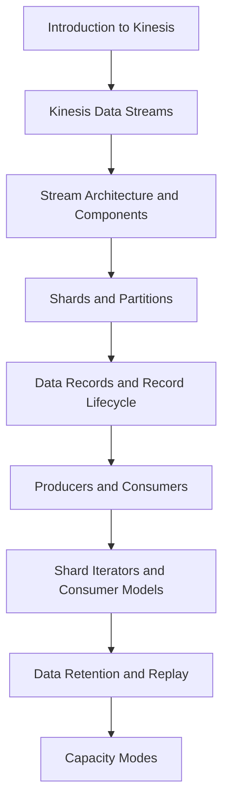
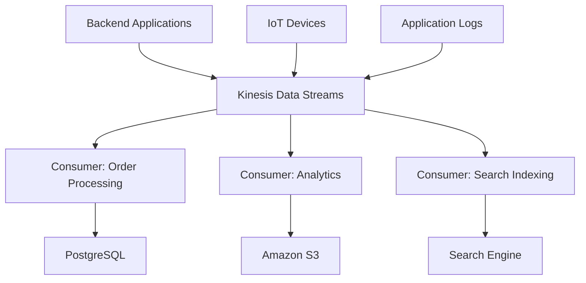

# Amazon Kinesis

## Overview

Amazon Kinesis Data Streams is an AWS-managed service for collecting, processing, and distributing real-time streaming data. It enables backend systems to ingest continuous event streams and make them available to multiple independent consumers with low latency.

Kinesis is commonly used in event-driven architectures, microservices, telemetry pipelines, log processing, analytics platforms, and real-time data integration.

This section covers Kinesis fundamentals, stream architecture, shard management, record processing, consumer models, retention, replay, and capacity planning.

## Documentation Index

| # | Document | Description |
|---|---|---|
| 01 | [Introduction to Amazon Kinesis](./01-%20Introduction%20to%20Amazon%20Kinesis.md) | Kinesis fundamentals, capabilities, use cases, and core service concepts. |
| 02 | [Kinesis Data Streams](./02-%20Kinesis%20Data%20Streams.md) | Stream creation, configuration, ingestion, consumption, and core APIs. |
| 03 | [Stream Architecture and Components](./03-%20Stream%20Architecture%20and%20Components.md) | Stream architecture, producers, consumers, records, shards, and data flow. |
| 04 | [Shards and Partitions](./04-%20Shards%20and%20Partitions.md) | Shard architecture, partition keys, hash ranges, scaling, and hot-shard considerations. |
| 05 | [Data Records and Record Lifecycle](./05-%20Data%20Records%20and%20Record%20Lifecycle.md) | Record structure, sequence numbers, partition keys, ingestion, and record lifecycle. |
| 06 | [Producers and Consumers](./06-%20Producers%20and%20Consumers.md) | Producer and consumer responsibilities, ingestion patterns, and processing architectures. |
| 07 | [Shard Iterators and Consumer Models](./07-%20Shard%20Iterators%20and%20Consumer%20Models.md) | Shard iterators, polling, enhanced fan-out, and consumer processing models. |
| 08 | [Data Retention and Replay](./08-%20Data%20Retention%20and%20Replay.md) | Retention configuration, replay strategies, checkpointing, recovery, and archival. |
| 09 | [Capacity Modes](./09-%20Capacity%20Modes.md) | Provisioned and on-demand capacity, throughput planning, scaling, and cost considerations. |

## Learning Path

Follow the documents in sequence to build a practical understanding of Kinesis.

The sequence progresses from service fundamentals to production-level stream processing and capacity management.

## Core Engineering Concepts

The following concepts are central to designing reliable Kinesis-based systems.

| Concept | Engineering significance |
|---|---|
| Streams | Logical containers for continuous event data. |
| Shards | Units of stream throughput and parallelism in provisioned capacity mode. |
| Partition keys | Determine record distribution and ordering scope. |
| Sequence numbers | Identify record positions within individual shards. |
| Producers | Publish records into streams. |
| Consumers | Read and process records independently. |
| Checkpointing | Tracks consumer processing progress and supports recovery. |
| Retention | Defines how long records remain available for consumption. |
| Replay | Enables historical reprocessing within the available retention window. |
| Capacity modes | Control how stream throughput capacity is managed. |
| Enhanced fan-out | Provides dedicated read throughput to registered consumers. |

## Typical Kinesis Architecture

A single stream can support multiple independent consumers. Each consumer can process records according to its own business requirements and maintain its own processing progress.

## Production Engineering Considerations

When designing Kinesis-based systems, evaluate the following areas:

- **Partition-key design:** Choose keys that distribute traffic effectively while preserving the required ordering scope.
- **Throughput planning:** Account for bytes per second, records per second, shard-level distribution, and consumer read capacity.
- **Consumer reliability:** Implement checkpointing, retries, idempotency, and appropriate failure handling.
- **Retention and recovery:** Ensure consumer recovery objectives fit within the configured retention period.
- **Replay isolation:** Separate historical reprocessing from live workloads when replay could affect production capacity.
- **Monitoring:** Track ingestion throughput, throttling, iterator age, consumer processing rates, and downstream failures.
- **Security:** Apply least-privilege IAM policies and encryption at rest and in transit.
- **Cost management:** Evaluate capacity mode, retention, enhanced fan-out, archival, and downstream processing costs.

## Key Takeaways

- Kinesis Data Streams provides managed infrastructure for real-time event ingestion and independent consumer processing.
- Shards, partition keys, and consumer models determine throughput, parallelism, and ordering behavior.
- Retention, checkpointing, and replay are essential to consumer recovery and historical reprocessing.
- Provisioned and on-demand capacity modes address different workload and operational requirements.
- Production Kinesis architectures require deliberate partition-key design, idempotent processing, monitoring, security, and capacity planning.