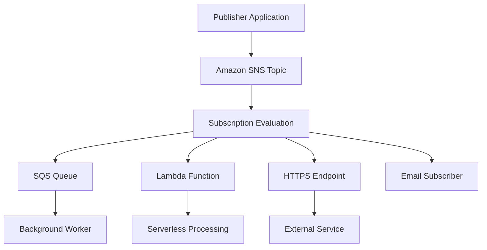
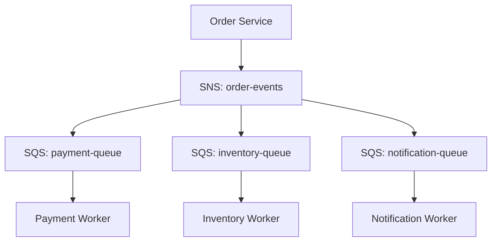
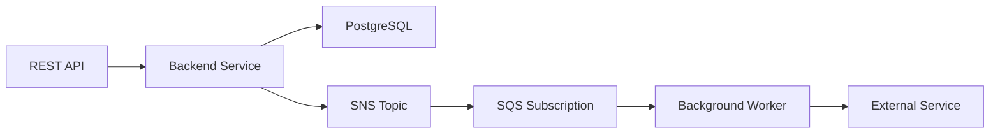

# 01- Introduction to Amazon SNS

## Overview

Amazon Simple Notification Service (SNS) is a fully managed publish-subscribe messaging service provided by AWS. It enables applications and distributed systems to publish messages to logical endpoints called topics, which deliver those messages to multiple subscribers.

SNS helps decouple message producers from consumers. A producer publishes an event once, while SNS distributes it to independently configured subscribers.

It is commonly used for:

- Event-driven microservice communication.
- Application notifications.
- Event broadcasting and fan-out.
- Asynchronous integration between AWS services.
- Monitoring and operational alerts.
- Distributed system event distribution.

SNS is particularly useful when multiple independent systems need to react to the same event without requiring the producer to know about each consumer.

## Core Concepts

### Topics

A topic is a logical communication channel through which publishers distribute messages.

Producers publish messages to a topic rather than directly communicating with individual subscribers.

For example, an e-commerce platform can publish an `order.created` event to an SNS topic. Multiple subscribers can independently receive and process that event.

Common topic types:

- Standard topics.
- FIFO topics.

### Publishers

A publisher is an application or AWS service that sends messages to an SNS topic.

Examples include:

- Django or FastAPI applications.
- AWS Lambda functions.
- Amazon EventBridge integrations.
- CloudWatch alarms.
- Other AWS services supporting SNS publication.

Publishers interact with SNS using AWS APIs or SDKs.

### Subscribers

Subscribers receive messages published to an SNS topic.

SNS supports multiple subscription protocols, including:

| Protocol | Subscriber | Typical use |
|---|---|---|
| Amazon SQS | SQS queue | Durable asynchronous processing |
| AWS Lambda | Lambda function | Serverless event processing |
| HTTP/HTTPS | Web endpoint | External application integration |
| Email | Email address | Notifications |
| Email-JSON | Email endpoint | Structured email notifications |
| SMS | Mobile number | Text notifications |
| Application | Mobile push endpoint | Mobile application notifications |

Protocol availability and supported delivery features vary. Select a subscription protocol according to the consumer's processing and reliability requirements.

### Messages

A message is the payload published to an SNS topic.

Messages can contain:

- JSON documents.
- Plain text.
- Event metadata.
- Application-specific data.
- Structured business events.

Example:

```json
{
  "event_id": "evt-8f7d9a2c",
  "event_type": "order.created",
  "event_version": 1,
  "occurred_at": "2026-11-19T10:30:00Z",
  "data": {
    "order_id": "ORD-10042",
    "customer_id": "CUST-2001",
    "amount": 1499.00,
    "currency": "INR"
  }
}
```

For production event contracts, include a stable business event identifier and an explicit schema version.

Do not use an SNS message ID as the business event identifier. The SNS message ID identifies an SNS publication, while the business event ID identifies the underlying domain event.

### Subscriptions

A subscription connects a topic to a subscriber endpoint.

A topic can have multiple subscriptions, allowing the same published message to reach multiple independent consumers.

For example:

```text
order-events
    |
    +-- SQS: payment-processing
    |
    +-- SQS: inventory-service
    |
    +-- Lambda: order-analytics
    |
    +-- HTTPS: notification-service
```

Each subscription can have its own delivery configuration and filtering policy.

## How Amazon SNS Works

SNS follows a publish-subscribe messaging model.

The publisher sends a message to a topic. SNS evaluates the topic's subscriptions and delivers the message to eligible endpoints.



### Message Delivery Lifecycle

A typical message lifecycle is:

1. A producer creates a business event.
2. The producer publishes the event to an SNS topic.
3. SNS accepts the publication and returns a message ID.
4. SNS evaluates the topic's subscriptions and applicable filter policies.
5. SNS attempts delivery to eligible subscribers.
6. Subscribers process the delivered messages according to their own execution model.

Successful publication does not mean that every subscriber has completed business processing.

For example, SNS may successfully deliver a message to an SQS queue, but the application consuming that queue may fail later.

Monitor publication, delivery, and downstream processing independently.

## Standard and FIFO Topics

SNS supports two topic types.

| Feature | Standard topic | FIFO topic |
|---|---|---|
| Ordering | Best-effort ordering | Ordered within message groups |
| Deduplication | No FIFO deduplication guarantee | Deduplication support |
| Throughput | High, scalable throughput | FIFO-specific throughput constraints |
| Delivery semantics | At-least-once for supported protocols | FIFO-specific delivery and deduplication behavior |
| Typical use | General event distribution | Ordering-sensitive event processing |

### Standard Topics

Standard topics are suitable for high-throughput event distribution where strict ordering is not required.

Duplicates can occur, and subscribers should implement idempotent processing.

Typical use cases:

- Application notifications.
- Monitoring events.
- General microservice event distribution.
- Analytics event broadcasting.

### FIFO Topics

FIFO topics are appropriate when message ordering and deduplication are important.

They support message groups, which define ordering scopes.

For example, an order-processing system can use `order_id` as the message group ID so events for the same order are processed in order.

FIFO deduplication does not guarantee exactly-once business processing. Consumers must still handle failures and duplicate side effects safely.

Use FIFO topics only when the ordering and deduplication requirements justify their constraints.

## SNS and SQS Fan-Out Architecture

A common production pattern combines SNS with Amazon SQS.

SNS distributes messages to multiple queues, and each queue independently buffers messages for its consumer.



This architecture provides:

- Producer-consumer decoupling.
- Independent consumer scaling.
- Durable buffering in SQS.
- Different processing speeds for each subscriber.
- Independent retry and dead-letter handling.
- Better isolation between downstream services.

Each independent subscriber should generally have its own SQS queue. Sharing one queue between different logical subscribers changes the processing model into competing consumers rather than independent fan-out.

SNS handles distribution, while SQS handles buffering and consumer delivery.

## SNS Compared with SQS and Kinesis

These services solve different messaging problems.

| Dimension | SNS | SQS | Kinesis Data Streams |
|---|---|---|---|
| Primary model | Publish-subscribe | Message queue | Streaming data |
| Main purpose | Fan-out and notifications | Decoupled task processing | Continuous event ingestion |
| Consumers | Multiple subscribers | Competing consumers per queue | Independent stream consumers |
| Message retention | No general-purpose historical replay | Configurable queue retention | Configurable stream retention |
| Ordering | Standard best-effort; FIFO group ordering | Standard or FIFO queue semantics | Ordering within a shard |
| Replay | No general stream replay | Messages can be redelivered while retained | Read from retained shard positions |
| Typical use | Event broadcasting | Background jobs | Event streaming and analytics |

### When to Use SNS

Use SNS when one event must be distributed to multiple independent subscribers.

Example:

An order service publishes `order.created`. Payment, inventory, and notification systems each receive the event independently.

### When to Use SQS

Use SQS when an application needs durable message buffering and controlled asynchronous processing.

Example:

A Django application places report-generation tasks in SQS. Worker instances retrieve and process those tasks.

### When to Use Kinesis

Use Kinesis when the system needs continuous event ingestion, retained stream data, and independent consumers that can read records from stream positions.

Example:

An IoT platform ingests telemetry from thousands of devices and supports real-time processing and historical replay.

## Publishing Messages with Python and Boto3

The AWS SDK for Python is Boto3.

Applications can publish messages using the SNS client.

Install the dependency:

```bash
pip install boto3
```

### Basic Publication

```python
import json
import boto3

sns = boto3.client(
    "sns",
    region_name="ap-south-1",
)

TOPIC_ARN = (
    "arn:aws:sns:ap-south-1:123456789012:order-events"
)


def publish_order_event(event: dict) -> str:
    response = sns.publish(
        TopicArn=TOPIC_ARN,
        Message=json.dumps(event),
        Subject="Order Created",
    )

    return response["MessageId"]
```

The returned message ID confirms that SNS accepted the publication request. It does not confirm that all subscribers successfully processed the event.

### Publishing with Message Attributes

Message attributes provide metadata that can be used by subscription filter policies.

```python
import json
import boto3

sns = boto3.client("sns", region_name="ap-south-1")

TOPIC_ARN = (
    "arn:aws:sns:ap-south-1:123456789012:order-events"
)


def publish_order_event(event: dict) -> str:
    response = sns.publish(
        TopicArn=TOPIC_ARN,
        Message=json.dumps(event),
        MessageAttributes={
            "event_type": {
                "DataType": "String",
                "StringValue": "order.created",
            },
            "environment": {
                "DataType": "String",
                "StringValue": "production",
            },
        },
    )

    return response["MessageId"]
```

Message attributes are useful for routing and filtering. They should not replace the event payload's business contract.

### Production Considerations

- Use IAM roles rather than hardcoded AWS credentials.
- Keep topic ARNs in environment-specific configuration.
- Use stable event IDs for idempotency.
- Validate event schemas before publication.
- Handle throttling and transient failures with bounded retries and exponential backoff.
- Use a transactional outbox when publishing events based on database transactions.
- Record publication failures and expose metrics.

## SNS with Backend Applications

SNS can integrate with Django, FastAPI, and other backend services.

A typical architecture is:



A backend application can publish events after business operations.

However, publishing directly after a database commit introduces a potential consistency problem:

1. The database transaction commits successfully.
2. The application attempts to publish to SNS.
3. SNS publication fails.
4. The database contains the business change, but subscribers never receive the event.

For critical business events, use the transactional outbox pattern.

The application writes the business change and an outbox record in the same database transaction. A separate publisher reads pending outbox records and publishes them to SNS.

This avoids relying on a non-atomic database-plus-SNS operation.

## Reliability and Delivery Semantics

SNS delivery behavior depends on topic type and subscription protocol.

For Standard topics, consumers should generally expect at-least-once delivery for supported protocols. Duplicate messages are possible, and ordering is not guaranteed.

FIFO topics provide ordering within message groups and deduplication capabilities, subject to their documented constraints.

### Important Reliability Concepts

| Concern | Engineering approach |
|---|---|
| Duplicate delivery | Use stable event IDs and idempotent consumers |
| Delivery failures | Configure appropriate retry and dead-letter behavior |
| Consumer failure | Use SQS buffering where durable asynchronous processing is required |
| Message loss between DB and SNS | Use the transactional outbox pattern |
| Downstream overload | Buffer with SQS and control worker concurrency |
| Poison messages | Use an SQS DLQ or appropriate subscription DLQ configuration |

### SNS Dead-Letter Queues

SNS supports subscription-level dead-letter queue configuration for eligible delivery failures.

This is different from an SQS dead-letter queue used when a consumer repeatedly fails to process a message.

The two failure boundaries should be designed separately:

- SNS subscription DLQ: captures messages SNS could not successfully deliver to a supported subscription endpoint.
- SQS consumer DLQ: captures messages that an SQS consumer repeatedly fails to process.

A successful SNS-to-SQS delivery does not guarantee successful processing by the application consuming that queue.

## Security Considerations

SNS topics should be protected through IAM policies, topic policies, encryption, and controlled subscription management.

### IAM Permissions

Typical permissions include:

| Permission | Purpose |
|---|---|
| `sns:Publish` | Publish messages to a topic |
| `sns:Subscribe` | Create subscriptions |
| `sns:Unsubscribe` | Remove subscriptions |
| `sns:GetTopicAttributes` | Inspect topic configuration |
| `sns:SetTopicAttributes` | Modify topic configuration |

Grant only the permissions required by each application or operational role.

A producer that only publishes events should not automatically receive permission to create subscriptions or modify topic policies.

### Topic Policies

Topic policies control which AWS principals and services can access a topic.

For SNS-to-SQS delivery, the destination queue policy must allow the SNS service principal to call `sqs:SendMessage`, constrained by the expected topic ARN using `aws:SourceArn`.

Avoid broad policies that allow unrelated topics or principals to publish to sensitive queues.

### Encryption

SNS supports server-side encryption using AWS Key Management Service (KMS).

For sensitive workloads:

- Enable encryption at rest.
- Use customer-managed KMS keys when required.
- Restrict KMS key access.
- Use TLS for communication.
- Protect sensitive data in message payloads.
- Avoid placing credentials or secrets in messages.

## Monitoring and Observability

Monitor SNS publication and delivery separately from downstream processing.

Important CloudWatch metrics include:

| Metric | Purpose |
|---|---|
| `NumberOfMessagesPublished` | Tracks published messages |
| `NumberOfNotificationsDelivered` | Tracks successful notification delivery |
| `NumberOfNotificationsFailed` | Tracks failed notification delivery |
| `NumberOfNotificationsFilteredOut` | Tracks messages excluded by subscription filters |
| `PublishSize` | Tracks message size |

For SNS-to-SQS architectures, also monitor:

- SQS `ApproximateNumberOfMessagesVisible`.
- SQS `ApproximateAgeOfOldestMessage`.
- SQS DLQ message count.
- Consumer processing failures.
- Worker concurrency and throughput.

Create alarms for delivery failures, growing queue backlogs, and abnormal processing latency.

Use structured logs containing the business event ID, SNS message ID, topic ARN, and downstream correlation identifiers.

## Cost Considerations

SNS pricing depends on message volume, delivery protocol, Region, and additional features.

Potential cost factors include:

- Number of published messages.
- Number of delivery attempts.
- Delivery protocol.
- Message size and applicable request units.
- Data transfer.
- FIFO topic usage.
- KMS usage for encrypted topics.

For SNS-to-SQS architectures, account for both SNS delivery and SQS request costs, as well as downstream worker execution.

Use the AWS Pricing Calculator and current regional pricing to estimate production costs.

## Common Mistakes and Production Pitfalls

### Treating SNS as a Durable Work Queue

SNS distributes messages but does not provide the same consumer-controlled buffering and processing model as SQS.

**Avoidance:** Use SNS with SQS when subscribers require durable buffering and independent processing.

### Assuming Exactly-Once Business Processing

SNS delivery and FIFO deduplication do not guarantee exactly-once business side effects.

**Avoidance:** Use stable event IDs and idempotent consumers.

### Publishing Before a Database Transaction Is Durable

A service may publish an event and subsequently roll back its database transaction.

**Avoidance:** Use a transactional outbox for critical domain events.

### Sharing One SQS Queue Across Independent Subscribers

Multiple consumers reading the same queue compete for messages. They do not each receive a copy.

**Avoidance:** Create one SQS queue per independent subscriber when every subscriber must receive every event.

### Confusing SNS and SQS Dead-Letter Queues

The SNS subscription delivery failure boundary differs from the SQS consumer processing failure boundary.

**Avoidance:** Configure and monitor each DLQ according to the failure it captures.

### Treating Filter Policies as Security Controls

Filtering determines message routing; it does not authorize access to sensitive data.

**Avoidance:** Enforce authorization through IAM, topic policies, queue policies, and application-level controls.

### Assuming Publication Success Means Processing Success

SNS accepting a message does not prove that subscribers completed their business operations.

**Avoidance:** Monitor delivery and downstream processing independently.

## Production Best Practices

- Use Standard topics for general high-throughput event distribution.
- Use FIFO topics when ordering within message groups is a business requirement.
- Use SNS with SQS for reliable asynchronous fan-out.
- Give each independent subscriber its own queue.
- Use stable business event IDs and idempotent consumers.
- Implement a transactional outbox for critical database-backed events.
- Apply subscription filter policies to reduce unnecessary delivery.
- Configure appropriate delivery retry and DLQ behavior.
- Use least-privilege IAM and restrictive topic and queue policies.
- Enable encryption where required.
- Monitor publication, delivery, filtering, queue backlog, and consumer processing separately.
- Version event schemas and maintain backward compatibility.
- Load-test fan-out volume and downstream consumer capacity.

## Key Takeaways

- Amazon SNS is a managed publish-subscribe service that distributes messages from publishers to multiple independent subscribers.
- Standard topics support high-throughput distribution, while FIFO topics provide ordering within message groups and deduplication capabilities.
- SNS combined with SQS provides fan-out, durable buffering, independent consumer scaling, and failure isolation.
- Reliable event-driven systems require idempotent consumers, transactional publication strategies, and explicit failure handling.
- Production SNS architectures need least-privilege security, delivery monitoring, schema management, and downstream capacity planning.