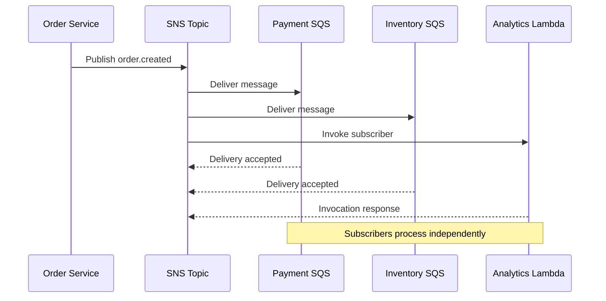
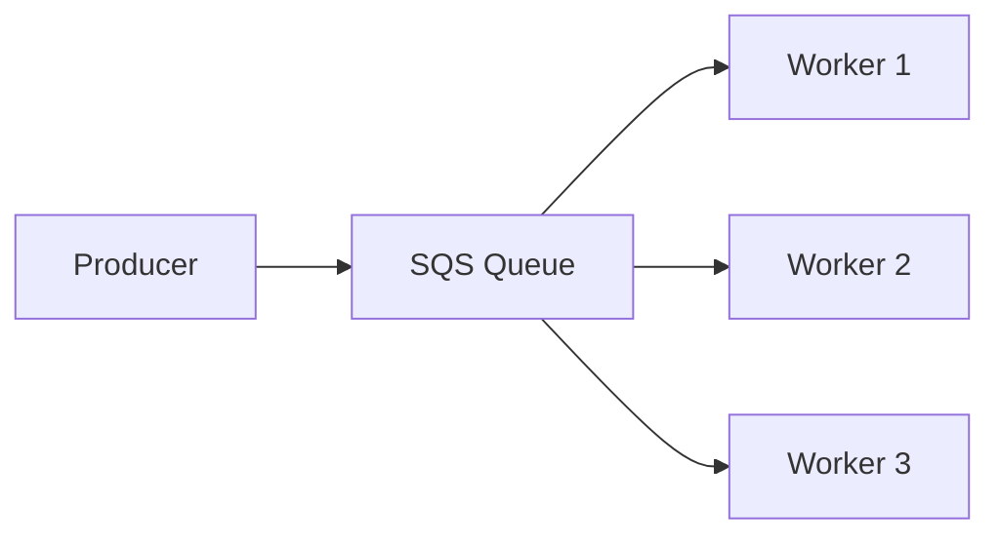
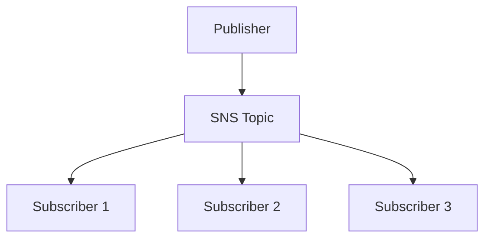
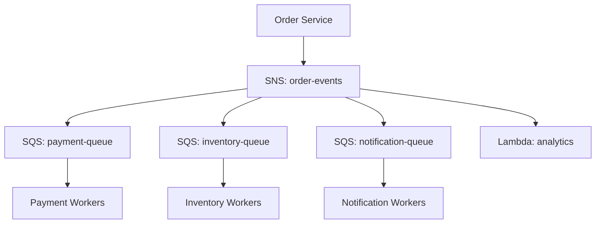
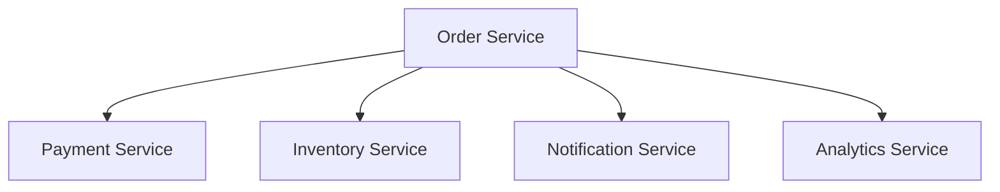
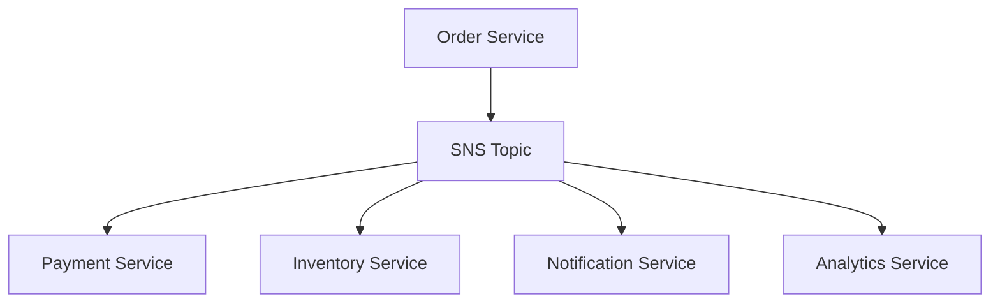
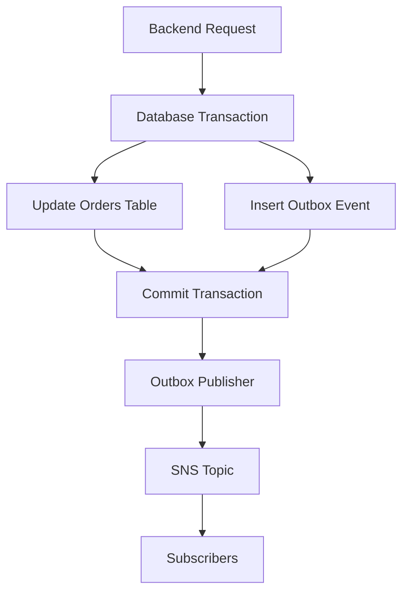

# 02- Publish-Subscribe Messaging Model

## Overview

The Publish-Subscribe (Pub/Sub) messaging model is an asynchronous communication pattern in which publishers send messages to a logical channel without directly knowing which consumers will receive them.

Amazon Simple Notification Service (SNS) implements this model through topics and subscriptions.

A publisher sends a message to an SNS topic. SNS distributes that message to eligible subscribers independently.

This model reduces direct dependencies between services and supports event-driven architectures where multiple systems react to the same business event.

Common use cases include:

- Broadcasting domain events across microservices.
- Distributing notifications to multiple systems.
- Triggering independent background processing workflows.
- Integrating AWS services with external applications.
- Building loosely coupled event-driven architectures.

## Core Components of the Pub/Sub Model

The Pub/Sub model consists of publishers, topics, messages, and subscribers.

### Publisher

A publisher is an application or service that produces and sends messages.

Publishers do not need to know:

- How many subscribers exist.
- Which services consume the message.
- Where subscribers are deployed.
- How subscribers process the message.
- Whether subscribers use Lambda, SQS, or HTTP endpoints.

For example, an order service publishes an `order.created` event after an order is created.

```python
import json
import boto3

sns = boto3.client("sns", region_name="ap-south-1")

TOPIC_ARN = (
    "arn:aws:sns:ap-south-1:123456789012:order-events"
)


def publish_order_created(order: dict) -> str:
    event = {
        "event_id": order["event_id"],
        "event_type": "order.created",
        "event_version": 1,
        "data": {
            "order_id": order["order_id"],
            "customer_id": order["customer_id"],
        },
    }

    response = sns.publish(
        TopicArn=TOPIC_ARN,
        Message=json.dumps(event),
    )

    return response["MessageId"]
```

The publisher only depends on the topic contract. It does not need to implement separate communication logic for payment, inventory, or notification services.

### Topic

A topic is a logical communication channel that receives published messages and distributes them to its subscriptions.

A topic provides an abstraction between publishers and subscribers.

For example:

```text
Topic: order-events

Subscribers:
    - Payment Service
    - Inventory Service
    - Notification Service
    - Analytics Service
```

The publisher sends one message to the topic. SNS handles distribution to eligible subscriptions.

Topics can be Standard or FIFO, depending on ordering and deduplication requirements.

### Message

A message is the data published to a topic.

A message should represent a meaningful event or notification rather than an arbitrary internal implementation detail.

Example:

```json
{
  "event_id": "evt-8f7d9a2c",
  "event_type": "order.created",
  "event_version": 1,
  "occurred_at": "2026-11-19T10:30:00Z",
  "data": {
    "order_id": "ORD-10042",
    "customer_id": "CUST-2001",
    "amount": 1499.00,
    "currency": "INR"
  }
}
```

Important message-design considerations:

- Include a stable business event ID.
- Include an event type.
- Version the event schema.
- Use consistent timestamp formats.
- Avoid unnecessary sensitive information.
- Keep payloads within SNS message-size limits.
- Prefer immutable event facts over mutable entity snapshots when appropriate.

The business event ID should remain stable across retries and replay operations.

### Subscriber

A subscriber is an endpoint that receives messages from a topic.

SNS supports multiple subscription protocols.

| Protocol | Subscriber | Typical use |
|---|---|---|
| Amazon SQS | Queue | Durable asynchronous processing |
| AWS Lambda | Function | Serverless event handling |
| HTTP/HTTPS | Web endpoint | External service integration |
| Email | Email address | Notifications |
| SMS | Mobile number | Text notifications |
| Application | Mobile push endpoint | Mobile application notifications |

Subscribers can process the same event independently using different technologies.

For example, the payment service can use SQS workers, while an analytics service can use Lambda.

## How the Publish-Subscribe Model Works

The Pub/Sub lifecycle separates event publication from event consumption.



The process is:

1. A publisher creates a message.
2. The publisher sends the message to an SNS topic.
3. SNS accepts the publication and returns a message ID.
4. SNS evaluates the topic's subscriptions.
5. Applicable subscription filter policies determine which subscriptions are eligible.
6. SNS attempts delivery to eligible endpoints.
7. Each subscriber processes the message according to its own execution model.

The publisher does not wait for every subscriber to finish its business processing.

A successful SNS publication confirms acceptance by SNS, not successful completion of downstream business operations.

## Point-to-Point Messaging vs Publish-Subscribe

Point-to-point messaging and publish-subscribe solve different communication problems.

### Point-to-Point Messaging

In point-to-point messaging, a producer sends a message to a queue.

Typically, one competing consumer receives and processes each message.



Workers compete for messages from the same queue.

This model is appropriate for:

- Background jobs.
- Task distribution.
- Work queues.
- Controlled asynchronous processing.

### Publish-Subscribe Messaging

In Pub/Sub, a publisher sends a message to a topic, and multiple independent subscribers receive their own deliveries.



This model is appropriate when multiple systems must independently react to the same event.

### Comparison

| Dimension | Point-to-point | Publish-subscribe |
|---|---|---|
| Communication | Producer to queue | Publisher to topic |
| Consumer model | Competing consumers | Independent subscribers |
| Message distribution | One consumer processes each delivery | Each eligible subscription receives a delivery |
| Decoupling | Producer decoupled from worker | Publisher decoupled from all subscribers |
| Scaling | Scale queue consumers | Scale each subscriber independently |
| Typical AWS service | SQS | SNS |

SNS and SQS are frequently combined to provide both independent fan-out and durable processing.

## SNS Fan-Out Architecture

Fan-out means distributing one published message to multiple independent destinations.

SNS supports fan-out by maintaining multiple subscriptions on a topic.

Consider an e-commerce application.

When an order is created, multiple systems need to react:

- Payment service initiates payment processing.
- Inventory service reserves stock.
- Notification service sends confirmation.
- Analytics service records the business event.

Without Pub/Sub, the order service would need direct integration with each downstream service.

With SNS, the order service publishes one event.



Each SQS queue provides independent buffering and processing.

If the notification service is temporarily unavailable, its queue can retain messages while payment and inventory processing continue independently.

### Why Use SNS with SQS?

SNS and SQS provide complementary capabilities.

| Responsibility | SNS | SQS |
|---|---|---|
| Message publication | Yes | Producers send directly to queues |
| Fan-out | Yes | Not inherently |
| Durable buffering | Not a general-purpose consumer queue | Yes |
| Competing consumers | No | Yes |
| Independent subscriber delivery | Yes, through separate subscriptions | One queue per independent subscriber |
| Consumer visibility timeout | No | Yes |
| Consumer-controlled deletion | No | Yes |

Use one SQS queue for each independent logical subscriber.

If payment and inventory workers share one queue, they compete for messages rather than each receiving a copy.

## Loose Coupling and Service Independence

One of the primary benefits of Pub/Sub is reduced coupling between services.

### Without Pub/Sub

A service may directly invoke several downstream services.



This introduces dependencies on:

- Downstream availability.
- Network latency.
- API contracts.
- Authentication mechanisms.
- Retry behavior.
- Service-specific error handling.

If one downstream service becomes unavailable, the publisher may need additional logic to handle that failure.

### With Pub/Sub



The publisher depends on the SNS topic contract rather than individual consumer implementations.

This improves service independence, but it does not eliminate all coupling.

Services still share:

- Event schemas.
- Business semantics.
- Topic availability.
- Delivery configuration.
- Security policies.

A stable event contract is therefore essential.

## Event-Driven Architecture

Pub/Sub is a common communication mechanism in event-driven microservice architectures.

Instead of requiring services to synchronously call each other, a service publishes an event describing something that happened.

For example:

```text
Order Service
    |
    | order.created
    v
SNS Topic
    |
    +--> Payment Service
    |
    +--> Inventory Service
    |
    +--> Notification Service
```

The event represents a business fact.

A useful distinction is:

- **Command:** Requests that another component perform an action.
- **Event:** Describes something that has already happened.

For example:

| Message | Type |
|---|---|
| `CreatePayment` | Command |
| `order.created` | Event |
| `ReserveInventory` | Command |
| `inventory.reserved` | Event |
| `order.shipped` | Event |

Avoid designing every message as a generic command. Event-driven systems are easier to evolve when events describe stable business facts.

## Subscription Filtering

SNS supports subscription filter policies.

A filter policy determines whether a message should be delivered to a particular subscription.

This is useful when a topic carries multiple event types or business categories.

For example, a topic may publish:

- `order.created`
- `order.cancelled`
- `order.shipped`

A notification service may only need `order.created` and `order.shipped`.

### Message Attribute Filtering

Publish a message with attributes:

```python
import json
import boto3

sns = boto3.client("sns", region_name="ap-south-1")

response = sns.publish(
    TopicArn=(
        "arn:aws:sns:ap-south-1:123456789012:order-events"
    ),
    Message=json.dumps({
        "event_id": "evt-123",
        "event_type": "order.created",
        "order_id": "ORD-10042",
    }),
    MessageAttributes={
        "event_type": {
            "DataType": "String",
            "StringValue": "order.created",
        },
        "region": {
            "DataType": "String",
            "StringValue": "IN",
        },
    },
)
```

A subscription filter policy can match the `event_type` attribute.

Example policy:

```json
{
  "event_type": [
    "order.created",
    "order.shipped"
  ]
}
```

### Message Body Filtering

SNS can also filter using message body attributes when the subscription is configured for `MessageBody` filtering.

Example:

```json
{
  "event_type": [
    "order.created"
  ],
  "data": {
    "region": [
      "IN"
    ]
  }
}
```

Filtering reduces unnecessary message delivery and downstream processing.

Filter policies are routing mechanisms, not security boundaries. Use IAM and resource policies to enforce access control.

## Message Contracts and Schema Evolution

In a distributed system, publishers and subscribers may deploy independently.

A producer can publish an event while some consumers are still running older application versions.

This creates a schema compatibility requirement.

### Recommended Event Structure

```json
{
  "event_id": "evt-8f7d9a2c",
  "event_type": "order.created",
  "event_version": 1,
  "occurred_at": "2026-11-19T10:30:00Z",
  "producer": "order-service",
  "data": {
    "order_id": "ORD-10042",
    "customer_id": "CUST-2001"
  }
}
```

Recommended fields:

| Field | Purpose |
|---|---|
| `event_id` | Stable business event identifier |
| `event_type` | Identifies the event |
| `event_version` | Defines the payload schema version |
| `occurred_at` | Records when the business event occurred |
| `producer` | Identifies the producing service |
| `data` | Contains event-specific information |

### Schema Evolution Practices

- Add optional fields when possible.
- Avoid removing fields consumers may depend on.
- Avoid changing existing field meanings.
- Version incompatible schema changes explicitly.
- Validate events before publication.
- Maintain consumer compatibility during rolling deployments.
- Document event ownership and lifecycle.

For larger event ecosystems, consider a centralized schema registry or contract-validation process.

## Reliability and Delivery Semantics

Pub/Sub systems must account for message delivery failures, retries, and duplicates.

### Duplicate Delivery

Standard SNS delivery can result in duplicate notifications for supported protocols.

Consumers should not assume that every event is delivered exactly once.

Use a stable event ID and an idempotency mechanism.

For example, PostgreSQL can enforce event uniqueness:

```sql
CREATE TABLE processed_events (
    event_id TEXT PRIMARY KEY,
    processed_at TIMESTAMPTZ NOT NULL DEFAULT NOW()
);
```

The consumer should register the event and apply its business changes in the same database transaction where possible.

### Ordering

Standard SNS topics provide best-effort ordering rather than strict ordering.

FIFO topics support ordering within message groups.

If order-dependent events are published to a FIFO topic, select a message group ID that represents the required ordering scope.

For example:

```python
response = sns.publish(
    TopicArn=FIFO_TOPIC_ARN,
    Message=json.dumps(event),
    MessageGroupId=event["data"]["order_id"],
    MessageDeduplicationId=event["event_id"],
)
```

FIFO topic names must end in `.fifo`.

Message group IDs define independent ordering groups. They also influence the available parallelism.

FIFO deduplication does not remove the need for idempotent business processing.

### Delivery Failure Handling

For critical workflows:

- Configure appropriate subscription delivery retry behavior.
- Use subscription-level DLQs where supported.
- Use SQS queues for durable buffering.
- Configure SQS consumer DLQs for repeated processing failures.
- Monitor delivery failures and queue age.
- Provide controlled replay and recovery procedures.

Do not confuse SNS delivery failures with downstream application processing failures. They occur at different boundaries.

## Transactional Outbox Pattern

A critical problem in event-driven systems is ensuring that a database transaction and message publication remain consistent.

Consider:

1. An order is committed to PostgreSQL.
2. The application attempts to publish `order.created`.
3. SNS publication fails.
4. The database contains the order, but downstream systems never receive the event.

A transactional outbox solves this by storing the event in the same database transaction as the business change.



Example table:

```sql
CREATE TABLE outbox_events (
    event_id UUID PRIMARY KEY,
    event_type TEXT NOT NULL,
    payload JSONB NOT NULL,
    created_at TIMESTAMPTZ NOT NULL DEFAULT NOW(),
    published_at TIMESTAMPTZ
);
```

The application writes both the order and the outbox event within one transaction.

A background publisher reads pending events, publishes them to SNS, and marks them as published after successful publication.

The publisher must tolerate crashes between SNS publication and updating the outbox row. This can cause duplicate publication, so consumers must remain idempotent.

## Backpressure and Consumer Isolation

Pub/Sub separates publishers from subscribers, but it does not automatically guarantee that downstream systems can process messages at the rate they arrive.

A slow consumer can accumulate backlog when using SQS subscriptions.

For example:

```text
SNS Topic
    |
    +--> Payment Queue: 100 messages
    |
    +--> Inventory Queue: 10 messages
    |
    +--> Notification Queue: 50,000 messages
```

Each subscriber has an independent backlog.

This isolation is valuable because notification processing delays do not inherently block payment or inventory queue processing.

Production systems should monitor:

- Queue depth.
- Age of oldest message.
- Consumer throughput.
- Processing errors.
- Worker concurrency.
- Downstream API latency.
- Database connection utilization.

Scale consumers according to backlog and downstream capacity rather than simply increasing worker concurrency.

## Security Considerations

Pub/Sub introduces multiple communication boundaries that require explicit authorization.

### Topic Access

Use IAM policies to control:

- Which principals can publish.
- Which principals can subscribe.
- Which roles can modify topic attributes.
- Which administrators can manage subscriptions.

### SNS-to-SQS Permissions

The SQS queue policy must allow SNS to send messages.

Restrict the permission to the expected topic ARN using `aws:SourceArn`.

Do not use unrestricted queue policies that allow arbitrary SNS topics to publish.

### Data Protection

- Encrypt topics and queues where required.
- Use TLS for network communication.
- Avoid placing secrets in event payloads.
- Apply data minimization.
- Restrict access to sensitive event types.
- Audit subscription changes.
- Use separate topics or access policies for different trust boundaries.

Subscription filtering must not be treated as authorization. A filter policy controls delivery selection, not access to the underlying data.

## Monitoring and Observability

A production Pub/Sub system requires visibility across the complete event lifecycle.

Monitor SNS metrics:

| Metric | Purpose |
|---|---|
| `NumberOfMessagesPublished` | Publication volume |
| `NumberOfNotificationsDelivered` | Successful delivery count |
| `NumberOfNotificationsFailed` | Delivery failures |
| `NumberOfNotificationsFilteredOut` | Messages excluded by filtering |

For SNS-to-SQS architectures, also monitor:

- `ApproximateNumberOfMessagesVisible`.
- `ApproximateAgeOfOldestMessage`.
- DLQ message count.
- Consumer processing failures.
- Processing latency.

Use structured logs and distributed correlation identifiers.

A useful event trace should connect:

```text
Business Event ID
    |
    v
SNS Message ID
    |
    v
SQS Message ID
    |
    v
Consumer Processing
    |
    v
Database Transaction
```

The business event ID should be propagated across service boundaries so that duplicate processing and failures can be investigated.

## Common Mistakes and Production Pitfalls

### Treating Pub/Sub as Point-to-Point Messaging

A topic distributes messages to independent subscriptions. It does not behave like a shared work queue.

**Avoidance:** Use SQS directly for competing consumers and SNS with separate SQS queues for independent fan-out.

### Assuming Publication Means Processing Completion

SNS accepting a message does not mean every subscriber completed its business operation.

**Avoidance:** Monitor delivery and consumer processing separately.

### Assuming Exactly-Once Delivery

Duplicates can occur, and FIFO deduplication does not guarantee exactly-once business side effects.

**Avoidance:** Use stable event IDs and idempotent consumers.

### Publishing Events Before Database Commit

A published event can describe a database change that later rolls back.

**Avoidance:** Use the transactional outbox pattern for critical domain events.

### Creating a Shared Queue for Independent Subscribers

Subscribers sharing one SQS queue compete for messages.

**Avoidance:** Use one queue per independent subscriber when each must receive every event.

### Using Filter Policies as Security Controls

Filter policies control routing, not authorization.

**Avoidance:** Enforce access through IAM, topic policies, queue policies, and application-level authorization.

### Ignoring Schema Evolution

A producer can deploy a new event format while consumers still expect an older schema.

**Avoidance:** Version event contracts and preserve backward compatibility.

### Ignoring Downstream Backlogs

A successful SNS publication does not guarantee that subscribers can process messages at the same rate.

**Avoidance:** Use SQS buffering, monitor queue age, and scale consumers according to downstream capacity.

## Production Best Practices

- Use SNS topics to distribute business events to independent subscribers.
- Keep publishers unaware of subscriber implementation details.
- Use one SQS queue per independent subscriber when durable buffering is required.
- Design stable, versioned event contracts.
- Include a business event ID for idempotency and traceability.
- Use the transactional outbox pattern for critical database-backed events.
- Select Standard or FIFO topics according to ordering requirements.
- Use message group IDs that match the required ordering scope.
- Apply subscription filters to reduce unnecessary delivery.
- Treat delivery and business processing as separate reliability boundaries.
- Configure DLQs and retries for the appropriate failure boundary.
- Apply least-privilege IAM and resource policies.
- Monitor publication, delivery, queue backlog, and consumer processing independently.

## Key Takeaways

- Publish-subscribe separates event producers from independent consumers through topics and subscriptions.
- SNS provides fan-out, while SQS provides durable buffering and competing-consumer processing.
- Each subscriber should have independent failure handling, scaling, and observability where required.
- Duplicate delivery and ordering limitations require stable event IDs, idempotent consumers, and appropriate FIFO design.
- Production Pub/Sub systems need explicit event contracts, transactional publication, security boundaries, and end-to-end monitoring.