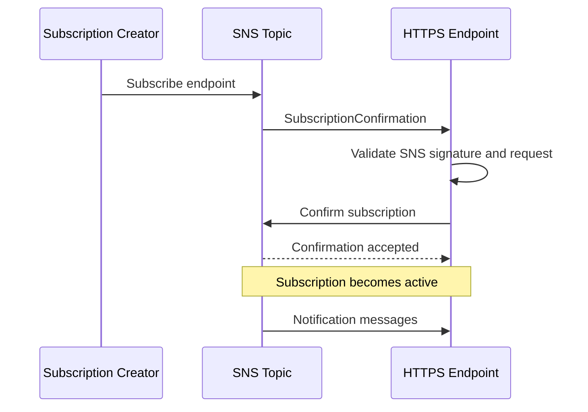
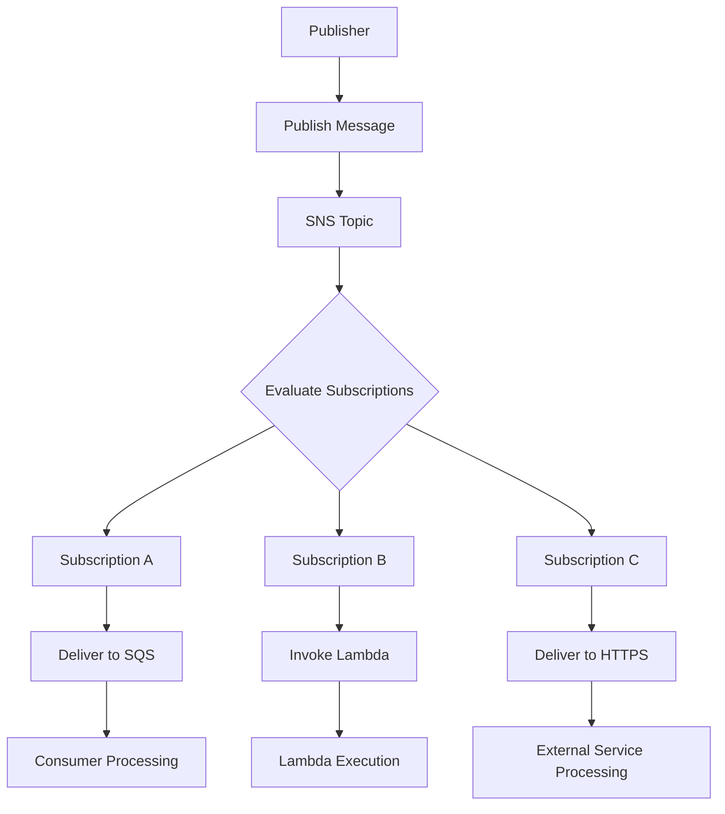
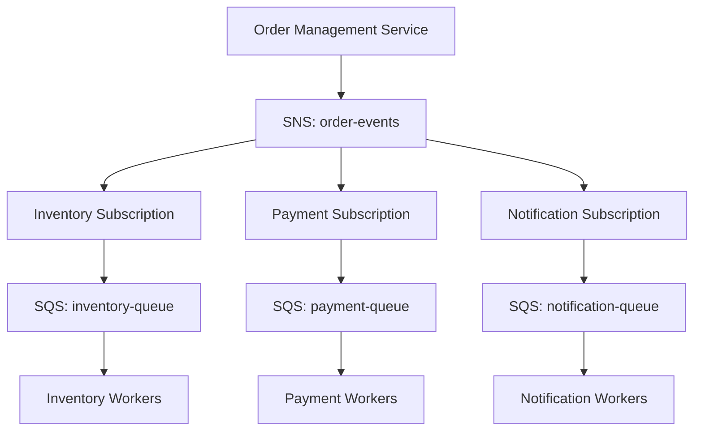
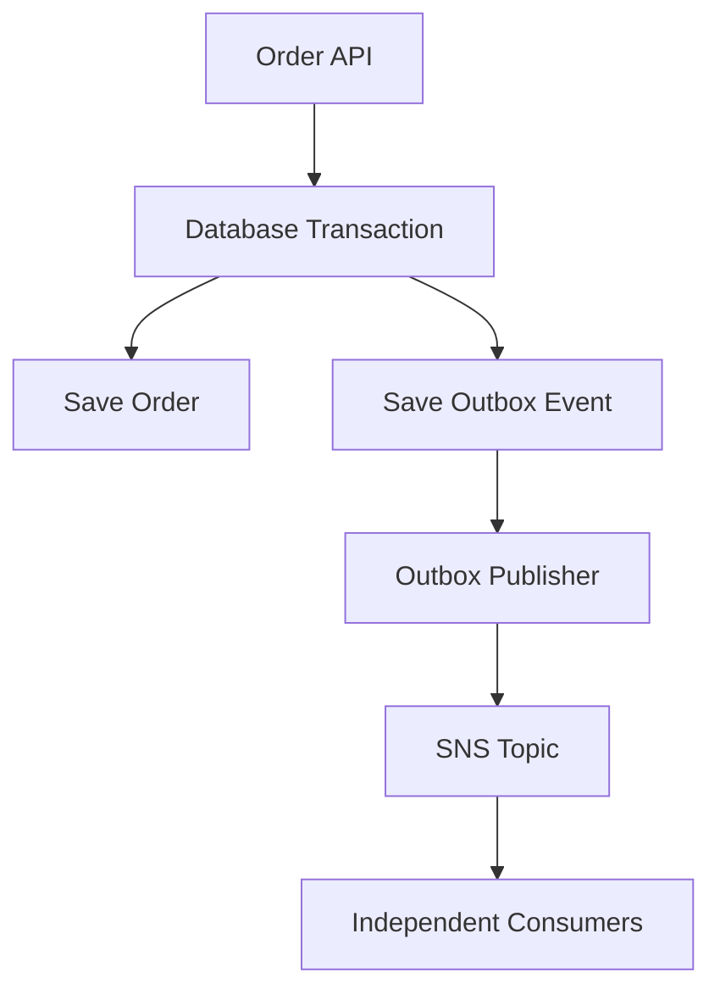

# 03- Topics and Subscriptions

## Overview

Amazon Simple Notification Service (SNS) uses topics and subscriptions to implement a publish-subscribe messaging model. A topic acts as a logical communication channel: publishers send messages to it, and SNS routes those messages to its subscribed endpoints.

Topics and subscriptions separate event producers from consumers. Producers do not need to know which services consume their events, while consumers can independently subscribe, process messages, and scale.

In production systems, this model is commonly used for:

- Broadcasting domain events across microservices.
- Sending notifications to multiple downstream systems.
- Triggering asynchronous processing through Lambda.
- Distributing events to independent SQS queues.
- Sending operational alerts through email, SMS, or HTTP endpoints.
- Building event-driven architectures with loosely coupled components.

Understanding topics and subscriptions is essential because topic configuration determines message routing, delivery behavior, access boundaries, and failure handling.

## SNS Topics

### What Is a Topic?

An SNS topic is a named logical resource that receives published messages and distributes them to its subscriptions.

A topic provides an abstraction between publishers and subscribers. Publishers send messages to the topic ARN rather than directly invoking individual consumers.

For example, an order management service can publish an `OrderCreated` event to an SNS topic. Multiple downstream services can independently subscribe:

- Inventory service.
- Payment service.
- Analytics pipeline.
- Customer notification service.

The publisher remains unaware of these consumers.

### Topic ARN

Every SNS topic has an Amazon Resource Name (ARN), which uniquely identifies the topic.

General format:

```text
arn:aws:sns:<region>:<account-id>:<topic-name>
```

Example:

```text
arn:aws:sns:ap-south-1:123456789012:order-events
```

The ARN is used when:

- Publishing messages.
- Creating subscriptions.
- Configuring IAM permissions.
- Defining topic access policies.
- Configuring AWS service integrations.
- Referencing the topic in infrastructure as code.

### Topic Types

SNS supports Standard and FIFO topics.

| Feature | Standard Topic | FIFO Topic |
|---|---|---|
| Message ordering | Best-effort | Ordered within a message group |
| Delivery | At-least-once for supported protocols | At-least-once delivery; FIFO semantics depend on the integration |
| Deduplication | No topic-level FIFO deduplication | Supports deduplication |
| Throughput | High, scalable throughput | Throughput depends on FIFO configuration and message groups |
| Message groups | Not supported | Supported |
| Typical use case | Notifications and event fan-out | Workflows requiring ordered message processing |
| Topic name | Ordinary topic name | Must end with `.fifo` |

Choose the topic type based on business requirements rather than assuming FIFO is universally more reliable.

Standard topics are appropriate for most event-broadcasting workloads. FIFO topics are useful when ordering and deduplication at the messaging layer are important.

FIFO does not eliminate the need for idempotent consumers or guarantee exactly-once business processing.

### Creating a Standard Topic

Using AWS CLI:

```bash
aws sns create-topic \
    --name order-events \
    --region ap-south-1
```

Example response:

```json
{
  "TopicArn": "arn:aws:sns:ap-south-1:123456789012:order-events"
}
```

The returned ARN should be stored in application configuration or infrastructure outputs rather than hardcoded throughout the codebase.

### Creating a FIFO Topic

```bash
aws sns create-topic \
    --name order-events.fifo \
    --attributes \
        FifoTopic=true,\
        ContentBasedDeduplication=true \
    --region ap-south-1
```

Important considerations:

- FIFO topic names must end with `.fifo`.
- `FifoTopic` must be enabled.
- Content-based deduplication can generate deduplication identifiers from message content.
- Alternatively, publishers can provide explicit deduplication identifiers.
- Message group IDs determine ordering boundaries.

For business-critical events, explicit deduplication identifiers are generally preferable because they make the deduplication contract visible and independent of message serialization details.

## Topic Attributes and Configuration

SNS topics expose attributes that control their behavior.

Some attributes are common to both topic types, while others apply specifically to FIFO topics.

| Attribute | Purpose | Engineering consideration |
|---|---|---|
| `DisplayName` | Human-readable display name | Primarily relevant to SMS and email-related presentation |
| `Policy` | Resource-based access policy | Restrict publishing and subscription management |
| `DeliveryPolicy` | Delivery retry configuration for supported HTTP/S delivery | Configure retries according to endpoint reliability |
| `KmsMasterKeyId` | Encryption key configuration | Use customer-managed KMS keys when required |
| `FifoTopic` | Enables FIFO behavior | Required for FIFO topics |
| `ContentBasedDeduplication` | Enables content-based deduplication | Applies to FIFO topics |
| `ArchivePolicy` | Configures FIFO message archiving | Useful when supported replay capabilities are required |

Retrieve topic attributes:

```bash
aws sns get-topic-attributes \
    --topic-arn arn:aws:sns:ap-south-1:123456789012:order-events \
    --region ap-south-1
```

Update a topic attribute:

```bash
aws sns set-topic-attributes \
    --topic-arn arn:aws:sns:ap-south-1:123456789012:order-events \
    --attribute-name DisplayName \
    --attribute-value OrderEvents
```

Topic configuration should be managed through infrastructure as code wherever possible. Manual changes create configuration drift and make environments harder to reproduce.

## SNS Subscriptions

### What Is a Subscription?

A subscription connects an endpoint to an SNS topic.

It defines where SNS delivers messages published to the topic.

A topic can have multiple subscriptions, and each subscription represents an independent delivery relationship.

For example:

```text
order-events
    |
    +---- SQS: inventory-queue
    |
    +---- SQS: payment-queue
    |
    +---- Lambda: notification-handler
    |
    +---- HTTPS: analytics-service
```

When a publisher sends a message to `order-events`, SNS evaluates the subscriptions and attempts delivery to the eligible endpoints.

### Why Subscriptions Exist

Subscriptions provide independent message delivery without requiring publishers to maintain consumer lists.

They allow:

- New consumers to be added without changing publisher code.
- Existing consumers to be removed independently.
- Different services to process the same event.
- Delivery protocols to vary between consumers.
- Message filtering to be configured per subscription.
- Delivery failures to be handled independently.

This is particularly useful in microservice architectures where services evolve independently.

### Supported Subscription Protocols

SNS supports multiple subscription endpoint types.

| Protocol | Endpoint | Typical use case |
|---|---|---|
| `sqs` | Amazon SQS queue ARN | Durable asynchronous processing |
| `lambda` | Lambda function ARN | Event-triggered execution |
| `https` | HTTPS endpoint | External service integration |
| `http` | HTTP endpoint | Non-production or controlled integrations |
| `email` | Email address | Human notifications |
| `email-json` | Email address | Structured email notifications |
| `sms` | Phone number | Text message notifications |
| `application` | Mobile push application endpoint | Mobile push notifications |
| `firehose` | Kinesis Data Firehose delivery stream ARN | Streaming delivery to supported destinations |

The protocol determines how SNS communicates with the endpoint and which delivery semantics and configuration options are available.

For backend workloads, SQS subscriptions are often preferred because they provide durable buffering and decouple message delivery from consumer execution.

## Creating Subscriptions

### Subscribe an SQS Queue

First, create an SQS queue:

```bash
aws sqs create-queue \
    --queue-name inventory-queue \
    --region ap-south-1
```

Retrieve its ARN:

```bash
aws sqs get-queue-attributes \
    --queue-url https://sqs.ap-south-1.amazonaws.com/123456789012/inventory-queue \
    --attribute-names QueueArn \
    --region ap-south-1
```

Subscribe the queue to the SNS topic:

```bash
aws sns subscribe \
    --topic-arn arn:aws:sns:ap-south-1:123456789012:order-events \
    --protocol sqs \
    --notification-endpoint arn:aws:sqs:ap-south-1:123456789012:inventory-queue \
    --region ap-south-1
```

SNS can now deliver eligible topic messages to the queue, provided the queue policy allows the SNS topic to send messages.

### Subscribe a Lambda Function

Create or deploy the Lambda function and obtain its ARN.

Create the subscription:

```bash
aws sns subscribe \
    --topic-arn arn:aws:sns:ap-south-1:123456789012:order-events \
    --protocol lambda \
    --notification-endpoint arn:aws:lambda:ap-south-1:123456789012:function:order-notification-handler \
    --region ap-south-1
```

The Lambda function also needs a resource-based permission allowing SNS to invoke it.

```bash
aws lambda add-permission \
    --function-name order-notification-handler \
    --statement-id AllowSNSTrigger \
    --action lambda:InvokeFunction \
    --principal sns.amazonaws.com \
    --source-arn arn:aws:sns:ap-south-1:123456789012:order-events \
    --region ap-south-1
```

The permission should restrict the invoking SNS topic through `SourceArn`. Avoid granting unrestricted invocation permissions.

### Subscribe an HTTPS Endpoint

```bash
aws sns subscribe \
    --topic-arn arn:aws:sns:ap-south-1:123456789012:order-events \
    --protocol https \
    --notification-endpoint https://api.example.com/events/sns \
    --region ap-south-1
```

For HTTP/S subscriptions, SNS normally sends a subscription confirmation request to the endpoint.

The endpoint must process the confirmation request before SNS can deliver notifications.

A production endpoint should:

- Validate SNS message signatures.
- Handle subscription confirmation securely.
- Process notification requests asynchronously where appropriate.
- Return successful HTTP responses only after safely accepting the message.
- Avoid performing long-running business operations inside the request handler.
- Implement idempotency because notifications can be delivered more than once.

Never trust an incoming request merely because it claims to originate from SNS.

## Subscription Confirmation Lifecycle

Some subscription protocols require explicit endpoint confirmation.

For HTTP/S, the lifecycle is:

1. A subscription is created.
2. SNS sends a confirmation message to the endpoint.
3. The endpoint validates the confirmation request.
4. The endpoint follows the confirmation URL or otherwise confirms the subscription.
5. SNS activates the subscription.
6. SNS begins delivering notifications.



The confirmation request should be validated before following its confirmation URL. Otherwise, an attacker could potentially abuse an endpoint to subscribe it to arbitrary topics.

For subscriptions created through the AWS console or AWS CLI, inspect the returned subscription ARN and confirmation status where applicable.

List subscriptions:

```bash
aws sns list-subscriptions-by-topic \
    --topic-arn arn:aws:sns:ap-south-1:123456789012:order-events \
    --region ap-south-1
```

An unconfirmed subscription can appear with a pending confirmation status rather than an active subscription ARN.

## Subscription ARN

Each confirmed subscription has its own ARN.

General format:

```text
arn:aws:sns:<region>:<account-id>:<topic-name>:<subscription-id>
```

The subscription ARN identifies a specific topic-to-endpoint relationship.

It is used when:

- Updating subscription attributes.
- Configuring message filtering.
- Configuring raw message delivery.
- Setting delivery retry policies.
- Unsubscribing an endpoint.
- Inspecting subscription configuration.

A topic ARN and subscription ARN are different resources and should not be used interchangeably.

## Subscription Attributes

Subscription attributes configure behavior for an individual subscription.

This is important because two consumers of the same topic may require different delivery behavior.

Common subscription attributes include:

| Attribute | Purpose |
|---|---|
| `FilterPolicy` | Filters messages based on message attributes or message body |
| `FilterPolicyScope` | Determines whether filtering uses message attributes or the message body |
| `RawMessageDelivery` | Controls whether SNS metadata is included in supported endpoint payloads |
| `DeliveryPolicy` | Configures retry behavior for supported HTTP/S endpoints |
| `RedrivePolicy` | Configures a subscription dead-letter queue where supported |
| `SubscriptionRoleArn` | IAM role used for supported delivery integrations, such as Firehose |

Inspect subscription attributes:

```bash
aws sns get-subscription-attributes \
    --subscription-arn arn:aws:sns:ap-south-1:123456789012:order-events:subscription-id \
    --region ap-south-1
```

Update an attribute:

```bash
aws sns set-subscription-attributes \
    --subscription-arn arn:aws:sns:ap-south-1:123456789012:order-events:subscription-id \
    --attribute-name RawMessageDelivery \
    --attribute-value true \
    --region ap-south-1
```

Subscription-level configuration should be documented and version-controlled alongside the topic definition.

## Message Routing and Delivery Lifecycle

SNS performs routing based on the topic's subscriptions and their configured filter policies.

A simplified delivery lifecycle:



The important distinction is that SNS delivery and consumer processing are separate operations.

For example, when SNS successfully delivers a message to SQS, that does not mean the inventory service has processed the order. It means the message has been accepted by the queue.

Similarly, successful delivery to a Lambda integration does not establish that every downstream business operation completed successfully.

### Delivery Behavior by Endpoint

| Endpoint | Delivery behavior | Operational concern |
|---|---|---|
| SQS | SNS sends a message to the queue | Queue permissions, queue retention, consumer failures |
| Lambda | SNS invokes the function | Function errors, retries, concurrency, asynchronous failure handling |
| HTTP/S | SNS sends an HTTP request | Endpoint availability, response codes, retry policy |
| Email | SNS sends an email notification | Delivery limitations and recipient management |
| SMS | SNS sends an SMS notification | Regional availability, spending limits, delivery cost |
| Firehose | SNS delivers to the configured Firehose integration | IAM role and downstream delivery configuration |

Delivery guarantees and retry behavior vary by protocol. Do not assume every endpoint has identical retry semantics.

## Raw Message Delivery

By default, SNS wraps a published message in a notification envelope containing metadata.

A typical SNS notification delivered to an SQS queue without raw message delivery resembles:

```json
{
  "Type": "Notification",
  "MessageId": "example-message-id",
  "TopicArn": "arn:aws:sns:ap-south-1:123456789012:order-events",
  "Subject": "Order created",
  "Message": "{\"event_id\":\"evt-1001\",\"event_type\":\"OrderCreated\"}",
  "Timestamp": "2026-11-19T10:00:00.000Z"
}
```

The business event is inside the `Message` field.

When raw message delivery is enabled for a supported subscription, SNS removes the standard notification envelope and delivers the message payload directly.

Enable raw message delivery:

```bash
aws sns set-subscription-attributes \
    --subscription-arn arn:aws:sns:ap-south-1:123456789012:order-events:subscription-id \
    --attribute-name RawMessageDelivery \
    --attribute-value true
```

### When to Use Raw Message Delivery

Use raw delivery when:

- Consumers should receive the original event payload directly.
- The SNS envelope is unnecessary for the consumer.
- Existing message-processing infrastructure expects a specific payload structure.
- Reducing payload parsing complexity is useful.

Avoid enabling it without considering the consumer contract.

Without the envelope, consumers lose convenient access to SNS notification metadata such as the topic ARN and SNS message ID unless that information is included separately in the application event.

Raw message delivery is protocol-dependent and should be verified against the selected endpoint.

## Message Filtering

A topic can have multiple subscriptions, but not every consumer necessarily needs every message.

SNS subscription filter policies allow selective delivery.

For example, an order topic may publish:

- `OrderCreated`
- `OrderCancelled`
- `OrderRefunded`
- `OrderShipped`

The inventory service may need only order creation and cancellation events, while the notification service may need shipping and refund events.

Filter policies are configured on subscriptions rather than publishers.

### Filtering by Message Attributes

Suppose a publisher sends the following message attributes:

```json
{
  "event_type": {
    "DataType": "String",
    "StringValue": "OrderCreated"
  },
  "environment": {
    "DataType": "String",
    "StringValue": "production"
  }
}
```

A subscription filter policy can select only production order creation events:

```json
{
  "event_type": ["OrderCreated"],
  "environment": ["production"]
}
```

Create the policy in a JSON file named `filter-policy.json` and apply it:

```bash
aws sns set-subscription-attributes \
    --subscription-arn arn:aws:sns:ap-south-1:123456789012:order-events:subscription-id \
    --attribute-name FilterPolicy \
    --attribute-value file://filter-policy.json \
    --region ap-south-1
```

### Filtering by Message Body

SNS also supports filtering based on message body properties when the subscription uses the appropriate filter policy scope.

Set the scope:

```bash
aws sns set-subscription-attributes \
    --subscription-arn arn:aws:sns:ap-south-1:123456789012:order-events:subscription-id \
    --attribute-name FilterPolicyScope \
    --attribute-value MessageBody \
    --region ap-south-1
```

Example message:

```json
{
  "event_id": "evt-1001",
  "event_type": "OrderCreated",
  "order": {
    "region": "ap-south-1",
    "priority": "high"
  }
}
```

Example filter policy:

```json
{
  "event_type": ["OrderCreated"],
  "order": {
    "priority": ["high"]
  }
}
```

Message-body filtering requires a valid JSON message body.

### Filter Policy Operators

SNS supports several filtering operators, including:

| Operator | Purpose | Example |
|---|---|---|
| Exact matching | Match a specific value | `["OrderCreated"]` |
| `anything-but` | Exclude specified values | `{"anything-but": ["test"]}` |
| `prefix` | Match values beginning with a prefix | `{"prefix": "Order"}` |
| `numeric` | Match numeric ranges or comparisons | `{"numeric": [">=", 100]}` |
| `exists` | Match whether a property exists | `{"exists": true}` |
| `equals-ignore-case` | Match strings without case sensitivity | `{"equals-ignore-case": "production"}` |

Filter policy complexity should remain manageable. Deeply nested or overly broad policies make message routing harder to reason about and troubleshoot.

### Filtering Considerations

- A message that does not match a subscription filter policy is not delivered to that subscription.
- Filtering does not prevent the publisher from publishing the message.
- Filtering is not an authorization mechanism.
- A filter policy should not be used to protect sensitive data from unauthorized consumers.
- Changes to filter policies may take time to become fully effective.
- Validate policies using representative messages before production deployment.
- Monitor filtered-out message metrics to detect unexpected routing behavior.

A filter policy controls delivery, not whether a consumer is authorized to access the topic.

## Python Integration with Boto3

A backend service can publish messages to SNS using the AWS SDK for Python.

### Publish an Event

```python
import json
import os
from datetime import datetime, timezone

import boto3

sns = boto3.client(
    "sns",
    region_name=os.getenv("AWS_REGION", "ap-south-1"),
)

SNS_TOPIC_ARN = os.environ["SNS_TOPIC_ARN"]


def publish_order_created(order_id: str, customer_id: str) -> str:
    event = {
        "event_id": f"order-created-{order_id}",
        "event_type": "OrderCreated",
        "event_version": 1,
        "occurred_at": datetime.now(timezone.utc).isoformat(),
        "data": {
            "order_id": order_id,
            "customer_id": customer_id,
        },
    }

    response = sns.publish(
        TopicArn=SNS_TOPIC_ARN,
        Message=json.dumps(event),
        MessageAttributes={
            "event_type": {
                "DataType": "String",
                "StringValue": "OrderCreated",
            },
        },
    )

    return response["MessageId"]
```

The returned `MessageId` identifies the SNS publication. It should not be treated as the application's business event ID.

### Publishing FIFO Messages

FIFO topics require message group and deduplication information.

```python
import json
import os

import boto3

sns = boto3.client(
    "sns",
    region_name=os.getenv("AWS_REGION", "ap-south-1"),
)

FIFO_TOPIC_ARN = os.environ["SNS_FIFO_TOPIC_ARN"]


def publish_order_event(
    order_id: str,
    event_id: str,
    event: dict,
) -> str:
    response = sns.publish(
        TopicArn=FIFO_TOPIC_ARN,
        Message=json.dumps(event),
        MessageGroupId=f"order-{order_id}",
        MessageDeduplicationId=event_id,
    )

    return response["MessageId"]
```

Using the order ID as the message group ID ensures that events for the same order share an ordering group.

Different orders can be processed independently.

The event ID provides a stable deduplication identifier for the configured FIFO deduplication interval.

### Application Configuration

Keep topic ARNs outside source code:

```bash
AWS_REGION=ap-south-1
SNS_TOPIC_ARN=arn:aws:sns:ap-south-1:123456789012:order-events
SNS_FIFO_TOPIC_ARN=arn:aws:sns:ap-south-1:123456789012:order-events.fifo
```

In production:

- Use IAM roles instead of long-lived access keys.
- Inject configuration through the deployment environment.
- Avoid logging sensitive message payloads.
- Use structured logging with event IDs.
- Configure timeouts and retry behavior deliberately.
- Handle SDK exceptions and publication failures.

## SNS Topic and Subscription Security

SNS uses IAM identity policies and resource-based topic policies to control access.

A production design should distinguish between:

- Who can publish messages.
- Who can subscribe endpoints.
- Who can modify topic configuration.
- Which AWS services can deliver to subscribed endpoints.
- Which principals can unsubscribe or delete resources.

### Topic Access Policy

A topic access policy can restrict publishing to a specific IAM role.

Example:

```json
{
  "Version": "2012-10-17",
  "Statement": [
    {
      "Sid": "AllowOrderServicePublishing",
      "Effect": "Allow",
      "Principal": {
        "AWS": "arn:aws:iam::123456789012:role/order-service-role"
      },
      "Action": "sns:Publish",
      "Resource": "arn:aws:sns:ap-south-1:123456789012:order-events"
    }
  ]
}
```

Apply the policy:

```bash
aws sns set-topic-attributes \
    --topic-arn arn:aws:sns:ap-south-1:123456789012:order-events \
    --attribute-name Policy \
    --attribute-value file://topic-policy.json \
    --region ap-south-1
```

A resource policy should grant only the required actions to the intended principals.

### SQS Queue Policy for SNS Delivery

When SNS publishes to an SQS subscription, the queue policy must permit the SNS service principal to send messages.

Example queue policy:

```json
{
  "Version": "2012-10-17",
  "Statement": [
    {
      "Sid": "AllowSpecificSNSTopic",
      "Effect": "Allow",
      "Principal": {
        "Service": "sns.amazonaws.com"
      },
      "Action": "sqs:SendMessage",
      "Resource": "arn:aws:sqs:ap-south-1:123456789012:inventory-queue",
      "Condition": {
        "ArnEquals": {
          "aws:SourceArn": "arn:aws:sns:ap-south-1:123456789012:order-events"
        }
      }
    }
  ]
}
```

The `aws:SourceArn` condition prevents unrelated SNS topics from using the queue permission.

For cross-account integrations, verify both sides of the authorization relationship:

- The publisher or subscribing principal must have the required identity permissions.
- The destination resource policy must allow the intended cross-account access.
- Any required KMS key policy must also permit the relevant principals.

### Encryption

SNS supports encryption at rest using AWS Key Management Service (KMS).

Example:

```bash
aws sns set-topic-attributes \
    --topic-arn arn:aws:sns:ap-south-1:123456789012:order-events \
    --attribute-name KmsMasterKeyId \
    --attribute-value alias/aws/sns \
    --region ap-south-1
```

For customer-managed keys, configure the KMS key policy and permissions for the relevant publishers and delivery integrations.

Encryption at rest does not replace transport security, authorization, or application-level data protection.

## Infrastructure as Code with Terraform

Topics and subscriptions should be managed through Terraform or another infrastructure-as-code tool.

This makes the messaging architecture reproducible across development, staging, and production environments.

### Standard Topic

```hcl
resource "aws_sns_topic" "order_events" {
  name = "order-events"

  kms_master_key_id = "alias/aws/sns"

  tags = {
    Environment = "production"
    Service     = "order-management"
  }
}
```

### SQS Queue

```hcl
resource "aws_sqs_queue" "inventory_queue" {
  name                      = "inventory-queue"
  message_retention_seconds = 345600
  visibility_timeout_seconds = 60

  tags = {
    Environment = "production"
    Service     = "inventory"
  }
}
```

### Queue Policy

```hcl
data "aws_iam_policy_document" "inventory_queue_policy" {
  statement {
    sid    = "AllowOrderEventsTopic"
    effect = "Allow"

    principals {
      type        = "Service"
      identifiers = ["sns.amazonaws.com"]
    }

    actions = ["sqs:SendMessage"]

    resources = [aws_sqs_queue.inventory_queue.arn]

    condition {
      test     = "ArnEquals"
      variable = "aws:SourceArn"
      values   = [aws_sns_topic.order_events.arn]
    }
  }
}

resource "aws_sqs_queue_policy" "inventory_queue_policy" {
  queue_url = aws_sqs_queue.inventory_queue.id
  policy    = data.aws_iam_policy_document.inventory_queue_policy.json
}
```

### SNS Subscription

```hcl
resource "aws_sns_topic_subscription" "inventory_subscription" {
  topic_arn = aws_sns_topic.order_events.arn
  protocol  = "sqs"
  endpoint  = aws_sqs_queue.inventory_queue.arn

  raw_message_delivery = true

  depends_on = [
    aws_sqs_queue_policy.inventory_queue_policy
  ]
}
```

The explicit dependency ensures the queue policy is applied before Terraform creates the subscription.

### Filter Policy

```hcl
resource "aws_sns_topic_subscription" "inventory_subscription" {
  topic_arn = aws_sns_topic.order_events.arn
  protocol  = "sqs"
  endpoint  = aws_sqs_queue.inventory_queue.arn

  raw_message_delivery = true

  filter_policy_scope = "MessageAttributes"

  filter_policy = jsonencode({
    event_type = [
      "OrderCreated",
      "OrderCancelled"
    ]
  })

  depends_on = [
    aws_sqs_queue_policy.inventory_queue_policy
  ]
}
```

In a real Terraform configuration, define only one resource block for a given subscription. The filter policy and other attributes should be incorporated into the same subscription resource.

### Outputs

```hcl
output "order_events_topic_arn" {
  description = "SNS topic ARN for order events"
  value       = aws_sns_topic.order_events.arn
}

output "inventory_queue_url" {
  description = "SQS queue URL for inventory processing"
  value       = aws_sqs_queue.inventory_queue.url
}
```

Infrastructure deployment should also include validation of:

- Topic type and naming.
- Subscription endpoint configuration.
- Queue resource policies.
- KMS permissions.
- Filter policies.
- Dead-letter queue configuration.
- Environment-specific topic ARNs.

## Managing Subscriptions

### List Topic Subscriptions

```bash
aws sns list-subscriptions-by-topic \
    --topic-arn arn:aws:sns:ap-south-1:123456789012:order-events \
    --region ap-south-1
```

### Unsubscribe an Endpoint

```bash
aws sns unsubscribe \
    --subscription-arn arn:aws:sns:ap-south-1:123456789012:order-events:subscription-id \
    --region ap-south-1
```

Unsubscribing removes the subscription relationship. It does not delete the topic or the endpoint resource.

### Delete a Topic

```bash
aws sns delete-topic \
    --topic-arn arn:aws:sns:ap-south-1:123456789012:order-events \
    --region ap-south-1
```

Deleting a topic also removes its subscriptions.

Before deleting a production topic:

- Verify that no active publishers depend on it.
- Identify all subscribed consumers.
- Check infrastructure dependencies.
- Confirm whether messages are still being published.
- Coordinate deployment changes across dependent services.

Deleting a topic is a destructive operation and should be protected by deployment controls.

## Production Architecture: Multiple Independent Consumers

Consider an order management platform with three downstream services:

- Inventory service reserves stock.
- Payment service processes payment.
- Notification service sends customer updates.

Each service has its own subscription and SQS queue.



This architecture provides several operational advantages:

- Each consumer has an independent backlog.
- Consumers can scale at different rates.
- A slow notification service does not directly block inventory processing.
- Queue-level retry and dead-letter handling can be configured independently.
- Each consumer can deploy without modifying the publisher.
- Each service can maintain its own processing and idempotency strategy.

A single shared SQS queue subscribed to SNS is not equivalent to independent fan-out. Multiple workers consuming one queue compete for messages rather than each receiving a copy.

For independent processing, create a separate queue for each logical consumer.

## Reliability and Failure Handling

SNS topic delivery and downstream processing have different failure boundaries.

| Failure | Where it occurs | Recommended handling |
|---|---|---|
| Publisher cannot reach SNS | Publishing application | Retry with bounded backoff and use an outbox |
| Publisher lacks permission | IAM or topic policy | Correct the authorization configuration |
| Subscription endpoint unavailable | SNS delivery | Configure supported delivery retries and a subscription DLQ where applicable |
| SQS consumer fails | Consumer application | Use visibility timeout, retry handling, and an SQS DLQ |
| Lambda execution fails | Lambda processing | Configure function failure handling and monitor execution errors |
| Event is duplicated | Delivery or retry path | Implement idempotent business processing |
| Message is filtered out | Subscription routing | Validate filter policy and monitor filtering metrics |

### Transactional Outbox

A common reliability problem occurs when an application updates its database but fails to publish the corresponding event.

For example:

1. The order service commits an order to PostgreSQL.
2. The application attempts to publish `OrderCreated`.
3. SNS publication fails because of a temporary AWS or network issue.
4. The order exists, but downstream services never receive the event.

A transactional outbox addresses this problem.

The application writes the business record and an outbox event in the same database transaction. A separate publisher process reads pending outbox records and publishes them to SNS.



The publisher marks an outbox record as published only after successful publication.

Because a failure can occur after SNS accepts the event but before the publisher records success, the same event may be published again. Consumers must therefore be idempotent.

## Monitoring and Operational Considerations

Monitor SNS at both topic and subscription levels.

Important CloudWatch metrics include:

| Metric | Purpose |
|---|---|
| `NumberOfMessagesPublished` | Number of messages published to a topic |
| `NumberOfNotificationsDelivered` | Number of notifications successfully delivered |
| `NumberOfNotificationsFailed` | Number of failed notification deliveries |
| `NumberOfNotificationsFilteredOut` | Messages filtered out by subscription policies |
| `NumberOfNotificationsFilteredOut-InvalidMessageAttributes` | Messages filtered because required attributes are invalid or missing |
| `PublishSize` | Published message size |
| `SMSSuccessRate` | SMS delivery success rate where applicable |

Metric availability and dimensions depend on the topic type and subscription protocol.

For SQS-backed consumers, also monitor:

- `ApproximateNumberOfMessagesVisible`
- `ApproximateNumberOfMessagesNotVisible`
- `ApproximateAgeOfOldestMessage`
- Dead-letter queue depth
- Consumer processing latency
- Consumer error rate

For Lambda consumers, monitor:

- Invocation count.
- Error count.
- Throttles.
- Duration.
- Concurrent executions.
- Asynchronous event age and destination failures where applicable.

### Operational Alerts

Useful alerts include:

- Sudden increase in SNS delivery failures.
- Sustained increase in SQS oldest-message age.
- Growing dead-letter queue depth.
- Unexpected decrease in published messages.
- High Lambda error or throttle rates.
- Unexpected changes in filtered-out messages.

Do not rely on `NumberOfMessagesPublished` alone. A topic can accept publications while downstream delivery or processing is failing.

For end-to-end observability, include a stable event ID and correlation ID in every business event.

## Scalability and Performance

SNS is designed to distribute messages to multiple subscribers without requiring publishers to manage individual consumer connections.

However, the overall system's capacity depends on the topic type, endpoint protocol, subscription configuration, and downstream services.

### Independent Consumer Scaling

With separate SQS subscriptions:

- Each queue accumulates its own backlog.
- Each consumer can scale independently.
- Slow consumers do not create a shared queue backlog for unrelated consumers.
- Queue depth can drive autoscaling decisions.

For example, an inventory service may need a small worker pool, while an analytics pipeline may require substantially more parallel processing.

### Message Size

SNS has message size limits. The maximum message size for a published SNS message is 256 KB.

Avoid sending large documents, images, or binary payloads directly through SNS.

Instead:

1. Store the large payload in Amazon S3.
2. Publish an event containing the object key and relevant metadata.
3. Let consumers retrieve the object using appropriately scoped permissions.

Example:

```json
{
  "event_id": "evt-2001",
  "event_type": "DocumentUploaded",
  "data": {
    "bucket": "production-documents",
    "key": "orders/1001/invoice.pdf"
  }
}
```

This reduces message size and avoids unnecessary payload duplication across subscribers.

### FIFO Message Groups

For FIFO topics, message groups determine ordering boundaries.

Using a single message group for all events can constrain parallelism because messages in that group must preserve order.

A practical design is to use a business entity identifier:

```text
order-1001
order-1002
order-1003
```

This preserves ordering within each order while allowing different orders to be processed independently.

The group ID should reflect the actual business ordering requirement, not an arbitrary technical identifier.

## Cost Considerations

SNS pricing depends on the service usage, delivery protocol, region, and applicable data transfer charges.

Relevant cost drivers include:

- Number of publish requests.
- Number of notification deliveries.
- Number of subscription endpoints.
- Message size and applicable request units.
- SMS delivery volume and destination.
- Data transfer.
- KMS usage where customer-managed encryption is used.

A single publication to a topic with multiple subscriptions can result in multiple delivery operations.

For example, a topic with five eligible subscriptions can generate five endpoint deliveries for one published message.

Cost optimization practices:

- Use filter policies to avoid unnecessary deliveries.
- Avoid sending large payloads through SNS.
- Use S3 references for large objects.
- Remove obsolete subscriptions.
- Monitor SMS spending and set appropriate limits.
- Review topic and subscription usage regularly.
- Choose Standard or FIFO based on business requirements rather than unnecessary feature complexity.

## Common Mistakes and Production Pitfalls

### Treating a Topic as a Queue

SNS is a publish-subscribe service, not a durable work queue.

A topic distributes messages to subscriptions. It does not provide the same consumer-controlled message visibility and deletion model as SQS.

**Avoidance:** Use SNS with independent SQS queues when consumers need durable buffering, controlled polling, and independent retry handling.

### Using One Queue for Multiple Independent Subscribers

Multiple consumers reading from the same SQS queue compete for messages.

They do not each receive a copy.

**Avoidance:** Create one SQS queue per independent logical subscriber when every service must receive every event.

### Forgetting the SQS Queue Policy

A subscription can fail to deliver messages when the queue policy does not allow SNS to call `sqs:SendMessage`.

**Avoidance:** Configure the queue policy with the SNS service principal and an exact `aws:SourceArn` condition.

### Forgetting Lambda Invocation Permissions

Creating an SNS-to-Lambda subscription does not replace the Lambda resource-based permission.

**Avoidance:** Explicitly allow the intended SNS topic to invoke the function.

### Assuming Successful Delivery Means Successful Processing

SNS delivery success indicates endpoint acceptance, not completion of downstream business logic.

**Avoidance:** Monitor the actual consumer, queue, or Lambda processing outcome.

### Using Filter Policies as Security Controls

A filter policy determines which messages are delivered. It does not authorize access to sensitive data.

**Avoidance:** Use IAM policies, topic resource policies, queue policies, and KMS key policies for access control.

### Ignoring Duplicate Messages

Standard SNS delivery can produce duplicate notifications, and retry paths can cause repeated business processing.

**Avoidance:** Use stable event IDs and idempotent consumers.

### Using FIFO Without a Message Group Strategy

A poorly chosen message group can unnecessarily serialize processing.

**Avoidance:** Select message group IDs according to the business entity or ordering boundary.

### Assuming Every Subscription Requires Confirmation

Confirmation behavior depends on the endpoint protocol and subscription workflow.

**Avoidance:** Understand the confirmation lifecycle for the selected protocol and verify the subscription status.

### Hardcoding Topic ARNs

Hardcoded ARNs make deployments environment-dependent and difficult to maintain.

**Avoidance:** Use Terraform outputs, environment variables, or deployment configuration.

## Best Practices

- Use Standard topics for general event distribution unless ordering requirements justify FIFO.
- Use separate SQS queues for independent consumers.
- Keep publishers unaware of subscriber implementation details.
- Define versioned event contracts with stable event IDs.
- Use a transactional outbox when database updates and event publication must remain consistent.
- Make consumers idempotent.
- Use message attributes for routing metadata and filtering where appropriate.
- Treat filter policies as routing rules, never as security boundaries.
- Apply least-privilege IAM and resource-based policies.
- Enable encryption at rest when required by the data classification and compliance requirements.
- Use customer-managed KMS keys when key ownership or policy requirements justify them.
- Configure subscription DLQs and endpoint-specific retries where supported.
- Configure SQS consumer DLQs separately from SNS subscription DLQs.
- Monitor topic delivery metrics and downstream processing metrics together.
- Use infrastructure as code to manage topics, subscriptions, policies, and filters.
- Avoid publishing large payloads; store them in S3 and publish references.
- Use FIFO message groups that preserve only the ordering the business actually requires.
- Test subscription creation, confirmation, filtering, permissions, and failure handling before production rollout.

## Key Takeaways

- SNS topics provide logical communication channels that decouple publishers from subscribers.
- Subscriptions define independent delivery relationships and support multiple endpoint protocols, including SQS, Lambda, and HTTPS.
- Subscription attributes control routing, filtering, raw delivery, and supported delivery behavior.
- Production systems should use least-privilege policies, idempotent consumers, independent failure handling, and end-to-end monitoring.
- Use SNS with separate SQS queues when multiple services need independent, durable processing of the same event.