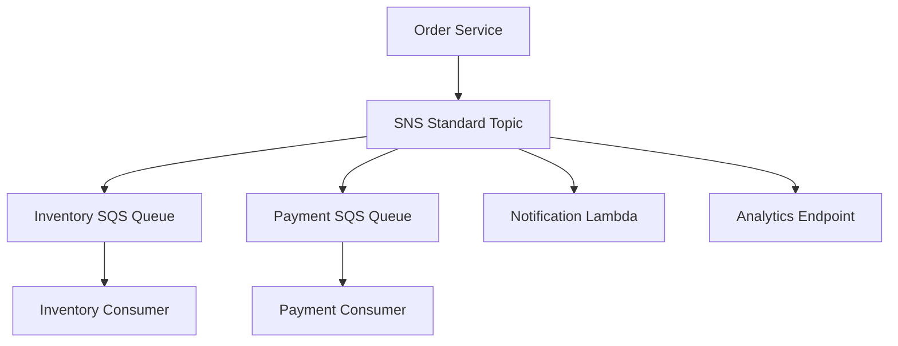
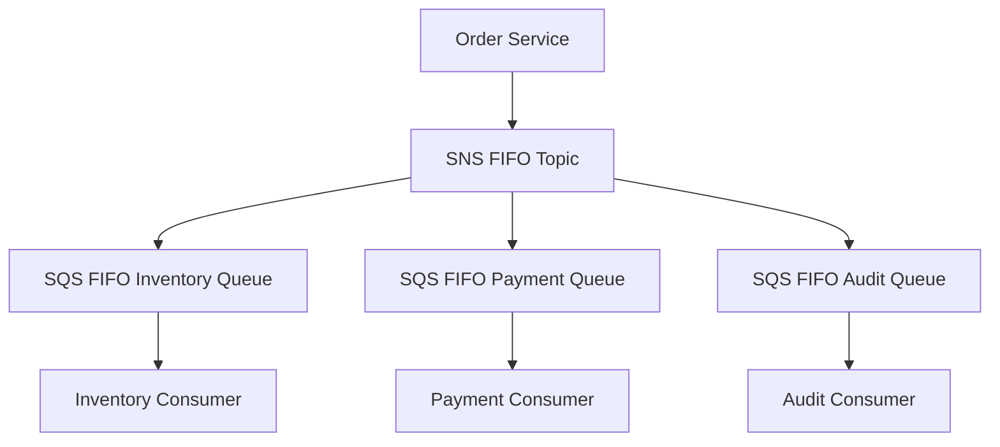

# 04- Standard Topics and FIFO Topics

## Overview

Amazon Simple Notification Service (SNS) provides two topic types: Standard and FIFO (First-In-First-Out). Both support publish-subscribe messaging and fan-out delivery, but they differ in ordering guarantees, deduplication behavior, throughput characteristics, and supported integrations.

Choosing the correct topic type affects application architecture, event-processing guarantees, consumer concurrency, and operational complexity.

- **Standard topics** prioritize scalable message distribution and high-throughput fan-out.
- **FIFO topics** provide ordering within message groups and message deduplication capabilities.

The choice should be based on business consistency requirements. FIFO is not automatically better than Standard, and neither topic type eliminates the need for idempotent consumers.

## Standard Topics

### What Is a Standard Topic?

A Standard topic is the default SNS topic type. It distributes published messages to subscribed endpoints with high scalability and best-effort ordering.

Standard topics are appropriate when consumers can process events independently and occasional duplicate or out-of-order delivery does not violate business requirements.

Typical use cases include:

- Application notifications.
- Order status updates.
- Audit event distribution.
- Monitoring and operational alerts.
- Event broadcasting across microservices.
- Analytics and data-ingestion pipelines.

### Message Delivery Characteristics

Standard topics provide at-least-once delivery for supported subscription protocols.

This means:

- SNS attempts to deliver a published message to eligible subscriptions.
- A message can be delivered more than once.
- Messages are not guaranteed to arrive in publication order.
- Consumers must tolerate duplicate and out-of-order events.

Consider an order workflow:

```text
OrderCreated
OrderPaid
OrderShipped
```

A consumer might receive:

```text
OrderCreated
OrderShipped
OrderPaid
```

This can happen because Standard topics do not guarantee ordering.

If the business workflow requires strict sequencing, the consumer must use an appropriate consistency strategy or the application should evaluate FIFO messaging.

### Advantages

- High-throughput message distribution.
- Simple publisher integration.
- Flexible fan-out to multiple endpoint types.
- Suitable for independent event processing.
- No requirement to design message group IDs.
- Supports a broad range of notification and event-driven workloads.

### Limitations

- No strict ordering guarantee.
- Duplicate delivery is possible.
- No FIFO message-group semantics.
- No topic-level FIFO deduplication.
- Consumers must handle duplicate and out-of-order events.

### Standard Topic Architecture



Each subscription receives an independent delivery attempt. A failure in one subscription does not turn the topic into a shared work queue or make other subscribers compete for the same message.

For durable asynchronous processing, SQS queues provide buffering between SNS delivery and consumer execution.

## FIFO Topics

### What Is a FIFO Topic?

An SNS FIFO topic is a publish-subscribe topic that supports ordering within message groups and message deduplication.

FIFO topics are designed for event-driven workflows where the relative order of related messages matters.

Typical use cases include:

- Financial transaction events.
- Order state transitions.
- Account balance workflows.
- Inventory reservation sequences.
- Business processes that require ordered event delivery.
- Event distribution to SQS FIFO queues.

FIFO topics require names ending in `.fifo`.

Example:

```text
order-events.fifo
```

### Message Ordering

FIFO ordering is scoped to a message group.

Messages published to the same message group are delivered in the order SNS accepts them for that group.

Messages belonging to different groups can be processed independently.

Example:

| Message | Message group | Business entity |
|---|---|---|
| `OrderCreated` | `order-1001` | Order 1001 |
| `OrderPaid` | `order-1001` | Order 1001 |
| `OrderShipped` | `order-1001` | Order 1001 |
| `OrderCreated` | `order-1002` | Order 1002 |
| `OrderPaid` | `order-1002` | Order 1002 |

Within `order-1001`, the messages preserve their accepted order. The same applies independently to `order-1002`.

This allows multiple business entities to progress concurrently without requiring one global ordering sequence.

### Message Group ID

A message group ID identifies the ordering boundary for a FIFO message.

Messages with the same group ID belong to the same ordered sequence.

Example:

```python
MessageGroupId="order-1001"
```

A useful message group ID generally corresponds to a business entity or aggregate whose events must be processed in order.

Common choices include:

- Order ID.
- Account ID.
- Customer ID.
- Shipment ID.
- Inventory item ID.

Avoid using one global group ID unless the entire topic genuinely requires a single ordered sequence.

A single group can become a throughput bottleneck because processing within that group is serialized by FIFO ordering semantics.

### Ordering Does Not Mean Global Ordering

FIFO topics do not establish one global order across all message groups.

For example:

```text
Group A:
A1 -> A2 -> A3

Group B:
B1 -> B2 -> B3
```

The ordering requirement is:

```text
A1 before A2 before A3
B1 before B2 before B3
```

There is no guaranteed relative order between `A1` and `B1`.

This distinction is important when designing distributed workflows.

## Message Deduplication

FIFO topics support deduplication to reduce duplicate message publication within a configured deduplication interval.

SNS FIFO supports a five-minute deduplication interval.

Two approaches are available:

- Content-based deduplication.
- Explicit message deduplication IDs.

### Content-Based Deduplication

When content-based deduplication is enabled, SNS generates a deduplication ID using a hash of the message body.

If the same message body is published again within the deduplication interval and the relevant deduplication scope matches, SNS treats it as a duplicate publication.

Example:

```bash
aws sns create-topic \
    --name order-events.fifo \
    --attributes \
        FifoTopic=true,\
        ContentBasedDeduplication=true \
    --region ap-south-1
```

Advantages:

- No need to generate a separate deduplication ID.
- Useful when identical payloads represent duplicate publication attempts.
- Reduces publisher-side deduplication logic.

Limitations:

- Deduplication is based on the message body, not message attributes.
- Different message bodies are treated as different publications even when they represent the same business event.
- Semantically identical events with different serialization can produce different hashes.
- The deduplication interval is limited.

Content-based deduplication should not replace a business-level event identity.

### Explicit Message Deduplication ID

Publishers can provide a deduplication ID explicitly.

```python
response = sns.publish(
    TopicArn="arn:aws:sns:ap-south-1:123456789012:order-events.fifo",
    Message='{"event_id":"evt-1001","event_type":"OrderCreated"}',
    MessageGroupId="order-1001",
    MessageDeduplicationId="evt-1001",
)
```

A stable event ID is generally preferable for business events because it separates event identity from payload serialization.

For example:

```text
event_id = evt-1001
```

If the same business event is published again within the deduplication interval with the same deduplication ID and applicable scope, SNS suppresses the duplicate publication.

### Deduplication Is Not Exactly-Once Processing

SNS FIFO deduplication does not guarantee exactly-once business processing.

It does not protect against:

- A consumer processing the same event through an application retry.
- A consumer executing a business operation and failing before recording completion.
- A duplicate event published outside the deduplication interval.
- Duplicate business operations caused by application-level logic.
- Downstream systems independently retrying requests.

Consumers should maintain an idempotency mechanism using a stable event ID.

Example PostgreSQL table:

```sql
CREATE TABLE processed_events (
    event_id VARCHAR(255) PRIMARY KEY,
    processed_at TIMESTAMPTZ NOT NULL DEFAULT NOW()
);
```

A consumer can use the event ID to prevent repeated business effects.

The event record and business update should be committed atomically where possible.

## FIFO Topic Configuration

### Create a FIFO Topic

```bash
aws sns create-topic \
    --name order-events.fifo \
    --attributes \
        FifoTopic=true,\
        ContentBasedDeduplication=false \
    --region ap-south-1
```

The command creates a FIFO topic with explicit deduplication IDs required from publishers.

For content-based deduplication:

```bash
aws sns create-topic \
    --name order-events.fifo \
    --attributes \
        FifoTopic=true,\
        ContentBasedDeduplication=true \
    --region ap-south-1
```

### Inspect FIFO Attributes

```bash
aws sns get-topic-attributes \
    --topic-arn arn:aws:sns:ap-south-1:123456789012:order-events.fifo \
    --region ap-south-1
```

Important attributes include:

| Attribute | Purpose |
|---|---|
| `FifoTopic` | Identifies the topic as FIFO |
| `ContentBasedDeduplication` | Enables content-based deduplication |
| `FifoThroughputScope` | Defines the applicable FIFO throughput and deduplication scope |
| `ArchivePolicy` | Configures supported message archiving behavior |

FIFO topic configuration should be created and managed through infrastructure as code.

## Publishing to Standard and FIFO Topics with Boto3

The SNS `publish` API supports both topic types, but FIFO topics require additional parameters.

### Publish to a Standard Topic

```python
import json
import os

import boto3

sns = boto3.client(
    "sns",
    region_name=os.getenv("AWS_REGION", "ap-south-1"),
)

STANDARD_TOPIC_ARN = os.environ["SNS_STANDARD_TOPIC_ARN"]


def publish_order_created(order_id: str, customer_id: str) -> str:
    event = {
        "event_id": f"order-created-{order_id}",
        "event_type": "OrderCreated",
        "data": {
            "order_id": order_id,
            "customer_id": customer_id,
        },
    }

    response = sns.publish(
        TopicArn=STANDARD_TOPIC_ARN,
        Message=json.dumps(event),
        MessageAttributes={
            "event_type": {
                "DataType": "String",
                "StringValue": "OrderCreated",
            }
        },
    )

    return response["MessageId"]
```

The publisher does not provide `MessageGroupId` or `MessageDeduplicationId` for a Standard topic.

### Publish to a FIFO Topic

```python
import json
import os

import boto3

sns = boto3.client(
    "sns",
    region_name=os.getenv("AWS_REGION", "ap-south-1"),
)

FIFO_TOPIC_ARN = os.environ["SNS_FIFO_TOPIC_ARN"]


def publish_order_event(
    order_id: str,
    event_id: str,
    event_type: str,
    payload: dict,
) -> str:
    event = {
        "event_id": event_id,
        "event_type": event_type,
        "data": payload,
    }

    response = sns.publish(
        TopicArn=FIFO_TOPIC_ARN,
        Message=json.dumps(event),
        MessageGroupId=f"order-{order_id}",
        MessageDeduplicationId=event_id,
    )

    return response["MessageId"]
```

The function uses:

- `MessageGroupId` to preserve order for events belonging to the same order.
- `MessageDeduplicationId` to identify duplicate publication attempts.
- `event_id` as a stable business event identifier.

The application should generate the event ID once and persist it before publication when reliable retry behavior is required.

## FIFO Subscription Requirements

FIFO topics support FIFO-compatible subscription endpoints.

For SQS subscriptions, use an SQS FIFO queue.

Example:

```text
SNS FIFO Topic
      |
      v
SQS FIFO Queue
      |
      v
Consumer
```

A FIFO topic cannot be treated as an ordinary Standard topic with identical endpoint behavior. Design the subscription architecture around supported FIFO integrations.

### Create an SQS FIFO Queue

```bash
aws sqs create-queue \
    --queue-name order-processing.fifo \
    --attributes FifoQueue=true,ContentBasedDeduplication=false \
    --region ap-south-1
```

### Subscribe the Queue

```bash
aws sns subscribe \
    --topic-arn arn:aws:sns:ap-south-1:123456789012:order-events.fifo \
    --protocol sqs \
    --notification-endpoint arn:aws:sqs:ap-south-1:123456789012:order-processing.fifo \
    --region ap-south-1
```

The queue policy must allow the SNS service principal to send messages from the specific topic.

For FIFO fan-out, use FIFO queues for the subscribed SQS endpoints.

### FIFO Fan-Out Architecture



Each queue receives its own copy of eligible messages and preserves the applicable FIFO ordering semantics.

The consumers should still use idempotent processing because message delivery and business transaction completion are separate concerns.

## Throughput and Scalability

Standard and FIFO topics have different scaling characteristics.

### Standard Topic Scaling

Standard topics are designed for high-throughput message distribution.

They are appropriate when:

- Events can be processed independently.
- Consumers tolerate out-of-order delivery.
- The system requires broad fan-out.
- Message ordering is not a business constraint.

The actual end-to-end throughput also depends on subscriber capacity and delivery protocol limits.

A high-throughput topic does not guarantee that every downstream endpoint can process messages at the same rate.

### FIFO Topic Scaling

FIFO throughput depends on the topic's configured throughput scope, message groups, and applicable regional service quotas.

Message groups provide an important concurrency boundary.

A topic with many active message groups can support more parallel processing than one where all messages use a single group.

Example:

```text
Single group:

order-events
    |
    +---- order-processing
              |
              +---- order-1
              +---- order-1
              +---- order-1

Multiple groups:

order-events
    |
    +---- order-1
    +---- order-2
    +---- order-3
    +---- order-4
```

The second design allows independent groups to progress concurrently.

However, adding message groups does not remove all service quotas or downstream capacity limits.

### FIFO Throughput Scope

SNS FIFO supports a configurable throughput scope that affects how throughput and deduplication are applied.

| Scope | Behavior |
|---|---|
| Topic | Throughput and deduplication are scoped to the topic |
| Message group | Throughput and deduplication are scoped by message group |

The available configuration and quotas depend on the AWS Region and current service capabilities.

Where message-group scope is supported and configured, it can improve parallelism for workloads with many independent groups.

Choose the scope deliberately because it also changes deduplication behavior. Verify current regional quotas before capacity planning.

### Performance Design Recommendations

- Use Standard topics when ordering is unnecessary.
- Use FIFO only for genuine ordering requirements.
- Select message group IDs based on business entities.
- Avoid a single global message group unless global serialization is required.
- Measure downstream queue age and consumer throughput.
- Load-test realistic message sizes and publication rates.
- Review current SNS and SQS quotas for the target Region.
- Scale consumers based on queue backlog and processing latency.

## Ordering Across Multiple Consumers

FIFO topics preserve ordering within message groups, but end-to-end ordering depends on the entire processing architecture.

Consider:

```text
SNS FIFO Topic
      |
      v
SQS FIFO Queue
      |
      v
Consumer Workers
```

If consumers process messages concurrently, they must preserve the queue's ordering semantics.

For SQS FIFO:

- Messages in the same message group are processed in order.
- A message group is blocked while a message is in flight.
- Different message groups can be processed concurrently.
- Visibility timeout and message deletion affect when subsequent messages in a group become available.

A consumer that receives a message should not acknowledge it before its business operation is safely completed.

### Ordering Across Independent Subscriptions

A FIFO topic can distribute ordered messages to multiple FIFO queues.

However, each subscription has its own delivery and processing lifecycle.

For example:

```text
SNS FIFO Topic
    |
    +---- Inventory FIFO Queue
    |
    +---- Payment FIFO Queue
```

The inventory service and payment service process their own ordered streams independently.

FIFO does not create a distributed transaction across those services.

If the business workflow requires coordination between them, use explicit workflow state, orchestration, or compensating transactions.

## Failure Handling and Reliability

FIFO ordering introduces additional considerations when messages fail.

### Failed Message in an SQS FIFO Queue

Suppose a queue contains:

```text
OrderCreated
OrderPaid
OrderShipped
```

If `OrderCreated` cannot be processed and remains in flight or becomes visible again after its visibility timeout, later messages in the same message group cannot simply bypass it while preserving the group's order.

This can block progress for that group.

Other message groups can continue processing.

### Dead-Letter Queues

Configure an SQS dead-letter queue for messages that repeatedly fail consumer processing.

The redrive policy controls how many receives are allowed before a message is moved to the DLQ.

Example:

```json
{
  "deadLetterTargetArn": "arn:aws:sqs:ap-south-1:123456789012:order-processing-dlq.fifo",
  "maxReceiveCount": 5
}
```

The source FIFO queue and its DLQ must both be FIFO queues.

A DLQ helps isolate poison messages, but moving a failed message out of the original queue can affect the business sequence.

For example, later events might be processed after an earlier event has been moved to the DLQ. The application must decide whether that is acceptable.

### SNS Subscription DLQ vs SQS Consumer DLQ

These represent different failure boundaries.

| DLQ type | Captures | Typical purpose |
|---|---|---|
| SNS subscription DLQ | Supported endpoint delivery failures | Recover messages SNS could not deliver to the subscribed endpoint |
| SQS consumer DLQ | Repeated consumer processing failures | Isolate messages that the application cannot process |

An SNS subscription DLQ does not replace the SQS consumer DLQ.

A production architecture may need both.

## Transactional Outbox and FIFO Ordering

FIFO topic ordering is based on the order SNS accepts messages within a message group.

It does not automatically guarantee that publishers submit events in the correct business order.

Consider two application instances publishing events for the same order:

```text
Instance A: OrderCreated
Instance B: OrderPaid
```

If `OrderPaid` reaches SNS first, FIFO preserves that accepted order, even if the business expects `OrderCreated` first.

A transactional outbox can help control publication sequencing.

Recommended design:

1. Persist the business update and outbox event in one database transaction.
2. Assign a stable event ID and sequence number.
3. Publish pending events in the required order for each aggregate.
4. Use the aggregate ID as the message group ID.
5. Use the event ID as the deduplication ID.
6. Mark events as published only after SNS confirms publication.
7. Make consumers idempotent.

Example outbox schema:

```sql
CREATE TABLE outbox_events (
    event_id VARCHAR(255) PRIMARY KEY,
    aggregate_id VARCHAR(255) NOT NULL,
    sequence_number BIGINT NOT NULL,
    event_type VARCHAR(100) NOT NULL,
    payload JSONB NOT NULL,
    created_at TIMESTAMPTZ NOT NULL DEFAULT NOW(),
    published_at TIMESTAMPTZ,
    UNIQUE (aggregate_id, sequence_number)
);
```

The publisher should prevent later events for an aggregate from overtaking earlier unpublished events.

This is an application-level responsibility, not a guarantee provided by SNS.

## Security Considerations

Standard and FIFO topics use the same fundamental security model.

Apply the following controls:

- Use IAM roles for application publishing.
- Restrict `sns:Publish` to the required topic ARN.
- Restrict subscription management permissions.
- Use resource-based topic policies for cross-account access.
- Configure KMS encryption where required.
- Restrict SQS queue policies to the intended SNS topic.
- Avoid storing AWS credentials in source code or container images.
- Validate external SNS HTTP/S notifications.
- Avoid including sensitive information in event payloads unless consumers are authorized to receive it.

FIFO ordering and deduplication are not security controls.

A FIFO topic does not prevent unauthorized publishers from sending messages if IAM and resource policies are misconfigured.

## Monitoring and Observability

Monitor both topic-level delivery and downstream consumer processing.

Important CloudWatch metrics include:

| Metric | What it indicates |
|---|---|
| `NumberOfMessagesPublished` | Messages accepted for publication |
| `NumberOfNotificationsDelivered` | Successful notification deliveries |
| `NumberOfNotificationsFailed` | Failed delivery attempts |
| `NumberOfNotificationsFilteredOut` | Messages excluded by subscription filters |
| `PublishSize` | Published message size |

For SQS FIFO subscribers, also monitor:

- `ApproximateNumberOfMessagesVisible`
- `ApproximateNumberOfMessagesNotVisible`
- `ApproximateAgeOfOldestMessage`
- DLQ message count
- Consumer processing duration
- Consumer error rate

For FIFO workloads, track:

- Message group distribution.
- Processing latency by aggregate.
- Repeated failures within a group.
- Backlog growth.
- Duplicate event detection.
- Out-of-sequence business events.

Include the following identifiers in application logs and traces:

```json
{
  "event_id": "evt-1001",
  "aggregate_id": "order-1001",
  "event_type": "OrderCreated",
  "correlation_id": "req-2001"
}
```

This makes it easier to trace a business event across publishers, SNS, SQS, and downstream services.

## Terraform Configuration

### Standard Topic

```hcl
resource "aws_sns_topic" "order_events" {
  name = "order-events"

  tags = {
    Environment = "production"
    Service     = "order-management"
  }
}
```

### FIFO Topic

```hcl
resource "aws_sns_topic" "order_events_fifo" {
  name                        = "order-events.fifo"
  fifo_topic                  = true
  content_based_deduplication = false
  fifo_throughput_scope       = "MessageGroup"

  tags = {
    Environment = "production"
    Service     = "order-management"
  }
}
```

The `fifo_throughput_scope` setting should be used only when supported by the selected topic configuration and provider version. Verify the provider schema and regional service support before deployment.

### SQS FIFO Queue

```hcl
resource "aws_sqs_queue" "order_processing" {
  name                        = "order-processing.fifo"
  fifo_queue                  = true
  content_based_deduplication = false

  visibility_timeout_seconds = 60
  message_retention_seconds  = 345600

  tags = {
    Environment = "production"
    Service     = "order-processing"
  }
}
```

### FIFO Subscription

```hcl
resource "aws_sns_topic_subscription" "order_processing" {
  topic_arn = aws_sns_topic.order_events_fifo.arn
  protocol  = "sqs"
  endpoint  = aws_sqs_queue.order_processing.arn

  depends_on = [
    aws_sqs_queue_policy.order_processing
  ]
}
```

The queue policy must grant the SNS topic permission to send messages before the subscription is established.

Terraform resource definitions should be tested with the pinned AWS provider version used by the project.

## Standard vs FIFO: Decision Matrix

| Requirement | Standard | FIFO |
|---|---|---|
| High-throughput event distribution | Suitable | Suitable within configured limits |
| Strict ordering within a business entity | Not guaranteed | Supported through message groups |
| Global ordering across all events | Not guaranteed | Not provided across independent groups |
| Deduplication at topic level | Not provided | Supported within the deduplication interval |
| Duplicate-tolerant consumers | Required | Still recommended |
| Independent fan-out | Supported | Supported with compatible endpoints |
| SQS integration | Standard queues | FIFO queues |
| Complex ordered workflows | Requires application-level coordination | Better suited when ordering boundaries are clear |
| Maximum simplicity | Usually simpler | Requires group and deduplication design |

### Choosing the Topic Type

Use a Standard topic when:

- Events can be processed independently.
- Ordering is not a business requirement.
- Consumers already handle duplicates.
- High-throughput fan-out is the primary requirement.
- Simpler publisher and consumer integration is preferred.

Use a FIFO topic when:

- Events for the same business entity must be delivered in order.
- Deduplication within the SNS FIFO interval is useful.
- Consumers use FIFO-compatible subscription endpoints.
- Message group boundaries can be defined clearly.
- The business can tolerate independent processing across different groups.

Do not choose FIFO merely to avoid implementing idempotency. Business-level idempotency remains necessary for reliable distributed processing.

## Common Mistakes and Pitfalls

### Assuming FIFO Means Exactly Once

FIFO deduplication suppresses duplicate publications within its deduplication interval. It does not guarantee exactly-once business execution.

**Avoidance:** Use stable event IDs and transactional idempotency in consumers.

### Using One Message Group for Every Event

A single group serializes all messages within that group and can restrict concurrency.

**Avoidance:** Use a business aggregate identifier when ordering is required only within an entity.

### Assuming FIFO Provides Global Ordering

FIFO ordering is scoped to message groups.

**Avoidance:** Design explicitly for per-entity ordering. If global sequencing is required, implement a deliberate coordination mechanism.

### Assuming FIFO Corrects Publisher Ordering

SNS preserves the order in which messages are accepted for a group. It cannot infer the intended business sequence.

**Avoidance:** Serialize publication per aggregate or use an ordered transactional outbox publisher.

### Using Content-Based Deduplication as Business Idempotency

Content-based deduplication hashes the message body. It does not identify semantically equivalent business events with different payload representations.

**Avoidance:** Use explicit deduplication IDs derived from stable event identifiers where appropriate.

### Using Standard SQS Queues with FIFO Topics

FIFO topics require FIFO-compatible SQS subscriptions.

**Avoidance:** Provision FIFO queues for FIFO topic fan-out and verify endpoint compatibility.

### Ignoring Message Group Blocking

A failed message can prevent later messages in the same group from progressing.

**Avoidance:** Configure visibility timeouts, retries, DLQs, and operational procedures for resolving poison messages.

### Assuming FIFO Solves Distributed Transactions

FIFO preserves message ordering but does not coordinate database commits across microservices.

**Avoidance:** Use sagas, transactional outboxes, workflow orchestration, and compensating actions where required.

### Ignoring Regional Quotas

Throughput limits and supported configuration vary by Region and topic settings.

**Avoidance:** Validate current service quotas and test expected publication and delivery rates before production rollout.

## Best Practices

- Prefer Standard topics when message ordering is not a business requirement.
- Use FIFO topics only when ordered delivery within defined message groups is necessary.
- Choose message group IDs based on business aggregates.
- Avoid a single global message group unless global serialization is explicitly required.
- Use explicit deduplication IDs for important business events.
- Keep a stable business event ID separate from the SNS message ID.
- Implement idempotent consumers for both Standard and FIFO workloads.
- Use transactional outbox publishing when database changes and event publication must remain consistent.
- Use FIFO SQS queues for FIFO topic subscriptions.
- Configure consumer DLQs and SNS subscription DLQs for their respective failure boundaries.
- Monitor message-group backlogs and downstream processing latency.
- Validate regional quotas and throughput settings before deployment.
- Manage topic configuration through Terraform or another infrastructure-as-code tool.
- Document ordering, deduplication, retry, and failure-recovery requirements as part of the event contract.

## Key Takeaways

- Standard topics provide scalable fan-out with best-effort ordering, while FIFO topics provide ordering within message groups.
- FIFO deduplication operates within a five-minute interval and does not guarantee exactly-once business processing.
- Message group IDs define ordering boundaries and influence concurrency and throughput.
- FIFO workloads require compatible subscription endpoints, deliberate failure handling, and idempotent consumers.
- Choose Standard or FIFO based on business ordering requirements, not assumptions about reliability.