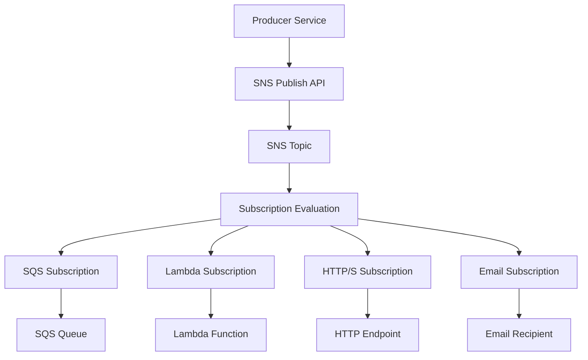
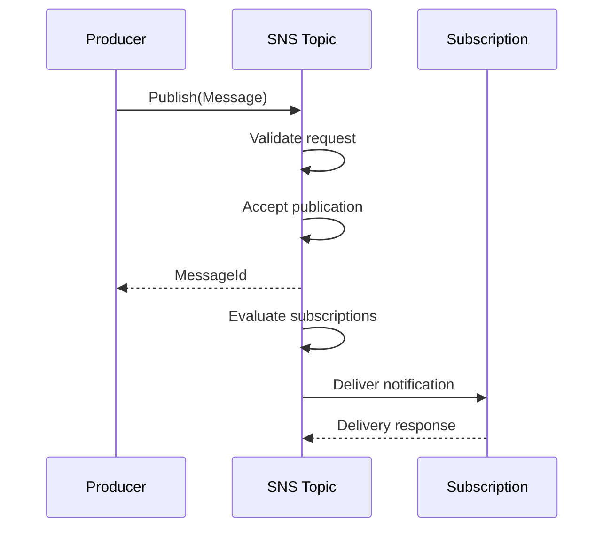
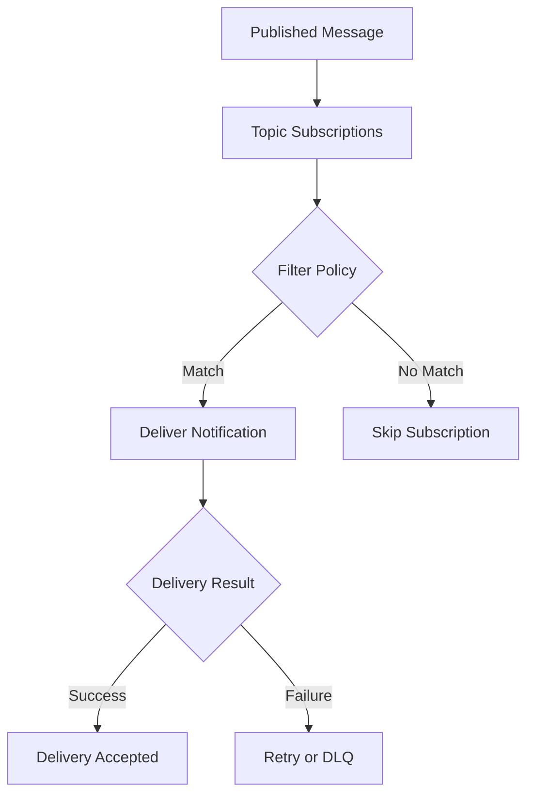
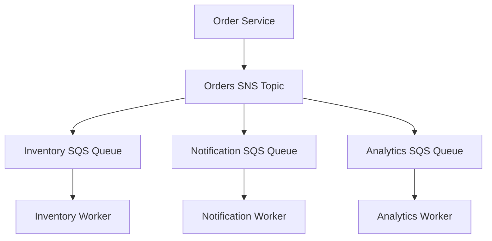
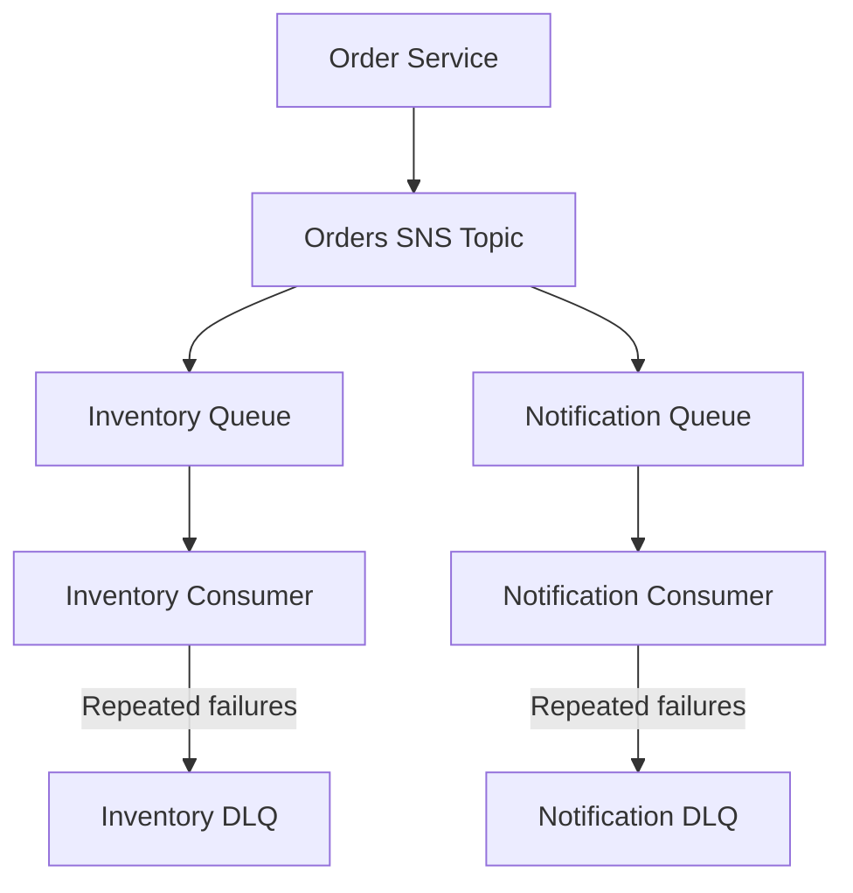

# 05- Message Publishing and Delivery Flow

## Overview

Amazon Simple Notification Service (SNS) is a managed publish-subscribe messaging service that enables applications to distribute messages to multiple subscribers through a topic.

A publisher sends a message to an SNS topic without needing to know which services consume it. SNS manages subscription delivery to configured endpoints such as SQS queues, Lambda functions, HTTP/S endpoints, email, SMS, and mobile push destinations.

Understanding the publishing and delivery flow is important because SNS is asynchronous and distributed. A successful publish request does not necessarily mean every subscriber has successfully processed the message.

Production systems must account for subscription configuration, delivery retries, duplicate notifications, endpoint availability, filtering, message transformations, and observability.

## SNS Message Publishing Architecture

The publishing and delivery flow consists of three primary stages:

1. **Publishing:** A producer sends a message to an SNS topic.
2. **Fan-out:** SNS evaluates subscriptions and determines eligible endpoints.
3. **Delivery:** SNS attempts to deliver the message independently to each eligible subscriber.



For example, an order service publishes an `order.created` event. The same event can be delivered to:

- An SQS queue consumed by the inventory service.
- Another SQS queue consumed by the notification service.
- A Lambda function responsible for analytics.
- An HTTP endpoint belonging to an external integration.

The producer publishes once. SNS manages delivery to the configured subscriptions.

## Publishing a Message

A publisher sends a message to an SNS topic using the `Publish` API.

The request identifies the topic and contains the message body. Optional fields can include:

- Subject.
- Message attributes.
- Message group ID for FIFO topics.
- Message deduplication ID for FIFO topics.
- Message structure for supported protocol-specific formats.

### Publishing Lifecycle



The publisher receives a `MessageId` when SNS accepts the publish request.

This confirms acceptance by SNS, not successful processing by every subscriber.

### Publishing with AWS CLI

```bash
aws sns publish \
    --topic-arn arn:aws:sns:ap-south-1:123456789012:orders-topic \
    --message '{"event_id":"evt-1001","event_type":"order.created","order_id":"ORD-1001"}' \
    --region ap-south-1
```

A successful response contains a message ID:

```json
{
  "MessageId": "example-message-id"
}
```

For FIFO topics, the publish request must also include a message group ID and either an explicit deduplication ID or an enabled content-based deduplication configuration.

### Publishing with Python and Boto3

```python
import json
import logging

import boto3
from botocore.exceptions import BotoCoreError, ClientError

logger = logging.getLogger(__name__)

sns = boto3.client("sns", region_name="ap-south-1")

TOPIC_ARN = (
    "arn:aws:sns:ap-south-1:123456789012:orders-topic"
)


def publish_order_created(order: dict) -> str:
    event = {
        "event_id": order["event_id"],
        "event_type": "order.created",
        "order_id": order["order_id"],
        "customer_id": order["customer_id"],
    }

    try:
        response = sns.publish(
            TopicArn=TOPIC_ARN,
            Message=json.dumps(event),
            MessageAttributes={
                "event_type": {
                    "DataType": "String",
                    "StringValue": "order.created",
                },
            },
        )

        message_id = response["MessageId"]

        logger.info(
            "SNS message accepted",
            extra={
                "message_id": message_id,
                "event_id": event["event_id"],
            },
        )

        return message_id

    except (ClientError, BotoCoreError):
        logger.exception(
            "SNS publication failed",
            extra={"event_id": event["event_id"]},
        )
        raise
```

The example uses a stable application-level `event_id` so that consumers can identify duplicate business events independently of the SNS-generated message ID.

### Message Size

SNS supports messages up to 256 KiB by default. The message size includes the message body and message attributes.

For larger payloads, store the payload in Amazon S3 and publish an object reference through SNS.

A reference message can contain:

```json
{
  "event_id": "evt-1001",
  "event_type": "document.uploaded",
  "payload": {
    "bucket": "application-event-payloads",
    "key": "documents/evt-1001.pdf"
  }
}
```

The consumer retrieves the actual payload from S3.

## Subscription Evaluation

After accepting a publication, SNS evaluates the topic's subscriptions.

Each subscription has its own configuration, including:

- Endpoint.
- Protocol.
- Subscription confirmation status, where applicable.
- Filter policy.
- Delivery policy.
- Raw message delivery configuration.
- Redrive policy, where supported.

SNS evaluates subscription filters against message attributes or message body fields, depending on the filter policy configuration.

Only subscriptions whose filters match are eligible to receive the notification.



A message can be successfully published even when no subscription matches its filter policy.

This distinction matters when investigating missing downstream events.

## Fan-Out Delivery

SNS fan-out means distributing one publication to multiple subscribers.

Each subscription is managed independently. A delivery failure to one endpoint does not normally prevent SNS from attempting delivery to other subscriptions.

For example:

```text
                    Orders Topic
                         |
             +-----------+-----------+
             |           |           |
             v           v           v
        Inventory    Notification  Analytics
          Queue         Queue       Lambda
             |           |           |
             v           v           v
        Inventory    Email/Push   Data Pipeline
        Consumer      Consumer
```

This architecture reduces direct service coupling.

The order service does not need to know how inventory, notifications, and analytics are implemented.

### SNS with SQS Fan-Out

SNS and SQS are commonly combined to build reliable asynchronous microservice architectures.

SNS distributes events, while each SQS queue buffers messages for an independent consumer.



Advantages include:

- Independent consumer scaling.
- Queue-based buffering during service outages.
- Separate retry and DLQ policies for each consumer.
- Independent message retention.
- Reduced coupling between producer and consumers.

An SQS queue subscription requires a queue resource policy that allows the SNS service principal to send messages, preferably restricted to the exact topic ARN using `aws:SourceArn`.

Example queue policy:

```json
{
  "Version": "2012-10-17",
  "Statement": [
    {
      "Sid": "AllowOrdersTopic",
      "Effect": "Allow",
      "Principal": {
        "Service": "sns.amazonaws.com"
      },
      "Action": "sqs:SendMessage",
      "Resource": "arn:aws:sqs:ap-south-1:123456789012:inventory-queue",
      "Condition": {
        "ArnEquals": {
          "aws:SourceArn": "arn:aws:sns:ap-south-1:123456789012:orders-topic"
        }
      }
    }
  ]
}
```

## Protocol-Specific Delivery

SNS supports different subscription protocols. The delivery representation and acknowledgment behavior depend on the endpoint type.

| Protocol | Destination | Delivery behavior |
|---|---|---|
| SQS | Standard or FIFO queue | SNS sends a message to the queue |
| Lambda | Lambda function | SNS invokes the function asynchronously |
| HTTP/S | Web endpoint | SNS sends an HTTP POST notification |
| Email | Email address | SNS sends an email notification |
| Email-JSON | Email endpoint | SNS sends a JSON-formatted email |
| SMS | Phone number | SNS sends an SMS notification |
| Application | Mobile push endpoint | SNS sends a push notification |

Not every topic type supports every protocol. For example, SNS FIFO topics support SQS subscriptions but do not directly support Lambda, HTTP/S, email, SMS, or mobile push subscriptions.

If a FIFO topic must trigger Lambda processing, use an SQS FIFO subscription and configure a Lambda event source mapping for that queue.

## Delivery Semantics

SNS delivery behavior depends on the topic type and subscriber protocol.

### Standard Topics

Standard SNS topics provide high-throughput, best-effort message ordering and at-least-once delivery.

Consumers should be prepared for:

- Duplicate notifications.
- Messages arriving out of order.
- Temporary delivery failures.
- Independent delivery outcomes across subscriptions.

A successful publish does not guarantee that every subscriber has completed its processing.

### FIFO Topics

FIFO topics provide ordering within a message group and deduplication within the configured deduplication scope and five-minute deduplication interval.

FIFO delivery to SQS FIFO subscriptions can provide exactly-once message delivery under documented conditions, including the absence of subscription filtering and successful consumer acknowledgment behavior.

This does not make arbitrary business side effects exactly once. Applications should still implement durable idempotency.

| Property | Standard topic | FIFO topic |
|---|---|---|
| Throughput | High | Depends on throughput configuration |
| Ordering | Best effort | Ordered within message groups |
| Deduplication | Not provided by SNS | Supported within a five-minute interval |
| Message group ID | Not required | Required |
| Typical subscription targets | Broad protocol support | SQS subscriptions |
| Typical use case | General event distribution | Ordered event processing |

## Delivery Retries

SNS uses protocol-specific delivery policies to retry certain failed deliveries.

A delivery failure can occur because:

- An HTTP endpoint is unavailable.
- An endpoint returns an unsuccessful HTTP status.
- A Lambda invocation cannot be accepted.
- An SQS queue rejects the send operation.
- A downstream service is temporarily unavailable.

Retry behavior depends on the subscription protocol and its configured delivery policy.

For HTTP/S subscriptions, SNS can retry failed delivery attempts according to the subscription's delivery policy.

For SQS subscriptions, delivery failures can occur because of queue permissions, encryption configuration, or service-level errors.

For Lambda subscriptions, SNS invokes Lambda asynchronously. Lambda has its own asynchronous invocation retry and failure-handling behavior after the event is accepted.

Do not assume that all subscription protocols share one universal retry schedule.

### Delivery Policy

A delivery policy controls retry behavior for supported subscription protocols.

A policy can include:

- Minimum delay between retries.
- Maximum delay between retries.
- Retry backoff behavior.
- Maximum retry attempts or delivery time, where supported.

Example HTTP/S delivery policy:

```json
{
  "healthyRetryPolicy": {
    "minDelayTarget": 10,
    "maxDelayTarget": 300,
    "numRetries": 10,
    "numMaxDelayRetries": 5,
    "numMinDelayRetries": 2,
    "backoffFunction": "exponential"
  }
}
```

The exact supported fields and limits depend on the subscription protocol and AWS delivery-policy model.

Configure retry behavior according to endpoint recovery characteristics rather than choosing arbitrary large retry counts.

## Delivery Status and Acknowledgment

SNS distinguishes between accepting a publication and successfully delivering it to a subscription endpoint.

For example, an HTTP/S endpoint can return an HTTP success response to indicate that it accepted the notification.

That response does not prove that the endpoint completed its business processing.

Similarly, successful delivery to an SQS queue means the message was accepted by the queue. It does not mean that the application consuming the queue has processed it.

The distinction is:

| Stage | Meaning |
|---|---|
| Publish accepted | SNS accepted the publisher's request |
| Subscription delivery accepted | Endpoint accepted the notification |
| Consumer received | Consumer retrieved the message |
| Business processing completed | Application operation succeeded |
| Message acknowledged or deleted | Messaging system was informed that processing completed, where applicable |

For SQS, consumers explicitly delete messages after successful processing.

For Lambda, the function's asynchronous invocation lifecycle and configured failure destinations or retry behavior determine how execution failures are handled.

For HTTP/S, the endpoint should acknowledge only after it has durably accepted responsibility for processing the event.

## Delivery Status Logging

SNS supports delivery status logging for supported endpoint protocols.

Delivery status logs can provide information about successful deliveries, failed deliveries, and notification outcomes.

Configure delivery status logging through the topic's delivery status attributes.

Example:

```bash
aws sns set-topic-attributes \
    --topic-arn arn:aws:sns:ap-south-1:123456789012:orders-topic \
    --attribute-name HTTPSuccessFeedbackRoleArn \
    --attribute-value arn:aws:iam::123456789012:role/sns-delivery-feedback-role \
    --region ap-south-1
```

Additional attributes are available for supported protocols, including failure feedback role configuration and success sampling configuration.

Delivery status logging requires an IAM role that SNS can assume to publish the corresponding logs to CloudWatch Logs.

Operational monitoring should distinguish between:

- Publish failures.
- Subscription delivery failures.
- Endpoint acceptance.
- Downstream consumer processing failures.

SNS delivery logs alone cannot establish whether a subscriber completed its business operation.

## Message Attributes and Filtering

Message attributes are optional metadata associated with an SNS message.

They can be used for:

- Subscription filtering.
- Event classification.
- Routing decisions.
- Correlation metadata.
- Consumer-specific processing hints.

Example:

```python
sns.publish(
    TopicArn=TOPIC_ARN,
    Message=json.dumps({
        "event_id": "evt-1001",
        "order_id": "ORD-1001",
    }),
    MessageAttributes={
        "event_type": {
            "DataType": "String",
            "StringValue": "order.created",
        },
        "priority": {
            "DataType": "String",
            "StringValue": "high",
        },
    },
)
```

A subscription can use a filter policy to receive only matching events.

Example filter policy:

```json
{
  "event_type": ["order.created"],
  "priority": ["high"]
}
```

Filter policies can use message attributes or message body fields, depending on the subscription's filter policy scope.

Filtering reduces unnecessary downstream processing, but it should not replace authorization or business validation.

For SNS FIFO subscriptions, message filtering changes delivery semantics. Filtered FIFO subscriptions have at-most-once delivery behavior, so consumers must account for sequence gaps.

## Raw Message Delivery

By default, SNS wraps messages in a notification envelope for supported protocols.

For SQS subscriptions, the envelope includes fields such as:

- Type.
- Message ID.
- Topic ARN.
- Subject.
- Message body.
- Timestamp.
- Signature information.

With raw message delivery enabled, SNS sends the original message body to the SQS endpoint without the standard SNS notification envelope.

### Default Delivery

```json
{
  "Type": "Notification",
  "MessageId": "example-message-id",
  "TopicArn": "arn:aws:sns:ap-south-1:123456789012:orders-topic",
  "Message": "{\"event_id\":\"evt-1001\",\"event_type\":\"order.created\"}",
  "Timestamp": "2026-11-20T10:30:00.000Z"
}
```

### Raw Delivery

```json
{
  "event_id": "evt-1001",
  "event_type": "order.created"
}
```

Enable raw delivery when consumers should receive the original application payload directly.

For SQS subscriptions, raw message delivery has a message attribute limit: SNS delivers at most 10 message attributes with raw delivery enabled. Messages exceeding this limit are treated as client-side delivery failures for that subscription.

Choose the envelope or raw format deliberately and keep the consumer contract consistent.

## Handling Duplicate Deliveries

Standard SNS topics provide at-least-once delivery. A subscriber may receive the same logical event more than once.

Possible causes include:

- Network interruptions.
- Endpoint acknowledgment failures.
- Retry attempts after ambiguous delivery outcomes.
- Consumer failures after performing a side effect.

Consumers should use stable application-level event IDs for idempotency.

Example PostgreSQL table:

```sql
CREATE TABLE processed_events (
    event_id TEXT PRIMARY KEY,
    processed_at TIMESTAMPTZ NOT NULL DEFAULT NOW()
);
```

A consumer can insert the event ID and apply the business update in one database transaction.

```python
from django.db import transaction
from django.utils import timezone

from orders.models import Order, ProcessedEvent


def process_order_event(event: dict) -> bool:
    with transaction.atomic():
        _, created = ProcessedEvent.objects.get_or_create(
            event_id=event["event_id"],
            defaults={"processed_at": timezone.now()},
        )

        if not created:
            return False

        order = Order.objects.select_for_update().get(
            external_id=event["order_id"]
        )

        order.status = "created"
        order.save(update_fields=["status"])

    return True
```

The database uniqueness constraint protects against concurrent duplicate processing.

For external side effects, use the external provider's idempotency mechanism or a durable workflow. A database transaction cannot atomically commit an external HTTP request.

## Failure Isolation with SQS and Dead Letter Queues

SNS and SQS can be combined to isolate downstream failures.

A common design uses:

- An SNS topic for event distribution.
- A separate SQS queue for each consumer.
- A DLQ for each queue.
- Independent consumer retry and recovery policies.



This architecture prevents one consumer's processing failure from blocking other subscribers.

SNS also supports subscription-level redrive policies for supported subscription protocols, such as SQS subscriptions. These policies route notifications that SNS cannot successfully deliver to the subscription endpoint into a configured SQS dead-letter queue.

Do not confuse an SNS subscription DLQ with a consumer queue's DLQ:

| DLQ type | Captures |
|---|---|
| SNS subscription DLQ | Notifications SNS could not deliver to the subscription endpoint after applicable delivery attempts |
| SQS consumer DLQ | Messages received by the consumer queue but repeatedly not processed successfully |

The two mechanisms address different failure stages and can both be required.

## Security Considerations

SNS publishing and delivery must be protected through IAM, topic policies, endpoint permissions, and encryption configuration.

### Publisher Permissions

Grant producer roles only the required `sns:Publish` permission on approved topic ARNs.

Example:

```json
{
  "Version": "2012-10-17",
  "Statement": [
    {
      "Effect": "Allow",
      "Action": "sns:Publish",
      "Resource": "arn:aws:sns:ap-south-1:123456789012:orders-topic"
    }
  ]
}
```

Avoid granting unrestricted SNS publishing permissions across all topics.

### Subscription Permissions

For SQS subscriptions:

- Allow the SNS service principal to call `sqs:SendMessage`.
- Restrict access using the exact SNS topic ARN.
- Configure KMS permissions when the queue uses SSE-KMS.

For Lambda subscriptions, ensure the Lambda resource-based policy permits invocation from the intended SNS topic.

### Encryption

SNS supports server-side encryption using AWS KMS.

For encrypted topics, configure the KMS key policy and IAM permissions so that authorized publishers and the SNS service can perform the required operations.

Use HTTPS for HTTP/S subscriptions and validate notification authenticity where the endpoint relies on SNS notification signatures.

Never place credentials, access tokens, or sensitive personal information in message attributes or payloads unless the data-handling requirements explicitly permit it.

## Scalability and Performance

SNS is designed for managed message distribution, but the overall system is constrained by subscriber capacity and downstream dependencies.

Consider the following:

| Concern | Engineering consideration |
|---|---|
| Publisher throughput | Monitor API throttling and retry transient failures |
| Subscriber count | Each additional subscription creates delivery work |
| Endpoint latency | Slow endpoints can increase delivery duration |
| SQS buffering | Allows consumers to process at their own rate |
| Lambda concurrency | Configure reserved concurrency and downstream limits |
| HTTP endpoint capacity | Scale independently and return responses promptly |
| Message size | Keep messages compact and offload large payloads |
| Retry traffic | Prevent repeated failures from amplifying load |

For high-volume event distribution, use SQS subscriptions to decouple SNS delivery from application processing.

SNS can deliver messages quickly, but it does not automatically guarantee that every downstream service can process them at the same rate.

## Monitoring and Observability

Monitor the publishing layer, subscription delivery layer, and consumer processing layer separately.

### Important CloudWatch Metrics

| Metric | Purpose |
|---|---|
| `NumberOfMessagesPublished` | Number of messages published to the topic |
| `NumberOfNotificationsDelivered` | Number of notifications successfully delivered |
| `NumberOfNotificationsFailed` | Number of failed notification deliveries |
| `NumberOfNotificationsFilteredOut` | Number of notifications excluded by subscription filters |
| `NumberOfNotificationsFilteredOut-InvalidAttributes` | Notifications filtered because required attributes were invalid or missing |
| `PublishSize` | Published message size |
| `PublishSize` percentile statistics | Helps identify large-message trends |

Metric availability and dimensions depend on topic type and subscription protocol.

For SQS subscribers, also monitor:

- Approximate visible messages.
- Approximate messages not visible.
- Approximate age of oldest message.
- Consumer processing errors.
- DLQ message count.

For Lambda subscribers, monitor invocation errors, throttles, duration, and concurrency.

### Structured Logging

Include identifiers that connect the publisher and subscriber workflows.

Example:

```json
{
  "event_id": "evt-1001",
  "sns_message_id": "sns-message-001",
  "event_type": "order.created",
  "topic": "orders-topic",
  "correlation_id": "req-91283",
  "status": "published"
}
```

Avoid logging sensitive payload contents.

Use distributed tracing or correlation identifiers to connect API requests, SNS publication, SQS consumption, and downstream service calls.

## Common Mistakes and Production Pitfalls

| Mistake | Why it is problematic | Recommended approach |
|---|---|---|
| Assuming successful publish means all consumers processed the event | SNS acceptance and consumer completion are separate stages | Monitor each delivery and processing stage |
| Assuming Standard SNS preserves ordering | Standard topics provide best-effort ordering | Use FIFO when ordered processing is required |
| Ignoring duplicate deliveries | Can cause repeated business side effects | Implement consumer idempotency |
| Treating all protocols as having identical retry behavior | Retry and acknowledgment semantics differ | Configure and monitor each subscription type |
| Using SNS without SQS for slow consumers | Direct delivery may not provide the buffering needed by the application | Use SQS fan-out |
| Misconfiguring SQS queue policies | SNS cannot deliver messages to the queue | Restrict and validate `sqs:SendMessage` permissions |
| Confusing subscription DLQs with consumer DLQs | They capture failures at different stages | Configure each according to its failure boundary |
| Enabling raw delivery without updating consumers | Payload format changes | Treat the delivery format as a versioned contract |
| Using filters as authorization | Filters are routing rules, not security controls | Enforce authorization independently |
| Ignoring FIFO filter semantics | Filtering can introduce sequence gaps | Design consumers for filtered FIFO behavior |
| Logging only publisher success | Subscriber failures remain invisible | Enable delivery status logging and monitor subscriber metrics |

## Key Takeaways

- SNS publishing, subscription evaluation, and endpoint delivery are separate stages; a successful publish does not prove subscriber processing succeeded.
- Standard topics provide at-least-once delivery and best-effort ordering, so consumers must handle duplicates and out-of-order events.
- SNS fan-out with independent SQS queues provides buffering, failure isolation, and independent consumer scaling.
- Retry policies, acknowledgment behavior, filtering, and DLQ semantics vary by subscription protocol.
- Production systems should combine least-privilege permissions, delivery monitoring, correlation IDs, and durable consumer idempotency.