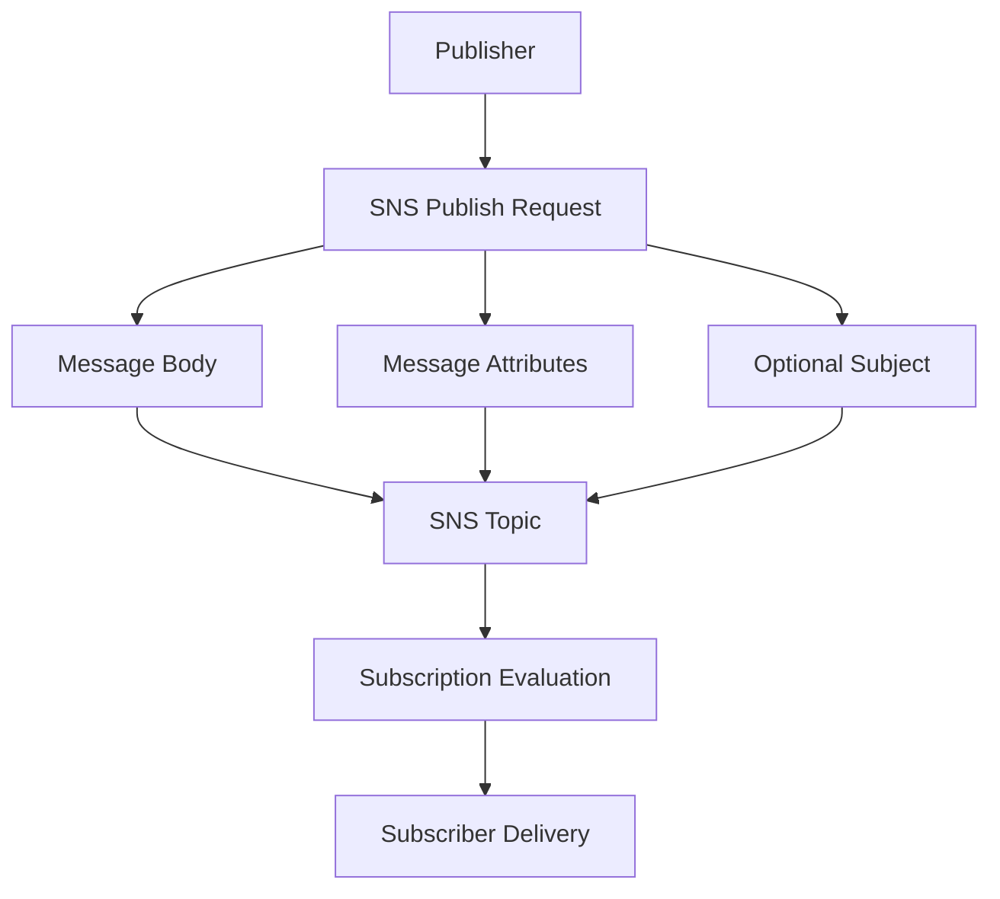

# 06- Message Attributes and Message Formats

## Overview

Amazon SNS messages consist of a message body and optional message attributes. The message body contains the primary application payload, while message attributes provide additional metadata that can be used for routing, filtering, classification, and subscriber-specific processing.

Message formats determine how SNS delivers the published content to subscribers. Depending on the subscription protocol and configuration, subscribers can receive an SNS notification envelope or the original message body.

Understanding message attributes and formats is important when designing event-driven microservices because they influence:

- Subscription filtering.
- Consumer routing.
- Event versioning.
- Message compatibility.
- Delivery payload structure.
- Observability and correlation.
- Integration with SQS, Lambda, and HTTP endpoints.

A well-designed message contract separates business data from routing metadata and remains stable as services evolve.

## SNS Message Structure

An SNS publication can contain:

1. **Message body:** The primary content published by the producer.
2. **Message attributes:** Optional metadata associated with the message.
3. **Subject:** Optional subject text, primarily useful for email-style notifications.
4. **Message structure:** Optional protocol-specific message representation.
5. **FIFO-specific fields:** Message group and deduplication identifiers for FIFO topics.

Conceptually:



The message body and attributes serve different purposes.

| Component | Responsibility | Example |
|---|---|---|
| Message body | Business event or payload | `{"order_id":"ORD-1001"}` |
| Message attributes | Metadata and routing information | `event_type=order.created` |
| Subject | Human-readable notification subject | `Order Created` |
| Message structure | Protocol-specific message representation | JSON protocol map |
| Message group ID | FIFO ordering boundary | `customer-1001` |
| Message deduplication ID | FIFO duplicate detection | `evt-1001` |

## Message Body

The message body contains the actual content published to the topic.

SNS treats the message body primarily as application data. The publisher and subscriber define its schema and interpretation.

For backend event-driven systems, JSON is a common message format.

Example:

```json
{
  "event_id": "evt-1001",
  "event_type": "order.created",
  "order_id": "ORD-1001",
  "customer_id": "CUST-1001",
  "total_amount": 2499.50,
  "currency": "INR"
}
```

The message body should contain information required by consumers to understand and process the event.

### Message Body Design

Prefer explicit event contracts containing:

- Stable event identifiers.
- Event type.
- Schema version.
- Event timestamp.
- Aggregate or entity identifier.
- Business data.
- Optional correlation and causation identifiers.

Example:

```json
{
  "event_id": "evt-1001",
  "event_type": "order.created",
  "schema_version": 1,
  "occurred_at": "2026-11-20T10:30:00Z",
  "aggregate": {
    "type": "order",
    "id": "ORD-1001"
  },
  "data": {
    "customer_id": "CUST-1001",
    "total_amount": 2499.50,
    "currency": "INR"
  },
  "correlation_id": "req-91283"
}
```

This structure makes event processing and schema evolution easier.

### Message Body Size

SNS supports messages up to 256 KiB by default.

The message size includes the message body and message attributes.

For large payloads:

- Store the payload in Amazon S3.
- Publish a compact object reference through SNS.
- Include the bucket, key, and optional object version ID.
- Ensure the object remains available throughout the processing and recovery window.

Avoid using SNS as a transport for large documents or binary files.

## Message Attributes

Message attributes are optional structured metadata associated with an SNS message.

They are useful when subscribers need to inspect message metadata without parsing the complete business payload.

Typical use cases include:

- Subscription filtering.
- Event classification.
- Priority-based routing.
- Tenant identification.
- Correlation metadata.
- Consumer processing hints.

Example:

```json
{
  "event_type": "order.created",
  "priority": "high",
  "environment": "production"
}
```

These values can be attached as SNS message attributes independently of the message body.

### Attribute Structure

Each SNS message attribute contains:

| Field | Description |
|---|---|
| `DataType` | Attribute data type |
| `StringValue` | String representation of the value |
| `BinaryValue` | Binary attribute value |

SNS supports the following attribute data types:

- `String`
- `Number`
- `Binary`

Custom data type suffixes can be used to describe application-specific values, such as `String.uuid` or `Number.order_total`.

Example:

```python
MessageAttributes={
    "event_type": {
        "DataType": "String",
        "StringValue": "order.created",
    },
    "priority": {
        "DataType": "String",
        "StringValue": "high",
    },
    "retry_count": {
        "DataType": "Number",
        "StringValue": "2",
    },
}
```

For `Number` attributes, the value is supplied as a string representation of a number.

### Publishing Message Attributes with Boto3

```python
import json
import boto3

sns = boto3.client("sns", region_name="ap-south-1")

TOPIC_ARN = (
    "arn:aws:sns:ap-south-1:123456789012:orders-topic"
)


def publish_order_event(order: dict) -> str:
    event = {
        "event_id": order["event_id"],
        "event_type": "order.created",
        "order_id": order["order_id"],
        "customer_id": order["customer_id"],
    }

    response = sns.publish(
        TopicArn=TOPIC_ARN,
        Message=json.dumps(event),
        MessageAttributes={
            "event_type": {
                "DataType": "String",
                "StringValue": "order.created",
            },
            "priority": {
                "DataType": "String",
                "StringValue": "high",
            },
            "tenant_id": {
                "DataType": "String",
                "StringValue": order["tenant_id"],
            },
        },
    )

    return response["MessageId"]
```

The producer publishes one event with metadata that different subscriptions can use for filtering.

## Message Attributes vs Message Body

Message attributes and message body should not be used interchangeably.

| Characteristic | Message body | Message attributes |
|---|---|---|
| Primary purpose | Business payload | Metadata and routing |
| Typical content | Event data | Event type, priority, tenant |
| Consumer access | Available to subscribers | Available to supported subscribers |
| Subscription filtering | Supported through message body filtering scope | Supported through message attribute filtering scope |
| Schema ownership | Application event contract | Routing and metadata contract |
| Size contribution | Counts toward message size | Counts toward message size |

### When to Use Message Attributes

Use attributes when metadata is needed for subscription filtering or lightweight routing.

Example:

```text
event_type = order.created
priority   = high
tenant_id  = tenant-100
```

### When to Use the Message Body

Use the body for business information that consumers need to process the event.

Example:

```json
{
  "event_id": "evt-1001",
  "order_id": "ORD-1001",
  "customer_id": "CUST-1001",
  "total_amount": 2499.50
}
```

Do not place critical business information exclusively in attributes if consumers need it as part of the event contract.

## Message Attribute Constraints

SNS imposes constraints on message attributes.

| Constraint | Consideration |
|---|---|
| Attribute count | Up to 10 message attributes per message |
| Attribute data types | String, Number, Binary |
| Attribute names | Must follow SNS naming restrictions |
| Attribute values | Must conform to the declared data type |
| Message size | Attribute data contributes to the overall message-size limit |
| Binary attributes | Use binary values for supported binary metadata |

Attribute names must not be empty, begin with reserved prefixes such as `AWS.` or `Amazon.`, or contain unsupported characters.

Use descriptive, stable names such as:

```text
event_type
schema_version
tenant_id
priority
correlation_id
```

Avoid creating large numbers of attributes for information that belongs in the message body.

## Subscription Filtering with Message Attributes

SNS subscription filter policies allow subscribers to receive only messages matching specified criteria.

When using the default message attribute filtering scope, SNS evaluates the message attributes against the subscription's filter policy.

Example event attributes:

```python
MessageAttributes={
    "event_type": {
        "DataType": "String",
        "StringValue": "order.created",
    },
    "priority": {
        "DataType": "String",
        "StringValue": "high",
    },
}
```

Example filter policy:

```json
{
  "event_type": ["order.created"],
  "priority": ["high"]
}
```

Only messages matching both conditions are eligible for delivery to that subscription.

### Filter Policy Scope

SNS supports two filtering scopes:

| Scope | Evaluates |
|---|---|
| `MessageAttributes` | Message attributes |
| `MessageBody` | Fields in a valid JSON message body |

Set the scope using the subscription attribute `FilterPolicyScope`.

Example:

```bash
aws sns set-subscription-attributes \
    --subscription-arn arn:aws:sns:ap-south-1:123456789012:orders-topic:subscription-id \
    --attribute-name FilterPolicyScope \
    --attribute-value MessageBody \
    --region ap-south-1
```

With message body filtering, the published message must contain valid JSON and the filter policy is evaluated against its fields.

Example body:

```json
{
  "event_type": "order.created",
  "region": "ap-south-1",
  "priority": "high"
}
```

Example filter policy:

```json
{
  "event_type": ["order.created"],
  "region": ["ap-south-1"]
}
```

Filtering is a routing mechanism, not an authorization boundary.

For FIFO topics, subscription filtering changes delivery semantics and can result in gaps in the sequence observed by a subscriber. Design consumers accordingly.

## Message Formats

SNS supports different message representations depending on the publishing request and subscription protocol.

The main formats to understand are:

- Standard SNS notification envelope.
- Raw message delivery.
- Protocol-specific message structure.
- JSON application payloads.

The format received by a subscriber depends on the subscription protocol and its configuration.

## Standard SNS Notification Envelope

By default, SNS wraps published messages in a notification envelope for supported protocols.

For an SQS subscription, the SQS message body contains an SNS notification structure.

Example:

```json
{
  "Type": "Notification",
  "MessageId": "sns-message-id",
  "TopicArn": "arn:aws:sns:ap-south-1:123456789012:orders-topic",
  "Subject": null,
  "Message": "{\"event_id\":\"evt-1001\",\"event_type\":\"order.created\"}",
  "Timestamp": "2026-11-20T10:30:00.000Z",
  "SignatureVersion": "1",
  "Signature": "example-signature",
  "SigningCertURL": "https://sns.ap-south-1.amazonaws.com/example.pem",
  "UnsubscribeURL": "https://sns.ap-south-1.amazonaws.com/example"
}
```

The application payload is contained inside the `Message` field.

This means an SQS consumer subscribed to SNS must parse two layers:

1. The SQS message body.
2. The SNS notification envelope's `Message` field.

Example:

```python
import json


def extract_sns_payload(sqs_message: dict) -> dict:
    envelope = json.loads(sqs_message["Body"])

    if envelope.get("Type") != "Notification":
        raise ValueError("Unexpected SNS message type")

    return json.loads(envelope["Message"])
```

The envelope provides SNS metadata that can be useful for tracing and diagnostics.

## Raw Message Delivery

Raw message delivery removes the SNS notification envelope for supported subscriptions.

For SQS subscriptions, the consumer receives the original published message body directly.

### Standard Delivery

```json
{
  "Type": "Notification",
  "MessageId": "sns-message-id",
  "TopicArn": "arn:aws:sns:ap-south-1:123456789012:orders-topic",
  "Message": "{\"event_id\":\"evt-1001\",\"event_type\":\"order.created\"}"
}
```

### Raw Delivery

```json
{
  "event_id": "evt-1001",
  "event_type": "order.created"
}
```

Raw delivery simplifies consumer parsing and is useful when the application already defines a complete event envelope.

### Enabling Raw Message Delivery

```bash
aws sns set-subscription-attributes \
    --subscription-arn arn:aws:sns:ap-south-1:123456789012:orders-topic:subscription-id \
    --attribute-name RawMessageDelivery \
    --attribute-value true \
    --region ap-south-1
```

Raw message delivery is configured per subscription, not globally for the topic.

For SQS subscriptions, SNS delivers at most 10 message attributes when raw delivery is enabled. If a message has more than 10 attributes, SNS treats delivery to that subscription as a client-side delivery failure.

### Raw Delivery Considerations

Advantages:

- Simplifies consumer parsing.
- Removes SNS-specific envelope fields.
- Makes the message body consistent with the producer's application contract.
- Reduces unnecessary envelope metadata.

Limitations:

- SNS envelope metadata is no longer included in the delivered body.
- Consumers cannot rely on the envelope's topic ARN or SNS message ID.
- SQS raw delivery has the 10-attribute delivery limit.
- Changing the setting can break existing consumers.

If consumers need SNS-specific identifiers, include application-level event and correlation identifiers in the published message.

## Protocol-Specific Message Structure

SNS supports protocol-specific message bodies through the `MessageStructure` parameter.

When `MessageStructure` is set to `json`, the message must be a JSON object containing a `default` message and optional protocol-specific messages.

Example:

```json
{
  "default": "An order has been created.",
  "email": "Your order has been created successfully.",
  "http": "{\"event_type\":\"order.created\",\"order_id\":\"ORD-1001\"}"
}
```

The publisher can submit this message using Boto3:

```python
import json
import boto3

sns = boto3.client("sns", region_name="ap-south-1")


def publish_protocol_specific_message(topic_arn: str) -> str:
    message = {
        "default": "An order has been created.",
        "email": "Your order has been created successfully.",
        "http": json.dumps({
            "event_type": "order.created",
            "order_id": "ORD-1001",
        }),
    }

    response = sns.publish(
        TopicArn=topic_arn,
        Message=json.dumps(message),
        MessageStructure="json",
    )

    return response["MessageId"]
```

SNS selects the message representation appropriate for the subscription protocol.

A `default` message is required when using this structure.

Protocol-specific message formatting is useful for notification systems where email, SMS, and application endpoints require different content.

For service-to-service event contracts, a consistent structured payload is generally easier to maintain.

## FIFO Message Attributes and Formats

SNS FIFO topics support message attributes alongside the message body.

Attributes can be used for filtering and metadata, while FIFO-specific parameters control ordering and deduplication.

Example:

```python
sns.publish(
    TopicArn=(
        "arn:aws:sns:ap-south-1:123456789012:orders.fifo"
    ),
    Message=json.dumps({
        "event_id": "evt-1001",
        "event_type": "order.created",
        "order_id": "ORD-1001",
    }),
    MessageGroupId="customer-1001",
    MessageDeduplicationId="evt-1001",
    MessageAttributes={
        "event_type": {
            "DataType": "String",
            "StringValue": "order.created",
        },
    },
)
```

Important distinctions:

| Parameter | Purpose |
|---|---|
| `MessageGroupId` | Defines the ordering boundary |
| `MessageDeduplicationId` | Identifies duplicate publications |
| `MessageAttributes` | Carries metadata |
| `Message` | Contains the application payload |

Message attributes do not replace the message group ID or deduplication ID.

Content-based deduplication calculates a hash from the message body only. Message attributes are excluded from the generated deduplication ID.

Therefore, two messages with identical bodies but different attributes can still be treated as duplicates when content-based deduplication is enabled and no explicit deduplication ID overrides it.

## Message Schema Versioning

Message schemas evolve as applications add fields, change business rules, or introduce new consumers.

Without versioning, a producer can publish a new structure that breaks older subscribers.

Include an explicit schema version in the message body.

Example:

```json
{
  "event_id": "evt-1001",
  "event_type": "order.created",
  "schema_version": 2,
  "data": {
    "order_id": "ORD-1001",
    "customer_id": "CUST-1001",
    "currency": "INR"
  }
}
```

Recommended practices:

- Prefer backward-compatible schema changes.
- Add optional fields rather than changing existing field types.
- Avoid renaming or removing fields without a migration plan.
- Maintain explicit schema versions.
- Validate incoming messages at consumer boundaries.
- Support older versions during rolling deployments.
- Use a schema registry or shared contract definitions when many services publish and consume events.

Message attributes can identify event types or versions for routing, but the authoritative schema version should remain part of the application payload when consumers need it for processing.

## Python Message Validation

A producer should validate event structure before publishing. Consumers should validate messages independently because messages can originate from multiple producers or older deployments.

Pydantic can provide a typed contract for Python services.

```python
from datetime import datetime
from decimal import Decimal
from typing import Literal

from pydantic import BaseModel, ConfigDict, Field


class OrderCreatedData(BaseModel):
    order_id: str
    customer_id: str
    total_amount: Decimal = Field(ge=0)
    currency: str


class OrderCreatedEvent(BaseModel):
    model_config = ConfigDict(extra="forbid")

    event_id: str
    event_type: Literal["order.created"]
    schema_version: int
    occurred_at: datetime
    data: OrderCreatedData
```

Serialize the validated model before publishing:

```python
event = OrderCreatedEvent(
    event_id="evt-1001",
    event_type="order.created",
    schema_version=1,
    occurred_at=datetime.now().astimezone(),
    data=OrderCreatedData(
        order_id="ORD-1001",
        customer_id="CUST-1001",
        total_amount=Decimal("2499.50"),
        currency="INR",
    ),
)

message_body = event.model_dump_json()
```

Use timezone-aware timestamps and define explicit serialization behavior for decimal values when the downstream contract requires exact monetary representation.

## Security Considerations

Message bodies and attributes can contain business data and metadata. Treat both as data that may cross service and account boundaries.

Recommended controls:

- Do not include passwords, access tokens, or credentials.
- Avoid unnecessary personal or sensitive information.
- Restrict publishing permissions to approved topic ARNs.
- Restrict subscription access through topic and endpoint policies.
- Use TLS for HTTP/S subscriptions.
- Enable SNS server-side encryption where required.
- Configure KMS key policies and IAM permissions correctly.
- Validate message schemas before processing.
- Treat message attributes as untrusted input.
- Do not use filter policies as authorization controls.

For multi-tenant systems, tenant identifiers can be useful for routing and observability, but consumers must still verify that the event belongs to an authorized tenant.

## Performance and Scalability

Message body and attribute design affects payload size, filtering, and downstream processing.

| Concern | Engineering recommendation |
|---|---|
| Message size | Keep event payloads compact |
| Attribute count | Use attributes only for useful metadata and filtering |
| Filtering | Filter at the subscription when it avoids unnecessary work |
| Serialization | Use efficient, consistent serialization |
| Consumer parsing | Avoid unnecessary envelope transformations |
| Schema evolution | Maintain backward compatibility |
| Large payloads | Offload data to S3 |
| High-volume publishing | Reuse SDK clients and handle throttling with bounded retries |

SNS supports up to 10 message attributes per message. Do not attempt to model an entire business entity through attributes.

Use the message body for the business contract and attributes for routing metadata.

## Common Mistakes and Production Pitfalls

| Mistake | Why it is problematic | Recommended approach |
|---|---|---|
| Putting business data only in attributes | Consumers may not receive or interpret it as expected | Keep the authoritative event in the body |
| Using attributes as authorization controls | Filters do not enforce access security | Validate authorization independently |
| Ignoring the SNS envelope | SQS consumers may parse the wrong JSON layer | Explicitly support envelope or raw delivery |
| Enabling raw delivery without updating consumers | Existing parsing logic can fail | Treat delivery format as a contract |
| Exceeding the raw SQS attribute limit | SNS delivery can fail | Keep raw-delivery attributes within the supported limit |
| Treating all attributes as strings | Numeric and binary values have distinct data types | Use correct attribute types |
| Omitting schema versions | Consumers cannot reliably interpret evolving events | Include a schema version in the body |
| Putting large documents in messages | Can exceed SNS message-size limits | Store payloads in S3 |
| Assuming FIFO deduplication includes attributes | Content-based deduplication hashes the body only | Use explicit deduplication IDs when needed |
| Overloading attributes with metadata | Makes event contracts harder to maintain | Keep only routing and operational metadata in attributes |
| Ignoring duplicate deliveries | Business side effects can execute more than once | Implement consumer idempotency |

## Best Practices

- Define a stable event envelope with event ID, event type, schema version, timestamp, and business data.
- Use message attributes for filtering and lightweight routing metadata.
- Keep authoritative business information in the message body.
- Choose raw or envelope delivery deliberately for each subscription.
- Treat message format changes as contract changes.
- Validate messages at producer and consumer boundaries.
- Use backward-compatible schema evolution.
- Keep message sizes within SNS limits and offload large payloads to S3.
- Use stable event IDs for idempotent processing.
- Monitor filtered messages, delivery failures, and consumer processing errors.

## Key Takeaways

- SNS messages contain a business message body and optional attributes; use the body for the event contract and attributes for routing metadata.
- Subscription filter policies can evaluate message attributes or JSON message body fields, depending on `FilterPolicyScope`.
- Default delivery can wrap messages in an SNS notification envelope, while raw delivery sends the original body for supported subscriptions.
- SNS message formats and schema versions are part of the integration contract and must evolve without breaking consumers.
- FIFO deduplication, message grouping, and delivery semantics are separate from ordinary message attributes and require explicit design.