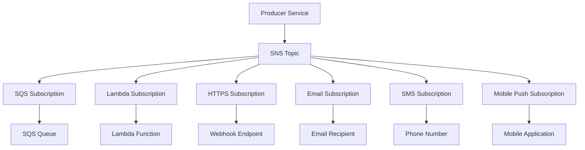
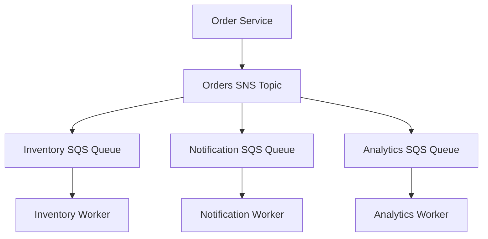
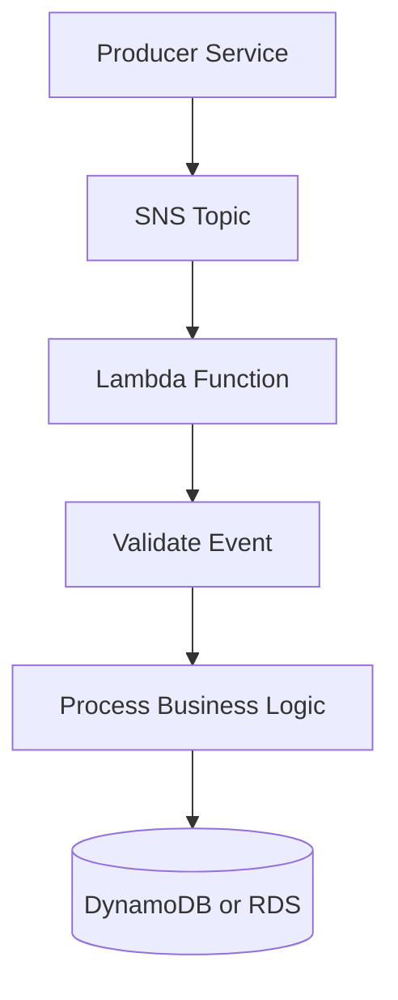
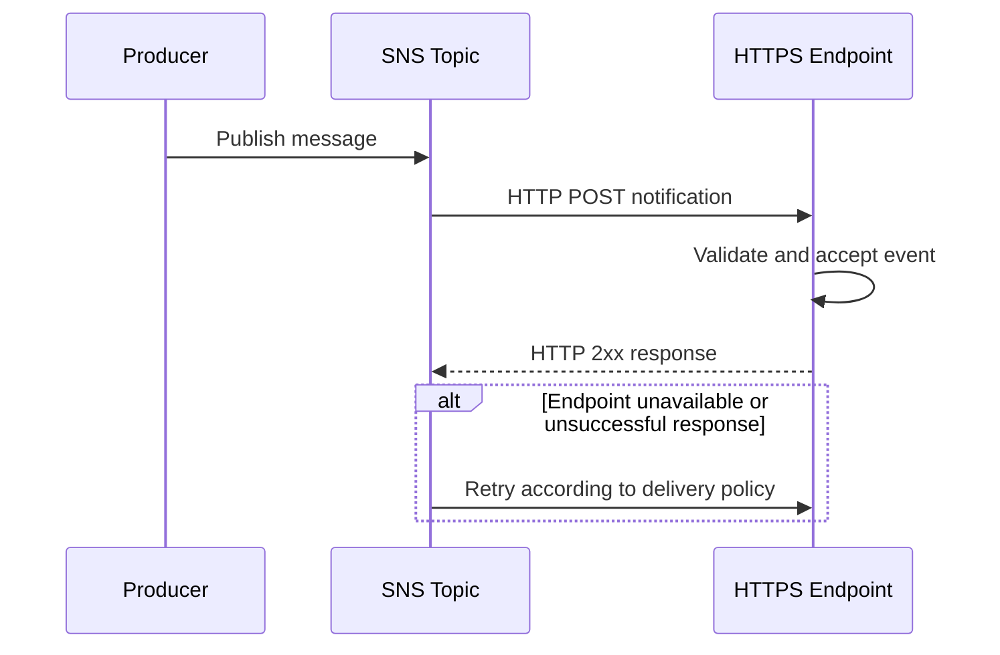
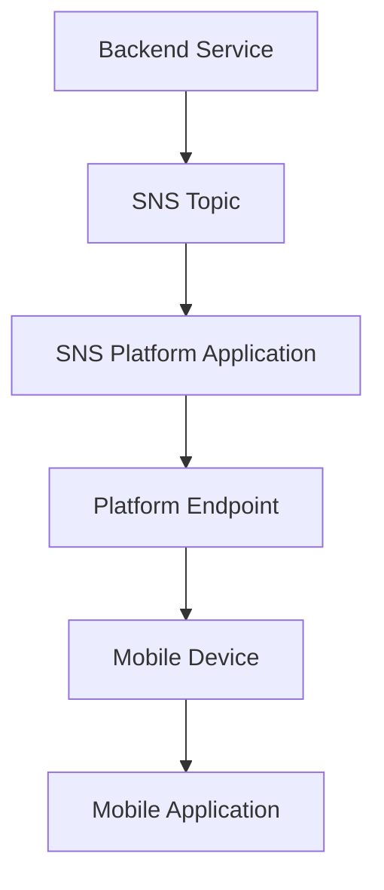
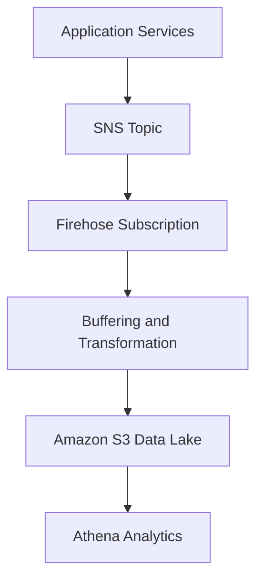

# 07- Subscription Protocols

## Overview

Amazon SNS supports multiple subscription protocols that determine how published messages are delivered to subscriber endpoints.

A subscription connects an SNS topic to a destination such as:

- Amazon SQS queues.
- AWS Lambda functions.
- HTTP/HTTPS endpoints.
- Email addresses.
- SMS phone numbers.
- Mobile push application endpoints.

The protocol defines the delivery mechanism, endpoint requirements, message representation, acknowledgment behavior, and operational characteristics.

Choosing the correct protocol is an architectural decision. For example, direct HTTP delivery may be suitable for lightweight webhook integrations, while SNS-to-SQS fan-out is generally more appropriate for independently scalable microservices that require buffering and controlled consumption.

## SNS Subscription Architecture

An SNS topic can have multiple subscriptions using different protocols.

Each subscription is independently configured and managed.



For example, an order service publishes an `order.created` event.

SNS can distribute that event to:

- An inventory SQS queue.
- A notification Lambda function.
- An external fulfillment HTTP endpoint.
- An operational email subscription.

The publisher does not need to know how these subscribers are implemented.

## Supported Subscription Protocols

SNS supports several subscription protocols, each designed for a different integration pattern.

| Protocol | Endpoint | Typical use case |
|---|---|---|
| `sqs` | Amazon SQS queue | Asynchronous microservice communication |
| `lambda` | AWS Lambda function | Event-driven serverless processing |
| `http` | HTTP endpoint | Webhook integration without TLS |
| `https` | HTTPS endpoint | Secure external service integration |
| `email` | Email address | Human-readable notifications |
| `email-json` | Email address | JSON-formatted email notifications |
| `sms` | Phone number | Text notifications |
| `application` | Mobile push application endpoint | Mobile push notifications |
| `firehose` | Amazon Data Firehose delivery stream | Streaming delivery to supported destinations |

Protocol availability depends on topic type and subscription configuration. For example, SNS FIFO topics support SQS subscriptions but do not directly support Lambda, HTTP/S, email, SMS, mobile push, or Firehose subscriptions.

## Amazon SQS Subscription

An SQS subscription connects an SNS topic to an SQS queue.

This is one of the most common SNS integration patterns for backend microservices.

SNS distributes messages to the queue, while the consumer retrieves and processes them independently.

### Architecture



### How It Works

1. A producer publishes a message to an SNS topic.
2. SNS evaluates the topic's subscriptions.
3. SNS sends the notification to each eligible SQS queue.
4. SQS stores the message.
5. A consumer polls its queue.
6. The consumer processes the message.
7. The consumer deletes the message after successful processing.

The queue provides buffering between SNS delivery and application processing.

### Why Use SNS with SQS?

- Consumers can process messages independently.
- Temporary consumer outages do not require the producer to remain available.
- Each consumer can scale independently.
- Queue retention and visibility timeout control processing behavior.
- Each queue can have its own DLQ and retry configuration.
- Consumer workloads can be distributed across multiple workers.

### Queue Policy Configuration

SNS must be permitted to send messages to the subscribed SQS queue.

Example queue resource policy:

```json
{
  "Version": "2012-10-17",
  "Statement": [
    {
      "Sid": "AllowOrdersTopic",
      "Effect": "Allow",
      "Principal": {
        "Service": "sns.amazonaws.com"
      },
      "Action": "sqs:SendMessage",
      "Resource": "arn:aws:sqs:ap-south-1:123456789012:inventory-queue",
      "Condition": {
        "ArnEquals": {
          "aws:SourceArn": "arn:aws:sns:ap-south-1:123456789012:orders-topic"
        }
      }
    }
  ]
}
```

Restricting `aws:SourceArn` prevents unrelated SNS topics from sending messages to the queue.

For cross-account subscriptions, configure the appropriate topic and queue resource policies and ensure the subscription is authorized.

### Creating an SQS Subscription

```bash
aws sns subscribe \
    --topic-arn arn:aws:sns:ap-south-1:123456789012:orders-topic \
    --protocol sqs \
    --notification-endpoint arn:aws:sqs:ap-south-1:123456789012:inventory-queue \
    --region ap-south-1
```

### Raw Message Delivery

By default, SNS wraps notifications in an SNS envelope before delivering them to SQS.

Raw message delivery removes this envelope and sends the original message body.

Enable it using:

```bash
aws sns set-subscription-attributes \
    --subscription-arn arn:aws:sns:ap-south-1:123456789012:orders-topic:subscription-id \
    --attribute-name RawMessageDelivery \
    --attribute-value true \
    --region ap-south-1
```

With raw delivery enabled, SNS delivers at most 10 message attributes to an SQS subscription. Messages exceeding this limit are treated as client-side delivery failures for that subscription.

Choose the delivery format deliberately because it changes the payload expected by consumers.

## AWS Lambda Subscription

An SNS Lambda subscription invokes a Lambda function when a message is published to the topic.

This pattern is useful for short-running, event-driven processing that does not require a continuously running worker.

### Architecture



### How It Works

1. A producer publishes a message.
2. SNS evaluates the Lambda subscription.
3. SNS invokes the Lambda function asynchronously.
4. Lambda executes the handler.
5. Lambda acknowledges successful execution through its asynchronous invocation lifecycle.
6. Failed executions are handled according to Lambda's asynchronous invocation retry and failure-destination configuration.

SNS invocation and Lambda execution are separate stages. SNS successfully invoking Lambda does not mean the business operation has completed.

### Lambda Permission

The Lambda function must allow SNS to invoke it.

Example:

```bash
aws lambda add-permission \
    --function-name order-event-processor \
    --statement-id allow-orders-topic \
    --action lambda:InvokeFunction \
    --principal sns.amazonaws.com \
    --source-arn arn:aws:sns:ap-south-1:123456789012:orders-topic \
    --region ap-south-1
```

This adds a resource-based permission scoped to the intended topic.

### Lambda Handler Example

```python
import json
import logging

logger = logging.getLogger(__name__)


def lambda_handler(event, context):
    for record in event.get("Records", []):
        sns_record = record["Sns"]
        message = json.loads(sns_record["Message"])

        logger.info(
            "Processing order event",
            extra={
                "sns_message_id": sns_record["MessageId"],
                "event_id": message["event_id"],
                "order_id": message["order_id"],
            },
        )

        process_order_event(message)

    return {"status": "success"}


def process_order_event(message: dict) -> None:
    pass
```

The handler receives an SNS event envelope containing the published message in `Records[].Sns.Message`.

### Operational Considerations

- Configure Lambda reserved concurrency to protect downstream systems.
- Monitor invocation errors, throttles, and duration.
- Implement idempotency because asynchronous processing can result in retries and duplicate execution.
- Configure Lambda failure destinations or an appropriate asynchronous failure-handling strategy.
- Keep processing within Lambda execution limits.
- Use SQS when durable buffering and explicit consumer-controlled polling are required.

A direct SNS-to-Lambda subscription is not supported for SNS FIFO topics. Use an SNS FIFO topic with an SQS FIFO subscription and a Lambda event source mapping when ordered processing is required.

## HTTP and HTTPS Subscriptions

HTTP and HTTPS subscriptions allow SNS to deliver notifications directly to web endpoints.

This is useful for:

- External webhook integrations.
- Partner systems.
- Internal services that expose webhook endpoints.
- Systems that cannot directly consume SQS.

HTTPS should be preferred for production integrations because it encrypts traffic in transit.

### Delivery Flow



SNS sends an HTTP POST request to the subscribed endpoint.

The endpoint must return a successful HTTP response to indicate that the notification was accepted.

### Subscription Confirmation

For HTTP/S subscriptions, SNS sends a subscription confirmation message to the endpoint.

The endpoint must process the confirmation request before SNS activates the subscription.

The confirmation message contains a confirmation token and a URL that can be used to confirm the subscription.

Do not blindly follow arbitrary URLs received through an HTTP request. Validate that the message is an authentic SNS notification before processing its confirmation information.

### FastAPI Webhook Example

```python
import json
import logging

from fastapi import FastAPI, HTTPException, Request

app = FastAPI()
logger = logging.getLogger(__name__)


@app.post("/webhooks/sns")
async def receive_sns_notification(request: Request):
    try:
        payload = await request.json()
    except ValueError as exc:
        raise HTTPException(
            status_code=400,
            detail="Invalid JSON payload",
        ) from exc

    message_type = payload.get("Type")

    if message_type == "Notification":
        message = json.loads(payload["Message"])

        logger.info(
            "SNS notification received",
            extra={
                "message_id": payload.get("MessageId"),
                "event_id": message.get("event_id"),
            },
        )

        await persist_event(message)

        return {"status": "accepted"}

    if message_type == "SubscriptionConfirmation":
        logger.info("SNS subscription confirmation received")
        return {"status": "confirmation_required"}

    return {"status": "ignored"}


async def persist_event(message: dict) -> None:
    pass
```

The example illustrates notification handling. A production endpoint must verify SNS message authenticity, validate the expected topic ARN, and implement the subscription confirmation workflow securely.

### Webhook Reliability

An HTTP endpoint should acknowledge a notification only after it has durably accepted responsibility for processing it.

A recommended architecture is:

1. Receive the SNS notification.
2. Verify its authenticity and expected topic.
3. Validate the event structure.
4. Persist the event or enqueue it internally.
5. Return a successful HTTP response.
6. Process the event asynchronously.

Avoid performing long-running business operations inside the webhook request.

If the endpoint returns an error or becomes unavailable, SNS can retry according to the configured delivery policy.

### HTTP/S Security

- Prefer HTTPS.
- Validate SNS signatures where required.
- Validate the expected topic ARN.
- Protect endpoints against unauthorized requests.
- Avoid accepting arbitrary confirmation URLs.
- Apply request-size limits.
- Use idempotency for duplicate notifications.
- Do not expose internal administrative endpoints as public subscriptions.

## Email Subscription

SNS can send notifications to email addresses.

Email subscriptions are appropriate for human-facing alerts rather than service-to-service event processing.

Typical use cases:

- Operational notifications.
- Deployment alerts.
- Monitoring notifications.
- Business event summaries.
- Administrative announcements.

### Creating an Email Subscription

```bash
aws sns subscribe \
    --topic-arn arn:aws:sns:ap-south-1:123456789012:system-alerts \
    --protocol email \
    --notification-endpoint ops@example.com \
    --region ap-south-1
```

The recipient receives a confirmation email. The subscription becomes active only after confirmation.

### Email-JSON Subscription

The `email-json` protocol sends a JSON-formatted notification rather than the standard human-readable email representation.

Example subscription:

```bash
aws sns subscribe \
    --topic-arn arn:aws:sns:ap-south-1:123456789012:system-alerts \
    --protocol email-json \
    --notification-endpoint ops@example.com \
    --region ap-south-1
```

Email delivery is not a reliable mechanism for application-level event processing.

Do not use email subscriptions as a replacement for SQS or Lambda consumers.

## SMS Subscription

SNS supports SMS notifications to phone numbers.

Typical use cases include:

- Critical operational alerts.
- Security notifications.
- Transactional notifications.
- Time-sensitive user communication.

Example:

```bash
aws sns publish \
    --phone-number +919876543210 \
    --message "Critical: Payment processing service is unavailable." \
    --region ap-south-1
```

A phone number can also be subscribed to a topic using the `sms` protocol.

```bash
aws sns subscribe \
    --topic-arn arn:aws:sns:ap-south-1:123456789012:critical-alerts \
    --protocol sms \
    --notification-endpoint +919876543210 \
    --region ap-south-1
```

SMS has country-specific regulations, sender requirements, delivery constraints, and pricing considerations.

Production systems should:

- Use SMS only for appropriate notification categories.
- Avoid sending sensitive information.
- Respect recipient consent and applicable regulations.
- Monitor delivery failures and spending.
- Configure account-level SMS spending limits.

SMS is not suitable for transporting application events between backend services.

## Mobile Push Subscription

SNS supports mobile push notifications through platform application endpoints.

Supported mobile push integrations include major push notification platforms such as:

- Firebase Cloud Messaging (FCM).
- Apple Push Notification service (APNs).
- Amazon Device Messaging, where supported by the relevant integration.

The integration uses an SNS platform application and endpoint objects.

### Architecture



The platform application stores the provider configuration. An endpoint represents a specific application installation or device token.

A mobile application typically registers its push token with the backend, which creates or updates the corresponding SNS endpoint.

### Operational Considerations

- Device tokens can expire or become invalid.
- Endpoint attributes must be updated when tokens change.
- Invalid endpoints should be disabled or refreshed.
- Push notifications can be delayed or dropped by platform services.
- Do not place confidential business information in notification payloads.
- Mobile clients should retrieve sensitive details through authenticated APIs.

Mobile push is intended for user notifications, not reliable backend event processing.

## Amazon Data Firehose Subscription

SNS supports the `firehose` subscription protocol for delivering notifications to an Amazon Data Firehose delivery stream.

This integration is useful when SNS events need to be delivered into an analytics or data-lake pipeline.

Typical destinations include:

- Amazon S3.
- Amazon Redshift through supported delivery configurations.
- OpenSearch Service through supported Firehose delivery configurations.
- Other supported Firehose destinations.

### Architecture



Firehose handles buffering, optional transformation, and delivery to its configured destination.

This pattern separates event publication from analytics ingestion.

### Considerations

- Configure the Firehose delivery stream and SNS subscription permissions.
- Monitor delivery failures and buffering behavior.
- Design event schemas for downstream analytics.
- Account for delivery latency and batching.
- Use S3 lifecycle policies for data retention.
- Avoid treating Firehose delivery as a synchronous business-processing acknowledgment.

## Subscription Protocol Comparison

Different protocols provide different operational characteristics.

| Capability | SQS | Lambda | HTTP/S | Email/SMS | Mobile Push | Firehose |
|---|---|---|---|---|---|---|
| Durable buffering | Yes, through SQS | No independent queue by default | No | No | No | Managed buffering |
| Consumer-controlled polling | Yes | No | No | No | No | No |
| Independent scaling | Yes | Lambda concurrency | Endpoint capacity | Managed delivery | Platform-dependent | Managed delivery |
| Business processing control | Consumer application | Lambda handler | Webhook application | Limited | Mobile application | Transformation pipeline |
| Typical use | Microservices | Serverless processing | Webhooks | Human alerts | Mobile notifications | Analytics ingestion |
| Direct FIFO topic support | Yes, FIFO SQS | No | No | No | No | No |

## Choosing the Right Subscription Protocol

Protocol selection should follow the application's delivery and processing requirements.

| Requirement | Recommended protocol |
|---|---|
| Independent microservice consumers | SQS |
| Durable buffering and controlled retries | SQS |
| Short-running serverless processing | Lambda |
| External webhook integration | HTTPS |
| Human-readable operational alerts | Email |
| Time-sensitive text notifications | SMS |
| Mobile application notifications | Mobile Push |
| Event ingestion into an analytics pipeline | Firehose |

For production microservices, SNS-to-SQS is generally a strong default when consumers require independent scaling, buffering, and explicit retry control.

Direct Lambda subscriptions are useful when the workload is serverless and its asynchronous invocation behavior meets the application's reliability requirements.

HTTP/S subscriptions are appropriate when integrating with external systems that expose webhook endpoints.

## Security Considerations

Each subscription protocol introduces different security requirements.

| Protocol | Security considerations |
|---|---|
| SQS | Queue resource policies, IAM, KMS permissions |
| Lambda | Lambda resource-based invocation permission |
| HTTP/S | HTTPS, signature validation, endpoint authentication |
| Email | Recipient confirmation and sensitive-data handling |
| SMS | Consent, regulatory requirements, spending controls |
| Mobile Push | Device token protection and minimal sensitive data |
| Firehose | IAM roles, destination permissions, encryption |

General recommendations:

- Apply least-privilege IAM permissions.
- Restrict topic publishing and subscription management.
- Use resource policies to control cross-service access.
- Encrypt sensitive data at rest and in transit.
- Avoid placing credentials or secrets in notification payloads.
- Validate incoming events at every consumer boundary.
- Maintain separate permissions for production and non-production topics.

## Monitoring and Operational Considerations

Monitor SNS delivery behavior independently from subscriber processing.

Useful SNS CloudWatch metrics include:

| Metric | Purpose |
|---|---|
| `NumberOfMessagesPublished` | Published message volume |
| `NumberOfNotificationsDelivered` | Successful endpoint delivery count |
| `NumberOfNotificationsFailed` | Failed notification delivery count |
| `NumberOfNotificationsFilteredOut` | Notifications excluded by filters |
| `PublishSize` | Published message size |

Also monitor destination-specific metrics.

Examples:

- SQS: visible messages, in-flight messages, oldest message age, and DLQ depth.
- Lambda: errors, throttles, duration, and concurrency.
- HTTP/S: endpoint response codes, latency, and availability.
- Firehose: delivery failures, throttling, and data freshness.

Enable SNS delivery status logging for supported protocols when detailed delivery diagnostics are required.

A successful SNS delivery should not be confused with successful business processing by the subscriber.

## Common Mistakes and Production Pitfalls

| Mistake | Why it is problematic | Recommended approach |
|---|---|---|
| Choosing HTTP instead of HTTPS | Exposes notifications to network interception | Prefer HTTPS |
| Forgetting SQS queue permissions | SNS cannot publish to the queue | Configure a scoped queue resource policy |
| Missing Lambda invocation permission | SNS cannot invoke the function | Add a resource-based Lambda permission |
| Treating email as a service integration | Email does not provide reliable application processing semantics | Use SQS or Lambda |
| Ignoring subscription confirmation | Subscription remains inactive | Confirm supported endpoints |
| Performing long processing inside webhooks | Increases timeout and retry risk | Persist and enqueue work quickly |
| Ignoring duplicate notifications | Can repeat business side effects | Implement idempotency |
| Assuming all protocols support FIFO | Several protocols are unsupported for FIFO topics | Validate topic and protocol compatibility |
| Confusing endpoint acceptance with business completion | Delivery success does not prove processing success | Track downstream processing independently |
| Ignoring mobile token expiration | Push notifications can stop reaching devices | Maintain endpoint token lifecycle |
| Using broad resource policies | Unintended services may publish or consume | Apply least privilege and source restrictions |

## Best Practices

- Use SQS subscriptions for independently scalable microservice consumers.
- Use Lambda subscriptions for suitable serverless workloads.
- Prefer HTTPS for webhook integrations.
- Confirm subscriptions that require endpoint verification.
- Configure endpoint permissions before enabling production traffic.
- Use subscription filtering to reduce unnecessary delivery.
- Configure delivery policies and DLQs according to endpoint failure behavior.
- Implement idempotency for subscribers that perform business operations.
- Monitor SNS delivery and downstream processing separately.
- Treat protocol and payload changes as integration contract changes.

## Key Takeaways

- SNS subscription protocols define how messages are delivered and determine endpoint-specific behavior, permissions, and operational requirements.
- SNS-to-SQS is well suited to asynchronous microservices because queues provide buffering, independent scaling, and consumer-controlled processing.
- Lambda and HTTP/S subscriptions support direct event-driven integrations but require protocol-specific failure handling and idempotency.
- Email, SMS, and mobile push are notification mechanisms, while Firehose supports analytics-oriented event delivery.
- Protocol selection must account for FIFO compatibility, acknowledgment semantics, security, retry behavior, and downstream processing requirements.